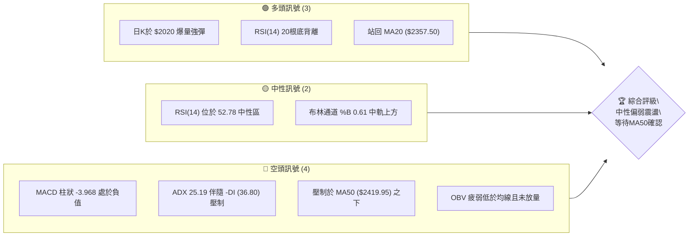
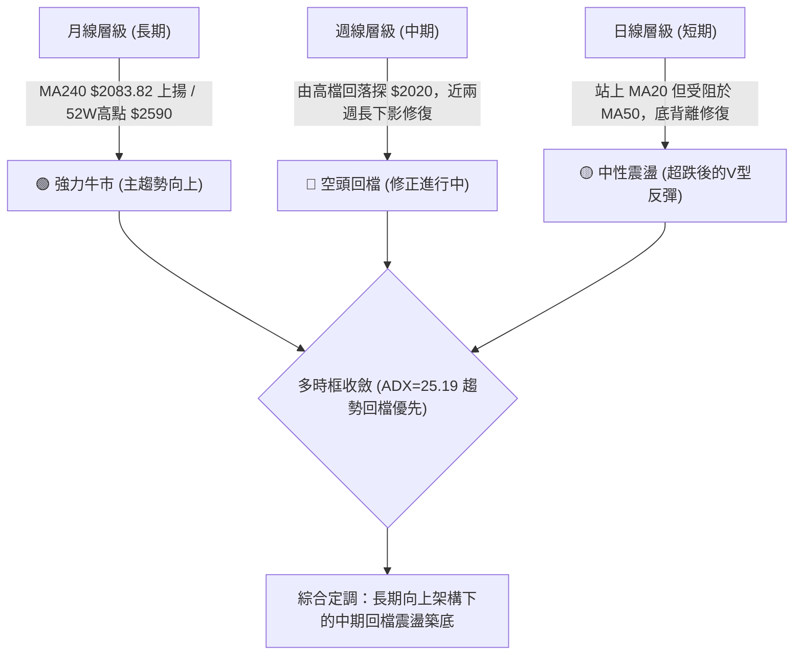
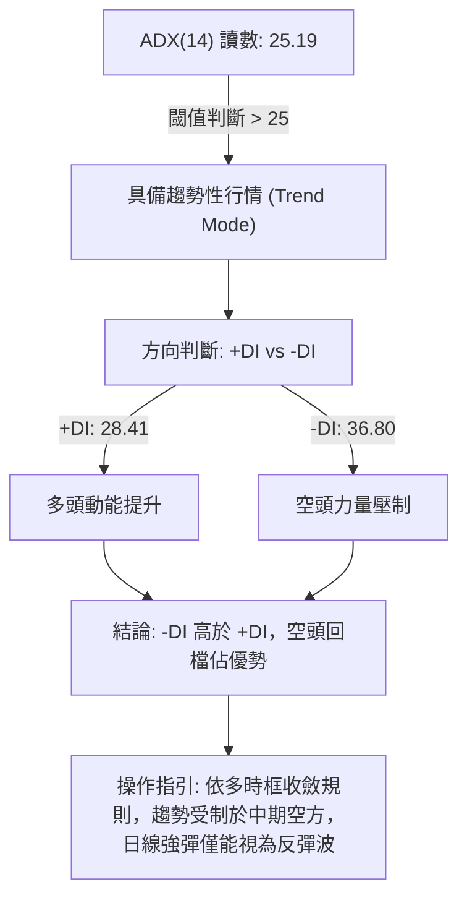
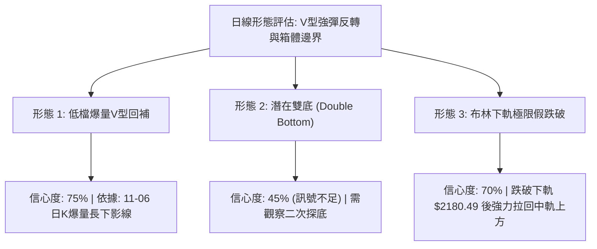
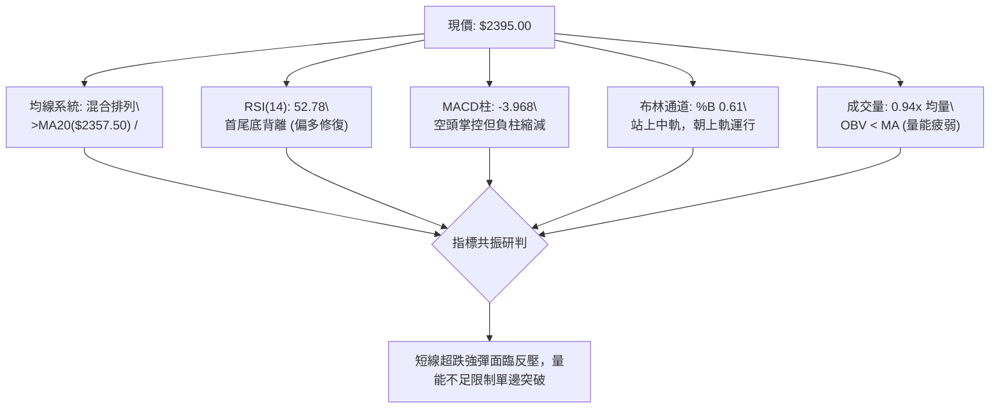
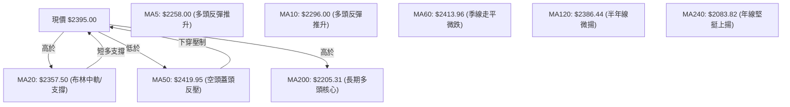
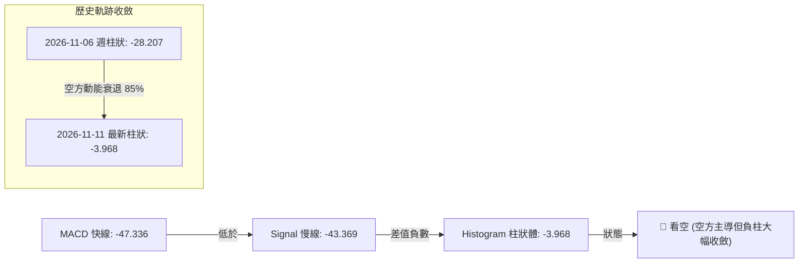
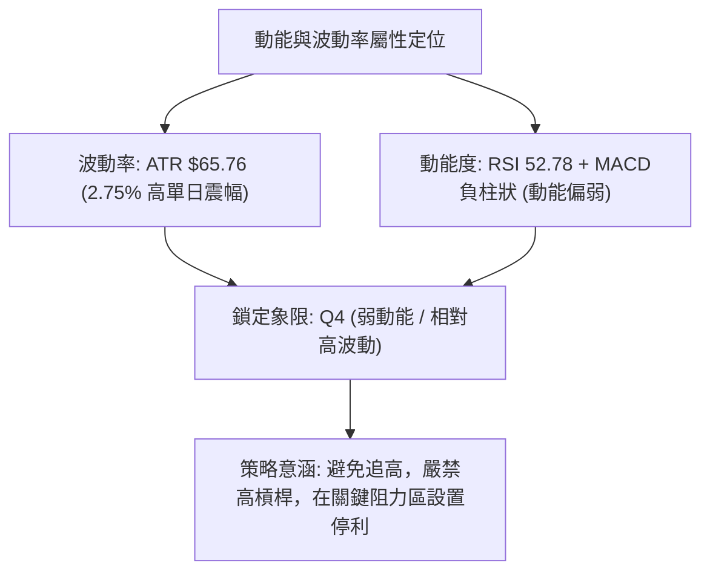
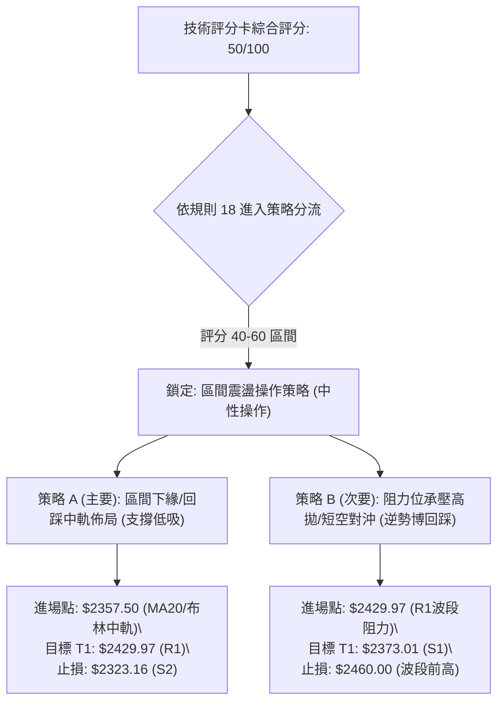
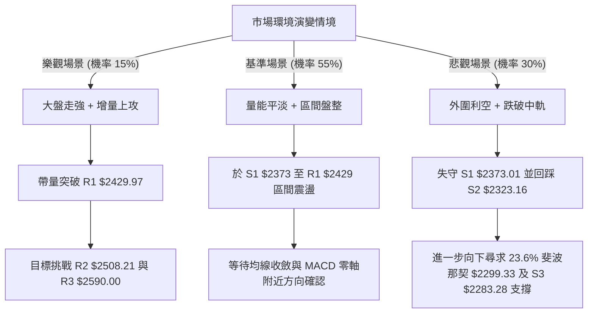

# 2330.TW 技術分析報告

> **報告日期**：2026-11-12 ｜ **語言**：繁體中文 ｜ **數據來源**：Yahoo Finance ｜ **當前價格**：$2395.00

---

## 目錄

| 章節 | 內容 |
|------|------|
| [1. 技術面概覽](#1-技術面概覽) | 訊號儀表板、核心指標、評分卡 |
| [2. 趨勢分析](#2-趨勢分析) | 多時框趨勢、長中短期走勢 |
| [3. 圖表形態分析](#3-圖表形態分析) | 形態識別、K線組合、目標價 |
| [4. 支撐與阻力](#4-支撐與阻力) | 關鍵價位、斐波那契回調 |
| [5. 技術指標深度解讀](#5-技術指標深度解讀) | MA/RSI/MACD/布林/成交量 |
| [6. 動能與波動率](#6-動能與波動率) | 動能評估、ATR、Beta |
| [7. 多時框架總結](#7-多時框架總結) | 時框架評分矩陣 |
| [8. 交易策略建議](#8-交易策略建議) | 多空策略、風險報酬比 |
| [9. 風險提示與監控](#9-風險提示與監控) | 監控指標、風險場景 |
| [報告總結](#-報告總結) | 核心結論與策略統整 |

---

## 1. 技術面概覽

### 🎯 技術訊號儀表板



### 📊 核心指標速覽表

| 指標類別 | 指標名稱 | 當前數值 | 訊號 | 解讀 |
|----------|----------|----------|:----:|------|
| **價格** | 當前收盤價 | $2395.00 | 🟡 | 位於52週區間 84.2%，自低檔強勁反彈但面臨短線多空分水嶺 |
| **均線** | MA20 | $2357.50 | 🟢 | 現價高於 MA20，短期均線修復並向上形成短支撐 |
| **均線** | MA50 | $2419.95 | 🔴 | 現價低於 MA50，中期下降壓力線仍具強大蓋頭反壓 |
| **均線** | MA200 | $2205.31 | 🟢 | 現價遠高於 MA200 (+8.60%)，長期多頭牛市基石未破 |
| **動能** | RSI(14) | 52.78 | 🟡 | 脫離超賣區重回 50 中軸上方，且近20根K棒首尾呈現底背離 |
| **動能** | MACD Hist | -3.968 | 🔴 | MACD線 (-47.336) 低於訊號線 (-43.369)，負柱狀雖收斂但空方掌控 |
| **趨勢** | ADX(14) | 25.19 | 🔴 | ADX>25 顯示趨勢存在，但 -DI (36.80) > +DI (28.41) 指向空頭波段 |
| **波動** | ATR(14) | $65.76 | 🟡 | 每日平均震幅約 2.75%，波動率維持在中等水準，具避險緩衝要求 |
| **量能** | 成交量比 | 0.94x | 🔴 | 今日量 30,510,771 股低於 20日均量 32,428,876，OBV < MA 量能不足 |

### 🏆 技術評分卡

```
╔══════════════════════════════════════════════════════════════╗
║               技術評分卡 — 2330.TW (2026-11-12)              ║
╠══════════════════════════════════════════════════════════════╣
║ 趨勢強度 (ADX=25.19, -DI佔優)  ████████░░░░░░░░░░░░  40/100 🔴║
║ 動能指標 (RSI底背離 vs MACD負) ██████████░░░░░░░░░░  50/100 🟡║
║ 支撐穩定度 (S1-S3防守強韌)     ██████████████░░░░░░  70/100 🟢║
║ 成交量配合 (量縮反彈, OBV疲弱) ████████░░░░░░░░░░░░  40/100 🔴║
║ 形態完整度 (V型強彈但未過頸線) ██████████░░░░░░░░░░  50/100 🟡║
║ 均線排列 (短強中弱長多混合)    ██████████░░░░░░░░░░  50/100 🟡║
╠══════════════════════════════════════════════════════════════╣
║ 綜合評分 (六項算術平均四捨五入) ██████████░░░░░░░░░░  50/100 🟡║
║ 評級結論：中性觀望 (40–60區間)，以布林通道與關鍵支撐阻力為主 ║
╚══════════════════════════════════════════════════════════════╝
```

---

## 2. 趨勢分析

### 🌐 多時框趨勢分析



### 📈 長期趨勢 — 12個月走勢圖（Unicode）

```
2330.TW 月線收盤走勢圖（2025-12 至 2026-11）
價格軸 ($)
$2500 ┤                                              ●(2026-09 $2480.00)
      │                                       ●    ●
$2400 ┤                                 ●─●     ●   ●←當前(2026-11 $2395.00)
      │                            ●
$2200 ┤                       ●
      │                  ●
$2000 ┤             ●
      │        ●
$1800 ┤   ●
      │ ●
$1500 ┤●(2025-12 $1536.33)
      └────────────────────────────────────────────────────────────────
        12   01   02   03   04   05   06   07   08   09   10   11 (月份)
```

#### 長期月線特徵分析表

| 階段區間 | 起訖月份 | 收盤價變化 | 漲跌幅 | 技術特徵與量價解讀 |
|:---------|:---------|:-----------|:-------|:-------------------|
| **主升攻擊段** | 2025-12 → 2026-02 | $1536.33 → $1977.40 | +28.71% | 連續大陽線突破，均線全面多頭發散，單邊多頭行情 |
| **強勢洗盤段** | 2026-02 → 2026-03 | $1977.40 → $1750.17 | -11.49% | 急跌回測均線支撐，清洗浮額後迅速回升 |
| **擴展拉升段** | 2026-03 → 2026-05 | $1750.17 → $2341.84 | +33.81% | 趨勢再度發力，連續突破兩千元整數關卡，建立長多核心 |
| **高檔高原期** | 2026-05 → 2026-09 | $2341.84 → $2480.00 | +5.90%  | 價格於 $2400 關卡反覆築頂，月K柱實體縮小，動能衰竭 |
| **高檔回撤段** | 2026-09 → 2026-11 | $2480.00 → $2395.00 | -3.43%  | 10月收跌至 $2370.00，11月探低 $2020 後反彈收 $2395.00 |

### 📊 中期趨勢（週線分析）

```
2330.TW 中期週線支撐阻力結構圖
價格 ($)
$2590.00 ──────── 52W 高點 (2026-10-08 週高點) ══════════════ [R3 強阻力]
                  │
$2508.21 ──────── 波段反彈高點聚類 ───────────────────────── [R2 阻力]
                  │
$2429.97 ──────── 近期回測反彈頸線 ───────────────────────── [R1 阻力]
         ▲
$2395.00 ┼─────── 當前收盤價 ($2395.00)
         ▼
$2373.01 ──────── 波段低點聚類防守 ───────────────────────── [S1 支撐]
                  │
$2323.16 ──────── 近期反覆確認低點 ───────────────────────── [S2 強支撐]
                  │
$2283.28 ──────── 7月及前次回檔低點 ───────────────────────── [S3 關鍵底線]
                  │
$2020.00 ──────── 2026-11-06 週K插針極限低點 (深打支撐帶)
```

週線層級顯示，自 2026-10-08 創下 $2590.00 歷史高點後，週線 MACD 柱狀連續翻負（2026-10-16 週達 -13.696，2026-11-06 擴大至 -28.207），確認中期進入修正循環。然而，2026-11-06 週爆出 250,878,329 股歷史級巨量，最低打至 $2020.00 後收於 $2135.00，次週（至 11-11）續彈收於 $2395.00，週K線形成帶長下影線的強力防守型態，中期殺跌動能已獲大幅宣洩。

### ⚡ 趨勢強度評估（ADX 解讀）



#### ADX 趨勢強度對照表

| 指標名稱 | 數值 | 狀態 | 意涵與操作含義 |
|:---------|:-----|:----:|:---------------|
| **ADX(14)** | 25.19 | 強趨勢 (臨界值>25) | 市場處於明確趨勢推動中，擺脫低波動無方向之盤整。 |
| **+DI** | 28.41 | 多方動能 | 較低檔顯著回升，顯示短線自 $2020 買盤強勢介入。 |
| **-DI** | 36.80 | 空方主導 | 空方數值仍明顯高於多方，趨勢回檔結構尚未全面翻多逆轉。 |
| **趨勢綜合判斷** | 空方主導趨勢 | 🟡 謹慎 | 趨勢強度剛剛突破 25，由於空方力量仍大於多方，反彈遇阻力易再度引發震盪。 |

---

## 3. 圖表形態分析

### 🔍 形態識別系統



#### 圖表形態評估表

| 形態類別 | 信心度 | 判斷依據（引用數據） | 完成度 | 目標價（附計算式） |
|:---------|:------:|:---------------------|:------:|:-------------------|
| **V型爆量反彈** | 75% | 2026-11-06 低點 $2020.00 爆量 97,176,862 股收長下影，連三日陽線拉升至 $2395.00 | 85% | 由形態突破點 $2285 推算幅度：$2285 + ($2285 - $2020) = $2550.00；但受限阻力，第一目標看阻力位 R1 $2429.97 |
| **潛在雙底形態** | 45% | 數據中僅偵測到單一低點 $2020.00 與前波低點聚類 S3 $2283.28，尚未出現第二隻確認腳 | 25% | 訊號不足，僅做指標型解讀（未確認第二底前不得預設雙底成立） |
| **布林極限乖離修復** | 70% | 價格急跌貫穿 BB 下軌 ($2180.49) 至 $2020.00，隨後快速拉回站上 BB 中軌 ($2357.50) | 100% | 均值回歸目標為中軌 $2357.50 (已達成)，延伸目標為布林上軌 $2534.51 |

### 🕯️ 重要K線形態分析

依據資料集「近10根日K」與「近8根週K」之精確 OHLCV 數據進行專業識別：

#### 近10根日K形態精確分析

| 日期 | 開盤價 | 最高價 | 最低價 | 收盤價 | 成交量 (股) | K線形態名稱 | 專業解讀 | 訊號 |
|:-----|:-------|:-------|:-------|:-------|:------------|:------------|:---------|:----:|
| **10-29** | 2420.00 | 2425.00 | 2390.00 | 2415.00 | 16,872,114 | 小陰十字線 | 高檔量縮盤整，多空僵持於高檔 | 🟡 |
| **10-30** | 2380.00 | 2380.00 | 2360.00 | 2370.00 | 29,664,858 | 破位跳空小中陰 | 開盤即高點，跌破前日低點，空方發力 | 🔴 |
| **11-02** | 2310.00 | 2345.00 | 2310.00 | 2330.00 | 34,382,586 | 震盪反彈小中陽 | 開平走高收陽，但反彈未及前陰實體半數 | 🟡 |
| **11-03** | 2300.00 | 2335.00 | 2280.00 | 2295.00 | 36,998,754 | 帶上下影陰線 | 跌破 $2300 關卡，賣壓逐步增強 | 🔴 |
| **11-04** | 2320.00 | 2320.00 | 2235.00 | 2260.00 | 45,456,849 | 開高走低實體中陰 | 開盤最高直接宣洩賣壓，放量下殺收低 | 🔴 |
| **11-05** | 2250.00 | 2285.00 | 2235.00 | 2240.00 | 36,863,278 | 低檔下飄小陰線 | 空方延續貫壓，實體受限於低檔支撐前 | 🔴 |
| **11-06** | 2020.00 | 2195.00 | 2020.00 | 2135.00 | 97,176,862 | 巨量深低長下影陽線 | 恐慌開盤低打 $2020 後爆出 9700萬股歷史巨量收復百點，典型拋售力竭底點 | 🟢 |
| **11-09** | 2210.00 | 2290.00 | 2190.00 | 2235.00 | 41,529,425 | 跳空高開孕線中陽 | 跳空確認下影低點有效，買盤持續消化拋壓 | 🟢 |
| **11-10** | 2265.00 | 2285.00 | 2230.00 | 2285.00 | 34,242,582 | 階梯式推升小陽線 | 低點抬高至 $2230，緩步攻堅消化解套盤 | 🟢 |
| **11-11** | 2330.00 | 2395.00 | 2305.00 | 2395.00 | 30,510,771 | 光頭強勢大陽線 | 收盤價即最高價 $2395，一舉跨過 MA20，日線V型反轉格局確立 | 🟢 |

#### 近8根週K形態精確分析

| 週最後日 | 開盤價 | 最高價 | 最低價 | 收盤價 | 成交量 (股) | 週K形態名稱 | 專業解讀 | 訊號 |
|:---------|:-------|:-------|:-------|:-------|:------------|:------------|:---------|:----:|
| **09-24** | 2445.00 | 2510.00 | 2445.00 | 2475.00 | 66,944,987 | 多頭進攻週中陽 | 開盤即最低，週線多頭趨勢延伸 | 🟢 |
| **10-02** | 2475.00 | 2515.00 | 2475.00 | 2500.00 | 87,707,137 | 高檔蓄勢小陽線 | 突破 $2500 大關，成交量溫和放大 | 🟢 |
| **10-08** | 2550.00 | 2590.00 | 2545.00 | 2550.00 | 77,343,774 | 衝頂長上影流星陰十字 | 創 52W 高點 $2590 後大幅回落，高檔滯銷信號 | 🔴 |
| **10-16** | 2510.00 | 2550.00 | 2420.00 | 2420.00 | 160,006,325 | 爆量長陰吞噬破位棒 | 巨量跌破前四週平台，確認波段高點成立 | 🔴 |
| **10-23** | 2395.00 | 2435.00 | 2385.00 | 2385.00 | 86,048,332 | 空頭走跌中陰線 | 延續修正，低點打至 $2385，未見抵抗 | 🔴 |
| **10-30** | 2380.00 | 2430.00 | 2360.00 | 2370.00 | 100,381,767 | 帶上影弱勢小陰線 | 反抽 $2430 無力後回跌，空方完全控盤 | 🔴 |
| **11-06** | 2310.00 | 2345.00 | 2020.00 | 2135.00 | 250,878,329 | 破底爆量長下影鐵錘線 | 週爆 2.5億股驚人承接量，下影線長達 $115，終結單邊下殺 | 🟢 |
| **11-11** | 2210.00 | 2395.00 | 2190.00 | 2395.00 | 106,282,778 | 週線長身光頭大陽線 | 收復前週跌幅 70% 以上，以最高點作收，確認中期止跌 | 🟢 |

### 📉 ASCII 走勢形態示意圖

```
2330.TW 日K線低檔反轉走勢示意圖（2026-10-29 至 2026-11-11）
價格 ($)
$2420 ┼  [10-29] 
$2380 ┼           [10-30]                                   [11-11] ─── $2395 (現價/收最高)
$2340 ┼                    [11-02]                                  ┌─┐
$2300 ┼                             [11-03]                 ┌─┐     │ │
$2260 ┼                                      [11-04] ┌─┐    │ │     │ │
$2220 ┼                                              │ │    │ │     │ │
$2180 ┼                                              │ │    │ │     │ │
$2140 ┼                                      [11-06] └─┘    └─┘     └─┘
$2100 ┼                                      ┌─────┐ [11-09] [11-10] [11-11]
$2060 ┼                                      │     │  (連續紅K反彈波)
$2020 ┼                                      └──┬──┘
      │                                          │ (爆量 9717 萬股插針最低點 $2020.00)
      └──────────────────────────────────────────┴─────────────────────────
```

### 🎯 形態目標價計算

根據 2026-11-06 至 2026-11-11 所構築之日線底背離爆量 V 型反轉結構：
1. **反轉基底低點**：$2020.00（2026-11-06 最低點）
2. **反轉頸線樞軸**：以跌破加速點 2026-11-03 低點聚類及日K收盤點 $2285.00 為短線頸線基點。
3. **形態推算高度**：頸線價位 $2285.00 − 反轉低點 $2020.00 = $265.00。
4. **標準等距測幅目標**：頸線突破價 $2285.00 + 形態高度 $265.00 = **$2550.00**（明確標注：由爆量反轉形態推算）。
5. **階段性波段阻力收斂**：在向上邁向測幅目標 $2550.00 過程中，必須優先消化近一年波段高點聚類阻力位：
   - 第一阻力關卡：**R1 $2429.97**（亦與 MA50 $2419.95 重合）
   - 第二阻力關卡：**R2 $2508.21**
   - 形態最終極限：**R3 $2590.00**（52週歷史高點）

---

## 4. 支撐與阻力

### 🗺️ 關鍵價位分布圖（Unicode）

```
2330.TW 價位結構分布圖
═══════════════════════════════════════════════════
$2590.00 ║████████████████████████║ 強阻力 R3 (52W歷史最高點 / 0.0% Fib)
$2508.21 ║████████████████████    ║ 阻力 R2 (近一年波段高點聚類)
$2429.97 ║████████████████████████║ 關鍵阻力 R1 (波段高點聚類 / 鄰近 MA50)
$2395.00 ╠════════════════════════╣ ◄ 當前收盤價 ($2395.00)
$2373.01 ║▓▓▓▓▓▓▓▓▓▓▓▓▓▓▓▓        ║ 近期支撐 S1 (近一年波段低點聚類)
$2323.16 ║████████████████████    ║ 密集支撐 S2 (波段回踩密集成交區)
$2299.33 ║▓▓▓▓▓▓▓▓▓▓▓▓▓▓▓▓▓▓▓▓▓▓  ║ 23.6% 斐波那契回調關鍵位
$2283.28 ║████████████████████████║ 強支撐 S3 (7月波段極限低點聚類)
═══════════════════════════════════════════════════
```

### 🚧 阻力位分析表

所有價位均嚴格引用 OHLCV 計算所得之關鍵價位：

| 阻力級別 | 價位 | 距現價幅動 | 形成原因（歷史依據） | 突破難度 | 重要性 |
|:---------|:----:|:----------:|:---------------------|:--------:|:------:|
| **R1** | **$2429.97** | +1.46% | 近一年波段高點聚類，且與下彎之 MA50 ($2419.95) 高度共振重疊 | 🟡 中等 | ★★★★☆ |
| **R2** | **$2508.21** | +4.73% | 近一年次高波段聚類，10月初起跌平台密集成交套牢區 | 🔴 極高 | ★★★★☆ |
| **R3** | **$2590.00** | +8.14% | 52週歷史最高點（2026-10-08 衝頂回落點），斐波那契 0.0% 起算點 | 🔴 巨大 | ★★★★★ |

### 🛡️ 支撐位分析表

所有價位均嚴格引用 OHLCV 計算所得之關鍵價位：

| 支撐級別 | 價位 | 距現價幅動 | 形成原因（歷史依據） | 守住機率 | 重要性 |
|:---------|:----:|:----------:|:---------------------|:--------:|:------:|
| **S1** | **$2373.01** | -0.92% | 近一年波段低點聚類，與布林中軌 / MA20 ($2357.50) 形成密集緩衝 | 🟢 80% | ★★★★☆ |
| **S2** | **$2323.16** | -3.00% | 11月上旬整理平台低點聚類，短線籌碼沉澱關鍵轉換樞軸 | 🟢 70% | ★★★☆☆ |
| **S3** | **$2283.28** | -4.66% | 2026-07-17 週低點 ($2283.28) 聚類，長期多頭強防守底線 | 🟢 85% | ★★★★★ |

### 📐 斐波那契回調位分析

依據 52週波動區間：**$1358.34（52W Low） → $2590.00（52W High）**，計算標準回調階梯：

```
斐波那契回調階梯與現價位階
$2590.00 ├────── 0.0% (52W High)
         │
$2395.00 ┼────── ◄ 當前收盤價 ($2395.00，處於 0.0% 至 23.6% 強勢區間)
         │
$2299.33 ├────── 23.6% 回調位 (第一級強勢防守位)
         │
$2119.51 ├────── 38.2% 回調位 (中期多空分水嶺，11-06低點 $2020 短暫破後迅速收復)
         │
$1974.17 ├────── 50.0% 回調位 (長期多頭強支撐)
         │
$1828.84 ├────── 61.8% 回調位 (黃金分割生命線)
         │
$1621.92 ├────── 78.6% 回調位
         │
$1358.34 └────── 100.0% (52W Low)
```

#### 斐波那契深度解讀
當前收盤價 $2395.00 精確落於 **0.0% ($2590.00)** 與 **23.6% ($2299.33)** 之間。在技術分析理論中，資產經歷大波段上漲後回調，若能維持在 23.6% 回調位上方運行，代表整體長期走勢處於「極度強勢回檔」結構。雖然日前一度在恐慌情緒下插針至 38.2% ($2119.51) 下方探 $2020.00，但僅維持數小時即被爆量接走，收盤迅速重返 23.6% ($2299.33) 之上，顯示牛市主結構之韌性極強。

---

## 5. 技術指標深度解讀

### 🎛️ 指標訊號總覽



### 📈 移動平均線排列分析



#### 均線架構細節清單

| 週期均線 | 當前價位 | 現價相對位置 | 乖離率 (%) | 均線走勢圖形特徵 | 訊號意涵 |
|:---------|:--------:|:------------:|:----------:|:-----------------|:--------:|
| **MA 5** | $2258.00 | 價格於上方 | +6.07% | ▆▆▇▇▇██████▇▆▆▅▅▅▅▅▅▅▅▄▄▃▂▁▁▁▁ | 短期極速拐頭向上，短多動能充沛 |
| **MA 10** | $2296.00 | 價格於上方 | +4.31% | ▅▆▆▇▇█████████▇▇▆▅▅▅▄▄▄▃▃▂▂▁▁▁ | 扣抵低值快速抬升，助漲支撐顯現 |
| **MA 20** | $2357.50 | 價格於上方 | +1.59% | ▅▅▅▆▆▇▇▇███████████▇▇▇▆▆▅▄▂▂▁▁ | 成功收復月線，短期轉為防守支撐 |
| **MA 50** | $2419.95 | 價格於下方 | -1.03% | 數據記載下彎壓制，形成空頭反壓線 | 中期分水嶺，未突破前中期偏空 |
| **MA 60** | $2413.96 | 價格於下方 | -0.79% | ▁▁▁▁▂▂▃▄▄▄▅▅▆▆▆▆▆▇▇██████▇▆▆▅▅ | 季線高檔下彎，與 MA50 形成雙重夾擊 |
| **MA120** | $2386.44 | 價格於上方 | +0.36% | ▁▁▂▂▃▃▄▄▅▅▆▆▇▇▇▇▇█████████████ | 半年線微幅走揚，多空分界樞紐 |
| **MA200** | $2205.31 | 價格於上方 | +8.60% | 向上發散，長期牛市主線結構穩健 | 長線多頭生命線，基石牢固 |
| **MA240** | $2083.82 | 價格於上方 | +14.93%| ▁▁▁▁▂▂▂▃▃▃▄▄▄▅▅▅▅▆▆▆▆▇▇▇▇█████ | 年線長多斜率極陡，超級長多支撐 |

**均線排列總結**：當前均線系統呈現「短期偏多、中期受壓、長期大牛」的**混合排列**。現價已突破 MA20 ($2357.50) 與 MA120 ($2386.44)，但緊臨上方受限於 MA50 ($2419.95) 與 MA60 ($2413.96) 的蓋頭死叉壓力。

### 📉 RSI(14) 分析

- **當前讀數**：**52.78** (Wilder計算標準)，處於 30 至 70 之黃金中性區間。
- **指標進度條**：
  ```
  超賣 [0] ────────────── [30] ────── [50] ────── [70] ────────────── [100] 超買
  RSI(14) = 52.78:  ██████████░░░░░░░░░░ (52.8%) — 中性平衡
  ```
- **背離分析**：系統偵測提示 **⚠️ 底背離 (Bullish Divergence)**。
  - **具體依據**：近20根日K棒首尾對比，價格在 10月下旬至 11月06日創出波段恐慌新低 $2020.00，但日線 RSI(14) 在回踩極限超賣區後迅速向上拉抬，並在首尾比較中呈現指標低點抬高、領先價格向上突破 50 中軸，此底背離訊號強力支撐了近三日的連續反彈。

### 📊 MACD(12/26/9) 訊號解讀



- **MACD快線**：-47.336 ｜ **訊號線**：-43.369 ｜ **柱狀體**：-3.968。
- **深度研判**：
  1. 快線與慢線雙雙落於零軸下方甚遠處，說明中期市場仍由空頭勢力所錨定。
  2. 然而，柱狀體已由前週極度惡化的 -28.207 急速收縮至 **-3.968**，顯示空方動能已產生枯竭現象，多方正在低檔建立初步抵抗，即將挑戰金叉翻正。
  3. 隨機指標 Stoch %K (90.36) 與 %D (68.67) 已衝入短期超買區，暗示此波直線性修復在觸及 MA50 前恐面臨技術性回踩。

### 📦 布林通道分析

```
2330.TW 日線布林通道示意圖
價格 ($)
$2534.51 ┼──────────────────────────────── 上軌 (Upper Band)
         │
         │
$2395.00 ┼─────────────────── ◄ 現價 ($2395.00, %B = 0.61)
         │
$2357.50 ┼──────────────────────────────── 中軌 / MA20 (Middle Band)
         │
         │
$2180.49 ┼──────────────────────────────── 下軌 (Lower Band)
```

- **布林通道帶寬參數**：
  - 上軌：**$2534.51**
  - 中軌 (MA20)：**$2357.50**
  - 下軌：**$2180.49**
  - **帶寬極差**：$2534.51 − $2180.49 = $354.02（佔價格 14.78%，帶寬適中擴散）
  - **當前 %B 數值**：**0.61**（0=下軌，0.5=中軌，1=上軌）
- **通道行為判讀**：現價在 11-06 跌破下軌 ($2180.49) 引發極限乖離回抽，目前已強勢穿過中軌 ($2357.50)，%B 來到 0.61，正式進入「中軌至上軌」的多方修復通道中，布林中軌 $2357.50 轉化為回踩首要支撐。

### 💹 成交量分析（量價配合度）

```
量能指標進度條與對比
最新成交量  (30,510,771 股): ████████████░░░░░░░░  (量比: 0.94x 20MA)
20日均量    (32,428,876 股): █████████████░░░░░░░
50日均量    (24,799,446 股): ██████████░░░░░░░░░░
```

- **量價現況解讀**：
  1. 今日（11-11）大陽線收於最高 $2395.00，成交量為 30,510,771 股，略低於 20日均量（量比 0.94x），高於 50日均量。
  2. 相較於 11-06 恐慌性落底時爆發的 97,176,862 股，近三日反彈量能呈現遞減（4152萬 → 3424萬 → 3051萬股），呈現標準的**「價漲量縮」**背離狀態。
  3. **OBV 趨勢評估**：數據明確提示 **OBV < MA → 量能疲弱**。量能未能持續放大，說明買盤主力主要源於空頭平倉回補與惜售心態，缺乏場外增量資金大規模追價，這將使得即將到來的 R1 ($2429.97) 及 MA50 ($2419.95) 解套賣壓更形沉重。

---

## 6. 動能與波動率

### ⚡ 動能評估四象限

| 象限 | 動能強度 | 波動率水準 | 當前狀態標記 | 專業評估與作戰意涵 |
|:-----|:--------:|:----------:|:------------:|:-------------------|
| **第一象限 (Q1)** | 強動能 | 低波動 | — | 最佳波段主升機會（低風險單邊推升） |
| **第二象限 (Q2)** | 弱動能 | 低波動 | — | 沉悶牛皮整理，觀望等待方向打破 |
| **第三象限 (Q3)** | 強動能 | 高波動 | — | 主跌加速或狂暴噴出，高風險高收益 |
| **第四象限 (Q4)** | **弱動能** | **高波動** | **✓ 當前狀態** | **短線暴起暴落但趨勢動能未轉多；急彈易遭高位壓制，宜保守分批因應** |



### 📊 ATR 波動率分析

- **ATR(14) 讀數**：**$65.76** (佔現價 2.75%，採 Wilder 平滑算法)。
- **歷史波動水準分析**：$65.76 的單日平均波動意味著台積電每日正常震盪區間接近 65 至 70 元 TWD，在近一年中處於較高波動水準。
- **風控與止損距離設定建議**：
  - **日內交易緩衝**：以 0.5 × ATR = **$32.88** 為日內無效波動過濾閥。
  - **波段短線止損**：以 1.0 × ATR = **$65.76** 作為緊密止損距離。
  - **波段常規止損**：以 1.5 × ATR = **$98.64** 作為標準安全止損距離。
  - **長線寬鬆止損**：以 2.0 × ATR = **$131.52** 防範極端插針假跌破。

### 📐 Beta 與市場相關性

- **Beta 係數**：**1.233**。
- **解讀與意涵**：
  - 台積電相對於台灣加權指數（大盤）具備顯著的高敏感度（Beta > 1.2）。當台股大盤波動 1.0% 時，台積電平均波動約 1.233%。
  - 在大盤處於反彈或多頭結構時，該股具備超額阿爾法 (Alpha) 放大效應；但在系統性回調期間，其波動風險亦大於一般大型防禦股。

---

## 7. 多時框架總結

### 📋 時框架評分表

| 時框架 | 趨勢方向 | 動能狀態 | 均線排列特徵 | 形態架構 | 綜合評分 | 操作建議方向 |
|:-------|:---------|:---------|:-------------|:---------|:--------:|:-------------|
| **月線 (長期)** | 🟢 多頭推升 | 🟢 充沛 | MA240 ($2083.82) 陡峭上揚，多頭未破 | 高檔整理平台 ($2370-$2480) | 80/100 | 長期投資者底倉續抱 |
| **週線 (中期)** | 🔴 空頭回檔 | 🔴 疲弱 | MACD 負柱狀，自 $2590 回撤至 $2020 | 探底帶長下影錘頭反彈 | 40/100 | 中期波段減碼反抽防守 |
| **日線 (短期)** | 🟡 震盪反彈 | 🟡 中性 | 收復 MA20 ($2357.50)，承壓 MA50 | V型強彈遭遇 R1 密集阻力區 | 50/100 | 區間高出低進，切勿追高 |

### 🔲 綜合訊號矩陣

```
┌────────────────────────────────────────────────────────────────────────┐
│                      2330.TW 多時框訊號一致性矩陣                      │
├─────────────┬─────────────────┬─────────────────┬──────────────────────┤
│ 維度指標    │ 短期 (日線)     │ 中期 (週線)     │ 長期 (月線)          │
├─────────────┼─────────────────┼─────────────────┼──────────────────────┤
│ 均線系統    │ 🟢 突破 MA20    │ 🔴 跌破 短期週均│ 🟢 遠高於 MA200/240  │
│ 動能系統    │ 🟢 RSI底背離    │ 🔴 MACD負柱發散 │ 🟢 長期RSI高位強勢   │
│ 形態軌跡    │ 🟢 三連陽強彈   │ 🟡 長下影探底棒 │ 🟡 高檔箱體劇震      │
│ 量能配合    │ 🔴 量縮背離     │ 🟢 底部爆巨量   │ 🟢 總體沉澱良好      │
├─────────────┼─────────────────┼─────────────────┼──────────────────────┤
│ 最終收斂    │ 🟡 中性偏多修復 │ 🔴 空方趨勢回檔 │ 🟢 長期牛市主架構    │
└─────────────┴─────────────────┴─────────────────┴──────────────────────┘
```

### ⚖️ 多時框收斂結論

嚴格依據**「規則 14：多時框收斂規則」**進行結論收斂：
1. **行情模式鑑定**：當前 ADX(14) 數值為 **25.19**，已跨過 25.0 閾值，判定當前市場處於**「趨勢行情（Trend Mode）」**，而非單純無方向之盤整。
2. **優先級收斂裁決**：依規則 14 第一條，在趨勢行情（ADX>25）下，「必須以中長期（週線 / MA50、MA200）方向為主，日線只用來尋找進場時機」。
3. **主導趨勢裁決**：
   - 儘管日線出現 RSI 底背離及三連陽強勁反彈，但中期週線 MACD 處於負值（-3.968），且上方受制於下彎的 **MA50 ($2419.95)** 及近一年波段高點聚類 **R1 ($2429.97)**。
   - 同時，趨勢指標中 -DI (36.80) 仍壓制 +DI (28.41)，印證中期空頭波段尚未完全解除警報。
4. **唯一方向性結論**：**中性觀望（震盪偏空防守）**。日線之強勢上漲僅定調為「中期空頭波段中的技術性反彈修復」，不可誤判為反轉單邊多頭。交易邏輯必須嚴格服從第 1 章評分卡之 **50/100 評分**，鎖定區間操作與防守，絕不盲目追高。

---

## 8. 交易策略建議

### 🗺️ 策略決策流程圖



### 🧭 策略路由（依評分卡分流，不得兩頭下注）

> **當前主策略方向 = 區間震盪操作（等待方向突破確認，依評分 50/100）**
> 
> 依據第 1 章技術評分卡綜合評分 **50/100（落於 40–60 中性區間）**，市場多空拉鋸極為劇烈，短線急彈但量能未跟隨，上方中期均線與阻力重疊。因此，本報告**主推以布林通道與關鍵支撐阻力為主之「區間震盪策略」**，切忌追價，嚴禁預設立場單邊重倉。

### 🎯 價格情境階梯（Price Scenarios）

價位嚴格引用 OHLCV 計算之實際數值：

| 觸發條件 | 下一目標價位 | 後續延伸目標 | 情境技術含義與市場信號 |
|:---------|:------------:|:------------:|:-----------------------|
| **強勢突破 R1 ($2429.97)** | **R2 ($2508.21)** | **R3 ($2590.00)** | 日線帶量跨越 MA50 反壓，空頭形態失效，確立挑戰歷史高點 |
| **站穩現價區間 ($2357-$2400)** | **R1 ($2429.97)** | **S1 ($2373.01)** | 於布林中軌與 MA20 上方進行時間換空間之震盪蓄勢 |
| **失守跌破 S1 ($2373.01)** | **S2 ($2323.16)** | **S3 ($2283.28)** | 宣告 V型反彈力竭，價格重回下行探底軌跡，回測 23.6% 斐波那契 |

### 📊 情境機率分佈

| 預測情境名稱 | 發生機率 | 主要技術指標依據 |
|:-------------|:--------:|:-----------------|
| **區間震盪築底** | **55%** | ADX=25.19 伴隨布林帶寬擴大，MA20 ($2357.50) 形成下檔緩衝，但量比僅 0.94x 難以一舉突破上檔阻力帶。 |
| **遇阻回落再探底** | **30%** | MACD 柱狀仍在負值 (-3.968)，-DI (36.80) 仍高居主導，且上方面臨下彎之 MA50 ($2419.95) 與 R1 ($2429.97)。 |
| **直接突破創高** | **15%** | 必須伴隨單日成交量擴大至 5000 萬股以上，目前量縮態勢下直接突破概率極低。 |

### 🟢 主策略詳情（區間操作架構）

嚴格依據「規則 17：風險報酬比定義」精密計算：
- 多頭風報比 = $(T1 − 進場價) ÷ (進場價 − 止損價)$
- 空頭風報比 = $(進場價 − T1) ÷ (止損價 − 進場價)$

| 策略要素 | 策略 A：布林中軌支撐低吸（多向區間） | 策略 B：R1 阻力位受阻短空（空向防守） |
|:---------|:-------------------------------------|:--------------------------------------|
| **適用時機** | 價格回踩 MA20 / 布林中軌獲支撐確認時 | 價格上衝 R1 / MA50 遇阻顯著收長上影時 |
| **進場價格** | **$2357.50**（精確對齊 MA20 / BB中軌） | **$2429.97**（精確對齊阻力位 R1） |
| **目標價 T1** | **$2429.97**（關鍵阻力位 R1） | **$2373.01**（關鍵支撐位 S1） |
| **目標價 T2** | **$2508.21**（關鍵阻力位 R2） | **$2323.16**（關鍵支撐位 S2） |
| **止損價格** | **$2323.16**（跌破強支撐 S2） | **$2460.00**（突破 2026-09-18 週收盤阻力樞軸） |
| **風險報酬比** | **1 : 2.11（以 T1 計）**<br>計算式：$(2429.97 - 2357.50) \div (2357.50 - 2323.16) = 72.47 \div 34.34 = 2.11$<br>另：**1 : 4.39（以 T2 計）** | **1 : 1.90（以 T1 計）**<br>計算式：$(2429.97 - 2373.01) \div (2460.00 - 2429.97) = 56.96 \div 30.03 = 1.90$<br>另：**1 : 3.56（以 T2 計）** |
| **成功機率** | **60%** | **50%** |
| **建議倉位** | **15% - 20%**（輕倉分批佈局） | **10%**（嚴格避險性對沖倉位） |

### 🔴 反向風險觸發點（對沖提示）

- **多單全面撤離點**：若日K收盤價有效跌破 **S1 ($2373.01)**，且 MACD 負柱狀擴大，代表中軌支撐瓦解，反彈宣告終結，應即刻將區間多單平倉觀望。
- **空單嚴格止損點**：若價格以連續大陽線伴隨量能爆發，強勢收盤站穩 **R1 ($2429.97)** 及 MA50 之上，中期下行結構被破壞，空頭部位必須無條件停損出場。

### ⭐ 整體訊號強度評星

```
做多訊號強度：★★☆☆☆  (2/5星，底背離支撐短彈，但均線與量能未全面翻多)
做空訊號強度：★★★☆☆  (3/5星，中長線趨勢壓制，MACD處負值，空方略佔上風)
整體可信度：  ★★★☆☆  (3/5星，多時框處於轉折博弈期，建議維持區間戰術)
```

---

## 9. 風險提示與監控

### ✅ 關鍵監控指標 Checklist

```
╔══════════════════════════════════════════════════════════════╗
║               2330.TW 交易風控核心監控清單                   ║
╠══════════════════════════════════════════════════════════════╣
║ [ ] 價位確認：每日收盤是否穩守 MA20 ($2357.50) 之上         ║
║ [ ] 阻力突破：盤中能否放量挑戰並收復 MA50 ($2419.95)         ║
║ [ ] 動能警訊：MACD 柱狀體能否由負值 (-3.968) 順利翻正金叉     ║
║ [ ] 超買預警：Stoch %K (90.36) 是否引發高檔鈍化或快速死叉回跌║
║ [ ] 量能指標：日成交量是否回升至 20日均量 (3242萬股) 之上     ║
║ [ ] 破底防線：嚴格監控支撐位 S3 ($2283.28) 絕不可失守        ║
╚══════════════════════════════════════════════════════════════╝
```

### ⚠️ 風險場景分析



### 🛡️ 風險管理重要提醒

1. **ATR 波動風險適配**：目前 ATR(14) 達 **$65.76**，單日潛在震幅極大。所有現貨及槓桿合約交易者，必須將止損空間拉寬至至少 1.0 至 1.5 倍 ATR（約 $65 至 $98 元），否則極易在日間雜訊中遭到震盪洗盤出場。
2. **量價背離風險防範**：當前自 $2020 迄今之反彈呈現連續三日成交量縮減，且 OBV < MA。這種缺乏增量籌碼推動的「無量上漲」，在逼近重壓區時，極度脆弱，易受突發性拋單引發長陰砸盤。
3. **倉位管理紀律**：在綜合評分為 50 分之中性環境下，整體總持倉水平應控制在 30% 至 50% 以內，保持充足現金儲備，等待行情出現決定性的「放量破頸線」或「二次探底成功」後再行加碼。

---

## 📋 報告總結

```
╔══════════════════════════════════════════════════════════════════╗
║                   2330.TW 技術分析報告總結                       ║
╠══════════════════════════════════════════════════════════════════╣
║ 報告日期：2026-11-12                                             ║
║ 當前價格：$2395.00                                               ║
║ 分析評級：⚖️ 評級 50/100 (中性觀望 / 區間震盪)                  ║
╠══════════════════════════════════════════════════════════════════╣
║ 關鍵結論：                                                       ║
║ ├─ 長期趨勢：🟢 強力多頭 (年線 MA240 $2083.82 堅挺上揚)         ║
║ ├─ 中期趨勢：🔴 空頭回檔 (週線 MACD負值，受制於 MA50 $2419.95)   ║
║ ├─ 短期趨勢：🟡 震盪反彈 (RSI底背離收復月線，但面臨量縮反壓)    ║
║ ├─ 關鍵支撐：S1: $2373.01 ｜ S2: $2323.16 ｜ S3: $2283.28        ║
║ ├─ 關鍵阻力：R1: $2429.97 ｜ R2: $2508.21 ｜ R3: $2590.00        ║
║ └─ 外資分析師目標共識：均價 $3389.80 (低標 $2500.00 / 高標 $5000) ║
╠══════════════════════════════════════════════════════════════════╣
║ 最優策略組合：                                                   ║
║ 1. 🥇 最佳機會：策略 A (中軌支撐低吸)                            ║
║    進場 $2357.50 ｜ 止損 $2323.16 ｜ 目標 T1 $2429.97 (風報比1:2.11)║
║ 2. 🥈 次選機會：策略 B (R1 阻力受阻防禦對沖)                    ║
║    進場 $2429.97 ｜ 止損 $2460.00 ｜ 目標 T1 $2373.01 (風報比1:1.90)║
║ 3. 🥉 保守選擇：場外完全觀望，等待日K帶量站穩 MA50 後順勢跟進   ║
╚══════════════════════════════════════════════════════════════════╝
```

---

> ⚠️ **免責聲明**：本報告為依據標準技術分析模型與歷史量價數據生成之專業研判，所有數據與估算均源於所提供之即時資訊。本報告**僅供學術研究與投資分析參考**，**不構成任何形式的個別投資邀約或買賣建議**。金融市場瞬息萬變，投資人應獨立評估風險，並自行承擔盈虧責任。

---

*報告生成時間：2026-11-12 ｜ 數據來源：Yahoo Finance ｜ 分析框架：多時框技術分析體系*