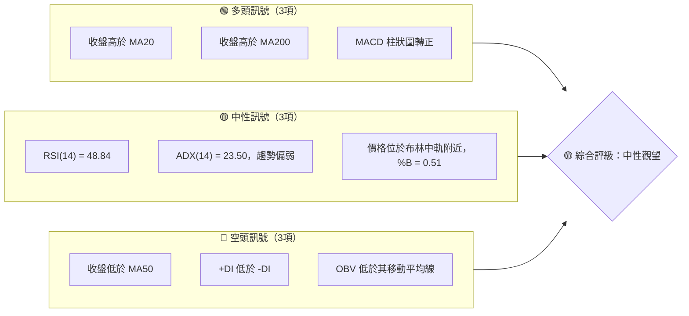
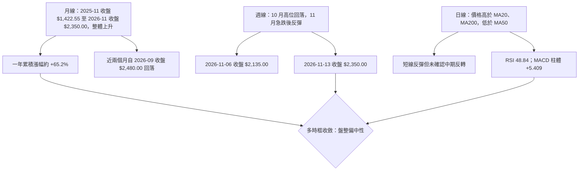
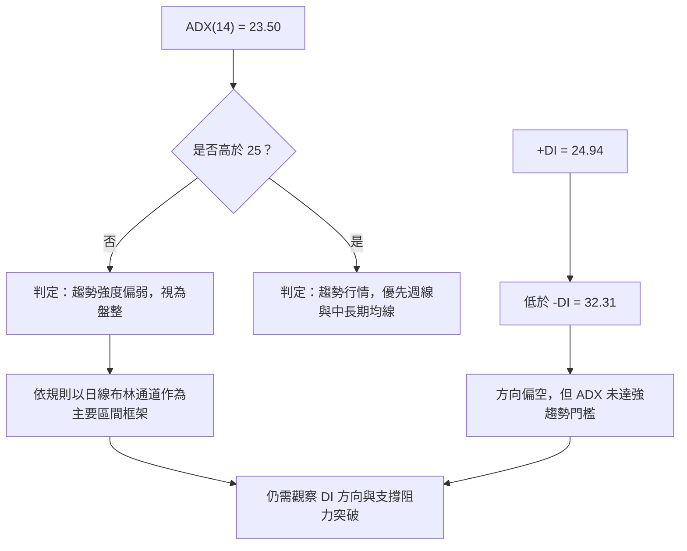
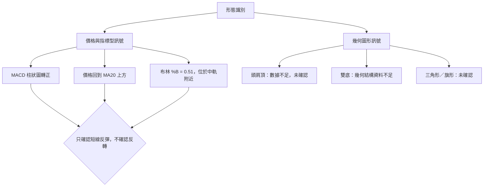
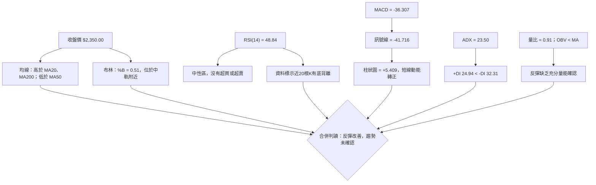
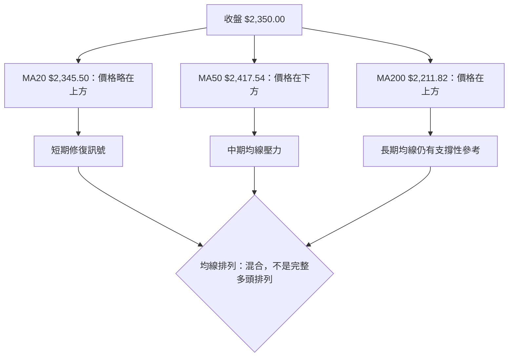
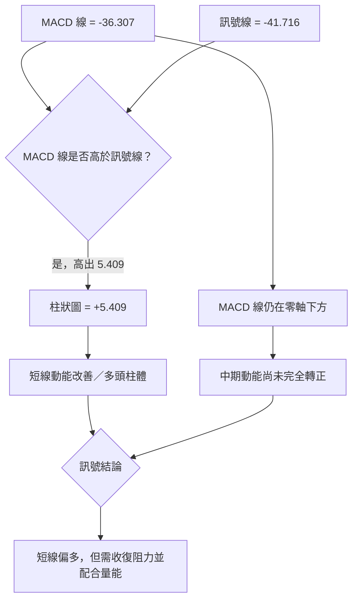
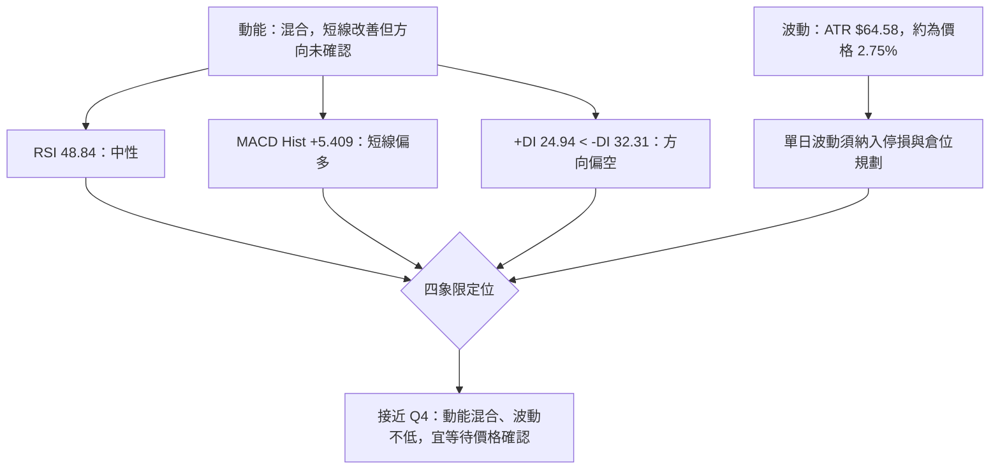
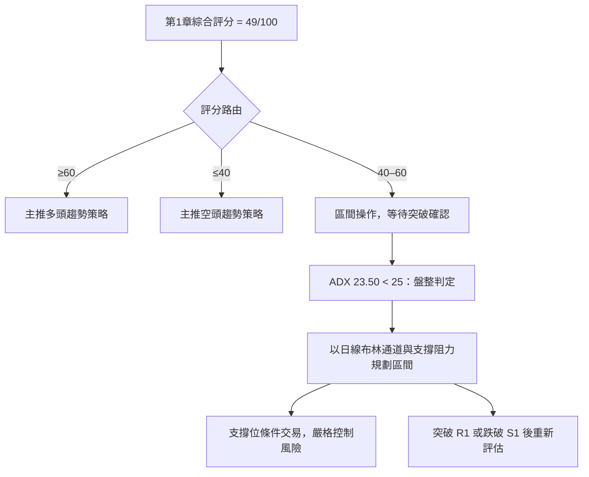
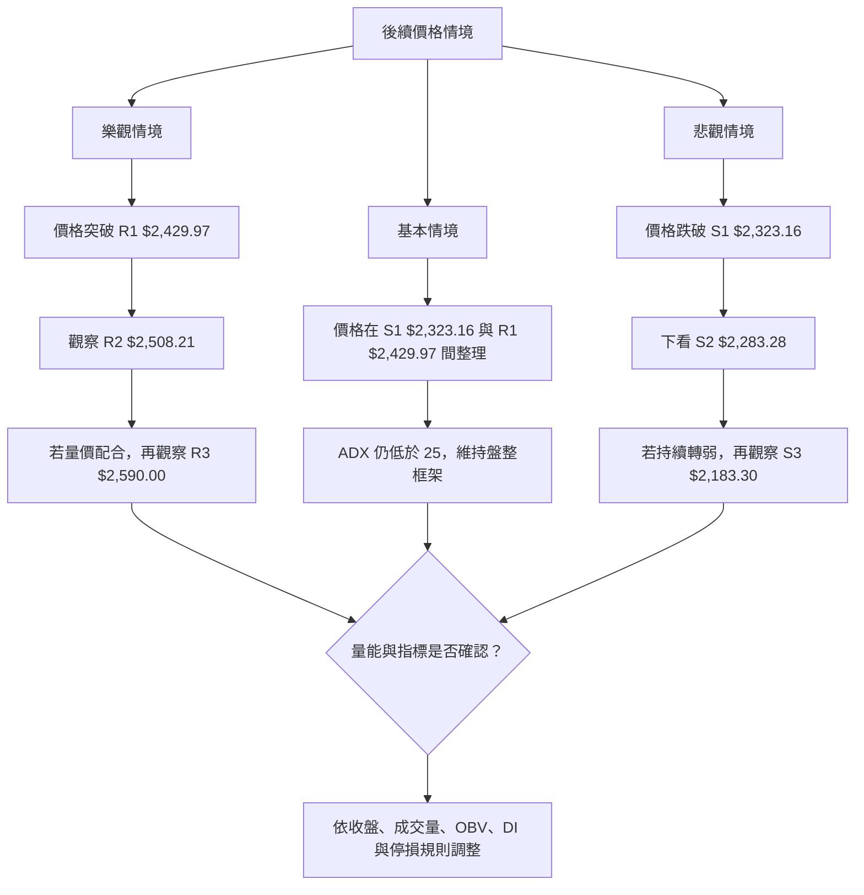

# 2330.TW 技術分析報告

> **報告日期**：2026-11-14 ｜ **語言**：繁體中文 ｜ **數據來源**：使用者提供之 Yahoo Finance 數據包 ｜ **當前價格**：$2,350.00（2026-11-13 收盤）

---

## 目錄

| 章節 | 內容 |
|------|------|
| [1. 技術面概覽](#1-技術面概覽) | 訊號儀表板、核心指標、評分卡 |
| [2. 趨勢分析](#2-趨勢分析) | 多時框趨勢、長中短期走勢 |
| [3. 圖表形態分析](#3-圖表形態分析) | 形態識別、K線組合、目標價 |
| [4. 支撐與阻力](#4-支撐與阻力) | 關鍵價位、斐波那契回調 |
| [5. 技術指標深度解讀](#5-技術指標深度解讀) | MA、RSI、MACD、布林、成交量 |
| [6. 動能與波動率](#6-動能與波動率) | 動能評估、ATR、Beta |
| [7. 多時框架總結](#7-多時框架總結) | 時框架評分矩陣 |
| [8. 交易策略建議](#8-交易策略建議) | 區間策略、風險報酬比 |
| [9. 風險提示與監控](#9-風險提示與監控) | 監控指標、風險場景 |

---

## 1. 技術面概覽

### 🎯 技術訊號儀表板

以下判讀以 2026-11-13 收盤價 $2,350.00 為準。訊號呈現「短線反彈、均線混合、成交量未確認」的組合；因此不把單一看多指標直接視為趨勢反轉。



**訊號整合判斷：**

- **偏多一側**：收盤價 $2,350.00 高於 MA20 $2,345.50，亦高於 MA200 $2,211.82；MACD 柱狀圖為正值 +5.409，顯示短線賣壓有緩和跡象。
- **偏空一側**：價格仍低於 MA50 $2,417.54；ADX 中 +DI 24.94 低於 -DI 32.31；OBV 低於自身均線，代表資金累積尚未確認價格反彈。
- **中性因素**：ADX 23.50 低於 25，依本報告的多時框收斂規則，採盤整行情處理，以日線布林通道和已提供支撐阻力作為主要區間參考。
- **整體判讀**：短線反彈訊號存在，但中期仍需收復 MA50 並改善量價結構，才足以提高趨勢轉強的可信度。

### 📊 核心指標速覽表

| 指標類別 | 指標名稱 | 當前數值 | 訊號 | 解讀 |
|----------|----------|----------|------|------|
| 價格 | 收盤價 | $2,350.00 | 🟡 | 價格高於 MA20、MA200，低於 MA50 |
| 均線 | MA20 | $2,345.50 | 🟡 | 收盤略高於 MA20，僅高 $4.50 |
| 均線 | MA50 | $2,417.54 | 🔴 | 收盤低於 MA50 $67.54 |
| 均線 | MA200 | $2,211.82 | 🟢 | 收盤高於 MA200 $138.18 |
| 動能 | RSI(14) | 48.84 | 🟡 | 位於中性區，未進入超買或超賣 |
| 動能 | MACD | -36.307 | 🟡 | MACD 線仍在零軸下方，但高於訊號線 |
| 動能 | MACD 柱狀圖 | +5.409 | 🟢 | 柱體轉正，短線動能改善 |
| 趨勢 | ADX(14) | 23.50 | 🟡 | 趨勢強度偏弱，符合盤整判定 |
| 趨勢 | +DI / -DI | 24.94 / 32.31 | 🔴 | 空方方向指標仍占優勢 |
| 波動 | ATR(14) | $64.58 | 🟡 | 約為收盤價的 2.75%，日內波動不低 |
| 布林 | %B | 0.51 | 🟡 | 接近布林中軌，非上下軌極端位置 |
| 成交量 | 量比 | 0.91 倍 | 🟡 | 最新量低於 20 日均量 |
| 量價 | OBV 趨勢 | OBV < MA | 🔴 | 量能尚未確認反彈走勢 |

### 🏆 技術評分卡

評分均採 **0–100 分**。綜合評分依規則以六項子評分作算術平均：

\[
(45+52+62+42+45+48)\div 6 = 49
\]

```text
╔══════════════════════════════════════════════════════════════╗
║             技術評分卡 — 2330.TW（2026-11-14）                ║
╠══════════════════════════════════════════════════════════════╣
║ 趨勢強度      █████████░░░░░░░░░░░  45/100  🟡               ║
║ 動能指標      ██████████░░░░░░░░░░  52/100  🟡               ║
║ 支撐穩定度    ████████████░░░░░░░░  62/100  🟢               ║
║ 成交量配合    ████████░░░░░░░░░░░░  42/100  🔴               ║
║ 形態完整度    █████████░░░░░░░░░░░  45/100  🟡               ║
║ 均線排列      ██████████░░░░░░░░░░  48/100  🟡               ║
╠══════════════════════════════════════════════════════════════╣
║ 六項算術平均  ██████████░░░░░░░░░░  49/100  🟡 中性觀望       ║
╚══════════════════════════════════════════════════════════════╝
```

| 評分維度 | 分數 | 評分理由 |
|---|---:|---|
| 趨勢強度 | 45/100 | ADX 23.50，低於 25；+DI 低於 -DI，趨勢方向尚偏空，但趨勢強度本身不高。 |
| 動能指標 | 52/100 | RSI 48.84 接近中性；MACD 柱狀圖翻正，但 MACD 線仍為負值；隨機指標位於超買區。 |
| 支撐穩定度 | 62/100 | 價格高於 S1 $2,323.16，亦高於布林中軌；但近期低點 $2,020.00 顯示波動與支撐測試風險不可忽視。 |
| 成交量配合 | 42/100 | 最新成交量為 20 日均量的 0.91 倍，且 OBV 低於其移動平均線，反彈缺少明確量能確認。 |
| 形態完整度 | 45/100 | 有反彈及指標轉折，但資料不足以確認完成的雙底、反轉底型或其他高信心幾何形態。 |
| 均線排列 | 48/100 | 收盤高於 MA20、MA200，但低於 MA50；短期均線回升與中期均線壓力並存。 |

---

## 2. 趨勢分析

### 🌐 多時框趨勢分析

月線資料顯示過去一年股價整體上升，但 2026 年 9 月月收盤價 $2,480.00 後，10 月與 11 月連續回落。週線資料則呈現 10 月高位回落、11 月急跌後反彈的結構；日線方面，收盤價重新站上 MA20，但尚未收復 MA50。



#### 長期趨勢：月線視角

### 📈 長期趨勢 — 12 個月走勢圖

以下使用提供的 2025-11 至 2026-11 月收盤價繪製。圖形為 ASCII 示意，縱向位置按月收盤價相對分布呈現；不代表月內最高價或最低價。

```text
2330.TW 月線收盤走勢圖（2025-11 至 2026-11）
價格（TWD）

2500 ┤                                              ● 2026-09 2,480.00
2400 ┤                                       ●──●       2026-06 至 08
2300 ┤                                                   ● 2,370
2200 ┤                                                    ● 2,350 ← 現價
2100 ┤
2000 ┤                             ● 2026-02 1,977.40
1900 ┤
1800 ┤                        ● 2026-01 1,759.34
1700 ┤
1600 ┤                  ● 2025-12 1,536.33
1500 ┤             ● 2025-11 1,422.55
1400 ┤
     └──────────────────────────────────────────────────────
      N25 D25 J26 F26 M26 A26 M26 J26 J26 A26 S26 O26 N26

月收盤序列：
1,422.55 → 1,536.33 → 1,759.34 → 1,977.40 → 1,750.17
→ 2,123.07 → 2,341.84 → 2,402.93 → 2,417.88 → 2,397.94
→ 2,480.00 → 2,370.00 → 2,350.00
```

**重要高低點說明：**

- 這段月收盤序列中，最低月收盤為 2025-11 的 $1,422.55，最高月收盤為 2026-09 的 $2,480.00。
- 數據另提供 52 週高點 $2,590.00、52 週低點 $1,358.34；這些是 52 週高低價，不等同月收盤價。
- 2026-02 至 2026-03 月收盤由 $1,977.40 回落至 $1,750.17，月跌幅約 **11.5%**。
- 2026-03 至 2026-06 月收盤由 $1,750.17 回升至 $2,402.93，累計約 **37.3%**。
- 2026-09 至 2026-11 月收盤由 $2,480.00 降至 $2,350.00，累計約 **5.2%**。

#### 走勢特徵分析表

| 階段 | 月收盤變化 | 約略變化 | 技術特徵 |
|---|---:|---:|---|
| 2025-11 → 2026-02 | $1,422.55 → $1,977.40 | +39.0% | 月收盤連續走高，長期趨勢向上。 |
| 2026-02 → 2026-03 | $1,977.40 → $1,750.17 | -11.5% | 顯著修正，代表上升走勢中出現中期回撤。 |
| 2026-03 → 2026-06 | $1,750.17 → $2,402.93 | +37.3% | 快速恢復並接近高位區域。 |
| 2026-06 → 2026-09 | $2,402.93 → $2,480.00 | +3.2% | 上升斜率放緩，收盤仍維持高檔。 |
| 2026-09 → 2026-11 | $2,480.00 → $2,350.00 | -5.2% | 高檔回落，與近期週線修正相呼應。 |
| 2025-11 → 2026-11 | $1,422.55 → $2,350.00 | +65.2% | 以月收盤衡量，長期方向仍向上。 |

#### 中期趨勢：週線分析

近 20 週收盤資料顯示，7 月至 9 月價格主要於 $2,283.28 至 $2,475.00 一帶波動，10 月一度收於 $2,550.00，隨後轉弱；11 月 6 日收盤降至 $2,135.00，11 月 13 日回升至 $2,350.00。

```text
近期週線價格區間示意（取自提供的週收盤資料）

$2,590.00 ─────────────────────────────── 52 週高點
$2,550.00 ───── 10/08 週收盤高位
$2,508.21 ───── R2
$2,429.97 ───── R1
$2,350.00 ───── 11/13 收盤
$2,323.16 ───── S1
$2,283.28 ───── S2；亦為 07/17 週收盤
$2,183.30 ───── S3
$2,135.00 ───── 11/06 週收盤
$2,020.00 ───── 11/06 日內低點（近10根日K）
$1,358.34 ───── 52 週低點
```

- 10 月 8 日週收盤 $2,550.00 至 11 月 6 日週收盤 $2,135.00，回落約 **16.3%**。
- 11 月 6 日週收盤 $2,135.00 至 11 月 13 日週收盤 $2,350.00，反彈約 **10.1%**。
- 反彈幅度顯著，但週收盤仍低於 R1 $2,429.97；因此尚不能把單週反彈等同於中期趨勢反轉。
- 週線成交量資料中，11 月 6 日週成交量為 250,878,329，高於 11 月 13 日週的 164,332,072；急跌週放量、反彈週量縮，代表承接力仍需後續確認。

#### 短期趨勢：日線分析

- 最新收盤價 $2,350.00 位於 MA20 $2,345.50 上方，但僅高出 **$4.50**，屬於貼近均線而非明確拉開距離。
- 價格仍低於 MA50 $2,417.54，短線反彈尚未解除中期均線壓力。
- 近 10 根日 K 中，11 月 6 日收盤 $2,135.00 後，11 月 9 日至 11 月 13 日逐步反彈至 $2,350.00；然而，最新成交量 28,844,142 低於 20 日均量 31,756,538。
- 日線判讀：**反彈修復中，尚未確認轉為多頭趨勢。**

### ⚡ 趨勢強度評估（ADX 解讀）



| ADX 區間 | 常見解讀 | 本次數值 | 本報告判讀 |
|---|---|---:|---|
| < 20 | 趨勢弱或盤整 | — | 未進入此更低強度區間 |
| 20–25 | 趨勢形成中或偏弱 | 23.50 | 目前所處區間 |
| > 25 | 趨勢強度較明確 | — | 未達此門檻 |
| > 40 | 強趨勢 | — | 不適用 |

**ADX 結論：**ADX 23.50 低於 25，依規則採盤整行情處理；但 +DI 24.94 低於 -DI 32.31，說明方向性仍偏空。這表示「趨勢力度不強」與「方向略偏空」可以同時成立，不應混為一談。

---

## 3. 圖表形態分析

### 🔍 形態識別系統

以目前提供的月收盤、近 20 週收盤、近 10 根日 K 及指標快照判斷，未有足夠的波段高低點序列支撐對頭肩頂、頭肩底、雙底、雙頂或三角形做高信心確認。因此，本節以指標型形態和價格行為描述為主，不強行推導幾何形態目標價。



#### 形態信心度表

| 形態／訊號 | 信心度 | 判斷依據（引用數據） | 完成度 | 目標價 |
|---|---:|---|---|---|
| 頭肩頂／頭肩底 | N/A（數據未提供） | 缺少可完整辨認頸線、左右肩與頭部的波段點序列。 | N/A（數據未提供） | 數據中未偵測到 |
| 雙頂／雙底 | N/A（數據未提供） | 近 20 週收盤與近 10 根日 K 不足以證明兩個具幾何一致性的低點或高點。 | N/A（數據未提供） | 數據中未偵測到 |
| 三角形／旗形 | N/A（數據未提供） | 沒有提供足夠的逐日完整價格序列來確認收斂趨勢線或旗面。 | N/A（數據未提供） | 數據中未偵測到 |
| MA20 上方的短線修復 | 60% | 收盤 $2,350.00 高於 MA20 $2,345.50；但低於 MA50 $2,417.54。 | 進行中 | 不屬於幾何形態，未推導形態目標 |
| MACD 柱狀圖轉正 | 60% | MACD Hist +5.409；MACD 線 -36.307 高於訊號線 -41.716。 | 短線動能改善，待確認 | 不屬於幾何形態，未推導形態目標 |

> **說明：**前兩列信心度標示為 N/A，是因目前資料不足以支持形態辨識，不代表形態不存在。只有在形態高低點、頸線和確認條件都可由資料核實時，才應計算形態目標價。

### 🕯️ 重要 K 線形態分析

以下 K 棒描述僅依使用者提供的「近 10 根日 K」及「近 8 根週 K」之開、高、低、收判斷。未將該區塊以外日期的 K 線形狀納入分析。

| 日期（日 K／週 K） | 開 | 高 | 低 | 收 | K 線形態 | 解讀 | 訊號 |
|---|---:|---:|---:|---:|---|---|---|
| 2026-11-06 日 K | 2,020.00 | 2,195.00 | 2,020.00 | 2,135.00 | 長實體陽線；下影線為 0，上影線 60.00 | 開收差為 +115.00，低點等於開盤，不能稱為錘頭；顯示當日由低位回升。 | 🟢 單日反彈 |
| 2026-11-09 日 K | 2,210.00 | 2,290.00 | 2,190.00 | 2,235.00 | 小實體陽線，上下影線均存在 | 收高於開，但實體較當日高低區間小，顯示多空拉鋸。 | 🟡 |
| 2026-11-10 日 K | 2,265.00 | 2,285.00 | 2,230.00 | 2,285.00 | 收於當日最高點的陽線 | 收盤等於最高價，買方掌控收盤，但隔日能否延續需確認。 | 🟢 |
| 2026-11-11 日 K | 2,330.00 | 2,395.00 | 2,305.00 | 2,395.00 | 長實體陽線；收於最高價 | 收盤較開盤高 65.00，收於高點，反彈動能較強；非吞噬判定。 | 🟢 |
| 2026-11-12 日 K | 2,385.00 | 2,395.00 | 2,330.00 | 2,340.00 | 陰線；上影線 10.00、下影線 10.00 | 開高於收 45.00，顯示 11 月 11 日反彈後出現回吐。 | 🔴 短線整理 |
| 2026-11-13 日 K | 2,375.00 | 2,390.00 | 2,340.00 | 2,350.00 | 小實體陰線，上影線 15.00、下影線 10.00 | 收低於開 25.00，幅度相對日內區間不大，呈現反彈後整理。 | 🟡 |
| 2026-10-16 週 K | 2,510.00 | 2,550.00 | 2,420.00 | 2,420.00 | 長陰線；下影線為 0 | 收盤等於低點，當週賣方壓力明顯。 | 🔴 |
| 2026-11-06 週 K | 2,310.00 | 2,345.00 | 2,020.00 | 2,135.00 | 長陰線，伴隨長下影線 | 當週收低於開 175.00，但從 2,020.00 低點回升 115.00；屬於急跌後有承接，未構成標準反轉形態確認。 | 🔴／🟡 |
| 2026-11-13 週 K | 2,210.00 | 2,395.00 | 2,190.00 | 2,350.00 | 陽線，收盤接近區間上部 | 收高於開 140.00，反映當週反彈；但需觀察是否能突破 R1 $2,429.97。 | 🟢 反彈訊號 |

### 📉 ASCII 走勢形態示意圖

此圖依提供的週收盤資料概括「高位回落—急跌—反彈」的價格路徑，並非頭肩、雙底或其他幾何形態的確認圖。

```text
2330.TW 近期週收盤路徑示意

$2,590 ┤                         52 週高
$2,550 ┤                  ● 10/08
$2,508 ┤──────────────────────────── R2
$2,430 ┤──────────────────────────── R1
$2,350 ┤                                  ● 11/13 現價
$2,323 ┤──────────────────────────── S1
$2,283 ┤      ● 07/17 ──────────── S2
$2,183 ┤──────────────────────────── S3
$2,135 ┤                                       ● 11/06
$2,020 ┤                                       日內低點
       └────────────────────────────────────────────
        07月      08月      09月      10月      11月

路徑：高檔整理 → 10 月下跌 → 11/06 急跌 → 11/13 反彈
```

### 🎯 形態目標價計算

1. **幾何形態目標：**數據中未偵測到可確認的頭肩、雙底、三角形或旗形，因此不提供頸線加形態高度的目標價。
2. **指標型修復觀察：**收盤價高於 MA20，MACD 柱狀圖轉正，表示短線動能改善；然而，這些條件本身不能產生一個符合本報告數據規則的形態目標價。
3. **交易參考位：**後續章節的 R1、R2、R3 及 S1、S2、S3 均直接取自提供的 OHLCV 關鍵價位，不是形態高度推算。
4. **分析師共識目標：**數據提供平均目標 $3,402.51，但這屬外部分析師共識，不是由本報告的技術形態計算得出，不作為本節技術形態目標價。

---

## 4. 支撐與阻力

### 🗺️ 關鍵價位分布圖

以下所有支撐與阻力均直接引用提供的「關鍵價位（由 OHLCV 計算）」數據。布林通道與斐波那契價位會在相關段落另行區分，不與 OHLCV 波段聚類價位混用。

```text
2330.TW 價位結構分布圖（TWD）
═══════════════════════════════════════════════════════

$2,590.00 ║████████████████████████║ R3／52 週高點
$2,508.21 ║████████████████████    ║ R2
$2,429.97 ║████████████████████████║ R1
$2,350.00 ╠════════════════════════╣ 現價（2026-11-13 收盤）
$2,323.16 ║▓▓▓▓▓▓▓▓▓▓▓▓▓▓▓▓        ║ S1
$2,283.28 ║▓▓▓▓▓▓▓▓▓▓▓▓▓▓▓▓▓▓      ║ S2
$2,183.30 ║████████████████████████║ S3
$1,358.34 ║████████████████████████║ 52 週低點

═══════════════════════════════════════════════════════
```

### 🚧 阻力位分析表

| 阻力級別 | 價位 | 距離現價 | 形成原因 | 突破難度 | 重要性 |
|---|---:|---:|---|---|---|
| R1 | $2,429.97 | +3.40% | 近一年波段高點聚類；亦高於 MA50 $2,417.54。 | 中高 | 高：短線反彈需面對的首要區域。 |
| R2 | $2,508.21 | +6.73% | 近一年波段高點聚類；與上方高位區域相接近。 | 高 | 高：若站上 R1，觀察反彈能否擴大。 |
| R3 | $2,590.00 | +10.21% | 近一年波段高點聚類，並與提供的 52 週高點一致。 | 很高 | 很高：主要中期高點與趨勢確認參考。 |

### 🛡️ 支撐位分析表

「守住機率」不是統計模型輸出，而是依照價位結構、價格距離與近期指標的定性評估，不應視為精確概率。

| 支撐級別 | 價位 | 距離現價 | 形成原因 | 守住機率（定性） | 重要性 |
|---|---:|---:|---|---|---|
| S1 | $2,323.16 | -1.14% | 近一年波段低點聚類；目前收盤仍高於此位。 | 中 | 高：與現價相距不遠，為第一個支撐測試區。 |
| S2 | $2,283.28 | -2.84% | 近一年波段低點聚類；亦出現在 2026-07-17 週收盤資料中。 | 中 | 高：若 S1 失守，下一層價格結構參考。 |
| S3 | $2,183.30 | -7.09% | 近一年波段低點聚類。 | 中低 | 很高：若跌破，代表支撐結構進一步轉弱。 |

**支撐與阻力的結構性判讀：**

- 現價 $2,350.00 高於 S1 $2,323.16，距離 S1 約 1.14%。
- R1 $2,429.97 是近期第一個需觀察的上檔阻力，且價格仍低於 MA50，兩項資訊共同說明上行空間需經過確認。
- 若價格於 S1 與 R1 之間往返，符合 ADX 低於 25 的盤整判讀。
- 若收盤價有效突破 R1，但成交量仍低於均量、OBV 未改善，突破訊號的可信度仍需保守看待。
- 若跌破 S1，需進一步觀察 S2；若 S2 亦失守，S3 成為下一個提供的結構參考位。

### 📐 斐波那契回調位分析

以下直接引用提供的 52 週區間回調位，不自行重算。

| 回調位 | 價位 |
|---|---:|
| 0.0%（52 週高） | $2,590.00 |
| 23.6% | $2,299.33 |
| 38.2% | $2,119.51 |
| 50.0% | $1,974.17 |
| 61.8% | $1,828.84 |
| 78.6% | $1,621.92 |
| 100.0%（52 週低） | $1,358.34 |

- 現價 $2,350.00 **高於 23.6% 回調位 $2,299.33**，低於 52 週高點 $2,590.00。
- 因此，若以「由 52 週高點往下回調」的回撤比例理解，現價尚未跌至 23.6% 回調價位。
- 這表示 52 週區間的長線漲幅仍保留相當部分，但不構成短線必然支撐；仍須結合 S1–S3、均線、成交量及市場方向判斷。
- 23.6% 回調位 $2,299.33 與 S1 $2,323.16 均為資料中不同方法計算的價位，不應視為同一支撐，也不應將二者合併成未提供的精確新價位。

---

## 5. 技術指標深度解讀

### 🎛️ 指標訊號總覽



### 📈 移動平均線排列分析



| 均線 | 數值 | 收盤與均線關係 | 均線本身方向（提供資料） | 解讀 |
|---|---:|---|---|---|
| MA5 | $2,321.00 | 收盤高於 MA5 | 上升 | 近端反彈有改善。 |
| MA10 | $2,286.50 | 收盤高於 MA10 | 上升 | 短線價格修復。 |
| MA20 | $2,345.50 | 收盤高於 MA20 $4.50 | 微幅上升 | 僅略微站上，仍需確認。 |
| MA50 | $2,417.54 | 收盤低於 MA50 $67.54 | N/A（當前快照未提供 MA50 方向） | 中期反彈阻力。 |
| MA200 | $2,211.82 | 收盤高於 MA200 $138.18 | N/A（當前快照未提供 MA200 方向） | 長期價格仍在均線上方。 |
| MA60 | $2,412.44 | 收盤低於 MA60 | 下跌 | 中期均線訊號偏弱。 |
| MA120 | $2,388.93 | 收盤低於 MA120 | 下跌 | 中長期壓力仍在現價上方。 |
| MA240 | $2,091.53 | 收盤高於 MA240 | 上升 | 長週期均線走勢向上，與短中期回檔形成分化。 |

**均線結論：**

- MA5、MA10、MA20 均呈上升狀態，並且收盤價高於這三條均線，說明短線回升。
- 收盤價仍低於 MA50、MA60 與 MA120，顯示中期壓力未解除。
- 收盤高於 MA200、MA240，長週期價格位置仍保有支撐性，但不能單靠價格相對均線的位置推斷均線交叉已形成。
- 綜合來看，均線屬**混合排列**，不是多頭排列，也不是全面空頭排列。

### 📉 RSI(14) 分析

```text
RSI(14) 強度尺（0–100）

0        20        30             50             70        80      100
|---------|---------|--------------|--------------|---------|--------|
                               ▲
                            48.84

超賣區：低於 30       中性區：30–70       超買區：高於 70
```

- RSI(14) = **48.84**，處於中性區間，顯示當前動能尚未進入明確過熱或嚴重超賣狀態。
- RSI 接近 50，與收盤價略高於 MA20、MACD 柱狀圖轉正的短線修復訊號大致一致。
- 但 RSI 仍低於 50，且 -DI 高於 +DI，不能僅憑 RSI 中性就視為多頭已取得主導權。
- **背離判斷：**數據快照明確標示「近 20 根 K 棒首尾比較存在底背離」。本報告依提供資訊判定為**底背離訊號存在**；但該算法只比較近 20 根 K 棒首尾價格與 RSI 方向，不能代替逐個波段低點的完整背離驗證。
- **頂背離：**數據未提供頂背離訊號，亦未有可獨立確認的頂背離點位；結論為**未確認頂背離**。

### 📊 MACD(12/26/9) 訊號解讀



- MACD 線為 -36.307，仍低於零軸。
- 訊號線為 -41.716，MACD 線高於訊號線，因此柱狀圖為 +5.409。
- 正柱表示短線下跌動能減弱或反彈動能改善，但 MACD 線仍為負值，代表較大尺度的動能尚未完全轉正。
- **MACD 背離：**所提供的 MACD 快照未列出背離標籤或可驗證的完整波段比較資料，故結論為**頂背離未確認、底背離未能由 MACD 獨立確認**。這與數據明列的 RSI 底背離並不矛盾，兩種指標的背離訊號可不一致。

### 📦 布林通道分析

已提供布林通道上軌、中軌、下軌及 %B 數值。當前價格接近中軌，並非觸及上軌或下軌的極端位置。

```text
布林通道示意（非比例尺）

$2,505.73 ─────────────── 上軌
                         │
$2,350.00 ─────────────── 現價
$2,345.50 ─────────────── 中軌（MA20）
                         │
$2,185.27 ─────────────── 下軌

%B = 0.51（0 = 下軌；0.5 = 中軌；1 = 上軌）
```

- %B = 0.51，數值非常接近中軌所對應的 0.5。
- 收盤價 $2,350.00 高於中軌 $2,345.50，但僅高出 $4.50；目前不能解讀為布林上軌突破。
- 下軌 $2,185.27 與上軌 $2,505.73 可作為盤整框架參考，但依交易策略的數據規則，策略目標價仍只採已提供的關鍵 OHLCV 價位，不將布林軌道自行當成新的形態目標價。
- 布林通道寬度的歷史變化或帶寬收縮程度未提供，因此不能判定是否出現布林擠壓。

### 💹 成交量分析（量價配合度）

| 成交量資料 | 數值 | 相對判讀 |
|---|---:|---|
| 最新成交量 | 28,844,142 | 低於 20 日均量 |
| 20 日均量 | 31,756,538 | 最新量為其 0.91 倍 |
| 50 日均量 | 25,144,972 | 最新量高於 50 日均量 |
| OBV 趨勢 | OBV < MA | 量能偏弱 |
| 11/06 週成交量 | 250,878,329 | 近 20 週資料中的高量週之一 |
| 11/13 週成交量 | 164,332,072 | 低於 11/06 週成交量 |

**量價解讀：**

- 最新日成交量低於 20 日均量，量比 0.91，短線反彈未伴隨超過近期均量的成交擴張。
- 最新成交量仍高於 50 日均量，故不宜將量能描述成極度萎縮；比較基準不同，判斷需保留這一點。
- OBV 低於其均線，與價格反彈形成未完全確認的量價結構。
- 11 月 6 日急跌週成交量較大，11 月 13 日反彈週成交量較低，顯示下跌時的成交活躍度高於反彈週。
- **OBV 結論：**量能目前沒有充分確認價格反彈。若後續價格突破阻力，但 OBV 仍低於其均線，需提防突破缺乏跟進買盤。

---

## 6. 動能與波動率

### ⚡ 動能評估四象限

動能評估綜合 RSI、MACD、DI 方向和量價確認；波動評估依 ATR 占收盤價比率。ATR(14) 為收盤價的 2.75%，本報告將其視為需要納入風控的中等偏高日波動參考，不代表對未來波動率的預測。

| 象限 | 動能 | 波動 | 典型狀態 | 本次判讀 |
|------|------|------|----------|----------|
| Q1 | 強 | 低 | 趨勢明確、風險相對可控 | 不符合：MACD 雖轉正，但 RSI 中性、ATR 比率 2.75%。 |
| Q2 | 弱 | 低 | 盤整、波動有限 | 不完全符合：ADX 偏弱，但 ATR 絕對與相對波動不低。 |
| Q3 | 強 | 高 | 高風險高收益，方向動能明確 | 動能尚未達到強勢標準。 |
| Q4 | 混合／偏弱 | 中等偏高 | 方向未確立、波動需要控管 | **目前最接近：RSI 中性、DI 偏空、MACD 柱體轉正、量能未確認。** |



### 📊 ATR 波動率分析

- ATR(14) = **$64.58**，約為收盤價 $2,350.00 的 **2.75%**。
- ATR 是歷史平均真實波幅的指標，不等同於預測下一交易日的必然波動，也不能直接視為停損必須固定採用的點數。
- 以 ATR 尺度觀察，較小幅度的日內回撤可能屬於常態波動；停損若過度貼近價格，可能在方向判斷正確前先被正常波動觸發。
- 本報告的具體交易停損價仍使用已提供支撐價位，以確保所有策略價格符合數據紀律；ATR 僅用於提醒倉位與波動風險，不另外創造精確停損位。
- **止損距離管理：**實際部位大小應與入場至停損距離、帳戶可承受損失相匹配。價格波動提高時，通常應降低部位，而非任意放寬可承受虧損。

### 📐 Beta 與市場相關性

- Beta = **1.233**。若該 Beta 估算方式及觀察期間可靠，通常表示此股票對市場波動的敏感度高於 Beta 約為 1 的基準市場。
- Beta 不等於固定的日漲跌幅預測，也不是相關係數；不能據此推斷某一日必然比大盤多漲或多跌 23.3%。
- 個股與大盤的實際相關係數、Beta 計算觀察期間及回歸品質均為 **N/A（數據未提供）**。
- 風控含義：在大盤快速下跌或市場風險偏好轉弱時，應考慮較大的價格敏感度，降低單一持股對整體投資組合的影響。

---

## 7. 多時框架總結

### 📋 時框架評分表

時框架分數屬定性技術評估；其中「綜合評分」欄所列的 **49/100** 是依第 1 章六項評分算出的唯一整體評分，不因時框架改變。其他時框架的定性描述不另行取代該總分。

| 時框架 | 趨勢方向 | 動能 | 均線排列 | 形態 | 綜合評分 | 建議 |
|--------|----------|------|----------|------|----------:|------|
| 月線／長期 | 🟢 過去一年月收盤整體上升，但近兩月回落 | 🟡 缺乏月線動能指標 | N/A（數據未提供） | 長期上升趨勢後高位回落，無法確認反轉形態 | **49/100（全局）** | 長期結構偏多，但短期不宜忽略回撤風險。 |
| 週線／中期 | 🟡 急跌後反彈，未確認重新站上 R1 | 🟡 最新週線反彈，但週成交量低於前週 | N/A（數據未提供週線均線值） | 高位回落後的修復，沒有足夠資料確認雙底 | **49/100（全局）** | 關注 R1 與 S1/S2，等待價格結構確認。 |
| 日線／短期 | 🟡 價格略高於 MA20，低於 MA50 | 🟡 MACD 柱體轉正，RSI 中性 | 混合排列 | 指標修復中，無高信心幾何形態 | **49/100（全局）** | 以盤整區間交易規劃為主，等待突破確認。 |

### 🔲 綜合訊號矩陣

| 技術面向 | 短期（日線） | 中期（週線） | 長期（月線） | 一致性判斷 |
|---|---|---|---|---|
| 價格趨勢 | 反彈修復 | 急跌後反彈 | 一年上升、近兩月回落 | 🟡 不完全一致 |
| 均線位置 | 高於 MA20，低於 MA50 | 週線均線數據 N/A（數據未提供） | 月線均線數據 N/A（數據未提供） | 🟡 |
| 動能 | MACD 柱體轉正、RSI 中性 | 週 MACD 柱體由負轉正（最新 +5.409） | 月線動能指標 N/A（數據未提供） | 🟡 短線改善 |
| 趨勢強度 | ADX 23.50，盤整 | 週線 ADX N/A（數據未提供） | 月線 ADX N/A（數據未提供） | 🟡 以盤整規則處理 |
| 量價 | 日量比 0.91、OBV < MA | 反彈週量低於急跌週 | 月線成交量 N/A（數據未提供） | 🔴 未充分確認 |
| 主要結論 | 反彈但未轉強 | 修復中 | 長期結構仍偏上 | 🟡 中性觀望 |

### ⚖️ 多時框收斂結論

1. **行情分類：**ADX(14) = 23.50，低於 25，因此依規則判定為**盤整行情**，不是已確認的強趨勢行情。
2. **主導時框：**在盤整判定下，以日線布林通道上下軌作為主要區間框架；同時以週線收盤及已提供的 R1–R3、S1–S3 作為方向確認參考。
3. **訊號衝突處理：**日線 MACD 柱體轉正、價格略高於 MA20，屬短線偏多；但 +DI 低於 -DI、收盤低於 MA50、OBV < MA，仍有中期偏空或量能未確認的訊號。
4. **唯一方向性結論：****中性觀望**。目前不足以定義為偏多趨勢，也不符合強趨勢下直接以中長期方向主導交易的條件。
5. **與策略一致性：**第 8 章依第 1 章 **49/100** 的綜合評分路由，採取「區間操作、等待突破確認」，不會同時強力推薦多頭與空頭趨勢策略。

---

## 8. 交易策略建議

### 🗺️ 策略決策流程圖



### 🧭 策略路由

**當前主策略方向 = 中性區間操作、等待突破確認（依評分 49/100）。**

第 1 章綜合評分為 49/100，落在 40–60 的中性區間。依路由規則，本報告不把趨勢性多頭或空頭作為強力主策略。下列兩個方案均為**有條件的區間偏多操作安排**，只有價格進入指定進場條件並出現確認訊號時才考慮執行；不代表當前價格立即追買。

### 🎯 價格情境階梯（Price Scenarios）

| 觸發條件 | 下一目標 | 後續延伸 | 情境含義 |
|----------|----------|----------|----------|
| 突破並確認站上 R1 $2,429.97 | R2 $2,508.21 | R3 $2,590.00 | 短線轉強；需以成交量及 OBV 改善確認。 |
| 價格維持在 S1 $2,323.16 與 R1 $2,429.97 之間 | — | — | 區間震盪，等待突破確認；不是趨勢追價訊號。 |
| 跌破 S1 $2,323.16 | S2 $2,283.28 | S3 $2,183.30 | 短中期轉弱，觀察支撐失守後的價格與成交量反應。 |
| 跌破 S3 $2,183.30 | 數據中未偵測到下一個 OHLCV 波段支撐位 | — | 原有支撐結構受損；不以未提供價位推算新目標。 |

### 📊 情境機率分佈

以下為依現有技術指標所作的**主觀情境估計**，總和為 100%，不是統計模型輸出，也不代表價格必然依此演變。

| 情境 | 機率 | 主要依據 |
|---|---:|---|
| 反彈延續／向上測試阻力 | 30% | MACD 柱狀圖 +5.409；收盤高於 MA20、MA200；RSI 背離資料標示底背離。但 OBV < MA 且 +DI < -DI，限制上行信心。 |
| 區間震盪 | 45% | ADX 23.50 低於 25；%B 0.51 接近布林中軌；均線排列混合，沒有明確趨勢突破訊號。 |
| 回落／再測下方支撐 | 25% | +DI 低於 -DI；收盤低於 MA50；OBV 偏弱；近期週線急跌後反彈週成交量較低。 |

### 📊 主策略詳情：中性區間操作

表中目標與停損均取自已提供的價位。入場價為指定支撐價位，不是價格保證；若交易前價格已大幅偏離，應重新評估而非直接照搬。

#### 策略 A：S1 附近有條件承接

**進場條件：**價格回到 S1 $2,323.16，且該區域出現可觀察的止跌或收盤重新站回 S1 的確認；若價格直接跌破並放量，取消此方案。

| 策略要素 | 策略 A |
|---|---:|
| 進場價格 | $2,323.16（取 S1；條件式進場） |
| 止損價格 | $2,283.28（取 S2） |
| 目標價 T1 | $2,429.97（取 R1） |
| 目標價 T2 | $2,508.21（取 R2） |
| 風險報酬比（T1） | **1 : 2.68** |
| 風險報酬比（T2） | **1 : 4.64** |
| 成功機率估計 | 低至中；主觀估計約 45%，非回測結果 |
| 建議倉位 | 低於常規單筆風險配置；依實際可承受風險設定 |

**風險報酬比驗算：**

- 風險 = $2,323.16 − $2,283.28 = **$39.88**
- T1 報酬 = $2,429.97 − $2,323.16 = **$106.81**
- T1 比值 = 106.81 ÷ 39.88 = **2.68**，呈現為 **1 : 2.68**
- T2 報酬 = $2,508.21 − $2,323.16 = **$185.05**
- T2 比值 = 185.05 ÷ 39.88 = **4.64**，呈現為 **1 : 4.64**

#### 策略 B：S2 較深回檔的條件式承接

**進場條件：**價格回測 S2 $2,283.28 後，未有效跌破 S3 $2,183.30，並出現價格止跌或重新收復 S2 的確認。若 S2 失守且賣壓擴大，取消此方案。

| 策略要素 | 策略 B |
|---|---:|
| 進場價格 | $2,283.28（取 S2；條件式進場） |
| 止損價格 | $2,183.30（取 S3） |
| 目標價 T1 | $2,429.97（取 R1） |
| 目標價 T2 | $2,508.21（取 R2） |
| 風險報酬比（T1） | **1 : 1.47** |
| 風險報酬比（T2） | **1 : 2.25** |
| 成功機率估計 | 低至中；主觀估計約 40%，非回測結果 |
| 建議倉位 | 不高於策略 A；支撐失效風險較大，宜縮小部位 |

**風險報酬比驗算：**

- 風險 = $2,283.28 − $2,183.30 = **$99.98**
- T1 報酬 = $2,429.97 − $2,283.28 = **$146.69**
- T1 比值 = 146.69 ÷ 99.98 = **1.47**，呈現為 **1 : 1.47**
- T2 報酬 = $2,508.21 − $2,283.28 = **$224.93**
- T2 比值 = 224.93 ÷ 99.98 = **2.25**，呈現為 **1 : 2.25**

> **風險報酬比的限制：**上述比值是價格層級的算術結果，未包含交易成本、滑價、跳空風險與實際成交差異。實際成交價格若不同，風險報酬比需重新計算。

### 🔴 反向風險觸發點（對沖提示）

- **跌破 S1 $2,323.16：**代表近端支撐未能守住，區間偏多方案的條件轉差；觀察 S2 $2,283.28。
- **跌破 S2 $2,283.28：**短中期結構進一步轉弱；如策略 A 已進場，需按停損計畫執行。
- **跌破 S3 $2,183.30：**提供的近一年波段低點聚類支撐失守；原有區間承接觀點應重新檢討。
- **突破 R1 $2,429.97 但量能未改善：**留意假突破；若 OBV 仍低於均線，避免只依價格瞬間穿越阻力追價。
- **上述為風險管理提示，不構成另一套完整做空策略。**主策略仍依 49/100 綜合評分維持中性區間框架。

### ⭐ 整體訊號強度評星

```text
做多訊號強度：★★★☆☆  (3/5星)
做空訊號強度：★★★☆☆  (3/5星)
整體可信度：  ★★★☆☆  (3/5星)

評星說明：
- 多頭：MACD 柱體轉正、收盤略高於 MA20，但 OBV 偏弱且仍低於 MA50。
- 空頭：+DI 低於 -DI、近期急跌週放量，但 ADX 尚未高於 25。
- 整體：訊號分歧，適合條件式區間策略，不適合高信心單方向追價。
```

---

## 9. 風險提示與監控

### ✅ 關鍵監控指標 Checklist

```text
╔══════════════════════════════════════════════════════════════╗
║               2330.TW 交易監控清單                           ║
╠══════════════════════════════════════════════════════════════╣
║ □ 收盤價是否守住 S1 $2,323.16？                              ║
║ □ S1 失守後，是否進一步測試 S2 $2,283.28？                   ║
║ □ 是否有效跌破 S3 $2,183.30？                                ║
║ □ 是否突破 R1 $2,429.97，且收盤能否維持在其上？              ║
║ □ 若突破 R1，成交量是否超越近期均量並持續？                  ║
║ □ OBV 是否由低於均線轉為站上均線？                           ║
║ □ +DI 是否回升並超過 -DI $32.31？                            ║
║ □ ADX 是否升至 25 以上，確認行情由盤整轉為趨勢？             ║
║ □ RSI 是否由 48.84 持續走高，或跌入 30 以下？                ║
║ □ MACD 線是否由負值區改善，柱狀圖是否持續為正？              ║
║ □ ATR 是否明顯放大，使原先部位風險超出預設？                 ║
╚══════════════════════════════════════════════════════════════╝
```

### ⚠️ 風險場景分析



#### 樂觀情境

- 收盤價突破 R1 $2,429.97，且後續成交量與 OBV 同步改善。
- 若進一步向 R2 $2,508.21 發展，表示短線修復延伸；其後 R3 $2,590.00 是提供資料中的重要高點阻力。
- 如果價格只瞬間越過 R1，但成交量低於均量、OBV 仍低於均線，突破仍存在假突破風險。
- 此情境需同時改善價格結構和量能，不應只因 MACD 柱體為正就視為樂觀情境成立。

#### 基本情境

- 價格在 S1 $2,323.16 與 R1 $2,429.97 之間整理。
- ADX 低於 25、布林 %B 0.51 接近中軌，支持目前以區間框架觀察。
- RSI 約 48.84、MACD 柱體為正，但方向指標仍偏空，與區間震盪而非趨勢單邊的判讀一致。
- 若價格在區間中段，風險報酬通常不如接近支撐或突破後的條件式策略，應避免在缺乏優勢的位置追價。

#### 悲觀情境

- 價格跌破 S1 $2,323.16，代表短線區間底部受到考驗。
- 若進一步跌破 S2 $2,283.28，支撐結構轉弱，S3 $2,183.30 成為下一個已提供的支撐參考。
- 若價格向下而 OBV 持續偏弱、-DI 持續高於 +DI，賣壓確認的程度提高。
- ATR 為 $64.58，若實際波動放大，部位風險可能在短時間內上升；應檢查部位規模及停損執行，不宜以加碼攤平取代風險管理。

### 🛡️ 風險管理重要提醒

1. **現價不等於策略進場價。**收盤 $2,350.00 位於 S1 $2,323.16 與 R1 $2,429.97 之間；本報告的策略採有條件進場，不鼓勵把價格區間表當成無條件買入指令。
2. **以收盤確認降低盤中假訊號。**支撐或阻力在盤中短暫穿越，不一定構成有效突破或跌破；可依交易週期設定收盤確認條件。
3. **部位大小應由停損距離決定。**策略 A 的入場至停損距離為 $39.88；策略 B 為 $99.98。若兩個策略承擔相同的股數，策略 B 的價格風險將更大。
4. **避免把主觀成功率當成回測結果。**本報告的成功機率是依指標狀態做的情境估計，未提供歷史策略回測、滑價或交易成本數據。
5. **分辨短線反彈與中期反轉。**MACD 柱體轉正、收盤高於 MA20 是短線改善；要確認中期轉強，仍須觀察 MA50、R1、成交量與 OBV 是否一併改善。
6. **留意跳空與波動擴大。**ATR(14) 為 $64.58，Beta 為 1.233。遇到市場事件或價格快速變動時，實際成交可能偏離預設停損價格。
7. **不要混用不同來源的價位。**S1–S3、R1–R3、布林軌道及斐波那契位代表不同計算方法，並非全部都是同等強度的支撐或阻力。
8. **若資料條件改變，重新判讀。**本報告以 2026-11-13 收盤及使用者提供的技術數據為基礎；之後的新價格、成交量或均線數據均可能改變訊號。

---

## 📋 報告總結

```text
╔══════════════════════════════════════════════════════════════╗
║              2330.TW 技術分析報告總結                        ║
╠══════════════════════════════════════════════════════════════╣
║ 報告日期：2026-11-14                                         ║
║ 當前價格：$2,350.00（2026-11-13 收盤）                       ║
║ 分析評級：🟡 中性觀望；綜合評分 49/100                       ║
╠══════════════════════════════════════════════════════════════╣
║ 長期趨勢：🟢 一年月收盤整體上升，近兩月由高位回落             ║
║ 中期趨勢：🟡 11月急跌後反彈，仍未確認中期反轉                ║
║ 短期趨勢：🟡 高於 MA20、低於 MA50，短線修復但均線混合         ║
║ 關鍵支撐：S1 $2,323.16；S2 $2,283.28；S3 $2,183.30            ║
║ 關鍵阻力：R1 $2,429.97；R2 $2,508.21；R3 $2,590.00            ║
║ 分析師共識：平均目標 $3,402.51（外部共識，非技術推算目標）     ║
╠══════════════════════════════════════════════════════════════╣
║ 最優策略組合：                                                ║
║ 1. 🥇 條件式區間策略：等待 S1 附近止跌確認，再評估風險報酬     ║
║ 2. 🥈 突破確認：有效站上 R1，並確認成交量與 OBV 改善           ║
║ 3. 🥉 風險控制：跌破 S1/S2 後取消承接計畫，依停損規則處理      ║
╚══════════════════════════════════════════════════════════════╝
```

**最終技術結論：**2330.TW 長期月收盤結構仍明顯高於一年前，但近期週線經歷快速回檔。日線已出現 MACD 柱體轉正、RSI 底背離資料標示及重新站上 MA20 等修復訊號；然而，收盤仍低於 MA50，+DI 低於 -DI，OBV 低於均線，成交量也未充分確認反彈。ADX 低於 25，故依多時框規則，最終判定為**中性觀望、以區間條件策略為主，等待突破或支撐失守後再確認方向**。

> ⚠️ **免責聲明：**本報告為 AI 自動生成之技術分析，內容依據使用者提供的歷史價格與技術指標資料。本報告僅供研究與學術參考，不構成投資建議、投資邀約或個人化交易指示。技術指標與情境估計並不保證未來表現；投資有風險，請依自身風險承受能力審慎決策。

---

*報告生成時間：2026-11-14 ｜ 數據來源：使用者提供之 Yahoo Finance 數據包 ｜ 分析框架：多時框技術分析*