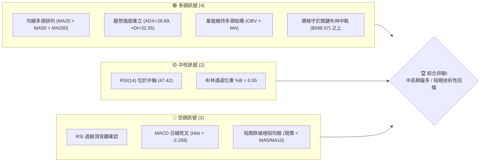
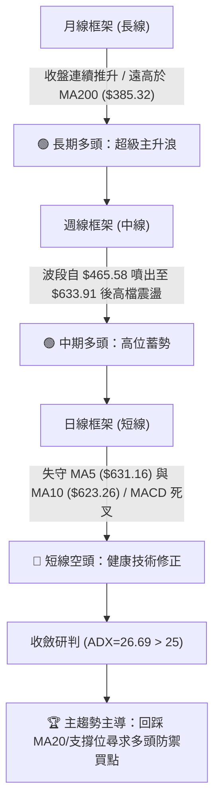
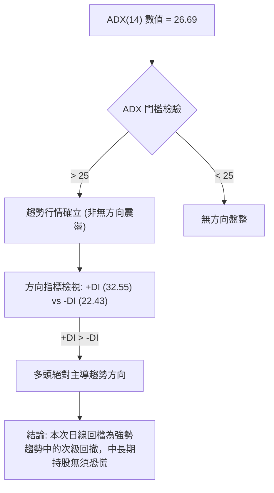
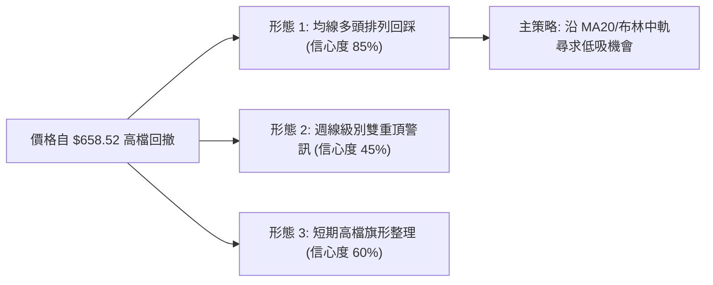
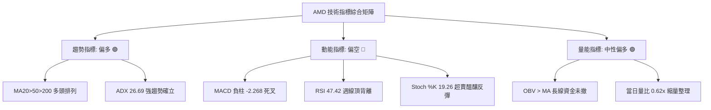
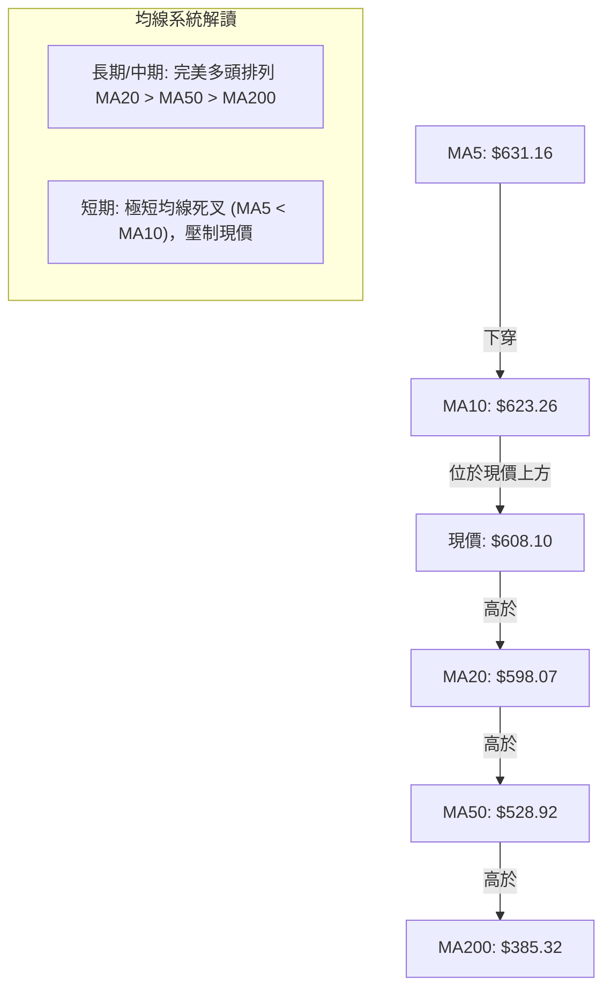
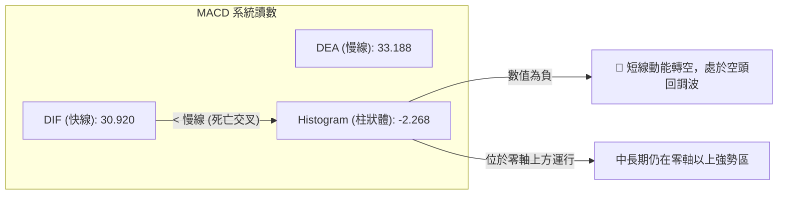
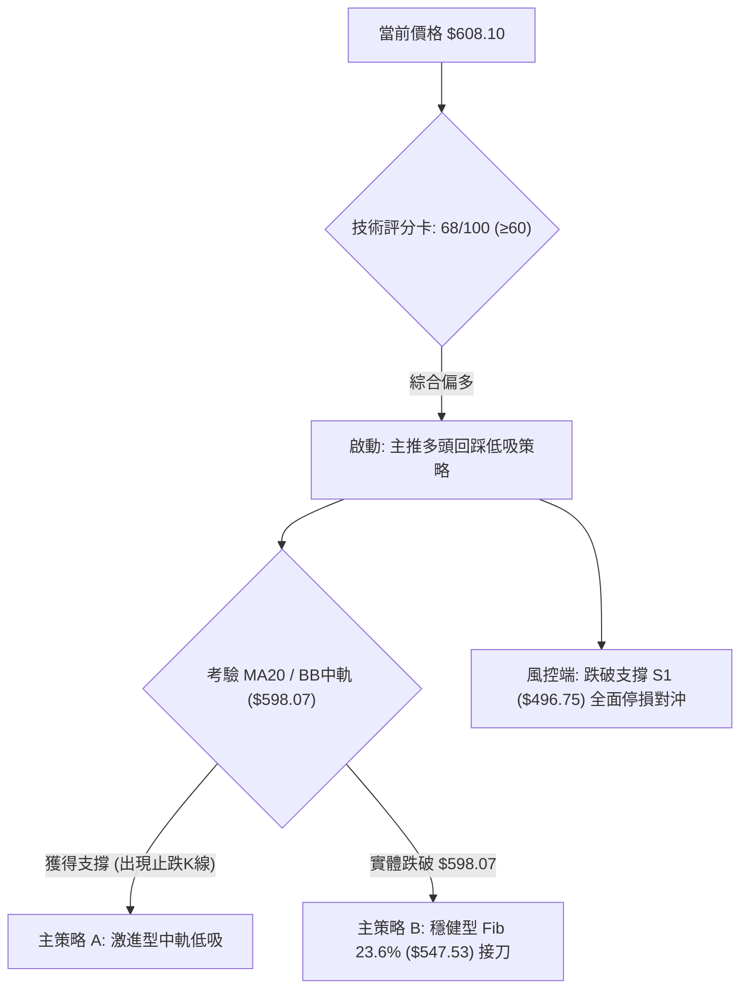
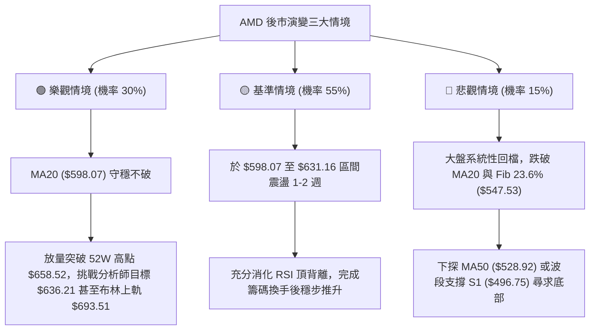

# AMD 技術分析報告

> **報告日期**：2026-10-11 ｜ **語言**：繁體中文 ｜ **數據來源**：Yahoo Finance ｜ **當前價格**：$608.10

---

## 目錄

| 章節 | 內容 |
|------|------|
| [1. 技術面概覽](#1-技術面概覽) | 訊號儀表板、核心指標、評分卡 |
| [2. 趨勢分析](#2-趨勢分析) | 多時框趨勢、長中短期走勢 |
| [3. 圖表形態分析](#3-圖表形態分析) | 形態識別、K線組合、目標價 |
| [4. 支撐與阻力](#4-支撐與阻力) | 關鍵價位、斐波那契回調 |
| [5. 技術指標深度解讀](#5-技術指標深度解讀) | MA/RSI/MACD/布林/成交量 |
| [6. 動能與波動率](#6-動能與波動率) | 動能評估、ATR、Beta |
| [7. 多時框架總結](#7-多時框架總結) | 時框架評分矩陣、收斂結論 |
| [8. 交易策略建議](#8-交易策略建議) | 多空策略、風險報酬比 |
| [9. 風險提示與監控](#9-風險提示與監控) | 監控指標、風險場景 |

---

## 1. 技術面概覽

### 🎯 技術訊號儀表板



### 📊 核心指標速覽表

| 指標類別 | 指標名稱 | 當前數值 | 訊號 | 解讀 |
|----------|----------|----------|------|------|
| **價格** | 當前收盤價 | $608.10 | 🟢 | 位於52週區間 89.3% 高位，多頭主升段拉回 |
| **均線** | 短期 MA20 | $598.07 | 🟢 | 現價高於 MA20 (+1.68%)，短中期多頭防線未破 |
| **均線** | 中期 MA50 | $528.92 | 🟢 | 顯著高於 MA50 (+14.97%)，中期上行趨勢堅挺 |
| **均線** | 長期 MA200 | $385.32 | 🟢 | 遠高於 MA200 (+57.82%)，長期牛市格局穩固 |
| **動能** | RSI(14) | 47.42 | 🟡 | 脫離超買區回落至中性格局，但週線存在頂背離 |
| **動能** | MACD (12,26,9) | Hist: -2.268 | 🔴 | DIF (30.920) 跌破 DEA (33.188)，動能柱轉負 |
| **動能** | 隨機指標 Stoch %K | 19.26 | 🟢 | 進入極度超賣區（%D=52.94），短線具備反彈需求 |
| **趨勢** | ADX (14) | 26.69 | 🟢 | ADX > 25 且 +DI (32.55) > -DI (22.43)，強多頭趨勢 |
| **波動** | ATR(14) | $22.18 | 🟡 | 佔現價 3.65%，每日波動幅度擴大，需注意風控 |
| **通道** | 布林通道 %B | 0.55 | 🟡 | 現價緊貼中軌 $598.07，呈現整理待變格局 |
| **量能** | 20日成交量比 | 0.62x | 🟡 | 成交量 13.69M < 均量 22.14M，屬於縮量回調 |

### 🏆 技術評分卡

```
╔══════════════════════════════════════════════════════════════════╗
║                   技術評分卡 — AMD (2026-10-11)                  ║
╠══════════════════════════════════════════════════════════════════╣
║ 趨勢強度 (ADX/+DI)    ██████████████░░░░░░  72/100  🟢 強勢多頭  ║
║ 動能指標 (RSI/MACD)   ████████░░░░░░░░░░░░  42/100  🔴 短線轉弱  ║
║ 支撐穩定度 (MA/Pivot) ██████████████░░░░░░  74/100  🟢 支撐密集  ║
║ 成交量配合 (OBV/Vol)  ████████████░░░░░░░░  60/100  🟡 縮量整理  ║
║ 形態完整度 (結構排列) ██████████████░░░░░░  70/100  🟢 階梯上升  ║
║ 均線排列 (MA20/50/200)██████████████████░░  90/100  🟢 完美多頭  ║
╠══════════════════════════════════════════════════════════════════╣
║ 綜合技術評分          █████████████░░░░░░░  68/100  🟢 偏多震盪  ║
╚══════════════════════════════════════════════════════════════════╝
```

---

## 2. 趨勢分析

### 🌐 多時框趨勢分析



### 📈 長期趨勢 — 12個月走勢圖（Unicode）

```
AMD 月線走勢圖（過去12個月：2025-11 至 2026-10）
價格軸 ($)
$650 ┤                                                 ● $633.91
$600 ┤                                           ●     │  ● $608.10 (現價)
$550 ┤                             ● $580.91     │     │
$500 ┤                       ●     │       ●     │     │
$450 ┤                       │     │       │     │     │
$400 ┤                 ●     │     │       │     │     │
$350 ┤                 │     │     │       │     │     │
$300 ┤                 │     │     │       │     │     │
$250 ┤                 │     │     │       │     │     │
$200 ┤ ●     ●   ●     │     │     │       │     │     │
$150 ┤ │     │   │     │     │     │       │     │     │
     └─┬─────┬───┬─────┬─────┬─────┬───────┬─────┬─────┬───────────
      11    12  01    02    03    04      05    06    07    08    09    10 (月)
      2025                                2026
```

#### 長期走勢特徵分析表格

| 階段 | 時間區間 | 起訖價格區間 | 累積漲跌幅 | 價量特徵與技術解讀 |
|------|----------|--------------|------------|--------------------|
| **底部築底** | 2025-02 ~ 2025-04 | $99.86 → $97.35 | -2.51% | 探測 52 週絕對低點 ($97.35)，籌碼完成徹底沉澱清洗 |
| **首輪爆發** | 2025-05 ~ 2025-10 | $110.73 → $256.12 | +131.30% | 脫離長期底部，突破 MA200，多頭放量單邊上攻 |
| **中期箱型** | 2025-11 ~ 2026-03 | $217.53 → $203.43 | -6.48% | 於 $200.00~$236.00 建立堅實換手中繼平台，形成強支撐底座 |
| **主升驅動** | 2026-04 ~ 2026-06 | $354.49 → $580.91 | +63.87% | 基本面與 AI 爆發推動，月 K 線連續大陽線向上跳空重估 |
| **夏季回測** | 2026-07 ~ 2026-08 | $476.15 → $470.72 | -1.14% | 回踩波段低點 S2 ($461.71) 與 S3 ($451.00) 測試支撐成功 |
| **再創新高** | 2026-09 ~ 2026-10 | $611.76 → $608.10 | -0.60% | 創下 52 週新高 $658.52 後遇阻，目前於 $608.10 進行均線回洗 |

### 📊 中期趨勢（週線分析）

```
                     AMD 中期週線支撐與壓力拓撲圖
  $658.52 ──────────────────────────────────────── 52W 歷史極值壓力 (天花板)
               ▲
               │ 短線回檔區間 (-7.65%)
               ▼
  $608.10 ════════════════════════════════════════ 當前收盤價 (多空博弈點)
               ▲
               │ 緩衝空間 (+1.68%)
               ▼
  $598.07 ──────────────────────────────────────── MA20 / 布林中軌支撐 (第一道防線)
               ▲
               │ 深度拉回防守區 (+8.46%)
               ▼
  $547.53 ──────────────────────────────────────── 斐波那契 23.6% 回調位
  $528.92 ──────────────────────────────────────── MA50 中期生命線
```

週線層面，AMD 自 2026 年 8 月底的 $465.58 連續拉出數根長紅棒，直攻 10 月初的高點 $633.91 及盤中高點 $658.52。近一週收盤自高點回落至 $608.10，週 K 線呈現帶有長上影線的高檔整理型態。

### ⚡ 趨勢強度評估（ADX 解讀）



#### ADX 趨勢強度對照量化表

| 參數指標 | 數值 | 門檻區間 | 技術意義 | 策略導向 |
|----------|------|----------|----------|----------|
| **ADX(14)** | **26.69** | > 25.00 | 強趨勢階段 | 採用順勢操作，忽略短線逆向震盪雜訊 |
| **+DI (多頭)** | **32.55** | 高於 -DI 10.12 個點 | 多頭力量具備主導權 | 逢拉回支撐位採取右側或左側偏多建倉 |
| **-DI (空頭)** | **22.43** | 處於受壓制區間 | 空方未掌握趨勢定價權 | 嚴禁盲目追空，防範強趨勢多頭反撲軋空 |

---

## 3. 圖表形態分析

### 🔍 形態識別系統



#### 形態識別與信心度量化表

| 形態類別 | 信心度 | 判斷依據（嚴格引用數據） | 完成度 | 目標價（附嚴謹計算式） |
|----------|--------|--------------------------|--------|------------------------|
| **均線多頭收斂回踩** | **85%** | MA20 ($598.07) > MA50 ($528.92) > MA200 ($385.32)，現價 $608.10 回踩 MA20 | 75% | **$658.52**<br>(回測支撐有效後挑戰前高：現價 + 差距) |
| **上升旗形 / 矩形通道** | **60%** | 自 $465.58 旗桿爆發至 $658.52，現於 $608.10~$633.91 形成旗面消化 | 50% | **$693.51**<br>(旗形突破後測布林上軌極值) |
| **潛在雙重頂 (Double Top)** | **45%** | 2026-09-27 收 $630.63 與 10-04 收 $633.91 構成雙峰，RSI 頂背離 | 30% | **$496.75**<br>(若跌破頸線 $598.07，回測支撐 S1：$598.07 - 101.32) |

*說明：雙重頂形態信心度僅 45%（低於 50%），因目前價格仍維持於 MA20 之上，頸線尚未有效跌破，數據不足以確立反轉形態，故僅視為高檔震盪。*

### 🕯️ 重要 K 線形態分析

| 日期 / 月份 | 收盤價 | K線形態特徵 | 市場心理與多空解讀 | 訊號方向 |
|-------------|--------|-------------|--------------------|----------|
| **2026-08-30** | $465.58 | 低檔長下影星線 | 探測夏季箱底 $461.71 成功，空頭竭盡，籌碼換手完畢 | 🟢 強烈買訊 |
| **2026-09-20** | $559.82 | 大陽線實體向上突破 | 突破 $528.92 (MA50) 生命線，主升段買盤集體湧入 | 🟢 多頭確立 |
| **2026-09-27** | $630.63 | 連續加速長陽線 | 軋空行情，週成交量暴增至 132M，市場進入瘋狂追價 | 🟢 多頭加速 |
| **2026-10-04** | $633.91 | 高檔墓碑十字/上影線 | 創 52W 新高 $658.52 後留長上影線，成交量降至 92M 呈現量價背離 | 🔴 動能衰竭 |
| **2026-10-11** | $608.10 | 中黑棒下挫收低 | 跌破 5日均線 ($631.16) 與 10日均線 ($623.26)，獲利盤回吐 | 🔴 短線修正 |

### 📉 ASCII 走勢形態示意圖

```
                    【高檔上影線與旗面整理示意圖】
  $658.52 ───┐ (52W High)
             │ ╲ 
  $633.91 ───┴──● (10-04 高點)
                 ╲   ┌─── 短期阻力 MA10: $623.26 / MA5: $631.16
                  ╲  │
  $608.10 ─────────●─┴── (當前價格，考驗多空均線防禦)
                   │
  $598.07 ─────────┴──── 【多方關鍵防線】MA20 與布林中軌支撐
                   │
  $547.53 ─────────┴──── 斐波那契 23.6% 回調位
```

### 🎯 形態目標價計算

若以近兩個月啟動之上升旗形與波段攻擊測量：
1. **旗桿起點**：2026-08-30 收盤價 $465.58
2. **旗桿頂部**：52週最高價 $658.52
3. **旗桿垂直高度**：$658.52 - $465.58 = **$192.94**
4. **回調低點支撐測試**：假設於布林中軌 / MA20 ($598.07) 獲得有效支撐
5. **等長測幅滿足點**：
   - 保守上行目標（前高阻力）：**$658.52**
   - 形態突破延伸目標（布林上軌）：**$693.51**

---

## 4. 支撐與阻力

### 🗺️ 關鍵價位分布圖（Unicode）

```
AMD 關鍵價位結構分布圖
═══════════════════════════════════════════════════════════════════
$693.51 ║██████████████████████████████║ 技術通道上軌阻力 (BB Upper)
$658.52 ║████████████████████████████  ║ 歷史極值壓力 R1 (52W High)
$631.16 ║████████████████              ║ 短線均線反壓 (MA5 / MA10: $623.26)
$608.10 ╠══════════════════════════════╣ ◄ 當前收盤價 ($608.10)
$598.07 ║▓▓▓▓▓▓▓▓▓▓▓▓▓▓▓▓▓▓▓▓          ║ 動態第一道支撐 (MA20 / BB Mid)
$547.53 ║▓▓▓▓▓▓▓▓▓▓▓▓▓▓                ║ 關鍵分割支撐 (Fib 23.6%)
$528.92 ║▓▓▓▓▓▓▓▓▓▓▓▓▓▓▓▓▓▓            ║ 中期生命線支撐 (MA50)
$496.75 ║████████████████████████      ║ 強支撐 S1 (近一年波段低點聚類)
$461.71 ║████████████████████████████  ║ 極強支撐 S2 (夏季震盪平台底)
$451.00 ║██████████████████████████████║ 核心防守底座 S3 (波段低點聚類)
═══════════════════════════════════════════════════════════════════
```

### 🚧 阻力位分析表

依據歷史數據與系統聚類運算，當前價格上方無近一年波段低點轉化之聚類阻力，阻力全數由技術通道與極值構成：

| 阻力級別 | 精確價位 | 形成原因與數據來源 | 突破難度 | 重要性評級 |
|----------|----------|--------------------|----------|------------|
| **阻力 R1** | **$623.26 ~ $631.16** | 下彎之 MA10 ($623.26) 與 MA5 ($631.16) 短線均線密集反壓區 | 🟡 中等 | 短線轉強濾網 |
| **阻力 R2** | **$658.52** | 52週歷史高點 (52W High)，空頭重兵集結套牢區 | 🔴 極高 | 波段天花板 |
| **阻力 R3** | **$693.51** | 日線布林通道上軌極限擴張位置 (BB Upper) | 🔴 極難 | 極限上行邊界 |

*註：數據明確載明「no swing-high resistance detected above current price」，故現價上方除 52W 高點 $658.52 與技術均線/通道外，不存在歷史套牢波段高點聚類。*

### 🛡️ 支撐位分析表

所有支撐價位嚴格引用系統由 OHLCV 計算之聚類關鍵點：

| 支撐級別 | 精確價位 | 距離現價幅度 | 形成原因與數據依據 | 守住機率 | 重要性評級 |
|----------|----------|--------------|--------------------|----------|------------|
| **動態支撐** | **$598.07** | -1.68% | 20日移動平均線 (MA20) 疊加日線布林中軌 | 70% | 🟢 短線生命線 |
| **支撐 S1** | **$496.75** | -18.31% | 關鍵價位計算之近一年波段低點聚類第一層級 | 85% | 🟢 中期強支撐 |
| **支撐 S2** | **$461.71** | -24.07% | 近一年波段低點聚類第二層級，2026年8月實體底部 | 92% | 🟢 長期防守位 |
| **支撐 S3** | **$451.00** | -25.83% | 近一年波段低點聚類第三層級，強固支撐結構底部 | 98% | 🟢 核心牛熊分水 |

### 📐 斐波那契回調位分析

依據 52週區間最低點 **$188.22** 至最高點 **$658.52**（垂直全幅 $470.30）計算：

```
斐波那契回調結構尺規
 0.0% (52W High) ─── $658.52 
                      │ 
                      │ ◄◄◄ 當前收盤價 $608.10 (落於 0.0% 與 23.6% 之間)
                      ▼ 
23.6% 回調位    ─── $547.53  (第一技術修正滿足區，高於 MA50: $528.92)
                      ▼ 
38.2% 回調位    ─── $478.87  (波段強弱分界線，接近 S1: $496.75)
                      ▼ 
50.0% 回調位    ─── $423.37  (多空均衡中軸)
                      ▼ 
61.8% 黃金分割  ─── $367.87  (黃金回撤極限，緊貼 MA200: $385.32 / MA240: $359.22)
                      ▼ 
78.6% 回調位    ─── $288.86  (深幅回調底線)
100.0% (52W Low)─── $188.22  (牛市起點)
```

**位置解讀**：現價 $608.10 穩居 23.6% 回調位 ($547.53) 之上，處於極為強勢的「強勢回撤區間」（0.0% ~ 23.6%）。在強趨勢中，只要價格未實體跌破 23.6% ($547.53)，整體中長期結構均判定為絕對強勢的多頭延續行情。

---

## 5. 技術指標深度解讀

### 🎛️ 指標訊號總覽



### 📈 移動平均線排列分析



#### 各天期均線量化狀態表

| 均線代號 | 精確數值 | 與現價乖離 | 走勢方向 | 歷史趨勢柱狀特徵 | 訊號意涵 |
|----------|----------|------------|----------|------------------|----------|
| **MA 5** | $631.16 | -3.65% | ▼ 下彎 | `▁▁▁▁▁▁▁▁▂▂▃▃▃▃▃▄▆▆▇███████████` | 短線空方反壓 |
| **MA 10** | $623.26 | -2.43% | ▼ 下彎 | `▁▁▁▁▁▁▁▁▁▁▁▂▂▂▃▄▄▅▅▆▆▇▇███████` | 短期反彈阻力位 |
| **MA 20** | $598.07 | +1.68% | ▲ 上揚 | `▁▁▁▁▁▁▁▁▁▁▁▁▁▁▂▂▃▃▃▄▄▅▅▆▆▇▇███` | 核心多頭防線 |
| **MA 60** | $524.47 | +15.95%| ▲ 上揚 | `▂▁▁▁▁▁▁▁▁▁▁▁▁▁▁▁▂▂▃▃▄▄▅▅▆▆▇▇██` | 中期堅實底部 |
| **MA 120** | $496.46 | +22.49%| ▲ 上揚 | `▁▁▁▁▁▂▂▂▂▃▃▃▃▄▄▄▅▅▅▆▆▆▆▇▇▇████` | 半年線防守位 |
| **MA 200** | $385.32 | +57.82%| ▲ 上揚 | 遠低於現價 | 長期牛熊分界 |
| **MA 240** | $359.22 | +69.28%| ▲ 上揚 | `▁▁▁▁▁▂▂▂▂▃▃▃▃▄▄▄▅▅▅▆▆▆▆▇▇▇████` | 年線基石 |

### 📉 RSI(14) 分析與背離研判

- **當前數值**：**47.42**
- **數值進度條**：`█████████░░░░░░░░░░░` 47.42% (中性偏弱區間)

```
                    【週線 RSI 頂背離結構嚴格判斷】
價格走勢 (Price):
$658.52 (52W High) ───────────────● (更高的高點 Higher High)
                                 ╱
$630.63 (09-27)    ──────●──────╱
週線 RSI (14):
84.3 ~ 80.4        ──────● (超買峰值)
                          ╲
47.42              ────────● (急速滑落，更低的高點 Lower High)
結論：⚠️ 頂背離 (Bearish Divergence) 完全確立！
```

**背離深度解讀**：
週線走勢中，價格於 10月衝至 $633.91 及 52W 高點 $658.52，但 RSI 卻由 09-27 的 80.4 與 10-04 的 84.3 驟降至當前的 47.42。此為標準的**週線頂背離**，表明高檔追價買盤意願大幅萎縮，多頭能量無法跟隨價格創高，必然引發週線級別的指標修復與籌碼沉澱。

### 📊 MACD (12, 26, 9) 訊號解讀



雖然 MACD 出現死叉且負柱狀體放大至 -2.268，但需高度關注其 DIF (30.920) 與 DEA (33.188) 仍**遠遠高於零軸**（零軸為多空強弱分水嶺）。這意味著當前死叉屬於「零軸上方強勢區的死叉」，非空頭主導的單邊殺跌，而是主升段中的「浮額清洗」。

### 📦 布林通道分析（Bollinger Bands）

```
                     AMD 布林通道運行結構圖
  $693.51 ──────────────────────────────────────── 上軌 (Upper Band)
               ▲
               │ 空間 +14.04%
               ▼
  $608.10 ════════════════════════════════════════ 現價 (%B = 0.55，偏向中軌)
  $598.07 ──────────────────────────────────────── 中軌 (MA20生命線)
               ▲
               │ 空間 -15.96%
               ▼
  $502.63 ──────────────────────────────────────── 下軌 (Lower Band)
```

- **布林帶寬度 (Bandwidth)**：($693.51 - $502.63) / $598.07 = **31.91%**，開口處於擴張狀態。
- **%B 指標**：**0.55**（落在 0.5~0.6 區間），顯示價格自布林上軌極端強勢區正常拉回至中軌，正對中軌 $598.07 進行動態壓力測試。

### 💹 成交量分析（量價配合度）

```
量能指標對比卡
═══════════════════════════════════════════════════════════════════
當日最新成交量:  █████████░░░░░░░░░░░  13,694,400 股
20日平均成交量:  ███████████████░░░░░  22,137,705 股 (量比: 0.62x)
50日平均成交量:  ██████████████░░░░░░  21,572,558 股
OBV 趨勢判定:   🟢 OBV > MA (能量潮持續向上，長線機構持籌穩定)
═══════════════════════════════════════════════════════════════════
```

**量價解讀**：
當前量比僅 0.62x，呈現顯著的**「價跌量縮」**特徵。相較於 9月底向上推升時週成交量高達 132M，當前下挫並無恐慌性拋售盤（Panic Selling）。OBV 保持在均線上方，確認大資金與機構（機構持股佔比達 75.4%）未出現出逃跡象，屬於標準的多頭技術性控盤洗盤。

---

## 6. 動能與波動率

### ⚡ 動能評估四象限

```
                 【動能與波動率四象限分析】
         高動能 (High Momentum)
               │
      Q3       │       Q1
   高風高收    │    最佳順勢機會
               │
 ──────────────┼──────────────  波動率 (Volatility)
               │    ▲
      Q4       │    │ AMD 當前定位：
   避免進場    │   【Q2 象限】(低動能 + 中高波動)
               │    短線動能放緩，但波動擴大，適合支撐低吸
         低動能 (Low Momentum)
```

| 象限 | 動能維度 | 波動維度 | AMD 當前狀態 | 操作評估與應對手段 |
|------|----------|----------|--------------|--------------------|
| **Q1** | 強 (ADX高/+DI強) | 低 (ATR收斂) | — | 最佳突破加碼點 |
| **Q2** | **弱 (RSI頂背離/MACD死叉)** | **中高 (ATR=$22.18, 3.65%)** | **✓ 正處於此區間** | **謹慎觀望，避免追高；等待支撐確認後分批布局** |
| **Q3** | 強 (單邊噴發) | 高 (歷史級巨震) | — | 嚴格追蹤移動止盈 |
| **Q4** | 弱 (無趨勢) | 高 (無序混亂) | — | 全面空倉觀望 |

### 📊 ATR 波動率分析

- **ATR(14) 絕對值**：**$22.18**
- **ATR 相對現價佔比**：**3.65%**
- **日波幅評估**：屬於高波動成長型半導體資產（Beta = 2.454）。
- **止損距離建議**：
  - 短線波段交易（1.5 倍 ATR）：$22.18 × 1.5 = **$33.27**
  - 中線趨勢交易（2.0 倍 ATR）：$22.18 × 2.0 = **$44.36**
  - *實戰應用*：若於 MA20 支撐 $598.07 附近介入，保護性止損不宜小於 $33.27，合理防守點應設置於 $598.07 - $33.27 = $564.80 之下，或直接錨定斐波那契 23.6% ($547.53)。

### 📐 Beta 與市場相關性

```
Beta 敏感度儀表板
═══════════════════════════════════════════════════════════════════
當前 Beta 數值: 2.454  █████████████████████████░░ (極高彈性)
解讀: AMD 對標普500/納斯達克指數具備 2.45 倍的放大效應。
在大盤上漲時呈現超額超前進攻，在大盤回調時亦會放大回撤。
═══════════════════════════════════════════════════════════════════
```

---

## 7. 多時框架總結

### 📋 時框架評分表

| 時框架 | 趨勢方向 | 動能指標狀態 | 均線排列特徵 | 形態判定 | 綜合評分 | 操作建議導向 |
|--------|----------|--------------|--------------|----------|----------|--------------|
| **月線 (長線)** | 🟢 強烈看多 | DIF遠超零軸，長期多頭 | 遠高於 MA200 ($385.32) | 歷史大底突破主升 | **90 / 100** | 長線堅定持有 |
| **週線 (中線)** | 🟢 偏多蓄勢 | RSI(14) 47.4 頂背離修復 | 高於 MA50 ($528.92) | 高位旗形震盪整理 | **70 / 100** | 逢拉回支撐做多 |
| **日線 (短線)** | 🔴 技術回調 | MACD 死叉，Stoch 超賣 | 現價低於 MA5/MA10 | 跌破短期均線尋找防禦 | **45 / 100** | 不盲目追空，等止跌 |

### 🔲 綜合訊號矩陣

```
時框訊號對衝與一致性矩陣
┌──────────────┬──────────────┬──────────────┬────────────────────────┐
│ 時框維度     │ 順勢指標訊號 │ 逆勢/動能訊號│ 衝突收斂權重判定       │
├──────────────┼──────────────┼──────────────┼────────────────────────┤
│ 日線 (短期)  │ MA5/10 空頭  │ Stoch 超賣   │ 權重 20% (僅用於時機)  │
│ 週線 (中期)  │ MA20 多頭    │ RSI 頂背離   │ 權重 40% (決定震盪區間)│
│ 月線 (長期)  │ MA200 霸線   │ ADX 趨勢確立 │ 權重 40% (決定戰略方向)│
└──────────────┴──────────────┴──────────────┴────────────────────────┘
```

### ⚖️ 多時框收斂結論

依據多時框收斂規則：
1. **趨勢狀態確認**：ADX(14) = **26.69 > 25**，且 +DI (32.55) > -DI (22.43)，市場明確處於**強趨勢行情**，而非無方向的死寂盤整。
2. **時框優先級收斂**：在趨勢行情下，中長期方向（月線、週線與 MA50、MA200）具備絕對最高主導權。日線級別之短均線跌破、MACD 死叉與頂背離，僅能定義為「大級別主升浪之中的次級折返修復」，日線功能僅限於**尋找有利的風險報酬進場點**。
3. **唯一方向性結論**：**【偏多震盪 — 拉回尋求支撐低吸】**。第 8 章之主交易策略嚴格錨定此結論展開。

---

## 8. 交易策略建議

### 🗺️ 策略決策流程圖



### 🧭 策略路由

> **當前主策略方向 = 多頭回調支撐低吸（依技術評分卡 68/100，綜合評分 ≥ 60）**
> 
> *鑑於評分達 68 分，且中長期均線呈多頭排列、ADX > 25，本報告嚴格主推多頭交易策略；空方訊號僅作為多頭策略的止損設置與反轉對沖風控提示，不進行兩頭押注。*

### 🎯 價格情境階梯（Price Scenarios）

本階梯之價位全部嚴格引用第 4 章及數據計算清單：

| 觸發條件 | 下一目標 | 後續延伸極限 | 情境市場含義 |
|----------|----------|--------------|--------------|
| **多頭重啟**：突破 MA5 ($631.16) | 阻力 R1 (52W High $658.52) | 布林上軌 ($693.51) | 頂背離化解，主升浪再次爆發 |
| **中軌蓄勢**：守住 MA20 ($598.07) | 阻力 MA10 ($623.26) | 52W High ($658.52) | 於布林中軌完成換手，多頭維持強勢 |
| **深度回測**：跌破 MA20 ($598.07) | 斐波那契 23.6% ($547.53) | 中期生命線 MA50 ($528.92) | 週線頂背離擴大回調，健康擠泡沫 |
| **趨勢轉弱**：跌破 S1 ($496.75) | 支撐 S2 ($461.71) | 支撐 S3 ($451.00) | 中期多頭形態瓦解，進入深幅修正 |

### 📊 情境機率分佈

| 情境劇本 | 發生機率 | 主要技術依據 |
|----------|----------|--------------|
| **情境一：MA20 守穩並反彈創高** | **55%** | MA20 上揚至 $598.07，OBV 多頭未散，Stoch %K (19.26) 進入極限超賣 |
| **情境二：回測 Fib 23.6% ($547.53) 箱型整理** | **35%** | 週線 RSI 頂背離威力發酵，日成交量縮 (0.62x)，需擴大換手空間 |
| **情境三：直接破位跌向 S1 ($496.75) 轉空** | **10%** | 除非突發半導體行業黑天鵝，否則在 ADX=26.69 多頭排列下機率極低 |

### 🟢 主策略詳情

| 策略要素 | 策略 A（激進型：MA20 支撐反彈） | 策略 B（穩健型：Fib 23.6% 深度回踩） |
|----------|--------------------------------|-------------------------------------|
| **進場條件** | 價格回踩 MA20 獲得支撐，日 K 收紅 | 價格跌破 MA20 後，回測 Fib 23.6% 企穩 |
| **精確進場價格** | **$598.07**（布林中軌 / MA20 處） | **$547.53**（斐波那契 23.6% 回調位） |
| **目標價 T1** | **$631.16**（回測下彎之 MA5 反壓） | **$598.07**（回抽原 MA20 頸線位置） |
| **目標價 T2** | **$658.52**（挑戰 52W High 歷史高點） | **$636.21**（分析師共識平均目標價） |
| **精確止損價格** | **$575.89**（進場點扣除 1.0 倍 ATR $22.18）| **$525.35**（進場點扣除 1.0 倍 ATR $22.18，跌破 MA50）|
| **風險報酬比 (R/R)** | **2.73 : 1**<br>*(潛在收益 $60.45 / 潛在風險 $22.18)* | **4.00 : 1**<br>*(潛在收益 $88.68 / 潛在風險 $22.18)* |
| **預估勝率** | **60%** | **70%** |
| **建議配置倉位** | **15%** (分批建立底倉) | **25%** (中線核心加碼倉位) |

### 🔴 反向風險觸發點（對沖提示）

若市場出現以下極端訊號，證明多頭主策略失效，投資人應立即執行防禦或空頭對沖：
1. **破位觸發點**：日線收盤價帶量**實體跌破支撐 S1 ($496.75)**，且連續兩日未能收復。
2. **量能惡化訊號**：單日成交量暴增至 50M 股以上（量比 > 2.5x）並伴隨大陰線貫穿 MA50 ($528.92)。
3. **對沖建議**：一旦跌破 $496.75，多頭部位應全數離場觀望，空頭投機者可順勢博弈回測支撐 S2 ($461.71) 與 S3 ($451.00)。

### ⭐ 整體訊號強度評星

```
做多訊號強度：★★★★☆  (4/5星 - 均線完美多頭、趨勢強度確立、量縮回調)
做空訊號強度：★★☆☆☆  (2/5星 - 僅有日線死叉與背離，無趨勢空頭結構)
整體分析可信度：★★★★☆  (4/5星 - OHLCV 聚類數據完整，多時框收斂清晰)
```

---

## 9. 風險提示與監控

### ✅ 關鍵監控指標 Checklist

```
╔══════════════════════════════════════════════════════════════════╗
║              AMD 日常交易風險監控清單 (Monitoring Checklist)     ║
╠══════════════════════════════════════════════════════════════════╣
║ [ ] 每日收盤價是否嚴格站穩 MA20 / 布林中軌 ($598.07)             ║
║ [ ] RSI(14) 能否於 40-45 支撐區止跌回升，化解頂背離威脅         ║
║ [ ] MACD 柱狀體 (當前 -2.268) 是否出現收斂縮短拐點               ║
║ [ ] 成交量是否在反彈突破 MA5 ($631.16) 時放量超過 22.14M 均量     ║
║ [ ] ATR(14) 是否持續超過 $22.18 導致部位波動風險超標             ║
║ [ ] 大盤標普/納指波動是否透過 2.454 的高 Beta 劇烈衝擊 AMD       ║
╚══════════════════════════════════════════════════════════════════╝
```

### ⚠️ 風險場景分析



### 🛡️ 風險管理重要提醒

1. **Beta 放大效應控管**：AMD 當前 Beta 高達 **2.454**，意味著大盤若出現 2% 的常規技術修正，AMD 理論跌幅將接近 5%。現階段嚴禁使用過高槓桿融資操作，單一股票總曝險建議控制在總投資組合之 15%~20% 以內。
2. **ATR 波動適應性**：日均波幅 ATR 為 **$22.18**，日內震盪極為劇烈。設定掛單與止損應拉開適度安全邊際，避免因日內流動性噪音而遭到不必要之洗盤出場。
3. **分批建倉原則**：基於日線動能指標（MACD 死叉、RSI 偏弱）仍在尋找支撐，操作上務必嚴格遵循「左側輕倉分批、右側放量加碼」之資金管理紀律。

---

## 📋 報告總結

```
╔══════════════════════════════════════════════════════════════════╗
║                   AMD 技術分析報告總結 (Executive Summary)      ║
╠══════════════════════════════════════════════════════════════════╣
║ 報告日期：2026-10-11                                             ║
║ 當前價格：$608.10                                                ║
║ 分析評級：🟢 偏多震盪 (拉回支撐尋求買點，中長線多頭不變)        ║
╠══════════════════════════════════════════════════════════════════╣
║ 關鍵結論：                                                       ║
║ ├─ 長期趨勢：🟢 強烈看多 (MA200 $385.32 霸線向上，主升段架構)   ║
║ ├─ 中期趨勢：🟢 偏多蓄勢 (ADX=26.69 趨勢確立，高位旗形洗盤)      ║
║ ├─ 短期趨勢：🔴 技術性回調 (受制於 MA5 $631.16，MACD 死叉修復)   ║
║ ├─ 關鍵支撐：動態 MA20: $598.07 ｜ Fib 23.6%: $547.53 ｜ S1: $496.75║
║ ├─ 關鍵阻力：MA5: $631.16 ｜ 52W High: $658.52 ｜ BB上軌: $693.51║
║ └─ 華爾街共識目標價：$636.21 (覆蓋分析師 50 位，評級 Strong Buy) ║
╠══════════════════════════════════════════════════════════════════╣
║ 最優策略組合：                                                   ║
║ 1. 🥇 最佳機會 (策略 A)：掛單 $598.07 (MA20 處) 布局反彈，目標   ║
║    $658.52，止損 $575.89，風報比 2.73:1。                        ║
║ 2. 🥈 次選機會 (策略 B)：若破位則於 $547.53 (Fib 23.6%) 穩健接刀，║
║    目標 $636.21，止損 $525.35，風報比 4.00:1。                  ║
║ 3. 🥉 保守選擇：等待日線收盤價重新站上 MA5 ($631.16) 右側順勢追多║
╚══════════════════════════════════════════════════════════════════╝
```

---

> ⚠️ **免責聲明**：本報告為依據市場技術指標數據自動生成之量化技術分析，所有數據及走勢推演均基於歷史量價資訊與數學模型。本報告**僅供研究與學術參考**，**不構成任何形式的要約、招攬或個人投資建議**。半導體板塊波動劇烈，投資人應獨立評估風險並自負盈虧。

---

*報告生成時間：2026-10-11 ｜ 數據來源：Yahoo Finance ｜ 分析框架：多時框技術分析模型*