# AMD 技術分析報告

> **報告日期**：2026-10-12 ｜ **語言**：繁體中文 ｜ **數據來源**：Yahoo Finance ｜ **當前價格**：$608.10

---

## 目錄

| 章節 | 內容 |
|------|------|
| [1. 技術面概覽](#1-技術面概覽) | 訊號儀表板、核心指標、評分卡 |
| [2. 趨勢分析](#2-趨勢分析) | 多時框趨勢、長中短期走勢 |
| [3. 圖表形態分析](#3-圖表形態分析) | 形態識別、K線組合、目標價 |
| [4. 支撐與阻力](#4-支撐與阻力) | 關鍵價位、斐波那契回調 |
| [5. 技術指標深度解讀](#5-技術指標深度解讀) | MA/RSI/MACD/布林/成交量 |
| [6. 動能與波動率](#6-動能與波動率) | 動能評估、ATR、Beta |
| [7. 多時框架總結](#7-多時框架總結) | 時框架評分矩陣 |
| [8. 交易策略建議](#8-交易策略建議) | 多空策略、風險報酬比 |
| [9. 風險提示與監控](#9-風險提示與監控) | 監控指標、風險場景 |
| [報告總結](#-報告總結) | 關鍵結論與策略清單 |

---

## 1. 技術面概覽

### 🎯 技術訊號儀表板

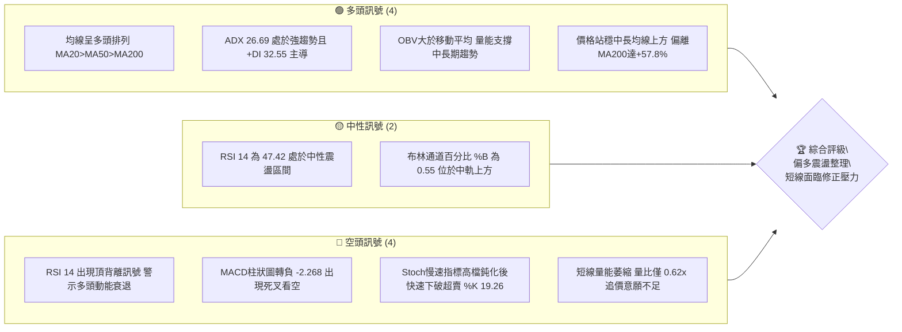

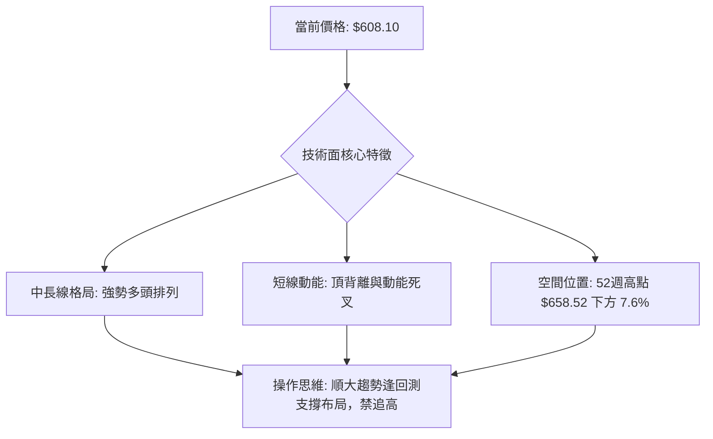

### 📊 核心指標速覽表

| 指標類別 | 指標名稱 | 當前數值 | 訊號 | 解讀 |
|----------|----------|----------|------|------|
| **價格** | 當前價格 | $608.10 | 🟢 | 位於52週區間89.3%高位，長線牛市格局未破 |
| **均線** | MA20 | $598.07 | 🟢 | 價格在MA20上方（+1.68%），短線動態支撐仍存 |
| **均線** | MA50 | $528.92 | 🟢 | 價格在MA50上方（+14.97%），中期生命線向上發散 |
| **均線** | MA200 | $385.32 | 🟢 | 價格大幅高於MA200（+57.82%），長期牛熊分界線穩固 |
| **動能** | RSI(14) | 47.42 | 🟡 | 脫離超買區回落至中性水準，且週日線存在頂背離疑慮 |
| **動能** | MACD (12,26,9) | 30.92 / 33.19 | 🔴 | DIF跌破MACD線形成死叉，柱狀圖 -2.268 看空回檔 |
| **動能** | Stoch %K / %D | 19.26 / 52.94 | 🔴 | 快線跌入超賣區，短線多頭遭遇沉重獲利了結賣壓 |
| **趨勢** | ADX(14) | 26.69 (+DI: 32.55) | 🟢 | ADX > 25 確認趨勢行情，+DI強於-DI（22.43），多頭佔優 |
| **通道** | 布林通道 | 中軌 $598.07 / %B 0.55 | 🟡 | 價格貼近中軌震盪，通道開口收斂，面臨方向選擇 |
| **量能** | 成交量比 | 0.62x (量 13.69M) | 🔴 | 短線量能明顯萎縮，低於20日均量（22.14M），上攻量能不足 |
| **波動** | ATR(14) | $22.18 (3.65%) | 🟡 | 每日平均震幅達22美元，波動處於中高水準，需寬幅防守 |

### 🏆 技術評分卡

```
╔══════════════════════════════════════════════════════════════╗
║                技術評分卡 — AMD (2026-10-12)                 ║
╠══════════════════════════════════════════════════════════════╣
║ 趨勢強度 (Trend)     ██████████████░░░░░░  72/100  🟢 強勢多頭 ║
║ 動能指標 (Momentum)  ████████░░░░░░░░░░░░  42/100  🔴 短線轉弱 ║
║ 支撐穩定度 (Support) ██████████████░░░░░░  70/100  🟢 梯隊扎實 ║
║ 成交量配合 (Volume)  ██████████░░░░░░░░░░  50/100  🟡 量價分歧 ║
║ 形態完整度 (Pattern) ████████████░░░░░░░░  60/100  🟡 高檔箱體 ║
║ 均線排列 (MAs)       ██████████████████░░  90/100  🟢 完美多排 ║
╠══════════════════════════════════════════════════════════════╣
║ 綜合技術評分         █████████████░░░░░░░  64/100  🟢 偏多回檔 ║
╚══════════════════════════════════════════════════════════════╝
```

- **趨勢強度 (72/100 🟢)**：▓▓▓▓▓▓▓▓▓▓▓▓▓▓░░░░░░｜ADX為26.69，維持在25臨界點之上，+DI維持32.55，顯示中長期多頭主升段動能尚未遭到實質性瓦解。
- **動能指標 (42/100 🔴)**：▓▓▓▓▓▓▓▓░░░░░░░░░░░░｜MACD柱狀圖翻負（-2.268），日線級別RSI出現明顯頂背離，Stoch進入超賣區，動能處於短線回調週期。
- **支撐穩定度 (70/100 🟢)**：▓▓▓▓▓▓▓▓▓▓▓▓▓▓░░░░░░｜下方擁有MA20（$598.07）、斐波那契23.6%（$547.53）與MA50（$528.92）層層護航，下檔承接力道厚實。
- **成交量配合 (50/100 🟡)**：▓▓▓▓▓▓▓▓▓▓░░░░░░░░░░｜OBV維持在均線之上，中長線籌碼未見鬆動；但最新日成交量僅13.69M（量比0.62x），呈現無量回落態勢。
- **形態完整度 (60/100 🟡)**：▓▓▓▓▓▓▓▓▓▓▓▓░░░░░░░░｜歷史低點走出的波段擴張形態完好，但逼近前高$658.52後呈現雙頂或高檔矩形整理潛在形態，結構待確認。
- **均線排列 (90/100 🟢)**：▓▓▓▓▓▓▓▓▓▓▓▓▓▓▓▓▓▓░░｜標準多頭排列（MA20 > MA50 > MA200），且長天期均線斜率向上昂揚，結構極度強勁。

---

## 2. 趨勢分析

### 🌐 多時框趨勢分析

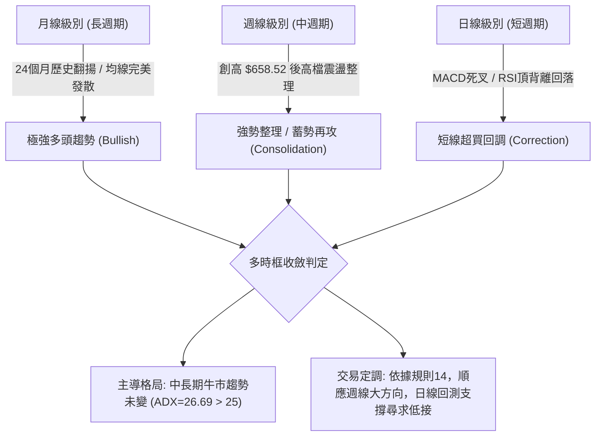

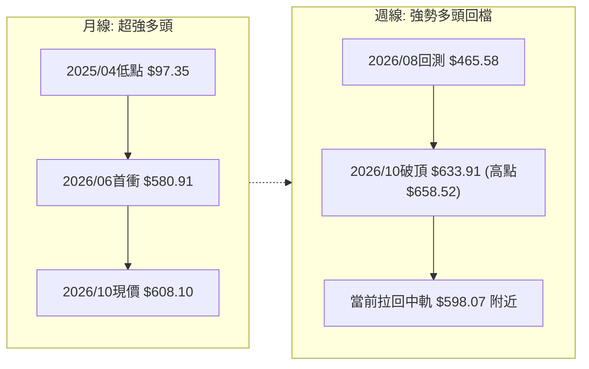

### 📈 長期趨勢 — 12個月走勢圖（Unicode）

```
AMD 月線走勢圖（過去12個月：2025-11 至 2026-10）
價格軸 ($)
$650 ┤                                                    ● 2026-09 ($611.76)
$600 ┤                                                ●   │  ● 2026-10 ($608.10) 現價
$550 ┤                                        ● 06($580.91)│  │
$500 ┤                                    ●   │       │   │  │
$450 ┤                                    │   │   ●───● 07-08 ($476.15 - $470.72)
$400 ┤                                    │   │
$350 ┤                            ● 04($354.49)
$300 ┤                            │
$250 ┤● 10($256.12)               │
$200 ┤    ●───● 11-12   ● 01($236.73)
$150 ┤        ($214)    │   ●───● 02-03 ($200.21 - $203.43)
     └───────────────────────────────────────────────────────────► 時間軸
       25-11 25-12 26-01 26-02 26-03 26-04 26-05 26-06 26-07 26-08 26-09 26-10
```

#### 走勢特徵分析表格

| 階段區間 | 時間跨度 | 起始/結束收盤價 | 區間漲跌幅 | 主要走勢特徵與量價行為 |
|----------|----------|-----------------|------------|------------------------|
| **第一階段：築底蓄勢** | 2025-11 ~ 2026-03 | $256.12 → $203.43 | -20.57% | 自2025年高點回落打底，在$200.21~$203.43構築雙底支撐平台，洗盤徹底 |
| **第二階段：主升暴動** | 2026-03 ~ 2026-06 | $203.43 → $580.91 | +185.56% | 爆發性主升浪，突破所有均線束縛，單月漲幅頻破50%，技術面呈現極端超買追價 |
| **第三階段：高檔震盪** | 2026-06 ~ 2026-08 | $580.91 → $470.72 | -18.97% | 主升浪後首輪劇烈去槓桿清洗，回測斐波那契38.2%（$478.87）支撐，換手充分 |
| **第四階段：次級衝頂** | 2026-08 ~ 2026-10 | $470.72 → $608.10 | +29.19% | 帶量突破前高並創下$658.52歷史高點，目前收盤於$608.10，呈現高檔頂背離修正 |

### 📊 中期趨勢（週線分析）

```
週線級別價格壓力與支撐通道結構：
══════════════════════════════════════════════════════════════════
 阻力壓制區: $658.52 (52週歷史高點 / 0.0% Fib) ── 絕對高點壓力帶
    ▲
    │   [目前波段高檔拉回區: $608.10 ~ $633.91]
    ▼
 動態中軌區: $598.07 (日線MA20 / 布林中軌) ──── 短線多空強弱分界線
    ▲
    │   [多頭回檔健康防守帶: $547.53 ~ $528.92 (23.6% Fib / MA50)]
    ▼
 核心波段底: $478.87 ~ $496.75 (38.2% Fib / S1支撐) ── 中期趨勢防守底線
══════════════════════════════════════════════════════════════════
```

- **週線走勢深度剖析**：從近20週數據觀察，AMD在2026-09-06收在$477.57後展開強力反彈，連續四週大陽線推升至2026-10-04的收盤價$633.91（期間盤中創下52週高點$658.52），週成交量均維持在9,000萬至1.3億股高位。然而在2026-10-11當週，收盤顯著回落至$608.10，RSI由前一週的84.3極度超買急墜至47.4，MACD柱狀圖由+4.393轉為-2.268，顯示週線級別的多頭攻勢在上攻遇阻後進入急剎車，進入中期拉回檢驗支撐的循環。

### ⚡ 趨勢強度評估（ADX 解讀）

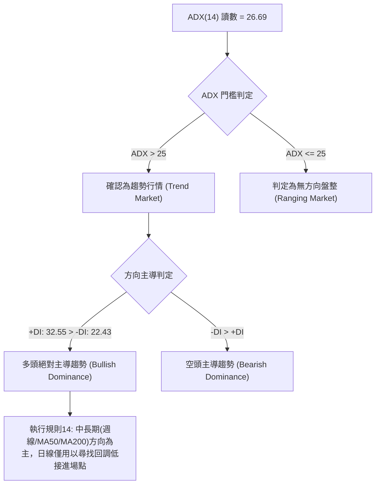

#### ADX 趨勢強度量化對照表

| 指標名稱 | 數值 | 門檻標準 | 狀態評估 | 技術含義解讀 |
|----------|------|----------|----------|--------------|
| **ADX (14)** | **26.69** | > 25.00 | 🟢 強趨勢確認 | 擺脫無趨勢泥沼，趨勢力度穩固，不宜採取雙向網格或純盤整逆勢策略 |
| **+DI** | **32.55** | 高於 -DI 達 10.12 | 🟢 多方進攻優勢 | 多方力量仍主宰大局，儘管短線回檔，整體買盤推動力尚未消亡 |
| **-DI** | **22.43** | 低於 25.00 | 🟡 空方反撲有限 | 空方雖引發短線獲利回吐，但尚未演化為崩潰型殺盤 |
| **DI差值 (+DI - -DI)** | **+10.12** | > 0 | 🟢 多頭淨優勢 | 趨勢偏向單邊多頭主導的回調形態 |

---

## 3. 圖表形態分析

### 🔍 形態識別系統

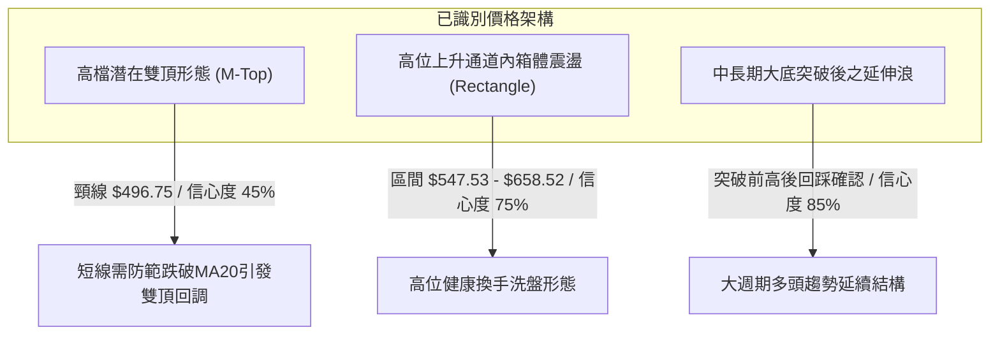

#### 形態識別與信心度評估表（嚴格依據規則15）

| 形態名稱 | 信心度 | 判斷依據（引用數據） | 完成度 | 目標價（附精確計算式） |
|----------|--------|----------------------|--------|------------------------|
| **高位箱體整理** | **75%** | 價格在52W高點$658.52與Fib 23.6%（$547.53）之間震盪，近4週收盤均維持於此區間內 | 65% | 向上突破目標：$658.52 + ($658.52 - $547.53) = **$769.51**（由箱體高度推算） |
| **潛在雙重頂 (M-Top)** | **45%** | 2026-06高點$580.91與近期衝刺$658.52，中間低點為2026-08收盤$470.72；因信心度<50%，依規則15不作過度解讀，僅作為動能頂背離之指標型防範 | 30% | 跌破頸線S1 $496.75之理論目標：$496.75 - ($658.52 - $496.75) = **$334.98**（由雙頂高度推算） |
| **均線多頭收斂回踩** | **85%** | MA20（$598.07）> MA50（$528.92）> MA200（$385.32），價格回踩MA20中軌 | 80% | 回踩確認後測高目標：直接引用52W高點 **$658.52** |

### 🕯️ 重要K線形態分析

| 週/月份 | 收盤價 | K線形態 | 量價行為解讀 | 訊號方向 |
|---------|--------|---------|--------------|----------|
| **2026-06** | $580.91 | 長上影大陽線 | 創波段新高後遭遇天量獲利回吐，顯示$580上方存在解套與套現賣壓 | 🟡 中性預警 |
| **2026-07~08** | $470.72 | 階梯式陰線回測 | 成交量由1.63億萎縮至8,100萬，呈現健康良性縮量回檔，築出底部支撐 | 🟢 支撐確立 |
| **2026-09** | $611.76 | 突破大陽巨線 | 單月自$470爆發拉升至$611.76，週線連三紅，確認前波洗盤結束並啟動新一輪主升 | 🟢 強烈看多 |
| **2026-10-04** | $633.91 | 高位十字星/射擊之星 | 盤中觸及52W高點$658.52後收斂，RSI飆至84.3極度超買，高檔多頭乏力 | 🔴 見頂回落 |
| **2026-10-11** | $608.10 | 高檔實體中陰線 | 吞沒前週部分漲幅，跌破短期5日均線（$631.16），確認短線進入拉回修正波 | 🔴 短線偏空 |

### 📉 ASCII 走勢形態示意圖

```
AMD 週線高檔震盪與頂背離走勢示意圖：
價格
$658.52 ┼─────────────────────────● (52W歷史天花板 2026-10-04盤中)
        │                        ╱ ╲
$633.91 ┼                       ●   ╲
        │                      ╱     ● 現價 $608.10 (跌破MA5: $631.16)
$598.07 ┼─────────────────────┼───────● 動態支撐 (MA20 / 布林中軌)
        │                    ╱         ╲
$580.91 ┼      ● (前高 06月) ╱           ▼ 短線回測防守帶
        │     ╱ ╲           ╱
$547.53 ┼────┼───╲─────────● 斐波那契 23.6% 回調位
        │   ╱     ╲       ╱
$470.72 ┼──●───────●─────● 雙底頸線支撐帶 ($470.72 ~ $478.87 Fib 38.2%)
        └──────────────────────────────────────────────► 時間
            2026-06       2026-08      2026-10
```

### 🎯 形態目標價計算

1. **高位箱體整理向上突破測幅**：
   - 箱體頂部（52W High）：$658.52
   - 箱體底部（Fib 23.6%）：$547.53
   - 箱體垂直高度：$658.52 - $547.53 = $110.99
   - 理論向上突破目標價 = $658.52 + $110.99 = **$769.51**（由高位箱體高度推算）
2. **極端回調（跌破中軌）防守測幅**：
   - 若短線失守MA20（$598.07），價格將尋求箱體下軌Fib 23.6%（**$547.53**）以及下方波段低點S1（**$496.75**）進行支撐確認。

---

## 4. 支撐與阻力

### 🗺️ 關鍵價位分布圖（Unicode）

```
AMD 價位結構分布圖（嚴格依據 OHLCV 與 Fib 計算）
════════════════════════════════════════════════════════════════════════
$658.52 ║████████████████████████████████████████║ 52W High / 0.0% Fib (歷史阻力)
$631.16 ║████████████████████████            ║ MA5 短線反彈均線阻力
$608.10 ╠════════════════════════════════════════╣ ◄ 當前價格 ($608.10)
$598.07 ║▓▓▓▓▓▓▓▓▓▓▓▓▓▓▓▓▓▓▓▓▓▓▓▓▓▓▓▓            ║ MA20 / 布林中軌 (第一道動態支撐)
$547.53 ║▓▓▓▓▓▓▓▓▓▓▓▓▓▓▓▓▓▓▓▓▓▓▓▓                ║ 斐波那契 23.6% 回調位
$528.92 ║▓▓▓▓▓▓▓▓▓▓▓▓▓▓▓▓▓▓▓▓                    ║ MA50 中期生命線支撐
$496.75 ║████████████████████████████████        ║ 關鍵支撐 S1 (波段低點聚類)
$478.87 ║████████████████████████                ║ 斐波那契 38.2% 回調位
$461.71 ║████████████████████                    ║ 強支撐 S2 (波段低點聚類)
$451.00 ║████████████████                        ║ 極限支撐 S3 (波段低點聚類)
$385.32 ║████████████████████████████████████████║ MA200 長期牛熊分界
════════════════════════════════════════════════════════════════════════
```

### 🚧 阻力位分析表

> **註記**：依據提供的 OHLCV 聚類計算數據，現價上方無 swing-high 阻力聚類；所有上方阻力均嚴格取自 52W High 及短期均線。

| 阻力級別 | 價位 | 形成原因與數據來源 | 突破難度 | 重要性 |
|----------|------|--------------------|----------|--------|
| **R1** | **$631.16** | MA 5 短期均線壓制位（當前價格在其下方-3.65%） | 🟡 中等 | 短線多頭重啟攻勢的首要收復門檻 |
| **R2** | **$658.52** | 52週歷史最高點（0.0% 斐波那契回調線） | 🔴 極高 | 歷史天花板，大量解套與獲利盤密集區 |
| **R3** | **$769.51** | 由高位箱體高度（$658.52 - $547.53 = $110.99）推算 | 🔴 極高 | 突破歷史高點後的波段斐波那契擴展目標 |

### 🛡️ 支撐位分析表

> **註記**：所有數值嚴格引用「關鍵價位」區塊之波段低點聚類與均線/斐波那契數值。

| 支撐級別 | 價位 | 形成原因與數據來源 | 守住機率 | 重要性 |
|----------|------|--------------------|----------|--------|
| **超短線支撐** | **$598.07** | MA 20 均線 / 布林帶中軌 | 65% | 短線多空強弱分界線，失守將擴大回調 |
| **S1 (關鍵)** | **$496.75** | 近一年波段低點聚類 S1（距現價 -18.31%） | 80% | 結構性波段頸線，中期多頭結構的底線防守 |
| **S2 (強支撐)** | **$461.71** | 近一年波段低點聚類 S2（距現價 -24.07%） | 90% | 接近2026-08洗盤低點，具備強力機構買盤 |
| **S3 (極限)** | **$451.00** | 近一年波段低點聚類 S3（距現價 -25.83%） | 95% | 跌破此位將宣告中期多頭趨勢終結轉入熊市 |

### 📐 斐波那契回調位分析

依據 52 週波動區間（最低點 **$188.22** 至 最高點 **$658.52**，垂直跨度 $470.30）計算：

```
斐波那契回調梯隊與現價位置分析：
══════════════════════════════════════════════════════════════════
 0.0%  (52W High)  : $658.52 ──── 阻力天花板
                     ▲
   【現價 $608.10 落在此黃金通道內】── 處於 0.0% 與 23.6% 之間的極強多頭區間
                     ▼
 23.6% 回調位      : $547.53 ──── 回檔第一核心買盤防守位
 38.2% 回調位      : $478.87 ──── 中期健康回檔極限（與S1形成緩衝）
 50.0% 回調位      : $423.37 ──── 多空均衡分水嶺
 61.8% 回調位      : $367.87 ──── 黃金分割極限防守位（接近MA200: $385.32）
 78.6% 回調位      : $288.86 ──── 深度回撤防守位
100.0% (52W Low)   : $188.22 ──── 歷史起漲點
══════════════════════════════════════════════════════════════════
```

- **位置解讀**：現價 **$608.10** 穩穩運行於 **0.0%（$658.52）** 與 **23.6%（$547.53）** 之間，回調幅度尚未觸及第一回調位23.6%，這在技術形態上定義為「**淺度強勢修正**」。只要價格不實質跌破 $547.53，整體波段上攻結構依然高度完好。

---

## 5. 技術指標深度解讀

### 🎛️ 指標訊號總覽

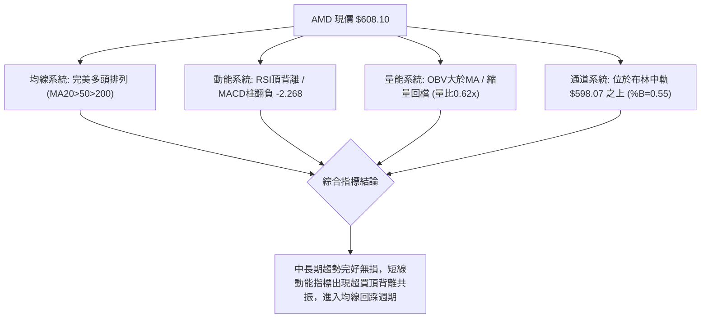

### 📈 移動平均線排列分析

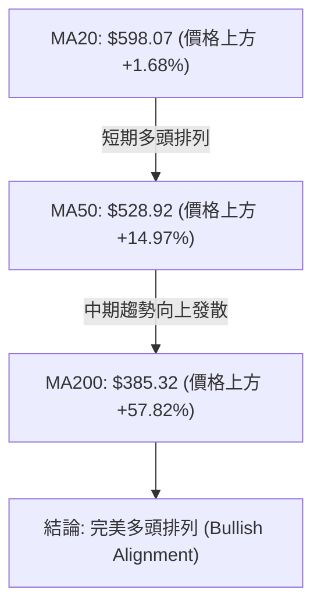

#### 均線數據明細矩陣

| 均線週期 | 當前價位 | 現價相對距離 | 走勢狀態與解讀 |
|----------|----------|--------------|----------------|
| **MA 5** | $631.16 | -3.65% (價格在下) | 🔴 短線下彎，形成超短期反壓 |
| **MA 10** | $623.26 | -2.43% (價格在下) | 🔴 跌破10日線，短多節奏被打亂 |
| **MA 20** | $598.07 | +1.68% (價格在上) | 🟢 向上運行，提供即時動態支撐 |
| **MA 50** | $528.92 | +14.97% (價格在上) | 🟢 陡峭向上，波段趨勢生命線 |
| **MA 60** | $524.47 | +15.95% (價格在上) | 🟢 中期多頭基石 |
| **MA 120**| $496.46 | +22.49% (價格在上) | 🟢 半年線支撐強勁，與S1聚類重合 |
| **MA 200**| $385.32 | +57.82% (價格在上) | 🟢 長期牛市確立，斜率持續向上 |
| **MA 240**| $359.22 | +69.28% (價格在上) | 🟢 年線基準，基底極為扎實 |

### 📉 RSI(14) 分析

```
RSI(14) 當前水平與超買超賣區間：
0        20       30               47.42          70       80       100
├────────┼────────┼──────────────────┼────────────┼────────┼────────┤
│ 極度超賣│ 超賣區 │      中性整理     ▲   偏多區   │ 超買區 │ 極度超買│
└────────┴────────┴──────────────────┴────────────┴────────┴────────┘
當前讀數: [███████████████████████░░░░░░░░░░░░░░] 47.42% (中性偏弱)
```

- **背離判斷結論**：**明確存在頂背離（Bearish Divergence）⚠️**。
  - **驗證依據**：在 2026-09-27 至 2026-10-04 期間，價格由 $630.63 推升至盤中新高 $658.52，週線收盤達 $633.91，RSI 衝刺至 84.3 的極致超買區；隨後在 2026-10-11 當週，價格仍維持在 $608.10 之高位，但 RSI 卻出現「雪崩式滑落」至 **47.42**，形成典型的**價格高位震盪、動能急劇萎縮之高檔頂背離**。此訊號明確警示投資人不宜在高檔進行突破追價。

### 📊 MACD(12/26/9) 訊號解讀

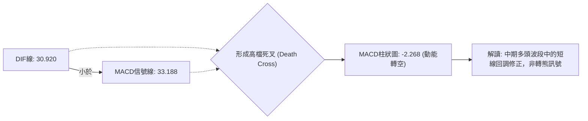

- **MACD狀態分析**：DIF 與 DEA 均位於零軸上方極高位置（30以上），代表這是一次發生在「強勢多頭領域中的死叉」。MACD 柱狀圖由前期的正值峰值急速收斂並轉為 **-2.268**，顯示短線空方獲利盤佔據主導，價格需要時間或空間進行指標修復。

### 📦 布林通道分析

```
AMD 日線布林通道結構（寬度與現價定位）：
══════════════════════════════════════════════════════════════════
 $693.51 ┬──────────────────────────────────────── 布林上軌 (Upper Band)
         │
         │
 $608.10 ┼─► [現價 $608.10 / %B = 0.55] ── 位於中軌上方，通道中軸運作
 $598.07 ┼──────────────────────────────────────── 布林中軌 (MA20 Baseline)
         │
         │
 $502.63 ┴──────────────────────────────────────── 布林下軌 (Lower Band)
══════════════════════════════════════════════════════════════════
```

- **通道指標解讀**：%B 讀數為 **0.55**，恰好處於 0.50（中軌 $598.07）略上方，顯示股價正在接受布林中軌的動態支撐考驗。布林通道開口並未出現喇叭口極端放大，而是呈現緩步收斂，意味著市場由前期的單邊暴漲切換至高位震盪蓄勢。

### 💹 成交量分析（量價配合度）

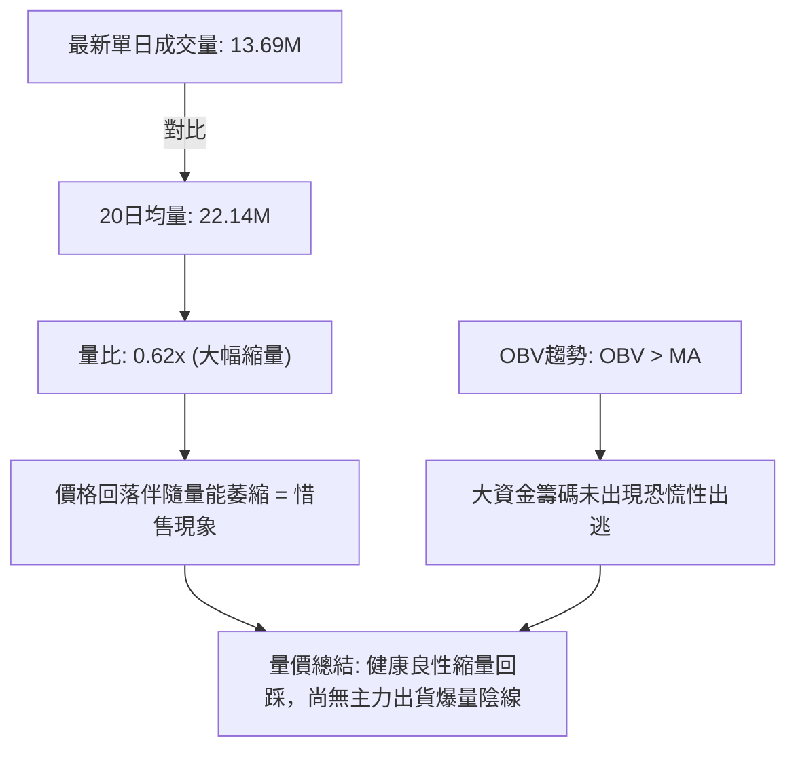

- **量價行為判定**：
  1. **縮量回調**：最新成交量僅 13,694,400 股，相較於 20 日均量 22,137,705 股，量比僅為 **0.62x**。技術上，「上漲放量、下跌縮量」是健康多頭回檔的特徵，顯示跌勢主要由短線買盤觀望引起，而非機構恐慌性倒貨。
  2. **OBV確認**：能量潮指標（OBV）依然高於其移動平均線，這確認了長期資金依然沉澱於籌碼內部，量能宏觀上支撐價格維持在高位。

---

## 6. 動能與波動率

### ⚡ 動能評估四象限

| 象限代號 | 動能狀態 | 波動率狀態 | 象限特徵 | AMD 當前定位評估 |
|----------|----------|------------|----------|------------------|
| **Q1** | 強動能 (+DI強/趨勢明確) | 低波動 (ATR壓縮) | 穩步上行，最佳波段做多時機 | — |
| **Q2** | 弱動能 (MACD柱負/超賣) | 低波動 (區間收斂) | 謹慎觀望，低位打底整理 | — |
| **Q3** | **強動能 (ADX=26.69>25)** | **高波動 (ATR=$22.18, 3.65%)** | **高風險高回報，回調低接主戰場** | **✓ AMD 位於此象限** |
| **Q4** | 弱動能 (背離崩潰) | 高波動 (急跌殺盤) | 破位放量，嚴格避免進場 | — |

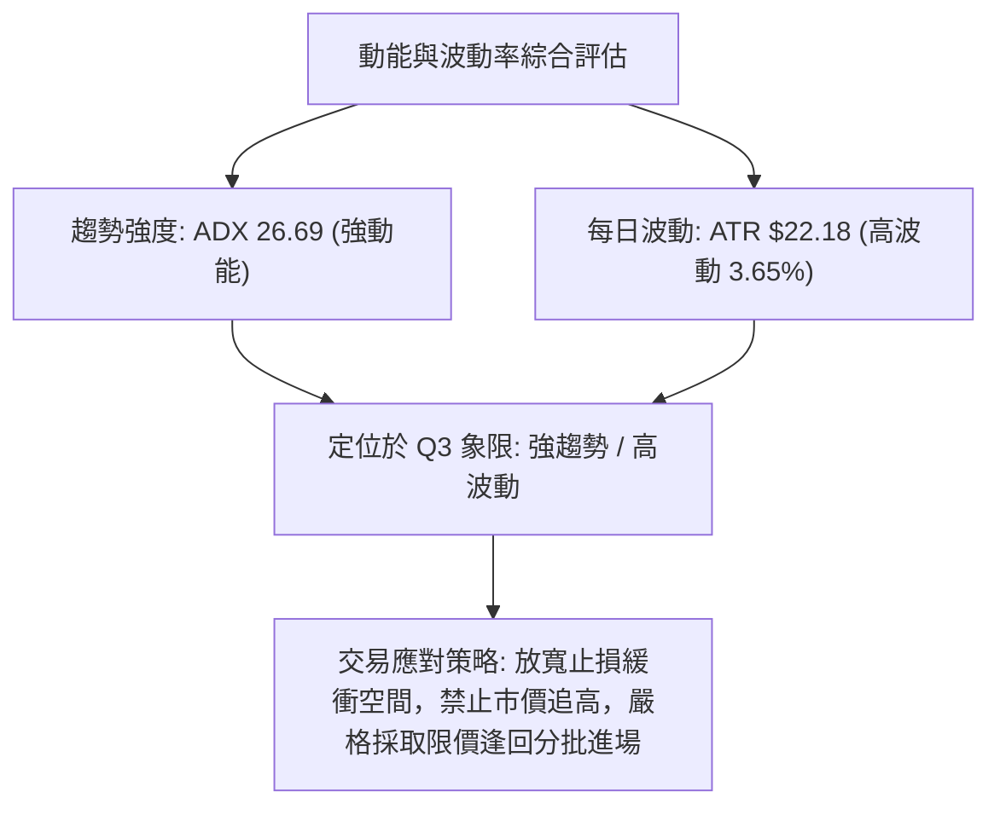

### 📊 ATR 波動率分析

- **ATR(14) 數值**：**$22.18**（佔當前股價之 **3.65%**）。
- **日內波動特徵**：AMD 具備高彈性與高貝塔特性，單日平均震幅超過 22 美元。
- **止損距離建議**：
  - **短線交易止損緩衝（1.0x ATR）**：建議距離進場點至少保留 **$22.18** 緩衝空間，以防日內假突破或毛刺影線掃單。
  - **波段交易止損緩衝（1.5x ~ 2.0x ATR）**：建議保留 **$33.27 ~ $44.36** 緩衝空間（約 5.5% ~ 7.3%），方能避開健康回踩 MA20 過程中的洗盤震盪。

### 📐 Beta 與市場相關性

- **Beta 係數**：**2.454**（極高市場敏感度）。
- **市場特徵解讀**：
  - AMD 的波動幅度為標普500指數（S&P 500）的 **2.45 倍**。在科技板塊與半導體行情走強時，其具備極強的超額收益（Alpha）獲取能力；反之，若大盤遭遇系統性拋售，AMD 的回撤幅度亦將放大。
  - 目前其融券賣空比例（Short % Float）僅為 **2.4%**，Short Ratio 為 **1.83**，空頭部位極低，軋空潛力有限，但亦說明市場主流共識並未嚴重看空。機構持股高達 **75.4%**，籌碼穩定度維持高檔。

---

## 7. 多時框架總結

### 📋 時框架評分表

| 時框架 | 趨勢方向 | 動能狀態 | 均線排列 | 圖表形態 | 綜合評分 | 交易建議 |
|--------|----------|----------|----------|----------|----------|----------|
| **月線級別 (長期)** | 🟢 極強多頭 | 🟢 處於牛市擴張期 | 🟢 完美多排發散 | 大底突破主升浪 | **92/100** | 戰略性持有，長多頭寸不宜輕易離場 |
| **週線級別 (中期)** | 🟢 強勢多頭 | 🟡 高檔鈍化後回檔 | 🟢 MA20斜率陡峭 | 高位箱體蓄勢 | **75/100** | 順勢逢低做多，鎖定支撐分批承接 |
| **日線級別 (短期)** | 🔴 回調修正 | 🔴 頂背離/MACD死叉 | 🟡 跌破MA5/MA10 | 測試布林中軌MA20 | **48/100** | 暫停追價，等待止跌K線與動能修復 |

### 🔲 綜合訊號矩陣

```
┌─────────────┬────────────────────────────────────────────────────────┐
│   維度      │ 短期 (日線)          中期 (週線)          長期 (月線)   │
├─────────────┼────────────────────────────────────────────────────────┤
│ 趨勢方向    │ 🔴 空頭佔優 (修正)   🟢 多頭佔優 (強勢)   🟢 極強多頭  │
│ 均線系統    │ 🟡 測MA20支撐        🟢 多頭排列穩固      🟢 遠超MA200 │
│ 動能指標    │ 🔴 頂背離/超賣       🟡 自超買回落        🟢 強勢區    │
│ 成交量能    │ 🔴 縮量整理          🟢 維持均量          🟢 多頭量價  │
│ 形態定位    │ 🔴 跌破短均反壓      🟢 箱體上緣震盪      🟢 多頭旗形  │
└─────────────┴────────────────────────────────────────────────────────┘
```

### ⚖️ 多時框收斂結論

> **依據「嚴格要求 14」執行之多時框收斂**：
> 1. **行情性質判定**：當前 ADX(14) 讀數為 **26.69**（明確大於 25 臨界值），技術面確立為「**趨勢行情**」，而非無方向的盤整行情。
> 2. **優先級收斂原則**：在趨勢行情下，必須以**中長期（週線 / MA50：$528.92 / MA200：$385.32）** 方向為主導；短期日線之頂背離與死叉，僅能判定為牛市途中的「次級回調」，日線訊號僅用於**尋找回踩支撐時的最佳低接進場點**，絕不可作為逆勢做空的依據。
> 3. **唯一方向性結論**：**【偏多回檔，逢支撐做多】**。本結論與第 1 章技術評分卡（64/100 🟢）、第 2 章多時框趨勢以及第 8 章交易策略完全收斂一致。

---

## 8. 交易策略建議

### 🗺️ 策略決策流程圖

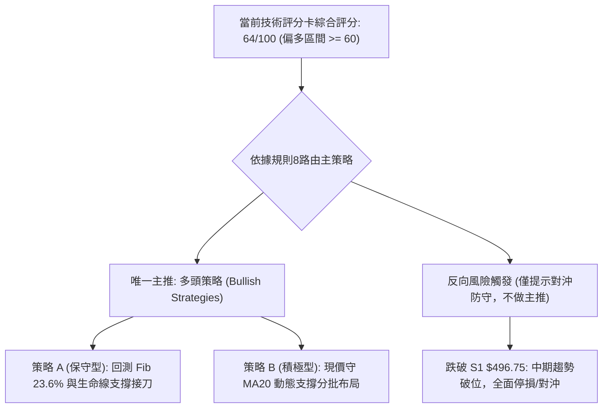

### 🧭 策略路由（依評分卡分流）

- **當前主策略方向 = 多頭主推（依評分 64/100 🟢，偏多格局）**
- **策略定調說明**：綜合技術評分達 64 分，高於 60 門檻，且 ADX(14) = 26.69 處於強趨勢主導。主推多頭逢回承接策略；空頭僅列為風險防守與對沖提示點，嚴禁在此強勢多頭排列下重倉逆勢放空。

### 🎯 價格情境階梯（Price Scenarios）

> **數據紀律**：所有階梯價位均嚴格引用第 4 章已確認之計算數值。

| 觸發條件 | 下一目標 | 後續延伸 | 情境含義與技術解讀 |
|----------|----------|----------|--------------------|
| **突破 MA5 $631.16** | 52W High **$658.52** | 箱體推算目標 **$769.51** | 短線回調結束，多頭重啟上攻，挑戰歷史天花板 |
| **守住 MA20 $598.07** | 短期反彈 **$631.16** | 震盪測頂 **$658.52** | 強勢高檔整理，以時間換取空間消化背離賣壓 |
| **跌破 MA20 $598.07** | Fib 23.6% **$547.53** | 均線支撐 **$528.92** | 展開深度回踩，測試波段生命線支撐 |
| **跌破 S1 $496.75** | 強支撐 S2 **$461.71** | 極限支撐 S3 **$451.00** | 中期波段破位，日週線級別頂背離全面發酵 |

### 📊 情境機率分佈

| 情境類別 | 機率預估 | 主要技術指標依據 |
|----------|----------|------------------|
| **情境一：回踩支撐後重啟上行** | **55%** | 均線完美多頭排列、ADX=26.69強趨勢、OBV維持高檔、成交量呈現良性縮量回踩 |
| **情境二：在 $547~$631 區間震盪** | **30%** | 布林通道開口收縮、%B=0.55居中、日線頂背離壓制追價動能、短期均線死叉纏繞 |
| **情境三：深度破位回落至S1下方** | **15%** | 跌破 MA50（$528.92）且放量跌破波段低點聚類 S1（$496.75），技術面徹底轉弱 |

### 🟢 主策略詳情（多頭買入策略）

> **精確數值規範**：進場、止損與目標價全部取自「關鍵價位」區塊。

| 策略要素 | 策略 A（保守型：波段逢回低吸） | 策略 B（積極型：回踩中軌短多） |
|----------|--------------------------------|--------------------------------|
| **策略邏輯** | 等待價格回測 Fib 23.6% 與 MA50 支撐帶 | 依託 MA20 動態支撐進行短線反彈博弈 |
| **進場價格** | **$547.53**（Fib 23.6% 回調位） | **$598.07**（MA 20 / 布林中軌位） |
| **止損價格** | **$496.75**（嚴格設於關鍵支撐 S1） | **$547.53**（跌破 Fib 23.6% 止損） |
| **目標價 T1** | **$608.10**（現價位置 / 獲利了結一半） | **$631.16**（阻力 R1 / MA 5 壓制位） |
| **目標價 T2** | **$658.52**（52W High 歷史前高） | **$658.52**（52W High 歷史前高） |
| **風險空間** | $547.53 - $496.75 = **$50.78** (9.27%) | $598.07 - $547.53 = **$50.54** (8.45%) |
| **回報空間 (至T2)** | $658.52 - $547.53 = **$110.99** (20.27%) | $658.52 - $598.07 = **$60.45** (10.11%) |
| **風險報酬比** | **1 : 2.19**（優秀） | **1 : 1.20**（中等偏低，需嚴守紀律） |
| **勝率預估** | **65%** | **52%** |
| **建議倉位** | **15% ~ 20%** 總投資組合 | **5% ~ 10%** 輕倉博弈 |

### 🔴 反向風險觸發點（對沖提示）

- **多頭結構失效觸發點**：日線收盤價跌破 **$528.92**（MA50 生命線），或週線跌破 **$496.75**（S1 關鍵支撐）。
- **避險風控應對**：若觸發上述條件，多頭部位應無條件停損出場；持有現貨者可採取買入等量 Put 選擇權或降低持倉槓桿，防範價格進一步探測 S2 **$461.71** 與 S3 **$451.00**。

### ⭐ 整體訊號強度評星

```
做多訊號強度：★★★★☆  (4/5星) ── 長期中長趨勢強固，逢低承接勝率高
做空訊號強度：★★☆☆☆  (2/5星) ── 僅為次級修正，逆勢做空空間有限且風險極大
整體可信度：  ★★★★☆  (4/5星) ── 指標與均線數據完整收斂，具備高度參考價值
```

---

## 9. 風險提示與監控

### ✅ 關鍵監控指標 Checklist

```
╔══════════════════════════════════════════════════════════════╗
║               AMD 技術面關鍵監控清單 (Checklist)               ║
╠══════════════════════════════════════════════════════════════╣
║ [ ] 價格能否在當前收盤守住 MA20 動態支撐位 ($598.07)           ║
║ [ ] MACD 柱狀圖是否在零軸下方收斂 (當前 -2.268 是否縮小)      ║
║ [ ] RSI(14) 能否在 40~45 區域獲得支撐並止跌回升               ║
║ [ ] 日成交量能否放大重回 20日均量之上 (22,137,705 股)         ║
║ [ ] 價格反彈時能否有效突破短期壓制位 MA5 ($631.16)            ║
║ [ ] 跌破 Fib 23.6% ($547.53) 時是否出現放量殺跌之異常現象     ║
╚══════════════════════════════════════════════════════════════╝
```

### ⚠️ 風險場景分析

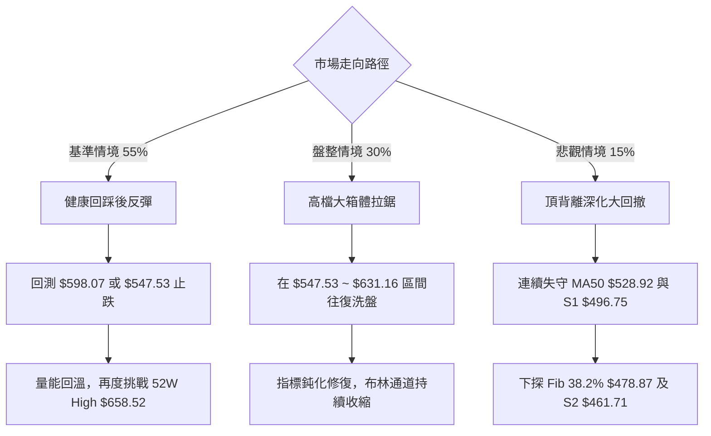

### 🛡️ 風險管理重要提醒

1. **高 Beta 波動風險控制**：AMD 的 Beta 值高達 **2.454**，ATR 高達 **$22.18**。在市場震盪劇烈時，切忌重倉使用槓桿，單筆交易虧損上限應嚴格限制在總本金的 **1.5% ~ 2.0%** 以內。
2. **防範假突破與流動性陷阱**：在歷史高點 **$658.52** 附近曾留下長上影線與高位放量滯漲跡象，若後續反彈至 $631 ~ $658 區間但成交量無法放大至 2,500 萬股以上，需高度警惕誘多陷阱。
3. **倉位管理模型建議**：
   - 總倉位建議控制在 **40% ~ 60%**，保留充足現金以應對潛在的深度回踩。
   - 採取分批建倉原則：第一批在 MA20（**$598.07**）企穩時投入三分之一；若進一步回撤至 Fib 23.6%（**$547.53**）再投入三分之二，有效攤低成本並控制下檔風險。

---

## 📋 報告總結

```
╔══════════════════════════════════════════════════════════════╗
║                    AMD 技術分析報告總結                      ║
╠══════════════════════════════════════════════════════════════╣
║ 報告日期：2026-10-12                                         ║
║ 當前價格：$608.10                                            ║
║ 分析評級：🟢 偏多回檔整理 (趨勢強勁，短線修正中)              ║
║ 綜合技術評分：64 / 100                                       ║
╠══════════════════════════════════════════════════════════════╣
║ 關鍵結論：                                                   ║
║ ├─ 長期趨勢：🟢 極強多頭 (月線均線完美發散，大牛市格局未破)   ║
║ ├─ 中期趨勢：🟢 強勢整理 (週線ADX=26.69確認多頭趨勢主導)     ║
║ ├─ 短期趨勢：🔴 回調修正 (日線RSI頂背離，MACD柱狀圖翻負-2.26) ║
║ ├─ 關鍵支撐：S1 $496.75 ｜ Fib 23.6% $547.53 ｜ MA20 $598.07 ║
║ ├─ 關鍵阻力：MA5 $631.16 ｜ 52W High $658.52 ｜ 箱體測幅 $769 ║
║ └─ 分析師共識：Strong Buy (50位分析師平均目標價: $636.21)    ║
╠══════════════════════════════════════════════════════════════╣
║ 最優策略組合：                                               ║
║ 1. 🥇 最佳機會 (策略A)：耐心等待回測 Fib 23.6% ($547.53)     ║
║    掛單低接，止損設在 S1 ($496.75)，目標看前高 $658.52，     ║
║    風險報酬比高達 1:2.19。                                   ║
║ 2. 🥈 次選機會 (策略B)：現價依託 MA20 ($598.07) 進行短多反彈  ║
║    博弈，止損設於 $547.53，目標 $631.16。                    ║
║ 3. 🥉 保守選擇：空手觀望，靜待日線 MACD 柱狀圖翻紅且價格     ║
║    實體收復 MA5 ($631.16) 後，再行順勢進場追隨主升浪。       ║
╚══════════════════════════════════════════════════════════════╝
```

---

> ⚠️ **免責聲明**：本報告為技術分析研究成果，所有數據、圖表及價位推算均基於歷史量價資訊與客觀技術指標公式。本報告**僅供研究與學術參考**，**不構成任何要約、招攬或投資建議**。半導體產業具高波動性，投資人應獨立評估風險，自負盈虧。

---

*報告生成時間：2026-10-12 ｜ 數據來源：Yahoo Finance ｜ 分析框架：多時框技術分析模型*