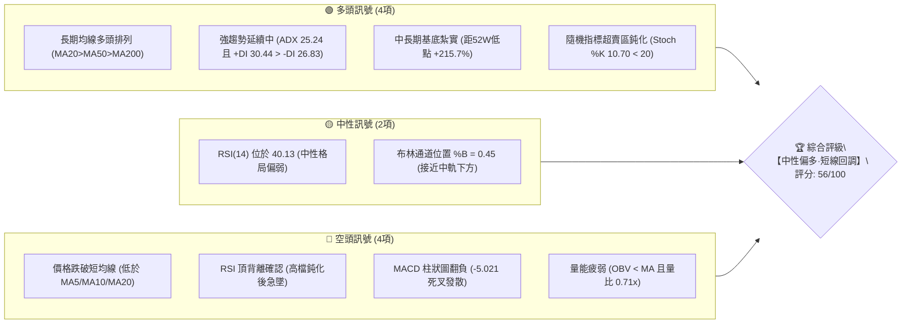
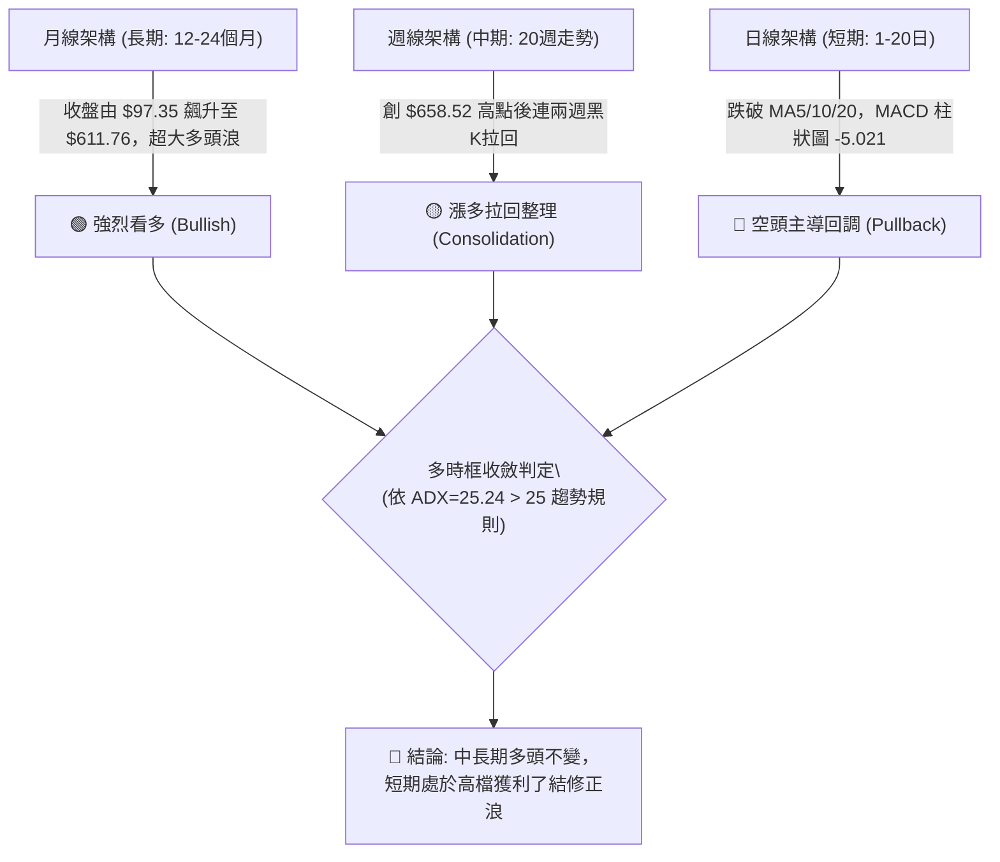
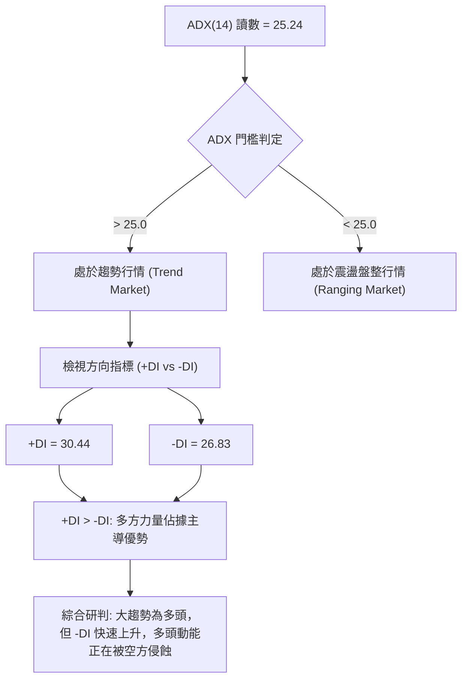
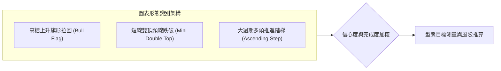
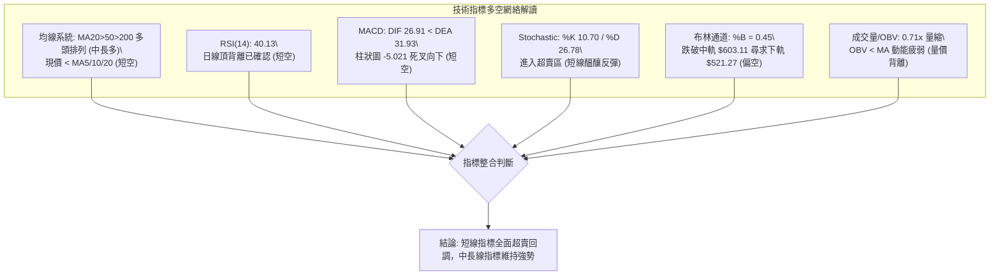
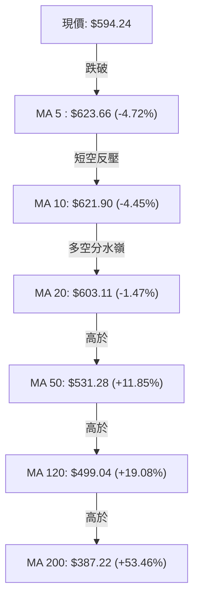
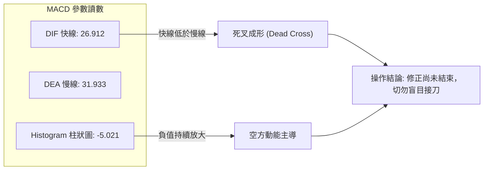
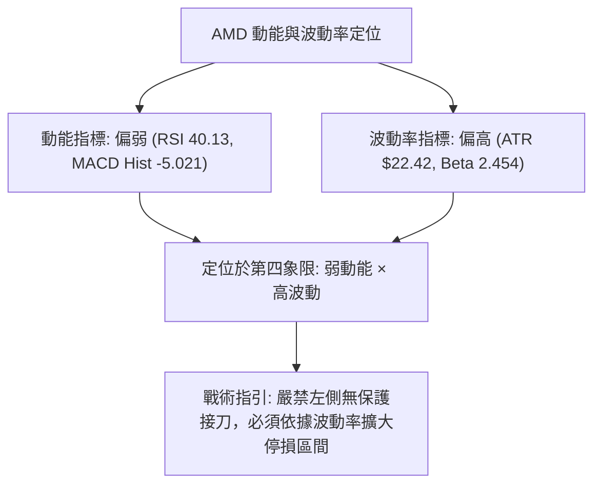
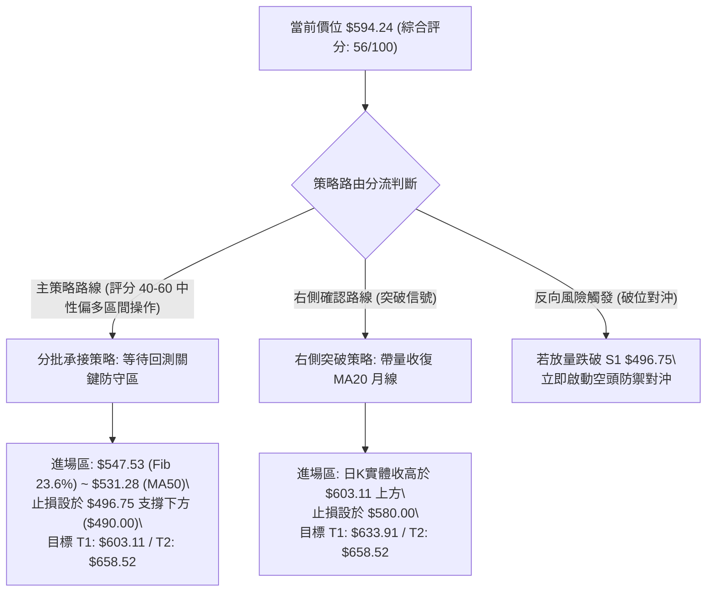
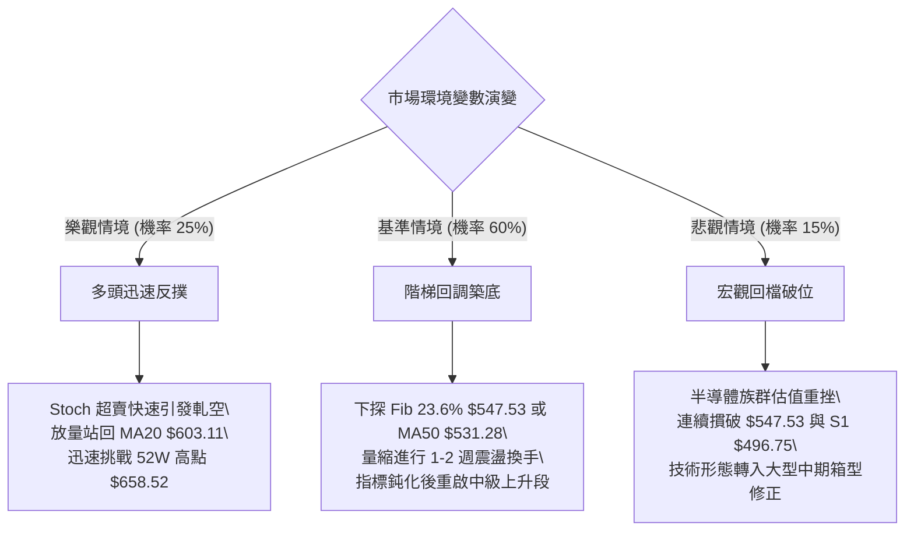

# AMD 技術分析報告

> **報告日期**：2026-10-13 ｜ **語言**：繁體中文 ｜ **數據來源**：Yahoo Finance ｜ **當前價格**：$594.24

---

## 目錄

| 章節 | 內容 |
|------|------|
| [1. 技術面概覽](#1-技術面概覽) | 訊號儀表板、核心指標、評分卡 |
| [2. 趨勢分析](#2-趨勢分析) | 多時框趨勢、長中短期走勢、12個月 ASCII 走勢圖 |
| [3. 圖表形態分析](#3-圖表形態分析) | 形態識別與信心度、K線組合、目標價推算 |
| [4. 支撐與阻力](#4-支撐與阻力) | 關鍵價位結構圖、波段聚類支撐、斐波那契回調 |
| [5. 技術指標深度解讀](#5-技術指標深度解讀) | 均線系統、RSI 頂背離、MACD、布林通道、OBV |
| [6. 動能與波動率](#6-動能與波動率) | 動能四象限、ATR 波動率、Beta 市場敏感度 |
| [7. 多時框架總結](#7-多時框架總結) | 時框架評分矩陣、收斂判斷規則與結論 |
| [8. 交易策略建議](#8-交易策略建議) | 主策略路由、情境階梯、機率分佈、多空策略與評星 |
| [9. 風險提示與監控](#9-風險提示與監控) | 監控指標 Checklist、情境樹狀圖、風控規則 |
| [📋 報告總結](#-報告總結) | 總體評級、關鍵指標歸納與最優策略執行 |

---

## 1. 技術面概覽

### 🎯 技術訊號儀表板



### 📊 核心指標速覽表

| 指標類別 | 指標名稱 | 當前數值 | 訊號 | 專業解讀 |
|:---|:---|:---|:---:|:---|
| **價格** | 當前收盤價 | $594.24 | 🟡 | 位於52週區間 86.3% 之高檔強勢區，短線自歷史高點回吐 |
| **均線** | MA20 (月線) | $603.11 | 🔴 | 現價低於 MA20（乖離 -1.47%），短線跌破多空分水嶺 |
| **均線** | MA50 (季線) | $531.28 | 🟢 | 現價高於 MA50（乖離 +11.85%），中期多頭結構穩固 |
| **均線** | MA200 (年線) | $387.22 | 🟢 | 現價大幅高於 MA200（乖離 +53.46%），長牛趨勢不變 |
| **動能** | RSI(14) | 40.13 | 🔴 | 跌落50中軸，且日線與週線出現典型「頂背離」修正訊號 |
| **動能** | MACD (12,26,9) | 26.91 / 31.93 | 🔴 | DIF 下穿 MACD 形成死叉，柱狀圖為 -5.021，短線回調延續 |
| **震盪** | Stochastic %K/%D | 10.70 / 26.78 | 🟢 | 進入極度超賣區（<20），短線具備技術性跌深反彈契機 |
| **趨勢** | ADX(14) / 方向 | 25.24 / +DI> -DI | 🟢 | ADX > 25 代表趨勢行情主導，+DI(30.44) 仍大於 -DI(26.83) |
| **通道** | 布林通道 %B | 0.45 ($521.27~$684.96)| 🟡 | 位於中軌（$603.11）下方，正向下軌尋求支撐 |
| **量能** | 20日成交量比 | 0.71x (15.33M) | 🔴 | 量能持續萎縮，OBV < MA，反映高檔買盤承接力道暫時退潮 |
| **波動** | ATR(14) | $22.42 (3.77%) | 🟡 | 單日震幅偏高，需保留足夠停損緩衝空間 |

### 🏆 技術評分卡

```
╔══════════════════════════════════════════════════════════════════╗
║                   技術評分卡 — AMD (2026-10-13)                  ║
╠══════════════════════════════════════════════════════════════════╣
║ 趨勢強度      ██████████████░░░░░░  70/100  🟢 宏觀多頭結構完好   ║
║ 動能指標      ████████░░░░░░░░░░░░  40/100  🔴 MACD死叉/RSI頂背離 ║
║ 支撐穩定度    ████████████░░░░░░░░  60/100  🟡 Fib 23.6%具初步防守║
║ 成交量配合    ██████░░░░░░░░░░░░░░  30/100  🔴 OBV走弱/買盤量縮   ║
║ 形態完整度    ██████████████░░░░░░  70/100  🟢 高檔上升旗形拉回   ║
║ 均線排列      ████████████░░░░░░░░  65/100  🟡 長多排列但短線破月線║
╠══════════════════════════════════════════════════════════════════╣
║ 綜合技術評分  ███████████░░░░░░░░░  56/100  ⚖️ 評級：中性偏多·觀望 ║
╚══════════════════════════════════════════════════════════════════╝
```

---

## 2. 趨勢分析

### 🌐 多時框趨勢分析



### 📈 長期趨勢 — 12個月走勢圖（Unicode）

以下為 AMD 過去 12 個月（2025-11 至 2026-10）之月線收盤價歷史走勢圖：

```
AMD 月線走勢圖（過去12個月價格軌跡）
價格軸 ($)
$650 ┤                                              
$600 ┤                                        ● $611.76 ──● $594.24 (現價)
$550 ┤                              ● $580.91 
$500 ┤                        ● $516.10       ● $470.72
$450 ┤                                  ● $476.15
$350 ┤                  ● $354.49
$250 ┤
$200 ┤● $217.53 ──● $214.16 ──● $236.73
$150 ┤            ● $200.21 ──● $203.43 (波段底部起漲)
     └────────────────────────────────────────────────────────────
       11    12    01    02    03    04    05    06    07    08    09    10 (月份)
      (2025)      (------------------------ 2026 ------------------------)
```

**走勢特徵分析表格**：

| 階段階段 | 時間跨度 | 起訖價位 | 漲跌幅 | 技術特徵解讀 |
|:---|:---|:---|:---:|:---|
| **第一階段：底部築底** | 2025-11 ~ 2026-03 | $217.53 → $203.43 | -6.48% | 於 $200.00~$236.00 區間反覆震盪打底，成交量收縮，構築長線雙底結構 |
| **第二階段：主升暴發** | 2026-03 ~ 2026-06 | $203.43 → $580.91 | **+185.56%** | 連續四個月長陽線噴出，放量突破所有均線，確立 AI 加速晶片主升浪 |
| **第三階段：高檔震盪** | 2026-06 ~ 2026-08 | $580.91 → $470.72 | -18.97% | 觸及 52W 高點區域後遭遇籌碼獲利了結，回測 $470 支撐位 |
| **第四階段：次級噴發與修正** | 2026-08 ~ 2026-10 | $470.72 → $594.24 | +26.24% | 9月拉出月收盤新高 $611.76，10月受短線動能竭盡影響拉回至 $594.24 |

### 📊 中期趨勢（週線分析）

從近 20 週數據觀察，AMD 在 2026-09-27 週閉市價達 $630.63（週 RSI 80.4）、2026-10-04 週閉市價達 $633.91（週 RSI 84.3）形成技術面極端超買。隨後兩週（10-11 的 $608.10 及當前 10-18 的 $594.24）連續回跌，週線 MACD 柱狀圖由高檔 +14.199 迅速反轉至 -5.021。

```
週線關鍵壓力與支撐階梯圖：
════════════════════════════════════════════════════════════════
$658.52  ─────────────────────────────  52週歷史高點 (終極阻力)
$633.91  ─────────────────────────────  前波週線收盤高點 (波段頂部)
$603.11  ─────────────────────────────  MA20 / 布林中軌 (已失守)
$594.24  ◄─────── [當前現價位置]
$547.53  ─────────────────────────────  斐波那契 23.6% 回調支撐
$531.28  ─────────────────────────────  MA50 季線關鍵防守線
$496.75  ─────────────────────────────  近一年波段聚類支撐 S1
════════════════════════════════════════════════════════════════
```

### ⚡ 趨勢強度評估（ADX 解讀）



**ADX 強度對照與解讀表**：

| 指標變數 | 當前讀數 | 門檻區間 | 趨勢狀態判定 | 操作意涵 |
|:---|:---:|:---:|:---:|:---|
| **ADX(14)** | **25.24** | 25 ~ 50 | **強趨勢建立點** | 市場脫離無方向盤整，遵循中長期趨勢操作優先級高於短線震盪指標 |
| **+DI (多方動向)** | **30.44** | > 25 | **主導多頭** | 多方攻擊能量仍處於優勢區間，回調暫視為良性換手 |
| **-DI (空方動向)** | **26.83** | 接近 30 | **空方反撲加劇** | 空方動能自低檔顯著抬頭，警惕回調演變為更深幅度的中級整理 |
| **淨動向差值** | **+3.61** | - | **多方微弱領先** | 差值快速收斂，若 -DI 金叉 +DI，多頭主升趨勢將暫告終止 |

---

## 3. 圖表形態分析

### 🔍 形態識別系統

依據價格軌跡與嚴格幾何定義，識別當前圖表形態並提供信心度評估：



**圖表形態信心度與目標價計算表**：

| 形態名稱 | 信心度 | 判斷依據（引用數據） | 完成度 | 目標價（附嚴格計算式） |
|:---|:---:|:---|:---:|:---|
| **高檔上升旗形 (Bull Flag)** | **75%** | 旗桿為 2026-08 低點 $470.72 噴發至 52W 高點 $658.52（高度 $187.80）。旗面為近期於 $633.91 至現價 $594.24 之量縮斜向下整理。 | 60% (整理中) | **突破上限測幅目標**：<br>突破點假設於前高 $658.52 + 旗桿高度 $187.80 = **$846.32**（中長期推算） |
| **微型雙重頂 (Mini Double Top)** | **65%** | 兩次波段高點分別為 2026-09-27 週高 $630.63 與 2026-10-04 週高 $633.91。短線頸線為該區間回調低點 $608.10。 | 90% (已破頸線) | **回調測幅目標**：<br>頸線 $608.10 - 形態高度 ($633.91 - $608.10 = $25.81) = **$582.29** |
| **頭肩頂形態** | **25%** | 數據中未偵測到完整的左肩與右肩對稱架構，僅有單一高點聚類。 | 0% (未成形) | *訊號不足，不予計算幾何目標價* |

### 🕯️ 重要K線形態分析

| 期間/月份 | 收盤價 | K線形態 | 技術解讀 | 訊號方向 |
|:---|:---:|:---|:---|:---:|
| **2026-09** | $611.76 | **大陽線突破突破實體** | 月線放量長紅吞噬前期黑K，奠定月線級別強多格局 | 🟢 強烈看多 |
| **2026-10-04週** | $633.91 | **流星線 (Shooting Star)** | 衝擊 52W 高點 $658.52 未果留下長上影線，暗示上方解套與獲利盤沉重 | 🔴 見頂反轉 |
| **2026-10-11週** | $608.10 | **中黑K確認線** | 跌破前週低點，確立高檔流星線之空頭回調有效性 | 🔴 空方確認 |
| **2026-10-18週(即時)**| $594.24 | **下行紡錘線** | 跌破 MA20 後跌勢稍緩，留微幅下影線，尋求下檔承接力道 | 🟡 跌勢暫緩 |

### 📉 ASCII 走勢形態示意圖

```
高檔上升旗形（Bull Flag）與微型雙頂跌破示意圖：
價格軸 ($)
$658.52 ──────┐ (52W High)
              │
$633.91 ──────┼───────● Top 1 (2026-09-27: $630.63)
              │        \     ● Top 2 (2026-10-04: $633.91)
              │         \   / \
$608.10 ──────┼──────────\─●───\────── 頸線位置 (Neckline)
$603.11 ──────┼───────────\─────\───── MA20 / 布林中軌
$594.24 ──────┼────────────\─────● ◄── 現價：回調旗面內部 ($594.24)
              │             \     \
$582.29 ──────┼──────────────\─────▼ 雙頂等幅回調目標位
              │               \
$547.53 ──────┴────────────────▼────── 旗形下軌 / Fib 23.6% 強支撐
```

### 🎯 形態目標價計算

1. **短線下行修正目標**：
   - 根據微型雙頂之測幅公式：
     $$\text{形態高度 } H = \text{波段最高點 } (\$633.91) - \text{跌破頸線 } (\$608.10) = \$25.81$$
     $$\text{下行最小目標 } T_{\text{down}} = \$608.10 - \$25.81 = \$582.29$$
   - 現價為 **$594.24**，距離該短期下行目標僅差 **$11.95 (-2.01%)**，暗示短線下殺動能已消耗大半。

2. **中長期波段回測目標**：
   - 上升旗面下邊界支撐通常落於前一波主升浪之 **斐波那契 23.6% 回調位 $547.53** 或 **MA50 季線 $531.28**。

---

## 4. 支撐與阻力

### 🗺️ 關鍵價位分布圖（Unicode）

```
AMD 價位結構分布圖（OHLCV 精確計算）
═════════════════════════════════════════════════════════════════════════
$684.96  ║██████████████████████████████║ 布林通道上軌極限阻力 (BB Upper)
$658.52  ║██████████████████████████    ║ 52週歷史最高點 (52W High)
$623.66  ║████████████████              ║ 短均線反壓密集區 (MA5: $623.66 / MA10: $621.90)
$603.11  ║████████████                  ║ 即時多空轉換線 (MA20 / 布林中軌)
─────────╫──────────────────────────────╫─────────────────────────────────
$594.24  ╠══════════════════════════════╣ ◄ 當前市價 (Current Price)
─────────╫──────────────────────────────╫─────────────────────────────────
$547.53  ║▓▓▓▓▓▓▓▓▓▓▓▓▓▓▓▓▓▓            ║ 斐波那契 23.6% 回調關鍵防守
$531.28  ║▓▓▓▓▓▓▓▓▓▓▓▓▓▓▓▓▓▓▓▓          ║ MA50 季線強勁生命線
$521.27  ║▓▓▓▓▓▓▓▓▓▓▓▓▓▓▓▓              ║ 布林通道下軌動態支撐 (BB Lower)
$496.75  ║██████████████████████████████║ 近一年波段聚類強支撐 S1
$461.71  ║████████████████████████      ║ 近一年波段聚類強支撐 S2
$451.00  ║████████████████████████████  ║ 近一年波段聚類強支撐 S3
$387.22  ║██████████████████████████████║ MA200 長期牛熊分水嶺
═════════════════════════════════════════════════════════════════════════
```

### 🚧 阻力位分析表

依據提供的 OHLCV 關鍵價位數據，波段高點聚類與技術均線構成以下阻力：

| 阻力級別 | 精確價位 | 形成依據與屬性 | 突破難度 | 重要性 |
|:---|:---:|:---|:---:|:---:|
| **即時阻力 R1** | **$603.11** | **MA20 月線暨布林通道中軌**。自跌破後轉換為短線第一道反壓。 | 🟡 中等 | ★★★★☆ |
| **短期阻力 R2** | **$623.66** | **MA5 反壓線（$623.66）及 MA10（$621.90）** 共振壓力區。 | 🔴 較高 | ★★★★☆ |
| **波段阻力 R3** | **$658.52** | **52週歷史最高價 (52W High)**。歷史高點套牢區與多頭極致攻頂點。 | 🔴 極高 | ★★★★★ |
| **通道極限 R4** | **$684.96** | **日線布林通道上軌**。超買擴展邊界。 | 🔴 極高 | ★★★☆☆ |

*註：原始數據標注「no swing-high resistance detected above current price」，此處阻力位嚴格引用自數據中現價上方之實體均線（MA20/MA5）、布林上軌與 52W High。*

### 🛡️ 支撐位分析表

以下支撐價位嚴格引用數據中「關鍵價位（由 OHLCV 計算）」之波段低點聚類與指標數值：

| 支撐級別 | 精確價位 | 形成依據與屬性 | 守住機率 | 重要性 |
|:---|:---:|:---|:---:|:---:|
| **短線支撐 S0** | **$547.53** | **斐波那契 23.6% 回調位**（距離現價 -7.86%）。 | 70% | ★★★★☆ |
| **動態支撐 S0.5**| **$531.28** | **MA50 季線（$531.28）及布林下軌（$521.27）** 夾擊區。 | 75% | ★★★★★ |
| **波段聚類 S1** | **$496.75** | **近一年波段低點聚類 S1**（距離現價 -16.41%），MA120（$499.04）共振。 | 85% | ★★★★★ |
| **波段聚類 S2** | **$461.71** | **近一年波段低點聚類 S2**（距離現價 -22.30%）。 | 90% | ★★★★☆ |
| **強烈聚類 S3** | **$451.00** | **近一年波段低點聚類 S3**（距離現價 -24.10%）。 | 95% | ★★★★★ |

### 📐 斐波那契回調位分析

基準計算區間為 52週極值：**$188.22 (52W Low) → $658.52 (52W High)**，全波段垂直落差為 **$470.30**。

| 斐波那契回調比例 | 精確對應價位 | 與現價 ($594.24) 距離 | 技術分析與戰略意涵解讀 |
|:---|:---:|:---:|:---|
| **0.0% (高點)** | **$658.52** | +10.82% | 52週最高點，多頭全面反轉目標 |
| **23.6% 回調** | **$547.53** | -7.86% | **當前關鍵緩衝區**。強勢主升浪通常於此位置止跌完成換手 |
| **38.2% 回調** | **$478.87** | -19.41% | 正常深度回調位，接近波段低點 S1 ($496.75) 與 8月回調低點 ($470.72) |
| **50.0% 中軸** | **$423.37** | -28.75% | 多空平衡中線，若回測此處代表中期主升結構遭破壞 |
| **61.8% 黃金分割** | **$367.87** | -38.09% | 極限防守線，鄰近 MA200 年線（$387.22）與 MA240（$360.62） |
| **78.6% 回調** | **$288.86** | -51.39% | 深度破位防線 |
| **100.0% (低點)** | **$188.22** | -68.33% | 52週最低點，宏觀牛市起點 |

> **位置判定**：當前現價 **$594.24** 處於 **0.0% ($658.52)** 與 **23.6% ($547.53)** 之間，屬於標準的「強勢多頭高檔回吐」區間，尚未破壞中長期的波段上升結構。

---

## 5. 技術指標深度解讀

### 🎛️ 指標訊號總覽



### 📈 移動平均線排列分析



- **多頭排列（Bullish Alignment）**：MA20 ($603.11) > MA50 ($531.28) > MA200 ($387.22)，長期均線多頭格局完全維持。
- **短線空頭排列（Short-term Bearish Cross）**：MA5 ($623.66) < MA10 ($621.90) 呈下彎態勢，且現價 $594.24 同時跌破 MA5、MA10 及 MA20，說明自 10 月初以來的回檔為短線主導之獲利回吐行情。

### 📉 RSI(14) 分析與頂背離研判

- **數值進度條**：
  $$\text{RSI(14)} = 40.13 \quad \text{████████░░░░░░░░░░░░} \quad [40.13\%]$$
- **超買超賣評估**：RSI 脫離 9月下旬的極端超買區（84.3）後單邊急墜至 40.13，進入弱勢震盪區間。
- **頂背離研判（Bearish Divergence）**：
  - **價格走勢**：AMD 股價由 2026-09-27 的 $630.63 攀升至 2026-10-04 的 $633.91，盤中刷新 52W 高點達 $658.52，創下波段新高。
  - **指標走勢**：同期日線 RSI 指標未創相對應新高，隨後迅速跌破前低形成典型頂背離型態。
  - **背離結論**：⚠️ **確認日線頂背離成立**。當前價格的持續下探正是頂背離釋放獲利盤壓力的必然技術演繹。

### 📊 MACD(12/26/9) 訊號解讀



MACD 快線已下穿慢線，且柱狀圖讀數為 **-5.021**。值得注意的是，快慢線仍處於零軸上方之極高位置（26.912 / 31.933），屬於「**高檔死叉回調**」而非「轉入實質熊市」。只要快慢線維持在零軸之上，此修正屬於多頭市場之次級折返。

### 📦 布林通道分析

```
AMD 布林通道（20日 / 2倍標準差）示意圖：
價格軸 ($)
$684.96  ─────────────────────────────── 布林上軌 (BB Upper)
                                          
$603.11  ─────────────────────────────── 布林中軌 (MA20: $603.11)
$594.24  ◄────── 現價位置 (%B = 0.45，跌破中軌，向中下軌滑落)
                                          
$521.27  ─────────────────────────────── 布林下軌 (BB Lower)
```

- **通道帶寬與形態**：%B 為 **0.45**，跌破中軌 $603.11。布林通道並未呈現劇烈開口擴張，而是保持水平微幅震盪，反映短期行情轉為「由上軌向下軌尋求支撐」之箱型拉回過程。
- **下軌支撐價值**：布林下軌目前處於 **$521.27**，與季線 MA50（$531.28）極為接近，構成強大的共振支撐帶。

### 💹 成交量分析（量價配合度）

1. **成交量對比**：
   - 最新單日成交量：**15,327,700 股**
   - 20日均量：**21,665,530 股**（量比僅 **0.71x**）
2. **量價關係解讀**：
   - 下跌過程伴隨量能顯著萎縮（量比 0.71x），顯示市場並未出現大規模恐慌性拋售，賣壓主要來自高檔多頭獲利了結與市場觀望情緒。
   - **OBV 趨勢**：數據顯示「OBV < MA → 量能疲弱」，表明資金流入節奏放緩，多頭能量需等待重新放量金叉才能重啟升勢。

---

## 6. 動能與波動率

### ⚡ 動能評估四象限

根據技術動能指標（RSI 40.13、MACD 負向柱體）與歷史波動率指標進行綜合定位：

| 象限 | 動能維度 | 波動維度 | AMD 當前狀態 | 策略意涵與評估 |
|:---:|:---:|:---:|:---:|:---|
| **第一象限 (Q1)** | 強動能 (Bullish) | 低波動 (Low Vol) | — | 最佳主升擴張期，持股續抱 |
| **第二象限 (Q2)** | 弱動能 (Bearish) | 低波動 (Low Vol) | — | 沉悶築底期，適合長期定投 |
| **第三象限 (Q3)** | 強動能 (Bullish) | 高波動 (High Vol) | — | 高風險高收益突破期，適合追突破 |
| **第四象限 (Q4)** | **弱動能 (Bearish)** | **高波動 (High Vol)** | **✓ (當前所處區間)** | **短線獲利了結回調期**。ATR 波動偏高且短行動能受挫，應採取觀望或逢低設限承接策略 |



### 📊 ATR 波動率分析

- **ATR(14) 讀數**：**$22.42**（佔當前股價之 **3.77%**）。
- **日內波動特徵**：AMD 屬於高波動品種，正常交易日上下震盪幅度可達 $20~$30。
- **止損距離建議**：
  - 日內/極短線交易：應至少設定 $1.5 \times \text{ATR} = \$33.63$ 之停損緩衝。
  - 波段交易（Swing Trading）：建議設定 $2.0 \times \text{ATR} = \$44.84$ 之停損保護空間，以避免被日內正常雜訊洗出場。

### 📐 Beta 與市場相關性

- **Beta 係數**：**2.454**（高度進攻型標的）。
- **市場敏感度分析**：AMD 的波動敏感度為 S&P 500 指數的 2.45 倍。當大盤微幅回檔時，AMD 容易出現倍數級別的劇烈折返。反之，當市場情緒轉暖時，其彈性亦居晶片股之冠。在當前高 Beta 環境下，倉位管理必須更加嚴謹。

---

## 7. 多時框架總結

### 📋 時框架評分表

| 時框架 | 趨勢方向 | 動能狀態 | 均線排列狀況 | 圖表形態識別 | 綜合評分 | 戰術建議 |
|:---|:---:|:---:|:---|:---|:---:|:---|
| **長期 (月線)** | 🟢 強烈看多 | 🟢 高檔飽滿 | 完好順向多頭 (MA20>MA50>MA200) | 長期大階梯主升浪 | **85/100** | 戰略多頭長線持股 |
| **中期 (週線)** | 🟡 震盪回調 | 🟡 頂部背離釋放 | 處於 20週均線之上，遠離MA50 | 高檔巨幅上升旗面 | **60/100** | 逢低分批佈局 |
| **短期 (日線)** | 🔴 回調修正 | 🔴 MACD死叉/RSI弱勢| 跌破短期均線群 (MA5/10/20) | 微型雙頂破頸線 | **38/100** | 停止追高，防禦至上 |

### 🔲 綜合訊號矩陣

| 評估面向 | 短期視角 (日線) | 中期視角 (週線) | 長期視角 (月線) | 矩陣一致性判定 |
|:---|:---:|:---:|:---:|:---|
| **趨勢強度 (ADX)** | +DI 下降 / -DI 上升 | ADX 居高 (主升浪) | ADX 強烈多頭 | 矛盾：短線背離中期趨勢 |
| **均線排列架構** | 跌破 MA20 (短空) | 遠高於 MA50 (強多) | 遠高於 MA200 (超強多) | 衝突：短線回測中期均線 |
| **動能震盪 (RSI/MACD)**| RSI 40.13 / 死叉 | 週 RSI 降溫 / 柱狀縮減| 月柱狀圖擴張 | 一致：高檔動能正常降溫 |
| **量價配合 (Volume)** | 量縮下跌 (未失控) | 高檔正常換手 | 放量突破堆疊 | 一致：長線資金並未外逃 |

### ⚖️ 多時框收斂結論

依據多時框收斂規則（嚴格要求 14）：
1. **行情體系判定**：當前 ADX(14) 讀數為 **25.24 (> 25)**，技術結構判定為**趨勢行情體系**（非無方向之布林區間震盪）。
2. **主導時框優先級**：在趨勢行情中，中長期（週線/MA50、MA200）方向具有最高決定權，日線訊號僅作為尋找進場時機與回調防守點。
3. **收斂方向唯一性**：
   - 儘管日線指標處於空頭回調（綜合評分 38/100），但週線與月線均線架構具備壓倒性的長多防禦優勢。
   - **唯一方向性結論**：**【中性偏多·回調支撐防守承接】**。目前日線的下挫定性為「強多格局中的次級折返浪」，操作重點絕非追空，而是耐心等待回調至關鍵支撐位企穩後進行右側多頭佈局。

---

## 8. 交易策略建議

### 🗺️ 策略決策流程圖



### 🧭 策略路由（依評分卡分流）

> **當前主策略方向 = 【中性偏多·區間回調逢低防守承接】（依評分卡得分 56/100）**
> *依規則：評分介於 40–60 之間，定性為回調尋求支撐之防守型佈局，以斐波那契回調支撐與布林下軌為主要承接核心，嚴禁於均線反壓區追高。*

### 🎯 價格情境階梯（Price Scenarios）

以當前收盤價 **$594.24** 為基準，所有價位嚴格引用自關鍵價位與斐波那契回調計算：

| 觸發條件 | 下一目標 | 後續延伸 | 情境技術含義 |
|:---|:---:|:---:|:---|
| **向上突破 R1 $603.11** | R2 **$623.66** | R3 **$658.52** | 突破月線壓力，短線修正結束，回歸主升浪測試歷史高點 |
| **維持於現價區間震盪** | — | — | 於 $582.00~$603.00 間進行指標消化，Stochastic 超賣修復 |
| **向下跌破 S0 $547.53** | 季線 **$531.28** | 下軌 **$521.27** | 跌破 Fib 23.6%，回測布林下軌與 MA50 季線尋求強共振支撐 |
| **深度跌破 S1 $496.75** | S2 **$461.71** | S3 **$451.00** | 破壞中期上升通道，觸發宏觀結構重新定價 |

### 📊 情境機率分佈

| 預測情境 | 機率 | 主要技術指標依據 |
|:---|:---:|:---|
| **情境 A：下探支撐後企穩反彈** | **55%** | Stochastic 進入極端超賣區（%K 10.70），量縮回跌（0.71x）顯示拋壓非恐慌性；下方 Fib 23.6% ($547.53) 與 MA50 ($531.28) 支撐厚實。 |
| **情境 B：現價附近弱勢橫盤** | **30%** | ADX 降至 25.24 臨界點，市場買盤意願低迷（OBV < MA），多空雙方於月線下方暫時取得弱平衡。 |
| **情境 C：深幅破位再探低** | **15%** | RSI 頂背離威力超預期發酵，MACD 柱狀圖（-5.021）跌勢擴大，若失守 S1 ($496.75) 則引發技術性停損賣壓。 |

### 🟢 主策略詳情

#### 策略 A：左側逢低分批承接策略（Pullback Limit Buy）
- **進場條件**：股價回測 Fib 23.6% 支撐或出現日線長下影線止跌K棒。
- **進場價格**：**$547.53**（可於 $547.53 至 $531.28 季線區間分批掛單）
- **止損價格**：**$490.00**（設定於關鍵支撐 S1 $496.75 下方約 1.3%，避開洗盤）
- **目標價 T1**：**$603.11**（回測原 MA20 月線阻力）
- **目標價 T2**：**$658.52**（前波 52W 歷史最高點）
- **風險報酬比 (R/R)**：
  $$\text{下檔風險} = \$547.53 - \$490.00 = \$57.53$$
  $$\text{上檔報酬 (T2)} = \$658.52 - \$547.53 = \$110.99$$
  $$\text{風險報酬比} = 110.99 : 57.53 \approx \mathbf{1.93 : 1}$$
- **成功機率估算**：**65%**
- **建議倉位**：**15%**（控制單筆曝險）

#### 策略 B：右側突破確認追多策略（Momentum Breakout Buy）
- **進場條件**：日K線強勢放量實體收盤站穩 MA20 月線上方，且 MACD 柱狀圖由負轉正收斂。
- **進場價格**：**$605.00**（確認突破 MA20 $603.11 後之右側進場價）
- **止損價格**：**$582.00**（設於微型雙頂測幅支撐 $582.29 下方）
- **目標價 T1**：**$633.91**（前波流星線高點反壓）
- **目標價 T2**：**$658.52**（52W 歷史高點）
- **風險報酬比 (R/R)**：
  $$\text{下檔風險} = \$605.00 - \$582.00 = \$23.00$$
  $$\text{上檔報酬 (T2)} = \$658.52 - \$605.00 = \$53.52$$
  $$\text{風險報酬比} = 53.52 : 23.00 \approx \mathbf{2.33 : 1}$$
- **成功機率估算**：**60%**
- **建議倉位**：**20%**

### 🔴 反向風險觸發點（對沖提示）

- **全面破位警報**：若日線以大黑K**實體跌破波段聚類支撐 S1 $496.75**，代表自 2026 年初以來的主升浪架構徹底遭到破壞。
- **對沖應對指引**：多頭應立即全數止損離場，並可透過購買賣權（Puts）或空頭期貨進行宏觀避險，下方目標將直接指向 **S2 $461.71** 與 **S3 $451.00**。

### ⭐ 整體訊號強度評星

```
做多訊號強度：★★★☆☆  (3.0/5星 — 長期架構強多，惟短線指標超賣待修復)
做空訊號強度：★★☆☆☆  (2.0/5星 — 短線受制均線反壓，但下檔重重支撐防線)
整體可信度：  ★★★★☆  (4.0/5星 — 均線與量價結構明確，背離訊號高度吻合)
```

---

## 9. 風險提示與監控

### ✅ 關鍵監控指標 Checklist

```
╔══════════════════════════════════════════════════════════════════╗
║                    每日盤後關鍵技術監控清單                      ║
╠══════════════════════════════════════════════════════════════════╣
║ [ ] 價格是否跌破 Fib 23.6% 防守線 ($547.53)？                    ║
║ [ ] 日線 RSI(14) 是否在 30 附近止跌出現底背離金叉？              ║
║ [ ] MACD 柱狀圖是否停止負向擴張（讀數收斂至 -2.0 以內）？        ║
║ [ ] 單日成交量是否回升至 20日均量 ($21.66M) 以上展現承接力？     ║
║ [ ] MA20 月線 ($603.11) 是否由動態阻力重新轉為實質支撐？         ║
║ [ ] 大盤 Nasdaq/SOX 晶片指數是否同步止跌（Beta 2.454 聯動效應）？║
╚══════════════════════════════════════════════════════════════════╝
```

### ⚠️ 風險場景分析



### 🛡️ 風險管理重要提醒

1. **ATR 波動管理**：目前 ATR 高達 **$22.42**，代表單日內價格上下震盪 $20 為常態波動。若使用過於緊繃之停損（如 $5~$10），極易在趨勢未改變前遭受市場雜訊洗出場。
2. **Beta 槓桿調整**：鑒於 AMD 擁有 **2.454 的超高 Beta 值**，其整體波動率約為標普 500 指數的 2.5 倍。建立倉位時，應將實際資產配置規模乘以 0.4 至 0.5 進行折算，方能符合投資組合之等權重風險預算。
3. **不可向下攤平**：若股價跌破 $531.28 季線，切忌在缺乏止跌形態的弱勢單邊行情中盲目加碼攤平成本，一切操作必須遵循右側確認訊號。

---

## 📋 報告總結

```
╔══════════════════════════════════════════════════════════════════════════╗
║                       AMD 技術分析報告總結                               ║
╠══════════════════════════════════════════════════════════════════════════╣
║ 報告日期：2026-10-13                                                     ║
║ 當前價格：$594.24                                                        ║
║ 分析評級：⚖️ 中性偏多·觀望等待 (Hold / Neutral Bullish)                  ║
║                                                                          ║
║ 關鍵趨勢研判：                                                           ║
║ ├─ 長期趨勢 (月線)：🟢 強烈看多 (MA20>MA50>MA200，大主升浪結構完好)       ║
║ ├─ 中期趨勢 (週線)：🟡 高檔整理 (攻 52W 高點後留長上影，週線降溫)        ║
║ ├─ 短期趨勢 (日線)：🔴 回調修正 (跌破 MA20，RSI 頂背離，MACD 死叉擴大)   ║
║ ├─ 核心阻力關卡：R1: $603.11 (MA20) ｜ R2: $658.52 (52W High)            ║
║ ├─ 關鍵防守支撐：S0: $547.53 (Fib 23.6%) ｜ S1: $496.75 (波段聚類支撐)   ║
║ └─ 華爾街目標均價：$636.21 (距現價具備 +7.06% 空間)                      ║
╠══════════════════════════════════════════════════════════════════════════╣
║ 最優策略組合建議：                                                       ║
║ 1. 🥇 最佳機會（左側）：回調至 $547.53 (Fib 23.6%) 分批低吸，損設 $490  ║
║ 2. 🥈 次選機會（右側）：帶量站穩 $605.00 (MA20確認) 追多，目標 $658.52   ║
║ 3. 🥉 保守選擇（觀望）：空手者靜待日線 MACD 負柱狀體收斂及超賣訊號修復   ║
╚══════════════════════════════════════════════════════════════════════════╝
```

---

> ⚠️ **免責聲明**：本報告為技術分析研究成果，所有價位依據歷史 OHLCV 量價數據、數學模型與量化指標嚴格運算。報告內容**僅供研究與學術參考**，**不構成任何形式的投資建議與要約**。金融市場瞬息萬變，高 Beta 品種波動風險極高，投資人應獨立評估風險並自負盈虧。

---

*報告生成時間：2026-10-13 ｜ 數據來源：Yahoo Finance ｜ 分析框架：多時框技術分析體系*