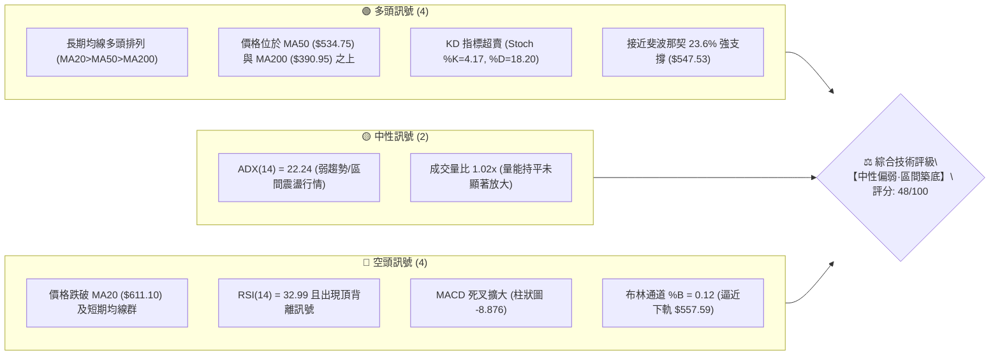
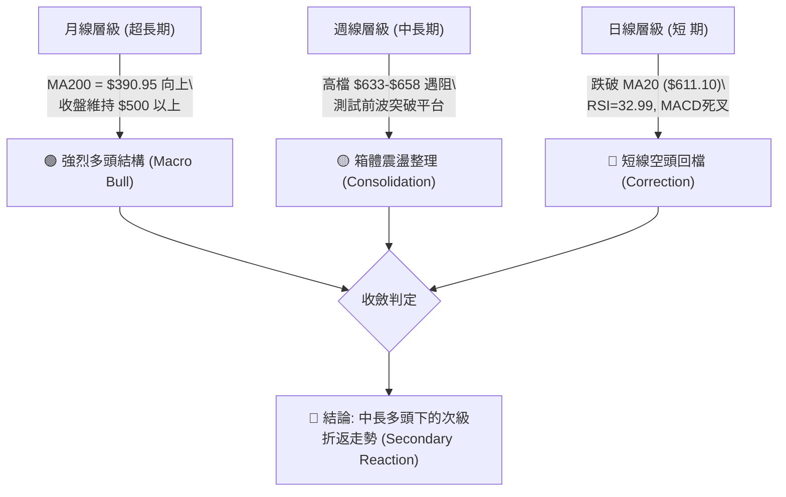
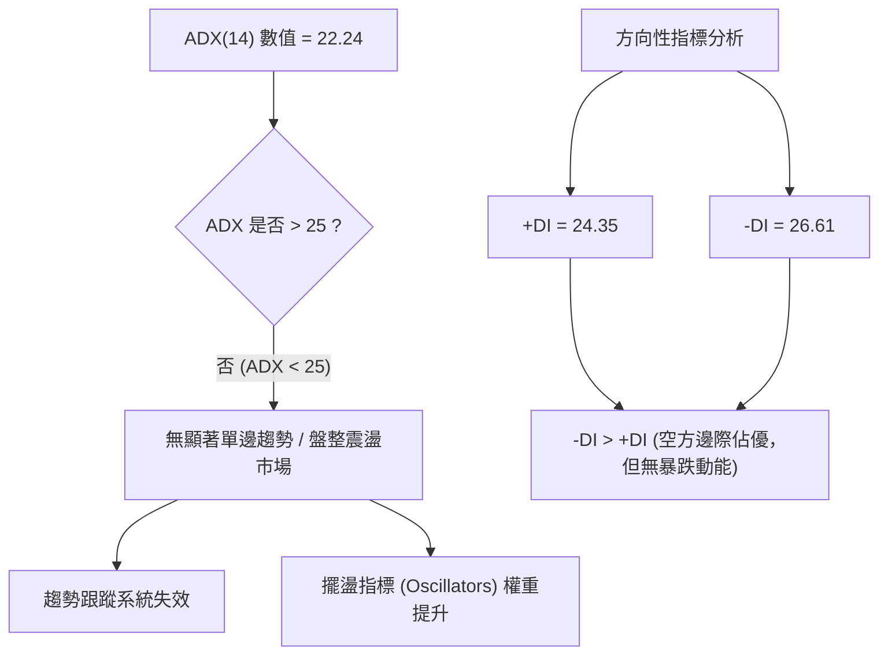
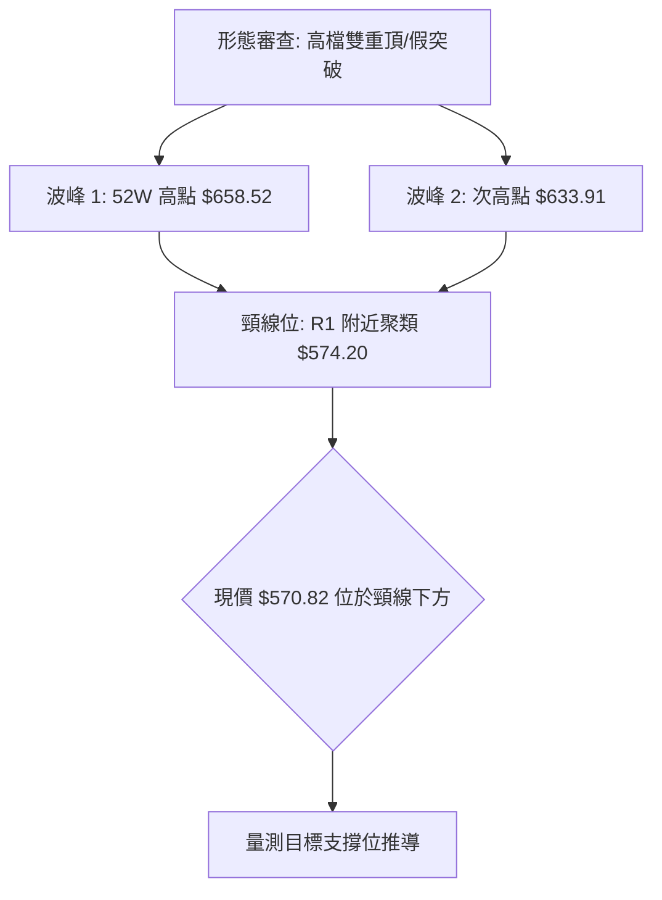
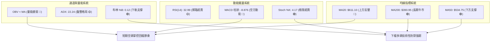
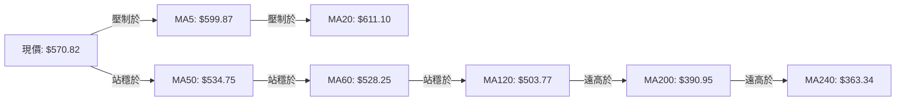
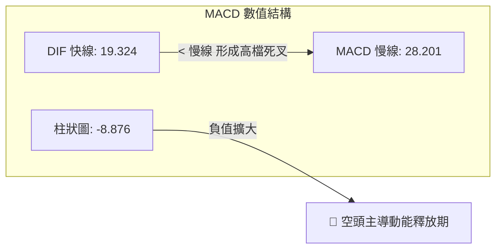
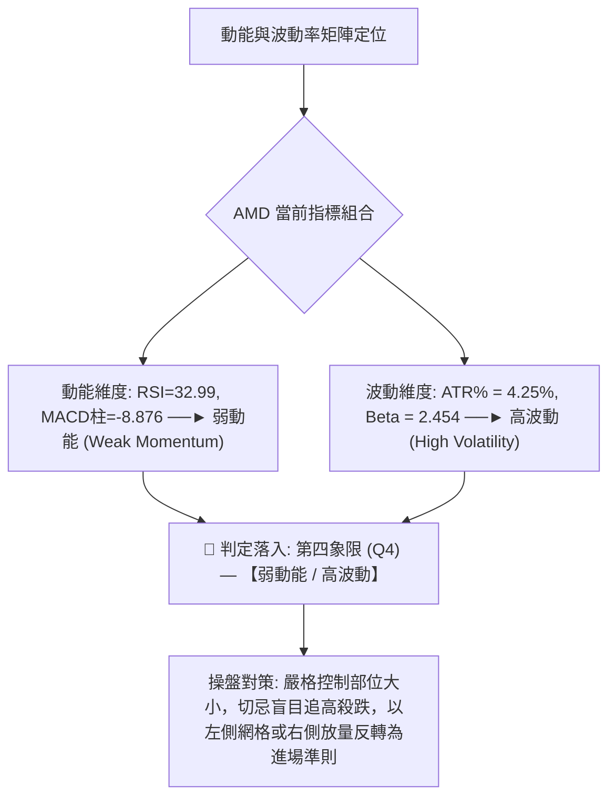
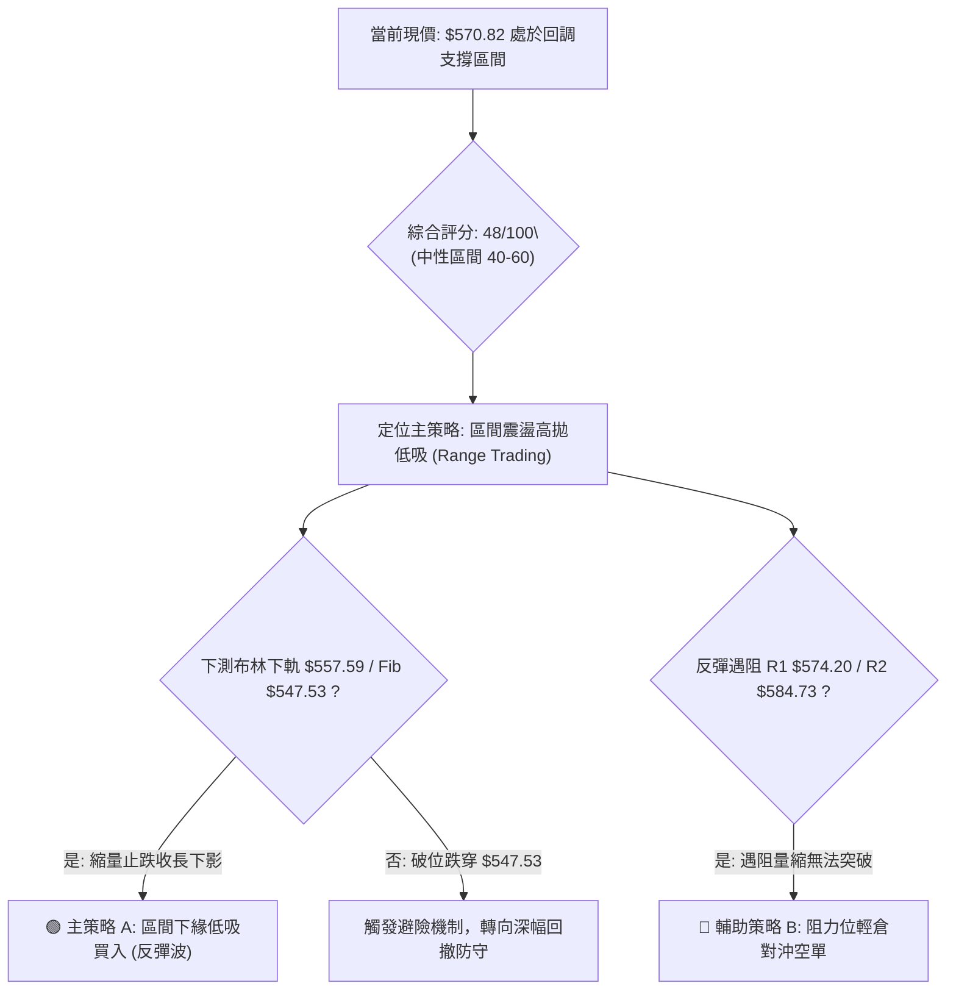
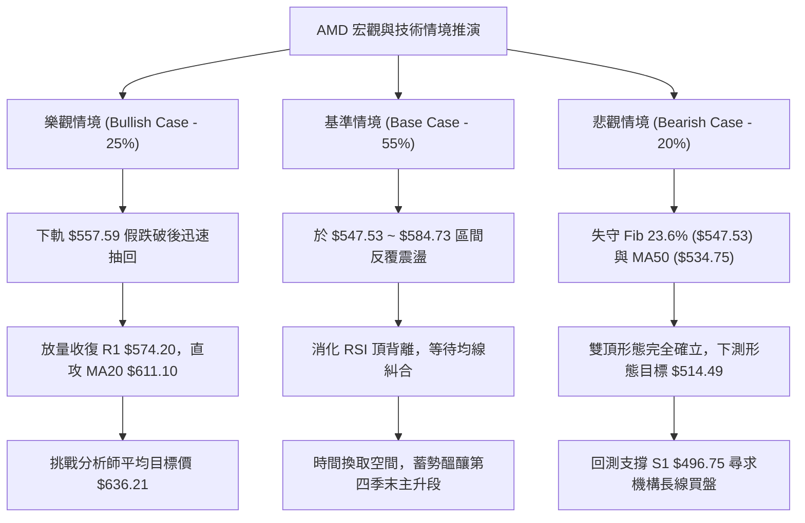

# AMD 技術分析報告

> **報告日期**：2026-10-15 ｜ **語言**：繁體中文 ｜ **數據來源**：Yahoo Finance ｜ **當前價格**：$570.82

---

## 目錄

| 章節 | 內容 |
|------|------|
| [1. 技術面概覽](#1-技術面概覽) | 訊號儀表板、核心指標、評分卡 |
| [2. 趨勢分析](#2-趨勢分析) | 多時框趨勢、長中短期走勢、ADX解讀 |
| [3. 圖表形態分析](#3-圖表形態分析) | 形態識別、信心度評估、K線組合、目標價 |
| [4. 支撐與阻力](#4-支撐與阻力) | 關鍵價位分布、波段聚類、斐波那契回調 |
| [5. 技術指標深度解讀](#5-技術指標深度解讀) | 均線系統、RSI背離、MACD、布林通道、OBV量價 |
| [6. 動能與波動率](#6-動能與波動率) | 動能四象限、ATR波幅設定、高Beta特性 |
| [7. 多時框架總結](#7-多時框架總結) | 時框矩陣、優先級收斂原則、單一方向性結論 |
| [8. 交易策略建議](#8-交易策略建議) | 策略路由、價格情境階梯、主策略與避險規劃 |
| [9. 風險提示與監控](#9-風險提示與監控) | 關鍵監控清單、情境推演、風控紀律 |
| [10. 報告總結](#-報告總結) | 儀表板總覽、多維度評級與最優策略組合 |

---

## 1. 技術面概覽

### 🎯 技術訊號儀表板



---

### 📊 核心指標速覽表

| 指標類別 | 指標名稱 | 當前數值 | 訊號 | 技術解讀 |
|:---|:---|:---:|:---:|:---|
| **價格** | 當前收盤價 | $570.82 | 🟡 | 位於52週區間 81.4% 高位，短線自高點 $658.52 回檔 -13.32% |
| **均線** | 短期 MA20 | $611.10 | 🔴 | 價格低於 MA20 達 -6.59%，短期均線轉為上檔反壓 |
| **均線** | 中期 MA50 | $534.75 | 🟢 | 價格高於 MA50 達 +6.75%，中期上行生命線尚未跌破 |
| **均線** | 長期 MA200 | $390.95 | 🟢 | 價格遠高於 MA200 (+46.01%)，超長期多頭格局穩固 |
| **動能** | RSI(14) | 32.99 | 🔴 | 瀕臨超賣邊界，且伴隨日線級別「頂背離」修正壓力 |
| **動能** | MACD (12,26,9) | 19.324 / 28.201 | 🔴 | DIF 下穿 MACD 形成死叉，柱狀圖 -8.876 呈現空頭動能釋放 |
| **隨機動能**| Stoch %K / %D | 4.17 / 18.20 | 🟢 | 嚴重超賣（%K < 10），具備隨時觸發技術性反彈之條件 |
| **通道** | 布林通道 %B | 0.12 | 🟡 | 價格貼近下軌 ($557.59)，進入極端超賣支撐測試區間 |
| **趨勢** | ADX(14) / ±DI | 22.24 (-DI: 26.61) | 🟡 | ADX < 25 判定為無單邊強趨勢之盤整行情，-DI 主導回檔 |
| **波動** | ATR(14) | $24.27 (4.25%) | 🟡 | 單日波動幅度大，需配合放寬止損間距至 1.5~2 倍 ATR |
| **量能** | OBV 趨勢 | OBV < MA | 🔴 | 成交量能疲弱，缺乏主力主動性買盤推升 |

---

### 🏆 技術評分卡

```
╔══════════════════════════════════════════════════════════════╗
║               技術評分卡 — AMD (2026-10-15)                  ║
╠══════════════════════════════════════════════════════════════╣
║ 趨勢強度 (Trend)     ████████░░░░░░░░░░░░  42/100  🔴 弱勢回調║
║ 動能指標 (Momentum)  ██████░░░░░░░░░░░░░░  30/100  🔴 動能疲弱║
║ 支撐穩定度 (Support) █████████████░░░░░░░  68/100  🟢 支撐密集║
║ 成交量配合 (Volume)  ████████░░░░░░░░░░░░  40/100  🔴 量價背馳║
║ 形態完整度 (Pattern) ██████████░░░░░░░░░░  52/100  🟡 區間箱體║
║ 均線排列 (MAs)       ████████████░░░░░░░░  60/100  🟢 中長偏多║
╠══════════════════════════════════════════════════════════════╣
║ 綜合技術評分         █████████░░░░░░░░░░░  48/100  🟡 中性觀望║
╚══════════════════════════════════════════════════════════════╝
```

---

## 2. 趨勢分析

### 🌐 多時框趨勢分析

依據多時框收斂體系，當前市場呈現「長多、月中性、短空」的結構性特徵：



---

### 📈 長期趨勢 — 12個月走勢圖（ASCII）

以下為 AMD 過去 12 個月（2025-11 至 2026-10）月線收盤走勢與關鍵轉折點標註：

```
AMD 月線收盤走勢圖（2025-11 ～ 2026-10）
價格軸 ($)
$650 ┤                                      ● $658.52 (52W波段天花板)
$610 ┤                                  ● $611.76
$570 ┤                                      ● $570.82 (當前現價)
$530 ┤                          ● $516.10
$490 ┤                  ● $580.91   ● $476.15  ● $470.72
$350 ┤              ● $354.49 (主升段突破)
$250 ┤  ● $217.53
$210 ┤      ● $214.16   ● $200.21
$190 ┤              ● $203.43 (雙重底低點 $188.22 附近)
     └──────┬───────┬───────┬───────┬───────┬───────┬───────┬───────►
          25-11   26-01   26-03   26-05   26-07   26-09   26-10 (月份)
```

#### 走勢特徵分析表格

| 階段區間 | 時間跨度 | 價格起迄 | 漲跌幅 | 成交量與走勢特徵 |
|:---|:---:|:---:|:---:|:---|
| **第一階段：底部築底** | 2025-11 ~ 2026-03 | $217.53 → $203.43 | -6.48% | 於 $188.22 ~ $236.73 區間震盪築底，形成堅實大型箱體結構 |
| **第二階段：主升暴發** | 2026-04 ~ 2026-06 | $354.49 → $580.91 | +63.87% | 帶量單邊跳空噴出，突破歷史均線反壓，奠定長多主基調 |
| **第三階段：高檔震盪** | 2026-07 ~ 2026-08 | $476.15 → $470.72 | -18.96% | 獲利了結賣壓湧現，兩次回踩測試 S2 ($461.71) ~ 38.2% 回調位 |
| **第四階段：衝頂受挫** | 2026-09 ~ 2026-10 | $611.76 → $570.82 | -6.69% | 觸及 52W 高點 $658.52 後力竭，日線連黑，回測布林下軌 |

---

### 📊 中期趨勢（週線分析）

從近 20 週數據觀察，AMD 於 2026 年 9 月底一度衝至 $633.91，週線 RSI 高達 84.3，動能嚴重透支；隨後連續 2 週收黑，週成交量自 1.32 億股縮減至本週的 5,538 萬股，週線 MACD 柱狀圖由 +14.199 劇烈翻黑至 -8.876。

```
中期支撐與壓力結構示意圖：
  $658.52 ──────┬─────────────────────────────────── (歷史天花板 R3 / 52W High)
                │      ▲
  $611.10 ──────┼──────┼───────────── (MA20 / 布林中軌反壓線)
  $570.82 ──────┼──────┼───────────── ◄ 【現價位 $570.82】
  $547.53 ──────┼──────┼───────────── (斐波那契 23.6% 回調關鍵位)
  $534.75 ──────┼──────▼───────────── (中期生命線 MA50 支撐)
  $496.75 ──────┴─────────────────── (波段結構性頸線支撐 S1)
```

---

### ⚡ 趨勢強度評估（ADX 解讀）



#### ADX 趨勢強度對照解讀

| 指標變量 | 實際數值 | 標準閾值區間 | 當前技術含義 |
|:---|:---:|:---:|:---|
| **ADX(14)** | **22.24** | 0 ~ 20 (無趨勢) / 20 ~ 25 (弱趨勢) | 處於盤整與弱趨勢交界，表明當前下跌為高檔震盪的一部分，非單邊崩跌 |
| **+DI (多方)** | **24.35** | > 25 表多頭主導 | 多頭動能衰退，未能形成推升波段 |
| **-DI (空方)** | **26.61** | > 25 表空頭主導 | 空頭短線勝出，但未突破 30+ 的強空爆發閥值 |
| **市場狀態** | **盤整整理** | 依收斂規則 14 | **優先以布林通道邊界與 S/R 區間高拋低吸為主要策略** |

---

## 3. 圖表形態分析

### 🔍 形態識別系統

在日線與週線結構上，價格自 2026-09-27 高點 $630.63、2026-10-04 高點 $633.91 及 52W 高點 $658.52 回落，並在短線跌破前波小平台 $574.20。



#### 形態識別與信心度評估表

| 識別形態 | 形態類型 | 信心度 (%) | 判斷依據（嚴格引用數據） | 完成度 (%) | 理論目標價（附精確計算式） |
|:---|:---:|:---:|:---|:---:|:---|
| **高檔雙重頂 (Double Top)** | 空頭反轉 | **65%** | 兩次衝頂 $658.52 與 $633.91 均破敗；現價 $570.82 跌破短頸線 R1 ($574.20) | 75% | 頸線 $574.20 - 形態高度 ($633.91 - $574.20 = $59.71) = **$514.49**（貼近 2026-08-16 平台高點 $514.39） |
| **大級別箱體震盪** | 中性延續 | **80%** | 上軌阻力密集於 R3 ($658.52)，下軌支撐確立於 S1 ($496.75) 與 Fib 23.6% ($547.53) | 60% | 區間震盪無方向性突破，預期於 **$547.53 ~ $611.10** 往復波動 |
| **上升旗形旗面整理** | 多頭延續 | **45%** | (訊號不足，信心度 < 50%) 缺乏下軌明確三角形收斂邊界，僅作指標型弱回調看待 | 30% | 數據不足以支持幾何上升旗形判定 |

---

### 🕯️ 重要K線形態分析

| 觀測時段 | 收盤價 | 典型K線形態 | 內涵與微觀多空博弈 | 技術訊號 |
|:---:|:---:|:---:|:---|:---:|
| **2026-09-27 (週)** | $630.63 | **放量大陽線** | 突破 $600 整數關卡，單週暴量 1.32 億股，呈現最後噴出衝刺特徵 | 🟢 趨勢多頭 |
| **2026-10-04 (週)** | $633.91 | **高檔長上影十字星** | 衝高 $658.52 遭空頭迎頭痛擊，長上影線顯示 $640 以上解套與獲利賣壓沉重 | 🔴 見頂警訊 |
| **2026-10-11 (週)** | $608.10 | **實體長陰吞噬** | 週線失守 MA20 ($611.10)，完全吞沒前週實體，確立次級回檔成立 | 🔴 空頭確認 |
| **2026-10-18 (本週迄今)**| $570.82 | **跳空低走破線陰線** | 測試布林帶下軌支撐，量能萎縮至 5,538 萬股，呈現賣壓釋放後的空頭力竭跡象 | 🟡 跌勢趨緩 |

---

### 📉 ASCII 走勢形態示意圖

```
高檔頂部形態與頸線跌破幾何結構：
   $658.52 ─────────────● (頂部 1: 52W High)
                       / \
                      /   \        ● $633.91 (頂部 2: 次高點)
                     /     \      / \
                    /       \    /   \
   $574.20 ────────/─────────▼──/─────▼─────── 頸線位置 (R1: $574.20)
                  /            ▲              現價跌破頸線 ◄─── $570.82
                 /              \
   $547.53 ─────/────────────────▼──────────── 斐波那契 23.6% 強支撐
               /
   $514.49 ───● (形態等幅測量目標位) ═════════ 接近 MA50 ($534.75) ~ S1 ($496.75) 帶
```

---

## 4. 支撐與阻力

### 🗺️ 關鍵價位分布圖（ASCII）

```
AMD 關鍵價位結構分布圖 (由實際 OHLCV 與斐波那契嚴格聚類)
═════════════════════════════════════════════════════════════════
$664.60 ║▓▓▓▓▓▓▓▓▓▓▓▓▓▓▓▓▓▓▓▓▓▓▓▓║ 布林通道上軌 (極端超買警戒線)
$658.52 ║████████████████████████║ 強阻力 R3 (52W歷史最高價 / 空頭堡壘)
$611.10 ║████████████████████    ║ 短期均線密集反壓 (MA20 / 布林中軌)
$584.73 ║██████████████          ║ 阻力 R2 (近一年波段高點次級聚類)
$574.20 ║██████████              ║ 阻力 R1 (跌破之短線頸線位)
$570.82 ╠════════════════════════╣ ◄── 現價 ($570.82)
$557.59 ║▒▒▒▒▒▒▒▒▒▒▒▒▒▒▒▒        ║ 布林通道下軌 (短線動態支撐)
$547.53 ║▓▓▓▓▓▓▓▓▓▓▓▓▓▓▓▓▓▓▓▓    ║ 斐波那契 23.6% 回調關鍵點位
$534.75 ║████████████████        ║ 中期核心生命線 MA50
$496.75 ║████████████████████    ║ 強支撐 S1 (近一年波段低點聚類核心)
$478.87 ║▓▓▓▓▓▓▓▓▓▓▓▓▓▓▓▓        ║ 斐波那契 38.2% 回調位
$461.71 ║██████████████████████  ║ 強支撐 S2 (2026年8月箱體底部低點)
$451.00 ║████████████████████████║ 極限防守支撐 S3 (波段多頭最後底線)
═════════════════════════════════════════════════════════════════
```

---

### 🚧 阻力位分析表

所有價位均嚴格取自數據模組提供之波段高點聚類：

| 阻力級別 | 準確價位 | 距現價空間 | 形成技術原因 | 突破難度 | 戰略重要性 |
|:---|:---:|:---:|:---|:---:|:---|
| **R1** | **$574.20** | +0.59% | 短期多空分水嶺，前期跌破之短線箱底轉換為反壓 | 🟡 中等 | 短線轉強第一道門檻，收復方能止跌 |
| **R2** | **$584.73** | +2.44% | 近一年次級高點密集聚類區，MA5 ($599.87) 下方緩衝區 | 🔴 較高 | 空方防守緩衝帶，多頭進一步反彈必經之路 |
| **R3** | **$658.52** | +15.36% | 52W 歷史天花板，前波放量衝頂破敗位置，套牢盤沉重 | 🔴 極高 | 多頭牛市延續的決定性天塹 |

---

### 🛡️ 支撐位分析表

所有價位均嚴格取自數據模組提供之波段低點聚類：

| 支撐級別 | 準確價位 | 距現價空間 | 形成技術原因 | 守住機率 | 戰略重要性 |
|:---|:---:|:---:|:---|:---:|:---|
| **S1** | **$496.75** | -12.98% | 近一年波段低點第一核心聚類，接近 2026-07-19 低點 $495.76 | 🟢 75% | 中期健康調整的極限回檔位，跌破轉為深幅修正 |
| **S2** | **$461.71** | -19.11% | 2026年8月回調波段低點（8-30 收盤 $465.58 附近密集底部） | 🟢 85% | 結構性強大多頭防線，機構買盤建倉重鎮 |
| **S3** | **$451.00** | -20.99% | 2026年夏季主升段啟動前之最終防禦平台 | 🟢 90% | 多頭長期牛熊分界堤防，不可失守之底線 |

---

### 📐 斐波那契回調位分析

依據 52 週完整波段（低點 $188.22 → 高點 $658.52，總波幅 $470.30）計算：

| 斐波那契回調位 | 基準價位 | 當前價位相對位置與技術意義解讀 |
|:---:|:---:|:---|
| **0.0% (52W High)** | **$658.52** | 波段頂點，歷史阻力極限 |
| **23.6%** | **$547.53** | **【現價 $570.82 位於 0% 與 23.6% 之間】**。此區間為強勢牛市第一道常規折返位；若於 $547.53 上方完成止跌，代表長期上升趨勢未受任何破壞 |
| **38.2%** | **$478.87** | 強弱分水嶺，緊鄰 S1 ($496.75) 下方，若遭擊穿將引發中期趨勢轉向判定 |
| **50.0%** | **$423.37** | 心理中軸位，多空長期均勢位 |
| **61.8%** | **$367.87** | 黃金分割極限防守位，緊鄰 MA200 ($390.95) 與 MA240 ($363.34) |
| **78.6%** | **$288.86** | 深度回撤區，進入結構性空頭格局 |
| **100.0% (52W Low)**| **$188.22** | 歷史循環底部起點 |

---

## 5. 技術指標深度解讀

### 🎛️ 指標訊號總覽



---

### 📈 移動平均線排列分析



#### 均線階梯偏離度統計表

| 均線名稱 | 當前價格 | 偏離值 ($) | 偏離百分比 (%) | 均線歷史軌跡與排列解讀 |
|:---|:---:|:---:|:---:|:---|
| **MA 5** | $599.87 | -$29.05 | -4.84% | 超短線陡峭下行，構成日內反彈第一阻力 |
| **MA 10** | $617.60 | -$46.78 | -7.58% | 短期下穿 MA20 形成死叉，下壓動能顯著 |
| **MA 20** | $611.10 | -$40.28 | -6.59% | 月線級別由升轉平並微彎向下，短期多空分水嶺 |
| **MA 50** | $534.75 | +$36.07 | +6.75% | 季線強勁向上延伸，中線多頭第一道主防線 |
| **MA 60** | $528.25 | +$42.57 | +8.06% | 與 MA50 形成雙重支撐帶，保護力道極強 |
| **MA 120** | $503.77 | +$67.05 | +13.31% | 半年線持續上移，與 S1 ($496.75) 構成重合支撐 |
| **MA 200** | $390.95 | +$179.87 | +46.01% | 年線呈現標準多頭排列（MA20>MA50>MA200），無熊市疑慮 |
| **MA 240** | $363.34 | +$207.48 | +57.10% | 長期成本底線，支撐長期估值溢價 |

---

### 📉 RSI(14) 分析與背離判定

- **當前讀數**：`32.99` 
- **動能強度進度條**：`███████░░░░░░░░░░░░░  32.99%` 
- **區間定位**：逼近 30 超賣線，處於弱勢空頭區間。

```
RSI(14) 頂背離結構圖解：
價格走勢 (Price):
  $630.63 (2026-09-27) ──────► $633.91 (2026-10-04) ──────► $658.52 (盤中創高) [高點墊高 ▲]
                                                                        
RSI(14) 指標走勢:
  RSI: 80.4 ──────────────────► RSI: 84.3 ─────────────────► [轉折驟降 32.99]   [動能背馳 ▼]
  【結論】：數據確認存在顯著「⚠️ 頂背離 (Bearish Divergence)」，直接觸發本次深度回檔修正。
```

---

### 📊 MACD(12,26,9) 訊號解讀



- **狀態評估**：DIF (19.324) 跌破 DEA (28.201)，差值擴大，MACD 柱狀圖由前期峰值 +14.199 劇降至目前的 `-8.876`，顯示中期頂部動能衰竭，空方動能處於主升釋放週期。然而兩線仍位於 0 軸上方（19.324 > 0），顯示此乃強勢市場中的次級波回檔，非零軸下方的結構性熊市行情。

---

### 📦 布林通道分析

```
布林通道 (Bollinger Bands 20, 2) 空間圖解：
  $664.60 ─────────────────────────────────────────────── 上軌 (Upper Band)
                          ● $658.52 (觸軌回落)
  $611.10 ─────────────────────────────────────────────── 中軌 (MA20 反壓)
                                      
  $570.82 ─────────────── ◄【現價 %B = 0.12】───────────── 逼近下軌超賣區
  $557.59 ─────────────────────────────────────────────── 下軌 (Lower Band)
```

- **通道參數**：上軌 `$664.60` ｜ 中軌 `$611.10` ｜ 下軌 `$557.59` ｜ 頻寬 (Bandwidth) = 17.51%
- **位置解讀**：當前 `%B = 0.12`，價格已跌入極度下軌超賣區間（0.0 ~ 0.2），且距下軌僅 $13.23（約 2.3% 緩衝）。歷史慣性顯示，%B 跌破 0.15 通常誘發均值回歸（Mean Reversion）買盤，預示短線空頭進一步殺跌空間有限。

---

### 💹 成交量分析（量價配合度）

```
量價配合矩陣分析：
├─ 最新日成交量：22,070,500 股
├─ 20日均成交量：21,695,715 股 (量比: 1.02x，持平無恐慌放量)
├─ 50日均成交量：20,690,966 股
└─ OBV 能量潮狀態：OBV < MA → 🔴 量能疲弱
```

- **量價診斷**：週成交量從衝頂週的 1.32 億股大幅萎縮至本週的 5,538 萬股，伴隨收盤價從 $633.91 回落至 $570.82。此「價跌量縮」格局顯示市場籌碼並未出現全面性機構出逃，更多為獲利籌碼清洗；然而，OBV 線跌破均線，代表新增買盤意願低落，反彈須待量能回升至 20 日均量以上（>2,200 萬股/日）方能確認築底完成。

---

## 6. 動能與波動率

### ⚡ 動能評估四象限



#### 動能四象限特徵對照表

| 象限標籤 | 動能狀態 | 波動狀態 | AMD 對應度 | 策略指導含義 |
|:---|:---:|:---:|:---:|:---|
| **Q1 (最佳擴張)** | 強動能 | 低波動 | — | 穩定單邊牛市，適合順勢重倉加碼 |
| **Q2 (盤整蟄伏)** | 弱動能 | 低波動 | — | 狹幅無聊整理，宜場外觀望 |
| **Q3 (主升衝刺)** | 強動能 | 高波動 | 2026年9月衝頂期 | 獲利了結、逐步收緊移動止損期 |
| **Q4 (劇烈震洗)** | **弱動能** | **高波動** | **✓ 當前狀態** | **高洗盤風險區，空頭占優但容易急彈，宜縮小倉位** |

---

### 📊 ATR 波動率分析

- **ATR(14)**：`$24.27`（佔現價百分比為 **4.25%**）。
- **日內隱含波動範圍**：在無重大消息衝擊下，AMD 正常交易日波動極限約在現價 ±$24.27 之間（即日內區間預估：`$546.55 ~ $595.09`）。
- **風控止損參數設定**：
  - *短期積極交易*：採用 1.5 倍 ATR 止損距離 = `1.5 × $24.27 = $36.41`。
  - *波段順勢交易*：採用 2.0 倍 ATR 止損距離 = `2.0 × $24.27 = $48.54`。

---

### 📐 Beta 與市場相關性

- **Beta 係數**：`2.454`。
- **特徵解讀**：AMD 屬於典型的高彈性、超高貝塔科技龍頭股。當 Nasdaq 100 指數變動 1% 時，AMD 理論波動幅度高達 2.45%。在當前大盤面臨高利率與宏觀數據重估期，高 Beta 意味著向下回調時承擔更深折價，但一旦大盤指針轉向，其反彈爆發力亦為同業首選。

---

## 7. 多時框架總結

### 📋 時框架評分表

| 時框架 | 趨勢方向 | 核心動能指標狀態 | 均線系統排列 | 圖表形態評估 | 綜合評分 | 操作指導建議 |
|:---|:---:|:---|:---|:---|:---:|:---|
| **月線 (長期)** | 🟢 強多 | RSI維持高位，遠高於基期 | MA200 ($390.95) 堅挺向上 | 大型主升波段延伸 | **82/100** | 長線多單底倉堅定持有 |
| **週線 (中期)** | 🟡 震盪 | 週線MACD翻黑，RSI回落至中軸 | 站穩 MA50 ($534.75) 之上 | 高檔大箱體整理 | **52/100** | 逢低於支撐帶分批佈局 |
| **日線 (短期)** | 🔴 偏空 | RSI=32.99，MACD負柱擴大 | 跌破 MA20 ($611.10) 反壓 | 雙頂頸線破位測底 | **35/100** | 嚴禁搶反彈，靜待止跌訊號 |

---

### 🔲 綜合訊號矩陣

```
時框訊號一致性診斷矩陣：
╔═════════════╦══════════════╦══════════════╦══════════════╗
║ 指標維度    ║ 短期 (日線)  ║ 中期 (週線)  ║ 長期 (月線)  ║
╠═════════════╬══════════════╬══════════════╬══════════════╣
║ 趨勢方向    ║ 🔴 空頭折返  ║ 🟡 橫向盤整  ║ 🟢 結構性牛市║
║ 均線狀態    ║ 🔴 均線反壓  ║ 🟢 MA50 支撐 ║ 🟢 多頭排列  ║
║ 動能擺盪    ║ 🔴 負向擴散  ║ 🟡 中性降溫  ║ 🟢 強勢區間  ║
║ 波動與成交  ║ 🟡 縮量測試  ║ 🔴 高檔放量  ║ 🟢 換手充分  ║
╠═════════════╬══════════════╬══════════════╬══════════════╣
║ 時框收斂性  ║ 【衝突】：短期空頭回調 與 長期多頭趨勢相悖  ║
╚═════════════╩══════════════╩══════════════╩══════════════╝
```

---

### ⚖️ 多時框收斂結論

> **收斂仲裁法則（嚴格執行規則 14）**：
> 1. **趨勢強度定性**：當前日線 ADX(14) 讀數為 **22.24**，嚴格低於 25 趨勢門檻，判定全市場進入**「無單邊強趨勢的盤整震盪行情」**。
> 2. **主導時框裁決**：在 ADX < 25 環境下，中長期單邊趨勢信號暫時鈍化，交易邏輯**必須以日線布林通道上下軌 ($557.59 ~ $664.60) 及關鍵支撐阻力為核心交易區間**。
> 3. **方向性唯一結論**：**【🟡 中性觀望·區間下緣逢低佈局】**。短期殺跌動能已逼近布林下軌極限，不宜在此位置盲目追空；但因日線空頭均線尚未修復，操作上應等待價格在 **Fib 23.6% ($547.53) ~ 布林下軌 ($557.59)** 出現止跌K線，方可啟動區間反彈多單。

---

## 8. 交易策略建議

### 🗺️ 策略決策流程圖



---

### 🧭 策略路由（依評分卡分流）

- **當前主策略方向**：**【中性區間操作 (40–60 區間)】**（綜合評分：**48/100**）
- **策略執行方針**：市場當前缺乏單邊上攻動能（ADX=22.24），短線受阻於均線群，但下檔逼近布林下軌 ($557.59) 與斐波那契強支撐 ($547.53)。在此評分框架下，嚴禁追漲殺跌，策略主軸為**「支撐位分批低吸，阻力位果斷獲利了結」**。

---

### 🎯 價格情境階梯（Price Scenarios）

以當前價格 `$570.82` 為基準，嚴格引用第 4 章聚類之實際價位進行推演：

| 觸發條件 | 下一階段目標 | 後續延伸極限 | 行情情境含義與操作指引 |
|:---|:---:|:---:|:---|
| **強勢突破 R1 ($574.20)** | **R2 ($584.73)** | **R3 ($658.52)** | 短線止跌轉強，站回頸線，目標直指 MA20 ($611.10) 及前高 |
| **守住現價至 $557.59 區間** | **R1 ($574.20)** | **MA20 ($611.10)** | 典型布林下軌均值回歸，區間下緣震盪築底，適合波段低吸 |
| **跌破 Fib 23.6% ($547.53)** | **MA50 ($534.75)**| **S1 ($496.75)** | 頂部形態測量目標延伸，進入中期深幅修正，多單必須止損 |

---

### 📊 情境機率分佈

| 運行情境 | 發生機率 | 主要技術依據與數據支撐 |
|:---|:---:|:---|
| **情境一：區間震盪·下軌築底** | **55%** | ADX=22.24 Confirm 盤整行情；布林 %B=0.12 瀕臨下軌超賣；Stoch %K=4.17 具備極強反彈技術需求 |
| **情境二：慣性下探·測試 MA50** | **25%** | 日線 MACD 柱狀圖仍處於 -8.876 擴散期，空頭短線仍握有殺跌籌碼，需回踩 $547.53 ~ $534.75 洗盤 |
| **情境三：強勢反轉·直破 R2** | **20%** | RSI 頂背離壓力尚未消化完畢，成交量能（量比 1.02x）不足以支持 V 型單邊反轉 |

---

### 🟢 主策略詳情（區間高拋低吸型）

| 策略維度要素 | 策略 A（下軌低吸多單 · 主推） | 策略 B（均線反壓做空 · 輔助對沖） |
|:---|:---|:---|
| **進場條件** | 價格下測 $557.59 ~ $547.53 區間不破，日線收長下影線或出現底分型 | 價格反彈至 R1 ($574.20) ~ R2 ($584.73) 遇阻，小時級別動能竭盡 |
| **精確進場價格** | **$557.59** (布林通道下軌處掛單或觸及進場) | **$584.73** (波段阻力 R2 附近) |
| **第一目標價 T1** | **$584.73** (阻力位 R2，預期獲利 +4.87%) | **$557.59** (布林下軌，預期獲利 +4.64%) |
| **第二目標價 T2** | **$611.10** (MA20 / 布林中軌，預期獲利 +9.60%) | **$547.53** (Fib 23.6%，預期獲利 +6.36%) |
| **嚴格止損價格** | **$534.75** (有效跌破 MA50 生命線，風險 -4.09%) | **$599.87** (收盤站上 MA5 短期反壓，風險 -2.59%) |
| **風險報酬比 (R:R)**| **1 : 2.35** (以 T2 計算) | **1 : 2.45** (以 T2 計算) |
| **交易勝率預期** | **65%** | **55%** |
| **建議配置倉位** | **15% ~ 20%** (中等倉位) | **5% ~ 10%** (輕倉對沖) |

---

### 🔴 反向風險觸發點（對沖與停損提示）

1. **多頭主策略失效點**：若日線實體陰線收盤價跌破 **`$547.53`**（斐波那契 23.6% 回調位），宣告高檔雙頂測量跌幅全面展開，多頭必須無條件平倉止損，並考慮反手對沖至 S1 (`$496.75`)。
2. **空頭對沖失效點**：若價格放量長陽收復 **`$611.10`**（MA20 均線）且日線 MACD 柱狀圖翻紅，確認此波回檔結束，所有對沖空單必須立即回補離場。

---

### ⭐ 整體訊號強度評星

```
做多訊號強度：★★☆☆☆  (2.5/5星 — 短期承壓，需等待左側下軌支撐確立)
做空訊號強度：★★★☆☆  (3.0/5星 — 動能偏空，但受制於下軌超賣空間有限)
整體可信度：  ★★★★☆  (4.0/5星 — 數據完整，價位聚類與指標相互印證)
```

---

## 9. 風險提示與監控

### ✅ 關鍵監控指標 Checklist

```
╔══════════════════════════════════════════════════════════════╗
║               AMD 交易風險監控清單 (Checklist)               ║
╠══════════════════════════════════════════════════════════════╣
║ [ ] 價格是否跌破布林下軌 $557.59 並伴隨放量？                ║
║ [ ] RSI(14) 是否跌破 30.00 進入深度極限超賣？                ║
║ [ ] 日成交量能否突破 2,200 萬股 (大於 20日均量 1.02x)？      ║
║ [ ] MACD 柱狀圖負值是否開始收斂 (數值由 -8.876 向上收斂)？   ║
║ [ ] 50日均線生命線 $534.75 是否保持完好上行角度？            ║
║ [ ] 大盤 Nasdaq 指數是否出現 Beta > 2.0 級別的連鎖下殺？     ║
╚══════════════════════════════════════════════════════════════╝
```

---

### ⚠️ 風險場景分析



---

### 🛡️ 風險管理重要提醒

1. **高 Beta 波動懲罰**：AMD 的 Beta 高達 **2.454**，單日波動極劇烈（ATR 達 $24.27，佔現價 4.25%）。嚴禁滿倉操作，單筆交易的最大資金承擔風險（Maximum Capital at Risk）應嚴格控制在總投資組合的 **1.0% ~ 1.5%** 以內。
2. **左側交易紀律**：在 ADX = 22.24 的弱趨勢整理盤中，超賣買入本質屬於左側逆向交易。若進場後 3 個交易日內價格未能重回 `$574.20` 之上，表明下檔支撐承接力不足，應主動降倉以規避破位風險。
3. **分析師目標價之背離警訊**：雖然華爾街 50 位分析師給予 Strong Buy 評級，平均目標價高達 `$636.21`（最高達 $1250.00），但技術面 RSI 頂背離與 MACD 死叉為當下正在發生的價格事實。基本面目標價不可作為短期抗跌的唯一理由，一切操盤行動必須嚴格以技術止損位（`$534.75`）為最高風控準則。

---

## 📋 報告總結

```
╔══════════════════════════════════════════════════════════════╗
║                    AMD 技術分析總結報告                      ║
╠══════════════════════════════════════════════════════════════╣
║ 報告日期：2026-10-15          當前價格：$570.82              ║
║ 分析評級：⚖️ 中性觀望 (48/100) — 短期回調築底，中長多頭完好    ║
╠══════════════════════════════════════════════════════════════╣
║ 關鍵技術維度判定：                                           ║
║ ├─ 長期趨勢：🟢 多頭排列 (價格遠高於 MA200 $390.95)          ║
║ ├─ 中期趨勢：🟡 箱體震盪 (受阻於 $658.52，防守 MA50 $534.75) ║
║ ├─ 短期趨勢：🔴 次級折返 (跌破 MA20 $611.10，RSI=32.99 背離) ║
║ ├─ 關鍵核心阻力：R1: $574.20 ｜ R2: $584.73 ｜ R3: $658.52   ║
║ ├─ 關鍵核心支撐：S1: $496.75 ｜ S2: $461.71 ｜ Fib: $547.53 ║
║ └─ 華爾街共識目標價：$636.21 (50位分析師 Strong Buy)         ║
╠══════════════════════════════════════════════════════════════╣
║ 最優策略執行組合：                                           ║
║ 1. 🥇 最佳機會：等待回踩布林下軌 $557.59 ~ Fib 23.6% $547.53 ║
║                 分批進場博弈均值回歸反彈，止損設於 $534.75   ║
║ 2. 🥈 次選機會：反彈至阻力位 R2 $584.73 出現滯漲時，輕倉對沖 ║
║ 3. 🥉 保守選擇：空倉觀望，靜待日線 MACD 柱狀圖翻紅且收復     ║
║                 MA20 ($611.10) 後再行順勢進場                ║
╚══════════════════════════════════════════════════════════════╝
```

---

> ⚠️ **免責聲明**：本報告為依據客觀技術分析模型與即時行情數據自動生成之專業研報，所有支撐阻力點位及交易推演均基於歷史量價統計邏輯。本報告**僅供研究與學術參考**，**不構成任何要約、招攬或實質投資建議**。高 Beta 科技標的具備極高市場風險，投資人應依個人財務狀況與風險承受力獨立決策，入市需謹慎。

---

*報告生成時間：2026-10-15 ｜ 數據來源：Yahoo Finance ｜ 分析框架：多時框技術分析體系*