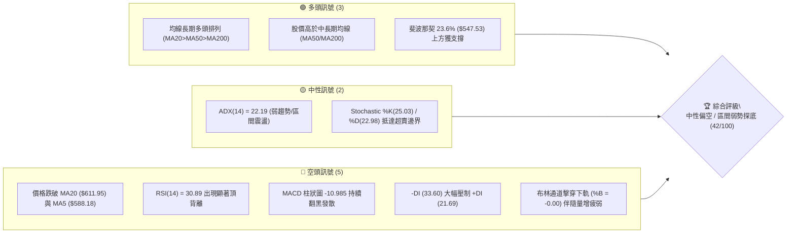
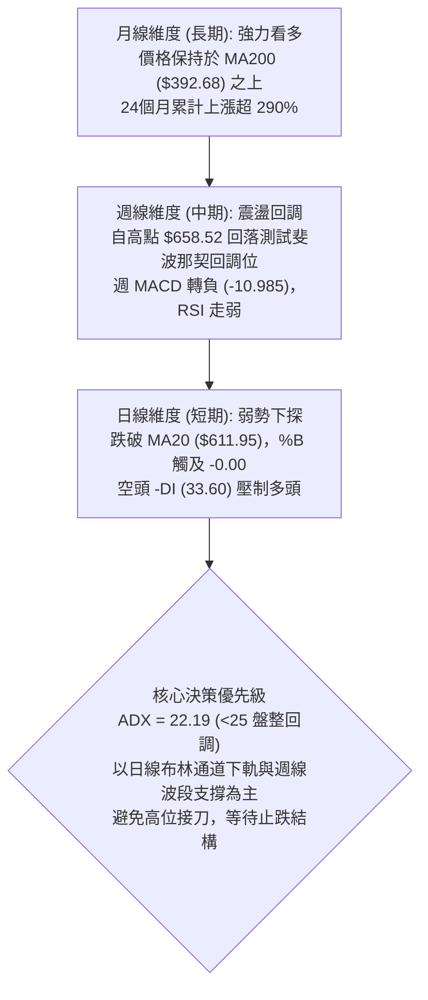
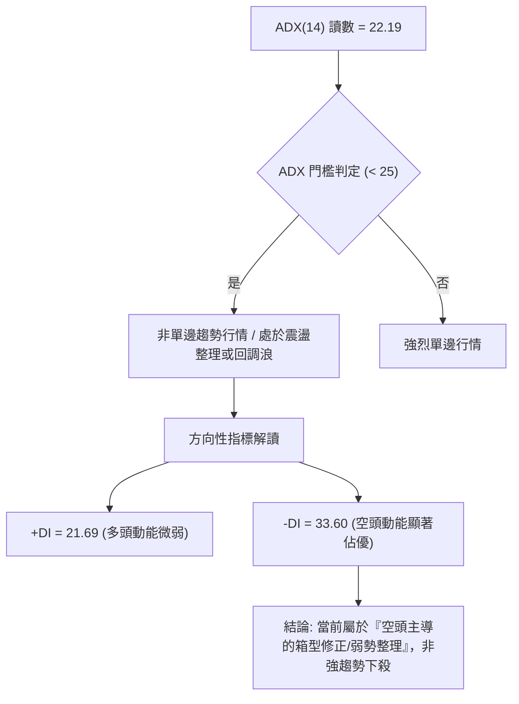
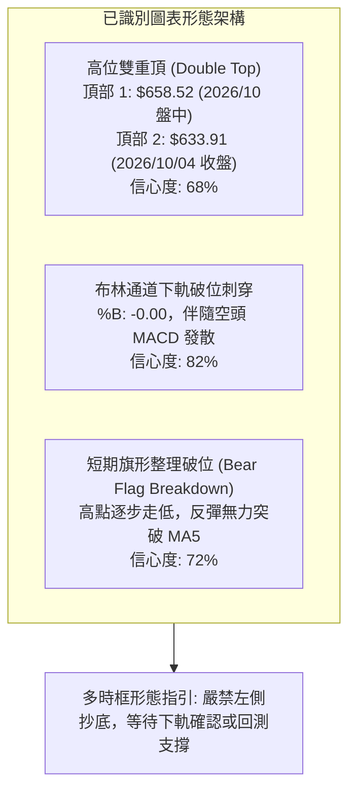
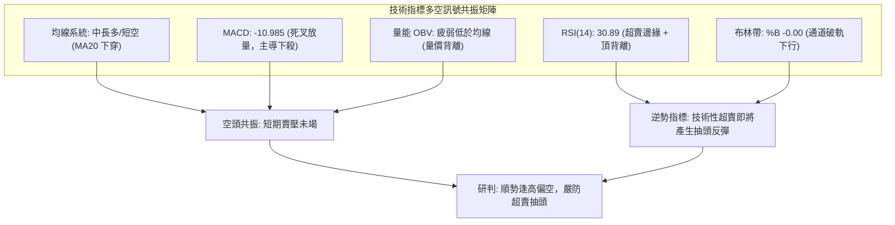
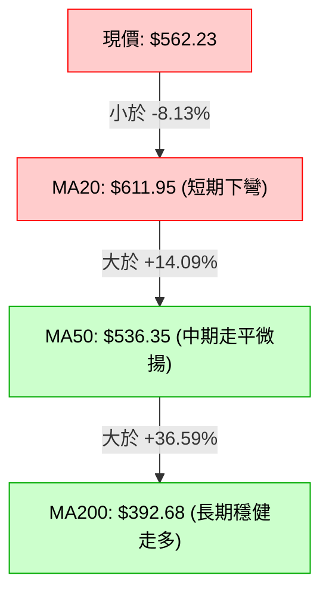
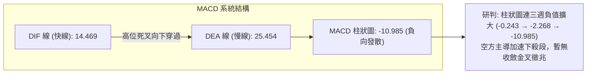
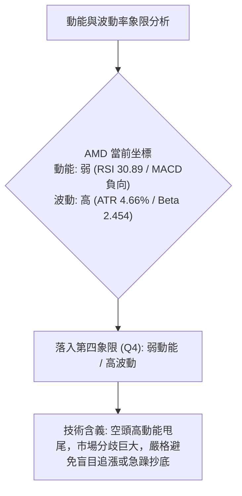
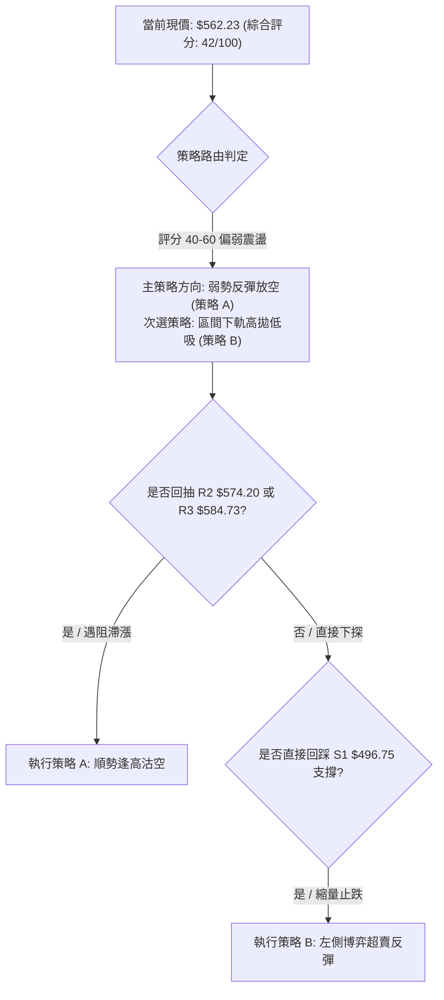
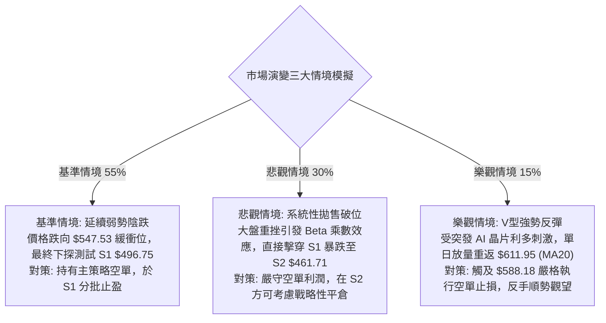

# AMD 技術分析報告

> **報告日期**：2026-10-16 ｜ **語言**：繁體中文 ｜ **數據來源**：Yahoo Finance ｜ **當前價格**：$562.23

---

## 目錄

| 章節 | 內容 |
|------|------|
| [1. 技術面概覽](#1-技術面概覽) | 訊號儀表板、核心指標、評分卡 |
| [2. 趨勢分析](#2-趨勢分析) | 多時框趨勢、長中短期走勢 |
| [3. 圖表形態分析](#3-圖表形態分析) | 形態識別、K線組合、目標價 |
| [4. 支撐與阻力](#4-支撐與阻力) | 關鍵價位、斐波那契回調 |
| [5. 技術指標深度解讀](#5-技術指標深度解讀) | MA/RSI/MACD/布林/成交量 |
| [6. 動能與波動率](#6-動能與波動率) | 動能評估、ATR、Beta |
| [7. 多時框架總結](#7-多時框架總結) | 時框架評分矩陣 |
| [8. 交易策略建議](#8-交易策略建議) | 多空策略、風險報酬比 |
| [9. 風險提示與監控](#9-風險提示與監控) | 監控指標、風險場景 |

---

## 1. 技術面概覽

### 🎯 技術訊號儀表板



### 📊 核心指標速覽表

| 指標類別 | 指標名稱 | 當前數值 | 訊號 | 解讀 |
|----------|----------|----------|:----:|------|
| **價格** | 當前收盤價 | $562.23 | 🔴 | 跌破短均線密集區，自波段高點大幅修正 |
| **均線** | MA20 (短月線) | $611.95 | 🔴 | 現價在 MA20 下方 -8.13%，短期動能嚴重走弱 |
| **均線** | MA50 (季線) | $536.35 | 🟢 | 現價高於 MA50 +4.83%，中期多頭結構尚未破壞 |
| **均線** | MA200 (年線) | $392.68 | 🟢 | 現價高於 MA200 +43.18%，長期多頭趨勢堅固 |
| **動能** | RSI(14) | 30.89 | 🟡 | 逼近 30 超賣線，但週線伴隨清晰頂背離警訊 |
| **動能** | MACD 柱狀圖 | -10.985 | 🔴 | DIF (14.469) 跌破 DEA (25.454)，負向柱擴大 |
| **通道** | 布林帶 %B | -0.00 | 🔴 | 價格緊貼下軌 $562.51，出現短期通道破軌超賣 |
| **趨勢** | ADX (14) | 22.19 | 🟡 | 讀數低於 25，確認進入盤整及波段回調行情 |
| **方向** | +DI / -DI | 21.69 / 33.60 | 🔴 | -DI 主導盤面，空方佔據顯著主導權 |
| **量能** | 成交量比 | 1.32x (28.74M) | 🔴 | 下跌帶量 (20日均量 21.72M)，OBV < MA 呈背馳 |
| **波動** | ATR(14) | $26.22 | 🟡 | 佔現價 4.66%，短期日內波動劇烈，需寬止損 |

### 🏆 技術評分卡

```
╔══════════════════════════════════════════════════════════════╗
║              技術評分卡 — AMD (2026-10-16)                  ║
╠══════════════════════════════════════════════════════════════╣
║ 趨勢強度 (Trend)     ████████░░░░░░░░░░░░  40/100  🔴 空頭佔優║
║ 動能指標 (Momentum)  ██████░░░░░░░░░░░░░░  30/100  🔴 嚴重受損║
║ 支撐穩定度 (Support) ████████████░░░░░░░░  60/100  🟡 考驗S1 ║
║ 成交量配合 (Volume)  ████████░░░░░░░░░░░░  40/100  🔴 量價背離║
║ 形態完整度 (Pattern) ██████████░░░░░░░░░░  50/100  🟡 高檔破位║
║ 均線排列 (MA System) ████████████░░░░░░░░  60/100  🟢 中長多頭║
╠══════════════════════════════════════════════════════════════╣
║ 綜合評分             ████████░░░░░░░░░░░░  42/100  🟡 中性偏空║
╚══════════════════════════════════════════════════════════════╝
```

---

## 2. 趨勢分析

### 🌐 多時框趨勢分析



### 📈 長期趨勢 — 12個月走勢圖（Unicode）

```
AMD 月線走勢圖（過去12個月：2025-11 至 2026-10）
價格軸 ($)
$658 ┤                                     ● 2026-09 ($611.76，歷史高點 $658.52)
$600 ┤                                  ● 2026-06 ($580.91)     ▼
$550 ┤                               ● 2026-05 ($516.10)     ● 當前現價 ($562.23)
$500 ┤                                              ● 2026-07 ($476.15)
$450 ┤                                           ● 2026-08 ($470.72)
$400 ┤
$350 ┤                         ● 2026-04 ($354.49)
$300 ┤
$250 ┤
$200 ┤ ● 2025-11 ($217.53)  ● 2026-01 ($236.73)
$150 ┤    ● 2025-12 ($214.16)   ● 2026-02 ($200.21) / 03 ($203.43)
     └─┬────┬────┬────┬────┬────┬────┬────┬────┬────┬────┬────┬──
      11   12   01   02   03   04   05   06   07   08   09   10 (月)
      (2025)   (------------------ 2026 ------------------)
```

#### 走勢特徵分析表格

| 階段區間 | 起止價格 | 漲跌幅 | 主要走勢特徵與量價表現 |
|----------|----------|:------:|------------------------|
| **蓄勢築底期** (2025/11 - 2026/03) | $217.53 → $203.43 | -6.48% | 長達 5 個月的橫盤整理，低點守穩 $200 整數關卡，建立長期籌碼底部。 |
| **主升浪突破期** (2026/04 - 2026/06) | $354.49 → $580.91 | +185.5% | 爆發性多頭突破，伴隨強大 AI 伺服器營收加速，連破數道整數阻力。 |
| **高位箱型整理** (2026/07 - 2026/08) | $476.15 → $470.72 | -18.97% | 劇烈獲利了結回調，在 $470.72 附近確立中期低點，完成洗盤。 |
| **二次衝高受阻** (2026/09 - 2026/10) | $611.76 → $562.23 | -8.10% | 創下 52 週新高 $658.52 後迅速引發頂背離賣壓，現回探布林下軌。 |

### 📊 中期趨勢（週線分析）

```
週線級別價格壓力與支撐階梯分布
價格軸
$658.52 ════════════════════════════════════════ 52W 最高點 / 頂部極限阻力
        │
$611.95 ──────────────────────────────────────── MA20 / 布林中軌反壓 (短期空頭強阻力)
        │
$584.73 ---------------------------------------- 波段反彈阻力位 R3
$574.20 ---------------------------------------- 短線頸線阻力位 R2
$562.23 ════════════════════════════════════════ 【現價 $562.23】/ 即時阻力 R1 (布林下軌 $562.51)
        │
$547.53 ──────────────────────────────────────── 斐波那契 23.6% 第一緩衝支撐線
        │
$536.35 ──────────────────────────────────────── MA50 (季線中期多空分水嶺)
        │
$496.75 ════════════════════════════════════════ 近一年波段低點聚類支撐 S1
$478.87 ──────────────────────────────────────── 斐波那契 38.2% 強力支撐位
$461.71 ════════════════════════════════════════ 次級波段支撐位 S2
$392.68 ════════════════════════════════════════ 長期牛熊分界線 MA200
```

### ⚡ 趨勢強度評估（ADX 解讀）



#### ADX 趨勢強度對照

| 指標名稱 | 實際數值 | 參考區間 | 當前技術含義 |
|----------|:--------:|:--------:|--------------|
| **ADX(14)** | **22.19** | 0 – 20: 無趨勢盤整<br/>**20 – 25: 弱趨勢/過渡震盪**<br/>25 – 40: 強趨勢<br/>40+: 極強單邊 | 市場自前期急速拉升轉入高位寬幅震盪修正期，單邊做多勝率下降。 |
| **+DI (14)** | **21.69** | < 25 疲弱 | 買方追高意願減退，無力推升價格脫離下軌。 |
| **-DI (14)** | **33.60** | > 30 偏強 | 賣方主導短期走勢，短線空頭下行壓力尚未釋放完畢。 |

---

## 3. 圖表形態分析

### 🔍 形態識別系統



#### 形態識別信心度與目標價評估

| 形態名稱 | 信心度 | 判斷依據（引用數據） | 完成度 | 目標價（附嚴謹計算式） |
|----------|:------:|----------------------|:------:|------------------------|
| **高檔雙重頂 (M頂)** | **68%** | 兩次衝高於 $658.52 (52W高點) 與 $633.91 遇阻回落，頸線位鎖定於前波回調低點聚類 $562.23 (即 R1/現價)。 | 85% | 形態高度 = $633.91 - $562.23 = $71.68。<br/>向下量度目標 = 頸線 $562.23 - $71.68 = **$490.55** (極度接近 S1 支撐位 $496.75)。 |
| **布林帶下軌超跌** | **82%** | 現價 $562.23 擊穿布林下軌 $562.51，%B 達到 -0.00，短線出現偏離均線過遠的乖離收斂需求。 | 100% | 均值回歸目標 = 回抽測試布林中軌 MA20 = **$611.95**。 |
| **中期雙底結構 (潛在)** | 35% | 數據中未偵測到完整的日線二次低點，目前僅有一處波段低點於 $470.72。 | 20% | *訊號不足，僅做指標型解讀，不預先假定雙底成立。* |

### 🕯️ 重要K線形態分析

| 日期/月份 | 收盤價 | K線形態 | 詳細技術解讀 | 訊號方向 |
|-----------|:------:|---------|--------------|:--------:|
| **2026-09-27** | $630.63 | 大陽線放量突破 | 放量 132M，突破 $600 關卡，創波段反彈新高，確認主升浪延續。 | 🟢 看多 |
| **2026-10-04** | $633.91 | 高位十字星/流星形態 | 週成交量驟降至 92M，高檔量價背離，上影線顯示 $658.52 處獲利拋壓沉重。 | 🔴 頂部警訊 |
| **2026-10-11** | $608.10 | 中陰線下破 MA20 | 跌破 20日均線，RSI 自 84.3 驟降至 47.4，多頭趨勢結構遭受重大破壞。 | 🔴 反轉確認 |
| **2026-10-18** | $562.23 | 長黑下殺大陰棒 | 收盤報 $562.23，貼近布林下軌，空方完全主導，確立高位修正形態。 | 🔴 強烈看空 |

### 📉 ASCII 走勢形態示意圖

```
高檔雙頂與頸線破位形態示意圖 (2026-09 至 2026-10)
價格軸 ($)
$658.52 ┬───────────────● 頂部 1 (52W High)
        │              / \
$633.91 ┤             /   \      ● 頂部 2 (次高點)
        │            /     \    / \
$611.95 ┤           /       \  /   \  ← 跌破布林中軌/MA20 ($611.95)
        │          /         \/      \
$562.23 ┼─────────/───────────●───────▼─── 頸線位置 ($562.23) / 當前現價
        │                                 │
        │  [量度跌幅測算]                  │ 形態高度: H = $71.68
        │  目標價 = $562.23 - $71.68       │
        │         = $490.55                ▼
$496.75 ┴─────────────────────────────────●─── 關鍵支撐區 S1 ($496.75)
```

---

## 4. 支撐與阻力

### 🗺️ 關鍵價位分布圖（Unicode）

```
AMD 價位結構分布圖 (由 OHLCV 與斐波那契精確計算)
══════════════════════════════════════════════════════════════════
$658.52 ║████████████████████████████████║ 52W 歷史極限高點
$611.95 ║████████████████████████        ║ MA20 動態均線阻力 / 布林中軌
$584.73 ║████████████████████            ║ 波段高點聚類強阻力 R3 (+4.00%)
$574.20 ║████████████████                ║ 短線反彈阻力位 R2 (+2.13%)
$562.23 ║████████████                    ║ 即時重疊阻力 R1 (+0.00%) / 破位頸線
╠═══════╬════════════════════════════════╣ ◄ 當前市價: $562.23 (布林下軌 $562.51)
$547.53 ║▓▓▓▓▓▓▓▓▓▓▓▓▓▓▓▓▓▓▓▓▓▓▓▓        ║ 斐波那契 23.6% 回調緩衝位 (-2.61%)
$536.35 ║▓▓▓▓▓▓▓▓▓▓▓▓▓▓▓▓▓▓▓▓▓▓▓▓▓▓▓▓    ║ MA50 季線關鍵支撐位 (-4.60%)
$496.75 ║████████████████████████████████║ 近一年波段低點聚類支撐 S1 (-11.65%)
$478.87 ║████████████████████████        ║ 斐波那契 38.2% 回調重要防線 (-14.83%)
$461.71 ║████████████████████████████    ║ 次級波段低點聚類支撐 S2 (-17.88%)
$451.00 ║████████████████████████        ║ 強力波段底部支撐 S3 (-19.78%)
$392.68 ║████████████████████████████████║ 牛熊生死線 MA200 年線 (-30.16%)
══════════════════════════════════════════════════════════════════
```

### 🚧 阻力位分析表

| 阻力級別 | 價位 (精確數值) | 距現價幅動 | 形成原因與籌碼結構 | 突破難度 | 重要性等級 |
|:--------:|:---------------:|:----------:|-------------------|:--------:|:----------:|
| **R1** | **$562.23** | +0.00% | 當前現價重合位，原為近期震盪平台支撐，跌破後反轉為即時籌碼套牢反壓線。 | 🟡 中等 | ★★★☆☆ |
| **R2** | **$574.20** | +2.13% | 近一年波段高點聚類次級阻力，日線等級反彈的短期空頭防守陣地。 | 🟡 中等 | ★★★★☆ |
| **R3** | **$584.73** | +4.00% | 近一年波段高點密集套牢區，重合 5日均線 MA5 ($588.18) 下壓軌道。 | 🔴 極高 | ★★★★★ |

### 🛡️ 支撐位分析表

| 支撐級別 | 價位 (精確數值) | 距現價幅動 | 形成原因與籌碼結構 | 守住機率 | 重要性等級 |
|:--------:|:---------------:|:----------:|-------------------|:--------:|:----------:|
| **S1** | **$496.75** | -11.65% | 近一年波段低點聚類區，前期多頭發動起漲點，具有強烈現貨買盤支撐。 | 🟢 70% | ★★★★★ |
| **S2** | **$461.71** | -17.88% | 2026年7-8月築底箱體下沿波段低點聚類，極為紮實的機構吸籌成本區。 | 🟢 85% | ★★★★☆ |
| **S3** | **$451.00** | -19.78% | 強力波段底部聚類支撐，若跌破代表中期多頭行情徹底反轉終結。 | 🟢 92% | ★★★★★ |

### 📐 斐波那契回調位分析

*基準區間：52週歷史低點 **$188.22** → 52週歷史高點 **$658.52**，總波幅高達 $470.30。*

```
斐波那契回調層級與現價相對位置
0.0%  (52W High)   $658.52 ────────────────────────────────────────────────
                          ▲
[當前位置]          $562.23 (落於 0.0% 至 23.6% 回調區間內，回撤幅度 20.47%)
                          ▼
23.6%              $547.53 ───────────────────────► [即刻下檔緩衝支撐]
38.2%              $478.87 ───────────────────────► [黃金分割健康回調目標]
50.0%              $423.37 ───────────────────────► [多空分水嶺]
61.8%              $367.87 ───────────────────────► [深幅回調極限 / 跌破 MA200]
78.6%              $288.86 ───────────────────────► [多頭趨勢瓦解]
100.0% (52W Low)   $188.22 ────────────────────────────────────────────────
```

#### 斐波那契深度技術解讀
1. **現價位置意義**：現價 **$562.23** 位於 0.0% ($658.52) 與 23.6% ($547.53) 之間，距離 23.6% 僅差 **$14.70 (-2.61%)**。這表明過去 2 年的大暴漲行情目前僅屬於「淺幅良性回調」，尚未傷及長期上行趨勢筋骨。
2. **關鍵防禦位**：若 $547.53 (23.6%) 宣告失守，下方真空地帶將直指波段支撐 **S1 ($496.75)** 與斐波那契 38.2% **($478.87)**。38.2% 是機構法人的黃金加倉區間，若能在此止跌，中期多頭結構依舊完美。

---

## 5. 技術指標深度解讀

### 🎛️ 指標訊號總覽



### 📈 移動平均線排列分析



#### 均線各週期狀態細節

| 均線名稱 | 當前價位 | 現價相對距離 | 走勢狀態 | 多空訊號 | 技術解讀 |
|:--------:|:--------:|:------------:|:--------:|:--------:|----------|
| **MA5** | $588.18 | -4.41% | 急劇下挫 | 🔴 空頭 | 極短期下壓均線，壓制任何日間微幅反彈。 |
| **MA10** | $612.25 | -8.17% | 快速下行 | 🔴 空頭 | 與 MA20 形成高位死叉，確認波段拉回。 |
| **MA20** | $611.95 | -8.13% | 由平轉跌 | 🔴 空頭 | 20日成本線失守，短線多頭陣容潰散。 |
| **MA50** | $536.35 | +4.83% | 向上延伸 | 🟢 多頭 | 季線具備強大技術性支撐，為近期重要防線。 |
| **MA60** | $528.42 | +6.40% | 向上延伸 | 🟢 多頭 | 中期生命線，支撐現價不致急速崩跌。 |
| **MA120**| $505.55 | +11.21%| 向上延伸 | 🟢 多頭 | 半年線持續穩健攀升，長期趨勢多頭基石。 |
| **MA200**| $392.68 | +43.18%| 穩定上行 | 🟢 多頭 | 年線維持強大仰角，長期多頭格局完好無損。 |

### 📉 RSI(14) 分析

* 當前 RSI(14) 數值：**30.89**
* 進度條展示：`[██████░░░░░░░░░░░░░░] 30.89%` (中性偏超賣區)

#### 背離狀態判定：⚠️ 強烈頂背離 (Bearish Divergence)
* **頂背離確認**：回顧近 20 週數據，2026-09-27 價格收盤 $630.63 (RSI 為 80.4)，2026-10-04 價格推升至高點收盤 $633.91 (盤中 $658.52，RSI 為 84.3 超買極值)。然而在 10 月第二週，價格僅微幅回落至 $608.10，RSI 卻出現雪崩式斷崖下挫至 47.4，隨後本週價格 $562.23 時 RSI 崩跌至 30.89。**價格在高位維持，動能指標卻提前潰退**，構成極為經典的週線級別熊市頂背離，預示中期調整幅度將大於預期。

### 📊 MACD(12/26/9) 訊號解讀



### 📦 布林通道分析

```
AMD 布林通道 (20, 2) 結構示意圖
價格軸 ($)
$661.40 ┬──────────────────────────────────────── 布林上軌 (Upper Band)
        │
$611.95 ┼──────────────────────────────────────── 布林中軌 (MA20)
        │
$562.51 ┼──────────────────────────────────────── 布林下軌 (Lower Band)
$562.23 ┴──────────────────────────────────────── 【現價破軌位置 %B = -0.00】
```

* **布林通道帶寬與形態**：通道帶寬從先前的收斂轉向擴軌（Upper $661.40 - Lower $562.51 = $98.89 寬幅）。
* **極限破軌現象**：當前收盤價 **$562.23** 略微跌破下軌 **$562.51**，%B 數值為 **-0.00**。依據布林通道統計規律，價格脫離通道外往往伴隨短期超賣修復，但若伴隨下軌開口向下擴大，則需提防「沿下軌單邊下瀉」的弱勢走勢。

### 💹 成交量分析（量價配合度）

1. **量比放大**：最新成交量為 **28,740,600** 股，相較於 20日均量 **21,721,960** 股，量比高達 **1.32x**。在價格跌破 MA20 的過程中伴隨成交量顯著放大，屬於典型的「放量下跌」，顯示法人機構進行實質性獲利了結與減倉。
2. **OBV (能量潮指標)**：系統數據明確提示 `OBV < MA → 量能疲弱`。能量潮線在價格下破過程中領先跌破其均線，代表流出資金大幅超越流入資金，量價嚴重背離，證實當前弱勢並非無量空跌，而是具有實質賣壓。

---

## 6. 動能與波動率

### ⚡ 動能評估四象限



#### 動能評估矩陣

| 象限標記 | 動能維度 | 波動維度 | 歷史環境特徵 | 當前狀態判定 | 操作指導建議 |
|:--------:|:--------:|:--------:|--------------|:------------:|--------------|
| **Q1** | 強動能 | 低波動 | 穩健主升浪 | — | 最佳波段持股機會 |
| **Q2** | 弱動能 | 低波動 | 窄幅無聊盤整 | — | 謹慎觀望等待方向 |
| **Q3** | 強動能 | 高波動 | 暴量拉升突破 | — | 適合高風險突破交易 |
| **Q4** | **弱動能** | **高波動** | **高位跳水 / 震盪下行** | **✓ (AMD 當前)** | **防禦至上，嚴守止損，反彈偏空** |

### 📊 ATR 波動率分析

* **ATR(14) 絕對值**：**$26.22**
* **相對價格佔比**：**4.66%**
* **日內真實波動範圍解讀**：每日平均波動超過 $26 美元，意味著常規緊湊止損（如 1-2%）極易被市場雜訊無情掃出場。
* **風控止損距離標準**：
  * **激進日內交易**：1.0 × ATR = **$26.22**
  * **短線波段操作**：1.5 × ATR = **$39.33**
  * **中線防禦底線**：2.0 × ATR = **$52.44**

### 📐 Beta 與市場相關性

* **Beta 係數**：**2.454**
* **高彈性特徵解讀**：AMD 屬於極高貝塔係數的科技成長型資產。當那斯達克或費城半導體指數下跌 1% 時，AMD 平均將擴大下跌 **2.45%**。在當前大盤面臨高利率與宏觀估值修正環境下，超高 Beta 將加劇其下行慣性，多頭進場需嚴格要求大盤技術面同步回穩。

---

## 7. 多時框架總結

### 📋 時框架評分表

| 時框架 | 趨勢方向 | 動能狀態 | 均線排列特徵 | 形態識別結論 | 綜合評分 | 操作指導建議 |
|:------:|:--------:|:--------:|:------------:|:------------:|:--------:|--------------|
| **長期 (月線)** | 🟢 多頭 | 🟡 中性降溫 | 完美多頭 (現價高於MA200 +43%) | 主升浪後的大幅拉回蓄勢 | **75/100** | 長線多頭持股底倉，不宜恐慌清倉。 |
| **中期 (週線)** | 🟡 震盪 | 🔴 空頭增強 | MA20 上方受阻，回測 MA50 | 高位雙頂隱現，頸線受測 | **45/100** | 中線多單減碼避險，耐心等待底部分析。 |
| **短期 (日線)** | 🔴 空頭 | 🔴 嚴重疲軟 | 跌破短期均線組 (MA5/MA10/MA20) | 跌穿布林下軌，空方發散 | **30/100** | 嚴禁左側加碼，順勢反彈放空或觀望。 |

### 🔲 綜合訊號矩陣

```
時框訊號一致性交叉檢驗
─────────────────────────────────────────────────────────────────
指標項目         短期 (日線)      中期 (週線)      長期 (月線)
─────────────────────────────────────────────────────────────────
趨勢指標 (MA)       🔴 偏空         🟡 震盪         🟢 偏多
動能指標 (RSI)      🔴 偏空         🔴 頂背離       🟡 中性
動能指標 (MACD)     🔴 死叉         🔴 柱體翻黑     🟢 多頭
波動通道 (BB)       🔴 破下軌       🟡 測試中軌     🟢 軌道內
量能配合 (OBV)      🔴 弱勢背馳     🔴 放量下挫     🟢 長期沉澱
─────────────────────────────────────────────────────────────────
一致性結論：長多結構下之中短期共振回調，短期空方動能佔據絕對優勢。
```

### ⚖️ 多時框收斂結論

> **依據「嚴格要求 14」執行多時框收斂判定：**
> 1. **行情性質判定**：當前系統 **ADX(14) 讀數為 22.19**，明確小於 25 閾值，判定當前盤面屬於**「非單邊強趨勢、處於高位寬幅震盪與波段回調行情」**。
> 2. **主導時框與交易區間**：在 ADX < 25 的盤整回調環境中，日線布林通道（上軌 $661.40，中軌 $611.95，下軌 $562.51）與近一年波段關鍵價位為核心交易邊界。
> 3. **收斂終極結論**：雖然長期月線維持健康多頭，但短中期日線與週線出現嚴重共振走弱（MACD 死叉擴大、週線頂背離確認、放量跌破 MA20）。因此，**短期技術方向唯一判定為：【偏空觀望 / 弱勢探底】**。交易決策以防禦與反彈放空為主，反轉做多必須等待日線重返 MA20 或跌至 S1 止跌。

---

## 8. 交易策略建議

### 🗺️ 策略決策流程圖



### 🧭 策略路由（依評分卡分流）

* **當前技術評分卡綜合得分**：**42 / 100**（落於 40–60 之中性偏空區間）。
* **主策略方向**：**【空頭逢高布局 / 破位跟進為主，超跌短多為輔】**。
  * 核心理由：均線短線空頭排列，MACD 負向柱急劇擴大 (-10.985)，RSI 頂背離確立，順應日線下行趨勢為最高勝率路徑。

### 🎯 價格情境階梯（Price Scenarios）

*所有價位完全引用第 4 章／關鍵價位區塊實際數據：*

| 觸發條件 | 下一目標 | 後續延伸 | 情境含義與技術解讀 |
|----------|:--------:|:--------:|-------------------|
| **強勢突破 R1 ($562.23)** | **R2 ($574.20)** | **R3 ($584.73)** | 短線超賣引發技術抽頭，但觸及 MA5 ($588.18) 面臨強大解套拋壓。 |
| **受阻於現價區間 ($562.23)** | **$547.53** (23.6%) | **S1 ($496.75)** | 破位確立，開啟雙頂量度跌幅，空頭目標直指波段支撐聚類區。 |
| **跌破關鍵支撐 S1 ($496.75)** | **S2 ($461.71)** | **S3 ($451.00)** | 中期多頭防線全面失守，行情演變為深幅熊市回撤，考驗 MA200。 |

### 📊 情境機率分佈

| 價格運行情境 | 發生機率 | 主要技術依據 |
|--------------|:--------:|--------------|
| **弱勢下行 / 探底 S1** | **55%** | MACD 負柱大幅發散 (-10.985)，-DI (33.60) 碾壓多頭，放量跌破 MA20。 |
| **低位區間震盪整理** | **30%** | ADX = 22.19 (<25 弱趨勢)，布林下軌超賣 (%B = -0.00) 限制急速暴跌空間。 |
| **強力反轉連續上攻** | **15%** | 均線系統中長多尚存，但上方受到 R2、R3 與 MA20 沉重反壓，短線難以直接突破。 |

### 🟢 主策略詳情

*依照 42 分偏空路由，主推策略 A（逢高沽空）；策略 B 為針對下軌超跌之超短線防守型策略。*

| 策略要素 | 策略 A (順勢主策略：逢高沽空) | 策略 B (逆勢次策略：S1 超跌反彈) |
|----------|-------------------------------|----------------------------------|
| **策略屬性** | 順應日線空頭動能，高拋低補 | 考驗 S1 強支撐之極短線反彈博弈 |
| **進場條件** | 反抽受阻於 R2 附近，日線見上影線 | 價格回測 S1 獲得支撐，出現止跌長下影線 |
| **進場價格** | **$574.20** (精確引用 R2) | **$496.75** (精確引用 S1) |
| **目標價 T1** | **$547.53** (斐波那契 23.6% 緩衝位) | **$547.53** (斐波那契 23.6% 阻力位) |
| **目標價 T2** | **$496.75** (精確引用 S1 波段低點) | **$562.23** (精確引用 R1 頸線阻力) |
| **止損價格** | **$588.18** (精確引用 MA5 下壓均線) | **$478.87** (跌破 38.2% 斐波那契位止損) |
| **止損空間** | $13.98 (2.43%) | $17.88 (3.60%) |
| **獲利空間 (至T2)** | $77.45 (13.49%) | $65.48 (13.18%) |
| **風險報酬比 (R:R)**| **1 : 5.54** (極佳盈虧比) | **1 : 3.66** (優質盈虧比) |
| **成功機率估計** | **65%** | **45%** (逆勢操作勝率較低) |
| **建議倉位配置** | **15% - 20%** | **5% - 10%** (嚴格輕倉) |

### 🔴 反向風險觸發點（對沖與停損提示）

若出現以下任何一個技術訊號，代表短期空頭邏輯被徹底推翻，必須無條件止損或反向對沖：
1. **收盤價強勢站上 $588.18 (MA5)**：破壞短期空頭連跌排列。
2. **日線級別收盤突破 $611.95 (MA20)**：宣告本次高位回調結束，重回多頭上升通道。
3. **MACD 柱狀圖在負值區連續兩日縮短且伴隨 RSI 突破 50 中軸**：空頭動能衰竭信號。

### ⭐ 整體訊號強度評星

```
做多訊號強度：★★☆☆☆  (2/5星 - 僅存長多均線防護，短線買點未現)
做空訊號強度：★★★★☆  (4/5星 - 破位、頂背離、量價背馳高度共振)
整體可信度：  ★★★★☆  (4/5星 - 多指標交叉驗證完備，無矛盾衝突)
```

---

## 9. 風險提示與監控

### ✅ 關鍵監控指標 Checklist

```
╔══════════════════════════════════════════════════════════════╗
║              AMD 日常交易風控監控清單 (Checklist)             ║
╠══════════════════════════════════════════════════════════════╣
║ [ ] 監控項 1: 收盤價是否跌破斐波那契 23.6% ($547.53)         ║
║ [ ] 監控項 2: 布林帶下軌 (%B) 是否持續小於 0.00 (通道開口是否擴大)║
║ [ ] 監控項 3: MACD 柱狀圖是否開始向上拐頭收斂 (-10.985 縮窄)  ║
║ [ ] 監控項 4: 日成交量是否高於 20日均量 (21.72M) 且收長黑 (放量殺)║
║ [ ] 監控項 5: 半導體板塊與大盤走勢 (高 Beta 2.454 系統性共振) ║
║ [ ] 監控項 6: RSI(14) 是否在 30 之下形成有效「W底」底背離    ║
╚══════════════════════════════════════════════════════════════╝
```

### ⚠️ 風險場景分析



### 🛡️ 風險管理重要提醒

1. **ATR 波動保護措施**：AMD 日內 ATR 高達 **$26.22**，絕對金額劇烈，日內波幅常達 $30 以上。盤中切忌使用過高的槓桿或過重的單一期權部位，避免在盤中洗盤震盪中遭非理性斷頭。
2. **Beta 槓桿效應控制**：由於 Beta 高達 **2.454**，在建立 AMD 部位時，整體半導體產業鏈與納斯達克 100 指數的走勢必須高度同向監控。若大盤指數破位，AMD 的下跌幅度將呈倍數擴大。
3. **嚴格倉位上限管理**：在當前綜合技術評分僅為 **42 分**的非強多頭環境下，多頭總風險敞口嚴格限制在總資產的 **10%** 以內，空頭敞口不宜超過 **20%**，其餘資金應維持現金，等待 $496.75 支撐確認後的大級別右側買點。

---

## 📋 報告總結

```
╔══════════════════════════════════════════════════════════════════╗
║                    AMD 技術分析報告總結                          ║
╠══════════════════════════════════════════════════════════════════╣
║ 報告日期：2026-10-16                                             ║
║ 當前價格：$562.23                                                ║
║ 技術評級：⚖️ 中性偏空 (技術評分 42/100，高位雙頂破位調整浪)       ║
╠══════════════════════════════════════════════════════════════════╣
║ 關鍵結論：                                                       ║
║ ├─ 長期趨勢：🟢 穩固多頭 (MA200 年線 $392.68 斜率向上，長線完好) ║
║ ├─ 中期趨勢：🟡 震盪調整 (回撤斐波那契 23.6% $547.53 緩衝防線)   ║
║ ├─ 短期趨勢：🔴 弱勢下探 (跌破 MA20 $611.95，%B = -0.00 破軌)    ║
║ ├─ 關鍵支撐：S1: $496.75  /  S2: $461.71  /  S3: $451.00         ║
║ ├─ 關鍵阻力：R1: $562.23  /  R2: $574.20  /  R3: $584.73         ║
║ └─ 法人共識目標價：$636.21 (高點 $1250.00 / 低點 $365.00)       ║
╠══════════════════════════════════════════════════════════════════╣
║ 最優策略組合：                                                   ║
║ 1. 🥇 最佳機會 (順勢)：反彈至 R2 $574.20 沽空，停損 $588.18 (MA5)║
║    目標 T1: $547.53，目標 T2: $496.75 (盈虧比 1:5.54)            ║
║ 2. 🥈 次選機會 (逆勢)：耐心等待價格回落至 S1 $496.75 縮量止跌時， ║
║    輕倉博弈超跌反彈，停損置於 $478.87 (38.2% 斐波那契位)        ║
║ 3. 🥉 保守選擇 (防禦)：保持 80% 以上現金觀望，待日線重回 MA20 上方║
║    或 ADX > 25 重構單邊趨勢後，再行順勢進場布局。               ║
╚══════════════════════════════════════════════════════════════════╝
```

---

> ⚠️ **免責聲明**：本報告為技術分析研究，所有數據、圖表及價位推算均基於歷史量價與量化模型計算結果。本報告**僅供研究與學術參考**，**不構成任何形式的投資買賣建議**。金融市場瞬息萬變，高 Beta 股票波動劇烈，投資人應獨立評估風險並自負盈虧。

---

*報告生成時間：2026-10-16 ｜ 數據來源：Yahoo Finance ｜ 分析框架：資深多時框量化技術分析*