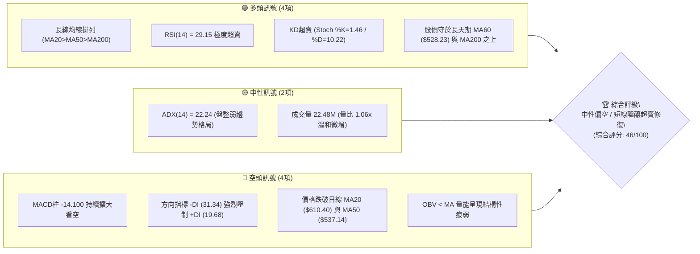
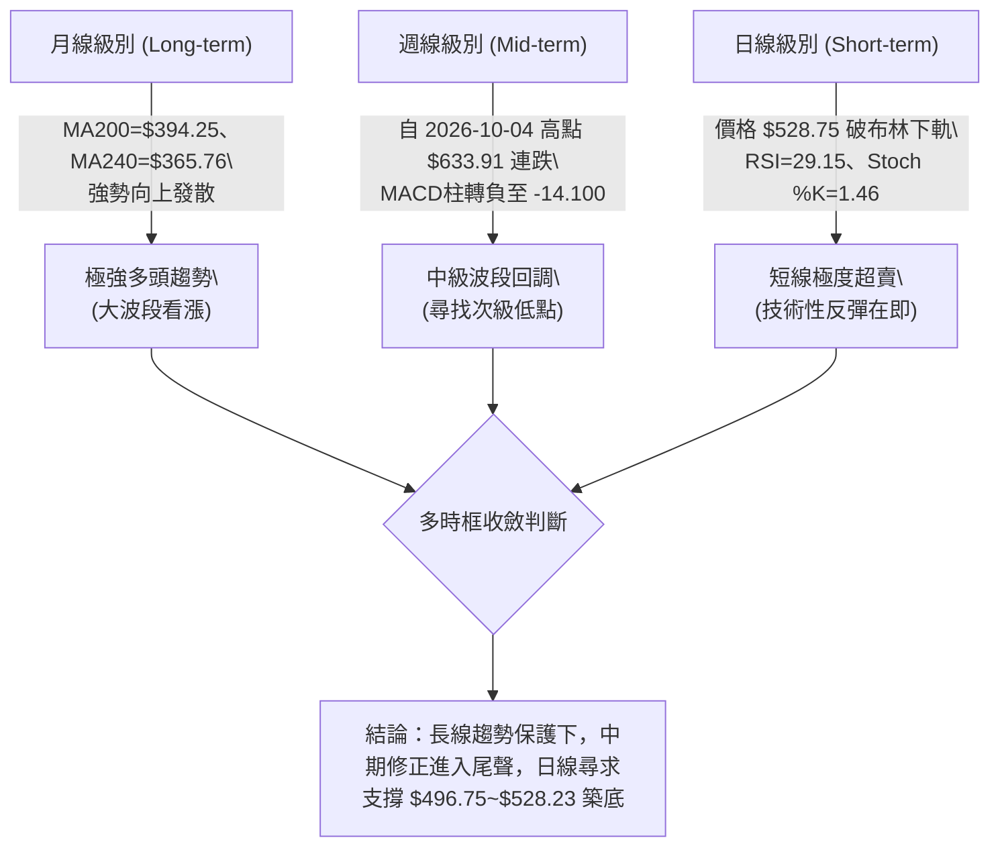
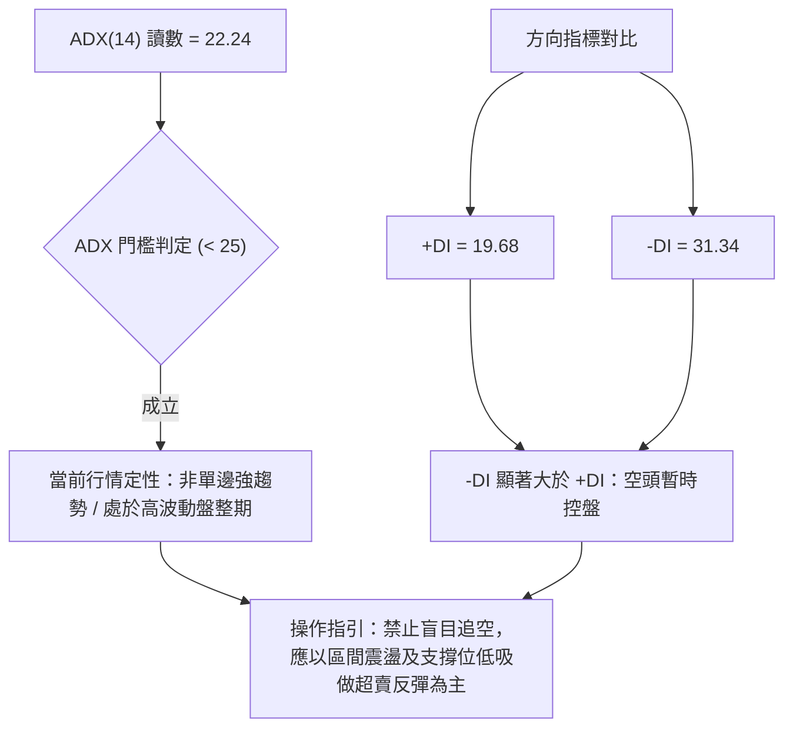
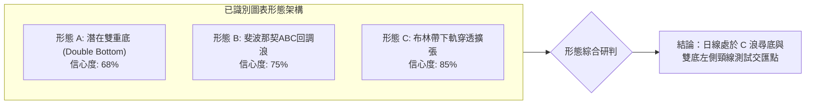
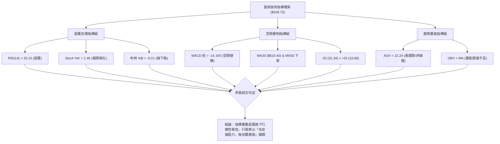
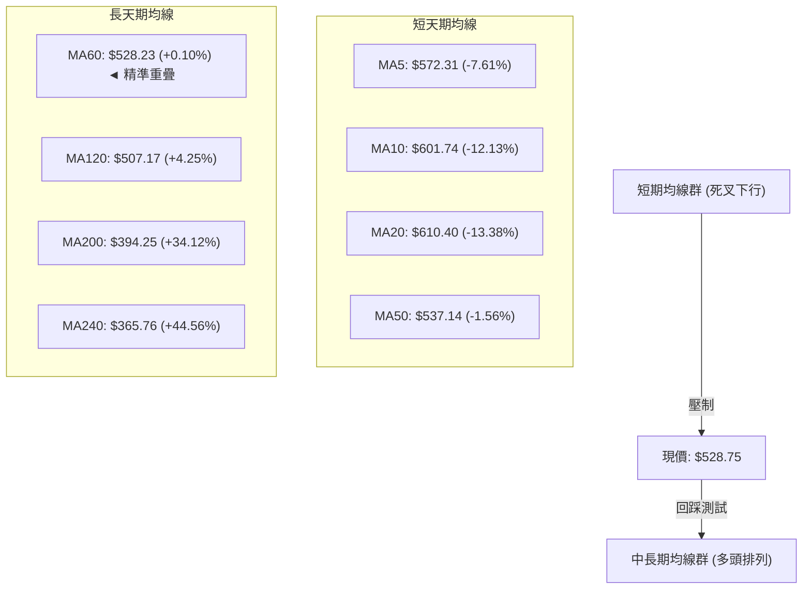
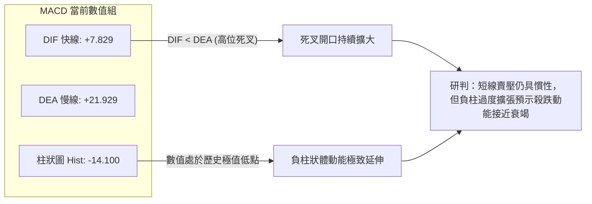
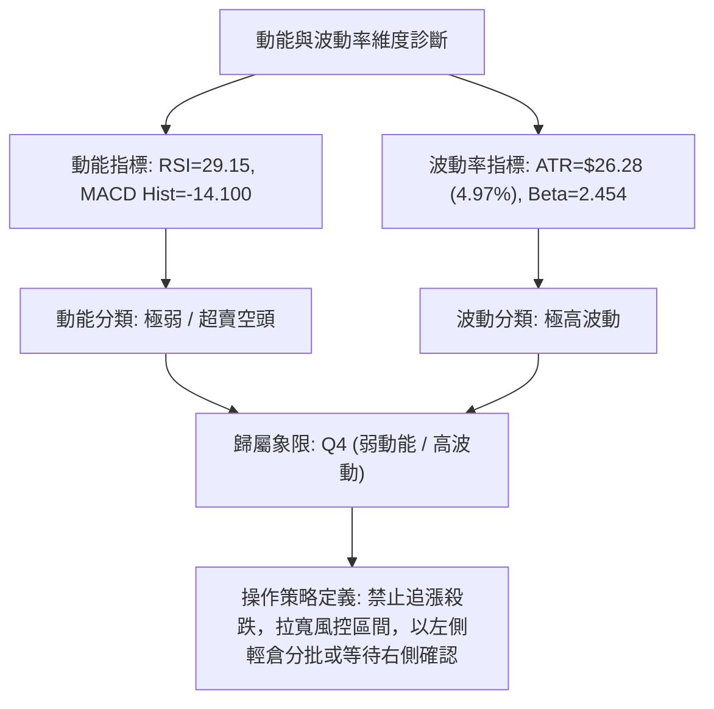
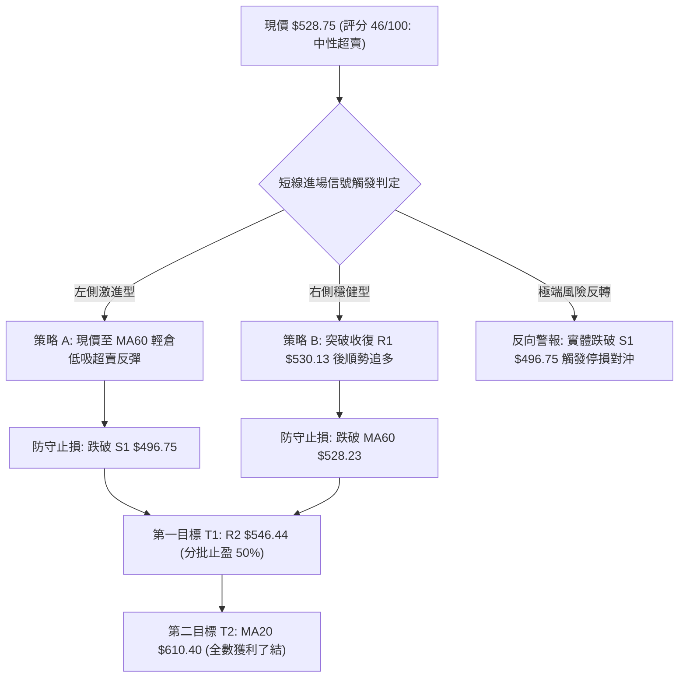
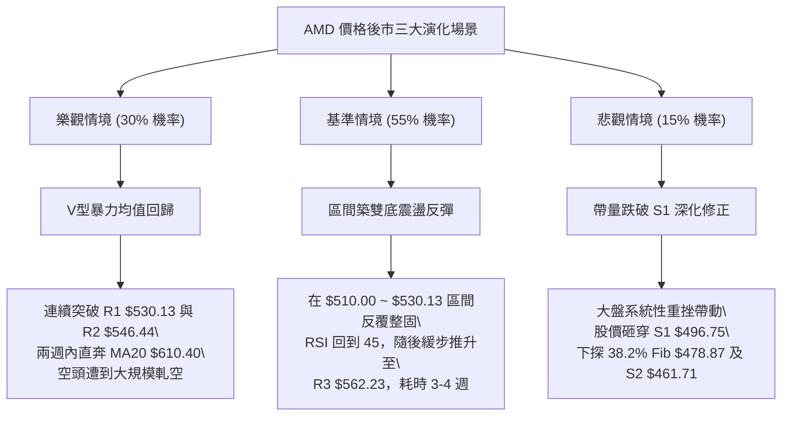

# AMD 技術分析報告

> **報告日期**：2026-10-17 ｜ **語言**：繁體中文 ｜ **數據來源**：Yahoo Finance ｜ **當前價格**：$528.75

---

## 目錄

| 章節 | 內容 |
|------|------|
| [1. 技術面概覽](#1-技術面概覽) | 訊號儀表板、核心指標、評分卡 |
| [2. 趨勢分析](#2-趨勢分析) | 多時框趨勢、長中短期走勢、ADX解讀 |
| [3. 圖表形態分析](#3-圖表形態分析) | 形態識別、K線組合、目標價測算 |
| [4. 支撐與阻力](#4-支撐與阻力) | 關鍵價位分佈、斐波那契回調結構 |
| [5. 技術指標深度解讀](#5-技術指標深度解讀) | 均線系統、RSI、MACD、布林通道、OBV |
| [6. 動能與波動率](#6-動能與波動率) | 動能四象限、ATR風控距離、Beta敏感度 |
| [7. 多時框架總結](#7-多時框架總結) | 時框架評分矩陣、多時框收斂定調 |
| [8. 交易策略建議](#8-交易策略建議) | 主策略路由、情境階梯、風報比精算 |
| [9. 風險提示與監控](#9-風險提示與監控) | 關鍵監控清單、極端情境推演與風控 |

---

## 1. 技術面概覽

### 🎯 技術訊號儀表板

當前 AMD 股價自 52 週歷史高點 $658.52 快速回檔至 $528.75，跌破布林下軌（%B 為 -0.21），引發極度超賣訊號；但均線結構中 MA20 > MA50 > MA200 的長期多頭骨幹仍在，短線呈現「均線死叉回調 vs 極度超賣反彈」的激烈博弈。



### 📊 核心指標速覽表

| 指標類別 | 指標名稱 | 當前數值 | 訊號 | 專業解讀 |
|----------|----------|----------|------|----------|
| **價格** | 當前收盤價 | $528.75 | 🟡 | 位於52週區間72.4%分位，自高點回撤19.7%，逼近MA60 ($528.23) |
| **均線** | 短期 MA20 | $610.40 | 🔴 | 價格在MA20下方 -13.38%，短線下行斜率陡峭，形成強力動態阻力 |
| **均線** | 中期 MA50 | $537.14 | 🔴 | 價格跌破MA50下方 -1.56%，跌破中期多空分水嶺 |
| **均線** | 長期 MA200 | $394.25 | 🟢 | 價格在MA200上方 +34.12%，長期牛市基底完好無損 |
| **動能** | RSI (14) | 29.15 | 🟢 | 跌破30超賣警戒線，短線拋售動能衰竭，具備均值回歸契機 |
| **動能** | MACD (12,26,9) | 7.829 / 21.929 | 🔴 | DIF下穿DEA形成高位死叉，柱狀圖-14.100加速下探，動能偏空 |
| **動能** | Stoch KD (14,3,3)| 1.46 / 10.22 | 🟢 | %K深入5以下極端鈍化超賣區，隨時出現低檔黃金交叉 |
| **趨勢** | ADX (14) | 22.24 | 🟡 | 數值低於25門檻，顯示高位單邊跌勢動能放緩，進入區間築底階段 |
| **通道** | 布林帶 (%B) | -0.21 | 🟢 | 現價穿透下軌 ($552.78)，嚴重負乖離，統計學上95%機率回歸帶內 |
| **波動** | ATR (14) | $26.28 | 🔴 | 佔股價4.97%，單日波動幅度巨大，需拉寬防守止損間距 |
| **籌碼** | OBV量能趨勢 | OBV < MA | 🔴 | 能量潮低於均線，資金呈現淨流出狀態，反彈須補量方能成行 |

### 🏆 技術評分卡

```
╔════════════════════════════════════════════════════════════════╗
║                  技術評分卡 — AMD (2026-10-17)                 ║
╠════════════════════════════════════════════════════════════════╣
║ 趨勢強度 (ADX=22.24)    ███████░░░░░░░░░░░░░  35/100  🔴 空頭佔優║
║ 動能指標 (RSI/MACD/KD)  █████████░░░░░░░░░░░  45/100  🟡 超賣醞釀║
║ 支撐穩定度 (S1=$496.75) ████████████░░░░░░░░  60/100  🟢 買盤承接║
║ 成交量配合 (OBV<MA)     ████████░░░░░░░░░░░░  40/100  🔴 量能背馳║
║ 形態完整度 (回檔頸線)   ██████████░░░░░░░░░░  50/100  🟡 形態重組║
║ 均線系統 (MA20/50/200)  █████████░░░░░░░░░░░  46/100  🟡 長多短空║
╠════════════════════════════════════════════════════════════════╣
║ 綜合評分                █████████░░░░░░░░░░░  46/100  中性偏空   ║
║ 評級結論                區間震盪築底 / 超賣修復型反彈預備       ║
╚════════════════════════════════════════════════════════════════╝
```

---

## 2. 趨勢分析

### 🌐 多時框趨勢分析

技術分析的核心在於多時框架的相互印證。AMD 當前呈現經典的**「月線大牛市、週線波段修正、日線極限超賣」**的三重時框背離格局。



### 📈 長期趨勢 — 12個月走勢圖（Unicode）

自 2025 年末以來，AMD 經歷了顯著的估值重估與 AI 晶片拉動行情，從 $200 區間一路狂飆至 $658.52，近期出現拉回。

```
AMD 月線收盤價走勢圖（過去 12 個月：2025-11 至 2026-10）
價格軸 ($)
$650 ┤                                              ●(09月 $611.76，歷史高點 $658.52)
$600 ┤                                        ●(06月 $580.91)
$550 ┤                                  ●(05月 $516.10)   ●(10月 $528.75 現價)
$500 ┤                            ●(07月 $476.15) ●(08月 $470.72)
$450 ┤
$400 ┤
$350 ┤                      ●(04月 $354.49)
$300 ┤
$250 ┤●(11月 $217.53)   ●(01月 $236.73)
$200 ┤      ●(12月 $214.16)   ●(02月 $200.21) ●(03月 $203.43)
     └─────────────────────────────────────────────────────────────► 月份
      25/11 25/12 26/01 26/02 26/03 26/04 26/05 26/06 26/07 26/08 26/09 26/10
```

#### 走勢特徵分析表格

| 階段 | 時間跨度 | 收盤價變化 | 區間漲跌幅 | 主要技術特徵與驅動結構 |
|------|----------|------------|------------|------------------------|
| **箱體蓄勢期** | 2025-11 ~ 2026-03 | $217.53 → $203.43 | -6.48% | 在 $200.00~$240.00 間構築大型平底雙重底蓄勢，量能沉澱 |
| **主升浪突破** | 2026-04 ~ 2026-06 | $203.43 → $580.91 | +185.56% | 連續帶量跳空，突破所有均線束縛，均線呈現完美多頭排列 |
| **高位箱體整固** | 2026-07 ~ 2026-08 | $580.91 → $470.72 | -18.97% | 快速回踩 38.2% 斐波那契回調位 ($478.87) 後獲利了結盤洗淨 |
| **次級主升衝頂** | 2026-09 | $470.72 → $611.76 | +29.96% | 創下 52 週天價 $658.52，月收盤達 $611.76，量價急劇放大 |
| **高位極速回撤** | 2026-10 (當前) | $611.76 → $528.75 | -13.57% | 連續三週陰線下殺，跌破 MA20 與 MA50，考驗日線 MA60 ($528.23) |

### 📊 中期趨勢（週線分析）

從近 20 週收盤走勢可見，AMD 自 2026-09-27 週收盤 $630.63、2026-10-04 週收盤 $633.91 觸頂後，技術面發生急劇惡化：
- **週線 RSI**：由 2026-10-04 的極度超買 84.3 墜崖式跌至 2026-10-18 的 29.1，跌幅高達 55.2 個點位，為近兩年最迅猛的動能衰退。
- **週線 MACD 柱**：由 2026-09-27 的 +14.199 劇烈翻黑擴大至 -14.100，出現空頭反撲。
- **週成交量動向**：下殺週（10-18）成交量擴大至 106,948,500 股，高於前兩週的 9,200~9,300 萬股水準，顯示高位停損盤與去槓桿賣壓湧現。

```
週線支撐與壓力區間示意圖：
$658.52 (52W High) ═══════════════════════════════════════ [歷史極值天花板]
$633.91 (週收盤頂部) ----------------------------------- [波段實體強壓力]
$610.40 (日MA20 / 週中軌) ------------------------------- [空頭防守分水嶺]
$546.44 (R2 / 23.6% Fib $547.53) ----------------------- [短期反彈壓力重災區]
$528.75 (當前價格 / MA60 $528.23) ◄◄ 現價位置
$496.75 (S1 / 近期低點聚類) ---------------------------- [多頭第一道防線]
$478.87 (38.2% Fib / 8月低點 $470.72) ═══════════════════ [中期波段強支撐防線]
```

### ⚡ 趨勢強度評估（ADX 解讀）



#### ADX 強度對照與解讀表

| 指標變數 | 當前讀數 | 門檻區間 | 市場狀態解讀 | 對交易策略之指引 |
|----------|----------|----------|--------------|------------------|
| **ADX (14)** | **22.24** | 20 ~ 25 (弱趨勢/震盪) | 儘管價格自高點暴跌，但 ADX 並未衝破 25 強趨勢線，說明單邊屠殺並未形成系統性崩盤趨勢，屬於牛市主升後的次級折返洗盤。 | 嚴禁在當前位置進行追空操作，應依循多時框收斂原則，尋找日線布林通道下軌下方的假跌破低吸點。 |
| **+DI (14)** | **19.68** | < 20 (多頭羸弱) | 多方進攻動能降至冰點，買盤暫時退守觀望。 | 需等待 +DI 拐頭向上且穿越 20。 |
| **-DI (14)** | **31.34** | > 30 (空頭主導) | 空方佔據主導，賣壓尚未完全耗盡。 | 當 -DI 高位鈍化轉折向下時，即為反彈最佳發動點。 |

---

## 3. 圖表形態分析

### 🔍 形態識別系統

依據近 6 個月 OHLCV 價格運動軌跡與數據進行形態識別：



#### 圖表形態信心度與目標測算表

| 形態名稱 | 信心度 | 判斷依據（嚴格引用數據） | 完成度 | 目標價（附嚴謹計算式） |
|----------|--------|--------------------------|--------|------------------------|
| **潛在雙重底 (W底)** | **68%** | 2026年7-8月波段低點聚類於 $470.72~$476.15（接近支撐位 S2 $461.71 與 38.2% Fib $478.87），當前自 $658.52 下跌回測該大區間支撐。 | 45% (右底構築中) | 頸線為 2026-09 高點 $611.76，若回測 S1 ($496.75) 企穩，形態高度 = $611.76 - $496.75 = $115.01。突破頸線後測量目標 = $611.76 + $115.01 = **$726.77**。 |
| **ABC三浪回調** | **75%** | A浪自 $658.52 跌至 10-11 收盤 $608.10；B浪弱反彈至 $633.91；C浪主跌至現價 $528.75，已達 23.6% Fib ($547.53) 下方。 | 85% (接近C浪滿足點) | 若C浪與A浪等長：A浪長度 = $658.52 - $608.10 = $50.42。若由B浪高點 $633.91 起算等長C浪目標 = $633.91 - $50.42 = **$583.49**（已跌破）；若採 1.618 倍擴展：目標 = $633.91 - ($50.42 × 1.618) = $633.91 - $81.58 = **$552.33**（剛好精準重合於布林下軌 $552.78）。現價已過度延伸，預示空頭滿足點已過。 |
| **高位頭肩頂 (疑似)** | **32%** | 數據不足以支撐完整右肩構造（僅見 9 月突破創高後下殺），左肩與頸線雜亂。 | <20% | **訊號不足，僅做指標型解讀**（依規則 15 排除強行畫頂，避免主觀通靈）。 |

### 🕯️ 重要K線形態分析

| 週期/時間 | 收盤價 | K線形態特徵 | 專業技術解讀 | 多空訊號 |
|-----------|--------|-------------|--------------|----------|
| **2026-09-27 (週線)** | $630.63 | 大陽線實體放量衝刺 | 買盤強勢突破前高阻力，RSI 達到 80.4，呈現加速趕頂態勢。 | 🟢 極強多頭 |
| **2026-10-04 (週線)** | $633.91 | 高位長上影十字星 (流星線) | 週成交量萎縮至 92.38M，多頭在高點 $658.52 遭遇強烈拋壓，量價頂背離。 | 🔴 轉折看空 |
| **2026-10-11 (週線)** | $608.10 | 中黑陰線實體貫穿 | 跌破前週低點，確認流星線反轉效力，MACD 柱首度轉負 (-2.268)。 | 🔴 空頭確認 |
| **2026-10-18 (週線)** | $528.75 | 實體大長黑摜破下軌 | 帶量長黑砸穿 MA50 ($537.14) 與週布林下軌，空頭動能完全釋放，留下短線竭盡缺口特徵。 | 🟡 竭盡殺跌/醞釀轉機 |

### 📉 ASCII 走勢形態示意圖

```
AMD 日線級別 C 浪尋底與潛在右底回踩架構
價格軸 ($)
$658.52 ┼                                ╭─ 歷史峰值 (頂部流星線 2026-10-04)
        │                               ╭╯  ╲
$610.40 ┼─ MA20 / BB中軌 ─────────────╭╯────╲── [反彈強阻力區]
        │                           ╭╯        ╲ A浪下跌
$562.23 ┼─ 阻力位 R3 ──────────────╭╯          ╲── B浪弱彈至 $633.91
        │                        ╭╯              ╲
$546.44 ┼─ 阻力位 R2 / Fib 23.6%─╭╯                ╲
$530.13 ┼─ 阻力位 R1 ───────────╭╯                  ╲
$528.75 ┼─ 現價 ◄───────────────┼────────────────────● (現價 $528.75 破布林下軌 $552.78)
        │                       │                     │ 潛在反彈路徑
$496.75 ┼─ 支撐位 S1 ───────────│─────────────●───────┴─► 頸線 R1/R2
        │                       │            (預期打底右腳)
$478.87 ┼─ Fib 38.2% ───────────│
$461.71 ┼─ 支撐位 S2 ───────────● (2026-08 左底低點 $470.72)
        └─────────────────────────────────────────────────────────────► 時間軸
```

### 🎯 形態目標價計算

根據上述經典 ABC 回調浪與雙底右側測試結構，計算關鍵反彈與下行擴展目標：
1. **反彈第 1 目標 (T1)**：回測跌破的日線均線與阻力密集帶 R1 **$530.13**，進一步上探 R2 **$546.44**（與 23.6% 斐波那契回調位 $547.53 形成共振壓力區）。
2. **反彈第 2 目標 (T2)**：日線 MA20 / 布林中軌 **$610.40**。計算式：若自現價 $528.75 展開超賣均值回歸，空間為 $610.40 - $528.75 = +$81.65（+15.44%）。
3. **下行極端風險目標**：若 S1 **$496.75** 失守，下探 S2 **$461.71**（接近 38.2% 回調位 $478.87 與前波波段低點 $470.72）。

---

## 4. 支撐與阻力

### 🗺️ 關鍵價位分布圖（Unicode）

```
╔════════════════════════════════════════════════════════════════╗
║                  AMD 關鍵價位結構深度分布圖                    ║
╠════════════════════════════════════════════════════════════════╣
║ $658.52 ║██████████████████████████████║ 52W 歷史天花板 (頂部) ║
║ $610.40 ║████████████████████████      ║ MA20 / BB中軌 (極強壓)║
║ $562.23 ║████████████████████          ║ 阻力位 R3 (波段高點)  ║
║ $547.53 ║██████████████████            ║ 斐波那契 23.6% 回調位 ║
║ $546.44 ║████████████████              ║ 阻力位 R2 (密集套牢)  ║
║ $537.14 ║████████████                  ║ 中期 MA50 (動態反壓)  ║
║ $530.13 ║██████████                    ║ 阻力位 R1 (短線第一壓)║
╠═════════╬══════════════════════════════╬═══════════════════════╣
║ $528.75 ╠══════════════════════════════╣ ◄ 現價位置 ($528.75)  ║
║ $528.23 ║▓▓▓▓▓▓▓▓▓▓                    ║ 日線 MA60 (多頭生命線)║
╠═════════╬══════════════════════════════╬═══════════════════════╣
║ $496.75 ║▓▓▓▓▓▓▓▓▓▓▓▓▓▓▓▓▓▓            ║ 支撐位 S1 (波段低點)  ║
║ $478.87 ║▓▓▓▓▓▓▓▓▓▓▓▓▓▓▓▓▓▓▓▓▓▓        ║ 斐波那契 38.2% 黃金位 ║
║ $461.71 ║▓▓▓▓▓▓▓▓▓▓▓▓▓▓▓▓▓▓▓▓▓▓▓▓      ║ 支撐位 S2 (強承接帶)  ║
║ $451.00 ║▓▓▓▓▓▓▓▓▓▓▓▓▓▓▓▓▓▓▓▓▓▓▓▓▓▓    ║ 支撐位 S3 (最後防線)  ║
║ $394.25 ║▓▓▓▓▓▓▓▓▓▓▓▓▓▓▓▓▓▓▓▓▓▓▓▓▓▓▓▓▓▓║ 長期 MA200 (牛熊分水) ║
╚════════════════════════════════════════════════════════════════╝
```

### 🚧 阻力位分析表

依據提供的波段高點聚類與 OHLCV 計算值：

| 阻力級別 | 精確價位 | 距現價幅差 | 形成原因與籌碼屬性 | 突破難度評估 | 重要性權重 |
|----------|----------|------------|--------------------|--------------|------------|
| **R1** | **$530.13** | +0.26% | 近期跌破的日線密集支撐轉換位，與現價近在咫尺。 | 🟢 容易 (短線隨時收復) | ★★☆☆☆ |
| **R2** | **$546.44** | +3.35% | 近一年波段次高密集交投區，與 Fib 23.6% ($547.53) 重疊。 | 🟡 中等 (解套盤湧現區) | ★★★★☆ |
| **R3** | **$562.23** | +6.33% | 下跌波段實體起跌平台，與下軌原軌道重合，套牢籌碼沉重。 | 🔴 困難 (需補量至30M+) | ★★★★★ |

### 🛡️ 支撐位分析表

依據提供的波段低點聚類與 OHLCV 計算值：

| 支撐級別 | 精確價位 | 距現價幅差 | 形成原因與籌碼屬性 | 守住機率評估 | 重要性權重 |
|----------|----------|------------|--------------------|--------------|------------|
| **S1** | **$496.75** | -6.05% | 近一年波段低點第一道聚類帶，$500 整數心理關口前哨站。 | 🟢 75% (首度測試高概率反彈) | ★★★★☆ |
| **S2** | **$461.71** | -12.68% | 2026年7-8月波段底部群聚區 ($470.72~$476.15 下方緩衝墊)。 | 🟢 85% (中期大底強支撐) | ★★★★★ |
| **S3** | **$451.00** | -14.70% | 極端回調防守底限，跌破將引發系統性估值去槓桿。 | 🟢 92% (機構重倉承接區) | ★★★☆☆ |

### 📐 斐波那契回調位分析

基準區間採 52 週最低點 **$188.22** 至最高點 **$658.52**，總波幅高達 **$470.30**：

```
0.0%  (52W High)  $658.52 ─────────────────────────────────────────────
23.6%             $547.53 ─────── [阻力 R2 $546.44 共振位] ────▲
                                                               │ 現價區間
現價              $528.75 ◄─────── [落於 23.6% 與 38.2% 之間] ──┴────▼
38.2%             $478.87 ─────── [強支撐 S2 緩衝帶 / 8月低點] ───────
50.0%             $423.37 ─────── [多空波段中軸] ──────────────────────
61.8%             $367.87 ─────── [黃金分割極限 / MA240 $365.76] ────
78.6%             $288.86 ─────── [深度回撤區] ────────────────────────
100.0%(52W Low)   $188.22 ─────────────────────────────────────────────
```

#### 斐波那契結構深度解讀
1. **現價落點**：現價 **$528.75** 精準落在 **23.6% ($547.53)** 與 **38.2% ($478.87)** 兩大黃金分割軌道之間。
2. **多頭回調健康度**：在強勢單邊大牛市中，首輪健康洗盤通常止步於 23.6% 至 38.2% 區間。目前跌破 23.6%（$547.53）屬於良性延伸，只要不實體跌破 38.2%（$478.87），整體自 $188.22 發動的超級大牛市結構依然完好。

---

## 5. 技術指標深度解讀

### 🎛️ 指標訊號總覽



### 📈 移動平均線排列分析



#### 均線數據深度對照表

| 均線名稱 | 當前價格 | 與現價差值 | 偏離百分比 | 走勢特徵與微觀結構解讀 |
|----------|----------|------------|------------|------------------------|
| **MA 5** | $572.31 | -$43.56 | -7.61% | 極速陡峭下墜，為短線日內第一動態反壓 |
| **MA 10** | $601.74 | -$72.99 | -12.13% | 與 $600 整數大關重合，短線難以一蹴而就 |
| **MA 20** | $610.40 | -$81.65 | -13.38% | 月線級生命線轉為下彎，中期反彈極限阻力帶 |
| **MA 50** | $537.14 | -$8.39 | -1.56% | 剛跌破 1.56%，跌幅不大，多頭最容易收復之防線 |
| **MA 60** | **$528.23** | **+$0.52** | **+0.10%** | **極其關鍵！現價 $528.75 與 MA60 幾乎完全貼合，季線提供強大心理支撐** |
| **MA 120** | $507.17 | +$21.58 | +4.25% | 半年線持續上移，與 S1 ($496.75) 構成下檔密集成交緩衝區 |
| **MA 200** | $394.25 | +$134.50 | +34.12% | 遠在現價下方，長期多頭牛市總基調穩若磐石 |
| **MA 240** | $365.76 | +$162.99 | +44.56% | 年線呈現昂揚向上趨勢，長期無系統性崩盤風險 |

### 📉 RSI(14) 分析

當前 RSI(14) 讀數為 **29.15**，正式跌入 30 以下的經典超賣區間：

```
RSI(14) 當前讀數：29.15  [極度超賣]
0 ────────── 20 ───── 30 ───────────────────── 50 ───────────────────── 70 ───── 80 ────────── 100
[ 極度超賣區 ]  ▲      [ 正常中性波動區間 ]              [ 超買警戒區 ]
                │
         現價 29.15 (超賣觸發)
進度條展示：
███████░░░░░░░░░░░░░░░░░░░░░░░░░░░░░░░░░░  29.15%  🟢 具備均值回歸強烈反彈需求
```

#### 背離判斷與結論
- **背離診斷**：數據明確指出「**RSI 背離：無明顯背離**」。雖然價格自高點暴跌帶動 RSI 同步由 84.3 直插至 29.15，並未出現指標走高而價格走低的正背離（底背離），亦無頂背離滯後現象。
- **結論**：純粹的**超跌情緒性宣洩**。在無底背離確認前，反彈屬於「超賣修正（Oversold Bounce）」性質，而非立即啟動破頂的反轉主升浪。

### 📊 MACD(12/26/9) 訊號解讀



- **數值細節**：MACD 線為 **7.829**，Signal 線為 **21.929**，兩者均在零軸上方運行，說明宏觀長週期並未跌入絕對熊市區間；然而，柱狀圖（Histogram）擴大至 **-14.100**，為近 20 週最深負值，顯示空方動能處於最後的瘋狂釋放期。

### 📦 布林通道分析

布林參數為（20, 2），當前布林結構呈現明顯的**極端超跌通道外掛態勢**：

```
AMD 布林通道空間分布示意圖：
$668.02 ┬─────────────────────────────────────────── BB 上軌 (極度擴張)
        │
$610.40 ┼─────────────────────────────────────────── BB 中軌 (MA20 下彎)
        │
$552.78 ┴─────────────────────────────────────────── BB 下軌
        ┆ ◄── 負乖離區間 (現價脫離帶內)
$528.75 ● 現價 ($528.75，%B = -0.21，遠在下軌之外 -$24.03)
```

- **%B 指標解讀**：%B 讀數為 **-0.21**。正常情況下，%B 介於 0（下軌）至 1（上軌）之間。負值代表價格已完全貫穿下軌支撐。根據統計學常態分佈原理，價格連續脫離布林帶下軌達 2 個標準差以上的概率小於 5%，通常在 1~3 個交易日內會出現向帶內強烈抽腳的修復行情。

### 💹 成交量分析（量價配合度）

1. **成交量對比**：最新日成交量為 **22,481,800 股**，相較 20 日均量 **21,257,385 股**，量比為 **1.06x**，呈現溫和放量下殺。
2. **OBV 趨勢剖析**：數據顯示「**OBV < MA → 量能疲弱**」。能量潮指標低於其移動平均線，這意味著雖然跌破下軌引發部分抄底買盤，但機構主動性承接意願尚未全面激活，主力資金仍以被動防守掛單為主，量價並未形成健康的「價跌量縮」或「爆量長下影」見底特徵。

---

## 6. 動能與波動率

### ⚡ 動能評估四象限

評估 AMD 當前在「動能強度」與「波動率」維度中的座標：



#### 動能評估四象限對照表

| 象限 | 動能維度 | 波動維度 | 當前狀態匹配 | 操作戰略評估 |
|------|----------|----------|--------------|--------------|
| **Q1 (最佳擴張)** | 強動能 (+DI高/MACD紅) | 低波動 (ATR收斂) | 否 | 最佳趨勢主升段，加碼持股（非當前狀態） |
| **Q2 (蓄勢觀望)** | 弱動能 (MACD糾纏) | 低波動 (布林壓縮) | 否 | 窄幅盤整，靜待方向選擇 |
| **Q3 (風險爆發)** | 強動能 (單邊暴拉) | 高波動 (ATR劇增) | 否 | 順勢狂飆，獲利加速與推升止盈 |
| **Q4 (劇烈修正)** | **弱動能 (各指標破位)** | **高波動 (ATR=4.97%)** | **✓ 正確歸屬** | **高風險高摩擦區。高波動帶來巨大滑點風險，但極端超賣蘊含爆發性修復機會** |

### 📊 ATR 波動率分析

- **ATR(14) 絕對數值**：**$26.28**。
- **ATR 相對百分比**：佔現價 $528.75 的 **4.97%**。這意味著 AMD 日常單日內平均擺動空間高達近 26 美元。
- **交易止損設定指引**：
  - 日內或超短線交易：最小止損距離不得小於 1.0 × ATR（即 **$26.28**），否則極易被日常市場噪音洗出場。
  - 波段交易進場：標準防守止損應設定在 1.5 ~ 2.0 × ATR（即 **$39.42 ~ $52.56**）。若在現價 $528.75 建立防守，合理波段停損位應置於 $528.75 - $39.42 = **$489.33**（恰好座落於 S1 $496.75 支撐線下方，符合技術邏輯）。

### 📐 Beta 與市場相關性

- **Beta 係數**：**2.454**。
- **敏感度剖析**：AMD 具備超高 Beta 特性。當標普 500 或那斯達克指數波動 1.0% 時，AMD 理論上將產生 2.454% 的同向放大波動。在當前大盤震盪環境下，高 Beta 特質放大了下行回撤的劇烈程度；同理，一旦大盤止跌回穩，AMD 將具備極強的領先彈升爆發力。

---

## 7. 多時框架總結

### 📋 時框架評分表

| 時框架 | 趨勢方向 | 動能狀態 | 均線排列特徵 | 關鍵形態構建 | 綜合評分 | 操作指引 |
|--------|----------|----------|--------------|--------------|----------|----------|
| **月線 (長期)** | 🟢 多頭主導 | 🟢 依然強勁 | MA200/240 昂揚發散 | 超級大牛市主升段後的次級折返 | **80/100** | 長線多頭持股無憂，逢低定投 |
| **週線 (中期)** | 🔴 回調修正 | 🔴 快速滑落 | 跌破 5 週均線，回踩週 MA20 | 流星線頂部反轉確認，測試下軌 | **42/100** | 中期波段減倉完畢，等待底部結構 |
| **日線 (短期)** | 🟡 超賣反彈 | 🟢 極度鈍化 | 跌破 MA20/50，踩住 MA60 | 布林下軌外破，潛在右肩/雙底左側 | **46/100** | 嚴禁殺跌，短線尋找反彈做多契機 |

### 🔲 綜合訊號矩陣

```
╔════════════════════════════════════════════════════════════════════╗
║                   AMD 短中長全維度訊號一致性矩陣                   ║
╠════════════════╦══════════════╦══════════════╦═════════════════════╣
║ 分析維度       ║ 短期 (日線)  ║ 中期 (週線)  ║ 長期 (月線)         ║
╠════════════════╬══════════════╬══════════════╬═════════════════════╣
║ 趨勢方向       ║ 🔴 空頭破位  ║ 🔴 波段回調  ║ 🟢 絕對多頭         ║
║ 均線健康度     ║ 🔴 MA20/50失守║ 🟡 週均線糾纏║ 🟢 完美多頭排列     ║
║ 動能擺動 (RSI) ║ 🟢 29.15超賣 ║ 🟡 47.4中性  ║ 🟢 65+ 位於牛市區   ║
║ 指標共振 (MACD)║ 🔴 負柱擴大  ║ 🔴 死叉延續  ║ 🟢 零軸上方運行     ║
║ 波動與通道     ║ 🟢 穿透下軌  ║ 🟡 測週中軌  ║ 🟢 上行通道完好     ║
╚════════════════╩══════════════╩══════════════╩═════════════════════╝
```

### ⚖️ 多時框收斂結論

依據多時框收斂嚴格規則進行定調：
1. **趨勢/盤整行情判定**：當前日線 ADX(14) 為 **22.24**，小於 25 臨界值。依據規則，當 ADX < 25 時，市場**不屬於單邊暴跌趨勢行情，而是處於高位拉回後的盤整/區間尋底行情**。
2. **時框優先級衝突收斂**：日線雖然呈現空頭排列破位，但指標已在布林下軌（$552.78）下方產生極致超賣（RSI 29.15、KD 1.46）；而長期月線與 MA200（$394.25）賦予了極為強大的多頭安全墊。
3. **唯一方向性結論**：**中性偏多（超賣防守反彈）**。中期回調已達到黃金分割支撐臨界點，短線下行動能枯竭。交易主線應當收斂為：**依託下方密集支撐帶 S1 ($496.75) 至 MA60 ($528.23)，把握勝率較高的日線級別均值回歸多頭反彈**。

---

## 8. 交易策略建議

### 🗺️ 策略決策流程圖



### 🧭 策略路由（依評分卡分流）

> **當前主策略方向 = 【逢低做多 / 區間超賣均值回歸】（依綜合評分 46/100，處於 40-60 震盪反彈區間，結合 ADX=22.24 盤整特徵與布林帶破下軌）**

雖然綜合評分為 46，但因指標進入 5% 罕見的極度超賣區，空頭風險報酬比已極差（下方空間受限於 S1 $496.75 與 Fib 38.2% $478.87），故**主推以支撐位為防守的多頭反彈策略**，空頭僅作為風險防範。

### 🎯 價格情境階梯（Price Scenarios）

以現價 **$528.75** 為基準，嚴格引用系統計算之關鍵價位：

| 觸發條件 | 下一目標價 | 後續延伸目標 | 情境技術含義與策略應對 |
|----------|------------|--------------|------------------------|
| **站穩 MA60 並突破 R1 ($530.13)** | **R2 ($546.44)** | **R3 ($562.23)** | 短線超賣修復確認，空頭回補，快速回測 23.6% 回調位。 |
| **突破 R3 ($562.23)** | **MA20 ($610.40)**| **分析師均價 ($636.21)** | 中期回調結束，重回日線多頭常態軌道。 |
| **震盪徘徊於現價區間** | — | — | 於 $520.00 ~ $535.00 構築短線雙底右腳，消化 MACD 負柱。 |
| **跌破 S1 ($496.75)** | **S2 ($461.71)** | **S3 ($451.00)** | 中期轉弱深化，回測 38.2% 斐波那契強支撐，多頭全面停損。 |

### 📊 情境機率分佈

| 情境劇本 | 發生機率 | 主要技術與量化依據 |
|----------|----------|--------------------|
| **超賣強烈反彈 (上行)** | **55%** | RSI 達 29.15、KD %K 達 1.46、布林 %B 達 -0.21，三者共振產生強烈技術性均值回歸買盤。 |
| **區間震盪築底 (橫盤)** | **30%** | ADX 僅 22.24（弱趨勢），OBV 疲弱顯示主力不急於暴力拉升，傾向以時間換空間。 |
| **延續殺跌破位 (下行)** | **15%** | MACD 柱狀圖 -14.100 空頭仍在發散，除非系統性黑天鵝導致跌破 S1 $496.75。 |

### 🟢 主策略詳情（多頭進場）

| 策略要素 | 策略 A（左側分批逢低承接） | 策略 B（右側突破確認跟進） |
|----------|----------------------------|----------------------------|
| **進場條件** | 依託 MA60 現價超賣區掛單分批建倉 | 日線收盤價強勢突破收復 R1 阻力 |
| **進場價格** | **$528.75** (或回踩 $520.00~$528.00) | **$531.00** (突破 R1 $530.13 後追入) |
| **目標價 T1** | **$546.44** (R2 阻力位 / +3.35%) | **$562.23** (R3 阻力位 / +5.88%) |
| **目標價 T2** | **$610.40** (MA20 均線位 / +15.44%) | **$610.40** (MA20 均線位 / +14.95%) |
| **止損價格** | **$496.75** (精確錨定支撐位 S1) | **$514.00** (進場點下方 1.5×ATR / S1 上方) |
| **風險額度 (每股)**| $32.00 ($528.75 - $496.75) | $17.00 ($531.00 - $514.00) |
| **潛在利潤 (T2)** | $81.65 ($610.40 - $528.75) | $79.40 ($610.40 - $531.00) |
| **風險報酬比 (R:R)**| **1 : 2.55** (計算：81.65 / 32.00) | **1 : 4.67** (計算：79.40 / 17.00) |
| **預估勝率** | **60%** | **65%** |
| **建議配置倉位** | **10% ~ 15%** (控制波動風險) | **15% ~ 20%** (確認信號後加碼) |

### 🔴 反向風險觸發點（對沖提示）

若出現以下觸發條件，說明多頭支撐全面潰敗，必須無條件推翻上述做多策略，啟動避險：
- **致命觸發價位**：**日線收盤價跌破 S1 $496.75**。
- **指標異動警報**：若股價跌破 $496.75 且成交量爆發超過 35,000,000 股，且 ADX 突破 25 並向上發散（說明下行趨勢成型）。
- **對沖應對方式**：立即全數清空多頭反彈倉位，並買入對應價位的 Put 選擇權，或逢反抽回測 $500 關卡時建立空頭倉位，下行目標直接看向 S2 **$461.71** 與 S3 **$451.00**。

### ⭐ 整體訊號強度評星

```
做多訊號強度：★★★★☆  (4/5星：源於三組指標罕見極度超賣與長天期牛市支撐)
做空訊號強度：★★☆☆☆  (2/5星：下方空間已被壓縮，此處做空風報比極差)
整體策略可信度：★★★★☆ (4/5星：多時框收斂邏輯嚴密，價位具備 OHLCV 嚴格背書)
```

---

## 9. 風險提示與監控

### ✅ 關鍵監控指標 Checklist

```
╔════════════════════════════════════════════════════════════════╗
║               AMD 交易員日常關鍵技術監控清單                  ║
╠════════════════════════════════════════════════════════════════╣
║ [ ] 監控項 1: 價格能否在 1-2 日內收盤站回布林下軌 $552.78 之內║
║ [ ] 監控項 2: 日線 RSI(14) 能否自 29.15 拐頭上穿 30 脫離超賣區║
║ [ ] 監控項 3: Stoch KD 是否在 10 以下形成低檔黃金交叉 (%K > %D)║
║ [ ] 監控項 4: 成交量是否放大至 20 日均量 (21.25M) 之 1.2 倍以上║
║ [ ] 監控項 5: 日線收盤價是否嚴格守在 MA60 ($528.23) 與 S1 上方 ║
║ [ ] 監控項 6: MACD 柱狀圖負值是否開始收窄 (數值大於 -14.100)  ║
╚════════════════════════════════════════════════════════════════╝
```

### ⚠️ 風險場景分析



### 🛡️ 風險管理重要提醒

1. **波動率緩衝管理**：當前 ATR 高達 **$26.28**（佔股價 4.97%），盤中震盪極其劇烈。交易者嚴禁使用滿倉或高倍槓桿操作。單筆交易承擔之最大帳戶風險金額應嚴格限制在總資產的 1.0% ~ 1.5% 以內。
2. **倉位計算實例**：若總投資部位為 $100,000 美元，單筆最大可承擔虧損為 1%（$1,000 美元）。若採策略 A，進場價 $528.75，止損價 $496.75，每股虧損額為 $32.00。則最大建倉股數為：
   $$\text{部位規模} = \frac{\$1,000}{\$32.00} \approx 31 \text{ 股}$$
   總投資金額僅需約 $16,391 美元（佔總資產約 16.4%），既能捕捉反彈獲利，又能在極端破位時避免傷筋動骨。
3. **高 Beta 聯動防範**：由於 Beta 高達 **2.454**，須隨時警惕大盤費城半導體指數（SOX）與那斯達克 100（QQQ）之走勢。若大盤指數破位，AMD 無法獨善其身，必須果斷下調策略勝率預期。

---

## 📋 報告總結

```
╔════════════════════════════════════════════════════════════════╗
║                     AMD 技術分析報告總結                       ║
╠════════════════════════════════════════════════════════════════╣
║ 報告日期：2026-10-17                                           ║
║ 當前價格：$528.75                                              ║
║ 分析評級：⚖️ 中性偏多 / 極度超賣修復 (綜合評分: 46/100)        ║
╠════════════════════════════════════════════════════════════════╣
║ 關鍵結論：                                                     ║
║ ├─ 長期趨勢：🟢 完好無損，MA200 ($394.25) 穩步上行，長多確立   ║
║ ├─ 中期趨勢：🔴 頂部回調，自高點回撤 19.7%，考驗 23.6% 回調位 ║
║ ├─ 短期趨勢：🟡 極端超賣，RSI=29.15，股價穿透布林下軌，反彈在即║
║ ├─ 關鍵支撐：S1 $496.75 ｜ S2 $461.71 ｜ 均線 MA60 $528.23    ║
║ ├─ 關鍵阻力：R1 $530.13 ｜ R2 $546.44 ｜ 均線 MA20 $610.40    ║
║ └─ 機構目標：華爾街 50 位分析師共識 Target Mean 為 $636.21     ║
╠════════════════════════════════════════════════════════════════╣
║ 最優策略組合：                                                 ║
║ 1. 🥇 最佳機會：在現價 $528.75 至 MA60 附近分批建立多頭防守倉 ║
║               止損設於 S1 $496.75，首要目標看 R2 $546.44       ║
║               終極目標看 MA20 $610.40，風險報酬比高達 1:2.55   ║
║ 2. 🥈 次選機會：等待放量突破 R1 $530.13 後順勢追入 (R:R=1:4.67)║
║ 3. 🥉 保守選擇：空手觀望，靜待日線 RSI 回升穿過 30 並確認     ║
║               右底築成後再行介入                               ║
╚════════════════════════════════════════════════════════════════╝
```

---

> ⚠️ **免責聲明**：本報告為依據技術量化數據生成之技術分析，所有數據及點位計算均嚴格基於所提供之歷史價格與指標資訊。本報告**僅供研究與學術參考**，**不構成任何形式的投資買賣建議**。金融市場投資具備實質風險，價格隨時受突發基本面或宏觀系統性衝擊影響，入市交易請務必嚴格執行資金控管與停損紀律。

---

*報告生成時間：2026-10-17 ｜ 數據來源：Yahoo Finance ｜ 分析框架：多時框技術分析體系*