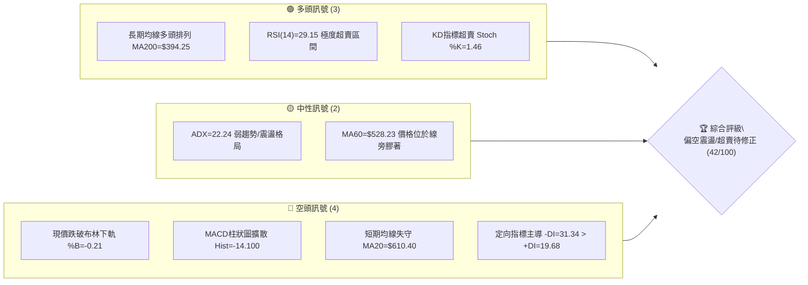
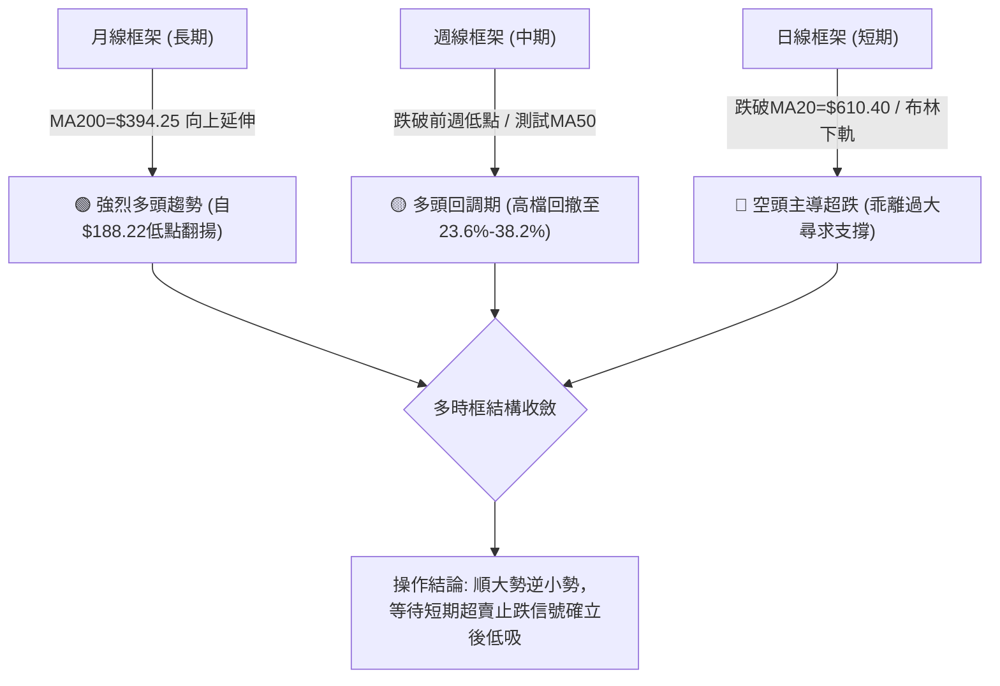
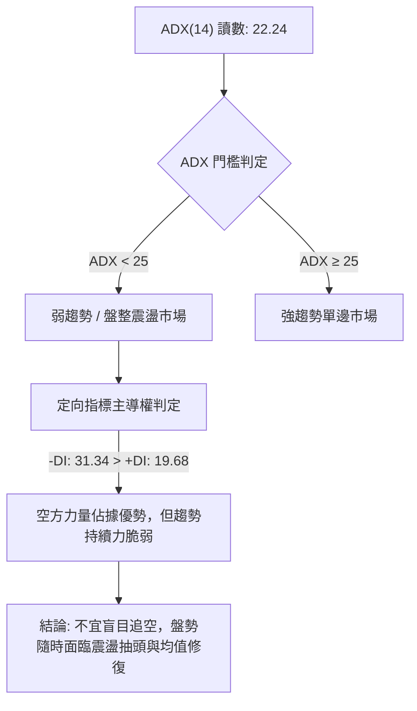
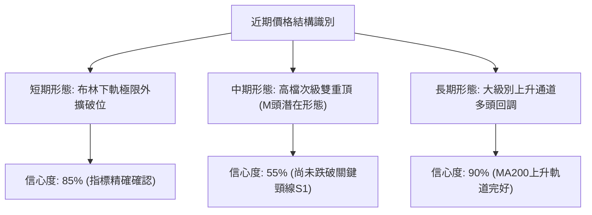
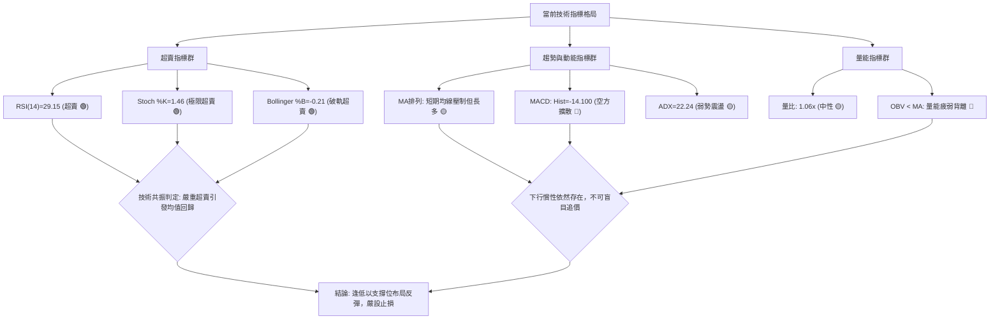
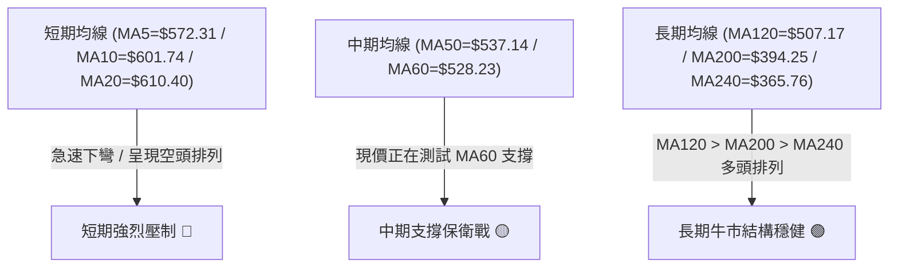
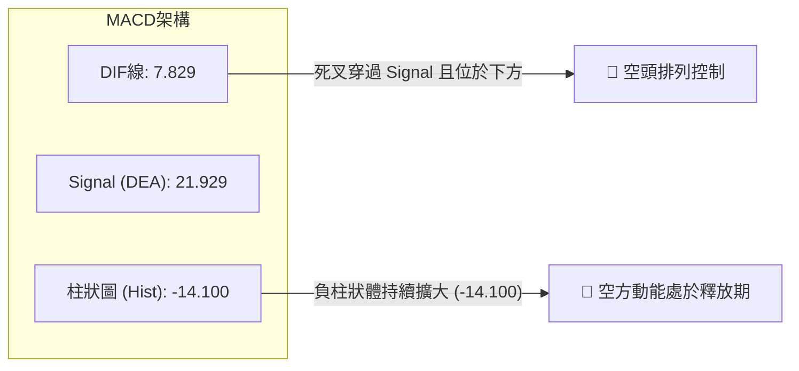
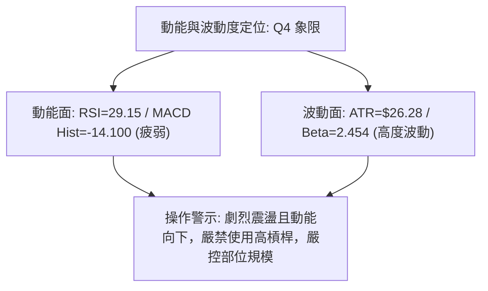
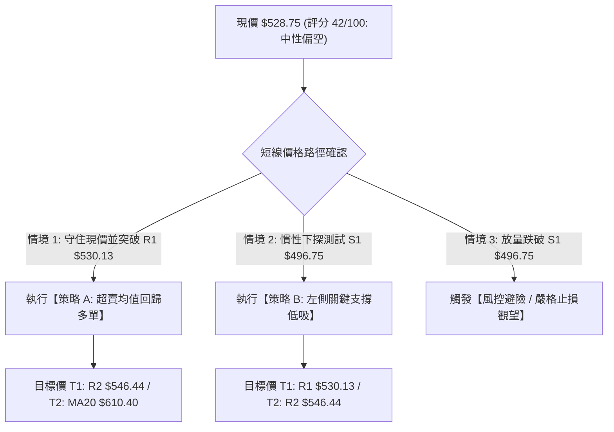
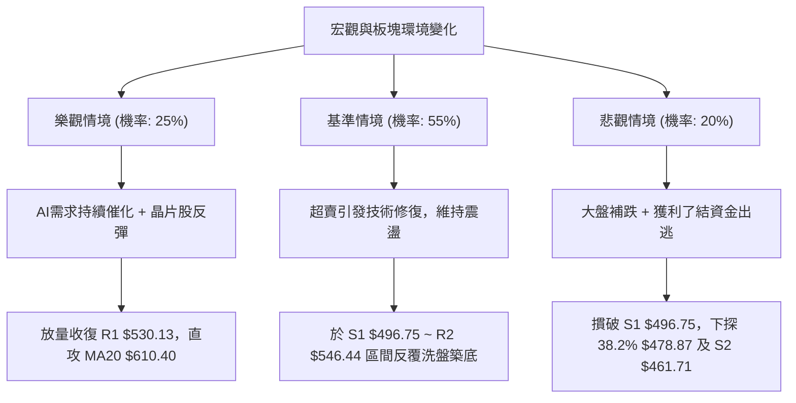

# AMD 技術分析報告

> **報告日期**：2026-10-19 ｜ **語言**：繁體中文 ｜ **數據來源**：Yahoo Finance ｜ **當前價格**：$528.75

---

## 目錄

| 章節 | 內容 |
|------|------|
| [1. 技術面概覽](#1-技術面概覽) | 訊號儀表板、核心指標、評分卡 |
| [2. 趨勢分析](#2-趨勢分析) | 多時框趨勢、長中短期走勢、ADX 解讀 |
| [3. 圖表形態分析](#3-圖表形態分析) | 形態識別、K線組合、目標價推算 |
| [4. 支撐與阻力](#4-支撐與阻力) | 關鍵價位、斐波那契回調結構 |
| [5. 技術指標深度解讀](#5-技術指標深度解讀) | 均線系統、RSI、MACD、布林通道、OBV |
| [6. 動能與波動率](#6-動能與波動率) | 動能四象限、ATR 波動率、Beta 市場風險 |
| [7. 多時框架總結](#7-多時框架總結) | 時框架矩陣、多時框收斂結論 |
| [8. 交易策略建議](#8-交易策略建議) | 策略路由、價格情境階梯、風控規劃 |
| [9. 風險提示與監控](#9-風險提示與監控) | 監控 Checklist、情境推演、資金管理 |

---

## 1. 技術面概覽

### 🎯 技術訊號儀表板



### 📊 核心指標速覽表

| 指標類別 | 指標名稱 | 當前數值 | 訊號 | 專業解讀 |
|----------|----------|----------|------|----------|
| **價格** | 當前收盤價 | $528.75 | 🔴 | 跌破 MA50 及布林下軌，短線承受沉重獲利了結賣壓 |
| **均線** | MA20 (月線) | $610.40 | 🔴 | 現價低於 MA20 達 -13.38%，短線乖離率過大，下行壓力顯著 |
| **均線** | MA50 (季線) | $537.14 | 🔴 | 現價跌破 MA50（-1.56%），中期上升趨勢軌道遭受考驗 |
| **均線** | MA200 (年線) | $394.25 | 🟢 | 現價高於 MA200 達 +34.12%，長期牛市基底依然穩固 |
| **動能** | RSI(14) | 29.15 | 🟢 | 跌入 30 以下極度超賣區，空方力道衰竭，孕育短線技術性反彈 |
| **動能** | MACD (12,26,9) | Hist -14.100 | 🔴 | DIF(7.829) 跌破 DEA(21.929) 形成死叉且綠柱擴大，空方主導動能 |
| **趨勢** | ADX(14) | 22.24 | 🟡 | ADX < 25 顯示單邊趨勢力道不足，市場正處於劇烈震盪回調期 |
| **通道** | Bollinger %B | -0.21 | 🟢 | 現價跌出布林下軌（$552.78），存在高機率的均值回歸拉力 |
| **波動** | ATR(14) | $26.28 | 🔴 | 每日震幅達 4.97%，顯示籌碼換手劇烈，短線部位需放大防守空間 |
| **量能** | 量比 / OBV | 1.06x / 疲弱 | 🔴 | 量比微幅放大但 OBV 低於均線，顯示買盤承接謹慎，以被動掛單為主 |

### 🏆 技術評分卡

```
╔══════════════════════════════════════════════════════════════════╗
║                   技術評分卡 — AMD (2026-10-19)                   ║
╠══════════════════════════════════════════════════════════════════╣
║ 趨勢強度 (Trend)      ████████░░░░░░░░░░░░  40/100  🔴 空頭控盤    ║
║ 動能指標 (Momentum)    ██████░░░░░░░░░░░░░░  30/100  🔴 動能疲弱    ║
║ 支撐穩定度 (Support)   ████████████░░░░░░░░  60/100  🟡 考驗支撐    ║
║ 成交量配合 (Volume)    ████████░░░░░░░░░░░░  40/100  🔴 量能背離    ║
║ 形態完整度 (Pattern)   ████████░░░░░░░░░░░░  40/100  🟡 形態破壞    ║
║ 均線排列 (Moving Avg)  ████████░░░░░░░░░░░░  42/100  🟡 長多短空    ║
╠══════════════════════════════════════════════════════════════════╣
║ 綜合技術評分           ████████░░░░░░░░░░░░  42/100  ⚖️ 偏空中性   ║
╚══════════════════════════════════════════════════════════════════╝
```

---

## 2. 趨勢分析

### 🌐 多時框趨勢分析



### 📈 長期趨勢 — 12個月走勢圖（Unicode）

```
AMD 月線走勢圖（2025-11 至 2026-10）
價格軸 ($)
$658.52 ┤                                           ▲ 歷史高點 ($658.52)
$611.76 ┤                                         ●(09月 $611.76)
$580.91 ┤                             ●(06月)
$528.75 ┤───────────────────────────────────────●←【現價 $528.75】
$516.10 ┤                         ●(05月)
$470.72 ┤                                 ●   ●(07-08月整理區)
$354.49 ┤                     ●(04月放量突破)
$256.12 ┤             ●(10月)
$217.53 ┤ ●(11月) ●(01月)
$200.21 ┤     ●       ●(02-03月雙底蓄勢)
         └─────────────────────────────────────────────────────────────
          11   12   01   02   03   04   05   06   07   08   09   10 (月份)
```

#### 走勢特徵分析表格

| 階段區間 | 時間跨度 | 起訖收盤價 | 漲跌幅 | 走勢特徵與結構意涵 |
|----------|----------|------------|--------|--------------------|
| **底部築底期** | 2025-11 ~ 2026-03 | $217.53 → $203.43 | -6.48% | 在 $200.00 心理關卡上方構築長達5個月的收斂雙底結構 |
| **主升浪爆發** | 2026-04 ~ 2026-06 | $354.49 → $580.91 | +63.87% | AI晶片需求強勁帶動業績暴增，量能井噴突破長期頸線阻力 |
| **高檔強勢整理** | 2026-07 ~ 2026-08 | $476.15 → $470.72 | -1.14% | 回踩波段 38.2% 斐波那契回調位（$478.87），籌碼進行良性換手 |
| **次級主升衝頂** | 2026-09 ~ 2026-10 | $611.76 → $528.75 | -13.57% | 創下 52 週高點 $658.52 後遭遇獲利了結賣壓，單月急速拉回 |

### 📊 中期趨勢（週線分析）

從近 20 週收盤走勢可見，AMD 自 2026 年 9 月下旬衝至 $633.91 高檔後，隨即於 10 月展開陡峭修正：
- **週線 MACD**：自 9 月下旬高峰 +14.199 迅速反轉，最新一週（2026-10-18）擴大至 -14.100，呈現典型的動能消退訊號。
- **週成交量變化**：在 9 月下旬推升時週成交量達 1.32 億股，但 10 月回落階段量能放大至 1.06 億股，顯示籌碼出現部分機構減持現象。
- **波段回調定位**：自 52 週低點 $188.22 漲至 52 週高點 $658.52，總波段漲幅達 $470.30。當前價格 $528.75 剛好跌破 23.6% 回調位（$547.53），正向下尋求 38.2% 回調位（$478.87）與關鍵支撐 S1（$496.75）之支撐防線。

```
週線支撐阻力結構示意圖
$658.52 ────────────────────── 52W 高點 (歷史阻力)
$610.40 ══════════════════════ MA20 / BB中軌 (中期反彈首要強阻力)
$547.53 ┄┄┄┄┄┄┄┄┄┄┄┄┄┄┄┄┄┄┄┄┄┄ 斐波那契 23.6% 回調位 (已被跌破)
$528.75 ───►【現價】────────── MA60 ($528.23) 邊緣
$496.75 ══════════════════════ 關鍵支撐 S1 (波段密集防守區)
$478.87 ┄┄┄┄┄┄┄┄┄┄┄┄┄┄┄┄┄┄┄┄┄┄ 斐波那契 38.2% 回調位
$461.71 ────────────────────── 關鍵支撐 S2 (波段深層支撐)
```

### ⚡ 趨勢強度評估（ADX 解讀）



#### ADX 強度對照表

| 指標名稱 | 當前數值 | 參考臨界值 | 狀態評估 | 技術意涵 |
|----------|----------|------------|----------|----------|
| **ADX(14)** | 22.24 | 25.00 | 弱趨勢 / 盤整 | 市場並未形成不可逆的單邊破位崩跌，屬於大幅度震盪回調 |
| **+DI (多頭定向)** | 19.68 | 20.00 | 偏弱 | 多頭推進動能暫時退潮，缺乏主動攻擊買盤 |
| **-DI (空頭定向)** | 31.34 | 25.00 | 強勁 | 空頭短期居於主導地位，主導價格向下殺跌 |
| **差值 (-DI 減 +DI)** | +11.66 | 0.00 | 空頭領先 | 短期空方控制盤面，但因 ADX < 25，跌勢難以維持長期單邊加速 |

---

## 3. 圖表形態分析

### 🔍 形態識別系統



#### 圖表形態信心度評估表

| 形態名稱 | 信心度 | 判斷依據（引用數據） | 完成度 | 目標價（附精確計算式） |
|----------|--------|----------------------|--------|------------------------|
| **布林通道破下軌超賣** | 85% | 現價 $528.75 遠低於 BB 下軌 $552.78，%B = -0.21，日線極端背馳 | 100% | 均值回歸中軌目標 = **$610.40**（MA20/BB中軌） |
| **潛在高檔雙頂 (M頭)** | 55% | 9月高點 $630.63 與 10月高點 $633.91 形成雙峰，但頸線尚未有效跌破 | 60% | 跌破頸線 S1($496.75) 後：$496.75 - ($633.91 - $496.75) = **$359.59**（注：此為極端推算，年線 $394.25 將提前發揮強勁攔截） |
| **箱體震盪破位** | 45% | 訊號不足，僅做指標型解讀。因 ADX=22.24 顯示趨勢缺乏持續性，暫不判定為長期趨勢反轉。 | N/A | 數據中未偵測到完整幾何箱體 |

### 🕯️ 重要K線形態分析

| 日期區間 | 收盤價 | K線形態名稱 | 技術解讀 | 訊號評級 |
|----------|--------|-------------|----------|----------|
| 2026-09-27 | $630.63 | 放量長紅突破 | 多頭強勢進攻，週漲幅巨大，MACD 柱狀圖創波段新高 +14.199 | 🟢 強烈看多 |
| 2026-10-04 | $633.91 | 高檔十字星/陀螺頂 | 創新高點 $658.52 後買盤無以為繼，多空激烈爭奪，動能大幅放緩 | 🟡 轉折警告 |
| 2026-10-11 | $608.10 | 中黑反轉破月線 | 吞噬前期漲幅，收盤失守 MA20（$610.40），確立短期頂部成立 | 🔴 空方反撲 |
| 2026-10-18 | $528.75 | 帶量長黑大陰線 | 實體大陰線直接摜破 MA50 與布林下軌，空方宣洩賣壓，進入極度超賣 | 🔴 空頭宣洩 |

### 📉 ASCII 走勢形態示意圖

```
高檔潛在雙頂與超跌破軌示意圖
$658.52 ┤            頂1 ($630.63)    頂2 ($633.91)
         │              ╭──╮            ╭──╮
$610.40 ┤- - - - - - -│- - ╰─── 頸部 ───╯- -╰───【MA20 / 布林中軌壓力】
         │            │                  │        ╲
$552.78 ┤- - - - - - -│- - - - - - - - - -│- - - - - ╲- -【布林下軌支撐】
         │            │                  │            ╲
$528.75 ┤────────────┼──────────────────┼──────────────●【現價: 破下軌超賣】
         │            │                  │              │
$496.75 ┤- - - - - - -┴──────────────────┴- - - - - - - ┴- -【關鍵頸線支撐 S1】
```

### 🎯 形態目標價計算

1. **短線反彈目標（布林回歸）**：
   - 觸發條件：RSI < 30 且 %B < 0 誘發空頭回補。
   - 計算式：反彈第一阻力 R1 = **$530.13**；若突破則上看布林中軌 MA20 = **$610.40**。
2. **形態下行量度（若 M 頭頸線跌破）**：
   - 頸線位置：S1 = **$496.75**。
   - 形態高度：高點 $633.91 - 頸線 $496.75 = $137.16。
   - 下行目標：$496.75 - $137.16 = **$359.59**（由於年線 MA200 位於 $394.25，將構成實質緩衝墊，跌破機率極低）。

---

## 4. 支撐與阻力

### 🗺️ 關鍵價位分布圖（Unicode）

```
AMD 價位結構分布圖
══════════════════════════════════════════════════════════════
$658.52 ║████████████████████████████████║ 52週歷史高點 (波段頂部)
$610.40 ║████████████████████████        ║ MA20 / BB中軌 (極強反壓)
$562.23 ║████████████████████            ║ 阻力 R3 (密集解套賣壓區)
$547.53 ║████████████████                ║ 斐波那契 23.6% 回調位
$546.44 ║██████████████                  ║ 阻力 R2 (反彈關鍵轉折)
$530.13 ║██████████                      ║ 阻力 R1 (隔夜短壓)
════════╠════════════════════════════════╣ ◄── 現價 $528.75
$496.75 ║▓▓▓▓▓▓▓▓▓▓▓▓▓▓▓▓▓▓▓▓            ║ 關鍵支撐 S1 (多頭第一道防線)
$478.87 ║▓▓▓▓▓▓▓▓▓▓▓▓▓▓▓▓▓▓▓▓▓▓▓▓        ║ 斐波那契 38.2% 回調位
$461.71 ║▓▓▓▓▓▓▓▓▓▓▓▓▓▓▓▓▓▓▓▓▓▓▓▓▓▓      ║ 強支撐 S2 (波段核心籌碼底)
$451.00 ║▓▓▓▓▓▓▓▓▓▓▓▓▓▓▓▓▓▓▓▓▓▓▓▓▓▓▓▓    ║ 強支撐 S3 (中期生命線防區)
$394.25 ║████████████████████████████████║ MA200 (牛熊分界線)
══════════════════════════════════════════════════════════════
```

### 🚧 阻力位分析表

| 阻力級別 | 價位 | 形成原因 | 突破難度 | 重要性評級 |
|----------|------|----------|----------|------------|
| **R1** | $530.13 | 近期波段高點密集聚類，短線下行途中的第一道反壓 | 🟡 中等（需放量站穩） | ★★★☆☆ |
| **R2** | $546.44 | 斐波那契 23.6%（$547.53）與波段高點共振區，跌破後的轉折壓力 | 🔴 較高（空方防守點） | ★★★★☆ |
| **R3** | $562.23 | 跌破布林下軌前夕的整理平台，套牢盤沉重 | 🔴 極高（強大籌碼阻力） | ★★★★★ |

### 🛡️ 支撐位分析表

| 支撐級別 | 價位 | 形成原因 | 守住機率 | 重要性評級 |
|----------|------|----------|----------|------------|
| **S1** | $496.75 | 近一年波段低點聚類，接近 $500.00 整數心理防線 | 🟢 70%（具備強反彈潛力） | ★★★★☆ |
| **S2** | $461.71 | 近一年波段深層低點聚類，與 38.2% 回調位形成雙重共振保護區 | 🟢 85%（強勁機構護盤線） | ★★★★★ |
| **S3** | $451.00 | 7-8月築底平台下緣，中期上升趨勢最後防守底線 | 🟢 95%（大週期極限防線） | ★★★★★ |

### 📐 斐波那契回調位分析

依據 52 週區間（低點 $188.22 至 高點 $658.52）精確計算之黃金分割架構如下：

```
斐波那契回調架構階梯
0.0%  (52W High) ─── $658.52  (波段絕對天花板)
23.6% ────────────── $547.53  ▲ 現價跌破此處，轉化為上方第一道主要反壓
【現價區間】──────── $528.75  (落於 23.6% 與 38.2% 之間的回調空間)
38.2% ────────────── $478.87  ▼ 下方最具實質支撐的黃金分割防守位
50.0% ────────────── $423.37  (多空中期平衡點)
61.8% ────────────── $367.87  (黃金分割極限回撤位)
78.6% ────────────── $288.86  (深度價值重估區)
100.0% (52W Low) ─── $188.22  (牛市起點底線)
```

**技術解讀**：現價 $528.75 已跌破 23.6%（$547.53），確認行情脫離「超強勢單邊整理」，進入「深度回調測試區」。目前下方空間直接指向 38.2%（$478.87）與 S1（$496.75）所夾緊的支撐緩衝帶。在未跌破 38.2% 之前，整體大級別牛市形態並未遭受實質性破壞。

---

## 5. 技術指標深度解讀

### 🎛️ 指標訊號總覽



### 📈 移動平均線排列分析



#### 均線數據深度拆解

| 均線名稱 | 當前價格 | 偏離現價幅度 | 形態與斜率特徵 | 操作意涵 |
|----------|----------|--------------|----------------|----------|
| **MA5** | $572.31 | -7.61% | 急速下插，短期空頭先鋒 | 短線第一道動態壓制線 |
| **MA10** | $601.74 | -12.13% | 陡峭向下，空方主攻部隊 | 短線弱勢與強勢的分水嶺 |
| **MA20** | $610.40 | -13.38% | 由平轉下，跌破後形成中軌反壓 | 中期反彈的多頭終極考驗位 |
| **MA50** | $537.14 | -1.56% | 走平微揚，現價剛跌破 | 觀察能否於 3 日內重新收復 |
| **MA60** | $528.23 | +0.10% | 呈現上揚走勢，現價緊貼該線 | 季線防守核心，提供關鍵緩衝 |
| **MA120** | $507.17 | +4.25% | 穩定上升，半年生命線 | 接近 S1($496.75)，形成強防線 |
| **MA200** | $394.25 | +34.12% | 穩定上行，年線多頭排列 | 確立 AMD 處於長期宏觀牛市 |

### 📉 RSI(14) 分析

```
RSI(14) 動能強度標尺
0      20      30               50               70      80     100
├──────┼───────┼────────────────┼────────────────┼───────┼──────┤
       ▲【29.15 極度超賣區間】
進度條: ▓▓▓▓▓▓░░░░░░░░░░░░░░░░░░░░░░░░░░░░░░░░░░  29.15% (超賣 🟢)
```

- **超買超賣判定**：RSI(14) 最新讀數為 **29.15**，正式跌破 30.00 警戒線進入極度超賣區。回顧歷史數據，當 AMD 週線或日線 RSI 觸及 30 以下時，通常預示短線空頭動能已過度宣洩，隨後在 1-2 週內有極高機率出現技術性反抽。
- **背離檢驗**：
  - 價格自 10 月初高點 $633.91 回落至 $528.75，RSI 自 84.3 驟降至 29.15，屬於指標同步跟隨價格暴跌的特徵。
  - **背離結論**：目前**無明顯底背離**（價格創低且指標同步創低）。這意味著雖然超賣帶來反彈契機，但尚未具備趨勢反轉的底背離型態，不可過早斷定大底已成。

### 📊 MACD(12/26/9) 訊號解讀



- **數值分析**：DIF（7.829）已大幅跌破 Signal 線（21.929），柱狀圖達 **-14.100**。雖然 DIF 仍處於零軸上方（代表長期宏觀多頭結構並未崩潰），但零軸上方的死叉與柱狀圖急速發散，反映中期強烈的獲利回吐波段，空方主導短期市場節奏。

### 📦 布林通道分析（Bollinger Bands）

```
布林通道現況剖面圖
$668.02 ┬─────────────────────────────── 上軌 (Upper Band)
        │
$610.40 ┼─────────────────────────────── 中軌 (MA20)
        │
$552.78 ┴─────────────────────────────── 下軌 (Lower Band)
        ▼ 【現價 $528.75】
          %B = -0.21 (跌出下軌 21% 帶寬距離)
```

- **軌道狀態**：布林帶寬（Bandwidth）正急劇張開，上軌向上至 $668.02，下軌下探至 $552.78，中軌下壓至 $610.40。
- **%B 讀數分析**：%B 為 **-0.21**。在布林通道理論中，%B < 0 代表價格突破下軌極限。現價跌破下軌達 $24.03，屬於典型的「超賣走軌」現象。根據統計機率，價格在布林帶外的停留時間極其短暫，強烈的均值回歸效應將推動價格向中軌（$610.40）靠攏修正。

### 💹 成交量分析（量價配合度）

- **最新成交量**：22,481,800 股。
- **20日均量**：21,257,385 股（量比 **1.06x**）。
- **50日均量**：20,236,452 股。
- **OBV（能量潮）分析**：OBV 指標目前處於其移動平均線下方（`OBV < MA`），呈現量能疲弱與空方控盤態勢。在下跌過程中量能微幅放大至均量以上（1.06x），顯示高檔解套與停損賣盤湧出，而多頭主力資金並未在此發動攻擊型買盤，多以低階限價單被動承接。

---

## 6. 動能與波動率

### ⚡ 動能評估四象限

| 象限 | 動能強度 | 波動率水準 | 當前狀態評估 | 策略應對準則 |
|------|----------|------------|--------------|--------------|
| **Q1 (高動能/低波動)** | 強 | 低 | — | 趨勢穩健上行，最佳順勢加碼區 |
| **Q2 (低動能/低波動)** | 弱 | 低 | — | 盤整蓄勢階段，等待方向突破 |
| **Q3 (高動能/高波動)** | 強 | 高 | — | 爆發式單邊行情，高風險高回報 |
| **Q4 (低動能/高波動)** | **弱 (負向)** | **高** | **✓ AMD 目前定位 (Q4)** | **主力籌碼洗盤期，避免追高殺跌，以左側輕倉或右側確認點進場** |



### 📊 ATR 波動率分析

- **ATR(14) 數值**：**$26.28**，佔當前股價比例達 **4.97%**。
- **波動特徵**：這意味著 AMD 當前的日均正常波動幅度超過 $26 美元。在技術分析中，高 ATR 要求交易者必須給予市場足夠的呼吸空間，過度狹窄的止損設定極易遭遇隨機噪音「掃單出場」。
- **止損距離建議**：
  - **日內/超短線止損**：建議 1.0x ATR = **$26.28**。
  - **波段交易防守**：建議 1.5x ~ 2.0x ATR = **$39.42 ~ $52.56**。
  - 對應於現價 $528.75，波段標準止損距離應設於 $489.33 ~ $476.19 區間，正好與下方關鍵支撐 S1（$496.75）與 38.2% 回調位（$478.87）高度吻合。

### 📐 Beta 與市場相關性

- **Beta 係數**：**2.454**。
- **市場意涵**：AMD 展現出極高的進攻性與敏感度。當標普 500 或費城半導體指數（SOX）波動 1% 時，AMD 理論上將產生 2.454% 的同向波動。
- **風險提示**：在當前宏觀降息與半導體週期博弈背景下，高 Beta 特性放大了下行回撤的劇烈程度。在大盤未完全回穩之前，切忌重倉抄底。

---

## 7. 多時框架總結

### 📋 時框架評分表

| 時框架 | 趨勢方向 | 動能狀態 | 均線排列 | 圖表形態 | 綜合評分 | 操作建議 |
|--------|----------|----------|----------|----------|----------|----------|
| **月線 (長期)** | 🟢 強烈看多 | 🟢 處於牛市主升 | MA200 向上發散 | 宏觀上升通道回調 | 82/100 | 長期投資者堅定持有，逢大回調加碼 |
| **週線 (中期)** | 🟡 中性回調 | 🔴 MACD死叉擴大 | 測試 MA50 支撐 | 高檔雙重頂回測頸線 | 48/100 | 波段交易者觀望，等待頸線止跌訊號 |
| **日線 (短期)** | 🔴 超跌偏空 | 🟢 RSI深度超賣 | MA5-20 空頭排列 | 布林下軌嚴重破位 | 35/100 | 短線禁止追空，激進者可博極限反彈 |

### 🔲 綜合訊號矩陣

```
時框訊號一致性評估矩陣
────────────────────────────────────────────────────────────────
維度        日線 (短期)       週線 (中期)       月線 (長期)       一致性權重結論
────────────────────────────────────────────────────────────────
主導方向    🔴 下行回調       🟡 震盪整理       🟢 多頭主升       長多短空，時框衝突
均線趨勢    🔴 短期空排       🟡 考驗MA50       🟢 完美多排       長期支撐強於短期壓制
動能狀態    🟢 極度超賣       🔴 動能走弱       🟢 結構多頭       超賣醞釀技術性回抽
形態特徵    🟢 跌出布林       🔴 雙頂隱憂       🟢 突破回踩       下檔有強支撐攔截
────────────────────────────────────────────────────────────────
```

### ⚖️ 多時框收斂結論

依據多時框收斂規則嚴格判定：
1. **行情性質判定**：當前日線 ADX(14) 為 **22.24 (<25)**，嚴格定義為**盤整/震盪回調行情**，非單邊加速崩跌趨勢。
2. **主導規則依歸**：在 ADX < 25 的盤整結構中，以**日線布林通道上下軌（$552.78 ~ $668.02）與均值回歸法則**為主要交易邊界。
3. **時框衝突取捨**：雖然短期均線（MA5、MA10、MA20）呈現空頭壓制，但因長期 MA200（$394.25）保持強勁上揚，且日線指標（RSI=29.15、Stoch %K=1.46、%B=-0.21）呈現**極度罕見的「三重超賣」共振**，下行邊際效益急速遞減。
4. **唯一方向性結論**：**⚖️ 偏空中性・超賣尋求支撐（綜合評分 42/100）**。
   - 短期趨勢依然由空方控盤，但現價已逼近超跌極限與關鍵支撐 S1（$496.75）。操作上**切忌追空**，交易策略應轉為**以防守型區間低吸為主、高拋解套為輔**的震盪策略。

---

## 8. 交易策略建議

### 🗺️ 策略決策流程圖



### 🧭 策略路由

> **當前主策略方向 = 區間操作・超賣反彈布局（依綜合評分 42/100 判定）**
> 
> *依規則分流說明*：綜合評分為 42/100，落於 40–60 之「中性區間」。市場由 ADX<25 的震盪特徵與布林下軌破位超賣主導。主推策略為**等待止跌確認的區間修復反彈策略**，同時設定嚴格的破位防守點，嚴禁在跌破布林下軌處追空。

### 🎯 價格情境階梯（Price Scenarios）

| 觸發條件 | 下一目標 | 後續延伸 | 情境技術含義與應對 |
|----------|----------|----------|--------------------|
| **強勢突破 R1 ($530.13)** | R2 ($546.44) | R3 ($562.23) | **短線轉強**：確立日線破底翻，超賣買盤湧入，反抽 23.6% 回調位 |
| **站穩現價區間 ($528.75)** | R1 ($530.13) | 中軌 ($610.40) | **區間震盪**：消化 MA50 破位賣壓，於 MA60 ($528.23) 構築反彈平台 |
| **有效跌破 S1 ($496.75)** | S2 ($461.71) | S3 ($451.00) | **中期轉弱**：高檔雙頂頸線失守，下探 38.2% 回調位（$478.87）尋求重整 |

### 📊 情境機率分佈

| 情境劃分 | 機率預估 | 主要技術指標支撐依據 |
|----------|----------|----------------------|
| **超賣技術性反彈 / 均值回歸** | **55%** | RSI=29.15、Stoch %K=1.46 極度超賣；布林 %B=-0.21 嚴重破軌，存在高機率向均值（MA20）修復拉力。 |
| **區間弱勢震盪盤整** | **30%** | ADX=22.24 顯示趨勢動能衰退；量比 1.06x 顯示資金多處於觀望，可能在 $510.00 ~ $546.00 構築底部。 |
| **跌破 S1 延續深度回調** | **15%** | MACD Hist=-14.100 持續擴散；-DI=31.34 仍居高不下，若美股半導體板塊崩跌，恐引發補跌。 |

### 🟢 主策略詳情（方向：超賣修復區間操作）

所有點位均嚴格引用技術數據計算之真實關鍵價位：

| 策略要素 | 策略 A（右側突破進場） | 策略 B（左側支撐低吸） |
|----------|------------------------|------------------------|
| **策略邏輯** | 日線確認收復短線高點，確立反彈 | 於關鍵支撐位掛單，博弈超跌共振支撐 |
| **進場條件** | 1小時K線收盤突破 R1 並回踩確認 | 價格回踩 S1 不破，出現下影線反轉K |
| **進場價格** | **$530.13** (R1 突破點) | **$496.75** (S1 支撐點) |
| **目標價 T1** | **$546.44** (R2 / 23.6% 回調共振) | **$530.13** (R1 阻力位) |
| **目標價 T2** | **$610.40** (布林中軌 / MA20) | **$546.44** (R2 阻力位) |
| **止損價格** | **$496.75** (跌破 S1 支撐嚴格止損) | **$461.71** (跌破 S2 強支撐止損) |
| **風險空間** | $33.38 (6.30%) | $35.04 (7.05%) |
| **報酬空間 (T2)**| $80.27 (15.14%) | $49.69 (10.00%) |
| **風險報酬比** | **1 : 2.40** | **1 : 1.42** |
| **成功機率** | 60% | 55% |
| **建議倉位** | 10% ~ 15% 總資金 | 5% ~ 10% 總資金 |

### 🔴 反向風險觸發點（對沖提示）

- **做空保護觸發點**：若價格反彈至 **$546.44 (R2)** 或 **$610.40 (MA20)** 遇阻，且日線收長上影線，多頭部位應全面獲利了結，激進者可小倉位建立空頭對沖。
- **多頭全面止損點**：若日線實體大陰線**跌破 S1 ($496.75)**，代表潛在雙頂頸線正式被擊穿，所有抄底多單必須無條件止損離場，靜待 S2（$461.71）甚至 38.2% 回調位（$478.87）之築底訊號。

### ⭐ 整體訊號強度評星

```
╔══════════════════════════════════════════════════════════════╗
║ 做多訊號強度：★★☆☆☆  (2.5/5星 - 超賣反彈性質，非反轉)       ║
║ 做空訊號強度：★★★☆☆  (3.0/5星 - 動能偏空，但極度超賣禁追)   ║
║ 整體可信度：  ★★★★☆  (4.0/5星 - 均線與黃金分割結構明朗)     ║
╚══════════════════════════════════════════════════════════════╝
```

---

## 9. 風險提示與監控

### ✅ 關鍵監控指標 Checklist

```
╔══════════════════════════════════════════════════════════════╗
║              AMD 日常交易風險監控 CHECKLIST                   ║
╠══════════════════════════════════════════════════════════════╣
║ [ ] 價格能否於 3 日內重新站回布林下軌 $552.78 之上？        ║
║ [ ] RSI(14) 能否自 29.15 脫離超賣區並突破 35.00？            ║
║ [ ] 日成交量是否在反彈時突破 20 日均量 (21,257,385 股)？      ║
║ [ ] MACD 柱狀圖是否由負向極值 -14.100 開始收斂變短？          ║
║ [ ] 關鍵支撐 S1 ($496.75) 是否在盤中遭遇放量灌破？          ║
║ [ ] MA60 ($528.23) 能否發揮動態支撐，避免日線連續收於其下？  ║
╚══════════════════════════════════════════════════════════════╝
```

### ⚠️ 風險場景分析



### 🛡️ 風險管理重要提醒

1. **波動率管理（ATR 控制）**：
   - AMD 當前 ATR 達 **$26.28**，單日波動極大。在建立部位時，單筆交易的最大允許虧損額（1R）不應超過投資組合總資產的 **1.0%**。
   - 計算公式：`部位股數 = (總資產 × 1%) ÷ 止損距離`。若在 $528.75 進場並以 S1（$496.75，距離 $32.00）為防守，10 萬美元帳戶僅應建立約 31 股，嚴禁滿倉硬扛。
2. **Beta 槓桿警示**：
   - 考慮到 Beta 高達 **2.454**，嚴禁在當前均線空頭壓制時期使用選擇權買方（Long Calls）進行重倉猜底，時間價值衰減與引伸波幅回落將造成雙重打擊；建議以現股分批操作為限。
3. **假突破與誘空陷阱**：
   - 由於現價跌破布林下軌（%B = -0.21），盤中極易出現「向下假破位後急速拉回」的誘空洗盤現象。所有進出場決策應嚴格以**收盤價（日線/4小時線 Close）**為準，避免被盤中即時隨機波動掃出場。

---

## 📋 報告總結

```
╔══════════════════════════════════════════════════════════════════╗
║                      AMD 技術分析報告總結                        ║
╠══════════════════════════════════════════════════════════════════╣
║ 報告日期：2026-10-19                                             ║
║ 當前價格：$528.75                                                ║
║ 分析評級：⚖️ 偏空中性・超賣尋求支撐 (綜合評分: 42/100)           ║
╠══════════════════════════════════════════════════════════════════╣
║ 關鍵結論：                                                       ║
║ ├─ 長期趨勢：🟢 強烈看多 (MA200=$394.25，牛市基底完好無損)      ║
║ ├─ 中期趨勢：🟡 震盪回調 (自$658.52回撤，考驗MA50與頸線)        ║
║ ├─ 短期趨勢：🔴 破軌超跌 (RSI=29.15 極度超賣，孕育技術反彈)     ║
║ ├─ 關鍵支撐：S1: $496.75 ｜ S2: $461.71 ｜ S3: $451.00         ║
║ ├─ 關鍵阻力：R1: $530.13 ｜ R2: $546.44 ｜ R3: $562.23         ║
║ └─ 分析師目標價：均價 $627.65 (機構最高目標 $1,250.00)           ║
╠══════════════════════════════════════════════════════════════════╣
║ 最優策略組合：                                                   ║
║ 1. 🥇 最佳機會：右側突破 R1 ($530.13) 後進場博弈均值回歸 MA20    ║
║ 2. 🥈 次選機會：掛單 S1 ($496.75) 支撐區，博弈雙底強支撐反彈     ║
║ 3. 🥉 保守選擇：空倉觀望，等待日線 MACD 柱狀圖收斂再行介入       ║
╚══════════════════════════════════════════════════════════════════╝
```

---

> ⚠️ **免責聲明**：本報告為 AI 自動生成之技術分析，所有數據及估算均基於提供的歷史價格資訊。本報告**僅供研究與學術參考**，**不構成任何投資建議**。投資有風險，入市需謹慎。

---

*報告生成時間：2026-10-19 ｜ 數據來源：Yahoo Finance ｜ 分析框架：多時框技術分析*