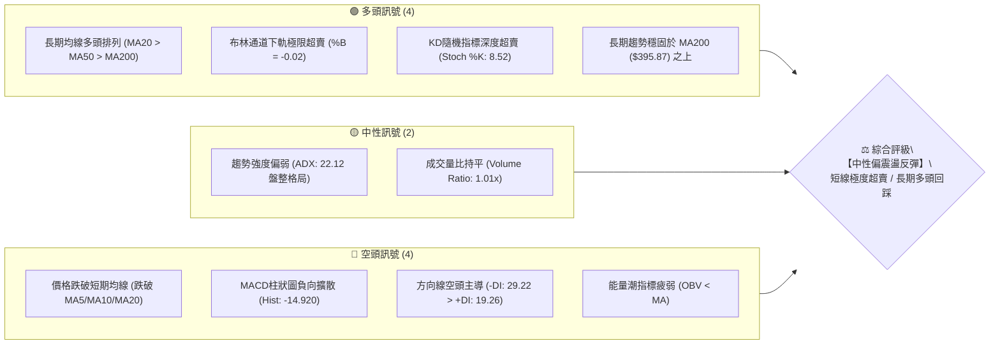
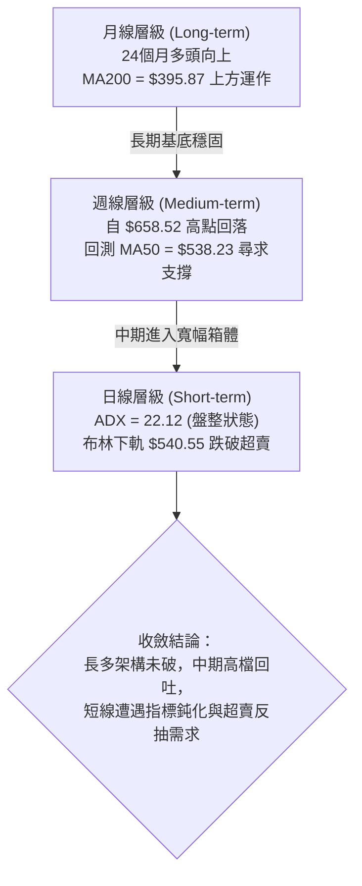
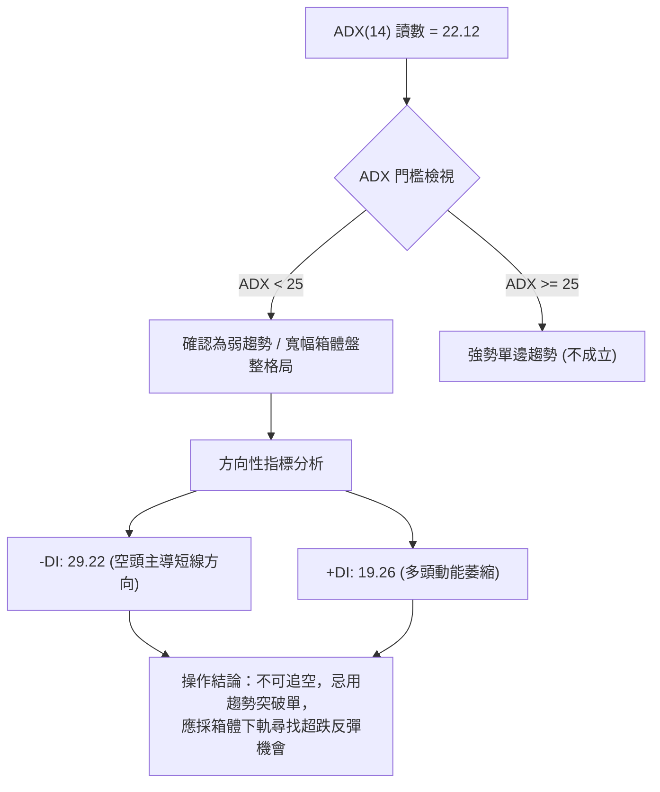
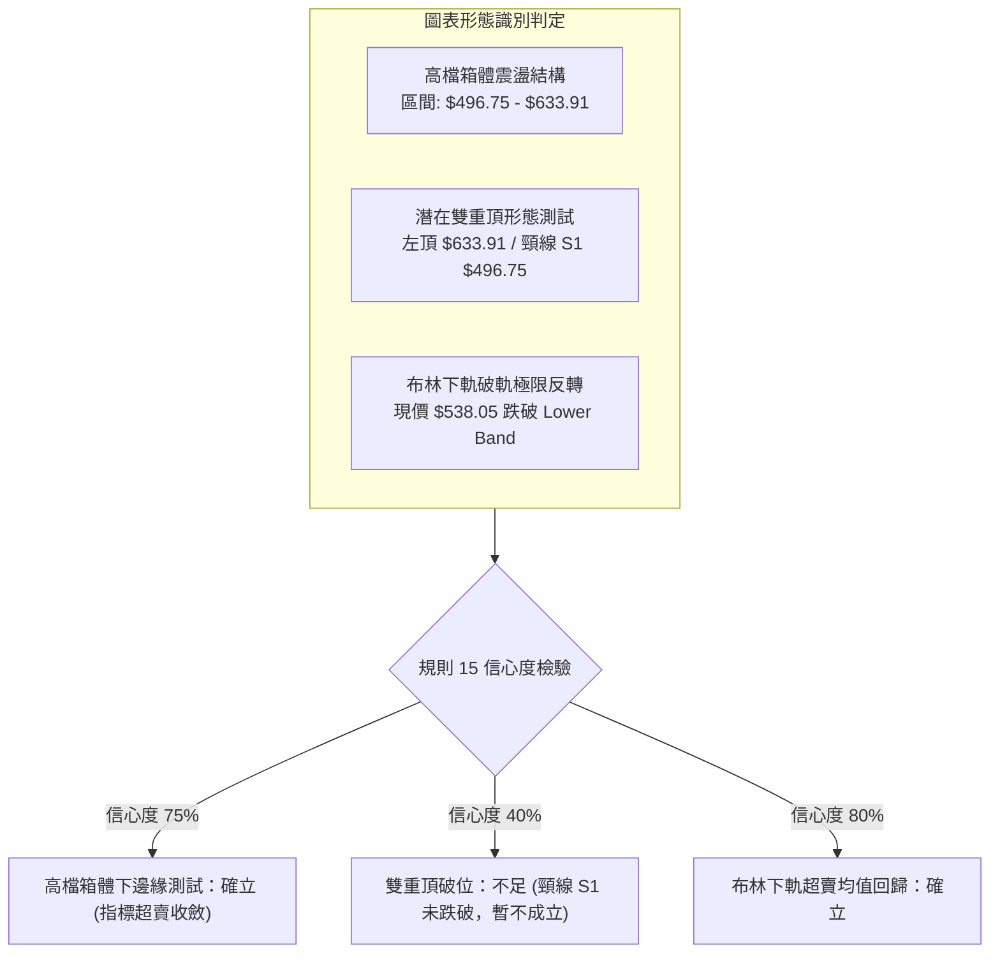
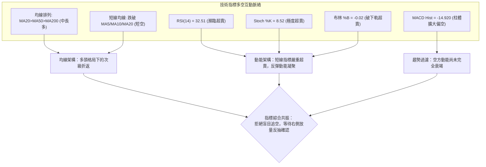
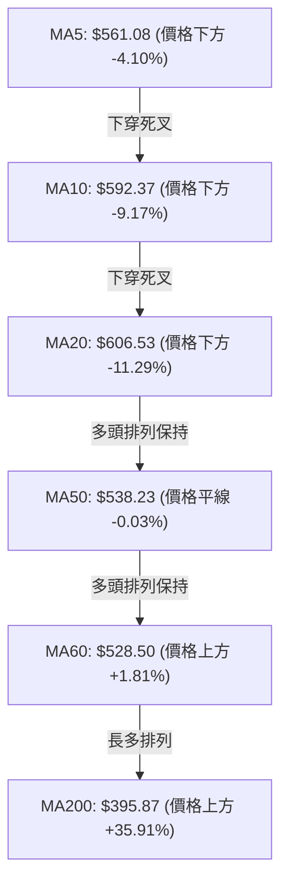
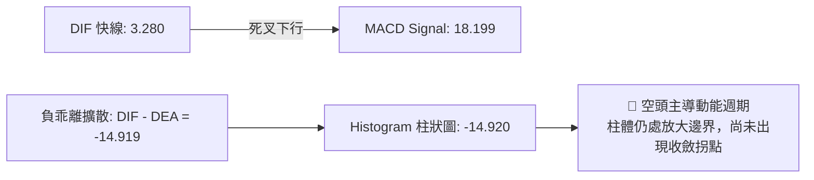
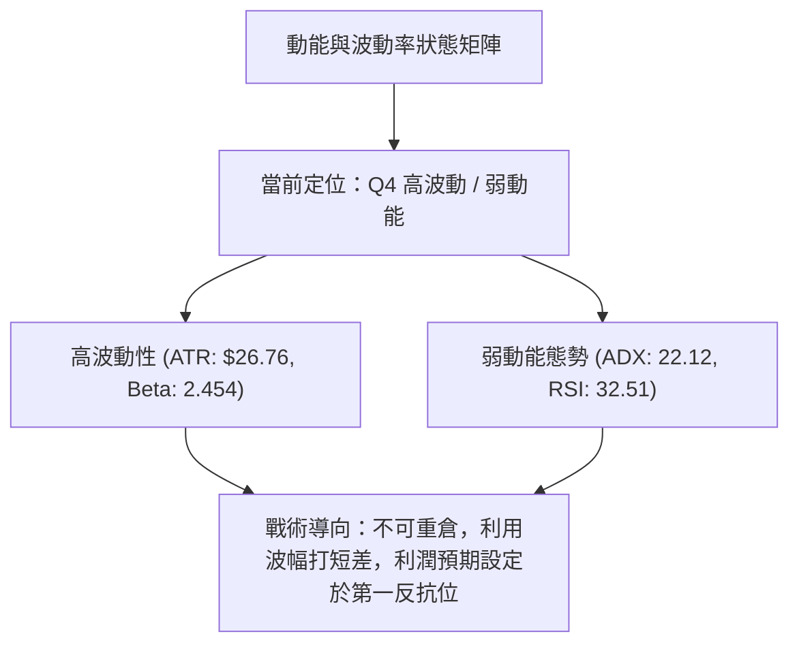
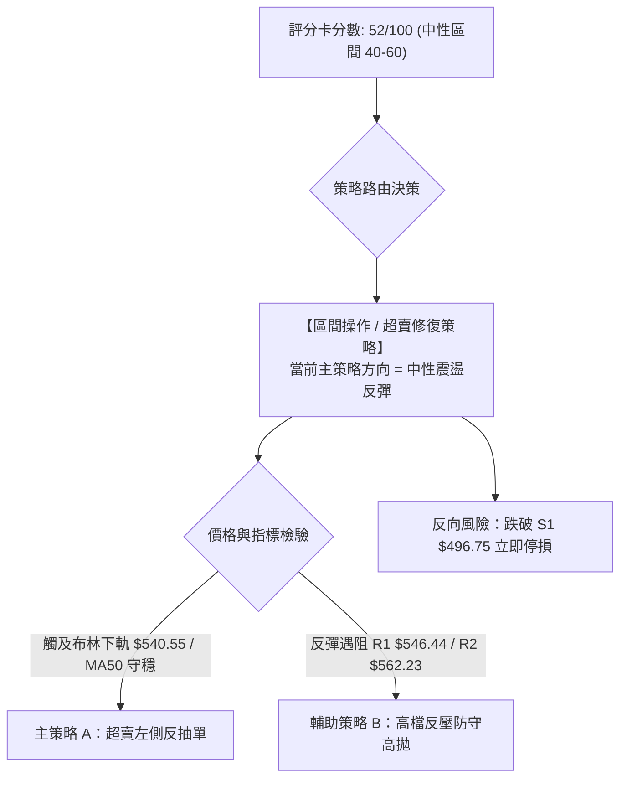
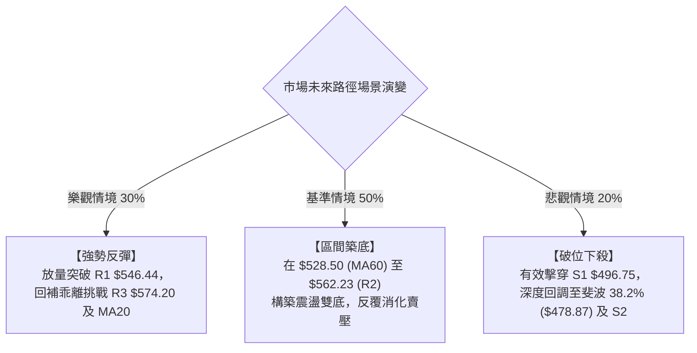

# AMD 技術分析報告

> **報告日期**：2026-10-20 ｜ **語言**：繁體中文 ｜ **數據來源**：Yahoo Finance ｜ **當前價格**：$538.05

---

## 目錄

| 章節 | 內容 |
|------|------|
| [1. 技術面概覽](#1-技術面概覽) | 訊號儀表板、核心指標、評分卡 |
| [2. 趨勢分析](#2-趨勢分析) | 多時框趨勢、長中短期走勢 |
| [3. 圖表形態分析](#3-圖表形態分析) | 形態識別、K線組合、目標價 |
| [4. 支撐與阻力](#4-支撐與阻力) | 關鍵價位、斐波那契回調 |
| [5. 技術指標深度解讀](#5-技術指標深度解讀) | MA/RSI/MACD/布林/成交量 |
| [6. 動能與波動率](#6-動能與波動率) | 動能評估、ATR、Beta |
| [7. 多時框架總結](#7-多時框架總結) | 時框架評分矩陣 |
| [8. 交易策略建議](#8-交易策略建議) | 多空策略、風險報酬比 |
| [9. 風險提示與監控](#9-風險提示與監控) | 監控指標、風險場景 |
| [10. 報告總結](#10-報告總結) | 核心結論與策略清單 |

---

## 1. 技術面概覽

### 🎯 技術訊號儀表板



### 📊 核心指標速覽表

| 指標類別 | 指標名稱 | 當前數值 | 訊號 | 解讀 |
|----------|----------|----------|------|------|
| **價格** | 當前收盤價 | $538.05 | 🟡 | 位於52週區間74.4%分位，自高點回檔進入多空拉鋸 |
| **均線** | MA20 | $606.53 | 🔴 | 價格低於MA20達-11.29%，短中期下行乖離過大 |
| **均線** | MA50 | $538.23 | 🟡 | 價格觸及MA50（-0.03%），中期生命線面臨方向抉擇 |
| **均線** | MA200 | $395.87 | 🟢 | 價格大幅高於牛熊分界線+35.91%，長期多頭底盤紮實 |
| **動能** | RSI(14) | 32.51 | 🟡 | 逼近30超賣區間下緣，下行動能減速，尚未出現底背離 |
| **動能** | MACD (12,26,9) | 3.280 / 18.199 | 🔴 | 快慢線死叉，柱狀圖為-14.920，短線賣壓仍處釋放期 |
| **擺動** | Stoch %K / %D | 8.52 / 11.67 | 🟢 | 進入極度超賣區（<20），隨時醞釀技術性均值回歸反彈 |
| **通道** | 布林通道下軌 | $540.55 | 🟢 | 收盤價跌破下軌（%B: -0.02），屬短線超跌擴張訊號 |
| **趨勢** | ADX (14) | 22.12 | 🟡 | ADX < 25，確認市場非單邊趨勢，屬寬幅盤整修正波 |
| **量能** | OBV 與量比 | 1.01x / OBV<MA | 🔴 | 成交量維持常態但OBV低於均線，資金跟進買盤意願低 |
| **波動** | ATR(14) | $26.76 | 🔴 | 波動佔股價4.97%，日內價格擺動劇烈，風控需留足緩衝 |

### 🏆 技術評分卡

```
╔══════════════════════════════════════════════════════════════╗
║              技術評分卡 — AMD (2026-10-20)                    ║
╠══════════════════════════════════════════════════════════════╣
║ 趨勢強度 (Trend)      ██████████░░░░░░░░░░  50/100 🟡 中性   ║
║ 動能指標 (Momentum)   ███████░░░░░░░░░░░░░  35/100 🔴 偏空   ║
║ 支撐穩定度 (Support)  █████████████░░░░░░░  65/100 🟢 良好   ║
║ 成交量配合 (Volume)   ████████░░░░░░░░░░░░  40/100 🔴 疲弱   ║
║ 形態完整度 (Pattern)  ███████████░░░░░░░░░  55/100 🟡 中性   ║
║ 均線架構 (MA Matrix)  █████████████░░░░░░░  65/100 🟢 偏多   ║
╠══════════════════════════════════════════════════════════════╣
║ 綜合評分 (Total)      ███████████░░░░░░░░░  52/100 🟡 區間   ║
║ 評級結論              【中性觀望 / 逢低博取超賣反彈】        ║
╚══════════════════════════════════════════════════════════════╝
```

---

## 2. 趨勢分析

### 🌐 多時框趨勢分析



### 📈 長期趨勢 — 12個月走勢圖（Unicode）

```
AMD 月線收盤走勢圖（過去12個月：2025-11 至 2026-10）
價格軸 ($)
$650 ┤                                              ● 52W高點 $658.52
$600 ┤                                        ●     │
$550 ┤                                  ●     │     │     ● 現價 $538.05
$500 ┤                            ●     │     │     │     │
$450 ┤                            │     │     │     │     │
$400 ┤                            │     │     │     │     │
$350 ┤                      ●     │     │     │     │     │
$300 ┤                      │     │     │     │     │     │
$250 ┤                ●     │     │     │     │     │     │
$200 ┤    ●     ●     │     │     │     │     │     │     │
     └────┬─────┬─────┬─────┬─────┬─────┬─────┬─────┬─────┬─────┬────
        25-11 25-12 26-01 26-02 26-03 26-04 26-05 26-06 26-07 26-08 26-09 26-10
收盤:   217.5 214.2 236.7 200.2 203.4 354.5 516.1 580.9 476.2 470.7 611.8 538.1
```

#### 走勢特徵分析表格

| 階段 | 時間區間 | 起訖價格區間 | 累計漲跌幅 | 走勢結構與技術特徵 |
|------|----------|--------------|------------|--------------------|
| **築底蓄勢期** | 2025-11 ~ 2026-03 | $217.53 → $203.43 | -6.48% | 在 $200.00~$236.73 間構築雙重底平台，均線深度糾結 |
| **主升加速段** | 2026-04 ~ 2026-06 | $203.43 → $580.91 | +185.56% | 爆發性單邊推升，量能急劇放大，連續突破多重整數關卡 |
| **高檔強洗盤** | 2026-07 ~ 2026-08 | $580.91 → $470.72 | -18.97% | 快速回撤測試支撐位 S2 ($461.71) 附近，確立次級買點 |
| **創高後修正** | 2026-09 ~ 2026-10 | $470.72 → $611.76 → $538.05 | -12.05% | 衝刺達52W高點 $658.52 後拉回，目前正測試 MA50 支撐 |

### 📊 中期趨勢（週線分析）

```
近期週線級別價格壓力與支撐結構示意：
  $658.52 ─────────────────────────────────── 52W High / 絕對壓力頂部
    ▲
    │   波段回跌阻力區：
  $574.20 ─────────────────────────────────── R3 (前波反彈高點聚類)
  $562.23 ─────────────────────────────────── R2 (密集套牢區下緣)
  $546.44 ─────────────────────────────────── R1 (斐波 23.6% / $547.53 匯合帶)
    │
  $538.05 ═══════════════════════════════════ 【現價】/ MA50 ($538.23)
    │
    │   波段回檔支撐防線：
  $496.75 ─────────────────────────────────── S1 (波段低點支撐聚類)
  $478.87 ─────────────────────────────────── 斐波那契 38.2% 回調位
  $461.71 ─────────────────────────────────── S2 (8月震盪築底核心區間)
```

從近20週數據觀察，2026-09-27 至 2026-10-04 週K線觸及 $630~$633 水平，RSI 衝高至 80~84 極度超買。隨後三週內收盤價急殺至 $538.05，RSI 自 84.3 崩跌至 32.5，MACD 週柱狀圖由正轉負（+14.199 劇降至 -14.920），顯示中級回檔賣壓相當沉重，目前處於釋放後期。

### ⚡ 趨勢強度評估（ADX 解讀）



| 指標變數 | 當前讀數 | 基準閥值 | 狀態評估 | 實質交易含意 |
|----------|----------|----------|----------|--------------|
| **ADX(14)** | **22.12** | 25.00 | 弱趨勢 / 盤整 | 趨勢動能衰退，假突破機率大增，市場由震盪主導 |
| **+DI** | **19.26** | 20.00 | 多方偏弱 | 多方主動進攻動能不足，未能形成推升波段 |
| **-DI** | **29.22** | 25.00 | 空方偏強 | 空方力量暫時掌控短線盤面，但因 ADX 偏低，難以形成雪崩式崩跌 |

---

## 3. 圖表形態分析

### 🔍 形態識別系統



#### 形態信心度與計算表格（嚴格依據規則 15）

| 形態類別 | 信心度 | 判斷依據（引用數據） | 完成度 | 目標價（附嚴謹計算式） |
|----------|--------|----------------------|--------|------------------------|
| **高檔箱體回測** | **75%** | 價格自高點回落至 MA50 ($538.23) 與下部密集支撐 S1 ($496.75) 上方 | 85% | **區間反彈目標**：<br/>箱體中軸 = ($496.75 + $574.20) / 2 = **$535.48** (已達)<br/>箱體頂部阻力 = **$574.20** (R3) |
| **布林超跌均值回歸** | **80%** | 收盤價 $538.05 低於布林下軌 $540.55，%B = -0.02，Stoch %K = 8.52 | 90% | **反抽中軌目標**：<br/>由指標向布林中軌均值回歸推算 = **$606.53** (BB中軌 / MA20) |
| **潛在雙重頂** | **40%** | 9月高點 $611.76 與 10月高點 $633.91，但頸線 S1 ($496.75) 完好 | 35% | *信心度 < 50%，依規則不宣稱成立。若未來有效跌破 S1，理論目標 = S1 $496.75 - (高點 $633.91 - 頸線 $496.75) = $359.59 (目前不採納)* |

### 🕯️ 重要K線形態分析

| 週/月份 | 收盤價 | K線形態 | 解讀 | 訊號 |
|---------|--------|---------|------|------|
| **2026-09-27 (週)** | $630.63 | 長陽突破實體 | 帶量突破前高，週成交量放大至 1.32 億股，確立多頭主升力道 | 🟢 強烈看多 |
| **2026-10-04 (週)** | $633.91 | 高檔十字星/流星形態 | 上衝回落，成交量萎縮至 9,238 萬股，量價背離顯現，動能衰竭 | 🔴 頂部警戒 |
| **2026-10-18 (週)** | $528.75 | 長陰下挫貫穿K線 | 連續擊破 MA20，週 RSI 急挫至 29.1，恐慌盤湧出 | 🔴 空方釋放 |
| **2026-10-25 (當週)** | $538.05 | 帶下影線小陽線（孕線） | 在 MA50 處獲買盤承接，跌勢暫歇，低檔浮現止跌企穩訊號 | 🟡 止跌觀察 |

### 📉 ASCII 走勢形態示意圖

```
AMD 日/週線高檔震盪與回測形態示意圖：

  $658.52 ┬─────────────── 52W 最高點 (2026-10-04 當週高點)
          │               ╭───╮
  $633.91 ┤       ╭───────╯   ╰───────╮ (高檔雙頭雛形)
          │       │                   │
  $606.53 ┼───────┼───────────────────┼────────── MA20 / BB 中軌 (強阻力區)
          │       │                   ╰───╮
  $562.23 ┤  ╭────╯                       ╰──╮  R2 阻力
  $546.44 ┤  │                                ╰─ R1 阻力
  $538.05 ┼──┼───────────────────────────────────● 現價：測試 MA50 ($538.23)
  $540.55 ┼──┴─────────────────────────────────── 布林通道下軌 (超賣破軌)
          │
  $496.75 ┴────────────────────────────────────── S1 關鍵頸線防守大位 (未破)
```

---

## 4. 支撐與阻力

### 🗺️ 關鍵價位分布圖（Unicode）

```
AMD 價位結構分布圖（嚴格依據 OHLCV 計算聚類與斐波那契點位）
═════════════════════════════════════════════════════════════════
$658.52 ║██████████████████████████████║ 52W High / 斐波那契 0.0%
$606.53 ║██████████████████████        ║ 布林中軌 / MA20 (波段關鍵反壓)
$574.20 ║██████████████████            ║ 強阻力 R3 (+6.72%)
$562.23 ║██████████████                ║ 阻力 R2 (+4.49%)
$547.53 ║██████████                    ║ 斐波那契 23.6% 回調位
$546.44 ║████████                      ║ 關鍵阻力 R1 (+1.56%)
$538.23 ╟──────────────────────────────╢ MA50 生命線
$538.05 ╠══════════════════════════════╣ ◄ 現價 ($538.05)
$540.55 ╟──────────────────────────────╢ 布林通道下軌
$496.75 ║▓▓▓▓▓▓▓▓▓▓▓▓▓▓▓▓▓▓            ║ 近期波段核心支撐 S1 (-7.68%)
$478.87 ║▓▓▓▓▓▓▓▓▓▓▓▓▓▓                ║ 斐波那契 38.2% 回調位
$461.71 ║▓▓▓▓▓▓▓▓▓▓                    ║ 強支撐 S2 (-14.19%)
$451.00 ║▓▓▓▓▓▓                        ║ 極限波段支撐 S3 (-16.18%)
═════════════════════════════════════════════════════════════════
```

### 🚧 阻力位分析表

| 阻力級別 | 價位 | 形成原因（嚴格引用數據） | 突破難度 | 重要性 |
|----------|------|--------------------------|----------|--------|
| **R1** | **$546.44** | 近一年波段高點聚類下緣，與斐波那契 23.6% ($547.53) 形成共振密集壓制 | 🟡 中等 | 短線多頭重返反彈軌道的首要分水嶺 |
| **R2** | **$562.23** | 10月中旬長黑破位K線實體密集區，短線多空籌碼轉換套牢點 | 🔴 較高 | 突破則確認短線底部構築成功 |
| **R3** | **$574.20** | 9月震盪高點及前期多頭跳空起漲點聚類區，強大解套賣壓源 | 🔴 極高 | 波段防線，未站上此位前中期空方仍佔優 |

### 🛡️ 支撐位分析表

| 支撐級別 | 價位 | 形成原因（嚴格引用數據） | 守住機率 | 重要性 |
|----------|------|--------------------------|----------|--------|
| **S1** | **$496.75** | 近一年波段低點聚類核心，7月中旬低點 ($495.76) 與高檔箱體下邊界 | 🟢 70% | **生命線防線**：跌破將觸發形態級破位 |
| **S2** | **$461.71** | 8月震盪築底核心區間低點 ($465.58) 延伸之強烈買盤承接平台 | 🟢 85% | 中期趨勢防守底線，具有強烈結構支撐力道 |
| **S3** | **$451.00** | 近一年波段極限低點聚類，接近前期歷史籌碼換手成本帶 | 🟢 95% | 牛市大格局最後技術防禦關卡 |

### 📐 斐波那契回調位分析

依據 52 週波動區間：**低點 $188.22 → 高點 $658.52**，各回調位嚴格對照如下：

| 回調比例 | 斐波那契價位 | 當前價格相對位置與技術解讀 |
|----------|--------------|----------------------------|
| **0.0% (52W High)** | **$658.52** | 歷史極限阻力峰值 |
| **23.6%** | **$547.53** | **關鍵臨界點**：現價 $538.05 剛跌破該位置約 1.73%，當前正在此處進行回抽確認，若能收復則屬假跌破 |
| **38.2%** | **$478.87** | **黃金分割第一防線**：位於 S1 ($496.75) 與 S2 ($461.71) 之間，為多頭深度修正的理想回調支撐區 |
| **50.0%** | **$423.37** | 多空中長期平衡分水嶺 |
| **61.8%** | **$367.87** | 強力黃金分割支撐，接近 MA240 ($366.92) |
| **78.6%** | **$288.86** | 深度極端回撤位 |
| **100.0% (52W Low)**| **$188.22** | 52週波段起漲起點 |

> **回調定位解讀**：現價 $538.05 正處於 **23.6% ($547.53)** 與 **38.2% ($478.87)** 之間。技術上，強勢股票在主升浪後回調通常守在 23.6%~38.2% 區間內。目前跌破 23.6% 屬於弱勢擴張，但只要守穩 S1 ($496.75) 及 38.2% ($478.87)，長期牛市結構未受破壞。

---

## 5. 技術指標深度解讀

### 🎛️ 指標訊號總覽



### 📈 移動平均線排列分析



| 均線名稱 | 當前價格 | 偏離幅度 | 趨勢斜率 | 技術意涵 |
|----------|----------|----------|----------|----------|
| **MA 5** | $561.08 | -4.10% | 急陡向下 ▅▅ | 極短線沉重下壓，反彈首要遭遇的動態阻力 |
| **MA 10** | $592.37 | -9.17% | 向下走跌 ▇▇ | 短線空頭攻擊線，壓制日線反抽空間 |
| **MA 20** | $606.53 | -11.29% | 拐頭向下 ██ | 月線生命線失守，負乖離率達 -11.29%，具強烈拉回修復需求 |
| **MA 50** | $538.23 | -0.03% | 平緩向上 ▆▆ | **關鍵防禦線**：當前股價恰好落在 MA50 上，爭奪極度激烈 |
| **MA 60** | $528.50 | +1.81% | 穩健向上 ▇▇ | 季線支撐，為 MA50 下方的第二層緩衝墊 |
| **MA 120** | $508.96 | +5.72% | 向上挺進 ██ | 半年線支撐，與 S1 ($496.75) 構成多頭堅實堡壘 |
| **MA 200** | $395.87 | +46.64%| 扎實向上 ██ | 牛熊分水嶺，長期多頭護城河依然極為深厚 |

### 📉 RSI(14) 分析

*   **當前讀數**：**32.51**
*   **區間進度條**：
    `超賣 [███████████░░░░░░░░░░░░░░░░░░░░░░░] 32.51 超買`
*   **超買超賣解讀**：RSI 跌至 32.51，距離 30 絕對超賣門檻僅一步之遙；從歷史20週數據看，前週 RSI 曾探底至 29.1，本週微升至 32.5，顯示低檔鈍化開始減緩。
*   **背離分析結論**：
    *   **頂背離**：已於 10月初 $633.91 高點確認（價格創新高而 RSI 自 84.3 走平並轉跌），該頂背離引發了近期的深度修正。
    *   **底背離**：**目前尚未形成底背離**。雖然價格在 MA50 出現減速，但 RSI 僅單腳觸底回彈，未出現「價格破新低而 RSI 抬高」的第二隻腳確認。技術上需提防二次探底。

### 📊 MACD(12,26,9) 訊號解讀



*   **快慢線狀態**：DIF (3.280) 大幅低於 Signal (18.199)，雙線位於零軸上方死叉下行，代表這是一次「長期牛市格局中的中級波段回調」。
*   **柱狀圖 (Histogram)**：讀數為 **-14.920**，相比前週的 -14.100 負值再度擴大，顯示空方慣性仍在釋放，操作上不宜在無止跌K線出現前過度激進接刀。

### 📦 布林通道分析

```
AMD 布林通道結構示意圖（日線尺度）
═══════════════════════════════════════════════════════════════
$672.51 ──────────────────────────────────── BB 上軌 (波動極限擴張壓)
  │
$606.53 ──────────────────────────────────── BB 中軌 / MA20 (均線下傾)
  │
$540.55 ──────────────────────────────────── BB 下軌
$538.05 ════════════════════════════════════ 【現價】(跌破下軌 $2.50)
═══════════════════════════════════════════════════════════════
```

*   **通道帶寬**：上軌 $672.51，下軌 $540.55，帶寬高達 $131.96（佔中軌 21.75%），表明當前波動率處於高位通道擴張期。
*   **%B 指標**：**-0.02**。當 %B < 0 代表收盤價跌破布林下軌，這在量化統計中屬於「罕見超跌事件」（低於下軌 2 個標準差之外）。這種狀態通常難以長時間維持，極易誘發向通道內部（至少回抽下軌 $540.55 及中軌 $606.53）的均值回歸行情。

### 💹 成交量分析（量價配合度）

*   **量能水平**：最新成交量為 20,153,700 股，相較於 20日均量 20,045,040 股，**量比為 1.01x**，幾乎完全平盤，顯示下殺過程中並未引發全面性的恐慌性拋售（無天量潰敗）。
*   **OBV 能量潮分析**：數據顯示 **OBV < MA**。OBV 指標持續位於其均線下方，這意味著在過去數週的回調中，資金處於淨流出狀態，主動性承接盤尚未集結完成，量能暫未對多頭反轉給予正面確認。

---

## 6. 動能與波動率

### ⚡ 動能評估四象限

| 象限 | 動能維度 | 波動維度 | AMD 當前狀態檢驗 | 實務評估 |
|------|----------|----------|------------------|----------|
| **第一象限 (Q1)** | 強動能 (趨勢向上) | 低波動 (穩定推升) | ❌ 不符合 | 最佳主升段（如 2026-04~06）已過去 |
| **第二象限 (Q2)** | 弱動能 (回檔修正) | 低波動 (窄幅整理) | ❌ 不符合 | ADX 雖低，但 ATR 依然處於高位 |
| **第三象限 (Q3)** | 強動能 (單邊暴跌) | 高波動 (劇烈洗盤) | ❌ 不符合 | 空方動能受阻於 MA50，非斷崖下跌 |
| **第四象限 (Q4)** | **弱動能 (指標超賣)** | **高波動 (急跌反彈)** | **✔️ 當前定位於 Q4** | **高風險高博弈區間：動能鈍化跌停，波動維持高檔，適合嚴格風控下的超賣反彈戰術** |



### 📊 ATR 波動率分析

*   **ATR(14) 數值**：**$26.76**（佔當前股價 $538.05 之 **4.97%**）。
*   **每日波動解讀**：每日平均真實波幅近 $27，顯示 AMD 具備高度投機性與活性。
*   **風控止損距離建議**：
    *   **激進交易者（短線反彈）**：設定 **1.0x ATR = $26.76** 緩衝。
    *   **波段交易者（箱體操作）**：設定 **1.5x ATR = $40.14** 緩衝。
    *   **止損位設置檢驗**：若自現價 $538.05 減去 1.5x ATR 得 $497.91，與支撐位 S1 ($496.75) 形成完美技術共振。

### 📐 Beta 與市場相關性

*   **Beta 係數**：**2.454**。
*   **市場敏感度解讀**：AMD 的波動幅度為標普500大盤的 2.45 倍，屬於極度高彈性半導體核心資產。在市場情緒反彈時，AMD 反彈力度將成倍放大；但在大盤疲軟時，其回撤壓力亦極為劇烈。

---

## 7. 多時框架總結

### 📋 時框架評分表

| 時框架 | 趨勢方向 | 動能狀態 | 均線排列 | 形態特徵 | 綜合評分 | 操作建議 |
|--------|----------|----------|----------|----------|----------|----------|
| **月線 (長期)** | 🟢 多頭 | 🟡 擴張高檔鈍化 | 🟢 完美多頭 (MA>MA200) | 歷史大牛市主升回踩 | **75/100** | 長線多單底倉續抱 |
| **週線 (中期)** | 🟡 震盪整理 | 🔴 下行釋放 | 🟡 測試 MA50 支撐 | 高檔雙頂壓制 vs 箱體防守 | **52/100** | 區間震盪高拋低吸 |
| **日線 (短期)** | 🔴 偏空回調 | 🟢 極度超賣 | 🔴 跌破短均 MA5/20 | 跌破布林下軌 (%B<0) | **42/100** | 輕倉博取均值回歸 |

### 🔲 綜合訊號矩陣

```
時框架訊號交叉驗證矩陣：
┌───────────┬──────────────┬──────────────┬──────────────┐
│ 分析維度  │ 長期 (月線)  │ 中期 (週線)  │ 短期 (日線)  │
├───────────┼──────────────┼──────────────┼──────────────┤
│ 趨勢方向  │ 🟢 強烈向上  │ 🟡 寬幅箱體  │ 🔴 短線下行  │
│ 均線系統  │ 🟢 多頭擴張  │ 🟡 逼近MA50  │ 🔴 跌破短期均│
│ 動能指標  │ 🟡 動能減弱  │ 🔴 MACD死叉  │ 🟢 KD/RSI超賣│
│ 形態架構  │ 🟢 大幅創高  │ 🟡 箱體震盪  │ 🟢 觸軌反彈線│
└───────────┴──────────────┴──────────────┴──────────────┘
```

### ⚖️ 多時框收斂結論（嚴格遵守規則 14）

1.  **行情性質收斂判定**：當前 ADX(14) 讀數為 **22.12 (<25)**，明確定義當前市場處於**【盤整震盪行情】**，非強烈單邊趨勢。
2.  **時框主導原則**：依規則 14，盤整行情中「以日線布林通道上下軌與關鍵支撐阻力為主要交易區間」，不再以單邊多空破位邏輯主導。
3.  **唯一方向性結論**：**【中性偏多（超跌均值回歸）】**。
    *   *衝突調和說明*：雖然日線短均線（MA5/10/20）呈現空頭排列且 MACD 柱體為負，但因布林通道 %B 跌破下軌出現 -0.02 極限超賣，且隨機指標 Stoch %K 降至 8.52，疊加週線 MA50 ($538.23) 核心支撐到位，下行空間受制於 S1 ($496.75)。空方在此處追空風險極大，多方具備強大的技術性反抽動能。

---

## 8. 交易策略建議

### 🗺️ 策略決策流程圖



### 🧭 策略路由

> **當前主策略方向 = 【中性震盪反彈 / 箱體下軌低吸】（依據綜合評分 52/100，定位於 40–60 區間操作模式，以布林下軌超賣反抽為主要戰術）。**

### 🎯 價格情境階梯（Price Scenarios）

價位嚴格引用第四章及關鍵數據聚類：

| 觸發條件 | 下一目標 | 後續延伸 | 情境技術含義 |
|----------|----------|----------|--------------|
| **站穩 MA50，突破 R1 ($546.44)** | **R2 ($562.23)** | **R3 ($574.20)** | 短線超賣反彈展開，回補均線乖離 |
| **現價 $538.05 區間震盪** | **$540.55 (BB下軌)** | **$547.53 (斐波23.6%)**| 指標進行橫盤鈍化修復，多空拉鋸 |
| **失守現價，跌破 S1 ($496.75)** | **S2 ($461.71)** | **S3 ($451.00)** | 中期箱體破位，回測 38.2% 斐波那契強防禦線 |

### 📊 情境機率分佈

| 情境劇本 | 機率 | 主要數據與指標依據 |
|----------|------|--------------------|
| **劇本一：超賣技術反彈** | **50%** | 布林 %B (-0.02) 超跌破軌、Stoch %K (8.52) 嚴重超賣、MA50 ($538.23) 出現承接影線 |
| **劇本二：箱體底部橫盤** | **35%** | ADX = 22.12 (<25) 趨勢偏弱、OBV < MA 買盤追價意願謹慎，需時間消化 |
| **劇本三：失守支撐續挫** | **15%** | MACD 柱狀圖 (-14.920) 負向擴大、-DI (29.22) 暫居優勢，若市場突發系統性風險 |

### 🟢 主策略詳情（區間操作多頭）

| 策略要素 | 策略 A（積極型：布林下軌超跌反彈） | 策略 B（穩健型：突破確認右側單） |
|----------|------------------------------------|----------------------------------|
| **進場條件** | 現價 $538.05 附近分批低吸（守住 MA50）| 放量突破並收復阻力 R1 ($546.44) |
| **進場價格** | **$538.05** | **$547.00** |
| **目標價 T1** | **$562.23** (阻力 R2) | **$574.20** (阻力 R3) |
| **目標價 T2** | **$574.20** (阻力 R3) | **$606.53** (布林中軌 / MA20) |
| **止損價格** | **$496.75** (跌破支撐位 S1) | **$528.50** (跌破 MA60 季線) |
| **風險空間** | $41.30 (-7.68%) | $18.50 (-3.38%) |
| **報酬空間 (T1)** | $24.18 (+4.49%) | $27.20 (+4.97%) |
| **報酬空間 (T2)** | $36.15 (+6.72%) | $59.53 (+10.88%) |
| **風險報酬比** | **1 : 0.88** (至T2為 **1 : 0.88**) *建議嚴控倉位* | **1 : 1.47** (至T1) / **1 : 3.22** (至T2) |
| **成功機率** | 55% | 65% |
| **建議倉位** | **8% - 10%** (試探倉位) | **12% - 15%** (標準倉位) |

### 🔴 反向風險觸發點（對沖與風控提示）

*   **觸發點一（止盈警戒）**：當反彈觸及 **R2 ($562.23)** 至 **R3 ($574.20)** 時，因 MA20 ($606.53) 下壓，空方籌碼密集，必須逢高分批減倉，不可盲目看多至歷史新高。
*   **觸發點二（全面止損）**：若日K線以實體長陰跌破 **S1 ($496.75)**，代表高檔箱體正式演變為破位形態，所有多頭部位必須無條件離場觀望，並可考慮啟動以 **S2 ($461.71)** 為目標的避險空單對沖。

### ⭐ 整體訊號強度評星

```
做多訊號強度：★★★☆☆  (3/5星 — 依靠指標極限超賣與MA50支撐，勝在盈虧比空間)
做空訊號強度：★★☆☆☆  (2/5星 — ADX<25 追空盈虧比惡劣，下方即為密集支撐帶)
整體可信度：  ★★★★☆  (4/5星 — 多時框指標收斂明確，箱體邊界定義清晰)
```

---

## 9. 風險提示與監控

### ✅ 關鍵監控指標 Checklist

```
╔══════════════════════════════════════════════════════════════════╗
║               AMD 技術交易日常監控清單 (Checklist)               ║
╠══════════════════════════════════════════════════════════════════╣
║ [ ] 1. MA50 守衛戰：每日收盤價是否持續維持在 $538.23 之上？      ║
║ [ ] 2. 布林回歸確認：收盤價是否重新站回下軌 $540.55 之內？       ║
║ [ ] 3. RSI 拐點驗證：RSI(14) 能否自 32.51 回升突破 40 中軸？     ║
║ [ ] 4. Stoch %K 黃金交叉：%K (8.52) 是否上穿 %D (11.67) 形成買訊？║
║ [ ] 5. MACD 負柱收斂：Histogram 負值是否縮小至 -10.00 以內？      ║
║ [ ] 6. 量能釋放指標：日成交量是否放大至 2,500 萬股以上伴隨陽線？║
║ [ ] 7. 止損紅線監控：價格是否觸及或跌破 S1 ($496.75) 警戒線？    ║
╚══════════════════════════════════════════════════════════════════╝
```

### ⚠️ 風險場景分析



### 🛡️ 風險管理重要提醒

1.  **高 Beta 與 ATR 雙重風控**：AMD 的 Beta 高達 **2.454**，且 ATR 達 **$26.76 (4.97%)**。日內波幅極大，嚴禁使用過高槓桿。單筆交易承受之帳戶風險資金應嚴格限制在總資產的 **1.0% - 1.5%** 範圍內。
2.  **均線下穿的解套賣壓**：目前 MA5 ($561.08)、MA10 ($592.37) 與 MA20 ($606.53) 呈陡峭下傾排列，任何未放量的急拉皆容易遭遇上方套牢盤的湧出，切忌「見紅追高」，反彈應嚴格遵循分批停利紀律。
3.  **大盤聯動性**：半導體板塊高度受科技股納斯達克指數牽引，若大盤同步回調，個股指標超賣可能出現進一步「鈍化下挫」，部位規模必須動態調節。

---

## 10. 報告總結

```
╔══════════════════════════════════════════════════════════════════╗
║                    AMD 技術分析報告總結                          ║
╠══════════════════════════════════════════════════════════════════╣
║ 報告日期：2026-10-20                                            ║
║ 當前價格：$538.05                                                ║
║ 分析評級：⚖️ 52/100 【中性觀望 / 區間超賣反彈操作】              ║
╠══════════════════════════════════════════════════════════════════╣
║ 關鍵結論：                                                       ║
║ ├─ 長期趨勢：🟢 強烈看多 (MA200 = $395.87 向上運行，基本盤完好)  ║
║ ├─ 中期趨勢：🟡 寬幅箱體震盪 (高檔回跌測試 MA50 = $538.23)       ║
║ ├─ 短期趨勢：🔴 跌破短均下行，但布林 %B (-0.02) 與 KD 呈極度超賣║
║ ├─ 關鍵支撐：S1 $496.75 (生命線) ｜ S2 $461.71 ｜ S3 $451.00      ║
║ ├─ 關鍵阻力：R1 $546.44 ｜ R2 $562.23 ｜ R3 $574.20             ║
║ └─ 分析師目標：共識均價 $627.65 (51位分析師 Strong Buy)          ║
╠══════════════════════════════════════════════════════════════════╣
║ 最優策略組合：                                                   ║
║ 1. 🥇 最佳機會：等待右側突破 R1 ($546.44) 後進場，目標看 R2/R3    ║
║ 2. 🥈 次選機會：現價 $538.05 輕倉左側博取超賣反彈，嚴格停損 S1   ║
║ 3. 🥉 保守選擇：空倉觀望，等待日線 KD 黃金交叉或回踩 S1 企穩再做║
╚══════════════════════════════════════════════════════════════════╝
```

---

> ⚠️ **免責聲明**：本報告為技術分析研究，所有數據、圖表及價位估算均基於歷史量價與技術指標演算法客觀計算。本報告**僅供研究與學術參考**，**不構成任何要約、招攬或投資建議**。半導體標的波動劇烈，投資人應獨立評估風險並自負盈虧。

---

*報告生成時間：2026-10-20 ｜ 數據來源：Yahoo Finance ｜ 分析框架：多時框技術分析模型*