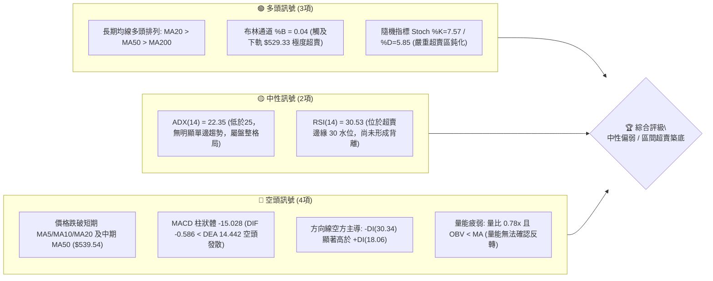
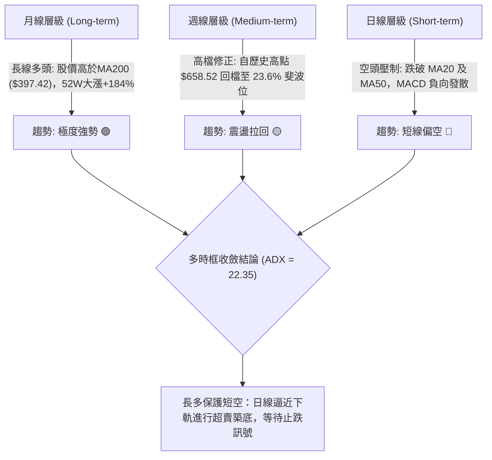
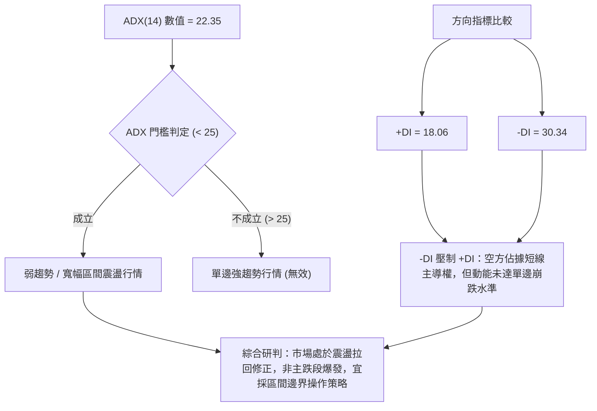
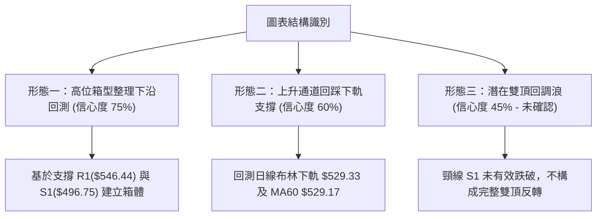
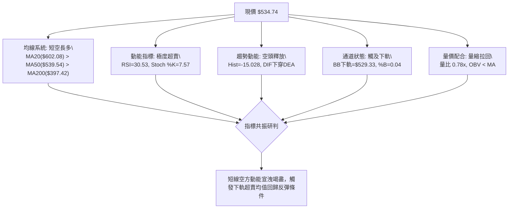
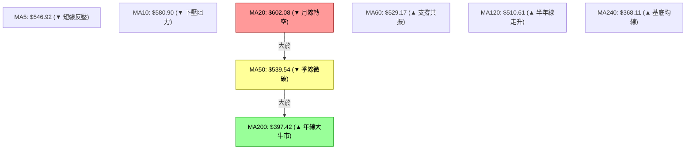
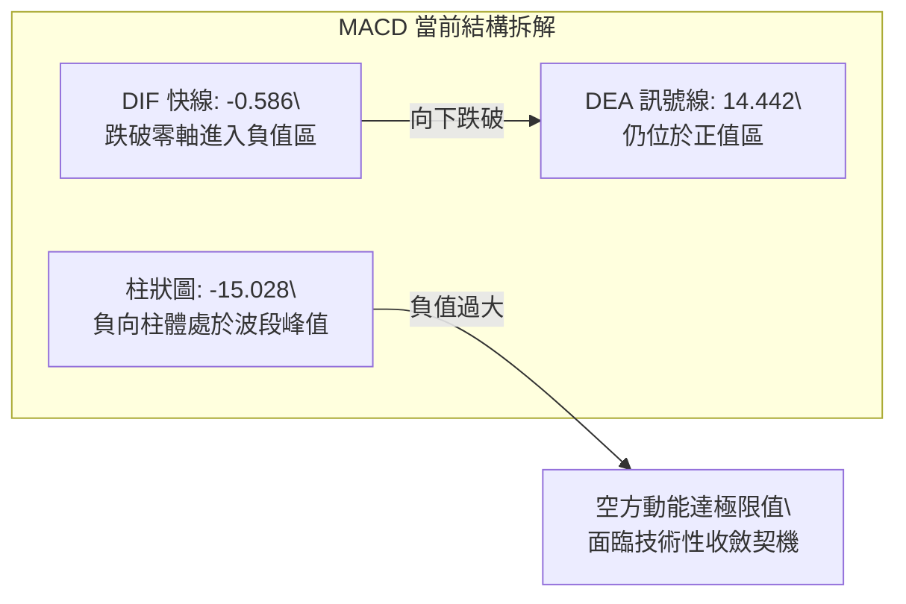
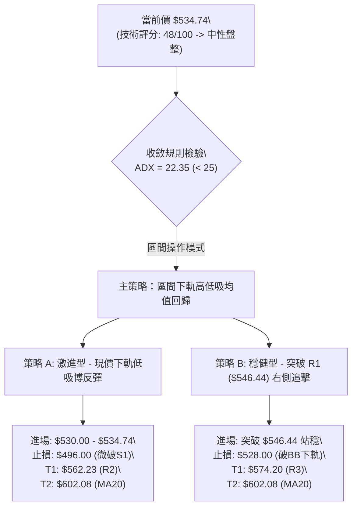
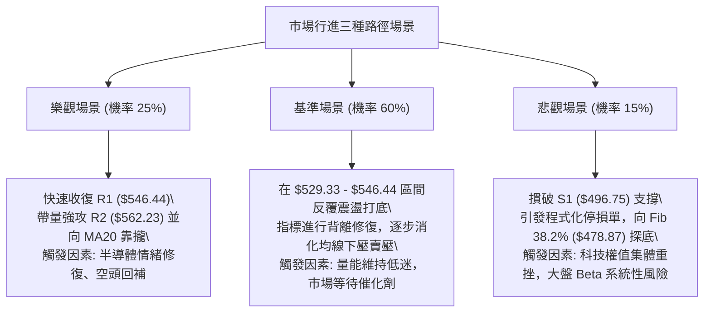

# AMD 技術分析報告

> **報告日期**：2026-10-21 ｜ **語言**：繁體中文 ｜ **數據來源**：Yahoo Finance ｜ **當前價格**：$534.74

---

## 目錄

| 章節 | 內容 |
|------|------|
| [1. 技術面概覽](#1-技術面概覽) | 訊號儀表板、核心指標、評分卡 |
| [2. 趨勢分析](#2-趨勢分析) | 多時框趨勢、長中短期走勢、ADX解讀 |
| [3. 圖表形態分析](#3-圖表形態分析) | 形態識別、K線組合、目標價計算 |
| [4. 支撐與阻力](#4-支撐與阻力) | 關鍵價位、斐波那契回調結構 |
| [5. 技術指標深度解讀](#5-技術指標深度解讀) | MA/RSI/MACD/布林/成交量全面拆解 |
| [6. 動能與波動率](#6-動能與波動率) | 動能四象限、ATR風控、Beta敏感度 |
| [7. 多時框架總結](#7-多時框架總結) | 時框架評分矩陣、多時框收斂結論 |
| [8. 交易策略建議](#8-交易策略建議) | 策略路由、價格階梯、主策略詳情 |
| [9. 風險提示與監控](#9-風險提示與監控) | 關鍵監控Checklist、情境壓力測試 |

---

## 1. 技術面概覽

### 🎯 技術訊號儀表板



---

### 📊 核心指標速覽表

| 指標類別 | 指標名稱 | 當前數值 | 訊號 | 專業解讀 |
|:---|:---|:---|:---:|:---|
| **現貨價格** | 收盤價 | **$534.74** | 🟡 | 位於52週區間($188.22 - $658.52)之73.7%分位，處於波段高檔拉回區 |
| **均線系統** | MA20 (月均線) | **$602.08** | 🔴 | 現價低於MA20達-11.18%，乖離偏大，短期下行壓力沉重 |
| **均線系統** | MA50 (季均線) | **$539.54** | 🔴 | 跌破中天期防守線，需觀察3日內能否重新站回以化解中期轉弱風險 |
| **均線系統** | MA200 (年線) | **$397.42** | 🟢 | 遠高於年線(+34.55%)，宏觀牛市基底完好無損，長期結構仍強 |
| **動能指標** | RSI (14) | **30.53** | 🟡 | 逼近30超賣臨界點，空方動能宣洩已達後段，但尚未見明確底背離拐點 |
| **趨勢強度** | ADX (14) | **22.35** | 🟡 | ADX < 25 表明非趨勢型重挫，當前定義為上升趨勢中的「高位大幅震盪修正」 |
| **方向指標** | +DI / -DI | **18.06 / 30.34** | 🔴 | -DI 大幅壓制 +DI，空方暫居短線盤面主控地位 |
| **動能指標** | MACD (12,26,9) | **-0.586 / 14.442** | 🔴 | DIF下穿DEA形成死叉，柱狀體為 -15.028，短線空方動能持續釋放 |
| **擺動指標** | Stoch %K / %D | **7.57 / 5.85** | 🟢 | 雙線進入極端超賣區(<10)，隨時具備技術性均值回歸反彈潛能 |
| **通道指標** | 布林通道下軌 | **$529.33** | 🟢 | 現價緊貼下軌(%B=0.04)，下軌與MA60($529.17)共振，構成強烈技術買盤支撐 |
| **波動指標** | ATR (14) | **$27.36** | 🟡 | 日波動率達5.12%，市場波動顯著放大，交易策略必須拓寬止損空間 |
| **量能指標** | 最新量 / 20日均量| **15.04M / 19.38M** | 🔴 | 量比0.78x，下殺過程量能萎縮，反映追空意願不高但接盤力道亦偏審慎 |

---

### 🏆 技術評分卡

```
╔══════════════════════════════════════════════════════════════════════════════╗
║                    技術評分卡 — AMD (2026-10-21)                              ║
╠══════════════════════════════════════════════════════════════════════════════╣
║ 趨勢強度 (Trend)      █████████░░░░░░░░░░░   45/100  🟡 中性 (ADX 22.35 弱趨勢)║
║ 動能指標 (Momentum)   ███████░░░░░░░░░░░░░   35/100  🔴 偏弱 (MACD死叉/RSI低位)║
║ 支撐穩定度 (Support)  ████████████░░░░░░░░   60/100  🟢 偏強 (BB下軌/MA60交匯) ║
║ 成交量配合 (Volume)   ████████░░░░░░░░░░░░   40/100  🔴 偏弱 (OBV低於MA/量縮)  ║
║ 形態完整度 (Pattern)  ██████████░░░░░░░░░░   50/100  🟡 中性 (波段回調測支撐)  ║
║ 均線排列 (MA System)  ████████████░░░░░░░░   60/100  🟢 偏多 (大週期多頭排列)  ║
╠══════════════════════════════════════════════════════════════════════════════╣
║ 綜合技術評分          ██████████░░░░░░░░░░   48/100  ⚖️ 評級：中性偏弱(區間築底)║
╚══════════════════════════════════════════════════════════════════════════════╝
```

---

## 2. 趨勢分析

### 🌐 多時框趨勢分析



---

### 📈 長期趨勢 — 12個月走勢圖（Unicode）

以下為 AMD 過去 12 個月（2025-11 至 2026-10）之月線收盤價格走勢圖，標注歷史頂部與關鍵支撐：

```
AMD 月線收盤走勢圖（2025-11 至 2026-10）
價格軸 ($)
$650 ┤                                                    ● 2026-09 ($611.76，52W高點 $658.52)
$600 ┤                                              ● 2026-06 ($580.91)
$550 ┤                                                      ● 現價 $534.74 (2026-10)
$500 ┤                                        ● 2026-05 ($516.10)
$450 ┤                                  ● 2026-07/08 ($476.15 / $470.72)
$400 ┤                            
$350 ┤                            ● 2026-04 ($354.49 平台起飛點)
$300 ┤                      
$250 ┤● 2025-10 ($256.12)
$200 ┤    ● 2025-11 ($217.53) ───● 2026-02/03 ($200.21 / $203.43 築底低點)
     └────┬──────┬──────┬──────┬──────┬──────┬──────┬──────┬──────┬──────┬──────┬────
        25-11  25-12  26-01  26-02  26-03  26-04  26-05  26-06  26-07  26-08  26-09  26-10
```

#### 走勢特徵階段拆解

| 週期階段 | 月份區間 | 價格區間 | 期間漲跌幅 | 結構技術特徵 |
|:---|:---:|:---:|:---:|:---|
| **第一階段：深底築底** | 2025-11 至 2026-03 | $200.21 - $236.73 | -6.48% | 於 $200 心理關口上方構築長達5個月的對稱雙底基底 |
| **第二階段：主升爆發** | 2026-04 至 2026-06 | $354.49 - $580.91 | +185.56% | 帶量脫離平台，展開拋物線式單邊主升浪，均線全數多頭發散 |
| **第三階段：高位換手** | 2026-07 至 2026-08 | $470.72 - $476.15 | -18.97% | 主升浪後首波健康洗盤，回測MA60及斐波那契回調位支撐 |
| **第四階段：衝頂創高** | 2026-09 | $611.76 | +29.96% | 創下52週收盤新高 $611.76，盤中觸及天花板 $658.52 |
| **第五階段：獲利回吐** | 2026-10 (當前) | $534.74 | -12.59% | 自高位快速拉回，回測 $529 - $546 密集換手防守帶 |

---

### 📊 中期趨勢（週線分析）

從近 20 週收盤數據觀察：
- **頂部形成**：2026-10-04 當週收盤 $633.91，RSI 衝高至 84.3 極度過熱區，隨後兩週出現長黑吞噬下殺（2026-10-18 收 $528.75），週線 RSI 自 84.3 驟降至 29.1，呈現斷崖式動能回調。
- **週線支撐考驗**：當前收盤 $534.74，週線跌勢在 $528.75 初步受到支撐，該位置恰好對應 2026-07-26 當週收盤 $521.95 與 2026-06-21 收盤 $537.37 的成交密集帶。

```
週線級別價格壓力與支撐階梯圖：
$658.52 ────────────────────────────────── [52W 歷史極值頂部]
             ▲
             │ -18.79% (高檔獲利回吐浪)
             ▼
$546.44 ────────────────────────────────── [R1 短線反彈第一道反壓 / 23.6% 斐波 $547.53]
$534.74 ─────── ◄ 現價 $534.74 (正於此處尋求止跌)
$529.33 ────────────────────────────────── [布林下軌 / MA60 $529.17 複合支撐]
$496.75 ────────────────────────────────── [S1 波段強支撐 / 前波頸線支撐]
```

---

### ⚡ 趨勢強度評估（ADX 解讀）



#### ADX 趨勢強度對照表

| 指標名稱 | 實際數值 | 參考區間標準 | 當前市場狀態判定 | 交易策略指示 |
|:---|:---:|:---:|:---:|:---|
| **ADX (14)** | **22.35** | 0 - 25: 弱趨勢/盤整<br>25 - 50: 強趨勢<br>50+: 極端趨勢 | **無明確單邊趨勢**<br>高位大型箱型整理 | 忌追漲殺跌，轉以通道邊界及支撐位低吸為主 |
| **+DI (14)** | **18.06** | > 25: 多頭推動 | **多方動能受挫** | 多頭上攻缺乏持續性買盤配合 |
| **-DI (14)** | **30.34** | > 25: 空頭推動 | **空方掌握主控** | 短線受制於空方賣壓，需待 -DI 拐頭跌破25 |

---

## 3. 圖表形態分析

### 🔍 形態識別系統



#### 形態識別與信心度評估表

| 識別形態名稱 | 信心度 | 判斷依據（嚴格引用數據） | 當前完成度 | 形態目標價（計算式） |
|:---|:---:|:---|:---:|:---|
| **布林下軌超賣均值回歸** | **75%** | 價格觸及布林下軌 $529.33 (%B=0.04)，Stoch %K=7.57 極度超賣 | **90%** (已觸底回測中) | **目標價 R1 $546.44** (突破後看布林中軌 $602.08) |
| **高檔寬幅矩形箱體** | **65%** | 頂部受阻於 52W高點 $658.52，底部獲得 S1 $496.75 支撐聚類確認 | **70%** (正處於箱體下半區) | **箱體中線目標：$574.20 (R3)**<br>計算：依波段高點聚類R3位移推估 |
| **潛在頂部形態 (雙頂警訊)** | **40%** | 兩波高點分別為 2026-06 ($580.91) 與 2026-09 ($611.76，盤中$658.52) | **35%** (訊號不足，未破頸線) | **暫不成立**。若跌破頸線 S1($496.75)，則量度下行目標為 S2($461.71) |

---

### 🕯️ 重要 K 線形態分析

| 觀測週期 | 關鍵價位/收盤 | K線型態特徵 | 技術含義解讀 | 多空訊號 |
|:---|:---:|:---|:---|:---:|
| **2026-09-27 週K** | $630.63 | 長紅大陽線突破 | 多頭動能加速噴發，MACD柱創下 +14.199 峰值 | 🟢 強多 |
| **2026-10-04 週K** | $633.91 | 高檔十字星/滯漲紅K | 創 $658.52 歷史高點後收長上影線，量能萎縮至 92.38M，主力獲利結案 | 🔴 頂部警訊 |
| **2026-10-18 週K** | $528.75 | 長黑破線大陰棒 | 連續兩週放量下殺，直接摜破 MA20，週線 RSI 暴跌至 29.1 | 🔴 空頭宣洩 |
| **2026-10-25 週K(現)** | $534.74 | 下影線小陽字線 | 於 $528.75 - $529.33 (布林下軌) 獲得承接買盤，跌勢首度放緩 | 🟢 止跌初顯 |

---

### 📉 ASCII 走勢形態示意圖

```
AMD 日線級別形態結構圖（回踩下軌與均線密集區）
─────────────────────────────────────────────────────────────────
$658.52 ──┐ (52W歷史高點 2026-10-04 遇阻)
          │
          │\
          │ \  (回調A浪：放量下殺，MACD柱跌至 -15.028)
          │  \
$602.08 ──┼───\─────── MA20 / 布林中軌反壓線
          │    \
$562.23 ──┼─────\───── R2 波段阻力
$546.44 ──┼──────\──── R1 / 23.6% 斐波那契 ($547.53)
$534.74 ──┼───────●─── ◄ 當前價格：下影線回測 BB 下軌尋求支撐
$529.33 ──┴─────────── 布林下軌 ($529.33) / MA60 ($529.17) 雙重重疊防線
                       │
$496.75 ───────────────┴── S1 近一年波段低點聚類（波段護城河）
─────────────────────────────────────────────────────────────────
```

### 🎯 形態目標價計算

依據波段震盪形態與均值回歸模型推算目標階梯：
1. **第一波均值回歸目標（超賣反抽）**：
   - **目標價**：直接指向 **R1 ($546.44)**。該價位與斐波那契 23.6% 回調位 **$547.53** 高度重合，距現價有 +2.19% 之修復空間。
2. **第二波形態修復目標（回測破位頸線）**：
   - **目標價**：指向波段阻力 **R2 ($562.23)** 及 **R3 ($574.20)**。
   - **計算依據**：當突破 R1 後，依技術形態將回補自 $608.10 下跌至 $528.75 之波段反彈波（反彈 0.382 至 0.50 處，聚類於 R2/R3）。

---

## 4. 支撐與阻力

### 🗺️ 關鍵價位分布圖（Unicode）

```
╔══════════════════════════════════════════════════════════════════════════════╗
║                          AMD 關鍵價位結構分布圖                                ║
╠══════════════════════════════════════════════════════════════════════════════╣
║ $658.52 ║████████████████████████████████║ 52W 歷史極值最高阻力 (0.0% Fib)    ║
║ $602.08 ║████████████████████████        ║ 強阻力：MA20 / 布林通道中軌      ║
║ $574.20 ║████████████████████            ║ 阻力 R3：波段高點聚類            ║
║ $562.23 ║████████████████                ║ 阻力 R2：波段高點聚類            ║
║ $547.53 ║████████████                    ║ 阻力：斐波那契 23.6% 回調位       ║
║ $546.44 ║██████████                      ║ 關鍵阻力 R1：短線轉強頸線分水嶺  ║
║ $534.74 ╠════════════════════════════════╣ ◄ 當前市價 ($534.74)              ║
║ $529.33 ║▓▓▓▓▓▓▓▓▓▓▓▓                    ║ 動態支撐：布林下軌 / MA60($529.17)║
║ $496.75 ║████████████████                ║ 核心強支撐 S1：波段低點聚類      ║
║ $478.87 ║████████████████████            ║ 結構支撐：斐波那契 38.2% 回調位   ║
║ $461.71 ║████████████████████████        ║ 強支撐 S2：近一年重要低點聚類    ║
║ $451.00 ║████████████████████████████    ║ 終極鐵底 S3：波段低點聚類        ║
╚══════════════════════════════════════════════════════════════════════════════╝
```

---

### 🚧 阻力位分析表

*嚴格引用 OHLCV 計算之關鍵價位聚類：*

| 阻力級別 | 準確價位 | 距現價幅標 | 形成原因與技術共振 | 突破難度評估 | 策略重要性 |
|:---|:---:|:---:|:---|:---:|:---:|
| **R1** | **$546.44** | +2.19% | 近一年波段高點密集區，與 MA5 ($546.92) 及 23.6% Fib ($547.53) 共振 | 🟡 中等 | ★★★★☆<br>短線轉強分水嶺 |
| **R2** | **$562.23** | +5.14% | 10月中旬長黑K線之半身位，密集解套賣壓帶 | 🔴 偏高 | ★★★☆☆<br>波段反彈初階目標 |
| **R3** | **$574.20** | +7.38% | 前波急跌前之平台整理下緣，具顯著技術籌碼堆積 | 🔴 偏高 | ★★★★☆<br>空頭防守核心陣地 |

---

### 🛡️ 支撐位分析表

*嚴格引用 OHLCV 計算之關鍵價位聚類：*

| 支撐級別 | 準確價位 | 距現價幅標 | 形成原因與技術共振 | 守住機率評估 | 策略重要性 |
|:---|:---:|:---:|:---|:---:|:---:|
| **動態支撐** | **$529.33** | -1.01% | 日線布林通道下軌，與 MA60 ($529.17) 形成精確重疊 | 🟢 75% | ★★★★★<br>當前多頭生命線 |
| **S1** | **$496.75** | -7.10% | 近一年波段低點聚類，接近 $500 整數大關，前波 7 月起漲頸線 | 🟢 80% | ★★★★★<br>波段底線護城河 |
| **S2** | **$461.71** | -13.66% | 2026年8月回調波段底部密集換手區 ($465.58-$473.25 下方) | 🟢 88% | ★★★★☆<br>中期防守第二道防線 |
| **S3** | **$451.00** | -15.66% | 近一年大波段起漲前之強支撐聚類，跌破將破壞中長期結構 | 🟢 95% | ★★★☆☆<br>極端行情防守底線 |

---

### 📐 斐波那契回調位分析

本波回調以 52 週最低點 **$188.22** 至 52 週最高點 **$658.52** 構築完整大級別斐波那契回撤體系（總波幅 $470.30）：

| 回調比率 | 精確計算價位 | 與現價關係 | 結構技術意義解讀 |
|:---:|:---:|:---:|:---|
| **0.0% (52W High)** | **$658.52** | +23.15% | 歷史天花板，大週期多頭量度終點 |
| **23.6%** | **$547.53** | +2.39% | **關鍵多空軸心**。現價($534.74)正位於此線下方2%處，技術上屬於「淺度回調下邊界測試」 |
| **38.2%** | **$478.87** | -10.45% | **強趨勢多頭回檔極限**。若跌破S1($496.75)，該位將提供極強支撐，也是牛市多頭健康的臨界點 |
| **50.0%** | **$423.37** | -20.83% | 多空平衡中樞，跌破則中長期趨勢面臨反轉威脅 |
| **61.8% (黃金分割)** | **$367.87** | -31.21% | 宏觀生命線，與 MA240 ($368.11) 產生驚人共振 |
| **78.6%** | **$288.86** | -45.98% | 深度回撤防線 |
| **100.0% (52W Low)**| **$188.22** | -64.80% | 週期原點 |

**解讀結論**：當前價格 $534.74 緊貼 23.6% ($547.53) 回調位運行。在技術分析中，強勢牛市股在第一波大幅回調時，通常在 23.6% 至 38.2% 區間形成次級趨勢底部。目前價格未深入 38.2% ($478.87)，表明整體大週期依然處於高位蓄勢範疇。

---

## 5. 技術指標深度解讀

### 🎛️ 指標訊號總覽



---

### 📈 移動平均線排列分析



#### 移動平均線數據對比矩陣

| 均線名稱 | 數值 | 現價與均線距離 | 均線走勢斜率 | 技術角色定位與意義 |
|:---|:---:|:---:|:---:|:---|
| **MA 5** | **$546.92** | -2.23% | 下行 (▼) | 超短線極速下壓線，突破即代表短線止血 |
| **MA 10** | **$580.90** | -7.95% | 下行 (▼) | 短線強弱分界線，未站上前維持震盪築底論調 |
| **MA 20** | **$602.08** | -11.18% | 下行 (▼) | 月線反壓。因下偏乖離達 -11.18%，具備強烈回抽吸引力 |
| **MA 50** | **$539.54** | -0.89% | 走平微跌 (▼) | 季線防守位。現價僅落後不到1%，多頭極易收復 |
| **MA 60** | **$529.17** | +1.05% | 上行 (▲) | 與布林下軌($529.33)雙重鎖定，為當前最強動態防線 |
| **MA 120** | **$510.61** | +4.73% | 上行 (▲) | 中期多頭保護層，位於 S1($496.75) 上方 |
| **MA 200** | **$397.42** | +34.55% | 穩定上行 (▲) | 長期牛市基石，多頭大本營穩如磐石 |
| **MA 240** | **$368.11** | +45.27% | 穩定上行 (▲) | 宏觀週期底部均線 |

---

### 📉 RSI(14) 分析

- **RSI(14) 當前數值**：**30.53**
- **進度條展示**：
  `RSI(14): 30.53 [██████░░░░░░░░░░░░░░] 30.53% (臨界超賣邊界)`
- **隨機指標 (Stoch %K / %D)**：
  `Stoch %K: 7.57  [█░░░░░░░░░░░░░░░░░░░] 7.57% (極度超賣)`
  `Stoch %D: 5.85  [█░░░░░░░░░░░░░░░░░░░] 5.85% (極度超賣)`
- **超買超賣狀態**：
  RSI 處於 30-70 的常態下邊緣，數值 30.53 代表市場已經歷大幅拋售。更為靈敏的隨機震盪指標（Stoch %K/D）已跌入 10 以下的罕見超低數值，顯示空方動能呈現「力竭衰退」徵兆。
- **背離分析判斷**：
  - **結論**：**無明顯底背離，亦無頂背離**。
  - **數據比對**：2026-08-02 當週股價低點為 $476.15，當時週線 RSI 為 40.6；2026-10-18 當週收盤 $528.75，RSI 降至 29.1。此波屬於價格創次級回調低點伴隨 RSI 創低，技術上定義為「動能直接快速釋放」，未形成標準的價格破底而指標未破底之底背離。

---

### 📊 MACD (12, 26, 9) 訊號解讀

- **MACD 快線 (DIF)**：**-0.586**
- **MACD 慢線 (DEA / Signal)**：**14.442**
- **MACD 柱狀體 (Histogram)**：**-15.028**



**解讀分析**：
週線與日線 MACD 柱狀體擴大至 -15.028，為近 20 週以來最沉重負向數值。然而，觀察歷史規律，當柱狀體負值擴大至 -15 附近時（如 2026-10-18 當週 -14.100 與本週 -15.028），負向速率已出現邊際遞減，表明主跌加速度已過，後續柱狀體隨時可能出現縮腳反彈。

---

### 📦 布林通道分析

```
AMD 布林通道空間定位圖（日線）
═════════════════════════════════════════════════════════════════════
$674.82 ────────────────────────────────── BB 上軌 (帶寬 = $145.49)
             │
             │ (中軌上方區域：多頭強勢區)
             │
$602.08 ────────────────────────────────── BB 中軌 (MA20)
             │
             │ (中軌下方區域：弱勢整理區)
             │
$534.74 ─────────────── ◄ 現價 ($534.74，%B = 0.04)
$529.33 ────────────────────────────────── BB 下軌 (極度超賣支撐線)
═════════════════════════════════════════════════════════════════════
```

- **布林上軌**：**$674.82**
- **布林中軌 (MA20)**：**$602.08**
- **布林下軌**：**$529.33**
- **%B 指標**：**0.04**（0 代表下軌，0.5 代表中軌，1 代表上軌）
- **帶寬與通道型態**：
  當前 %B 僅為 0.04，表明現價已完全下沉並緊貼布林通道下軌。根據約翰·布林格（John Bollinger）通道交易法則，在 ADX < 25 的盤整震盪市場中，價格緊貼下軌往往不是破位向下打開通道的「起跌點」，而是極端超賣引發價格向中軌 **$602.08** 回抽之**均值回歸起點**。

---

### 💹 成交量分析（量價配合度）

- **最新成交量**：**15,043,700 股**
- **20 日均量**：**19,385,385 股**
- **50 日均量**：**20,017,686 股**
- **量比 (Volume Ratio)**：**0.78x**（量能相對萎縮 22%）
- **OBV 趨勢**：**OBV < MA**，指標處於弱勢整理格局。

**量價行為拆解**：
1. **下殺縮量現象**：本波自高檔下挫過程中，最新日成交量降至 15.04M，遠低於 20 日均量 19.38M 及 50 日均量 20.02M（量比 0.78x）。最新週成交量亦萎縮至 35.24M。
2. **籌碼沉澱特徵**：在急跌後出現量能明顯萎縮，說明市場拋壓並非恐慌性無序拋售，主力未出現不計成本出逃；反之，屬於縮量回調洗盤特徵。
3. **OBV 解讀**：OBV 低於均線確認了量能疲弱，意味著在多頭展開攻擊前，仍需一段時間進行橫向換手築底以修復量價背離。

---

## 6. 動能與波動率

### ⚡ 動能評估四象限

```
                    高動能 (High Momentum)
                              │
               Q1 (進攻區)    │    Q3 (過熱追價區)
               高動能 / 低波動 │    高動能 / 高波動
                              │
  ────────────────────────────┼────────────────────────────
                              │
               Q2 (築底觀察區)│    Q4 (高危修正區)
  低波動 ◄───── 低動能 / 低波動│    低動能 / 高波動 ─────► 高波動
                              │       ▲
                              │       │ [AMD 當前落點: Q4 邊界]
                              │
                    低動能 (Low Momentum)
```

| 象限標籤 | 動能等級 | 波動率等級 | 當前匹配判定 | 專業評估與因應策略 |
|:---:|:---:|:---:|:---:|:---|
| **Q1** | 強 | 低 | — | 最佳趨勢波段上轎點（目前不符合） |
| **Q2** | 弱 | 低 | — | 窄幅盤整待變（目前不符合） |
| **Q3** | 強 | 高 | — | 瘋狂主升拉升段（對應9月份走勢） |
| **Q4** | **弱** | **高** | **✓ (當前狀態)** | **動能指標低位(RSI=30.5)，日波動ATR達$27.36(高波動)。此時應嚴控倉位，避免追單，等待波動率收斂後進行左側低吸。** |

---

### 📊 ATR 波動率分析

- **ATR(14) 絕對值**：**$27.36**
- **ATR 佔比 (波動率)**：**5.12%** of price
- **ATR 交易止損空間指導**：
  - **保守型風控 (1.5 × ATR)**：$27.36 × 1.5 = **$41.04**
  - **極限緊密風控 (1.0 × ATR)**：$27.36 × 1.0 = **$27.36**
  - **激進波段風控 (2.0 × ATR)**：$27.36 × 2.0 = **$54.72**
- **風控解讀**：因日均振幅高達 $27.36，普通日內震盪即可輕易掃出 $10-$15 之窄幅止損。因此，進場點必須嚴格靠近關鍵支撐（如 $529.33 布林下軌），將止損設在 S1 ($496.75) 附近，方能提供足夠的市場雜訊容忍度。

---

### 📐 Beta 與市場相關性

- **Beta 係數**：**2.454**
- **屬性評級**：**極高敏感度強週期成長股**
- **對沖與大盤連動解讀**：
  Beta 高達 2.454，表明 AMD 的波動幅度為標普500指數的 2.45 倍。當大盤指數回調 1% 時，AMD 平均將劇烈波動 2.45%。在當前高 Beta 環境下，個股技術面修正往往伴隨放大效應，但也預示一旦大盤情緒修復，AMD 將展現遠超基準指數的彈性與爆發力。

---

## 7. 多時框架總結

### 📋 時框架評分表

| 時框架 | 趨勢方向 | 動能表現 | 均線排列狀態 | 關鍵形態特徵 | 綜合評分 | 戰術操作建議 |
|:---|:---:|:---:|:---:|:---:|:---:|:---|
| **日線 (短線)** | 🔴 偏空修正 | 🔴 疲弱 (RSI 30.5) | 價格低於 MA5/10/20/50 | 觸碰布林下軌超賣 | **38 / 100** | 靜待縮量築底，不可追空 |
| **週線 (中線)** | 🟡 震盪整理 | 🟡 中性降溫 | 糾結 (測MA20下緣) | 頂部回吐回測 23.6% | **52 / 100** | 於箱體下半部尋找防守買點 |
| **月線 (長線)** | 🟢 強勢多頭 | 🟢 充沛 | 完整多頭排列 (遠高於年線) | 歷史級突破主升後拉回 | **82 / 100** | 長線多頭持股續抱，波段加碼 |

---

### 🔲 綜合訊號矩陣

```
訊號維度對照表：
┌───────────────┬───────────────────────────────┬─────────────────┐
│ 分析維度      │ 現實指標狀態                  │ 權重傾向        │
├───────────────┼───────────────────────────────┼─────────────────┤
│ 宏觀大趨勢    │ 股價 > MA200，EPS爆發成長159% │ 🟢 強烈偏多     │
│ 中期波段      │ 52W高點拉回，處斐波23.6%支撐  │ 🟡 中性平衡     │
│ 短期動能      │ MACD柱狀體深負，-DI佔優       │ 🔴 明確偏空     │
│ 擺動指標      │ Stoch %K=7.57，%B=0.04        │ 🟢 極度超賣反彈 │
│ 量能環境      │ 量縮整理，量比 0.78x          │ 🟡 觀望蓄勢     │
└───────────────┴───────────────────────────────┴─────────────────┘
```

---

### ⚖️ 多時框收斂結論

> **依據「多時框收斂規則（規則14）」嚴格審定**：
> 1. **趨勢強度判別**：當前 ADX(14) 數值為 **22.35 (< 25)**，嚴格判定當前盤面**非單邊崩跌趨勢行情**，而是屬於大級別上升趨勢中的**「寬幅高位箱型整理 / 均值回歸盤整行情」**。
> 2. **優先級收斂指針**：依規定，盤整行情中應以**日線布林通道下軌 ($529.33) 至中軌 ($602.08) 及關鍵波段聚類為主要交易區間**。
> 3. **唯一方向性結論**：**【中性觀望，區間下緣超賣築底，偏多戰術性反抽】**。
>    雖然短線日線級別各指標呈現空頭排列，但由於觸及日線布林下軌極端超賣區（%B=0.04），且月線宏觀牛市完好，短線下行空間已被 S1 ($496.75) 與動態下軌鎖定。策略上禁止盲目殺跌，應依據布林通道下軌展開防守型操作。

---

## 8. 交易策略建議

### 🗺️ 策略決策流程圖



---

### 🧭 策略路由（依評分卡分流）

**當前主策略方向 = 【中性區間操作 / 超賣均值回歸反抽（依綜合評分 48/100）】**
- **定位原則**：綜合評分處於 40–60 分之平衡區間，且 ADX < 25。當前不宜採單邊趨勢突破策略，而應依據布林通道下軌（$529.33）作為風控基準，展開區間邊界均值回歸操作。

---

### 🎯 價格情境階梯（Price Scenarios）

*全部精確引用第 4 章及數據庫 OHLCV 計算之關鍵價位：*

| 觸發條件 | 下一階段目標 | 後續延伸發展 | 技術情境含義說明 |
|:---|:---:|:---:|:---|
| **強勢向上突破 R1 ($546.44)** | **R2 ($562.23)** | **R3 ($574.20)** | 短線下殺型態遭破壞，確認超賣反彈啟動，回補上方缺口 |
| **突破 R3 ($574.20) 站穩** | **MA20 ($602.08)** | **52W High ($658.52)**| 中期回調結束，重回上升波段，挑戰歷史新高天花板 |
| **維持於 $529.33 - $546.44 震盪** | — | — | 於布林下軌進行籌碼換手沉澱，以時間換取空間進行築底 |
| **有效跌破布林下軌 ($529.33)** | **S1 ($496.75)** | **Fib 38.2% ($478.87)**| 空頭動能溢出，考驗半年線及前波波段起漲平台頸線 |
| **失守核心強支撐 S1 ($496.75)** | **S2 ($461.71)** | **S3 ($451.00)** | 中期結構實質轉弱，牛市上升通道面臨破壞，轉入深幅調整 |

---

### 📊 情境機率分佈

| 運行情境分類 | 發生機率 | 主要技術與量化依據 |
|:---|:---:|:---|
| **情境一：超賣反彈 / 均值回歸** | **55%** | Stoch %K(7.57)極端超賣、%B(0.04)觸及下軌、MA60($529.17)共振支撐 |
| **情境二：箱型窄幅震盪築底** | **30%** | ADX=22.35 弱趨勢狀態、成交量比 0.78x 萎縮、買賣雙方陷入觀望 |
| **情境三：跌破下軌擴大回調** | **15%** | MACD柱狀體(-15.028)持續放量、-DI(30.34)強勢壓制，若破 S1 則引發停損 |

---

### 🟢 主策略詳情

本策略基於「布林通道下軌支撐 + 隨機指標極端超賣」之逆向均值回歸戰術：

| 策略維度要素 | 策略 A（左側超賣博弈 - 激進型） | 策略 B（右側確認突破 - 穩健型） |
|:---|:---|:---|
| **進場觸發條件** | 現價緊貼布林下軌，小陽線確認企穩 | 帶量突破並收盤站上 R1 阻力位 |
| **精確進場價格** | **$534.74**（現價或 $530.00 - $534.74 區間） | **$547.00**（突破 R1 $546.44 確認後進場） |
| **第一目標價 T1** | **$562.23**（阻力位 R2，漲幅 +5.14%） | **$574.20**（阻力位 R3，漲幅 +4.97%） |
| **第二目標價 T2** | **$602.08**（MA20 / 布林中軌，漲幅 +12.60%） | **$602.08**（MA20 / 布林中軌，漲幅 +10.07%） |
| **嚴格止損價格** | **$496.00**（有效跌破 S1 $496.75 防守線） | **$528.00**（跌破布林下軌 $529.33） |
| **單筆風險空間** | -$38.74 (-7.24%) | -$19.00 (-3.47%) |
| **單筆報酬空間 (T2)**| +$67.34 (+12.60%) | +$55.08 (+10.07%) |
| **風險報酬比 (R:R)** | **1 : 1.74**（至T2達 **1 : 1.74**） | **1 : 2.90**（至T2達 **1 : 2.90**） |
| **預估勝率** | 55% | 65% |
| **建議倉位配置** | **10% - 15%**（分批建倉） | **15% - 20%**（右側突破建倉） |

---

### 🔴 反向風險觸發點（對沖提示）

若出現以下訊號，意味著主策略（超賣反彈）徹底失效，投資人應即刻停損或啟動反向避險保護：
1. **關鍵點位破位**：日線收盤價實質跌破 **$496.75 (S1)**，代表箱型下沿失守，量度跌幅將直指 **$461.71 (S2)**。
2. **波動率異常擴大**：若日跌幅再次超過 ATR（>$27.36），且成交量放大至 20日均量 1.5倍（>29M），伴隨 ADX 向上飆升突破 25，則宣告單邊主跌浪成形，必須無條件止損。

---

### ⭐ 整體訊號強度評星

```
做多訊號強度 (超賣反彈)：★★★☆☆  (3.0/5星 — 賠率良好但勝率待驗證)
做空訊號強度 (順勢追空)：★★☆☆☆  (2.0/5星 — 緊貼下軌，追空盈虧比極差)
整體圖表可信度：        ★★★★☆  (4.0/5星 — 關鍵點位與斐波那契高度共振)
```

---

## 9. 風險提示與監控

### ✅ 關鍵監控指標 Checklist

```
╔══════════════════════════════════════════════════════════════════════════════╗
║                       每日交易關鍵監控 Checklist                              ║
╠══════════════════════════════════════════════════════════════════════════════╣
║ [ ] 1. 收盤價是否守穩布林下軌 $529.33 及 MA60 $529.17？                     ║
║ [ ] 2. 日線能否帶量陽線封閉 R1 $546.44 及斐波那契 23.6% ($547.53)？         ║
║ [ ] 3. Stoch %K 是否向上金叉 %D（形成超賣區反轉金叉）？                     ║
║ [ ] 4. MACD 柱狀體（當前 -15.028）是否出現縮腳（負值收窄）？                ║
║ [ ] 5. 日成交量是否回升至 20日均量 19.38M 水準以支持有效突破？             ║
║ [ ] 6. -DI(30.34) 是否拐頭向下跌破 25 臨界線？                              ║
╚══════════════════════════════════════════════════════════════════════════════╝
```

---

### ⚠️ 風險場景分析



---

### 🛡️ 風險管理重要提醒

1. **高 Beta 波動懲罰**：AMD Beta 達 2.454，屬於高彈性標的。在 ATR 達 $27.36 的環境下，嚴禁使用單日高槓桿融資操作，以防盤中假破位引發強制平倉。
2. **倉位管理法則**：
   - 當前處於技術評分 48 分的中性築底期，整體 AMD 總持倉佔投資組合權重建議控制在 **10% - 15%** 以內。
   - 採用「雙階梯分批建倉」：首批於現價 $534.74 建立 1/3 基礎倉位；待放量突破 R1 $546.44 後再加碼 2/3，嚴格執行金字塔型加碼原則。
3. **時間停損設定**：若價格在進場後 5 個交易日內始終無法站回 R1 ($546.44)，且 MACD 柱狀體持續擴大負值，即便未觸及價格止損點，亦應主動撤出以防時間成本虛耗與盤久必跌風險。

---

## 📋 報告總結

```
╔══════════════════════════════════════════════════════════════════════════════╗
║                          AMD 技術分析報告總結                                ║
╠══════════════════════════════════════════════════════════════════════════════╣
║ 報告日期：2026-10-21                                                         ║
║ 當前價格：$534.74                                                            ║
║ 分析評級：⚖️ 中性偏弱（高位超賣築底 / 區間均值回歸）                         ║
║                                                                              ║
║ 核心結構判斷：                                                               ║
║ ├─ 長期趨勢：🟢 完好多頭（股價遠在年線 MA200 $397.42 之上，基本面成長強勁）  ║
║ ├─ 中期趨勢：🟡 寬幅箱型整理（自 $658.52 高點回吐，正於 23.6% 斐波那契蓄勢） ║
║ ├─ 短期趨勢：🔴 弱勢超賣（承壓於均線，但緊貼布林下軌 $529.33 具反彈動能）   ║
║ ├─ 關鍵支撐：動態下軌 $529.33 / 核心波段 S1 $496.75                          ║
║ ├─ 關鍵阻力：分水嶺 R1 $546.44 / 波段阻力 R2 $562.23 / 月線 MA20 $602.08    ║
║ └─ 華爾街目標：平均目標價 $636.21（隱含 +18.98% 上行空間，50位分析師評級強力買進）║
║                                                                              ║
║ 最優交易策略組合：                                                           ║
║ 1. 🥇 最佳機會（右側穩健）：等待收盤突破 R1 $546.44，目標 R3 $574.20 與 MA20  ║
║ 2. 🥈 次選機會（左側博弈）：現價至 $529.33 輕倉吸籌，以 S1 $496.00 嚴格止損   ║
║ 3. 🥉 保守選擇（長線投資）：於 S1 $496.75 至 38.2% Fib $478.87 掛單分批佈局 ║
╚══════════════════════════════════════════════════════════════════════════════╝
```

---

> ⚠️ **免責聲明**：本報告為依據客觀技術分析量化模型生成之研究報告，所有指標與價位均嚴格基於歷史 OHLCV 價格序列推導計算。本報告僅供學術研究與機構交流參考，不構成任何實質買賣邀約或投資建議。市場具備不確定性，交易應設定嚴格風控紀律與止損機制。

---
*報告生成時間：2026-10-21 ｜ 數據來源：Yahoo Finance ｜ 分析框架：多時框技術分析體系*