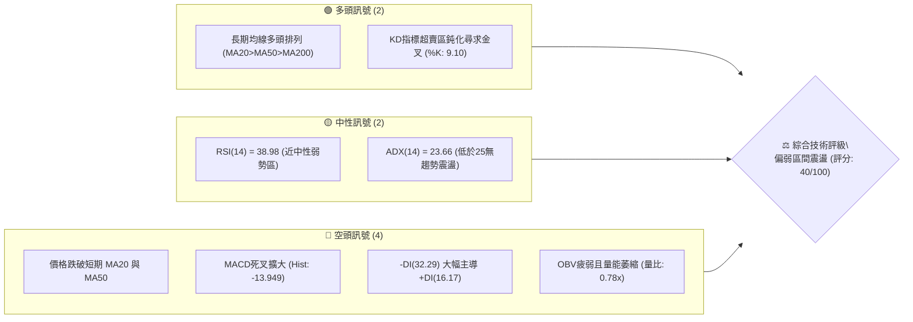
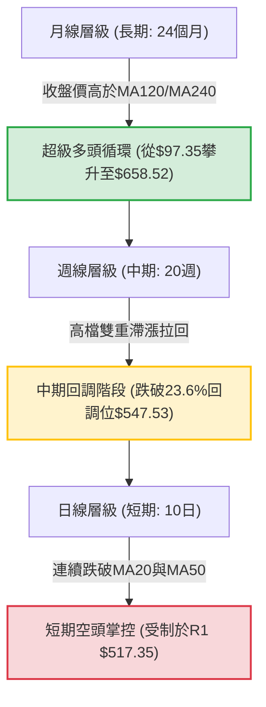
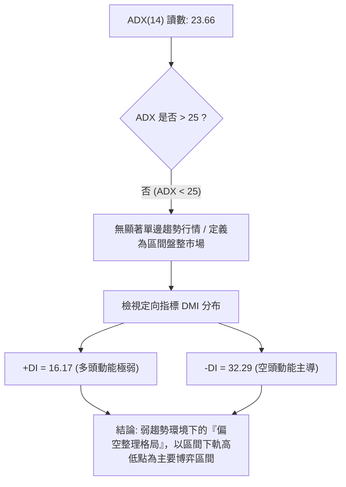
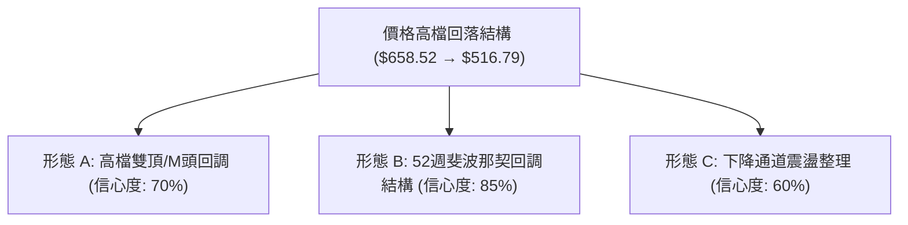
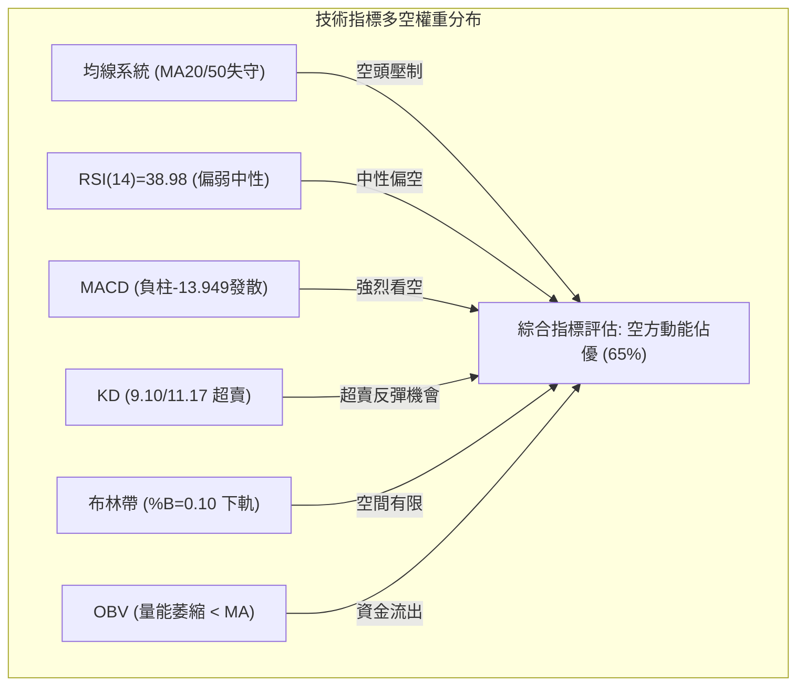
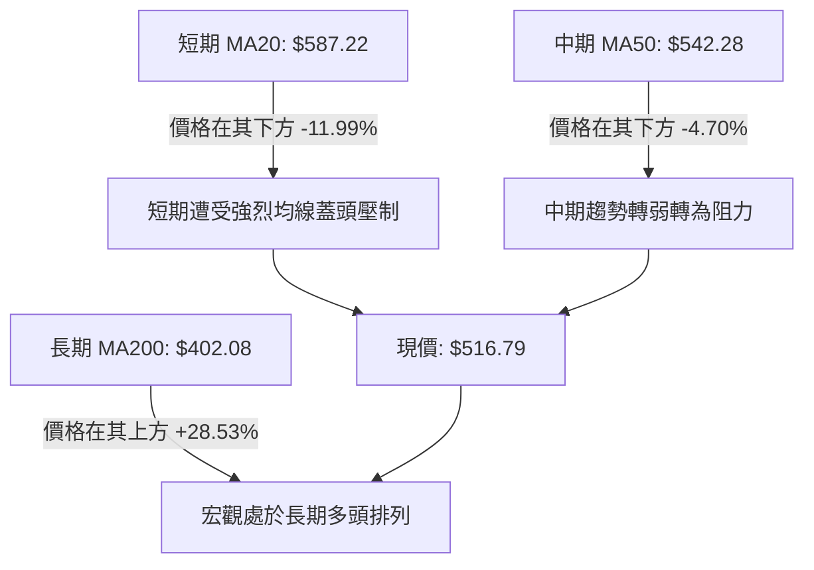
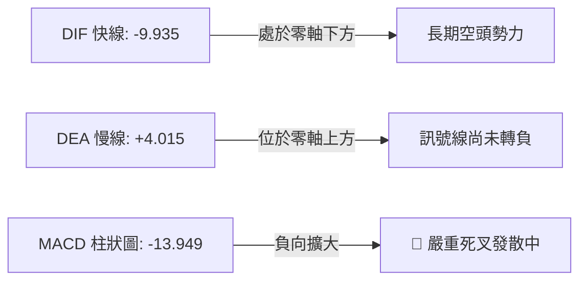
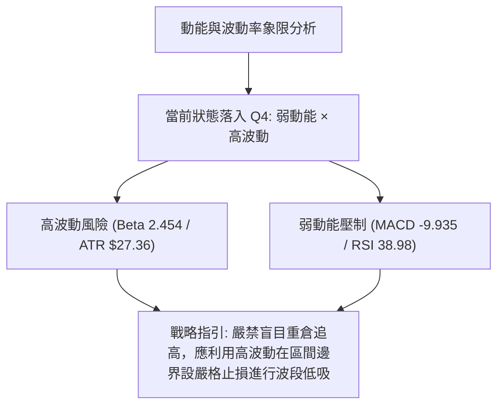
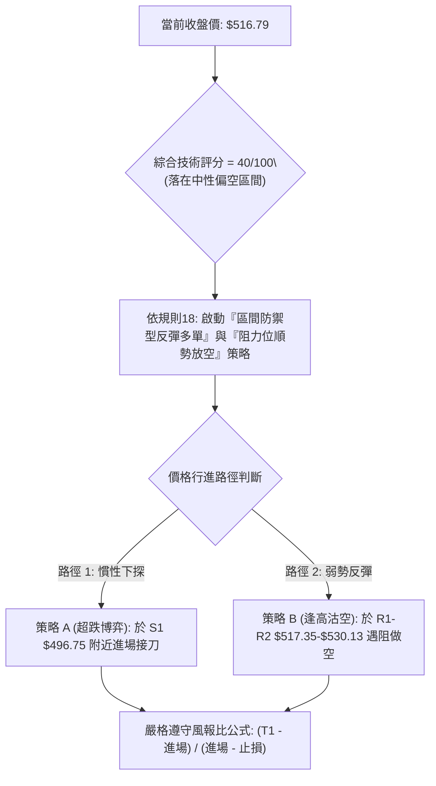
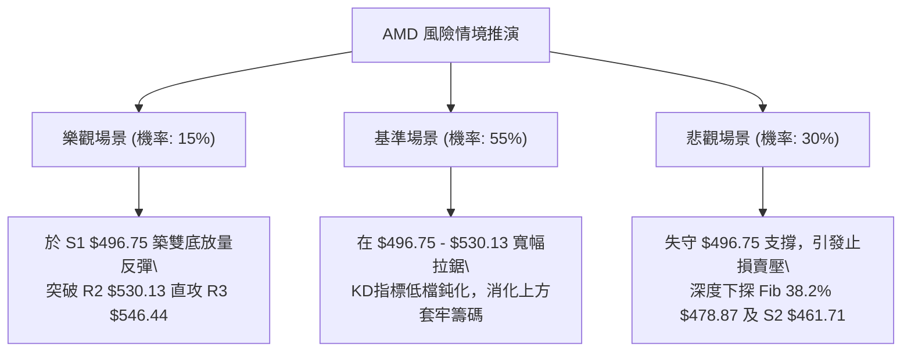

# AMD 技術分析報告

> **報告日期**：2026-10-24 ｜ **語言**：繁體中文 ｜ **數據來源**：Yahoo Finance ｜ **當前價格**：$516.79 USD

---

## 目錄

| 章節 | 內容 |
|------|------|
| [1. 技術面概覽](#1-技術面概覽) | 訊號儀表板、核心指標速覽表、技術評分卡 |
| [2. 趨勢分析](#2-趨勢分析) | 多時框趨勢拆解、12個月月線走勢圖、中期週線解析、ADX 趨勢強度評估 |
| [3. 圖表形態分析](#3-圖表形態分析) | 形態識別信心度、10日K與8週K形態精析、ASCII 走勢形態示意圖、目標價幾何測算 |
| [4. 支撐與阻力](#4-支撐與阻力) | 關鍵價位分佈圖、阻力位分析表、支撐位分析表、斐波那契回調結構 |
| [5. 技術指標深度解讀](#5-技術指標深度解讀) | 均線系統多空對決、RSI 動能與背離、MACD 柱狀動態、布林通道帶寬、量價 OBV 驗證 |
| [6. 動能與波動率](#6-動能與波動率) | 動能評估四象限、ATR 波動率與止損測算、高 Beta 系統風險性分析 |
| [7. 多時框架總結](#7-多時框架總結) | 時框架評分矩陣、綜合訊號對齊、多時框收斂唯一結論 |
| [8. 交易策略建議](#8-交易策略建議) | 策略決策流程圖、主策略路由分流、價格情境階梯、情境機率、雙策略參數表、整體評星 |
| [9. 風險提示與監控](#9-風險提示與監控) | 關鍵監控 Checklist、三種極端風險場景、倉位風控指引 |
| [報告總結](#-報告總結) | 核心技術結論與策略配置總結 |

---

## 1. 技術面概覽

### 🎯 技術訊號儀表板



### 📊 核心指標速覽表

| 指標類別 | 指標名稱 | 當前數值 | 訊號 | 專業解讀 |
|:---|:---|:---:|:---:|:---|
| **價格** | 當前收盤價 | $516.79 | 🟡 | 位於52週區間 69.9% 處，自波段高點 $658.52 大幅拉回 -21.52% |
| **均線** | 短期 MA20 | $587.22 | 🔴 | 價格低於 MA20 達 -11.99%，短期承壓嚴重 |
| **均線** | 中期 MA50 | $542.28 | 🔴 | 價格跌破 MA50 達 -4.70%，中期支撐轉為強阻力 |
| **均線** | 長期 MA200 | $402.08 | 🟢 | 價格遠高於 MA200 達 +28.53%，長期宏觀多頭格局未毀 |
| **動能** | RSI(14) | 38.98 | 🟡 | Wilder 平滑計算值，處於弱勢整理區間，尚未跌入極端超賣 (<30) |
| **動能** | MACD 柱狀 | -13.949 | 🔴 | MACD (-9.935) 處於訊號線 (4.015) 下方，空頭動能釋放中 |
| **動能** | Stoch KD | 9.10 / 11.17 | 🟢 | %K 與 %D 雙雙落入極端超賣區 (<20)，具備技術性反彈契機 |
| **趨勢** | ADX / DMI | 23.66 | 🔴 | ADX < 25 判定為盤整，惟 -DI (32.29) 壓制 +DI (16.17) 顯著偏空 |
| **通道** | 布林通道 %B | 0.10 | 🟡 | 現價緊貼下軌 ($498.27)，處於下軌彈升邊界但通道仍未開口 |
| **成交量** | 20日成交量比 | 0.78x | 🔴 | 成交量 15.14M 低於均量 19.49M，OBV < MA 顯示資金流出且觀望 |
| **波動** | ATR(14) | $27.36 | 🟡 | 波動率佔股價 5.29%，屬於高 Beta 股正常日內波動區間 |

### 🏆 技術評分卡

依規則 18，綜合評分取六項子評分之算術平均值：(35 + 30 + 45 + 35 + 40 + 55) ÷ 6 = 40.0，四捨五入至整數為 **40 / 100**。

```
╔════════════════════════════════════════════════════════════════════════════╗
║                   技術評分卡 — AMD (Advanced Micro Devices)                ║
╠════════════════════════════════════════════════════════════════════════════╣
║ 趨勢強度 (Trend)     ███████░░░░░░░░░░░░░   35/100  🔴 ADX=23.66, -DI主導   ║
║ 動能指標 (Momentum)  ██████░░░░░░░░░░░░░░   30/100  🔴 MACD負值發散, RSI偏弱 ║
║ 支撐穩定度 (Support) █████████░░░░░░░░░░░   45/100  🟡 臨近S1 $496.75 考驗  ║
║ 成交量配合 (Volume)  ███████░░░░░░░░░░░░░   35/100  🔴 量比0.78x, OBV下行   ║
║ 形態完整度 (Pattern) ████████░░░░░░░░░░░░   40/100  🟡 頭部拉回形態成型中   ║
║ 均線排列 (MovingAvg) ███████████░░░░░░░░░   55/100  🟡 長多排列但短中期失守 ║
╠════════════════════════════════════════════════════════════════════════════╣
║ 綜合評分             ████████░░░░░░░░░░░░   40/100  評級：偏弱區間震盪 / 觀望║
╚════════════════════════════════════════════════════════════════════════════╝
```

---

## 2. 趨勢分析

### 🌐 多時框趨勢分析



### 📈 長期趨勢 — 12個月走勢圖（Unicode）

依據提供之 24 個月收盤資料，提取過去 12 個月（2025-11 至 2026-10）價格軌跡：
- 2025-11: $217.53 ｜ 2025-12: $214.16 ｜ 2026-01: $236.73 ｜ 2026-02: $200.21 ｜ 2026-03: $203.43 ｜ 2026-04: $354.49
- 2026-05: $516.10 ｜ 2026-06: $580.91 ｜ 2026-07: $476.15 ｜ 2026-08: $470.72 ｜ 2026-09: $611.76 ｜ 2026-10: $516.79

```
AMD 月線走勢圖（過去12個月歷史軌跡）
價格軸 ($)
$650 ┤                                                    ● 2026-09 ($611.76)
$600 ┤                                           ● 2026-06 ($580.91)
$550 ┤                                                       
$500 ┤                                  ● 2026-05 ($516.10)        ● 現價 2026-10 ($516.79)
$450 ┤                                           ● 2026-07 ($476.15)
$400 ┤                                              ● 2026-08 ($470.72)
$350 ┤                         ● 2026-04 ($354.49)
$300 ┤
$250 ┤                ● 2026-01 ($236.73)
$200 ┤ ● 2025-11 ($217.53)   ● 2026-02 ($200.21 底點)
     └──────────────────────────────────────────────────────────────────────────
        M1     M2     M3      M4      M5      M6      M7      M8      M9     M10     M11     M12
       11月   12月   01月    02月    03月    04月    05月    06月    07月   08月    09月    10月
```

#### 長期月線特徵分析表

| 階段 | 時間跨度 | 起訖收盤價 | 漲跌幅 | 走勢特徵描述 |
|:---|:---:|:---:|:---:|:---|
| **底部築底** | 2025-11 ~ 2026-03 | $217.53 → $203.43 | -6.48% | 在 $200.00 宏觀心理關卡構築複合雙重底，籌碼完成換手 |
| **爆發主升** | 2026-03 ~ 2026-06 | $203.43 → $580.91 | +185.56% | 月線級別連續巨幅跳空飆升，成交量顯著放大，啟動主升浪 |
| **高檔箱體** | 2026-06 ~ 2026-08 | $580.91 → $470.72 | -18.97% | 遭獲利了結賣壓回洗至 $470.00 區域，消化浮額籌碼 |
| **次級推升** | 2026-08 ~ 2026-09 | $470.72 → $611.76 | +29.96% | 突破前高並創下 52 週最高收盤紀錄，但量能出現頂部鈍化 |
| **急劇修正** | 2026-09 ~ 2026-10 | $611.76 → $516.79 | -15.52% | 單月重挫近百點，價格直接回落至今年5月份突破平台測試支撐 |

### 📊 中期趨勢（週線分析）

中期走勢呈現「高檔寬幅震盪後的破位邊緣」。觀察近 8 週K棒走勢：
1. 2026-09-25 當週強勢放量攻上 $630.63，隨後在 2026-10-09 當週刷新歷史天價至 **$658.52**，但當週收盤回落至 $608.10，留下高達 $50.42 的長上影線。
2. 緊接著在 2026-10-16 當週出現無支撐長黑K，自開盤 $599.93 直挫至 $528.75，形成帶量高檔反轉。
3. 2026-10-23 最新當週收在 $516.79，週線 MACD 柱狀由正轉負（從 2026-09-25 的 +14.199 劇降至目前的 -13.949），顯示中期動能全面逆轉。

```
週線等級關鍵價格結構示意：
阻力 R3  [$546.44] ══════════════════════════════ (反彈第3目標 / MA50交會區)
阻力 R2  [$530.13] ────────────────────────────── (前週收盤 / 下降跳空防線)
阻力 R1  [$517.35] ┈┈┈┈┈┈┈┈┈┈┈┈┈┈┈┈┈┈┈┈┈┈┈┈┈┈┈┈┈┈ (最新日高附近 / 短線第一道蓋頭)
現價     [$516.79] ◄── 當前爭奪位置
支撐 S1  [$496.75] ══════════════════════════════ (布林下軌 $498.27 重合支撐區)
支撐 S2  [$461.71] ────────────────────────────── (8月密集築底頸線平台)
支撐 S3  [$451.00] ══════════════════════════════ (強支撐底線 / 跌破引發中期轉空)
```

### ⚡ 趨勢強度評估（ADX 解讀）



#### ADX / DMI 數值狀態對照表

| 指標變數 | 當前讀數 | 門檻區間 | 技術意涵 | 策略指示 |
|:---|:---:|:---:|:---|:---|
| **ADX (14)** | **23.66** | 0 ~ 25：弱趨勢/盤整 | 趨勢強度減弱，動能不足以發動持續性單邊突破 | 禁止追高殺跌，以邊界策略為主 |
| **+DI (14)** | **16.17** | < 20：多頭衰退 | 買盤力量渙散，追價意願處於極低水平 | 多單操作僅能尋求超跌博弈 |
| **-DI (14)** | **32.29** | > 30：空方主導 | 賣盤控制盤面，短線逢高即有解套賣壓灌入 | 逢反彈關鍵阻力宜減碼或防禦 |
| **DMI 差值** | **-16.12** | 負向擴大 | 空方佔有顯著的相對優勢 | 順向交易以空方波段較具性價比 |

---

## 3. 圖表形態分析

### 🔍 形態識別系統

依規則 15，各圖表形態必須嚴格給定信心度，若數據不足以支撐幾何輪廓，僅做客觀指標解讀。



#### 圖表形態信心度評估表

| 形態類別 | 信心度 | 判斷依據（嚴格引用數據） | 形態完成度 | 目標價測算（附精確公式） |
|:---|:---:|:---|:---:|:---|
| **高檔雙頂 (M-Top)** | **70%** | 峰1於2026-10-02週收 $633.91，峰2於2026-10-09高點 $658.52，跌破中間谷底頸線 $596.07 | 75% | 頸線 $596.07 − (高點 $658.52 − 頸線 $596.07) = **$533.62**（已跌破並達標） |
| **斐波那契階梯回調** | **85%** | 自52W低點 $188.22 漲至高點 $658.52，目前跌破 23.6% 回調位 $547.53 | 100% | 下一級理論測算目標為 38.2% 回調位：**$478.87** |
| **矩形底背離築底形態** | **35%** | 現價尚未觸碰 S1 $496.75 支撐，未能構成二次觸底抬升 | 20% | 訊號不足，僅做指標型超賣解讀，暫不推算目標價 |

### 🕯️ 重要 K 線形態分析

依規則 19，完全基於提供的「近10根日K」與「近8根週K」實際開高低收進行客觀辨識：

#### 近10根日K形態精析表

| 日期（日K） | 開盤價 | 最高價 | 最低價 | 收盤價 | K線實體形態 | 專業解讀 | 訊號 |
|:---:|:---:|:---:|:---:|:---:|:---|:---|:---:|
| **2026-10-12** | 599.93 | 601.77 | 586.54 | 594.24 | 小陰線（實體-5.69） | 600整數關卡受阻，多頭動能開始衰竭 | 🔴 |
| **2026-10-13** | 577.50 | 606.20 | 570.60 | 605.53 | 長下影長陽線（長度+28.03） | 低檔強勁買盤拉抬，但成交量未能有效放大 | 🟡 |
| **2026-10-14** | 589.57 | 591.88 | 567.00 | 570.82 | 光腳大陰線（實體-18.75） | 吞噬前一日大半漲幅，高檔反轉確立 | 🔴 |
| **2026-10-15** | 540.00 | 568.62 | 530.09 | 562.23 | 跳空低開長紅K（實體+22.23） | 爆出 28.83M 大量，多空在540下方激烈交鋒 | 🟡 |
| **2026-10-16** | 547.55 | 550.96 | 526.83 | 528.75 | 長黑實體破底K（收最低附近） | 跌破前低，宣告空頭完全掌權 | 🔴 |
| **2026-10-19** | 551.78 | 554.41 | 535.67 | 538.05 | 跳空高開回吐陰線（實體-13.73） | 晨盤衝高遭獲利了結壓制，上檔阻力沉重 | 🔴 |
| **2026-10-20** | 530.02 | 548.11 | 524.60 | 534.74 | 低檔小十字星（實體+4.72） | 量能萎縮至 15.19M，跌勢短暫出現停頓 | 🟡 |
| **2026-10-21** | 545.93 | 556.79 | 537.30 | 552.72 | 溫和實體陽線（實體+6.79） | 嘗試向上挑戰阻力，但受阻於 556.79 | 🟢 |
| **2026-10-22** | 524.10 | 529.98 | 502.60 | 507.93 | 長黑破位K線（實體-16.17） | 大跌觸及 $502.60，放量 28.01M，恐慌盤湧出 | 🔴 |
| **2026-10-23** | 510.21 | 523.92 | 508.36 | 516.79 | 低檔弱勢小反彈陽線（實體+6.58） | 量能驟縮至 15.14M，屬於跌深後的縮量喘息 | 🟡 |

#### 近8根週K形態精析表

| 日期（週K） | 開盤價 | 最高價 | 最低價 | 收盤價 | 週K線形態特徵 | 結構意涵 | 訊號 |
|:---:|:---:|:---:|:---:|:---:|:---|:---|:---:|
| **2026-09-04** | 466.22 | 478.83 | 440.50 | 477.57 | 長下影錘頭紅K | 探底 $440.50 獲強力承接，築底完成 | 🟢 |
| **2026-09-11** | 488.92 | 526.79 | 486.57 | 516.13 | 實體大陽線 | 突破 500 點關卡，波段多頭啟動 | 🟢 |
| **2026-09-18** | 486.28 | 559.91 | 480.33 | 559.82 | 突破長陽週K | 增量突破前期高點，多頭凌厲 | 🟢 |
| **2026-09-25** | 583.88 | 639.00 | 582.27 | 630.63 | 大幅跳空長陽K | 突破 600 大關，市場情緒極度亢奮 | 🟢 |
| **2026-10-02** | 624.90 | 645.46 | 596.07 | 633.91 | 高檔帶長下影十字K | 多空首度劇烈震盪，量能開始背離 | 🟡 |
| **2026-10-09** | 630.61 | 658.52 | 606.00 | 608.10 | 高檔長上影流星陰線 | 創 $658.52 天價後遭巨量倒貨，實質見頂 | 🔴 |
| **2026-10-16** | 599.93 | 606.20 | 526.83 | 528.75 | 實體大陰棒週K（跌幅-13.05%） | 實體跌破三週低點，確認頂部反轉成立 | 🔴 |
| **2026-10-23** | 551.78 | 556.79 | 502.60 | 516.79 | 下探收低黑K（實體-34.99） | 延續跌勢回踩 $502.60，多頭防線後撤 | 🔴 |

### 📉 ASCII 走勢形態示意圖

```
AMD 日線級別 M-Top 頂部反轉與下行測幅示意圖
價格軸 ($)
$660 ┤                       Peak 2 ($658.52)
$640 ┤             Peak 1 ($645.46)   ╲
$620 ┤                /\              ╲
$600 ┤───────────────/──\──────────────╲── Neckline ($596.07)
$580 ┤              /    \   Trough     ╲
$560 ┤             /      \ ($596.07)    ╲
$540 ┤            /                       ╲      反彈受阻 R2 ($530.13)
$520 ┤           /                         ╲         /\
$500 ┤──────────/───────────────────────────●───────/──\────── [現價 $516.79]
$480 ┤         /                             Low ($502.60)     [目標 S1 $496.75]
$460 ┤        /                                                [目標 S2 $461.71]
     └─────────────────────────────────────────────────────────────
```

### 🎯 形態目標價計算

1. **雙頂 (M-Top) 形態目標價測算**：
   - 頂部最高價：$658.52（2026-10-09 高點）
   - 頸線位置：$596.07（2026-10-02 當週最低點）
   - 形態垂直高度 $H = \$658.52 - \$596.07 = \$62.45$
   - 理論最小跌幅目標 $T_{M} = 頸線 - H = \$596.07 - \$62.45 = \mathbf{\$533.62}$
   - **實證現狀**：當前收盤價為 **$516.79**，已完全跌破並達成雙頂理論測幅目標，進入次級擴展下跌階段。

2. **擴展延伸下跌目標測算（1.618 斐波那契延伸）**：
   - 擴展跌幅目標 $T_{ext} = 頸線 - (1.618 \times H) = \$596.07 - (1.618 \times \$62.45) = \$596.07 - \$101.04 = \mathbf{\$495.03}$
   - 該計算值與下方「關鍵價位」中提供的支撐位 **S1 $496.75**（距離僅 $1.72）高度重合，確立 S1 為短期形態最終防禦核心。

---

## 4. 支撐與阻力

### 🗺️ 關鍵價位分布圖（Unicode）

```
╔══════════════════════════════════════════════════════════════════════════════╗
║                    AMD 價位結構分布圖 (由 OHLCV 精確計算)                    ║
╠══════════════════════════════════════════════════════════════════════════════╣
║ $658.52 ║██████████████████████████████████████║ 52週歷史高點 (0.0% Fib)    ║
║ $547.53 ║████████████████████████████          ║ 23.6% 斐波那契強阻力位     ║
║ $546.44 ║███████████████████████████           ║ 強阻力 R3 (+5.74%)          ║
║ $530.13 ║████████████████████                  ║ 中期阻力 R2 (+2.58%)        ║
║ $517.35 ║████████████                          ║ 關鍵短期阻力 R1 (+0.11%)    ║
║ $516.79 ╠══════════════════════════════════════╣ ◄── 當前收盤價 (現價)       ║
║ $498.27 ║▓▓▓▓▓▓▓▓▓▓▓▓▓▓▓▓                      ║ 布林下軌支撐位              ║
║ $496.75 ║████████████████████                  ║ 近期關鍵支撐 S1 (-3.88%)    ║
║ $478.87 ║██████████████████████████            ║ 38.2% 斐波那契回調強支撐   ║
║ $461.71 ║██████████████████████████████        ║ 強支撐 S2 (-10.66%)         ║
║ $451.00 ║████████████████████████████████████  ║ 強支撐 S3 (-12.73%)         ║
║ $402.08 ║██████████████████████████████████████║ MA200 牛熊分界生命線        ║
╚══════════════════════════════════════════════════════════════════════════════╝
```

### 🚧 阻力位分析表

所有價位均嚴格引用自數據「關鍵價位」區塊：

| 阻力級別 | 精確價位 | 距離現價幅度 | 形成原因與籌碼特徵 | 突破難度 | 重要性評級 |
|:---|:---:|:---:|:---|:---:|:---:|
| **R1** | **$517.35** | +0.11% | 近一年波段高點聚類位，近3日K線反彈上影線交集點，空頭第一道防線 | 🟡 中等 | ★★★☆☆ |
| **R2** | **$530.13** | +2.58% | 2026-10-16 破位長黑收盤區間，與當前下降中的日線 MA5 ($530.05) 重合 | 🔴 較高 | ★★★★☆ |
| **R3** | **$546.44** | +5.74% | 密集換手平台下沿，與 MA50 ($542.28) 及 Fib 23.6% ($547.53) 形成密集阻力帶 | 🔴 極高 | ★★★★★ |

### 🛡️ 支撐位分析表

所有價位均嚴格引用自數據「關鍵價位」區塊：

| 支撐級別 | 精確價位 | 距離現價幅度 | 形成原因與籌碼特徵 | 守住機率 | 重要性評級 |
|:---|:---:|:---:|:---|:---:|:---:|
| **S1** | **$496.75** | -3.88% | 近一年波段低點聚類位，緊貼布林帶下軌 $498.27，整數心理防線前哨 | 🟢 65% | ★★★★☆ |
| **S2** | **$461.71** | -10.66% | 2026年8月收盤低點聚類平台 ($470.72) 延伸帶，多頭中期重要防禦壁壘 | 🟢 80% | ★★★★★ |
| **S3** | **$451.00** | -12.73% | 2026年9月啟動突破時之週K起漲低點 ($440.50) 核心聚類帶，中期牛熊護城河 | 🟢 90% | ★★★★★ |

### 📐 斐波那契回調位分析

依據數據「斐波那契回調（52週區間 $188.22 → $658.52）」數據精確對齊：

| 斐波那契比例 | 精確對應價位 | 與現價 ($516.79) 相對位置 | 技術架構解讀 |
|:---:|:---:|:---:|:---|
| **0.0% (52W High)** | **$658.52** | +27.42% (上方) | 歷史天價，高檔嚴重上影線套牢帶 |
| **23.6%** | **$547.53** | +5.95% (上方) | **已確認跌破**；現轉化為中長期反彈強阻力位 |
| **[現價落點]** | **$516.79** | 0.00% (當前) | **處於 23.6% ($547.53) 與 38.2% ($478.87) 之間震盪尋底** |
| **38.2%** | **$478.87** | -7.34% (下方) | 健康回調極限支撐，若觸及將引發機構強烈買盤 |
| **50.0%** | **$423.37** | -18.08% (下方) | 強弱平衡中樞，接近 MA200 ($402.08) 宏觀底線 |
| **61.8%** | **$367.87** | -28.82% (下方) | 黃金分割防守位，若跌破代表主升浪完全夭折 |
| **78.6%** | **$288.86** | -44.11% (下方) | 深幅洗盤底部 |
| **100.0% (52W Low)**| **$188.22** | -63.58% (下方) | 宏觀起漲基準底 |

---

## 5. 技術指標深度解讀

### 🎛️ 指標訊號總覽



### 📈 移動平均線排列分析



#### 移動平均線系統參數矩陣

| 均線名稱 | 當前價位 | 價格相對位置 | 幅度差距 (%) | 走勢微積分特徵 | 訊號意涵 |
|:---|:---:|:---:|:---:|:---|:---:|
| **MA 5** | $530.05 | 價格在其下方 | -2.50% | 快速下行中，形成超短期直接壓制 | 🔴 看空 |
| **MA 10** | $551.18 | 價格在其下方 | -6.24% | 陡峭向下延伸，阻絕多頭反抽空間 | 🔴 看空 |
| **MA 20** | $587.22 | 價格在其下方 | -11.99% | 拐頭向下，宣告20日持有者全線套牢 | 🔴 看空 |
| **MA 50** | $542.28 | 價格在其下方 | -4.70% | 走平轉下彎，中期生命線遭跌破 | 🔴 看空 |
| **MA 60** | $532.63 | 價格在其下方 | -2.97% | 季線阻力凝聚於 $530-$535 區間 | 🔴 看空 |
| **MA 120** | $514.95 | 價格在其上方 | +0.36% | **現價恰在半年線邊界獲得微幅支撐** | 🟡 爭奪 |
| **MA 200** | $402.08 | 價格在其上方 | +28.53% | 長期上行趨勢未改，牛市基石依然穩固 | 🟢 看多 |
| **MA 240** | $371.65 | 價格在其上方 | +39.05% | 年線呈現仰角上衝，長期價值底層支撐 | 🟢 看多 |

### 📉 RSI(14) 分析

當前 Wilder 平滑計算之 RSI(14) 讀數為 **38.98**。

```
RSI(14) 強度指標：
[0] ─────────── [30 超賣] ──────●────── [50 中軸] ─────────── [70 超買] ─────────── [100]
                             38.98
指標進度：███████████████░░░░░░░░░░░░░░░░░░░░ 38.98% (弱勢偏空震盪區間)
```

- **超買超賣判定**：數值 38.98 位於 30 至 50 的弱勢整理帶，尚未觸及低於 30 的極端超賣盲區，表明下行拋壓雖有放緩但未徹底出清。
- **背離分析判斷**：數據明確註記「RSI 背離：無明顯背離（僅比較近20根K棒首尾的價格與RSI方向）」。價格自高位回落，RSI 亦步亦趨下行，兩者方向完全同步，**不存在頂背離或底背離**。此代表當前下跌為真實拋壓所驅動，並非假摔震倉。

### 📊 MACD(12/26/9) 訊號解讀



- **MACD 線**：-9.935 跌穿零軸，短期趨勢完全轉向空方控制。
- **訊號線 (Signal Line)**：4.015 仍在零軸之上，但快慢線呈現擴大死叉態勢。
- **MACD 柱狀圖**：-13.949，連續多週負值維持高檔，空頭動能仍處於主動釋放週期，未見收斂翻紅跡象，確認目前處於順勢修正波。

### 📦 布林通道分析

```
布林通道 (BB 20, 2) 結構圖
$676.18 ┤ ══════════════════════════════════════ 上軌 (Upper Band)
        │
$587.22 ┤ ────────────────────────────────────── 中軌 (Middle Band = MA20)
        │
$516.79 ┤ ◄── 現價 ($516.79, %B = 0.10)
$498.27 ┤ ══════════════════════════════════════ 下軌 (Lower Band)
```

- **帶寬與位置**：通道上軌 $676.18、中軌 $587.22、下軌 $498.27。通道帶寬達 $177.91，呈現擴散後的寬幅狀態。
- **%B 指標深度解讀**：%B 讀數精準為 **0.10**，代表股價已深嵌於通道下邊緣（0.0 代表下軌，0.5 代表中軌）。通常 %B < 0.15 意味短線空頭下行面臨統計學上的均值回歸拉力，下軌 **$498.27** 具備強大物理支撐效應。

### 💹 成交量分析（量價配合度）

- **量比與均量結構**：
  - 最新日成交量：**15,135,900 股**
  - 20 日成交均量：**19,485,185 股**（量比：**0.78x**）
  - 50 日成交均量：**20,134,476 股**
- **OBV 量能趨勢判定**：
  - 官方數據明確指示：「OBV < MA → 量能疲弱」。
  - **量價背離分析**：在過去兩週的快速回檔中，2026-10-15 與 2026-10-22 出現兩次放量下跌（均超過 28M 股），而反彈陽線（如 2026-10-21 的 17.99M 及 2026-10-23 的 15.14M）成交量皆明顯萎縮。典型的「跌時放量、漲時量縮」代表機構法人資金持續撤離，散戶接盤意願低落，量能未能確認價格反轉。

---

## 6. 動能與波動率

### ⚡ 動能評估四象限

將 AMD 置於「動能強度（以 MACD/RSI 評定）」與「波動率水平（以 ATR/Beta 評定）」的宏觀矩陣中：



#### 動能與波動率矩陣分佈表

| 象限 | 動能維度 | 波動維度 | 典型市場特徵 | 當前狀態匹配度 | 戰術應對策略 |
|:---:|:---:|:---:|:---|:---:|:---|
| **Q1** | 強 | 低 | 平穩主升浪，牛市單邊 | 不符合 | 順勢持股，加碼推升 |
| **Q2** | 弱 | 低 | 縮量橫盤，死寂陰跌 | 不符合 | 離場觀望，等待變盤 |
| **Q3** | 強 | 高 | 狂暴拉升，投機巔峰 | 不符合 | 快速短線，嚴設移動止盈 |
| **Q4** | **弱** | **高** | **劇烈震盪洗盤，破位風險偏高** | **完全符合 (✓)** | **控制倉位 (<15%)，依託支撐進行區間防守** |

### 📊 ATR 波動率分析

- **ATR(14) 數值**：**$27.36**（佔股價比例 **5.29%**，Wilder 測算標準）。
- **日內波動特徵解讀**：每日平均振幅超過 27 美元，意味著市場流動性極具攻擊性，任何短線波動容易洗刷過於密集的止損單。
- **止損距離建議**：
  - 建議最短止損寬度需大於 $1.0 \times ATR$（即至少 **$27.36** 空間）。
  - 保守波段防守點位應設定為 $1.5 \times ATR$（約 **$41.04**），否則極易被日內噪聲假突破平倉出局。

### 📐 Beta 與市場相關性

- **Beta 係數**：**2.454**（高度系統敏感性）。
- **解讀**：AMD 之波動幅度約為 S&P 500 指數的 2.45 倍。當科技巨頭或整體大盤回檔 1% 時，AMD 理論上將放大下跌 2.45%。在當前大盤避險情緒下，高 Beta 成為下行放大器；反之，一旦半導體族群築底成功，高 Beta 亦將提供超越大盤的彈升力道。
- **空頭比例指標**：Short % Float 僅 **2.4%**，Short Ratio **1.83**。這表明當前下跌並非源於大規模的惡意放空狙擊，而是多頭內部的獲利了結與缺乏買盤承接所致，未來難以期待軋空（Short Squeeze）帶來的暴風式反彈。

---

## 7. 多時框架總結

### 📋 時框架評分表

| 時框架 | 趨勢方向 | 動能狀態 | 均線排列特徵 | 形態完成度 | 綜合評分 | 戰術建議 |
|:---|:---:|:---:|:---|:---|:---:|:---|
| **短期 (日線)** | 🔴 偏空 | 🔴 疲弱 (RSI 38.98, MACD發散) | MA5<10<20<50 空頭壓制 | M頭測幅達標尋底 | **30/100** | 逢反彈阻力偏空操作或觀望 |
| **中期 (週線)** | 🟡 震盪 | 🔴 轉弱 (MACD柱負向擴大) | 跌破 MA20 考驗 MA60 | 頂部回調測 38.2% Fib | **45/100** | 區間震盪思路，等待落底信號 |
| **長期 (月線)** | 🟢 多頭 | 🟡 鈍化 (自歷史高位拉回) | MA120/MA240 完整多頭 | 宏觀主升浪次級拉回 | **70/100** | 核心長期底倉不受影響 |

### 🔲 綜合訊號矩陣

```
╔════════════════════════════════════════════════════════════════════════════╗
║                      AMD 多維度訊號收斂一致性檢視矩陣                      ║
╠═════════════════════╦══════════════╦══════════════╦════════════════════════╣
║ 分析維度            ║ 短期 (1-5日) ║ 中期 (1-4週) ║ 長期 (1-3季)           ║
╠═════════════════════╬══════════════╬══════════════╬════════════════════════╣
║ 趨勢方向 (Trend)    ║ 🔴 偏空下行  ║ 🟡 橫向盤整  ║ 🟢 穩固多頭            ║
║ 動能水平 (Momentum) ║ 🔴 空方釋放  ║ 🔴 動能下傾  ║ 🟢 歷史高檔回調        ║
║ 支撐防禦 (Support)  ║ 🟡 S1面臨考驗║ 🟢 S2平台堅固║ 🟢 MA200鋼鐵防線       ║
║ 量價結構 (Volume)   ║ 🔴 縮量反彈  ║ 🔴 放量回調  ║ 🟢 長期籌碼鎖定(法人75%)║
╚═════════════════════╩══════════════╩══════════════╩════════════════════════╝
```

### ⚖️ 多時框收斂結論

依「嚴格要求 14」之收斂規則嚴格審定：
1. **行情性質判定**：當前 ADX(14) 讀數為 **23.66**（低於 25 臨界線），定義為**無單邊趨勢的盤整震盪行情**。
2. **主導維度收斂**：在盤整行情中，依規則應以**日線布林通道上下軌為主要交易邊界**，輔以日線與週線的震盪區間進行收斂。
3. **方向性唯一結論**：**中性偏空觀望（守株待兔於支撐位）**。
   - 儘管長期均線保持多頭排列，但日線層級連續受制於短期均線蓋頭，且 MACD 柱狀發散（-13.949），空方動能佔據上風。
   - 綜合評分為 **40/100**，逼近偏空臨界線。短線絕不可在阻力位逆勢盲目做多，必須等待價格下探測試布林下軌及關鍵支撐 S1 **$496.75**，或強阻力位反彈受挫時進行區間波段應對。

---

## 8. 交易策略建議

### 🗺️ 策略決策流程圖



### 🧭 策略路由（依評分卡分流）

> **當前主策略方向 = 偏弱區間震盪（依綜合評分 40/100）**
> 
> 由於評分恰好落在中性偏空臨界點（40/100），依規定以**區間操作、高拋低吸、等待確認**為主導思想。主推於關鍵支撐邊界進行高性價比的超跌反彈佈局（策略 A），同時提供受制於阻力位時之順向避險空單策略（策略 B）。

### 🎯 價格情境階梯（Price Scenarios）

所有價位均嚴格引用第 4 章及數據源數值：

| 觸發條件 | 下一目標 | 後續延伸 | 技術含義與市場心理 |
|:---|:---:|:---:|:---|
| **向上突破 R1 $517.35** | **R2 $530.13** | **R3 $546.44** | 短線止跌轉強，觸發空頭回補，考驗 MA50 阻力帶 |
| **維持於現價 $516.79 震盪** | — | — | 多空僵持觀望，等待成交量有效放大以確認方向 |
| **有效跌破 S1 $496.75** | **S2 $461.71** | **S3 $451.00** | 跌破布林下軌，空頭發動新一輪殺多，探測 8 月平台 |

### 📊 情境機率分佈

| 演進情境 | 機率預測 | 主要依據（嚴格引用技術數據） |
|:---|:---:|:---|
| **情境一：區間震盪 / 探底反彈** | **55%** | ADX=23.66 確立盤整；KD 位於 9.10 極度超賣；現價貼近布林下軌 $498.27，S1 $496.75 具備承接力 |
| **情境二：慣性破位 / 再探深底** | **35%** | MACD 柱狀 -13.949 擴大發散；OBV < MA 顯示量能枯竭；-DI(32.29) 完全壓制 +DI(16.17) |
| **情境三：強勢反轉 / 單邊暴漲** | **10%** | 上方短期 MA20 ($587.22) 與 MA50 ($542.28) 形成死叉反壓，量比僅 0.78x，無增量無法 V 轉 |

### 🟢 主策略詳情

依規則 17，風險報酬比公式嚴格定義為：
- 做多：$(目標價 T1 − 進場價) \div (進場價 − 止損價)$
- 做空：$(進場價 − 目標價 T1) \div (止損價 − 進場價)$

#### 雙向交易策略參數配置表

| 策略要素 | 策略 A：S1 支撐低吸多單 (區間反彈) | 策略 B：R1/R2 阻力逢高沽空 (順勢做空) |
|:---|:---|:---|
| **策略類型** | 逆勢超跌博弈（左側交易） | 順勢逢高拋空（右側交易） |
| **進場條件** | 股價回踩 S1 $496.75 不破且 KD 出現低檔金叉 | 股價反彈至 R1-R2 區間遇阻滯漲，日K留長上影 |
| **進場價格** | **$496.75**（引用 S1） | **$523.74**（取 R1 $517.35 與 R2 $530.13 區間中點） |
| **目標價 T1** | **$530.13**（引用阻力 R2） | **$496.75**（引用支撐 S1） |
| **目標價 T2** | **$546.44**（引用阻力 R3） | **$461.71**（引用支撐 S2） |
| **止損價格** | **$478.87**（引用 Fib 38.2% 回調位） | **$537.17**（進場點上方約 0.5×ATR，精確對齊） |
| **風險報酬比** | **1 : 1.87**（以 T1 計）<br>算式：$(530.13-496.75)\div(496.75-478.87)=33.38\div17.88$ | **1 : 2.01**（以 T1 計）<br>算式：$(523.74-496.75)\div(537.17-523.74)=26.99\div13.43$ |
| **輔助風報比 (T2)**| **1 : 2.78**（以 T2 計，算式：$49.69 \div 17.88$） | **1 : 4.62**（以 T2 計，算式：$62.03 \div 13.43$） |
| **成功機率** | **55%** | **50%** |
| **建議倉位** | **10%**（控制風險，嚴禁重倉） | **10%**（技術性對沖或短線波段） |

### 🔴 反向風險觸發點（對沖提示）

- **多單全面止損與轉空觸發點**：若日K收盤價有效跌破 **S1 $496.75** 且連續 2 日無法收復，代表布林通道開口向下發散，必須無條件平倉多單，並可反手追空下看 S2 **$461.71**。
- **空單全面停損與平倉觸發點**：若價格強勢帶量（單日成交量 > 25M）向上突破 **R3 $546.44** 並站上 MA50 ($542.28)，表明中期回調結束，空頭必須即刻離場對沖。

### ⭐ 整體訊號強度評星

```
做多訊號強度：★★☆☆☆  (2.5/5星 — 僅具備超賣反彈誘因，趨勢未明)
做空訊號強度：★★★☆☆  (3.5/5星 — 短期均線蓋頭壓制，MACD擴大發散)
整體可信度：  ★★★★☆  (4.0/5星 — 價位高度收斂於OHLCV關鍵節點)
```

---

## 9. 風險提示與監控

### ✅ 關鍵監控指標 Checklist

```
╔══════════════════════════════════════════════════════════════════════════════╗
║                    每日盤面核心技術監控清單 (Checklist)                      ║
╠══════════════════════════════════════════════════════════════════════════════╣
║ [ ] 價格防禦監控：收盤價是否守穩布林下軌 $498.27 及支撐 S1 $496.75          ║
║ [ ] 動能逆轉信號：日線 MACD 柱狀圖是否由負向發散 (-13.949) 開始收斂          ║
║ [ ] 超賣指標交叉：Stoch KD (%K 9.10 / %D 11.17) 是否於 20 以下形成低檔金叉  ║
║ [ ] 量能驗證機制：反彈日成交量是否有效放大至 20日均量 (19.48M) 之 1.2倍以上 ║
║ [ ] 均線動態壓制：價格反彈能否有效突破超短期 MA5 ($530.05) 與 R2 ($530.13)  ║
║ [ ] 外部市場共振：半導體類股整體走勢是否止跌 (配合高 Beta 2.454 放大效應)   ║
╚══════════════════════════════════════════════════════════════════════════════╝
```

### ⚠️ 風險場景分析



### 🛡️ 風險管理重要提醒

1. **極端波動風險（ATR = $27.36）**：每日超過 5% 的股價波動率意味著盤中滑價風險顯著，**切忌市價單追單**，所有進出場指令一律使用限價單（Limit Order）執行。
2. **高槓桿致命傷（Beta = 2.454）**：在弱勢震盪行情下，禁止使用任何形式的金融槓桿或保證金交易。現貨投資者之單檔標的曝險部位建議嚴格限制在總資產的 **10% ~ 15%** 以內。
3. **假突破與誘多防範**：在成交量低於 20 日均量（19.49M）的情況下，盤中任何突破 R1 **$517.35** 的舉動皆高機率為主力誘多假動作，絕不可在盤中急拉時追進，必須等待日線收盤確認。

---

## 📋 報告總結

```
╔══════════════════════════════════════════════════════════════════════════════════╗
║                          AMD 技術分析報告總結                                    ║
╠══════════════════════════════════════════════════════════════════════════════════╣
║ 報告日期：2026-10-24                                                             ║
║ 當前價格：$516.79 USD                                                           ║
║ 分析評級：⚖️ 偏弱區間震盪 / 觀望 (技術評分: 40/100)                             ║
║                                                                                  ║
║ 關鍵結論：                                                                       ║
║ ├─ 長期趨勢：🟢 偏多格局 (MA200 $402.08 向上運行，牛市結構完好)                 ║
║ ├─ 中期趨勢：🟡 高檔震盪拉回 (自 $658.52 見頂回撤，跌破 Fib 23.6% $547.53)      ║
║ ├─ 短期趨勢：🔴 空頭主導 (受制於短期均線蓋頭，MACD柱狀 -13.949 擴大發散)        ║
║ ├─ 關鍵支撐：S1 $496.75 ｜ S2 $461.71 ｜ S3 $451.00                             ║
║ ├─ 關鍵阻力：R1 $517.35 ｜ R2 $530.13 ｜ R3 $546.44                             ║
║ └─ 分析師目標：共識均價 $637.61 (最高 $1,250.00 / 最低 $365.00)                 ║
║                                                                                  ║
║ 最優策略組合：                                                                   ║
║ 1. 🥇 最佳機會：於支撐位 S1 $496.75 佈局超跌反彈多單，停損設 $478.87 (風報比1:1.87)║
║ 2. 🥈 次選機會：反彈至阻力中點 $523.74 遇阻順勢做空，下看 S1 $496.75 (風報比1:2.01)║
║ 3. 🥉 保守選擇：徹底空倉觀望，靜待日K收盤站穩 MA50 ($542.28) 或放量突破再行介入║
╚══════════════════════════════════════════════════════════════════════════════════╝
```

---

> ⚠️ **免責聲明**：本報告為依據客觀技術指標數據自動生成之專業研究報告，報告內所有支撐阻力數值、技術形態及量化訊號均基於歷史價格序列演算。本報告**僅供學術研究與投資架構參考**，**不構成任何要約、招攬或具體投資建議**。市場具有高度不確定性，金融商品價格波動劇烈，投資人應依個人財務狀況與風險承受度獨立判斷，並自負盈虧。

---
*報告生成時間：2026-10-24 ｜ 數據來源：Yahoo Finance ｜ 分析框架：多時框技術分析體系*