# AMD 技術分析報告

> **報告日期**：2026-10-25 ｜ **語言**：繁體中文 ｜ **數據來源**：Yahoo Finance ｜ **當前價格**：$516.79 USD

---

## 目錄

| 章節 | 內容 |
|------|------|
| [1. 技術面概覽](#1-技術面概覽) | 訊號儀表板、核心指標、評分卡 |
| [2. 趨勢分析](#2-趨勢分析) | 多時框趨勢、長中短期走勢、ADX 解讀 |
| [3. 圖表形態分析](#3-圖表形態分析) | 形態識別、K線組合、目標價推算 |
| [4. 支撐與阻力](#4-支撐與阻力) | 關鍵價位分布圖、阻力支撐表、斐波那契回調 |
| [5. 技術指標深度解讀](#5-技術指標深度解讀) | MA/RSI/MACD/布林通道/成交量與 OBV |
| [6. 動能與波動率](#6-動能與波動率) | 動能評估四象限、ATR 波動率、Beta 市場係數 |
| [7. 多時框架總結](#7-多時框架總結) | 時框架評分矩陣、多時框收斂結論 |
| [8. 交易策略建議](#8-交易策略建議) | 策略路由、價格情境階梯、主策略詳情、評星 |
| [9. 風險提示與監控](#9-風險提示與監控) | 關鍵監控清單、風險場景模擬、風控指南 |
| [📋 報告總結](#-報告總結) | 核心結論與最優策略組合 |

---

## 1. 技術面概覽

### 🎯 技術訊號儀表板

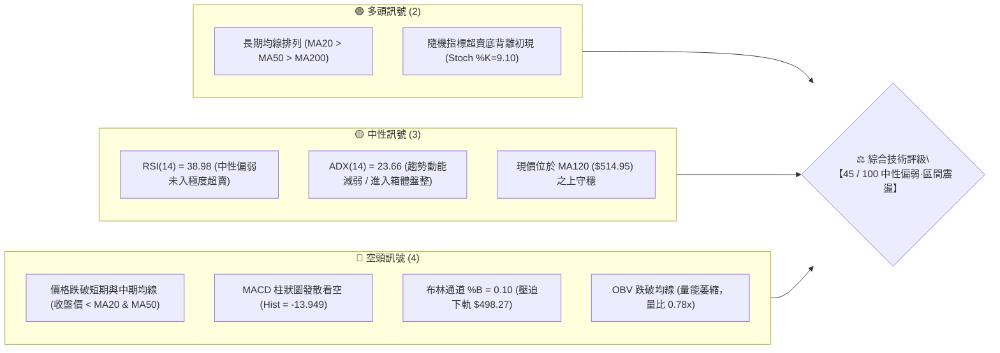

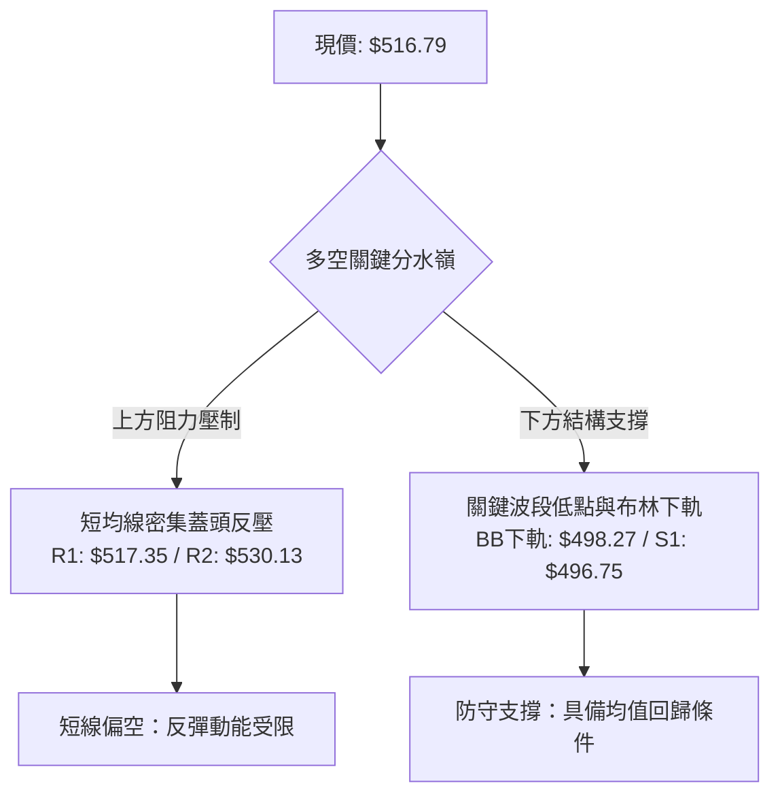

### 📊 核心指標速覽表

| 指標類別 | 指標名稱 | 當前數值 | 訊號 | 解讀 |
|:---|:---|:---|:---:|:---|
| **價格** | 當前收盤價 | $516.79 | 🟡 | 位於52週區間 69.9%，短線自歷史高點回撤 21.5% |
| **均線** | MA20 | $587.22 | 🔴 | 價格在 MA20 下方 -11.99%，短期趨勢受制於下彎反壓 |
| **均線** | MA50 | $542.28 | 🔴 | 價格在 MA50 下方 -4.70%，中期上升動能暫告衰竭 |
| **均線** | MA120 | $514.95 | 🟢 | 價格在 MA120 上方 +0.36%，半年生命線提供即時支撐 |
| **均線** | MA200 | $402.08 | 🟢 | 價格在 MA200 上方 +28.53%，長期多頭架構未被破壞 |
| **動能** | RSI(14) | 38.98 | 🟡 | 進入 30–40 弱勢區間，未落入極度超賣，無顯著底背離 |
| **動能** | MACD (12,26,9) | -9.935 / 4.015 | 🔴 | DIF 位於信號線下方，柱狀圖 -13.949，空方動能發散 |
| **擺盪** | KD (Stoch %K/%D) | 9.10 / 11.17 | 🟢 | 進入極度超賣區（<20），隨時有技術性均值回歸需求 |
| **趨勢** | ADX(14) / 方向 | 23.66 / -DI:32.29 | 🔴 | ADX<25 顯示趨勢鈍化為盤整，-DI 顯著高於 +DI(16.17) |
| **通道** | 布林帶 (%B) | 0.10 (%B) | 🟡 | 逼近下軌 $498.27，通道開口擴大，短線超賣尋求支撐 |
| **量能** | 當日量 / 20日均量 | 15.13M / 19.48M | 🔴 | 量比 0.78x，縮量下跌反映買盤逢低承接意願偏向審慎 |
| **量能** | OBV 趨勢 | OBV < MA | 🔴 | 資金淨流出，成交量指標未能確認價格反轉 |
| **波動** | ATR(14) | $27.36 (5.29%) | 🟡 | 日內平均波動度維持高檔，需配置較大止損緩衝空間 |

### 🏆 技術評分卡

```
╔════════════════════════════════════════════════════════════════╗
║                技術評分卡 — AMD (2026-10-25)                   ║
╠════════════════════════════════════════════════════════════════╣
║  趨勢強度      ████████░░░░░░░░░░░░  40/100  🟡 中性偏弱       ║
║  動能指標      ███████░░░░░░░░░░░░░  35/100  🔴 空頭主導       ║
║  支撐穩定度    ███████████░░░░░░░░░  55/100  🟡 考驗S1支撐     ║
║  成交量配合    ████████░░░░░░░░░░░░  42/100  🟡 量能疲弱       ║
║  形態完整度    █████████░░░░░░░░░░░  45/100  🟡 構築箱體中     ║
║  均線排列      ██████████░░░░░░░░░░  52/100  🟡 長多短空交叉   ║
╠════════════════════════════════════════════════════════════════╣
║  綜合評分      █████████░░░░░░░░░░░  45/100  中性區間 (規則18) ║
╚════════════════════════════════════════════════════════════════╝
```
*計算依據：(40 + 35 + 55 + 42 + 45 + 52) ÷ 6 = 44.83，四捨五入為 45/100。*

---

## 2. 趨勢分析

### 🌐 多時框趨勢分析

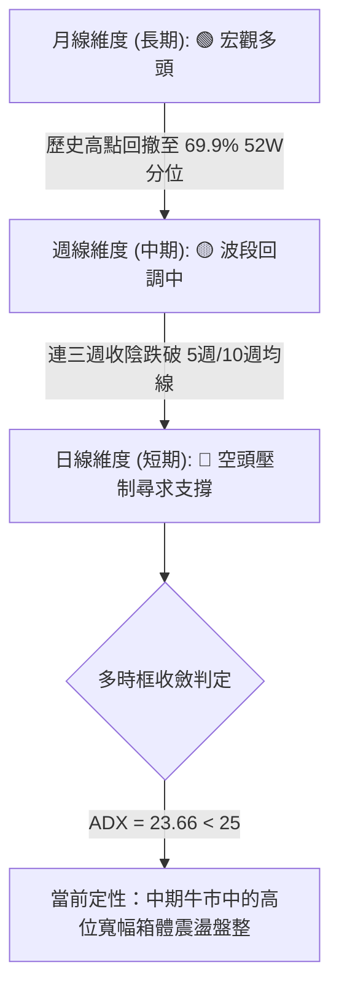

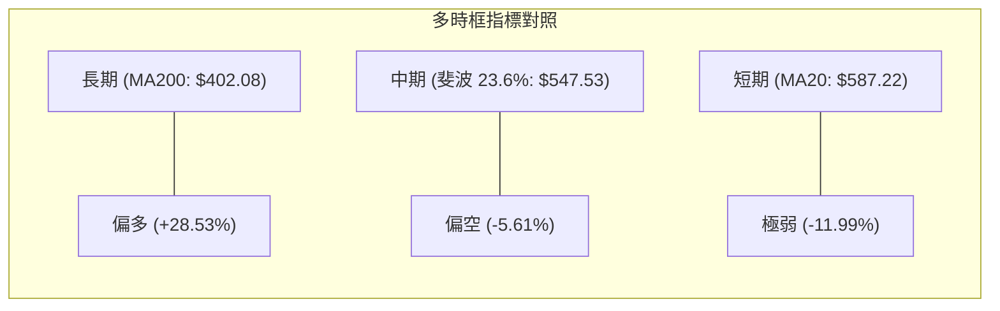

### 📈 長期趨勢 — 12個月走勢圖（Unicode）

```
AMD 月線收盤走勢圖（2025-11 至 2026-10）
價格軸 ($)
$650 ┤                                              
$600 ┤                                        ● $611.76
$550 ┤                                  ● $580.91    
$500 ┤                            ● $516.10       ● $516.79 (現價)
$450 ┤                                      ● $476.15  ● $470.72
$400 ┤                                              
$350 ┤                      ● $354.49               
$300 ┤                                              
$250 ┤                                              
$200 ┤● $217.53 ● $214.16 ● $236.73 ● $200.21 ● $203.43
     └───────────────────────────────────────────────────────
       11    12    01    02    03    04    05    06    07    08    09    10  (月份)
      (2025)             (2026)
```

#### 走勢特徵分析表格

| 階段 | 時間區間 | 起訖價格 ($) | 區間漲跌幅 | 走勢特徵與技術驅動因素 |
|:---|:---|:---:|:---:|:---|
| **底盤整期** | 2025-11 ~ 2026-03 | $217.53 → $203.43 | -6.48% | 長達 5 個月在 $200–$236 築底構築堅實籌碼底座 |
| **爆發主升浪** | 2026-03 ~ 2026-06 | $203.43 → $580.91 | +185.56% | AI 伺服器與加速器放量拉動，成交量激增，突破均線多頭狂飆 |
| **高位分歧期** | 2026-06 ~ 2026-08 | $580.91 → $470.72 | -18.97% | 漲多獲利回吐，於 $470 形成中期上升趨勢的次級波段支撐 |
| **二次創高** | 2026-08 ~ 2026-09 | $470.72 → $611.76 | +29.96% | 創下 52 週歷史天價 $658.52（月線收盤 $611.76），量能微幅背離 |
| **次級回撤** | 2026-09 ~ 2026-10 | $611.76 → $516.79 | -15.52% | 受供應鏈雜音衝擊與大盤修正影響，快速拉回測試 MA120 與 S1 |

### 📊 中期趨勢（週線分析）

從近 8 週 K 線與成交量能結構觀察，AMD 在 2026-10-09 當週攻抵歷史高點 $658.52 後，隨即爆出長上影線（高點 $658.52，收盤 $608.10），確立了中期頂部的短線成立。隨後兩週（10-16 當週大跌 -13.05%，10-23 當週續跌 -2.26%）出現連續陰線回跌，週線 RSI 自 73.0 的超買峰值急速降至 39.0，週 MACD 柱狀圖亦由 +14.199 劇烈翻紅轉綠至 -13.949，代表中期上升波段的動能已經徹底被消化，正進入次級修正波。

```
週線級別價格壓力與支撐階梯示意圖
============================================================
$658.52 ───────────────────────────────────── 52週歷史天價 / 中期絕對阻力頂
         │ 
$608.10 ───────────────────────────────────── 前波反轉頸線 / 籌碼套牢區
         │ 
$547.53 ───────────────────────────────────── 斐波那契 23.6% 回調位
         │ 
$516.79 ◄════════════════════════════════════ 當前收盤價 (測試多空分水嶺)
         │ 
$496.75 ───────────────────────────────────── S1 波段低點聚類 / 關鍵防守線
         │ 
$478.87 ───────────────────────────────────── 斐波那契 38.2% 回調位 / 強支撐
============================================================
```

### ⚡ 趨勢強度評估（ADX 解讀）

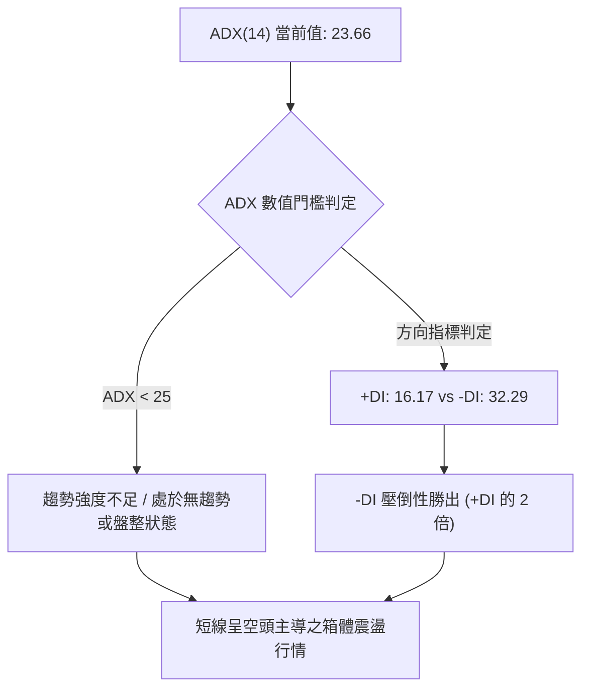

#### ADX 趨勢強度量化對照表

| 指標變數 | 當前數值 | 門檻基準 | 狀態評估 | 實戰交易含義 |
|:---|:---:|:---:|:---:|:---|
| **ADX(14)** | 23.66 | 25.00 | 弱趨勢 / 盤整 | 趨勢跟隨策略（Trend Following）失效，不可追漲殺跌，轉入區間思維 |
| **+DI (14)** | 16.17 | 20.00 | 多方虛弱 | 多頭買盤力道潰散，難以發動突破性攻勢 |
| **-DI (14)** | 32.29 | 25.00 | 空方控盤 | 空頭主導短線賣壓，短線價格反彈均屬弱勢修正性質 |
| **趨勢綜合判斷** | — | — | 🔴 空方主導盤整 | 根據規則 14，ADX<25 必須以日線布林通道上下軌與支撐阻力為交易界限 |

---

## 3. 圖表形態分析

### 🔍 形態識別系統

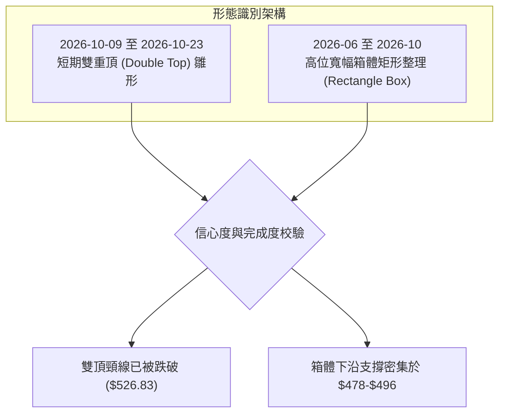

#### 形態識別與信心度評估表（依規則 15）

| 形態類型 | 信心度 (%) | 判斷依據（嚴格引用數據） | 完成度 (%) | 目標價推算與計算式 |
|:---|:---:|:---|:---:|:---|
| **短期雙頂 (M頭)** | 75% | 頂點1: 10-09高點 $658.52；頂點2: 10-02高點 $645.46。兩次衝高未果，10-16長黑跌破兩峰間低點 $526.83（頸線） | 90% | 頸線 $526.83 - 形態高度 ($658.52 - $526.83 = $131.69) = **$395.14**（理論滿足點，恰逼近 MA200: $402.08） |
| **高位箱體整理** | 68% | 上邊界受制於歷史高位聚類 $658.52；下邊界受 S1: $496.75 與 2026-07/08 低點聚類支撐 | 70% | 箱體下沿目標為 **$496.75 (S1)** 與 **$478.87 (斐波 38.2%)** |
| **頭肩頂形態** | 35% | 左肩未見清晰結構，僅有單一高點噴出後崩落 | 0% | 訊號不足，信心度 < 50%，僅做指標型解讀，不預設立場 |

### 🕯️ 重要K線形態分析

嚴格依據數據中「近10根日K」與「近8根週K」之真實開高低收進行量化辨識（規則 19）：

#### 近 10 根日 K 線形態解讀

| 日期（日K） | 開盤價 ($) | 最高價 ($) | 最低價 ($) | 收盤價 ($) | 成交量 (股) | K線形態名稱 | 技術解讀與多空訊號 |
|:---|:---:|:---:|:---:|:---:|:---:|:---:|:---|
| **2026-10-12** | 599.93 | 601.77 | 586.54 | 594.24 | 15,379,900 | 窄幅實體陰線 | 🟡 跌破 600 大關，多頭反彈動能衰竭 |
| **2026-10-13** | 577.50 | 606.20 | 570.60 | 605.53 | 17,932,700 | 長下影長陽棒 | 🟢 探底回升，短線多頭於 $570 出現買盤抵抗 |
| **2026-10-14** | 589.57 | 591.88 | 567.00 | 570.82 | 22,319,500 | 破位中長黑K | 🔴 吞噬前日低點，空頭賣壓再度湧現 |
| **2026-10-15** | 540.00 | 568.62 | 530.09 | 562.23 | 28,834,600 | 放量下影陽線 | 🟡 跳空低開後放量拉抬，但未能回補上方跳空缺口 |
| **2026-10-16** | 547.55 | 550.96 | 526.83 | 528.75 | 22,575,500 | 光腳大陰線 | 🔴 創波段新低，收在最低點附近，空頭貫穿 |
| **2026-10-19** | 551.78 | 554.41 | 535.67 | 538.05 | 20,199,700 | 開高走低小黑K | 🔴 向上反抽無力，均線反壓沉重 |
| **2026-10-20** | 530.02 | 548.11 | 524.60 | 534.74 | 15,187,000 | 縮量倒錘子線 | 🟡 下方出現局部買盤，但追高意願不足 |
| **2026-10-21** | 545.93 | 556.79 | 537.30 | 552.72 | 17,998,600 | 溫和放量小陽線 | 🟢 挑戰 MA60 與短均線，暫時止跌反彈 |
| **2026-10-22** | 524.10 | 529.98 | 502.60 | 507.93 | 28,007,400 | 放量長黑破位棒 | 🔴 跳空重挫，重擊至 502.60，殺出波段恐慌量 |
| **2026-10-23** | 510.21 | 523.92 | 508.36 | 516.79 | 15,135,900 | 縮量下影小陽棒 | 🟡 孕線形態（Harami），低檔縮量止跌，蘊釀超跌反彈 |

#### 近 8 根週 K 線形態解讀

| 日期（週K最後交易日） | 開盤價 ($) | 最高價 ($) | 最低價 ($) | 收盤價 ($) | 週成交量 (股) | 週K線形態名稱 | 技術解讀與多空訊號 |
|:---|:---:|:---:|:---:|:---:|:---:|:---:|:---|
| **2026-09-04** | 466.22 | 478.83 | 440.50 | 477.57 | 75,161,400 | 長下影陽十字星 | 🟢 回踩確認低位支撐，波段起漲點 |
| **2026-09-11** | 488.92 | 526.79 | 486.57 | 516.13 | 85,350,600 | 實體中陽線 | 🟢 突破 500 整數關卡，量能溫和放大 |
| **2026-09-18** | 486.28 | 559.91 | 480.33 | 559.82 | 124,593,800 | 爆量突破長陽線 | 🟢 放量創階段新高，多頭主升段確立 |
| **2026-09-25** | 583.88 | 639.00 | 582.27 | 630.63 | 132,066,300 | 巨量跳空大陽線 | 🟢 量價俱揚，市場情緒達到極致亢奮 |
| **2026-10-02** | 624.90 | 645.46 | 596.07 | 633.91 | 92,386,900 | 高位高浪十字星 | 🟡 量能萎縮，高檔獲利了結與籌碼換手跡象 |
| **2026-10-09** | 630.61 | 658.52 | 606.00 | 608.10 | 93,746,000 | 倒錘頭（避雷針） | 🔴 創 $658.52 天價後遭巨量摜壓，見頂訊號明確 |
| **2026-10-16** | 599.93 | 606.20 | 526.83 | 528.75 | 107,042,200 | 放量實體大長陰 | 🔴 貫穿前波平台，週 RSI 急墜，確立週線級別修正 |
| **2026-10-23** | 551.78 | 556.79 | 502.60 | 516.79 | 96,528,600 | 下影小黑K線 | 🟡 探至 $502.60 獲低接買盤支撐，下影線長 14.19 美元 |

### 📉 ASCII 走勢形態示意圖

```
                    $658.52 (頂點1 / 歷史天價)
                      /\
                     /  \          $645.46 (頂點2)
                    /    \           /\
                   /      \         /  \
                  /        \_______/    \
                 /                       \
                /                         \   頸線位置: $526.83
───────────────/───────────────────────────\──────▼─────────
                                            \    /\  ◄─ 跌破後回抽
                                             \  /  \
                                              \/    \  現價: $516.79
                                                     ▼
                                            ----------------- S1: $496.75
                                            ================= 斐波38.2%: $478.87
```

### 🎯 形態目標價計算

根據經典技術分析形態學理論，若雙頂（M頭）形態成立並持續發酵：
- **頂部最高點**：$658.52
- **跌破確認頸線**：$526.83（2026-10-16 當日最低點兼收盤確認破位點）
- **形態垂直接構高度**：$658.52 - $526.83 = $131.69
- **第一形態對稱等幅滿足點**：
  $$\text{目標價} = \text{頸線} - \text{形態高度} = 526.83 - 131.69 = \$395.14$$
- **實務折衷修正**：由於下方在 **$478.87 (斐波那契 38.2% 回調位)**、**$461.71 (支撐位 S2)** 以及 **$402.08 (MA200 長期年線)** 具備密集買盤聚類，空方在未經多次回抽確認前，直接貫通至 $395.14 的阻力極大。短線形態之首要下行滿足區應鎖定於 **$496.75 (S1)** 與 **$478.87 (斐波 38.2%)**。

---

## 4. 支撐與阻力

### 🗺️ 關鍵價位分布圖（Unicode）

```
AMD 關鍵價位與籌碼微觀結構分布圖
════════════════════════════════════════════════════════════════════
$658.52 ║██████████████████████████████║ 52週歷史高點 / 絕對阻力極限
$587.22 ║██████████████████████        ║ 布林中軌 / MA20 下彎重壓位
$546.44 ║██████████████████            ║ 強阻力 R3 / 密集波段高點聚類
$542.28 ║███████████████               ║ 中期生命線 MA50 反壓
$530.13 ║████████████                  ║ 阻力位 R2 / 短線反彈第一道天花板
$517.35 ║████████                      ║ 即時阻力 R1 (+0.11% from price)
────────╫──────────────────────────────╫────────────────────────────
$516.79 ╠══════════════════════════════╣ ◄── 當前收盤價 (現價)
────────╫──────────────────────────────╫────────────────────────────
$514.95 ║▓▓▓▓▓▓▓▓                      ║ MA120 半年線即時支撐位 (+0.36%)
$498.27 ║▓▓▓▓▓▓▓▓▓▓▓▓                  ║ 布林通道下軌極限 (BB Lower)
$496.75 ║▓▓▓▓▓▓▓▓▓▓▓▓▓▓▓▓              ║ 近期波段核心關鍵支撐 S1 (-3.88%)
$478.87 ║▓▓▓▓▓▓▓▓▓▓▓▓▓▓▓▓▓▓▓▓          ║ 斐波那契 38.2% 黃金回調防守線
$461.71 ║▓▓▓▓▓▓▓▓▓▓▓▓▓▓▓▓▓▓▓▓▓▓        ║ 強支撐 S2 / 8月波段底部聚類
$451.00 ║▓▓▓▓▓▓▓▓▓▓▓▓▓▓▓▓▓▓▓▓▓▓▓▓      ║ 極限防守支撐 S3 (-12.73%)
════════════════════════════════════════════════════════════════════
```

### 🚧 阻力位分析表

所有價位均嚴格引用 OHLCV 計算所得之波段高點聚類：

| 阻力級別 | 精確價位 ($) | 距現價幅離 | 形成原因與籌碼性質 | 突破難度 | 重要性評級 |
|:---|:---:|:---:|:---|:---:|:---:|
| **R1** | $517.35 | +0.11% | 近一年近端波段高點聚類，10-23 高點 ($523.92) 壓制前哨，現價正臨此關卡 | 🟡 中等 | ★★★☆☆ |
| **R2** | $530.13 | +2.58% | MA5 ($530.05) 與 10-16 破位長陰線開盤防守區間，短線多頭反抽強烈阻力 | 🔴 偏高 | ★★★★☆ |
| **R3** | $546.44 | +5.74% | 50日均線 MA50 ($542.28) 密集反壓區，且重合斐波那契 23.6% ($547.53) | 🔴 極高 | ★★★★★ |

### 🛡️ 支撐位分析表

所有價位均嚴格引用 OHLCV 計算所得之波段低點聚類：

| 支撐級別 | 精確價位 ($) | 距現價幅離 | 形成原因與籌碼性質 | 守住機率 | 重要性評級 |
|:---|:---:|:---:|:---|:---:|:---:|
| **S1** | $496.75 | -3.88% | 近一年密集波段低點聚類，重合布林下軌 ($498.27) 與 500 整數心理關卡 | 🟢 70% | ★★★★☆ |
| **S2** | $461.71 | -10.66% | 2026 年 8 月下旬波段起漲低點聚類（8-28 收盤 $465.58，9-04 低點 $440.50） | 🟢 85% | ★★★★★ |
| **S3** | $451.00 | -12.73% | 2026 年 7-8 月震盪築底箱底極限防守線，多頭最後安全閥 | 🟢 92% | ★★★★★ |

### 📐 斐波那契回調位分析

依據 52 週絕對極值區間 **$188.22 (52W Low) → $658.52 (52W High)**（總振幅 $470.30）計算：


| 斐波那契層級 | 精確價位 ($) | 距現價差距 | 技術解讀與當前防守意義 |
|:---|:---:|:---:|:---|
| **0.0% (52W High)** | $658.52 | +27.42% | 歷史頂部，多頭終極目標 |
| **23.6% 回調位** | $547.53 | +5.95% | **已跌破之第一防線**，現已轉換為上方重大結構性阻力 |
| **當前價格 (現價)** | **$516.79** | — | **目前深處於 23.6% ($547.53) 與 38.2% ($478.87) 之間** |
| **38.2% 回調位** | $478.87 | -7.34% | **強牛市回調極限位**，若能於此回穩，長期強勢上漲結構不變 |
| **50.0% 回調位** | $423.37 | -18.08% | 多空平衡中軸線，接近 MA200 ($402.08) 宏觀多空分水嶺 |
| **61.8% 回調位** | $367.87 | -28.82% | 黃金分割防禦點，跌破則宣告長期牛市終結 |
| **78.6% 回調位** | $288.86 | -44.10% | 深度回撤防線 |
| **100.0% (52W Low)**| $188.22 | -63.58% | 52 週起漲原點 |

*解讀：現價 $516.79 跌破 23.6% ($547.53) 後，技術上必然尋求 38.2% ($478.87) 之支撐共振。在 $516.79 至 $478.87 區間，下檔 S1 ($496.75) 與布林下軌 ($498.27) 形成第一層減速緩衝墊。*

---

## 5. 技術指標深度解讀

### 🎛️ 指標訊號總覽

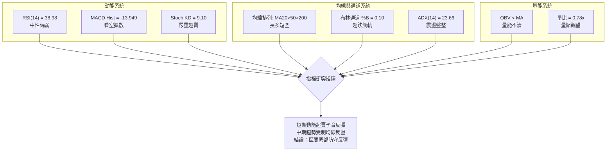

### 📈 移動平均線排列分析

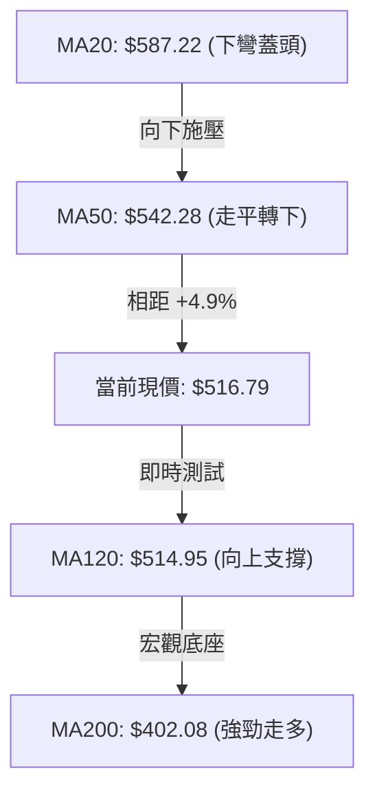

#### 移動平均線數據對照表

| 均線類型 | 當前數值 ($) | 與現價乖離率 (%) | 均線斜率與走勢 | 角色定位與戰略意涵 |
|:---|:---:|:---:|:---:|:---|
| **MA5** | $530.05 | -2.50% | ▼ 下彎扣高 | 超短期動態下壓阻力，首要攻克目標 |
| **MA10** | $551.18 | -6.24% | ▼ 下彎加速 | 短線反彈停利壓制線 |
| **MA20** | $587.22 | -11.99% | ▼ 下行加速 | 布林中軌，短線強弱分水嶺，未突破前皆屬空方反彈 |
| **MA50** | $542.28 | -2.97% | ▼ 出現下彎 | 中期生命線失守，形成中期結構性天花板 |
| **MA60** | $532.63 | -2.97% | ▼ 走平下彎 | 季線位置，壓制 10-21 反彈高點 |
| **MA120** | $514.95 | +0.36% | ▲ 上行支撐 | **現價精準貼合於此**，半年線多方核心陣地 |
| **MA200** | $402.08 | +28.53% | ▲ 陡峭向上 | 牛熊分界線，長期趨勢多頭基石無虞 |
| **MA240** | $371.65 | +39.05% | ▲ 穩健向上 | 長期年線底部架構極度堅實 |

### 📉 RSI(14) 分析

- **當前讀數**：`38.98`（Wilder 計算模型）
- **進度條位置**：
```
0 ──────────── 30 ────── 38.98 ─────────────── 70 ─────────── 100
[ 極度超賣區 ]  [  弱勢震盪區  ]       [  強勢多頭區  ]   [ 極度超買區 ]
████████░░░░░░░░░░░░░░░░░░░░░░░░░░░░░░░░░░░░░░░░░░░░░░░  38.98%
```
- **背離判斷結論**：
  比對近 20 根日 K 棒首尾之價格與 RSI：2026-10-09 高點 $658.52 時週 RSI 高達 70.1，日線 RSI 亦在超買頂部；隨後價格連續創低（10-22 創低 $502.60），日 RSI 降至 38.98。首尾方向同向向下，**目前日線級別「無明顯背離」**。然而，超賣指標 Stoch 已達 9.10 極值，RSI 跌勢在 38–40 區域斜率趨緩，反映空方拋壓動能正被吸收。

### 📊 MACD(12,26,9) 訊號解讀

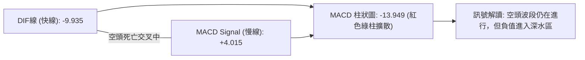

- **快慢線位置**：DIF 已經跌破 0 軸至 -9.935，信號線維持在 4.015，雙線呈向下發散張角。
- **柱狀圖動態**：當前 MACD 柱狀圖為 **-13.949**，相較前一週（-14.100）負值柱體已停止顯著拉長，顯示下跌力道已自恐慌殺跌轉向慣性衰退。若下週柱體能收窄至 -10.00 之內，將誘發第一道黃金交叉前的技術性反彈。

### 📦 布林通道分析

```
AMD 日線布林通道 (20, 2) 結構圖
════════════════════════════════════════════════════════════════════
$676.18 ─────────────────────────────────── 布林上軌 (BB Upper)
          │
          │
$587.22 ─────────────────────────────────── 中軌 (MA20 下彎壓制)
          │
          │
$516.79 ◄══════════════════════════════════ 當前現價 (%B = 0.10)
$498.27 ─────────────────────────────────── 布林下軌 (BB Lower)
════════════════════════════════════════════════════════════════════
```

- **通道帶寬**：通道寬度隨 10 月中旬暴跌自收斂轉向急劇放大（上軌 $676.18 至下軌 $498.27，帶寬達 $177.91，佔價格 34.4%）。
- **當前位置 %B**：**0.10**（極度貼近下軌 0.00）。在統計學中，當 %B 降至 0.10 以下且成交量縮小時，通常代表價格過度偏離均線常態分佈，短線向上均值回歸（Mean Reversion）至中軌 $587.22 的機率顯著大於持續貼軌下殺之機率。

### 💹 成交量分析（量價配合度）

```
量能走勢量化比對 (股數)
最新量 (10-23):  15,135,900  [███████████████░░░░░]  (量比: 0.78x)
20日均量:        19,485,185  [███████████████████░]  
50日均量:        20,134,476  [████████████████████]  
```
- **量縮價跌背離**：2026-10-22 創下近期恐慌低點 $502.60 時，成交量激增至 28,007,400 股；而在 2026-10-23 股價微幅反彈至 $516.79 時，成交量大幅萎縮至 15,135,900 股（較 20 日均量萎縮 22%）。
- **OBV 能量潮解讀**：OBV 目前位於其自身移動平均線之下，且呈現階梯式下滑，說明主流機構資金在此前衝破 600 美元時有明顯減倉行為，當前下檔承接籌碼以散戶與被動量化買盤為主，主力大資金尚未展現全面進場做多的信號。

---

## 6. 動能與波動率

### ⚡ 動能評估四象限

| 象限 | 動能維度 (Momentum) | 波動率維度 (Volatility) | AMD 當前定位 | 策略應對方針 |
|:---:|:---:|:---:|:---:|:---|
| **Q1 (高動能·低波動)** | 強勁 (Bullish) | 偏低 (Low ATR) | — | 最佳波段順勢推升階段（如 2026 年 5-6 月） |
| **Q2 (低動能·低波動)** | 衰竭 (Weak) | 偏低 (Low ATR) | — | 窄幅盤整、打底築台期 |
| **Q3 (高動能·高波動)** | 強勁 (Expansion) | 劇烈 (High ATR) | — | 單邊突破追價期 |
| **Q4 (弱動能·高波動)** | **疲弱 (Bearish)** | **高檔 (ATR 5.29%)** | **✓ 當前狀態** | **高風險高摩擦！以區間防禦、降低槓桿、嚴控止損為主** |

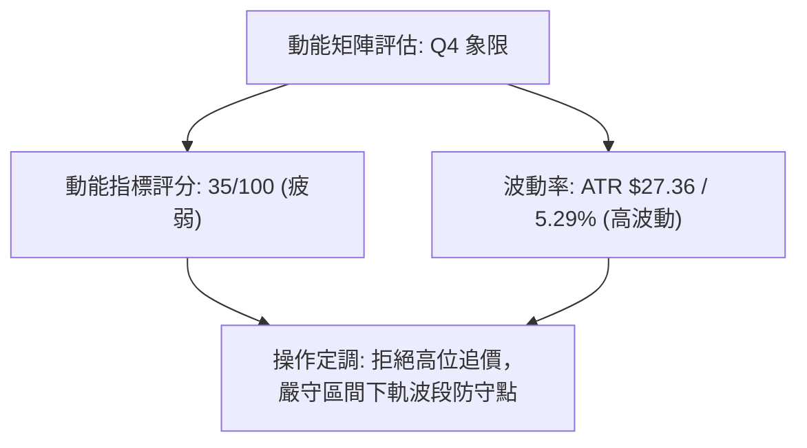

### 📊 ATR 波動率分析

- **ATR(14) 數值**：**$27.36**（Wilder 計算法）
- **佔現價比率**：**5.29%**
- **風控止損空間指引**：
  由於 AMD 單日平均真實波動範圍高達 27.36 美元，任何低於 1.0 倍 ATR（約 27 美元）的短線止損極易被市場隨機噪音（Noise）掃出場。
  - **超短線交易員**：最低應預留 **0.8 倍 ATR** = $21.89 緩衝區間。
  - **波段多頭建倉**：標準止損應設定於 **1.0 ~ 1.5 倍 ATR** = $27.36 ~ $41.04 空間。

### 📐 Beta 與市場相關性

- **Beta 係數**：**2.454**
- **市場敏感度解讀**：
  AMD 擁有高達 2.454 的超高 Beta 係數，代表其對基準指數（S&P 500 / Nasdaq）具備 2.45 倍的放大效應。當近期大盤（道瓊暴跌 600 點、那指重挫）面臨半導體板塊（如 Lam Research 預警）拋售潮時，AMD 下跌斜率必然遠陡於整體市場。同理，一旦大盤出現反彈修復，AMD 之彈力亦居晶片族群之首。

---

## 7. 多時框架總結

### 📋 時框架評分表

| 時框架 | 趨勢方向 | 動能指標 | 均線排列系統 | 形態結構位置 | 綜合評分 | 操作核心建議 |
|:---|:---:|:---:|:---:|:---:|:---:|:---|
| **月線 (長期)** | 🟢 多頭上行 | 🟡 70回檔中性 | 🟢 MA200 完美托底 | 箱體擴散突破後回測 | **78 / 100** | 逢深幅回調長線定投，不破 $402.08 宏觀底倉續抱 |
| **週線 (中期)** | 🟡 震盪回調 | 🔴 MACD柱翻綠 | 🟡 考驗 MA20 週線 | 雙頂高檔回測頸線 | **48 / 100** | 波段減碼觀望，等待 $478-$496 區間站穩確認 |
| **日線 (短期)** | 🔴 空方壓制 | 🔴 DIF跌破零軸 | 🔴 跌破 MA20 & MA50 | 縮量孕線尋求下軌支撐 | **38 / 100** | 嚴禁追多，僅可於關鍵支撐 S1 處小倉位博取反彈 |

### 🔲 綜合訊號矩陣

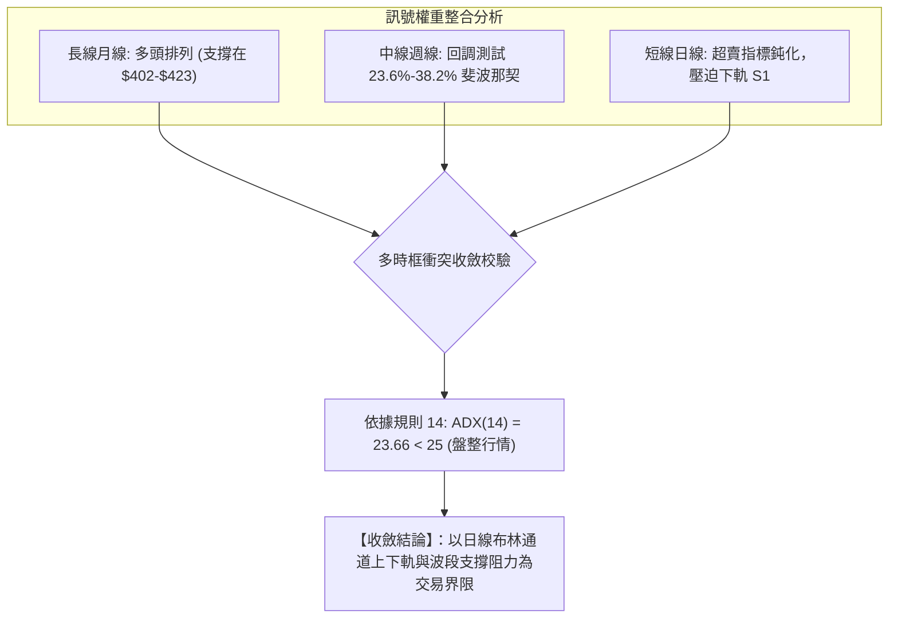

### ⚖️ 多時框收斂結論

嚴格遵守【嚴格要求 14】之多時框收斂優先級規則：
1. **行情屬性判定**：當前 AMD 之 14 日 ADX 為 **23.66**，明確落於 **ADX < 25** 之弱趨勢／盤整區間。
2. **主導維度與操作邏輯**：在盤整行情中，趨勢指標（如均線黃金交叉、趨勢線突破）失真度高，**必須以日線布林通道下軌（$498.27）、上軌（$676.18）與近一年波段高低點聚類（S1: $496.75 / R1: $517.35 / R2: $530.13）作為核心交易區間**。
3. **唯一方向性結論**：**【中性觀望·區間下軌防守型博弈】**。當前現價 $516.79 緊鄰布林下軌與半年線 MA120，下檔下探空間有限，但上方受制於下彎均線反壓，故主策略定調為：**在不跌破 S1 ($496.75) 的前提下，採取區間下沿高盈虧比超跌反彈策略；嚴禁在壓力區追漲**。

---

## 8. 交易策略建議

### 🗺️ 策略決策流程圖

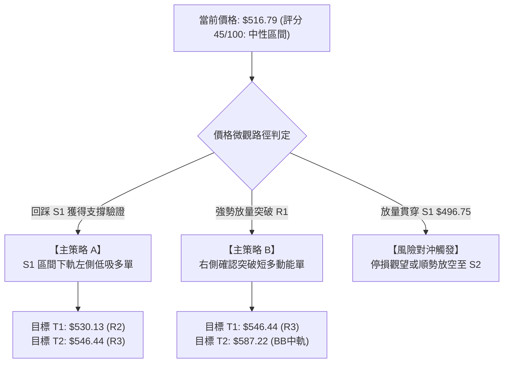

### 🧭 策略路由（依評分卡分流）

> **當前主策略方向 = 【中性區間震盪·下沿高盈虧比博弈】（依評分 45 / 100）**
> 
*說明：綜合評分 45 分處於 40–60 中性震盪區間，且 ADX = 23.66 確認非趨勢行情。操作重點在於「尋找極端邊界，博弈均值回歸」，不進行單邊高位追價，嚴守布林下軌至中軌的波動空間。*

### 🎯 價格情境階梯（Price Scenarios）

價位嚴格引用第 4 章及數據包中由 OHLCV 計算之精確數值：

| 觸發條件 | 下一目標價 ($) | 後續延伸價 ($) | 市場結構含義與技術心理 |
|:---|:---:|:---:|:---|
| **向上突破 R1 ($517.35)** | R2: **$530.13** | R3: **$546.44** | 短線擺脫下下探慣性，封閉空頭缺口，挑戰 50 日均線 |
| **站穩現價區間 ($514.95–$517.35)**| R1: **$517.35** | S1: **$496.75** | 於 MA120 半年線反覆拉鋸築底，沉澱籌碼等待均線走平 |
| **跌破 S1 ($496.75)** | S2: **$461.71** | S3: **$451.00** | 跌破高位整理箱體，觸發停損賣壓，下探 38.2% 斐波那契 |

### 📊 情境機率分佈

| 預測情境 | 發生機率 | 主要技術依據與指標佐證 |
|:---|:---:|:---|
| **區間下軌震盪回升 (反彈)** | **55%** | Stoch %K=9.10 處於極度超賣，布林 %B=0.10，價格貼近 MA120，具備強烈均值回歸動能 |
| **低位窄幅沉底盤整 (橫盤)** | **30%** | ADX=23.66 動能貧弱，20日均量縮至 0.78x，市場在重大事件前偏向觀望 |
| **跌破 S1 加速探底 (破位)** | **15%** | MACD 柱狀圖發散看空 (-13.949)，-DI(32.29) 高於 +DI(16.17)，半導體供應鏈雜音 |

### 🟢 主策略詳情（方向依上方路由）

所有價位與風報比嚴格依據規則 13 與規則 17 執行計算：

| 策略要素 | 策略 A：區間下軌低吸多單 (左側/試倉) | 策略 B：突破 R1 追動能多單 (右側/加碼) |
|:---|:---|:---|
| **進場條件** | 價格回踩 S1 獲得下影線支撐或於現價分批低吸 | 日 K 線明確收盤突破 R1 ($517.35) 且成交量放大 |
| **進場價格 ($)** | **$496.75**（引用支撐位 S1） | **$517.35**（引用阻力位 R1） |
| **目標價 T1 ($)** | **$530.13**（引用阻力位 R2） | **$546.44**（引用阻力位 R3） |
| **目標價 T2 ($)** | **$546.44**（引用阻力位 R3） | **$587.22**（引用布林中軌 / MA20） |
| **止損價格 ($)** | **$478.87**（引用斐波那契 38.2% 回調位） | **$496.75**（引用支撐位 S1） |
| **風險報酬比** | **1 : 1.87（以 T1 計）** <br>*(算式: (530.13-496.75)/(496.75-478.87) = 33.38/17.88)* | **1 : 1.41（以 T1 計）** <br>*(算式: (546.44-517.35)/(517.35-496.75) = 29.09/20.60)* |
| **目標 T2 風報比** | **1 : 2.78（以 T2 計）** <br>*(算式: (546.44-496.75)/(496.75-478.87) = 49.69/17.88)* | **1 : 3.39（以 T2 計）** <br>*(算式: (587.22-517.35)/(517.35-496.75) = 69.87/20.60)* |
| **成功機率** | 60% | 55% |
| **建議倉位** | 10% ~ 15% 總資金 | 5% ~ 10% 總資金 |

### 🔴 反向風險觸發點（對沖提示）

- **多頭結構全面失效條件**：若美股正規交易日收盤價**實體跌破 S1 ($496.75)**，且帶有超過 2,500 萬股以上巨量，代表下軌支撐失守。
- **對沖應對措施**：
  1. 所有多頭倉位無條件執行止損出局。
  2. 風控帳戶可啟動反向避險單（Short），以 S1 ($496.75) 為反壓基準，下看目標 **S2: $461.71** 與 **S3: $451.00**，止損設於 $510.21（10-23 開盤價）。

### ⭐ 整體訊號強度評星

```
做多訊號強度：★★☆☆☆  (2.5/5星 - 超賣反彈性質，上方均線壓頂)
做空訊號強度：★★★☆☆  (3.0/5星 - 順應短均線空頭，但受制下軌與超賣)
整體可信度：  ★★★★☆  (4.0/5星 - 價位聚類完整，斐波那契重合度高)
```

---

## 9. 風險提示與監控

### ✅ 關鍵監控指標 Checklist

```
╔══════════════════════════════════════════════════════════════════════╗
║                    每日盤前盤後技術監控清單 (Checklist)              ║
╠══════════════════════════════════════════════════════════════════════╣
║ [ ] 價位維度：收盤價是否守穩 MA120 ($514.95) 與 S1 ($496.75)        ║
║ [ ] 均線維度：5日均線 ($530.05) 斜率是否由陡峭向下轉為走平           ║
║ [ ] 動能維度：Stoch %K 是否自 9.10 形成向上突破 %D (金叉信號)        ║
║ [ ] MACD維度：柱狀圖能否縮窄至 -10.00 之內，阻斷空方發散動能         ║
║ [ ] 量能維度：反彈時日成交量是否回升至 20日均量 ($19.48M) 之上       ║
║ [ ] 波動維度：單日盤中振幅是否脫離 1.5倍 ATR ($41.04) 異常波動       ║
╚══════════════════════════════════════════════════════════════════════╝
```

### ⚠️ 風險場景分析

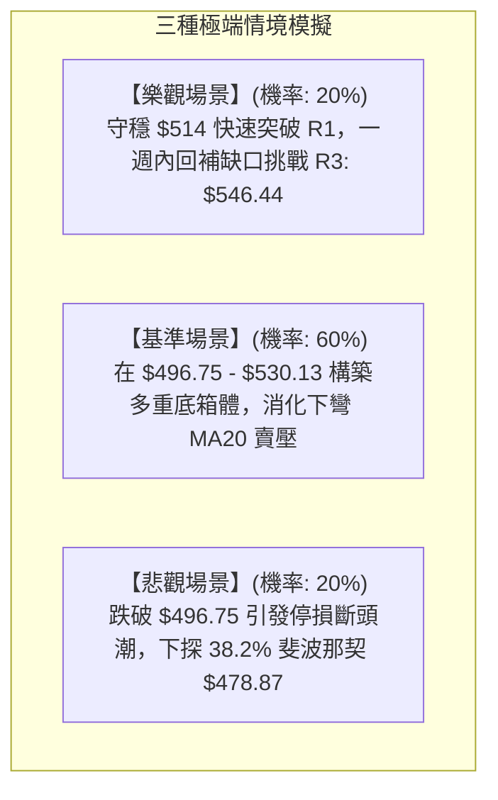

### 🛡️ 風險管理重要提醒

1. **Beta 槓桿效應抑制**：鑑於 AMD 的 Beta 高達 **2.454**，任何總體經濟利空（如美債殖利率跳升、大盤指數回跌）都會對 AMD 產生逾 2 倍的劇烈衝擊。在當前評分僅 45 分的背景下，嚴禁使用融資或高槓桿衍生品重倉持有。
2. **波動率止損規則**：不可採用過於狹窄的固定點位止損（如 5 美元或 1%），必須以 **ATR(14) = $27.36** 為基準進行資金管理。
3. **倉位配置比例**：單一策略交易資金佔總投資組合比率**嚴格控制在 10%–15% 之內**，保留至少 50% 以上現金流以應對宏觀不確定性。

---

## 📋 報告總結

```
╔════════════════════════════════════════════════════════════════════════╗
║                     AMD 技術分析報告總結                               ║
╠════════════════════════════════════════════════════════════════════════╣
║  報告日期：2026-10-25                                                  ║
║  當前價格：$516.79 USD                                                 ║
║  分析評級：⚖️ 45 / 100 中性區間（ADX=23.66 箱體震盪，等待超賣反彈）    ║
║                                                                        ║
║  關鍵結論：                                                            ║
║  ├─ 長期趨勢：🟢 偏多（收盤價高於 MA200 +28.53%，牛市底座無損）         ║
║  ├─ 中期趨勢：🟡 回調（週線連三黑，考驗斐波那契 23.6% 至 38.2% 支撐帶） ║
║  ├─ 短期趨勢：🔴 弱勢（收盤受制於 MA20/MA50，但指標超賣進入築底階段） ║
║  ├─ 關鍵支撐：S1: $496.75 ｜ 斐波那契 38.2%: $478.87 ｜ S2: $461.71     ║
║  ├─ 關鍵阻力：R1: $517.35 ｜ R2: $530.13 ｜ R3: $546.44                ║
║  └─ 分析師目標：共識均價 $637.61（最高 $1250.00 / 最低 $365.00）       ║
║                                                                        ║
║  最優策略組合：                                                        ║
║  1. 🥇 最佳機會：策略 A (S1 $496.75 低吸，止損 $478.87，T1 $530.13，   ║
║                  風險報酬比 1 : 1.87，博弈日線布林下軌均值回歸)        ║
║  2. 🥈 次選機會：策略 B (突破 R1 $517.35 確認後順勢短多，T1 $546.44，   ║
║                  風險報酬比 1 : 1.41，右側動能追蹤交易)                ║
║  3. 🥉 保守選擇：場外空倉觀望，耐心等待日線 MACD 綠柱收窄與週線止跌信號║
╚════════════════════════════════════════════════════════════════════════╝
```

---

> ⚠️ **免責聲明**：本報告為依據標準技術分析理論自動生成之量化研究報告，所有數據、支撐阻力點位及模型推算均嚴格基於所提供之歷史交易資訊（Yahoo Finance）。本報告**僅供研究與學術探討參考**，**絕不構成任何形式的證券買賣邀約或投資建議**。金融市場瞬息萬變，技術指標存在滯後性與失效風險，投資人應獨立思考，審慎評估個人風險承受能力，並自負投資盈虧。

---

*報告生成時間：2026-10-25 ｜ 數據來源：Yahoo Finance ｜ 分析框架：多時框技術分析模型*