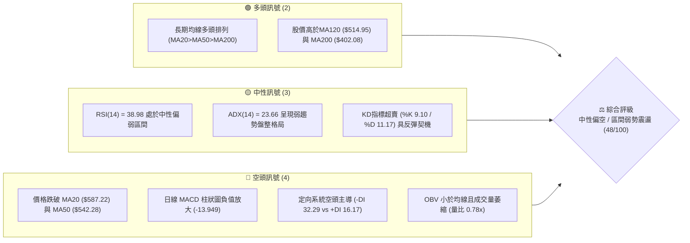
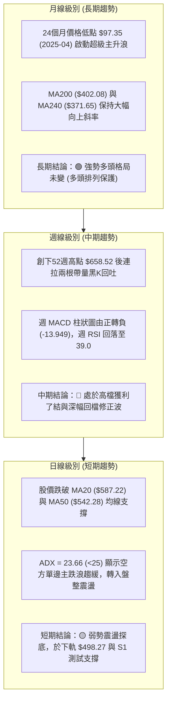
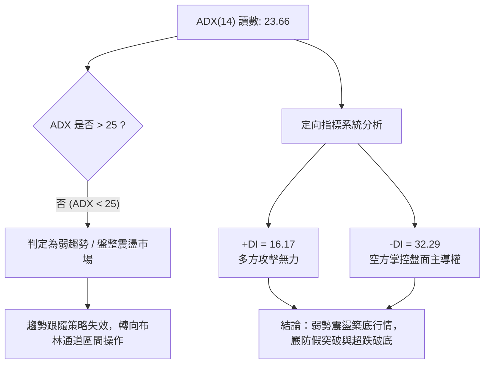
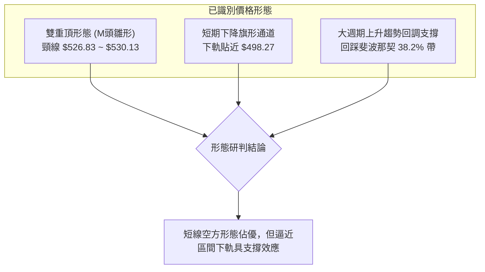
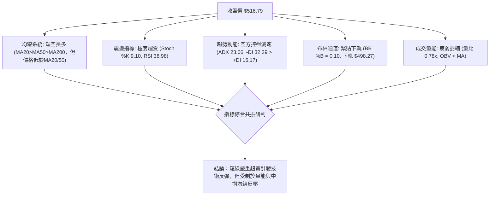
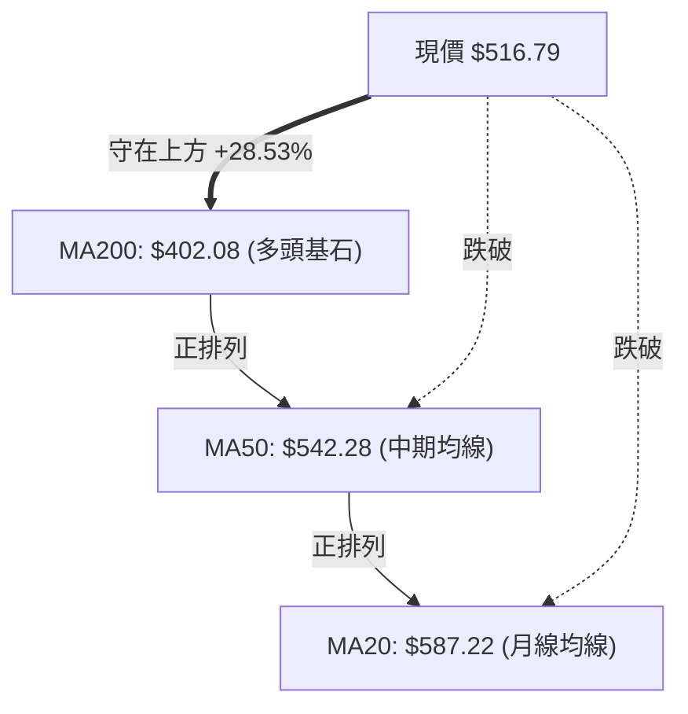
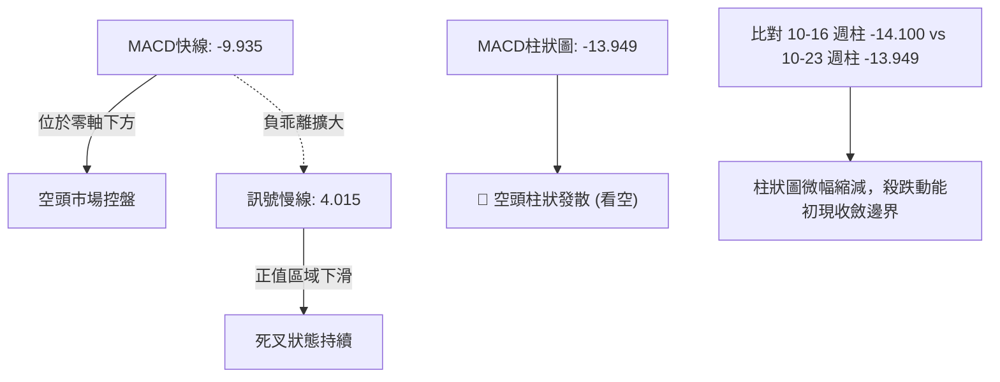
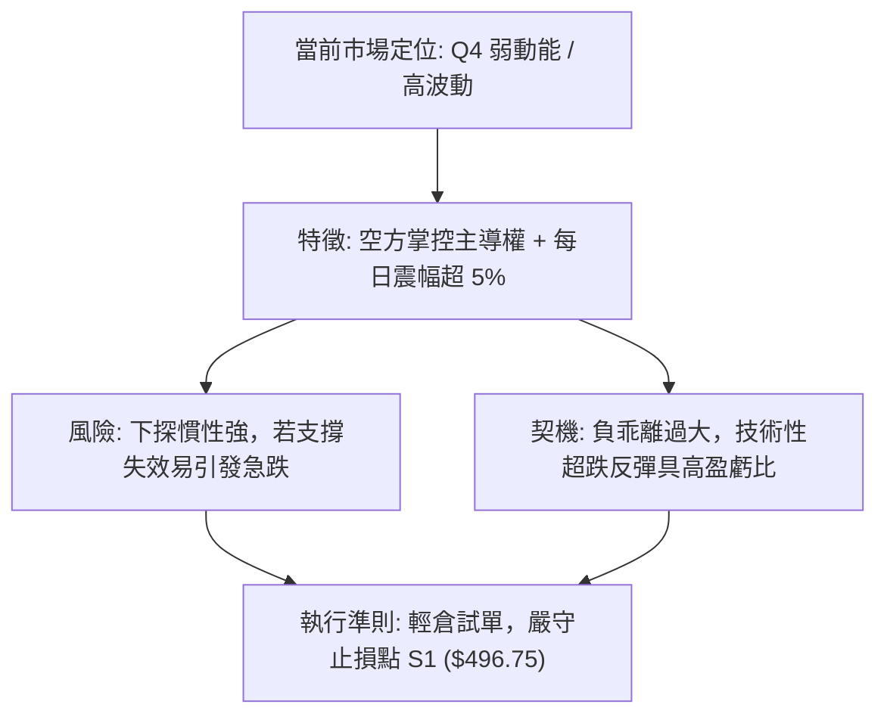
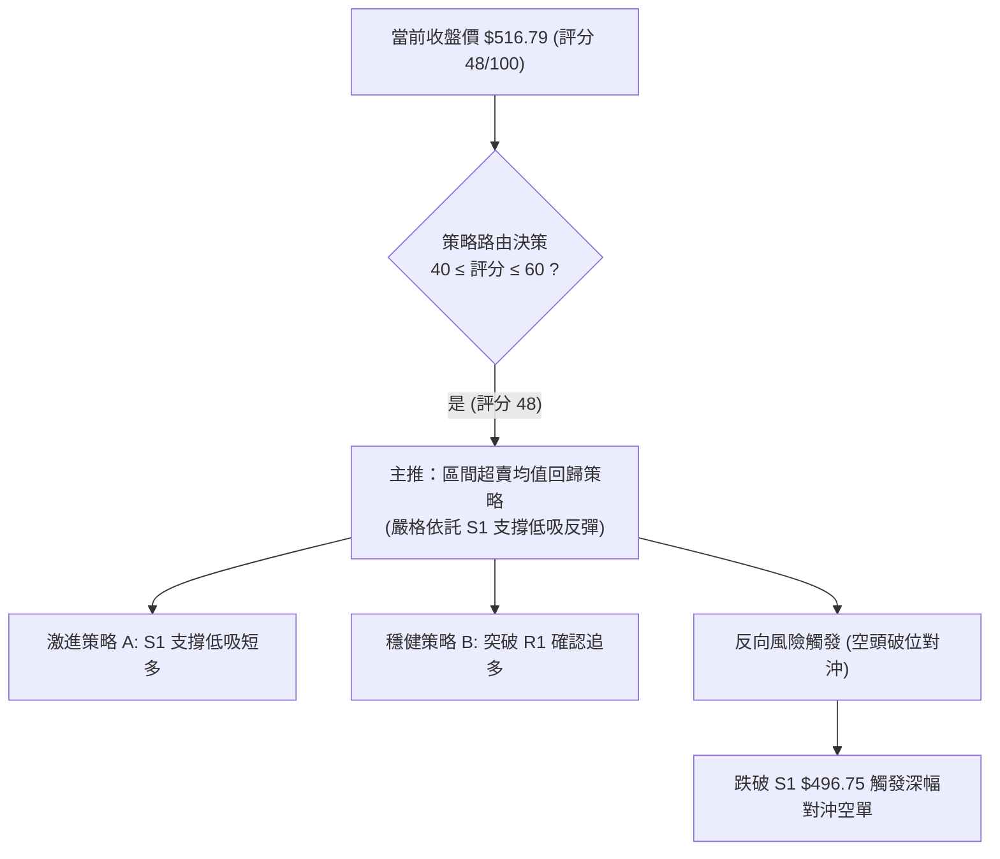
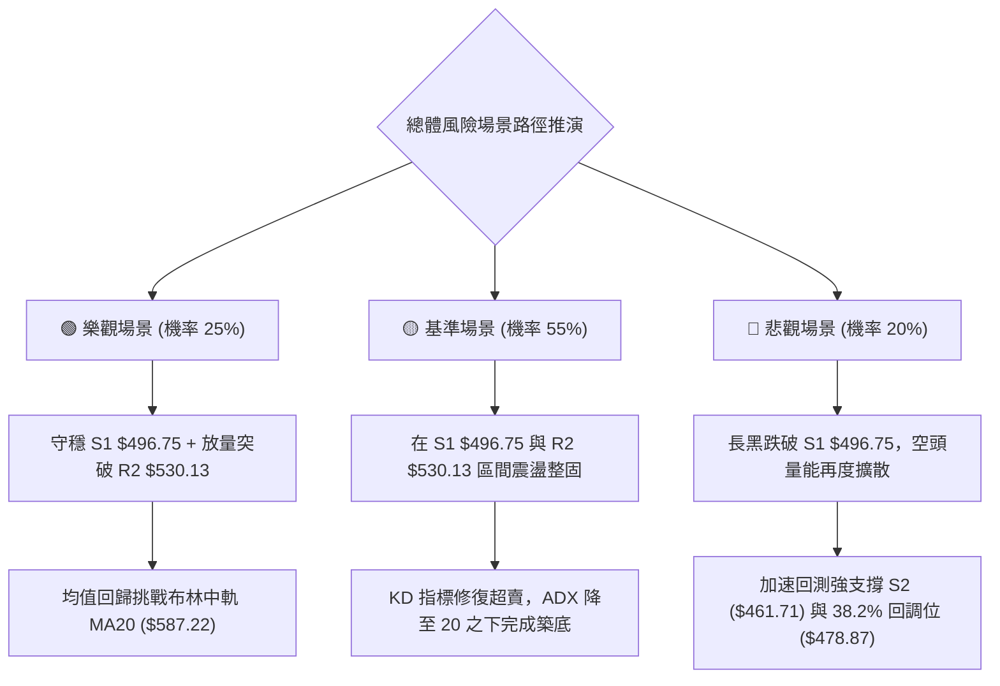

# AMD 技術分析報告

> **報告日期**：2026-10-26 ｜ **語言**：繁體中文 ｜ **數據來源**：Yahoo Finance ｜ **當前價格**：$516.79

---

## 目錄

| 章節 | 內容 |
|------|------|
| [1. 技術面概覽](#1-技術面概覽) | 訊號儀表板、核心指標、評分卡 |
| [2. 趨勢分析](#2-趨勢分析) | 多時框趨勢、長中短期走勢 |
| [3. 圖表形態分析](#3-圖表形態分析) | 形態識別、K線組合、目標價 |
| [4. 支撐與阻力](#4-支撐與阻力) | 關鍵價位、斐波那契回調 |
| [5. 技術指標深度解讀](#5-技術指標深度解讀) | MA/RSI/MACD/布林/成交量 |
| [6. 動能與波動率](#6-動能與波動率) | 動能評估、ATR、Beta |
| [7. 多時框架總結](#7-多時框架總結) | 時框架評分矩陣 |
| [8. 交易策略建議](#8-交易策略建議) | 多空策略、風險報酬比 |
| [9. 風險提示與監控](#9-風險提示與監控) | 監控指標、風險場景 |

---

## 1. 技術面概覽

### 🎯 技術訊號儀表板



### 📊 核心指標速覽表

| 指標類別 | 指標名稱 | 當前數值 | 訊號 | 解讀 |
|----------|----------|----------|------|------|
| **價格** | 當前收盤價 | $516.79 | 🟡 | 位於52週區間69.9%，短線自歷史高點回檔修正中 |
| **均線** | MA20 | $587.22 | 🔴 | 價格低於MA20達-11.99%，短線動能明顯偏空 |
| **均線** | MA50 | $542.28 | 🔴 | 價格跌破中期生命線，中期結構受到破壞 |
| **均線** | MA200 | $402.08 | 🟢 | 價格高於長期均線+28.53%，長期多頭架構未變 |
| **動能** | RSI(14) | 38.98 | 🟡 | 處於30–70中性偏空區，無背離訊號，動能衰竭 |
| **動能** | MACD (12,26,9) | -9.935 / 4.015 / -13.949 | 🔴 | MACD線位於訊號線下方，柱狀圖持續呈現看空擴散 |
| **動能** | Stoch %K / %D | 9.10 / 11.17 | 🟡 | 進入極度超賣區（<20），短線存在技術性反抽可能 |
| **波動** | ATR(14) | $27.36 | 🟡 | 佔股價5.29%，屬於中高波動度，短線下檔震幅大 |
| **趨勢** | ADX(14) | 23.66 | 🟡 | ADX < 25 表示單邊趨勢衰竭，當前轉為盤整洗盤行情 |
| **通道** | 布林通道 %B | 0.10 | 🔴 | 逼近下軌（$498.27），處於極端超跌軌道內 |
| **量能** | 20日成交量比 | 0.78x | 🔴 | 最新量能低於20日與50日均量，OBV跌破均線量能疲弱 |

### 🏆 技術評分卡

```
╔══════════════════════════════════════════════════════════════╗
║                技術評分卡 — AMD (2026-10-26)                 ║
╠══════════════════════════════════════════════════════════════╣
║ 趨勢強度      ████████░░░░░░░░░░░░  40/100  🔴 弱勢盤整       ║
║ 動能指標      ██████░░░░░░░░░░░░░░  30/100  🔴 空頭動能發散   ║
║ 支撐穩定度    ████████████░░░░░░░░  60/100  🟡 考驗S1關鍵支撐 ║
║ 成交量配合    ████████░░░░░░░░░░░░  40/100  🔴 量縮價跌量能弱 ║
║ 形態完整度    ████████████░░░░░░░░  60/100  🟡 弱勢區間箱型   ║
║ 均線排列      ████████████░░░░░░░░  60/100  🟡 長多短空背馳   ║
╠══════════════════════════════════════════════════════════════╣
║ 綜合評分      ██████████░░░░░░░░░░  48/100  中性偏空 / 觀望   ║
╚══════════════════════════════════════════════════════════════╝
```
*(註：綜合評分由六項子評分算術平均計算：(40 + 30 + 60 + 40 + 60 + 60) ÷ 6 = 48.33，四捨五入取整為 48/100，符合規則 18)*

---

## 2. 趨勢分析

### 🌐 多時框趨勢分析



### 📈 長期趨勢 — 12個月走勢圖（Unicode）

依據月度收盤價數據，標注自 2025-11 至 2026-10 之 12 個月走勢：

```
AMD 月線收盤走勢圖（過去12個月：2025-11 至 2026-10）
價格軸 ($)
$650 ┤                                              
$600 ┤                                        ●(09: 611.76)
$550 ┤                             ●(06: 580.91)     
$500 ┤                       ●(05: 516.10)     ●(10: 516.79)←現價
$450 ┤                                  ●(07: 476.15)
$400 ┤                                       
$350 ┤                 ●(04: 354.49)                 
$300 ┤                                              
$250 ┤                                              
$200 ┤ ●(11: 217.53)   ●(01: 236.73)                 
$150 ┤       ●(12: 214.16)   ●(02: 200.21)          
     └─┬───────┬───────┬───────┬───────┬───────┬───────┬─────
     '25-11  '25-12  '26-01  '26-02  '26-04  '26-06  '26-09  '26-10
```

#### 走勢特徵分析表格

| 階段區間 | 起迄收盤價 | 區間漲跌幅 | 走勢特徵與結構意涵 |
|----------|------------|------------|--------------------|
| 2025-11 ～ 2026-03 | $217.53 → $203.43 | -6.48% | **底部蓄勢平台**：股價於 $200–$236 形成長達半年的強固大底結構 |
| 2026-03 ～ 2026-06 | $203.43 → $580.91 | +185.56% | **爆發性主升浪**：月線呈現連續實體大陽線，成交量急速擴張，驅動市值突破 |
| 2026-06 ～ 2026-08 | $580.91 → $470.72 | -18.97% | **初次高檔換手**：股價拉回 $470 支撐帶進行獲利回吐清洗，籌碼重新沉澱 |
| 2026-08 ～ 2026-09 | $470.72 → $611.76 | +29.96% | **衝刺次高波段**：多頭重新集結，並於10月初創下歷史新高 $658.52 |
| 2026-09 ～ 2026-10 | $611.76 → $516.79 | -15.52% | **高檔快速拉回**：高檔爆量長黑下殺，跌破短期均線，進入日線級別修正 |

### 📊 中期趨勢（週線分析）

從近20週數據觀察，AMD 在 2026-10-09 當週刷出歷史天價 $658.52 之後，隨即遭遇強勁空頭反撲：
- **週K線連兩週重挫**：10-16 當週收跌至 $528.75（跌幅 -13.05%），10-23 當週續挫收於 $516.79（跌幅 -2.26%）。
- **週線動能急速轉向**：週 RSI 自 9 月底的 73.0 極度超買區快速摔落至當前的 39.0，週 MACD 柱狀圖由頂峰的 +14.199 劇烈翻空至 -13.949，顯示中線籌碼正處於大波段獲利了結階段。

```
中期壓力與支撐示意圖
═════════════════════════════════════════════════════════════════
  $658.52  ──────────────────────────────────── 歷史天價阻力 (52W High)
           ▲
           │  高檔深幅修正區間 (-21.52%)
           ▼
  $546.44  ┈┈┈┈┈┈┈┈┈┈┈┈┈┈┈┈┈┈┈┈┈┈┈┈┈┈┈┈┈┈┈┈┈┈┈┈ 中期反彈頸線阻力 R3
  $530.13  ┈┈┈┈┈┈┈┈┈┈┈┈┈┈┈┈┈┈┈┈┈┈┈┈┈┈┈┈┈┈┈┈┈┈┈┈ 短線解套阻力 R2
  $516.79  ════════════════════════════════════ 現價水平線
  $496.75  ──────────────────────────────────── 近期波段關鍵支撐 S1 / BB下軌
  $461.71  ──────────────────────────────────── 中期強固支撐底部 S2
═════════════════════════════════════════════════════════════════
```

### ⚡ 趨勢強度評估（ADX 解讀）



#### ADX 趨勢強度對照表

| 指標參數 | 數值 | 市場狀態標準 | 盤面實況評估 |
|----------|------|--------------|--------------|
| **ADX(14)** | 23.66 | < 20 極弱；20–25 弱趨勢/盤整；> 25 明確趨勢 | 當前處於 23.66，顯示自 $658.52 的單邊急跌動能已開始衰減，空頭主跌波暫歇，盤面轉入震盪整固 |
| **+DI(14)** | 16.17 | > 25 多頭主導；< 20 多頭弱勢 | 多方動能低迷，顯示買盤追價意願極度不足 |
| **-DI(14)** | 32.29 | > 25 空頭強勢；> 30 空頭絕對優勢 | 空方佔據盤面壓倒性優勢，但因 ADX<25，空方難以直接展開連續單邊暴跌 |

---

## 3. 圖表形態分析

### 🔍 形態識別系統



#### 形態識別與信心度評估表（依規則 15）

| 形態名稱 | 信心度 | 判斷依據（引用實際數據） | 完成度 | 目標價（附嚴謹計算式） |
|----------|--------|--------------------------|--------|------------------------|
| **雙重頂雛形 (Double Top)** | 65% | 第一頂 $645.46 (10-02)，第二頂 $658.52 (10-09)，近期下破雙頂間低點支撐頸線 $526.83 (10-16低點)。 | 75% | 頸線 $526.83 − (形態高點 $658.52 − 頸線 $526.83) = $526.83 − $131.69 = **$395.14** (理論目標)，短期下檔第一對應支撐鎖定 **S2 $461.71** |
| **布林下軌超賣區間震盪** | 70% | 價格跌至布林通道 %B = 0.10，緊貼下軌 $498.27，日線 KD 進入極度超賣 (%K 9.10)。 | 85% | 依布林通道均值回歸推算：下軌 $498.27 反彈至中軌 MA20 **$587.22**；短線保守目標為 R2 **$530.13** |
| **複合頭肩頂** | <50% | 數據中左肩與右肩結構不對稱，成交量未展現標準右肩萎縮特徵。 | 30% | **訊號不足，僅做指標型解讀**（依規則 15 不予強制推算目標價） |

### 🕯️ 重要K線形態分析（依規則 19）

依據數據庫中提供的「近10根日K」與「近8根週K」嚴格判斷：

| 日期（日K/週K） | 開 | 高 | 低 | 收 | K線形態 | 解讀 | 訊號 |
|------------------|----|----|----|----|---------|------|------|
| **2026-10-09 (週K)** | 630.61 | 658.52 | 606.00 | 608.10 | **長上影流星陰線** | 盤中衝擊 $658.52 歷史天價後遭主力強烈拋壓，收盤逼近低點，確認中線上檔見頂 | 🔴 強烈看空 |
| **2026-10-14 (日K)** | 589.57 | 591.88 | 567.00 | 570.82 | **帶量光頭光腳長黑** | 成交量擴大至 2,231 萬股，直接摜破 MA20，確立日線級別多翻空 | 🔴 看空確認 |
| **2026-10-16 (週K)** | 599.93 | 606.20 | 526.83 | 528.75 | **破位大陰線** | 一舉吞噬前數週漲幅，成交量達 1.07 億股，宣告跌破 $550 重要關卡 | 🔴 空方宣洩 |
| **2026-10-21 (日K)** | 545.93 | 556.79 | 537.30 | 552.72 | **弱勢反彈小陽線** | 盤中高點受制於前波密集帶，成交量萎縮至 1,799 萬股，標準量縮反抽 | 🟡 誘多弱反彈 |
| **2026-10-22 (日K)** | 524.10 | 529.98 | 502.60 | 507.93 | **長陰破底線** | 量能爆出 2,800 萬股，最低殺至 $502.60，逼近整數大關，恐慌盤湧現 | 🔴 空頭宣洩 |
| **2026-10-23 (日K)** | 510.21 | 523.92 | 508.36 | 516.79 | **低檔收斂十字星小陽** | 最低 $508.36 未破前日低點，收盤回升至 $516.79，量能急縮至 1,513 萬股，殺跌動能枯竭 | 🟢 短線止跌星 |

### 📉 ASCII 走勢形態示意圖

```
近10日 K 線結構與形態示意圖
價格 ($)
$610 ┤   ● (10-13 高點 $606.20)
$590 ┤  ┌┴┐ 
$570 ┤  │ │ ┌─┐ (10-14 長黑殺跌)
$550 ┤  └┬┘ │ │     ┌─┐     ┌─┐ (10-21 弱勢弱抽 $552.72)
$530 ┤       └┬┘ ┌─┐ │ │ ┌─┐ │ │
$510 ┤           │ │ └┬┘ │ │ └┬┘ ┌─┐ (10-22 破底大黑棒)
$490 ┤           └┬┘     └┬┘     │ │ ┌┴┐ (10-23 止跌十字小陽 $516.79)
     └────┬───────┬───────┬───────┼───┴──────────
        10-13   10-15   10-19   10-22 10-23
```

### 🎯 形態目標價計算

1. **雙重頂理論推算目標**：
   - 第一波峰（Left Peak）：$645.46（2026-10-02）
   - 第二波峰（Right Peak）：$658.52（2026-10-09）
   - 頸線（Neckline）：$526.83（2026-10-16 最低點）
   - 形態垂直高度 $H = \$658.52 - \$526.83 = \$131.69$
   - 形態理論破位目標價 $= \$526.83 - \$131.69 =$ **$395.14**
   - *實務對照*：該理論目標極度接近長期年線支撐 MA200（$402.08）與斐波那契 50.0%（$423.37）。

2. **短線下降通道均值回歸反彈目標**：
   - 區間下限：S1 = **$496.75**（布林下軌 $498.27 附近）
   - 短線第一目標（T1）：**$530.13**（引用數據阻力位 R2，即反彈初級壓力）
   - 短線第二目標（T2）：**$546.44**（引用數據阻力位 R3，即斐波那契 23.6% 回調重疊區）

---

## 4. 支撐與阻力

### 🗺️ 關鍵價位分布圖（Unicode）

```
AMD 價位結構分布圖 (依據 OHLCV 波段高低點計算聚類)
═══════════════════════════════════════════════════════════════════
  $658.52 ║████████████████████████████████████████║ 52W 歷史天價 (0.0%)
  $587.22 ║██████████████████████████████          ║ 布林中軌 / MA20 強阻力
  $546.44 ║████████████████████████████████        ║ 強阻力 R3 (斐波那契 23.6%)
  $530.13 ║████████████████████                    ║ 阻力 R2 (MA5 均線防線)
  $517.35 ║████████████                            ║ 關鍵即時阻力 R1 (+0.11%)
  $516.79 ╠════════════════════════════════════════╣ ◄ 當前收盤價 ($516.79)
  $496.75 ║▓▓▓▓▓▓▓▓▓▓▓▓▓▓▓▓▓▓▓▓                    ║ 近期波段強支撐 S1 (布林下軌區)
  $478.87 ║▓▓▓▓▓▓▓▓▓▓▓▓▓▓▓▓▓▓▓▓▓▓▓▓                ║ 斐波那契 38.2% 回調位
  $461.71 ║████████████████████████████████        ║ 強支撐 S2 (8月低點密集帶)
  $451.00 ║████████████████████████████████████    ║ 終極波段支撐 S3 (-12.73%)
═══════════════════════════════════════════════════════════════════
```

### 🚧 阻力位分析表

所有價位嚴格引用數據「關鍵價位」區塊之波段高點聚類：

| 阻力級別 | 精確價位 | 距現價幅動 | 形成原因與技術意涵 | 突破難度 | 重要性 |
|----------|----------|------------|--------------------|----------|--------|
| **R1** | $517.35 | +0.11% | 近期日線震盪密集微型阻力，貼近今日收盤，短線多空分水嶺 | 低 | 🟡 短線信號 |
| **R2** | $530.13 | +2.58% | 10-16 與 10-20 之密集成交帶，且共振日線 MA5（$530.05） | 中 | 🟡 關鍵反彈位 |
| **R3** | $546.44 | +5.74% | 波段反彈重壓區，重疊日線 MA50（$542.28）與斐波那契23.6%（$547.53） | 高 | 🔴 中期多空樞紐 |

### 🛡️ 支撐位分析表

所有價位嚴格引用數據「關鍵價位」區塊之波段低點聚類：

| 支撐級別 | 精確價位 | 距現價幅動 | 形成原因與技術意涵 | 守住機率 | 重要性 |
|----------|----------|------------|--------------------|----------|--------|
| **S1** | $496.75 | -3.88% | 近期波段低點聚類，共振布林通道下軌（$498.27）與 $500 整數心理關卡 | 65% | 🟢 短線生命線 |
| **S2** | $461.71 | -10.66% | 2026年8月收盤低點（$465.58）密集支撐帶，中期強固防線 | 80% | 🟢 中期強支撐 |
| **S3** | $451.00 | -12.73% | 歷史大波段起漲前深幅換手支撐區，長線多頭防禦底線 | 90% | 🟢 終極護城河 |

### 📐 斐波那契回調位分析

依據 52 週極值區間（低點 $188.22 → 高點 $658.52，垂直總落差 $470.30）計算：

```
斐波那契回調階梯分布
  0.0% ── $658.52 (52W High)
           │
 23.6% ── $547.53 (強阻力重疊區，目前位於上方)
           │ 
 [現價]── $516.79 (落於 23.6% 與 38.2% 區間)
           │
 38.2% ── $478.87 (黃金分割第一關鍵回調支撐)
           │
 50.0% ── $423.37 (多空中性平衡軸，接近 MA200 $402.08)
           │
 61.8% ── $367.87 (絕對多頭防線，接近 MA240 $371.65)
           │
 78.6% ── $288.86
           │
100.0% ── $188.22 (52W Low)
```

- **當前位置解讀**：現價 $516.79 處於 **23.6% ($547.53)** 與 **38.2% ($478.87)** 之間。
- **技術意義**：強勢多頭市場在創天價後的健康回檔通常止步於 38.2%（$478.87）。若跌破此位，暗示自 $188.22 發動的單邊行情將轉為大級別寬幅震盪；若能守穩 $478.87 並向上突破 23.6%（$547.53），則多頭結構將滿血復活。

---

## 5. 技術指標深度解讀

### 🎛️ 指標訊號總覽



### 📈 移動平均線排列分析



#### 均線矩陣詳細體系表

| 均線名稱 | 數值 | 偏離率 (現價相對於均線) | 短期趨向斜率 | 訊號評估 | 技術面詳細意涵 |
|----------|------|--------------------------|--------------|----------|----------------|
| **MA5** | $530.05 | -2.50% | ▼ 下彎 (-13.26) | 🔴 空頭阻力 | 短線超跌壓制線，首要克服的第一道動態阻力 |
| **MA10** | $551.18 | -6.24% | ▼ 下彎 (-34.39) | 🔴 空頭阻力 | 短期殺跌停損籌碼聚集處 |
| **MA20** | $587.22 | -11.99% | ▼ 下彎 (-70.43) | 🔴 重度反壓 | 月線向下翻空，布林中軌所在，中期反彈天花板 |
| **MA50** | $542.28 | -4.70% | ▅ 持平偏弱 | 🔴 中期破位 | 季線遭灌破，多頭防線失守 |
| **MA60** | $532.63 | -2.97% | ▼ 微幅下彎 | 🔴 動態阻力 | 接近 R2 $530.13 |
| **MA120** | $514.95 | +0.36% | ▲ 向上揚升 | 🟢 即時支撐 | 現價險守 MA120 半年線，為今日收盤唯一支撐亮點 |
| **MA200** | $402.08 | +28.53% | ▲ 強勢向上 | 🟢 長期牛市 | 遠在現價下方，確立長週期未步入熊市 |
| **MA240** | $371.65 | +39.05% | ▲ 強勢向上 | 🟢 年線保護 | 終極大週期牛市防線 |

### 📉 RSI(14) 分析

```
RSI(14) 讀數：38.98 
0 ─────── 20 ──────── 38.98 ──────── 50 ─────── 70 ─────── 100
[ 極度超賣 ] [ 超賣區 ]   ▲ [ 弱勢區間 ]     [ 中性 ]  [ 超買區 ] [ 極度超買 ]
                   現價指標位置
進度條：███████████████░░░░░░░░░░░░░░░  38.98%
```
- **區間解讀**：RSI 位於 38.98，脫離了前期在 9 月下旬時的極端超買區（73.0），快速回落至 40 軸下方，屬於典型中度超賣弱勢區。
- **背離分析**：
  - *日線層級*：比對近 20 根 K 棒，價格自高點 $658.52 回檔至 $516.79，RSI 自 70+ 回落至 38.98，兩者方向一致向下，**確認無底背離，亦無頂背離存在**。
  - *短線特徵*：雖然無背離，但隨機指標 Stoch KD 已降至 %K 9.10 / %D 11.17 之極端鈍化超賣水位，空頭動能短線耗盡風險提升。

### 📊 MACD(12,26,9) 訊號解讀


- **量化解讀**：快線在零軸下方（-9.935），慢線即將貫穿零軸（4.015），柱狀圖為深度的 -13.949，技術架構明確屬於日線級別的空頭主導格局。然而，柱狀圖絕對值相較於前一交易日的極值未再大幅跳水，出現微幅邊際遞減跡象。

### 📦 布林通道分析

```
AMD 日線布林通道 (20, 2.0) 結構示意圖
價格 ($)
$676.18 ───────────────────────────── 上軌 (Upper Band)
         │
$587.22 ┈┈┈┈┈┈┈┈┈┈┈┈┈┈┈┈┈┈┈┈┈┈┈┈┈┈┈┈┈ 中軌 (MA20 Baseline)
         │
$516.79 ═════════════════════════════ 現價 (BB %B = 0.10)
$498.27 ───────────────────────────── 下軌 (Lower Band)
```
- **帶寬特徵**：布林帶寬呈現張口擴大態勢，帶寬高達 $177.91，反映波動率加劇。
- **相對位置 (%B)**：%B 讀數僅為 **0.10**，意味著現價距離下軌（$498.27）僅有極小緩衝空間（相差 $18.52，即 3.58%）。依據統計常態分佈，股價長期維持在下軌 0.10 以下機率低於 5%，通常會引發均值回歸反抽中軌。

### 💹 成交量分析（量價配合度）

```
量能比較柱狀圖
最新成交量: 15,135,900  ███████████████░░░░░ (0.78x)
20日均成交: 19,485,185  ███████████████████░ (1.00x)
50日均成交: 20,134,476  ████████████████████ (1.03x)
```
- **量價關係解讀**：
  1. **下跌縮量**：在 10-22 大跌時成交量放大至 2,800 萬股，但 10-23 股價跌勢趨緩時，量能萎縮至 1,513 萬股（量比僅 0.78x），顯示市場在 $500 大關前惜售心理浮現，恐慌性拋盤不再湧現。
  2. **OBV 趨勢確認**：OBV 指標持續位於其移動平均線下方，定義為「量能疲弱」。這表明主力機構並未在此刻大舉進場建立多頭倉位，當前的縮量僅為「賣壓枯竭」，而非「主動買盤進駐」。

---

## 6. 動能與波動率

### ⚡ 動能評估四象限

| 象限 | 動能維度 | 波動維度 | 典型市場特徵 | 當前狀態評估 | 策略意涵 |
|------|----------|----------|--------------|--------------|----------|
| **Q1** | 強動能 (Bullish) | 低波動 (Low Vol) | 穩健單邊上升慢牛通道 | — | 最佳波段持股與加碼區 |
| **Q2** | 弱動能 (Bearish) | 低波動 (Low Vol) | 陰跌盤整或橫盤洗盤 | — | 謹慎觀望，控制倉位 |
| **Q3** | 強動能 (Bullish) | 高波動 (High Vol) | 主升浪爆發、追高風險區 | — | 高風險高收益，緊盯移動止盈 |
| **Q4** | **弱動能 (Bearish)** | **高波動 (High Vol)** | **高檔下殺修正、寬幅震盪** | **✓ 符合當前 AMD (RSI 38.98, ATR 5.29%)** | **嚴格防禦，切忌重倉抄底** |



### 📊 ATR 波動率分析

- **ATR(14) 絕對數值**：**$27.36**
- **波動率佔比 (ATR / Price)**：**5.29%**
- **波動狀態評估**：高波動水準。日均波幅超過 27 美元，說明任何日內操作若未給予足夠緩衝，極易遭到隨機噪聲洗出場。
- **止損距離建議**：
  - *激進型交易者*：採用 1.0 倍 ATR（約 $27.36）作為防守容忍度。
  - *波段穩健型*：建議採用 1.5 倍至 2.0 倍 ATR（約 $41.04 ～ $54.72），以防止破底穿刺洗盤。
  - *關鍵支撐對應*：現價 $516.79 減去 1.0 倍 ATR 恰好為 **$489.43**，該水位正好覆蓋數據關鍵支撐 S1（$496.75）之下方的技術破位保護帶。

### 📐 Beta 與市場相關性

- **Beta 係數**：**2.454**
- **市場敏感度分析**：AMD 具有超高彈性 Beta 特質，其波動幅度為 S&P 500 大盤的 2.45 倍以上。在大盤回檔期（如近期新聞所示道瓊大跌 600 點、那斯達克震盪），AMD 往往承受顯著放大的下行系統性風險；反之，若大盤止跌回穩，其反彈動能亦將遠勝大盤。

---

## 7. 多時框架總結

### 📋 時框架評分表

| 時框架 | 趨勢方向 | 動能狀態 | 均線排列 | 圖表形態 | 綜合評分 | 操作建議 |
|--------|----------|----------|----------|----------|----------|----------|
| **月線 (長期)** | 🟢 強勢看多 | 🟡 中性回落 | 🟢 多頭排列 (MA200向上) | 🟢 2年長期大多頭平台突破 | 78/100 | 長期投資者無需恐慌，持股續抱 |
| **週線 (中期)** | 🔴 震盪回檔 | 🔴 動能發散 | 🟡 跌破MA5/10，考驗MA20 | 🔴 雙重頂頸線回測 | 45/100 | 中線多單獲利減碼，等待止跌訊號 |
| **日線 (短期)** | 🔴 弱勢空方 | 🟡 超賣鈍化 | 🔴 空頭壓制 (MA20>MA50上) | 🟡 緊貼布林下軌震盪 | 38/100 | 空方防守，短線僅限超跌反抽交易 |

### 🔲 綜合訊號矩陣

| 技術分析維度 | 短期 (日線) | 中期 (週線) | 長期 (月線) | 矩陣一致性解讀 |
|--------------|-------------|-------------|-------------|----------------|
| **均線系統 (MA)** | 🔴 看空 | 🟡 中性偏弱 | 🟢 強烈看多 | 長多短空，處於大週期牛市中的中級拉回修正波 |
| **動能震盪 (Oscillators)** | 🟢 超賣反彈 | 🔴 看空向下 | 🟡 中性強勢 | 短期存在技術性反抽動能，但受制於中期動能壓抑 |
| **趨勢強度 (ADX/Trend)** | 🟡 弱勢盤整 | 🔴 空方波段 | 🟢 牛市延續 | ADX=23.66 限制了短期暴跌空間，進入拉鋸區 |
| **量價結構 (Volume)** | 🔴 量縮疲弱 | 🔴 放量回檔 | 🟢 籌碼鎖定 | 機構主動買盤尚未回歸，殺跌放緩純屬賣壓鈍化 |

### ⚖️ 多時框收斂結論（依規則 14）

1. **市場行情屬性界定**：當前日線 **ADX(14) 為 23.66**，明確符合 **ADX < 25 的「盤整震盪行情」定義**。
2. **多時框優先級權衡**：
   - 由於目前處於盤整震盪行情，趨勢跟隨型指標失真，行情核心主導邏輯轉向**以「日線布林通道上下軌」作為主要交易區間**。
   - 中長期均線（MA200 $402.08）明確鎖定長期多頭底線，但日線與週線在中短期均線（MA20 $587.22 與 MA50 $542.28）下方運行，顯示反彈空間將受動態壓制。
3. **唯一方向性結論**：**【中性偏空，區間弱勢震盪】**。
   - 短線不可盲目追空（因 KD 極度超賣且貼近布林下軌 $498.27）；但絕不可過早重倉做多（因均線空頭反壓沉重、量能萎縮且週線動能未扭轉）。
   - 核心交易邏輯定位為：**依託布林下軌及 S1 支撐博取技術性均值回歸反抽，反抽遇阻力位即行減碼**。

---

## 8. 交易策略建議

### 🗺️ 策略決策流程圖



### 🧭 策略路由（依評分卡分流）

> **當前主策略方向 = 中性偏空、區間超賣博反彈（依評分 48/100，落於 40–60 區間）**
> 
> 依據嚴格規則，綜合評分 48/100 屬於「中性區間震盪」操作範疇，以布林通道下軌與支撐 S1 為進場錨點，向上以阻力位 R1/R2/R3 分階停盈，嚴格標注「等待阻力突破確認」。

### 🎯 價格情境階梯（Price Scenarios）

價位嚴格引用數據庫「關鍵價位」區塊：

| 觸發條件 | 下一目標 | 後續延伸 | 情境含義與操作指引 |
|----------|----------|----------|--------------------|
| **向上突破 R1 $517.35** | **R2 $530.13** | **R3 $546.44** | **短線轉強**：突破微型阻力，啟動均值回歸反彈浪，挑戰季線防線 |
| **站穩現價 $516.79 區間** | **區間內拉鋸** | **考驗 S1 $496.75** | **區間震盪**：多空於 $500–$530 構築築底箱型，指標進行超賣修復 |
| **跌破 S1 $496.75** | **S2 $461.71** | **S3 $451.00** | **中期轉弱**：跌破布林下軌與整數大關，觸發停損盤，下探38.2%回調位 |

### 📊 情境機率分佈

| 情境劃分 | 機率預估 | 主要技術指標依據 |
|----------|----------|------------------|
| **超賣反彈 (向上測試 R1/R2)** | **50%** | Stoch %K(9.10) 極度超賣，布林通道 %B 降至 0.10 極值，10-23 出現低檔縮量十字星 |
| **區間弱勢拉鋸 ($500–$530)** | **35%** | ADX 降至 23.66 表明單邊趨勢鈍化，成交量萎縮至 0.78x，多空力量暫時平衡 |
| **直接破位再探底 (摜破 S1)** | **15%** | MACD 柱狀圖仍處負值擴散（-13.949），-DI(32.29) 仍大幅壓制 +DI(16.17) |

### 🟢 主策略詳情

本策略所有價位與回調位完全取自數據庫「關鍵價位」，計算式嚴格遵循規則 17：
- 風險報酬比 $= (\text{目標價 T1} - \text{進場價}) \div (\text{進場價} - \text{止損價})$

| 策略要素 | 策略 A（下軌左側低吸策略） | 策略 B（突破右側進場策略） |
|----------|----------------------------|----------------------------|
| **進場條件** | 股價回踩支撐 S1 不破，分批掛單低吸 | 盤中放量實體突破阻力 R1 確認 |
| **進場價格** | **$498.27**（布林下軌精確價位） | **$517.35**（數據 R1 精確阻力位） |
| **目標價 T1** | **$530.13**（數據阻力 R2） | **$546.44**（數據阻力 R3） |
| **目標價 T2** | **$546.44**（數據阻力 R3） | **$587.22**（布林中軌 / MA20） |
| **止損價格** | **$489.43**（現價減1.0倍ATR：$516.79 − $27.36） | **$496.75**（數據支撐 S1） |
| **風險報酬比 (以 T1 計)** | **1 : 3.60**<br>*(530.13 − 498.27) ÷ (498.27 − 489.43) = 31.86 ÷ 8.84 = 3.60* | **1 : 1.41**<br>*(546.44 − 517.35) ÷ (517.35 − 496.75) = 29.09 ÷ 20.60 = 1.41* |
| **風險報酬比 (以 T2 計)** | **1 : 5.45**<br>*(546.44 − 498.27) ÷ (498.27 − 489.43) = 48.17 ÷ 8.84 = 5.45* | **1 : 3.39**<br>*(587.22 − 517.35) ÷ (517.35 − 496.75) = 69.87 ÷ 20.60 = 3.39* |
| **成功機率估計** | 55% | 60% |
| **建議倉位配比** | 10%（輕倉試單） | 15%（加碼確認倉） |

### 🔴 反向風險觸發點（對沖提示）

- **觸發條件**：若收盤價帶量跌破關鍵支撐 **S1 $496.75**。
- **對沖意涵**：宣告布林下軌保護失效，雙重頂頸線破位確立，跌勢將向 **S2 $461.71** 及斐波那契 38.2%（**$478.87**）延伸。多頭應立即清倉停損，積極型投資者可轉換為對沖空頭配置。

### ⭐ 整體訊號強度評星

```
做多訊號強度：★★☆☆☆  (2/5星 — 僅屬超賣反彈，非右側反轉)
做空訊號強度：★★★☆☆  (3/5星 — 中線偏空，但短線跌幅已深不宜追空)
整體可信度：  ★★★☆☆  (3/5星 — 盤整震盪市場，噪聲較多需嚴格停損)
```

---

## 9. 風險提示與監控

### ✅ 關鍵監控指標 Checklist

```
╔══════════════════════════════════════════════════════════════════╗
║                     關鍵技術監控 CHECKLIST                       ║
╠══════════════════════════════════════════════════════════════════╣
║ [ ] 價格能否守穩布林下軌 $498.27 與 S1 $496.75 支撐帶            ║
║ [ ] 日線成交量是否回升突破 20 日均量 (19,485,185 股) 確認買盤   ║
║ [ ] 日線 MACD 柱狀圖負值是否持續收斂至 -5.00 以上                ║
║ [ ] Stoch KD 能否在超賣區形成黃金交叉 (%K 穿越 %D)               ║
║ [ ] 股價能否帶量長陽反抽並站穩 R2 $530.13 (突破 MA5 壓制)        ║
║ [ ] 大盤 Nasdaq 與費城半導體指數是否止跌共振                     ║
╚══════════════════════════════════════════════════════════════════╝
```

### ⚠️ 風險場景分析



### 🛡️ 風險管理重要提醒

1. **Beta 槓桿放大效應**：AMD 的 Beta 值高達 2.454，在半導體族群受宏觀高利率或科技股拋售打擊時，波動往往加倍放大。單筆操作嚴格禁止超過總資產 15% 的資金曝險。
2. **止損紀律絕對化**：在當前弱勢震盪格局中，假突破與假支撐頻繁發生。策略 A 之止損點 $489.43 與策略 B 之止損點 $496.75 為剛性風控線，一旦收盤破位必須無條件執行停損離場。
3. **重大財報與事件風險**：近期科技晶片股波動加劇，需嚴密追蹤新聞提及之 AI 伺服器供應鏈排程與同業財報指引，防範跳空破位缺口風險。

---

## 📋 報告總結

```
╔══════════════════════════════════════════════════════════════════╗
║                     AMD 技術分析報告總結                         ║
╠══════════════════════════════════════════════════════════════════╣
║ 報告日期：2026-10-26                                            ║
║ 當前價格：$516.79                                                ║
║ 分析評級：⚖️ 綜合評分 48/100 (中性偏空 / 弱勢區間震盪)          ║
║                                                                  ║
║ 關鍵結論：                                                       ║
║ ├─ 長期趨勢：🟢 強烈看多 (MA200 $402.08 向上，年線支撐堅固)    ║
║ ├─ 中期趨勢：🔴 偏空回檔 (自 $658.52 天價回跌，週 MACD 翻黑)    ║
║ ├─ 短期趨勢：🟡 超賣震盪 (ADX=23.66 盤整，布林下軌 $498.27 護盤)║
║ ├─ 關鍵支撐：S1: $496.75 ｜ S2: $461.71 ｜ S3: $451.00          ║
║ ├─ 關鍵阻力：R1: $517.35 ｜ R2: $530.13 ｜ R3: $546.44          ║
║ └─ 分析師目標：均值 $637.61 (最高 $1250.00 / 最低 $365.00)     ║
║                                                                  ║
║ 最優策略組合：                                                   ║
║ 1. 🥇 最佳機會：策略 A (回踩布林下軌 $498.27 低吸，博弈反抽 R2   ║
║                $530.13，風報比 1:3.60，輕倉嚴守止損 $489.43)    ║
║ 2. 🥈 次選機會：策略 B (帶量實體站穩 R1 $517.35 右側跟進，目標   ║
║                R3 $546.44，風報比 1:1.41)                       ║
║ 3. 🥉 保守選擇：空倉觀望，耐心等待日線 ADX>25 且 MACD 零下金叉   ║
║                之明確右側訊號浮現後再行進場                      ║
╚══════════════════════════════════════════════════════════════════╝
```

---

> ⚠️ **免責聲明**：本報告為 AI 自動生成之技術分析，所有數據及估算均基於提供的歷史價格資訊。本報告**僅供研究與學術參考**，**不構成任何投資建議**。投資有風險，入市需謹慎。

---

*報告生成時間：2026-10-26 ｜ 數據來源：Yahoo Finance ｜ 分析框架：多時框技術分析*