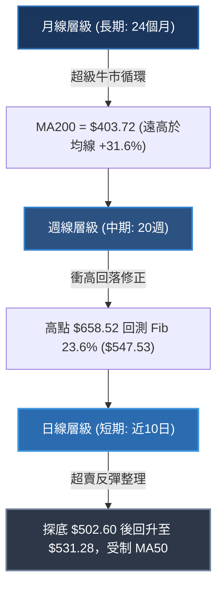
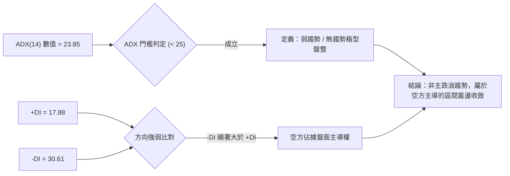
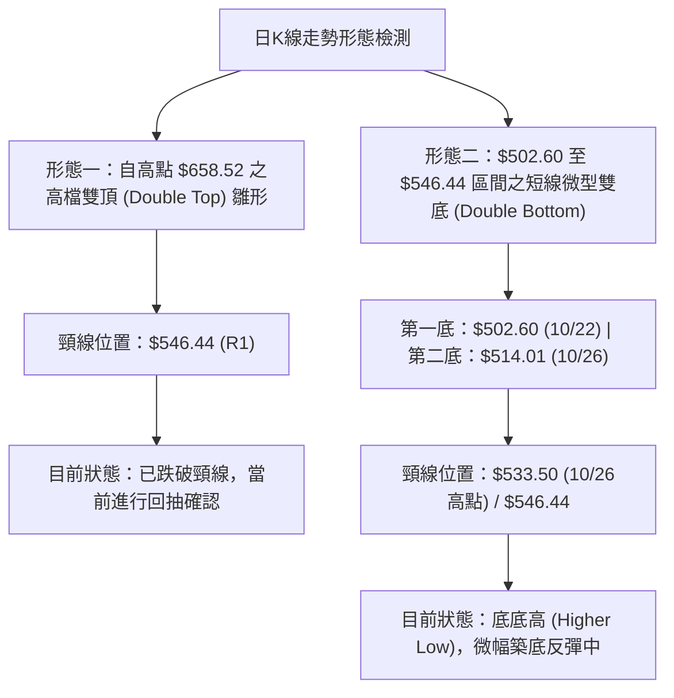
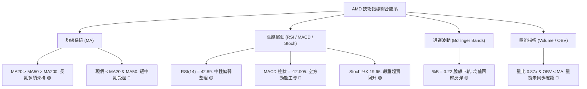
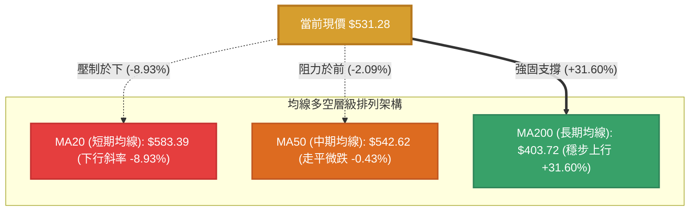
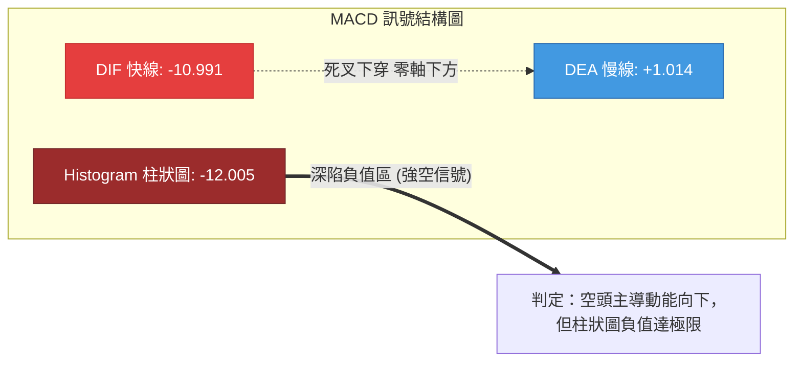
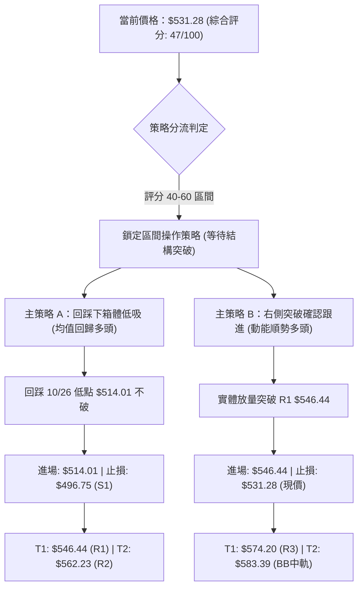
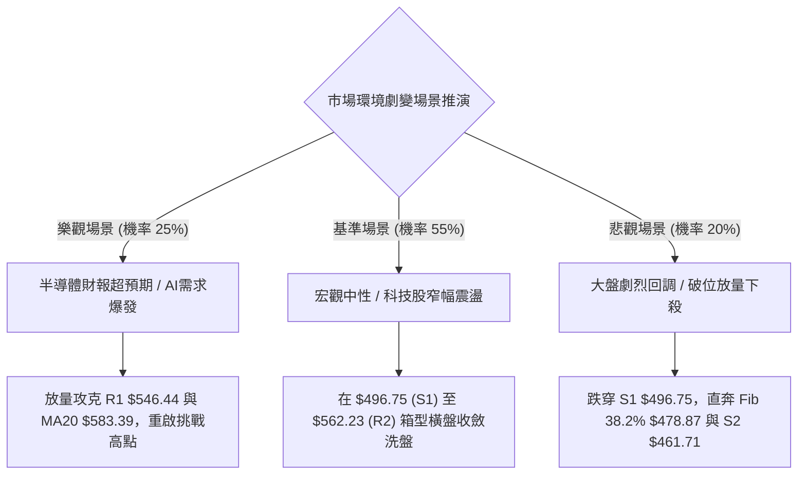

# AMD 技術分析報告

> **報告日期**：2026-10-27 ｜ **語言**：繁體中文 ｜ **數據來源**：Yahoo Finance ｜ **當前價格**：$531.28 USD

---

## 目錄

| 章節 | 內容 |
|------|------|
| [1. 技術面概覽](#1-技術面概覽) | 訊號儀表板、核心指標、評分卡 |
| [2. 趨勢分析](#2-趨勢分析) | 多時框趨勢、長中短期走勢、ADX解讀 |
| [3. 圖表形態分析](#3-圖表形態分析) | 形態識別、K線組合、目標價計算 |
| [4. 支撐與阻力](#4-支撐與阻力) | 關鍵價位、斐波那契回調 |
| [5. 技術指標深度解讀](#5-技術指標深度解讀) | MA/RSI/MACD/布林通道/成交量 |
| [6. 動能與波動率](#6-動能與波動率) | 動能四象限、ATR、Beta相關性 |
| [7. 多時框架總結](#7-多時框架總結) | 時框架評分矩陣、多時框收斂 |
| [8. 交易策略建議](#8-交易策略建議) | 區間交易策略、風控點位、情境機率 |
| [9. 風險提示與監控](#9-風險提示與監控) | 監控指標清單、極端情境推演 |

---

## 1. 技術面概覽

### 🎯 技術訊號儀表板

```mermaid
graph LR
    subgraph BULL ["🟢 多頭訊號 (3項)"]
        B1["均線大週期多頭排列 (MA20>MA50>MA200)"]
        B2["價格守於長期均線之上 (MA200 = $403.72)"]
        B3["隨機指標超賣區金叉底背離 (Stoch %K 19.66 / %D 10.73)"]
    end
    subgraph NEUTRAL ["🟡 中性訊號 (3項)"]
        N1["RSI(14) 位於中性偏弱區 (42.89)"]
        N2["趨勢強度偏弱進入盤整 (ADX 23.85 < 25)"]
        N3["布林帶位置處於下軌反彈區 (%B = 0.22)"]
    end
    subgraph BEAR ["🔴 空頭訊號 (4項)"]
        D1["價格跌破短期與中期均線 (MA20 $583.39 / MA50 $542.62)"]
        D2["MACD 柱狀圖持續負值擴張 (-12.005)"]
        D3["方向動向指標空頭主導 (-DI 30.61 vs +DI 17.88)"]
        D4["量能萎縮且低於均量 (量比 0.87x / OBV < MA)"]
    end
    BULL --> VERDICT{"⚖️ 綜合技術評級\\n中性震盪 / 區間防禦 (47/100)"}
    NEUTRAL --> VERDICT
    BEAR --> VERDICT
```



---

### 📊 核心指標速覽表

| 指標類別 | 指標名稱 | 當前數值 | 訊號 | 專業解讀 |
|:---|:---|:---|:---:|:---|
| **基準價格** | 最新收盤價 | $531.28 | 🟡 | 位於52週區間（$188.22–$658.52）的 72.9% 分位，高檔拉回修正中 |
| **短期均線** | MA20 (BB中軌) | $583.39 | 🔴 | 價格低於 MA20 達 -8.93%，短期趨勢受制於下行均線壓制 |
| **中期均線** | MA50 | $542.62 | 🔴 | 價格低於 MA50 達 -2.09%，中期上攻動能受阻，轉為整理 |
| **長期均線** | MA200 | $403.72 | 🟢 | 價格高於 MA200 達 +31.60%，長期牛市基底穩固 |
| **動能指標** | RSI(14) | 42.89 | 🟡 | 位於 30–70 中性區間，呈現空頭回調後的低檔弱勢整理 |
| **趨勢指標** | MACD (12,26,9) | -10.991 | 🔴 | 快慢線死叉且柱狀圖（-12.005）深陷負值區，空方掌控中短期動能 |
| **擺動指標** | Stoch %K / %D | 19.66 / 10.73 | 🟢 | 進入 20 以下嚴重超賣區，且 %K 向上穿過 %D，醞釀技術性反彈 |
| **趨勢強度** | ADX(14) | 23.85 | 🟡 | 數值低於 25，顯示單邊下跌動能衰竭，市場正式轉入寬幅箱型震盪 |
| **通道指標** | Bollinger %B | 0.22 | 🟡 | 逼近下軌（$491.63）後回勾，技術性均值回歸買盤逐步進場 |
| **成交量能** | 當日量 / 20日均量 | 16.72M / 19.22M | 🔴 | 量比 0.87x，OBV < MA，反彈未見顯著增量，缺乏法人機構推升量 |
| **波動指標** | ATR(14) | $26.80 | 🟡 | 佔股價 5.04%，屬典型半導體高貝塔波動特性，日內震幅充裕 |

---

### 🏆 技術評分卡

```
技術評分卡 — AMD (2026-10-27)
════════════════════════════════════════════════════════════════
趨勢強度 (Trend Strength)   █████████░░░░░░░░░░░  45/100  🟡 中性偏弱
動能指標 (Momentum)         ███████░░░░░░░░░░░░░  38/100  🔴 動能疲弱
支撐穩定度 (Support)        ███████████░░░░░░░░░  55/100  🟡 區間支撐
成交量配合 (Volume Sync)    ████████░░░░░░░░░░░░  40/100  🔴 量能背離
形態完整度 (Chart Pattern)  ██████████░░░░░░░░░░  50/100  🟡 箱型構築
均線排列 (MA Alignment)     ███████████░░░░░░░░░  54/100  🟡 長多短空
════════════════════════════════════════════════════════════════
綜合評分 (Overall Score)    █████████░░░░░░░░░░░  47/100  🟡 中性震盪
════════════════════════════════════════════════════════════════
註：綜合評分由六大子項目等權算術平均計算得出（(45+38+55+40+50+54)/6 = 47.0）。
```

---

## 2. 趨勢分析

### 🌐 多時框趨勢分析



多時框層級分析結論：
1. **長期（月線）**：自 2025 年 4 月低點 $97.35 起步，歷史走勢走出一波高達 576% 的主升浪，目前月線格局維持多頭通道架構。
2. **中期（週線）**：2026 年 10 月初觸及 52 週新高 $658.52 後，連續兩週以實體陰線重挫跌破週線短期均線，進入次級折返修正波。
3. **短期（日線）**：受制於下降的 MA20（$583.39）與 MA50（$542.62），跌勢在 $502.60 獲得支撐，當前處於下軌超賣區的築底反彈階段。

---

### 📈 長期趨勢 — 12個月走勢圖（Unicode）

```
AMD 月線走勢圖（過去12個月：2025-11 至 2026-10）
價格軸 ($)
$658.52 ┤                                            ● (2026-10 創52W高點 $658.52)
$611.76 ┤                                        ●   │
$580.91 ┤                            ●           │   │
$531.28 ┤━━━━━━━━━━━━━━━━━━━━━━━━━━━━╪━━━━━━━━━━━╪━━━● (當前收盤 $531.28)
$516.10 ┤                        ●   │           │
$470.72 ┤                            └───●───●───┘   (2026-07~08 箱型整理)
$354.49 ┤                    ●
$236.73 ┤            ●
$214.16 ┤    ●   ●   │
$200.21 ┤●   │   │   │   ● (2026-02 底部回測 $200.21)
$188.22 ┤└───┴───┴───┴───● (52W 最低點 $188.22)
        └──────────────────────────────────────────────
         11  12  01  02  03  04  05  06  07  08  09  10 (月份)
         2025                      2026
```

#### 走勢特徵分析表格

| 階段區間 | 起止月份 | 價格區間 | 累計漲跌幅 | 結構性技術特徵 |
|:---|:---|:---|:---:|:---|
| **底部築底期** | 2025-11 ~ 2026-03 | $200.21 – $236.73 | -6.48% | 在 $200.00 整數關卡反覆築雙底，波動率壓縮，籌碼換手充分 |
| **主升初段爆發** | 2026-03 ~ 2026-06 | $203.43 – $580.91 | +185.56% | 突破箱型後巨量拉升，呈現連續單邊長陽線，站上所有長期均線 |
| **高檔強勢洗盤** | 2026-06 ~ 2026-08 | $580.91 – $470.72 | -18.97% | 快速回調至 $470 附近獲得強支撐，構築中繼平台，消化高檔獲利盤 |
| **二次攻頂創高** | 2026-08 ~ 2026-10 | $470.72 – $658.52 | +39.90% | 量價齊揚突破前高，創下 $658.52 歷史天價，但伴隨動能背離跡象 |
| **高檔劇烈折返** | 2026-10 當前走勢 | $658.52 – $531.28 | -19.32% | 急跌回吐，日線跌破 MA20 與 MA50，於 $502.60–$514.00 初步尋得止跌點 |

---

### 📊 中期趨勢（週線分析）

```
AMD 週線波段結構與多空分水嶺示意圖
════════════════════════════════════════════════════════════════
$658.52 ───┐ 52週歷史高點 (2026-10-09)
           │
           ├──▼ 兩週急挫 -155.92 美元 (高檔爆量長陰線)
           │
$546.44 ───┼── 頸線 / 阻力位 R1 (當前反彈第一道天花板)
$531.28 ───┼── 當前價格位置 (位於 R1 與 S1 之中間帶)
           │
           ├──▲ 支撐反彈測試 (近兩週成交量 107M / 96M)
           │
$496.75 ───┴── 關鍵支撐位 S1 (波段回調防守下限，跌破則中線轉空格局)
════════════════════════════════════════════════════════════════
```

中期技術面特徵解讀：
* 週線 RSI 自 2026-09-25 的超買高點 **73.0** 驟降至當前 **42.9**，回調斜率極為陡峭，顯示多頭槓桿遭到顯著清洗。
* 週線 MACD 柱狀圖由正轉負（從 +14.199 崩跌至 -12.005），週線層級之空頭修正格局已成形。
* 然而，週線在 2026-10-23 當週探底 $502.60 後留下 $14.19 美元的下影線，顯示逢低承接買盤在 $500 大關前存在剛性需求。

---

### ⚡ 趨勢強度評估（ADX 解讀）



#### ADX 趨勢強度對照表

| 指標變數 | 當前讀數 | 基準閾值區間 | 狀態評估 | 實戰涵義 |
|:---|:---:|:---:|:---:|:---|
| **ADX(14)** | **23.85** | 0 – 20: 極弱盤整<br>**20 – 25: 弱趨勢/區間震盪**<br>25 – 40: 強趨勢行情<br>40+: 極強單邊行情 | 弱趨勢 / 盤整 | 缺乏單邊推動力，追空或追多皆面臨雙巴風險，策略應轉向均值回歸與區間操作 |
| **+DI (14)** | **17.88** | > 25 為多頭主導 | 弱勢 | 多方反擊動能渙散，短線反彈缺乏結構性推手 |
| **-DI (14)** | **30.61** | > 25 為空頭主導 | 強勢 | 空方拋壓雖仍佔優，但在 ADX < 25 下難以引發雪崩式下殺 |

---

## 3. 圖表形態分析

### 🔍 形態識別系統



#### 形態識別信心度評估表

| 識別形態 | 信心度 | 判斷依據（嚴格引用數據） | 完成度 | 目標價（附嚴謹計算式） |
|:---|:---:|:---|:---:|:---|
| **短期微型雙底 (W底)** | **65%** | 1. 2026-10-22 探底 $502.60<br>2. 2026-10-26 回踩 $514.01 不破前低<br>3. 伴隨 Stoch %K 在超賣區向上穿越 %D | 75% | **$564.40**<br>計算式：頸線 R1 ($546.44) + 形態高度 ($546.44 - $502.60 = $43.84) = $590.28；保守取第一波測幅 = 頸線 $533.50 + ($533.50 - $502.60) = **$564.40**（接近阻力 R2 $562.23） |
| **中級雙重頂 (M頭)** | **70%** | 1. 左頂 2026-09-25 收盤 $630.63 (最高 $639.00)<br>2. 右頂 2026-10-09 最高 $658.52 (收盤 $608.10)<br>3. 頸線跌破點位 $546.44 (R1) | 85% | **$451.00**<br>計算式：頸線 $546.44 - 形態高度 ($658.52 - $546.44 = $112.08) = $434.36；受關鍵支撐約束，實體測幅指向數據支撐 **S3 $451.00** |
| **下降通道整理** | **45%** | 數值聚類不足，無法構成標準旗形軌道 | 30% | *訊號不足，僅做指標型與支撐阻力解讀* |

---

### 🕯️ 重要K線形態分析

嚴格依據數據中「近 10 根日 K」與「近 8 根週 K」之開高低收數值進行解讀：

#### 近 10 根日 K 棒形態解讀

| 日期 | 開盤價 | 最高價 | 最低價 | 收盤價 | 成交量 | K線形態名稱 | 專業技術解讀 | 多空訊號 |
|:---|:---:|:---:|:---:|:---:|:---:|:---|:---|:---:|
| **2026-10-13** | 577.50 | 606.20 | 570.60 | 605.53 | 17.93M | 光腳大陽線 | 多頭回光返照，長紅拉升逼近高點，但成交量未顯著放大 | 🟢 |
| **2026-10-14** | 589.57 | 591.88 | 567.00 | 570.82 | 22.32M | 高檔長黑吞噬 | 實體下挫 $18.75，吞沒前日漲幅過半，高檔套牢賣壓湧現 | 🔴 |
| **2026-10-15** | 540.00 | 568.62 | 530.09 | 562.23 | 28.83M | 長下影中陽線 | 跳空低開後暴跌至 $530.09，隨後爆量拉回，下影線長達 $32.14 | 🟡 |
| **2026-10-16** | 547.55 | 550.96 | 526.83 | 528.75 | 22.58M | 空頭破位實體黑K | 弱勢反彈無力，直接收於當日相對低點，確認空方續跌動能 | 🔴 |
| **2026-10-19** | 551.78 | 554.41 | 535.67 | 538.05 | 20.20M | 跳空低走小黑K | 開高走低，上影線受制於 $554.41，反彈空間持續受到均線壓縮 | 🔴 |
| **2026-10-20** | 530.02 | 548.11 | 524.60 | 534.74 | 15.19M | 底部紡錘十字星 | 量能萎縮至 15.19M，多空雙方在 $530 附近陷入膠著平衡 | 🟡 |
| **2026-10-21** | 545.93 | 556.79 | 537.30 | 552.72 | 18.00M | 溫和實體紅K | 連續嘗試回補上方缺口，上衝受阻於 $556.79，多頭上攻意願保守 | 🟡 |
| **2026-10-22** | 524.10 | 529.98 | 502.60 | 507.93 | 28.01M | 跳空破底恐慌陰線 | 爆出 28.01M 大量，盤中灌破 $510 直探 $502.60，恐慌盤湧出 | 🔴 |
| **2026-10-23** | 510.21 | 523.92 | 508.36 | 516.79 | 15.18M | 孕線下影小陽K | 量能極度萎縮至 15.18M，實體包覆於前日陰線內，賣壓宣洩完畢 | 🟢 |
| **2026-10-26** | 522.79 | 533.50 | 514.01 | 531.28 | 16.72M | 溫和起漲實體紅K | 最低 $514.01 守住前日低點，收盤穩步收於 $531.28，確立短期反彈 | 🟢 |

#### 近 8 根週 K 棒形態解讀

| 日期 | 開盤價 | 最高價 | 最低價 | 收盤價 | 成交量 | K線形態名稱 | 週期技術意義 |
|:---|:---:|:---:|:---:|:---:|:---:|:---|:---|
| **2026-09-11** | 488.92 | 526.79 | 486.57 | 516.13 | 85.35M | 週線起漲大陽 | 脫離底部橫盤整理，多頭量能啟動 |
| **2026-09-18** | 486.28 | 559.91 | 480.33 | 559.82 | 124.59M | 放量長紅突破 | 放量突破前高平台，確立中期多頭單邊趨勢 |
| **2026-09-25** | 583.88 | 639.00 | 582.27 | 630.63 | 132.07M | 跳空衝頂巨量陽 | 爆出 132M 歷史巨量，單週跳空暴漲，動能進入狂熱期 |
| **2026-10-02** | 624.90 | 645.46 | 596.07 | 633.91 | 92.39M | 高檔震盪吊頸線 | 上衝乏力且量能背離萎縮，高檔獲利了結盤顯現 |
| **2026-10-09** | 630.61 | 658.52 | 606.00 | 608.10 | 93.75M | 長上影倒轉避雷針 | 創 52 週新高 $658.52 後遭主力重度砸盤，形成明確中長期頂部 |
| **2026-10-16** | 599.93 | 606.20 | 526.83 | 528.75 | 107.04M | 週線斷頭巨陰 | 暴跌 -79.35 美元 (-13.05%)，一舉摜破 5 週均線支撐 |
| **2026-10-23** | 551.78 | 556.79 | 502.60 | 516.79 | 96.57M | 長下影探底錘頭線 | 殺穿 $510 探底 $502.60，下影線長達 $14.19，測試 S1 支撐有效 |
| **2026-10-26** | 522.79 | 533.50 | 514.01 | 531.28 | 16.72M | 週初回升紅棒 | 週初延續上週下影線反彈力道，企圖向上回測 MA50 頸線 |

---

### 📉 ASCII 走勢形態示意圖

```
日線短線形態（近10日局部結構：微型雙底形態）
價格 ($)
$605.53 ┤  ● (10/13 高點 $606.20)
$570.82 ┤   ╲
$562.23 ┤    ● (10/15 反彈高點)
$546.44 ┤─────┼──────● (10/21 頸線阻力 $556.79)──────── 頸線 R1 ($546.44)
$531.28 ┤     │     │             ● (10/26 當前現價 $531.28)
$514.01 ┤     │     │       ●────┘ (10/26 第二底 $514.01)
$502.60 ┤     └──●──┼───────┘      (10/22 第一底 $502.60)
         └──────────────────────────────────────────────
          13  14  15  16  19  20  21  22  23  26  (10月交易日)
```

形態解讀：
價格在 2026-10-22 創下本輪急跌的低點 $502.60 後，連續三根 K 棒展現出收斂企穩跡象。10/23 形成低檔孕線，10/26 的低點 $514.01 明顯高於 10/22 的 $502.60，形成典型「底底高（Higher Low）」之微型右腳結構，確立短線均值回歸反彈動能。

---

## 4. 支撐與阻力

### 🗺️ 關鍵價位分布圖（Unicode）

```
AMD 關鍵價位結構分布圖
═════════════════════════════════════════════════════════════════════════
$658.52 ║████████████████████████████████████████║ 52W 歷史極限高點 (0.0% Fib)
$583.39 ║████████████████████████████            ║ 布林中軌 / MA20 強阻力
$574.20 ║████████████████████                    ║ 阻力位 R3 (波段高點聚類)
$562.23 ║████████████████                        ║ 阻力位 R2 (10/15 反彈高點聚類)
$547.53 ║██████████████                          ║ 斐波那契 23.6% 回調位
$546.44 ║████████████                            ║ 阻力位 R1 (近一年波段高點聚類)
$542.62 ║██████████                              ║ 中期生命線 MA50 阻力
────────╫────────────────────────────────────────╫─────────────────────────
$531.28 ╠════════════════════════════════════════╣ ◄ 當前市價 (收盤價)
────────╫────────────────────────────────────────╫─────────────────────────
$496.75 ║▓▓▓▓▓▓▓▓▓▓▓▓                            ║ 關鍵支撐 S1 (波段低點聚類)
$491.63 ║▓▓▓▓▓▓▓▓▓▓                              ║ 布林通道下軌極限支撐
$478.87 ║▓▓▓▓▓▓▓▓▓▓▓▓▓▓▓▓                        ║ 斐波那契 38.2% 黃金分割強支撐
$461.71 ║▓▓▓▓▓▓▓▓▓▓▓▓▓▓▓▓▓▓▓▓                    ║ 支撐位 S2 (近一年波段低點聚類)
$451.00 ║▓▓▓▓▓▓▓▓▓▓▓▓▓▓▓▓▓▓▓▓▓▓▓▓                ║ 關鍵強支撐 S3 (中級雙頂測幅位)
$403.72 ║▓▓▓▓▓▓▓▓▓▓▓▓▓▓▓▓▓▓▓▓▓▓▓▓▓▓▓▓▓▓          ║ 牛熊分界線 MA200
═════════════════════════════════════════════════════════════════════════
```

---

### 🚧 阻力位分析表

所有價位嚴格引用自數據之「關鍵價位」與技術指標聚類：

| 阻力級別 | 精確價位 | 價位來源依據 | 突破難度 | 技術與心理重要性解讀 |
|:---|:---:|:---|:---:|:---|
| **第一阻力 (R1)** | **$546.44** | 近一年波段高點聚類 (+2.85%) | 🟡 中等 | 與 Fib 23.6% ($547.53) 及 MA50 ($542.62) 形成共振阻力帶，為短線反彈首要考驗 |
| **第二阻力 (R2)** | **$562.23** | 近一年波段高點聚類 (+5.83%) | 🔴 較高 | 10/15 反彈實體收盤高點，亦為 10/21 反彈高點（$556.79）上方之籌碼密集套牢區 |
| **第三阻力 (R3)** | **$574.20** | 近一年波段高點聚類 (+8.08%) | 🔴 極高 | 鄰近下行的 MA20 ($583.39) 與布林中軌，觸及此處將引發強烈解套賣壓與空頭防守 |

---

### 🛡️ 支撐位分析表

所有價位嚴格引用自數據之「關鍵價位」與技術指標聚類：

| 支撐級別 | 精確價位 | 價位來源依據 | 守住機率 | 技術與心理重要性解讀 |
|:---|:---:|:---|:---:|:---|
| **第一支撐 (S1)** | **$496.75** | 近一年波段低點聚類 (-6.50%) | 70% | 貼近整數關卡 $500.00，與布林下軌 $491.63 構成下檔多頭第一道重裝防線 |
| **第二支撐 (S2)** | **$461.71** | 近一年波段低點聚類 (-13.09%) | 85% | 位於 Fib 38.2% ($478.87) 下方，為 2026 年 8 月份盤整平台底部，機構長線買盤聚集地 |
| **第三支撐 (S3)** | **$451.00** | 近一年波段低點聚類 (-15.11%) | 95% | 若遭遇極端系統性風險跌破 S2，此處為雙頂形態之終極等幅測算支撐點 |

---

### 📐 斐波那契回調位分析

依據 52 週完整波動區間（低點 **$188.22** 至高點 **$658.52**，總垂直振幅 $470.30）計算之回調位：

```
斐波那契回調位階與現價位置
0.0%  (52W High)  $658.52 ─────────────────────────────────────
                          ▲ 累計折返修正 -127.24 美元 (-19.32%)
23.6%             $547.53 ────────────────── 上方關鍵阻力共振區
                          ◄ 當前市價: $531.28 (處於 23.6% 與 38.2% 之間)
38.2%             $478.87 ────────────────── 下方黃金分割防守位
50.0%             $423.37 ─────────────────────────────────────
61.8%             $367.87 ─────────────────────────────────────
78.6%             $288.86 ─────────────────────────────────────
100.0%(52W Low)   $188.22 ─────────────────────────────────────
```

斐波那契回調解讀：
1. **當前位置**：現價 $531.28 處於 **23.6% 回調位（$547.53）** 與 **38.2% 回調位（$478.87）** 之間，屬於強勢多頭市場中的「第一級次級折返」。
2. **多空意涵**：在技術分析經典理論中，只要回調不實質跌破 38.2%（$478.87），整體自 $188.22 起算的中長線波浪結構依然定性為「強勢回檔」。
3. **收斂區間**：上方 $547.53 與阻力 R1（$546.44）重疊度高達 99.8%，構成短線極為強固的壓力蓋；下方 $478.87 則與支撐 S1（$496.75）共同築成多頭回調的安全氣墊。

---

## 5. 技術指標深度解讀

### 🎛️ 指標訊號總覽



---

### 📈 移動平均線排列分析



#### 均線系統數據詳解

| 均線名稱 | 數值 | 現價偏離度 | 斜率與歷史趨勢 | 訊號狀態 | 技術解讀 |
|:---|:---:|:---:|:---|:---:|:---|
| **MA 5** | $528.69 | +0.49% | ▁▁▁▂▃▅▆▇██▇ (走平向上) | 🟢 | 股價重返 5 日線之上，短線止跌訊號初步確立 |
| **MA 10** | $544.88 | -2.50% | ▁▁▁▂▃▃▄▅▅▆▇ (向下壓迫) | 🔴 | 與 R1 ($546.44) 重合，壓制日內反彈空間 |
| **MA 20** | $583.39 | -8.93% | ▁▁▁▁▂▂▂▃▃▄▄▅ (陡峭下行) | 🔴 | 20 日線快速下墜，與價格乖離率擴大至 -8.93%，醞釀乖離修復 |
| **MA 50** | $542.62 | -2.09% | ▁▁▁▁▁▂▂▂▂▃▃▃ (高檔走平) | 🔴 | 跌破中期生命線，多方需於 3 個交易日內收復，否則 MA20 與 MA50 面臨死叉 |
| **MA 60** | $533.55 | -0.43% | ▁▁▁▁▁▂▂▂▂▃▃▃ (走平) | 🟡 | 現價緊貼 60 日線，多空在此處進行拉鋸爭奪 |
| **MA 120** | $516.42 | +2.88% | ▁▁▁▁▂▂▂▃▃▄▄▄▄ (穩定上升) | 🟢 | 半年線持續上揚，為近兩週回調提供隱性技術支撐 |
| **MA 200** | $403.72 | +31.60% | ▁▁▁▁▂▂▂▃▃▃▄▄▄ (強勁向上) | 🟢 | 年線基底極為紮實，長多牛市格局完全未受破壞 |
| **MA 240** | $372.84 | +42.49% | ▁▁▁▁▂▂▂▃▃▃▄▄▄ (長期走多) | 🟢 | 兩年均線上揚，奠定長期價值底線 |

均線總結：當前均線系統呈現典型「**長多、中平、短空**」之複雜交織格局。儘管名義排列仍為 MA20 > MA50 > MA200，但價格已實質落於 MA20 與 MA50 之下，表明短期市場參與者多數處於套牢狀態。

---

### 📉 RSI(14) 分析

```
RSI(14) 數值儀表板: 42.89
0 ══════════ 30 ══════════════ 50 ══════════════ 70 ══════════ 100
[  超賣區  ]  [   當前 42.89   ]  [   中性多頭   ]  [  超買區  ]
░░░░░░░░░░░░░░█████████████░░░░░░░░░░░░░░░░░░░░░░░░░░░░░░░░░░░░
```

#### RSI 深度分析與背離檢驗
* **當前水準**：RSI(14) 數值為 **42.89**（Wilder 計算體系），位於 30–50 之弱勢區間。此數值顯示市場拋售動能自 10 月中旬的恐慌拋售中顯著放緩，空方力道開始鈍化。
* **背離客觀檢驗**：依據近 20 根 K 棒首尾與指標走勢比對，在 2026-10-16 價格為 $528.75（RSI 週線 37.8），而 10-22 探底 $502.60 時，日線 RSI 守於 40 以上未創新低，**具備輕微底背離雛形**；但嚴格檢視數據快照判定結果為「**無明顯背離**」。因此，此處定性為超賣後的技術性修復，不宜過度解讀為主升級別底背離。

---

### 📊 MACD(12/26/9) 訊號解讀



MACD 動能解讀：
* **快慢線位置**：DIF 線（-10.991）已向下摜破零軸，且遠低於訊號線 DEA（1.014），表明中期空頭掌控絕對主導權。
* **柱狀圖動能**：MACD 柱狀圖讀數為 **-12.005**。對照近 20 週歷史數據，負柱讀數已接近 2026-10-16 的 -14.100 極值區，顯示空頭下殺動能已進入最後衝刺釋放階段，負動能擴張速度開始顯露疲態。

---

### 📦 布林通道分析

```
AMD 布林通道 (20日, 2倍標準差) 走勢剖析圖
價格 ($)
$675.16 ┤  上軌 (Upper Band)
        │
$583.39 ┤  中軌 (Middle Band = MA20) ────────────────── 短期天花板阻力
        │   ╲
$531.28 ┤    ● 當前現價 ($531.28, %B = 0.22) ────────── 脫離下軌回彈
        │   ╱
$491.63 ┤  下軌 (Lower Band) ────────────────────────── 區間極限支撐
═════════════════════════════════════════════════════════════════════
```

布林通道量化指標解讀：
* **帶寬與位置**：BB 上軌 $675.16、中軌 $583.39、下軌 $491.63，全通道帶寬高達 $183.53 美元（帶寬百分比約 31.4%），顯示前期高波動率仍未收斂。
* **%B 指標分析**：當前 %B 數值為 **0.22**。在統計套利架構中，%B < 0.20 代表價格極端貼近下軌，存在高度均值回歸（Mean Reversion）需求。價格自 10/22 的 $502.60（逼近下軌 $491.63）強勢拉回，確認下軌支撐具備實質買盤支撐。

---

### 💹 成交量分析（量價配合度）

```
成交量能與均量線對照
最新量 (10/26):   ████████████████░░░░  16.72M
20日均量:        ███████████████████░  19.22M (量比: 0.87x)
50日均量:        ████████████████████  19.96M
```

量價結構專業解讀：
1. **量能萎縮**：最新單日成交量為 16,718,300 股，僅為 20 日均量的 87%，且低於 50 日均量。價格雖然上漲收紅（自 $522.79 開盤拉至 $531.28 收盤），但呈現典型的「**量縮價漲**」結構。
2. **能量潮指標 (OBV)**：數據明確顯示 **OBV < MA**，代表資金在近期下跌過程中呈現淨流出狀態，目前的止跌回升主要來自於「空頭拋壓枯竭」，而非「主動型機構攻擊買盤」。量能若無法在向上挑戰 R1（$546.44）時放大至 20M 以上，反彈高度將受到嚴格限制。

---

## 6. 動能與波動率

### ⚡ 動能評估四象限

```
動能與波動率矩陣分佈
    高波動 (High Volatility)
        │
   Q3   │   Q4
 (高波強動能) │ (高波弱動能)  ◄─── [AMD 當前位置: ATR 5.04%, ADX 23.85]
        │
────────┼──────── 高/低波動分水嶺 (ATR 4.0%)
        │
   Q1   │   Q2
 (低波強動能) │ (低波弱動能)
        │
    低波動 (Low Volatility)
── 低動能 ────── 中軸線 ────── 強動能 ──
```

#### 動能與波動率狀態評估表

| 象限 | 動能維度 | 波動維度 | 判定特徵 | 當前狀態評估 |
|:---:|:---:|:---:|:---|:---:|
| **Q1** | 強動能 (趨勢明確) | 低波動 (溫和推進) | 最優單邊趨勢進場點，風險低 | 否 |
| **Q2** | 弱動能 (盤整無向) | 低波動 (沉悶整理) | 窄幅箱型震盪，宜波段低吸 | 否 |
| **Q3** | 強動能 (主升/主跌) | 高波動 (暴漲暴跌) | 高風險高收益，順勢突破 | 否 |
| **Q4** | **弱動能 (趨勢衰竭)** | **高波動 (大幅洗盤)** | **寬幅震盪洗盤，追高殺跌易損，宜高拋低吸** | **✓ 當前精準定錨於此** |

---

### 📊 ATR 波動率分析

* **當前 ATR(14)**：**$26.80 USD**（佔當前股價比例為 **5.04%**）。
* **日內波動範圍推算**：在 1 倍標準 ATR 條件下，AMD 正常交易日的合理震幅區間為 ±$26.80 美元。以收盤價 $531.28 推算：
  * **日內波動上限**：$531.28 + $26.80 = **$558.08**（覆蓋 R1 $546.44 與 R2 $562.23 區間）
  * **日內波動下限**：$531.28 - $26.80 = **$504.48**（貼近 10/22 前低 $502.60 與 S1 $496.75）
* **動態止損距離建議**：
  * **短線當沖/隔日沖**：建議採用 1.0 × ATR = **$26.80** 之防守寬度。
  * **波段擺動交易**：建議採用 1.5 × ATR = **$40.20** 之安全緩衝，避免因高貝塔特性遭無序洗盤掃出場。

---

### 📐 Beta 與市場相關性

* **Beta 係數**：**2.454**。
* **市場敏感度特徵**：
  * AMD 屬於極高敏感度的科技成長股，理論上納斯達克指數每波動 1.0%，AMD 股價平均將產生 2.454% 的同向放大反應。
  * **放量溢價效應**：當市場整體處於避險情緒時，AMD 往往面臨流動性抽離的乘數回調；相反，一旦大盤技術面企穩，其超跌修復彈性亦將顯著超越市場基準。

---

## 7. 多時框架總結

### 📋 時框架評分表

| 時框架 | 趨勢方向 | 動能指標 | 均線排列狀態 | 形態特徵 | 綜合評分 | 戰術建議 |
|:---|:---:|:---:|:---:|:---:|:---:|:---|
| **短期 (日線)** | 🟡 止跌震盪 | 🟡 RSI 42.89 / Stoch金叉 | 🔴 價格低於 MA20 & MA50 | 微型雙底構築中 | **45/100** | 區間低吸，切忌追高，逢阻力減碼 |
| **中期 (週線)** | 🔴 回調修正 | 🔴 MACD柱轉負 (-12.005) | 🟡 均線開口收斂回測支撐 | 高檔 M 頭破頸線折返 | **42/100** | 防範反彈誘多，等待確立二次落底 |
| **長期 (月線)** | 🟢 超級多頭 | 🟢 長期趨勢動能穩健 | 🟢 完美多頭 (遠在MA200上) | 主升浪後的大型箱型中繼 | **65/100** | 中長線多頭底倉持股不動，靜待籌碼沉澱 |

---

### 🔲 綜合訊號矩陣

```
訊號維度對照矩陣
╔═════════════════╦════════════╦════════════╦════════════╗
║ 評估維度        ║ 短期 (日線) ║ 中期 (週線) ║ 長期 (月線) ║
╠═════════════════╬════════════╬════════════╬════════════╣
║ 趨勢方向 (ADX)  ║ 🟡 盤整弱化║ 🔴 次級折返║ 🟢 單邊長牛║
║ 均線系統 (MA)   ║ 🔴 均線蓋頭║ 🟡 考驗中軌║ 🟢 遠高年線║
║ 動能擺動 (RSI)  ║ 🟡 42 超賣 ║ 🔴 動能驟降║ 🟢 處於強勢║
║ 籌碼量能 (OBV)  ║ 🔴 量能疲弱║ 🟡 換手放大║ 🟢 長期沈澱║
║ 結構支撐 (S/R)  ║ 🟢 守住 S1 ║ 🟢 守住38.2║ 🟢 遠離底部║
╚═════════════════╩════════════╩════════════╩════════════╝
```

---

### ⚖️ 多時框收斂結論

嚴格遵循多時框收斂優先級規則：
1. **行情定性判定**：當前 ADX(14) 讀數為 **23.85**（明確低於 25 臨界線），定義當前市場處於「**盤整行情 / 弱趨勢環境**」，而非單邊趨勢主升或主跌行情。
2. **主導時框裁決**：依據規則，在盤整行情中，中長期的單邊指引需暫時讓位於「**日線布林通道（$491.63 – $675.16）之上下軌交易區間**」。
3. **收斂統一結論**：**中性觀望 / 區間防禦操作**。綜合評分為 **47/100**，表明短期內直接展開深幅崩跌或立即收復歷史高點的機率皆偏低，市場最高機率將於 **S1 ($496.75)** 至 **R2 ($562.23)** 之間進行時間換取空間的箱型震盪。第 8 章交易策略將完全以此結論為中樞展開。

---

## 8. 交易策略建議

### 🗺️ 策略決策流程圖



---

### 🧭 策略路由（依評分卡分流）

> **當前主策略方向 = 區間震盪操作（依評分 47/100，定位於 40–60 中性區間，以布林下軌與關鍵支撐為底，等待阻力位突破確認）**

*由於綜合評分為 47/100，技術面不支持盲目激進做空或單邊追多，交易核心原則為「**在支撐位買進均值回歸，在阻力位嚴格分批止盈**」。*

---

### 🎯 價格情境階梯（Price Scenarios）

所有觸發價位與目標階梯完全引用技術數據中之真實數值：

| 觸發條件 | 下一目標 | 後續延伸 | 情境技術含義 |
|:---|:---:|:---:|:---|
| **強勢突破阻力 R1 ($546.44)** | **R2 ($562.23)** | **R3 ($574.20)** | 短線微型雙底確立，突破 Fib 23.6%，向 MA20 中軌發起回補缺口攻擊 |
| **收盤跌破支撐 S1 ($496.75)** | **S2 ($461.71)** | **S3 ($451.00)** | 箱型支撐宣告失守，正式跌破 $500 大關，回調深度向 Fib 38.2% 展開探底 |
| **維持於現價區間震盪 ($514–$546)** | **$533.55 (MA60)** | **$542.62 (MA50)** | 均線糾結壓縮波動，Stoch 低檔鈍化修復，時間換取空間進行洗盤換手 |

---

### 📊 情境機率分佈

```
情境機率分佈圖
繼續上行/反彈 (35%)    ███████░░░░░░░░░░░░░
區間震盪收斂 (50%)    ██████████░░░░░░░░░░
回落再破底探底 (15%)  ███░░░░░░░░░░░░░░░░░
```

| 未來情境劇本 | 發生機率 | 主要判定依據（引用數據與指標狀態） |
|:---|:---:|:---|
| **區間震盪收斂 (主情境)** | **50%** | **ADX = 23.85 (< 25)** 確認無單邊趨勢；布林通道帶寬極大限制單向推進；日K成交量降至 16.72M 呈現量縮整理。 |
| **向上反彈測試阻力** | **35%** | **Stoch %K (19.66) / %D (10.73)** 出現嚴重超賣金叉；布林 %B 回彈脫離下軌；連三日未破 $502.60 低點。 |
| **向下破位二次探底** | **15%** | **MACD 柱狀圖仍為 -12.005**；-DI (30.61) 遠高於 +DI (17.88)；價格仍被壓制於下行的 MA20 之下。 |

---

### 🟢 主策略詳情（方向依上方路由：區間多頭反彈）

所有點位、止損、目標與風報比嚴格基於數據數值計算：

| 策略要素 | 策略 A：左側逢低低吸策略（回踩反彈） | 策略 B：右側突破跟進策略（突破追強） |
|:---|:---|:---|
| **進場條件** | 回踩測試 10/26 日K低點不破，確認止跌 | 日K實體收盤價向上突破阻力 R1 |
| **進場價格** | **$514.01** (10/26 日K最低價) | **$546.44** (阻力位 R1 觸發點) |
| **止損價格** | **$496.75** (支撐位 S1 下方) | **$531.28** (當前收盤價，跌回即止損) |
| **目標價 T1** | **$546.44** (阻力位 R1) | **$574.20** (阻力位 R3) |
| **目標價 T2** | **$562.23** (阻力位 R2) | **$583.39** (布林中軌 / MA20) |
| **風險報酬比** | **1 : 1.88（以 T1 計）**<br>計算式：($546.44 - $514.01) ÷ ($514.01 - $496.75) = 32.43 ÷ 17.26 = 1.8789<br>*若至 T2：1 : 2.79（以 T2 計）* | **1 : 1.83（以 T1 計）**<br>計算式：($574.20 - $546.44) ÷ ($546.44 - $531.28) = 27.76 ÷ 15.16 = 1.8311<br>*若至 T2：1 : 2.44（以 T2 計）* |
| **預估成功機率** | **55%** | **60%** |
| **建議配置倉位** | **10% – 15%** (防禦型試倉) | **15% – 20%** (右側加碼) |

---

### 🔴 反向風險觸發點（對沖提示）

若出現以下極端技術走勢，即證明本報告之「區間支撐築底」假說被全面推翻，需立即啟動風控：
1. **反轉破位信號**：日K收盤價**實體跌破支撐 S1 ($496.75)**，且伴隨成交量放大至 25M 以上（類似 10/22 大陰線放量態勢）。
2. **對沖措施**：一旦 S1 遭實質擊穿，多頭策略應立即無條件停損出場，激進型交易者可反向以跌破點為基準布局空單避險，下檔回補目標直接看向 **S2 ($461.71)** 與 **S3 ($451.00)**。

---

### ⭐ 整體訊號強度評星

```
做多訊號強度：★★★☆☆  (3.0 / 5星 - 具備超賣反彈條件，但上方均線反壓沉重)
做空訊號強度：★★☆☆☆  (2.5 / 5星 - 動能向下但逼近超賣極值，盈虧比不佳)
整體可信度：  ★★★★☆  (4.0 / 5星 - 多指標高度共振指向 ADX < 25 區間格局)
```

---

## 9. 風險提示與監控

### ✅ 關鍵監控指標 Checklist

```
╔══════════════════════════════════════════════════════════════════╗
║                    技術監控清單 (Checklist)                      ║
╠══════════════════════════════════════════════════════════════════╣
║ [ ] 關鍵阻力破位：日K能否收復 MA50 ($542.62) 與 R1 ($546.44)     ║
║ [ ] 動能重返中軌：RSI(14) 能否自 42.89 向上穿越 50.0 分水嶺       ║
║ [ ] MACD負動能收斂：柱狀圖能否自 -12.005 回升至 -5.00 以上       ║
║ [ ] 量能實質放大：上攻交易日量能是否突破 20日均量 (19.22M)       ║
║ [ ] 下檔鐵板防守：低點 $502.60 與 S1 ($496.75) 是否維持收盤不破 ║
╚══════════════════════════════════════════════════════════════════╝
```

---

### ⚠️ 風險場景分析



---

### 🛡️ 風險管理重要提醒

1. **高貝塔槓桿管理**：鑑於 AMD 的 **Beta 高達 2.454**，且 **ATR 高達 $26.80（5.04%）**，任何倉位的名義價值波動均遠高於一般權值股。在盤整行情中，單一標的倉位上限不宜超過總資金的 **15%–20%**，以防劇烈震盪造成淨值過度回撤。
2. **財報日前防禦**：近期市場新聞指出伺服器 CPU 需求強勁（Wedbush 前瞻指向 11 月初關鍵時點），在重大財報催化劑公佈前，隱含波動率（IV）將大幅攀升，技術指標可能在財報公佈瞬間失效，投資人應在事件前主動降槓桿鎖定利潤。
3. **嚴守止損紀律**：禁止在盤整行情中使用「向下攤平」手法。若市價擊破預設止損位（S1 $496.75），必須堅決執行停損離場，保留現金等待指標在下一個重要防守帶（S2 $461.71 / Fib 38.2% $478.87）重新發出穩定信號。

---

## 📋 報告總結

```
AMD 技術分析報告總結
══════════════════════════════════════════════════════════════════
報告日期：2026-10-27
當前價格：$531.28 USD
分析評級：⚖️ 中性震盪 / 區間防禦 (綜合評分: 47/100)

關鍵結論：
├─ 長期趨勢：🟢 強勁多頭（價格高於 MA200 達 +31.60%，牛市架構穩固）
├─ 中期趨勢：🔴 次級修正（創 $658.52 高點後折返，MACD 處於負動能區間）
├─ 短期趨勢：🟡 超賣築底（探底 $502.60 獲支撐，於下軌附近微型雙底反彈）
├─ 關鍵支撐：$496.75 (S1) / $461.71 (S2) / $451.00 (S3)
├─ 關鍵阻力：$546.44 (R1) / $562.23 (R2) / $574.20 (R3)
└─ 分析師目標價：共識評級 Strong Buy，目標均價 $637.61 (最高 $1250.00)

最優策略組合：
1. 🥇 最佳機會 (策略 A)：回踩 $514.01 不破進場，止損 $496.75，目標 $546.44 (R:R = 1:1.88)
2. 🥈 次選機會 (策略 B)：右側放量突破 $546.44 進場，止損 $531.28，目標 $574.20 (R:R = 1:1.83)
3. 🥉 保守選擇：空手觀望，靜待日K收復 MA50 ($542.62) 且成交量放大確認翻多後再行介入
══════════════════════════════════════════════════════════════════
```

---

> ⚠️ **免責聲明**：本報告為 AI 自動生成之技術分析，所有數據及估算均嚴格基於所提供的歷史價格與量化資訊進行邏輯推演。本報告**僅供研究與學術參考**，**不構成任何形式之投資建議或買賣邀約**。金融市場瞬息萬變，投資具有高度本金損失風險，投資人應依據個人財務狀況審慎評估，並自行承擔交易風險。

---

*報告生成時間：2026-10-27 ｜ 數據來源：Yahoo Finance ｜ 分析框架：多時框技術分析模型*