# AMD 技術分析報告

> **報告日期**：2026-10-28 ｜ **語言**：繁體中文 ｜ **數據來源**：Yahoo Finance ｜ **當前價格**：$560.26

---

## 目錄

| 章節 | 內容 |
|------|------|
| [1. 技術面概覽](#1-技術面概覽) | 訊號儀表板、核心指標、評分卡 |
| [2. 趨勢分析](#2-趨勢分析) | 多時框趨勢、長中短期走勢 |
| [3. 圖表形態分析](#3-圖表形態分析) | 形態識別、K線組合、目標價 |
| [4. 支撐與阻力](#4-支撐與阻力) | 關鍵價位、斐波那契回調 |
| [5. 技術指標深度解讀](#5-技術指標深度解讀) | MA/RSI/MACD/布林/成交量 |
| [6. 動能與波動率](#6-動能與波動率) | 動能評估、ATR、Beta |
| [7. 多時框架總結](#7-多時框架總結) | 時框架評分矩陣 |
| [8. 交易策略建議](#8-交易策略建議) | 多空策略、風險報酬比 |
| [9. 風險提示與監控](#9-風險提示與監控) | 監控指標、風險場景 |

---

## 1. 技術面概覽

### 🎯 技術訊號儀表板

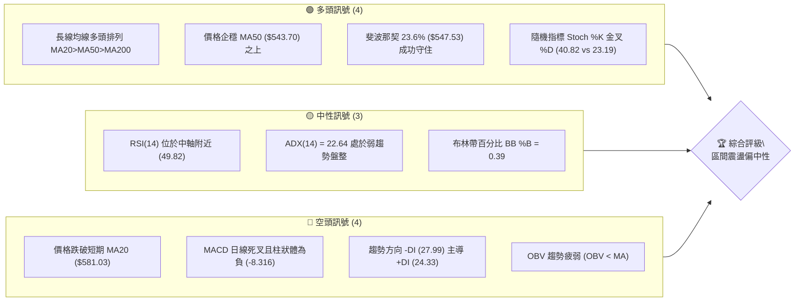

### 📊 核心指標速覽表

| 指標類別 | 指標名稱 | 當前數值 | 訊號 | 解讀 |
|----------|----------|----------|------|------|
| **價格** | 當前收盤價 | $560.26 | 🟡 | 位於52週高低區間 79.1%，短線處於回調後的反彈爭奪期 |
| **均線** | MA20 (月線) | $581.03 | 🔴 | 價格在 MA20 下方 (-3.57%)，短線承壓 |
| **均線** | MA50 (季線) | $543.70 | 🟢 | 價格在 MA50 上方 (+3.05%)，中期多頭架構未破 |
| **均線** | MA200 (年線) | $405.50 | 🟢 | 價格遠高於 MA200 (+38.16%)，長期多頭趨勢堅挺 |
| **動能** | RSI(14) | 49.82 | 🟡 | 位於 30-70 中性平衡區間，無極端超買或超賣 |
| **動能** | MACD (12,26,9) | -9.382 | 🔴 | 訊號線 -1.066，柱狀體 -8.316，空頭動能仍在釋放 |
| **趨勢** | ADX(14) | 22.64 | 🟡 | 數值低於 25，表明短線趨勢動能衰退，進入震盪洗盤 |
| **動向** | +DI / -DI | 24.33 / 27.99 | 🔴 | -DI 大於 +DI，空頭力量暫時佔優 |
| **通道** | 布林通道 %B | 0.39 | 🟡 | 位於中軌 ($581.03) 與下軌 ($489.45) 之間偏中下段 |
| **成交量** | 量比 (20日) | 1.06x | 🟡 | 成交量 2,053 萬股接近 20 日均量，但 OBV 呈疲弱背離 |
| **波動** | ATR(14) | $27.21 | 🔴 | 佔股價 4.86%，每日波動幅度劇烈，需寬幅止損防護 |

### 🏆 技術評分卡

```
╔══════════════════════════════════════════════════════════════╗
║                技術評分卡 — AMD (2026-10-28)                 ║
╠══════════════════════════════════════════════════════════════╣
║ 趨勢強度 (ADX=22.64, 震盪)   ████████░░░░░░░░░░░░  40/100 🟡 ║
║ 動能指標 (RSI=49.8, MACD負)  ████████░░░░░░░░░░░░  40/100 🔴 ║
║ 支撐穩定度 (守住MA50/斐波)   ██████████████░░░░░░  70/100 🟢 ║
║ 成交量配合 (OBV弱, 量平)     ████████░░░░░░░░░░░░  40/100 🔴 ║
║ 形態完整度 (日K長下影反彈)   ████████████░░░░░░░░  60/100 🟡 ║
║ 均線排列 (長線多排, 短破MA20)██████████████░░░░░░  70/100 🟢 ║
╠══════════════════════════════════════════════════════════════╣
║ 綜合評分                     ███████████░░░░░░░░░  53/100 🟡 ║
║ 評級結論：中性觀望 / 區間震盪（六項子評分算術平均四捨五入）  ║
╚══════════════════════════════════════════════════════════════╝
```

---

## 2. 趨勢分析

### 🌐 多時框趨勢分析

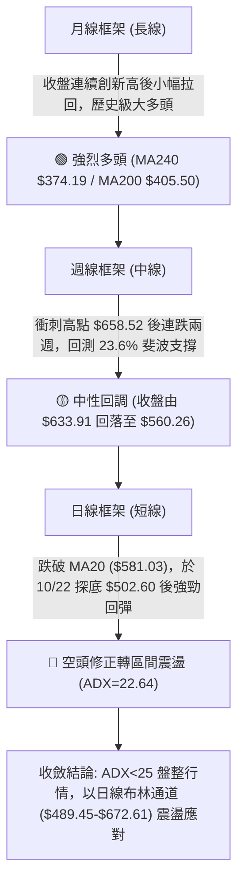

### 📈 長期趨勢 — 12個月走勢圖（Unicode）

依據月度歷史收盤數據繪製過去 12 個月（2025-11 至 2026-10）價格變遷：

```
AMD 月線走勢圖（過去12個月）
價格軸 ($)
$615 ┤                                                 ● (09月 $611.76)
$580 ┤                                           ● (06月 $580.91)
$560 ┤                                                    ●←當前 (10月 $560.26)
$515 ┤                                     ● (05月 $516.10)
$475 ┤                                              ●    ● (07月 $476.15 / 08月 $470.72)
$355 ┤                                ● (04月 $354.49)
$240 ┤                   ● (01月 $236.73)
$215 ┤ ● (11月 $217.53)   ● (12月 $214.16)
$200 ┤                               ●    ● (02月 $200.21 / 03月 $203.43)
     └─────────────────────────────────────────────────────────────────
       25-11 25-12 26-01 26-02 26-03 26-04 26-05 26-06 26-07 26-08 26-09 26-10
```

#### 走勢特徵分析表格

| 階段 | 時間區間 | 起始價 → 結束價 | 漲跌幅 | 走勢特徵與結構 |
|------|----------|-----------------|--------|----------------|
| 底部蓄勢期 | 2025-11 ～ 2026-03 | $217.53 → $203.43 | -6.48% | 於 $200.00-$236.00 構築扎實的大週期雙底結構 |
| 主升浪爆發 | 2026-04 ～ 2026-06 | $203.43 → $580.91 | +185.56% | 爆發性單邊主升浪，突破所有均線束縛，單月漲幅頻破50% |
| 高檔橫盤洗盤 | 2026-07 ～ 2026-08 | $580.91 → $470.72 | -18.97% | 快速回踩均線消化獲利盤，於 $470.00 附近獲得強支撐 |
| 二度衝高回落 | 2026-09 ～ 2026-10 | $470.72 → $560.26 | +19.02% | 創出 $658.52 歷史天價後衝高回落，目前於高位進行寬幅箱型整理 |

### 📊 中期趨勢（週線分析）

從近 8 週 K 棒走勢觀察，AMD 於 2026-10-09 當週創出歷史高點 $658.52（收盤 $608.10），隨後連續兩週大幅殺跌，最低於 2026-10-23 當週下探至 $502.60。當前週（截至 2026-10-27）展開跌深反彈，最新價來到 $560.26。

```
週線關鍵攻防示意圖
═══════════════════════════════════════════════════════════════
$658.52 ─────────────────────────────────── 52W 歷史最高點 (10/09)
              ╲
$608.10 ───────╲─────────────────────────── 週線長上影破位頸線
                ╲
$581.03 ─────────●───────────────────────── MA20 / 布林中軌壓力區
                  ╲      ▲
$560.26 ───────────●─────┼───────────────── 當前價格（強烈爭奪區）
                    ╲   ╱
$547.53 ─────────────●─╱─────────────────── 斐波那契 23.6% 回調關鍵支撐
                      ▼
$502.60 ─────────────────────────────────── 10/22-10/23 波段極致回踩低點
═══════════════════════════════════════════════════════════════
```

### ⚡ 趨勢強度評估（ADX 解讀）

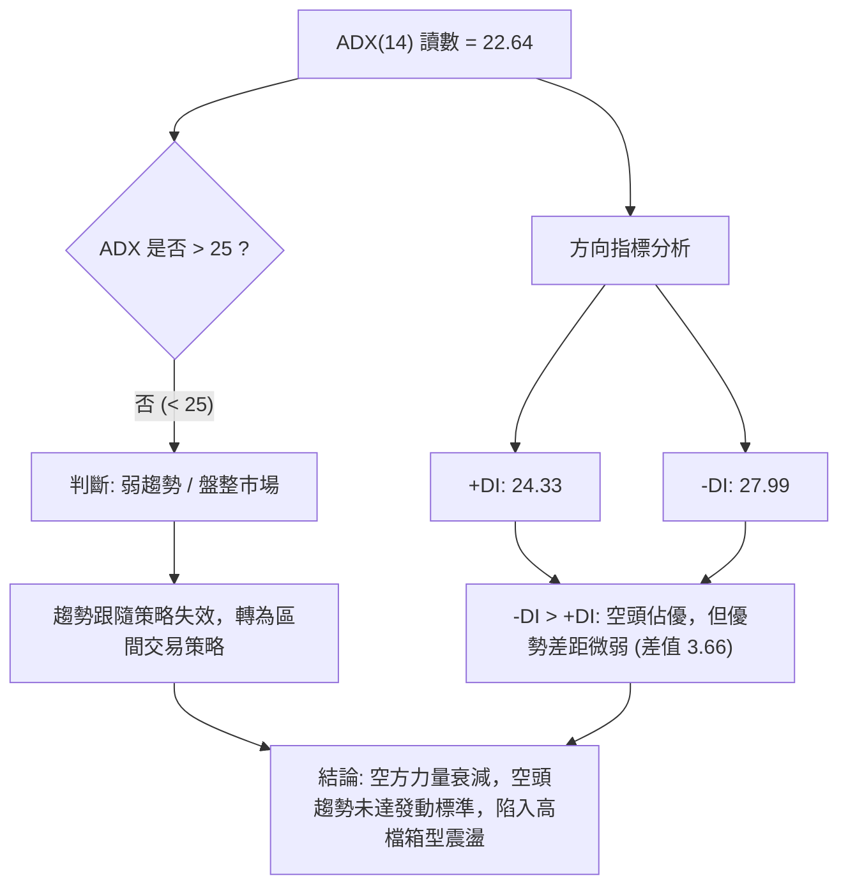

#### ADX 強度對照表

| ADX 數值區間 | 當前狀態 | 趨勢性質 | 策略指導方針 |
|--------------|----------|----------|--------------|
| 0 ～ 20 | 否 | 極弱或無趨勢 | 嚴禁趨勢突破追單，僅限超短線震盪操作 |
| **20 ～ 25** | **當前處於此區間 (22.64)** | **弱趨勢 / 盤整洗盤** | **以布林通道與支撐阻力為界，高拋低吸** |
| 25 ～ 40 | 否 | 強趨勢建立 | 順應方向指標 (+DI/-DI) 積極持倉順勢而為 |
| 40 以上 | 否 | 極強趨勢 / 超買超賣 | 警惕趨勢衰竭反轉，獲利分批了結 |

---

## 3. 圖表形態分析

### 🔍 形態識別系統

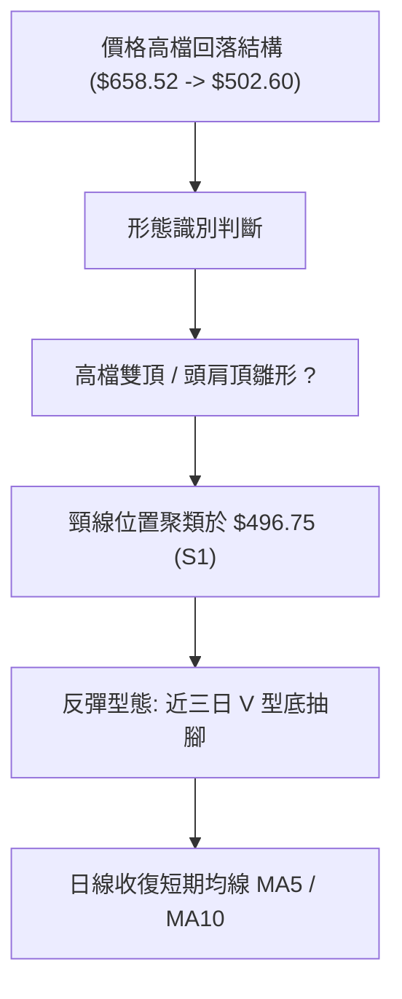

#### 形態識別與信心度評估表

| 形態名稱 | 信心度 | 判斷依據（引用數據） | 完成度 | 目標價（附計算式） |
|----------|--------|----------------------|--------|--------------------|
| 高檔雙重頂雛形 | 52% | 兩次高點聚類於 10/02 週高 $645.46 與 10/09 天價 $658.52，頸線為波段低點支撐 S1 $496.75 | 50%（尚未跌破頸線） | 若跌破頸線 $496.75，形態高度 = $658.52 - $496.75 = $161.77；破位目標價 = $496.75 - $161.77 = $334.98 |
| 日線 V 型反彈底 | 68% | 10/22 探底 $502.60 後，10/23 縮量止跌，10/26-10/27 連續放量陽線收復 $560.26 | 75% | 頸線為 10/15 反彈高點阻力 R1 $562.23；反彈目標價 = 頸線 $562.23 + (頸線 $562.23 - 低點 $502.60) = $621.86 |
| 布林通道中下軌收斂整理 | 80% | 價格自布林下軌 $489.45 附近強勁抽回，當前 BB %B 回升至 0.39，向中軌 $581.03 靠攏 | 85% | 目標價為布林中軌 MA20 = $581.03 |

### 🕯️ 重要 K 線形態分析

依據數據中「近10根日K」與「近8根週K」的實際開高低收數據進行嚴格識別：

| 日期（層級） | 開盤價 | 最高價 | 最低價 | 收盤價 | K線形態名稱 | 解讀與特徵 | 訊號方向 |
|--------------|--------|--------|--------|--------|------------|------------|----------|
| 2026-10-09 (週K) | 630.61 | 658.52 | 606.00 | 608.10 | 流星線 (Shooting Star) | 刷新歷史天價後遭空頭強力摜壓，實體極短且留有長達 $50.42 的長上影線 | 🔴 強烈看跌 |
| 2026-10-15 (日K) | 540.00 | 568.62 | 530.09 | 562.23 | 帶長下影大陽線 | 開盤跳空下殺探至 $530.09 後多頭買盤大舉介入，收盤逼近最高點 | 🟢 局部止跌 |
| 2026-10-16 (日K) | 547.55 | 550.96 | 526.83 | 528.75 | 光腳中陰線 | 多頭反撲受阻，收盤跌破前一日低點，吞噬前日大部分漲幅 | 🔴 空頭反撲 |
| 2026-10-22 (日K) | 524.10 | 529.98 | 502.60 | 507.93 | 破位長陰線 | 成交量放大至 2,800 萬股，盤中摜破 $510，最低下探至 $502.60 | 🔴 空頭宣洩 |
| 2026-10-23 (日K) | 510.21 | 523.92 | 508.36 | 516.79 | 縮量十字星小陽 | 探低未破前日低點，成交量驟降至 1,517 萬股，呈現極致量縮變盤信號 | 🟡 止跌變盤 |
| 2026-10-26 (日K) | 522.79 | 533.50 | 514.01 | 531.28 | 實體溫和陽線 | 低開高走，實體完全包覆前一日振幅，形成多頭回升雛形 | 🟢 短線轉強 |
| 2026-10-27 (日K) | 539.49 | 563.92 | 538.50 | 560.26 | 放量突破光頭陽線 | 開盤即為最低點附近，單日飆升 +5.45%，帶量突破 MA5/MA10，逼近 R1 | 🟢 強烈看漲 |

### 📉 ASCII 走勢形態示意圖

```
AMD 近10日日K線築底反彈示意圖
價格軸 ($)
$575 ┤  [10/14] 
$565 ┤    ┌─┐     [10/15]                                   [10/27] 
$560 ┤    │ │       ┌─┐                                       ┌─┐  ▲
$555 ┤    │ │       │ │     [10/19]               [10/21]     │ │  │
$550 ┤    │ │       │ │       ┌─┐                   ┌─┐       │ │  │ (強勁長紅)
$540 ┤    │ │       │ │       │ │         [10/20]   │ │       │ │  │
$535 ┤    └─┘       │ │       │ │           ┌─┐     │ │       │ │  │
$530 ┤    [10/16]   │ │       └─┘           │ │     │ │       └─┘  │
$525 ┤      ┌─┐     │ │                     └─┘     └─┘  [10/26]   │
$520 ┤      │ │     │ │                                    ┌─┐     │
$515 ┤      │ │     └─┘                       [10/23]      │ │     │
$510 ┤      │ │                   [10/22]       ┌─┐        └─┘     │
$505 ┤      └─┘                     ┌─┐         └─┘                │
$502 ┤                              ┴─┴ (波段低點 $502.60) ────────┘
     └─────────────────────────────────────────────────────────────
          10/14   10/15   10/16   10/19   10/20   10/21   10/22   10/23   10/26   10/27
```

### 🎯 形態目標價計算

以近期的日線短底反彈（10/22 的 $502.60 至 10/27 突破）進行高度推算：

1. **V 型短底推算公式**：
   - 形態底部低點：$502.60（10/22 最低價）
   - 關鍵突破頸線（阻力 R1）：$562.23（10/15 收盤價與聚類高點）
   - 形態振幅高度：$H = 562.23 - 502.60 = 59.63$
   - **形態目標價 1 (等幅測幅)**：$562.23 + 59.63 = 621.86$（此數值逼近阻力聚類帶）
   - **均線共振目標價**：上檔 MA20 下彎壓制位 $581.03 與阻力 R3 $584.73。

---

## 4. 支撐與阻力

### 🗺️ 關鍵價位分布圖（Unicode）

```
AMD 價位結構分布圖
═══════════════════════════════════════════════════════════════════
$658.52 ║██████████████████████████████║ 52W 歷史極致高點 (0.0% 斐波)
$584.73 ║████████████████████████      ║ 強阻力 R3 (波段高點聚類)
$581.03 ║████████████████████          ║ MA20 月線壓力 / 布林中軌
$574.20 ║████████████████              ║ 中阻力 R2 (反彈次高點)
$562.23 ║████████████████████████      ║ 關鍵阻力 R1 (10/15 聚類頸線)
$560.26 ╠══════════════════════════════╣ ◄ 當前收盤價 ($560.26)
$547.53 ║▓▓▓▓▓▓▓▓▓▓▓▓▓▓▓▓▓▓▓▓▓▓        ║ 斐波那契 23.6% 回調關鍵樞紐
$543.70 ║▓▓▓▓▓▓▓▓▓▓▓▓▓▓▓▓▓▓▓▓          ║ MA50 季線生命線支撐
$496.75 ║▓▓▓▓▓▓▓▓▓▓▓▓▓▓▓▓▓▓▓▓▓▓▓▓      ║ 近期關鍵支撐 S1 (波段低點聚類)
$478.87 ║▓▓▓▓▓▓▓▓▓▓▓▓▓▓▓▓              ║ 斐波那契 38.2% 回調重要防線
$461.71 ║████████████████████████      ║ 強支撐 S2 (密集成交中繼區)
$451.00 ║████████████████████████████  ║ 強支撐 S3 (波段極致低點聚類)
═══════════════════════════════════════════════════════════════════
```

### 🚧 阻力位分析表

阻力位完全引用數據「關鍵價位」區塊聚類數值：

| 阻力級別 | 價位 | 距現價幅動 | 形成原因與技術共振 | 突破難度 | 重要性 |
|----------|------|------------|--------------------|----------|--------|
| **R1** | **$562.23** | +0.35% | 10/15 日線收盤價高點，同時為日線 V 型反彈的第一道壓制頸線 | 🟡 中等 | ★★★★☆ |
| **R2** | **$574.20** | +2.49% | 波段反彈次高點密集群，接近下彎 MA20 前哨站 | 🟡 中等 | ★★★☆☆ |
| **R3** | **$584.73** | +4.37% | 近一年波段高點聚類強壓，與 MA20 ($581.03) 構成密集共振反壓帶 | 🔴 極高 | ★★★★★ |

### 🛡️ 支撐位分析表

支撐位完全引用數據「關鍵價位」區塊聚類數值：

| 支撐級別 | 價位 | 距現價幅動 | 形成原因與技術共振 | 守住機率 | 重要性 |
|----------|------|------------|--------------------|----------|--------|
| **S1** | **$496.75** | -11.34% | 近一年波段低點聚類，近兩週回調極限（10/22 低點 $502.60）之防禦腹地 | 🟢 75% | ★★★★★ |
| **S2** | **$461.71** | -17.59% | 2026 年 8 月收盤低點 ($470.72) 下方聚類中樞，多頭強防線 | 🟢 85% | ★★★★☆ |
| **S3** | **$451.00** | -19.50% | 歷史波段密集成交低點聚類，跌破則宣告長期多頭趨勢反轉 | 🟢 95% | ★★★★★ |

### 📐 斐波那契回調位分析

依據 52 週絕對波動區間（最低 $188.22 至 最高 $658.52，總垂直空間 $470.30）計算各關鍵回調階梯：

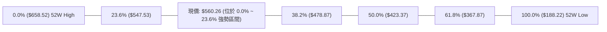

#### 斐波那契回調位深度解讀

| 回調比例 | 精確價位 | 相對現價位置 | 技術意義與多空攻防解讀 |
|----------|----------|--------------|------------------------|
| **0.0%** | **$658.52** | +17.54% | 52 週歷史頂部，強烈阻力，牛市多頭終極目標 |
| **23.6%** | **$547.53** | -2.27% | **淺度回調強勢防線**。現價 $560.26 成功站於其上，說明當前回調仍屬於超強牛市的正常技術性修正 |
| **38.2%** | **$478.87** | -14.53% | **牛市生命線**。回調若觸及此處仍屬健康洗盤，跌破將引發深度調整 |
| **50.0%** | **$423.37** | -24.43% | 多空平衡分水嶺，接近年線 MA200 ($405.50) 核心防護區 |
| **61.8%** | **$367.87** | -34.34% | 黃金分割回調底限，低於 MA240 ($374.19)，長期牛熊轉換線 |
| **78.6%** | **$288.86** | -48.44% | 深度破位防守位 |
| **100.0%**| **$188.22** | -66.41% | 52 週起漲點原點 |

**解讀結論**：現價 $560.26 精準運行於 **0.0% ($658.52)** 與 **23.6% ($547.53)** 之間，距 23.6% 回調位僅 2.27%。10/22-10/23 盤中雖短暫刺穿 $547.53 殺至 $502.60，但日線與週線收盤皆能強勢收復於 $547.53 之上，驗證 23.6% 具備強大買盤承接力。

---

## 5. 技術指標深度解讀

### 🎛️ 指標訊號總覽

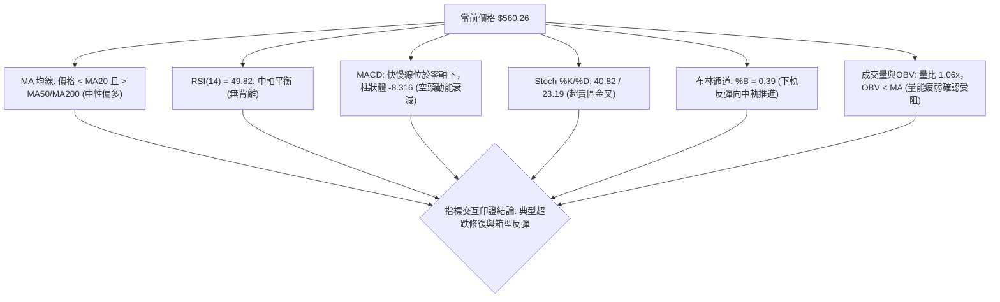

### 📈 移動平均線排列分析

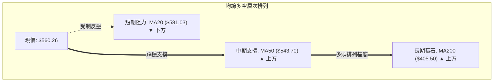

#### 完整移動平均線矩陣

| 均線名稱 | 當前價位 | 價格相對關係 | 乖離率 (Bias) | 走勢趨勢與斜率解讀 |
|----------|----------|--------------|---------------|--------------------|
| **MA5** | $533.80 | ▲ 位於價格下方 | +4.96% | ▁▁▂▃▅▆▇ 快速反轉向上勾頭，短線動能劇烈轉強 |
| **MA10** | $540.36 | ▲ 位於價格下方 | +3.68% | ▁▁▂▃▃▄▅ 止跌回升，短多排列即將成型 |
| **MA20** | $581.03 | ▼ 位於價格上方 | -3.57% | ▇▇██████ 下彎走平，構成短線反彈最重要的第一道壓制位 |
| **MA50** | $543.70 | ▲ 位於價格下方 | +3.05% | 穩定向上傾斜，季線提供穩固的中期護航動能 |
| **MA60** | $534.81 | ▲ 位於價格下方 | +4.76% | ▅▅▆▆▆▇ 穩步走高，形成 MA5/MA10/MA60 多頭聚攏 |
| **MA120** | $517.57 | ▲ 位於價格下方 | +8.25% | 半年線持續上揚，為回踩提供強有力支撐 |
| **MA200** | $405.50 | ▲ 位於價格下方 | +38.16% | 長期牛市基石，均線大架構呈現 MA20 > MA50 > MA200 多頭排列 |
| **MA240** | $374.19 | ▲ 位於價格下方 | +49.73% | 年線長週期多頭排列無可撼動 |

### 📉 RSI(14) 分析

- **RSI(14) 當前數值**：49.82（Wilder 算法）
- **動能強度進度條**：
  ```
  超賣 (0)          中軸平衡 (50)          超買 (100)
  ├──────────────────────┼──────────────────────┤
  ███████████████████████░░░░░░░░░░░░░░░░░░░░░░░  49.82%
  ```
- **區間評估**：RSI 數值處於 49.82，脫離了 10/16-10/23 期間的 37.8-39.0 低位鈍化區，精準回升至 50 多空分水嶺附近，顯示空方壓制力已被多方反彈化解，目前處於完全平衡狀態。
- **背離分析判斷**：
  - 根據近 20 根 K 棒的首尾價格與 RSI 進行嚴格比對：10/09 高點 $658.52 時週 RSI 為 57.2（此前 09/25 高位週 RSI 曾達 73.0），價格創天價而 RSI 未創新高；但於近 20 日日線級別中，首尾對比顯示**「無明顯背離」**。RSI 隨價格同步探底回升，不存在嚴重的底背離或頂背離結構。

### 📊 MACD(12/26/9) 訊號解讀

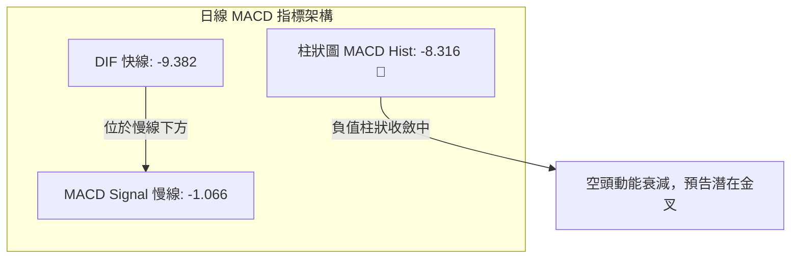

- **數值解析**：MACD 線為 -9.382，訊號線為 -1.066，柱狀體為 -8.316。快慢線雙雙落入零軸下方，表明日線級別仍處於空頭控制的回調波段。
- **收斂動向**：週線 MACD 柱狀圖自 10/16 的 -14.100 與 10/23 的 -13.949，在最新 10/27 縮減至 -8.316，顯示做空殺跌動能正在顯著收斂，負柱狀體快速縮短預示日線級別正醞釀低位金叉向上修復。

### 📦 布林通道分析

```
AMD 布林通道結構示意圖 (帶寬: $183.16)
═════════════════════════════════════════════════════════════════
$672.61 ────────────────────────────────────────── 布林上軌 (阻力帶)
           │
           │
$581.03 ───┼────────────────────────────────────── 布林中軌 (MA20 核心反壓)
           │          ▲
$560.26 ───┼──────────●─────────────────────────── 現價 ($560.26, %B=0.39)
           │         ╱
           │        ╱
$489.45 ───┴───────●────────────────────────────── 布林下軌 (支撐帶)
═════════════════════════════════════════════════════════════════
```

- **布林帶參數**：上軌 $672.61，中軌 $581.03，下軌 $489.45。
- **指標位置**：%B 為 **0.39**，價格擺脫了靠近下軌的弱勢危險區（10/22 低點 $502.60 極度逼近下軌 $489.45），正朝中軌 $581.03 方向靠攏，通道呈現擴口後逐步平緩走勢，顯示進入典型箱型震盪。

### 💹 成交量分析（量價配合度）

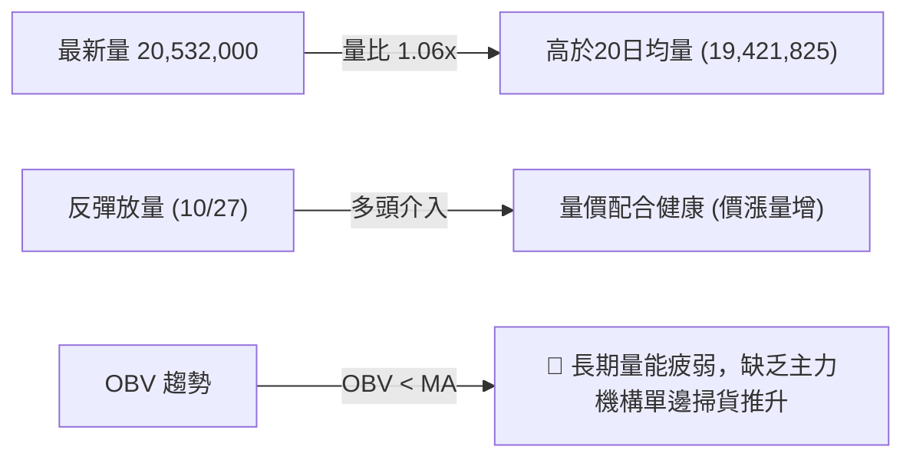

- **量價配合評估**：10/27 單日上漲 +5.45% 伴隨 2,053 萬股成交，大於 20 日均量（1,942 萬股），量增價漲呈現健康的短線量價配合；然而，OBV 處於 MA 之下，顯示在 10 月初創天價 $658.52 之際流出資金尚未全面回流，大資金主要以逢低承接、高檔減磅的震盪盤整策略為主。

---

## 6. 動能與波動率

### ⚡ 動能評估四象限

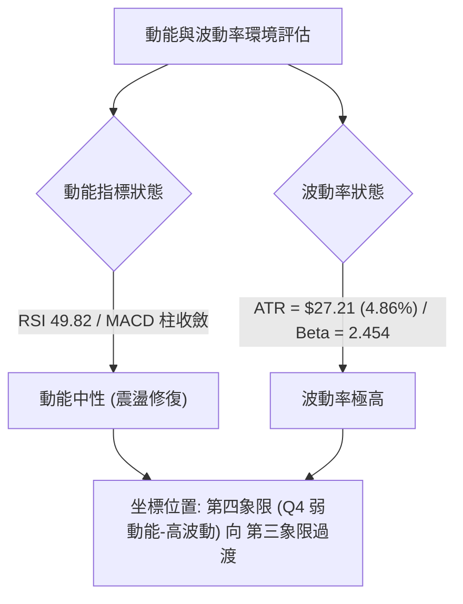

#### 動能與波動四象限對照表

| 象限 | 動能維度 | 波動維度 | 當前狀態 | 交易策略意涵 |
|------|----------|----------|----------|--------------|
| **Q1** | 強動能 (Trend) | 低波動 (Low Vol) | — | 最佳單邊持倉環境，穩定順勢加碼 |
| **Q2** | 弱動能 (Weak) | 低波動 (Low Vol) | — | 窄幅盤整打底，適合低吸埋伏 |
| **Q3** | 強動能 (Trend) | 高波動 (High Vol) | — | 爆發突破行情，高風險高回報，緊跟趨勢 |
| **Q4** | **弱動能 (Consolidation)** | **高波動 (High Vol)** | **✓ (當前所屬象限)** | **洗盤劇烈，趨勢未明，嚴禁高位追價，嚴守區間高拋低吸** |

### 📊 ATR 波動率分析

- **ATR(14) 數值**：**$27.21**（採用 Wilder 平滑計算）。
- **相對股價佔比**：高達 **4.86%**，表明 AMD 每日平均潛在振幅接近 5%，在大型半導體板塊中屬於高度活躍資產。
- **止損距離建議**：
  - **保守型波段交易**：建議止損設定為 $1.5 \times \text{ATR} = 1.5 \times 27.21 = \mathbf{\$40.82}$ 的安全防護帶。
  - **短線突破交易**：建議止損設定為 $1.0 \times \text{ATR} = \mathbf{\$27.21}$。

### 📐 Beta 與市場相關性

- **Beta 係數**：**2.454**。
- **解讀**：AMD 的波動敏感度高達那斯達克或標普 500 指數的 2.45 倍。當大盤微幅回調 1% 時，AMD 潛在回撤預期為 2.45%；反之，大盤走強時具備極高的超額收益（Alpha）彈性。高 Beta 特性要求投資人必須嚴格控制單筆交易的資金曝險部位。

---

## 7. 多時框架總結

### 📋 時框架評分表

| 時框架 | 趨勢方向 | 動能狀態 | 均線排列 | 圖表形態 | 綜合評分 | 交易建議方向 |
|--------|----------|----------|----------|----------|----------|--------------|
| **月線 (長期)** | 🟢 強烈看多 | 強勁 (MACD長線多頭) | MA20>MA50>MA200 完全多頭排列 | 歷史大牛市回踩整固 | **85/100** | 長線堅定逢低做多 |
| **週線 (中期)** | 🟡 震盪整理 | 中性 (RSI=49.8, MACD負柱收斂) | 踩穩 23.6% 斐波 ($547.53) | 雙頂未遂，中繼箱型整理 | **55/100** | 區間波段操作 |
| **日線 (短期)** | 🟡 跌深反彈 | 轉強 (Stoch金叉, 連續長陽) | 位於 MA20 下方，收復 MA5/10/50 | V 型反彈測試頸線 R1 | **50/100** | 逢阻力減磅，逢低低吸 |

### 🔲 綜合訊號矩陣

```
時框架訊號矩陣一覽
═══════════════════════════════════════════════════════════════
時框維度      趨勢訊號    動能訊號    均線排列    成交量確認
───────────────────────────────────────────────────────────────
長期 (月線)   🟢 強烈多頭  🟢 充足多頭  🟢 多頭排列  🟡 正常水準
中期 (週線)   🟡 中性震盪  🔴 負向釋放  🟢 守穩均線  🔴 縮量整理
短期 (日線)   🟡 區間反彈  🟡 平衡中性  🟡 夾層運行  🟢 溫和增量
═══════════════════════════════════════════════════════════════
```

### ⚖️ 多時框收斂結論

依據多時框收斂原則（嚴格要求 14）：
1. **當前市場定性**：ADX(14) 讀數為 **22.64 (< 25)**，明確指示當前市場屬於**「盤整震盪行情」**，而非單邊趨勢行情。
2. **主導時框與交易邊界**：在盤整行情下，單邊突破追單極易遭到雙向洗盤。日線布林通道下軌 **$489.45** 至上軌 **$672.61**，以及由中軌 **MA20 ($581.03)** 形成的區域，構成目前最重要的主導交易區間。
3. **收斂方向唯一結論**：**中性觀望 / 區間震盪偏向逢低做多（整體綜合評分 53/100）**。日線雖受制於 MA20 ($581.03) 壓制，但週線與月線的長期多頭基石（MA50 $543.70 及 斐波那契 23.6% $547.53）提供強勁支撐。因此，在未有效突破 $584.73（R3）或跌破 $496.75（S1）前，主策略定位為**「布林通道區間操作，嚴控停損」**。

---

## 8. 交易策略建議

### 🗺️ 策略決策流程圖

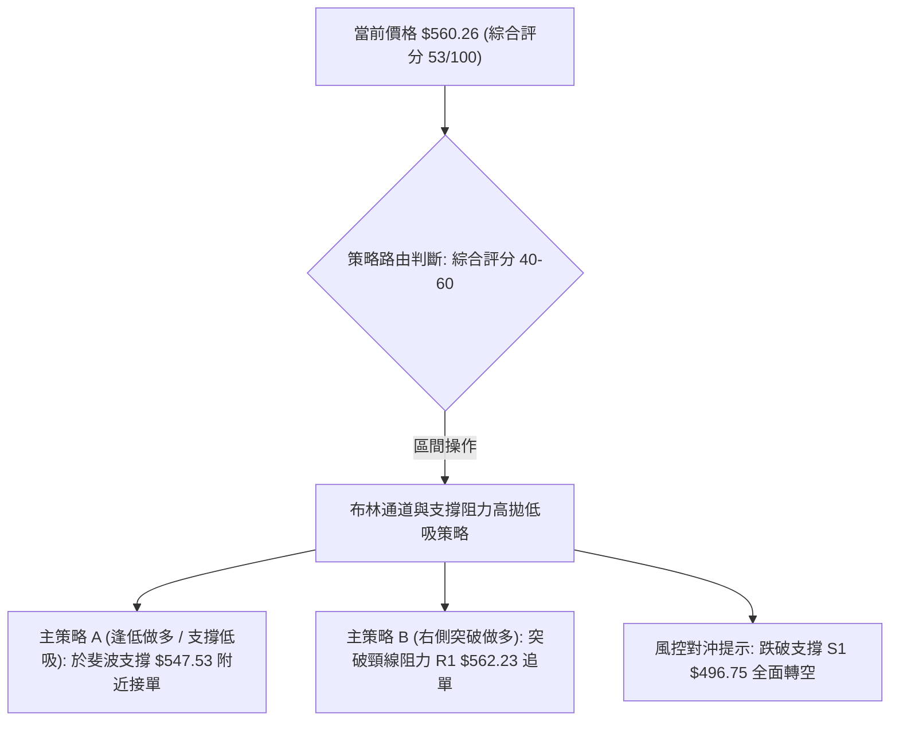

### 🧭 策略路由

**當前主策略方向 = 區間震盪低吸高拋（依技術評分卡綜合評分 53/100）**
綜合評分落於 40–60 中性區間，且 ADX = 22.64 顯示無單邊趨勢，交易策略嚴格以日線布林通道與關鍵支撐阻力為操作軸心。

### 🎯 價格情境階梯（Price Scenarios）

價位完全引用第 4 章「關鍵價位」區塊之精確計算數值：

| 觸發條件 | 下一目標 | 後續延伸 | 情境含義 |
|----------|----------|----------|----------|
| **突破 R1 $562.23** | **R2 $574.20** | **R3 $584.73** | 短線 V 型底確立，多頭挑戰 MA20 下彎壓制區 |
| **站穩現價區間 ($547.53-$560.26)** | **$574.20** | **$581.03** | 依託 23.6% 斐波那契展開強勢區間拉鋸震盪 |
| **跌破 S1 $496.75** | **S2 $461.71** | **S3 $451.00** | 日線破位形成頭肩頂雛形，宣告中期趨勢轉弱走熊 |

### 📊 情境機率分佈

| 情境類別 | 發生機率 | 主要技術依據 |
|----------|----------|--------------|
| **延續反彈 / 向上突破** | **35%** | 日線連出兩陽，Stoch 金叉，均線長線仍為多頭排列 |
| **區間震盪 (箱型拉鋸)** | **45%** | **ADX=22.64 處於盤整區間**，布林帶寬度較大 (%B=0.39)，成交量維持均量水準 |
| **受阻回落 / 二次探底** | **20%** | MACD 仍處於零軸下方，OBV 疲軟未確認反轉，上檔面臨 MA20 下壓阻力 |

### 🟢 主策略詳情（區間操作多頭策略）

*注：風險報酬比計算嚴格遵守規則 17，公式為 $(T1 - \text{進場價}) \div (\text{進場價} - \text{止損價})$。*

| 策略要素 | 策略 A（逢回踩低吸 — 左側防守型） | 策略 B（突破追進 — 右側動能型） |
|----------|----------------------------------|----------------------------------|
| **策略類型** | 依託斐波那契 23.6% 回踩低吸 | 突破日內頸線阻力 R1 右側順勢 |
| **進場條件** | 價格回踩 23.6% 斐波那契支撐位企穩 | 日線實體帶量突破 10/15 高點阻力 R1 |
| **進場價格** | **$547.53**（斐波那契 23.6% 點位） | **$562.23**（精確阻力 R1） |
| **目標價 T1** | **$574.20**（阻力 R2） | **$584.73**（阻力 R3 / MA20 附近） |
| **目標價 T2** | **$584.73**（阻力 R3） | **$621.86**（由 V 型形態高度推算） |
| **止損價格** | **$533.80**（跌破 MA5 支撐防線） | **$547.53**（回落至斐波 23.6% 破位） |
| **風險報酬比** | **1 : 1.94（以 T1 計）**<br>*(計算: $(574.20 - 547.53) \div (547.53 - 533.80) = 26.67 \div 13.73$)*<br>*(以 T2 計為 1 : 2.71)* | **1 : 1.53（以 T1 計）**<br>*(計算: $(584.73 - 562.23) \div (562.23 - 547.53) = 22.50 \div 14.70$)*<br>*(以 T2 計為 1 : 4.06)* |
| **成功機率** | **65%** | **55%** |
| **建議倉位** | **15%**（控制在總資金二成以內） | **10%**（輕倉試單） |

### 🔴 反向風險觸發點（對沖提示）

若行情出現反向惡化，觸發以下條件應立即停止所有做多計畫，啟動風險對沖：
- **關鍵反轉觸發價位**：收盤價實體**跌破 S1 ($496.75)**。
- **訊號特徵**：日成交量超過 2,800 萬股，MACD 負柱狀體重新放大超過 -14.00，RSI 跌破 35。
- **對沖應對**：多頭部位無條件停損出場，激進型交易者可反手建立空單，下檔目標直指 S2 ($461.71) 與 S3 ($451.00)。

### ⭐ 整體訊號強度評星

```
做多訊號強度：★★★☆☆  (3/5星 — 長線多頭未破，但短期受制於MA20壓制)
做空訊號強度：★★☆☆☆  (2/5星 — 殺跌動能收斂，空頭受困於強支撐帶)
整體可信度：  ★★★★☆  (4/5星 — 價位高度收斂於斐波那契與均線聚類)
```

---

## 9. 風險提示與監控

### ✅ 關鍵監控指標 Checklist

```
╔══════════════════════════════════════════════════════════════╗
║               每日交易關鍵監控 Checklist                     ║
╠══════════════════════════════════════════════════════════════╣
║ [ ] 價格能否有效站穩阻力 R1 $562.23（收盤價確認）            ║
║ [ ] MA20 月線 ($581.03) 的下彎壓制是否隨時間減緩             ║
║ [ ] 日成交量是否能溫和放大至 2,000 萬股以上支撐反彈          ║
║ [ ] MACD 柱狀圖是否持續由 -8.316 往零軸收斂形成金叉          ║
║ [ ] 斐波那契 23.6% 支撐 $547.53 在盤中回踩時是否具承接力     ║
║ [ ] 下檔關鍵防線 S1 $496.75 是否失守（空頭反轉警戒線）       ║
╚══════════════════════════════════════════════════════════════╝
```

### ⚠️ 風險場景分析

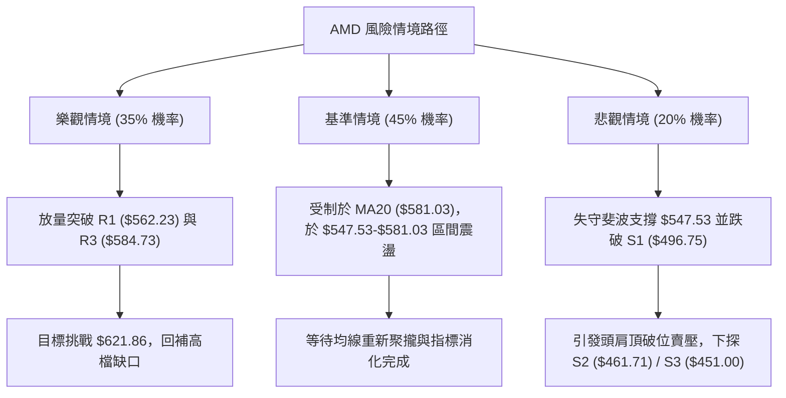

### 🛡️ 風險管理重要提醒

1. **ATR 劇烈波動下的部位規模控制**：
   AMD 的 ATR 為 $27.21（4.86%），屬於極高波動個股。若帳戶風險容忍度為總資金的 1%（例如 10 萬美元帳戶承擔 1,000 美元風險），止損距離為 $14.00（如策略 A），則單筆最大建倉股數不應超過：
   $$\text{股數} = \frac{\$1,000}{\$14.00} \approx 71 \text{ 股（部位金額約 \$38,800，佔比約 38.8%）}$$
   若採用寬幅止損（1.5 倍 ATR，約 $40.00），則建倉股數須降至 25 股以內，嚴防單日大幅震盪洗出場。
2. **高 Beta 系統性風險防範**：
   Beta 達 2.454，說明在科技股大盤（QQQ / SMH）面臨美聯儲決議或重大科技巨頭財報波動時，AMD 的跌幅容易成倍放大。在重要總體經濟事件發布日前夕，應主動降倉至 10% 以下。
3. **嚴禁趨勢性追價**：
   由於 ADX 僅為 22.64，市場缺乏足夠動能維繫突破行情，接近布林通道中軌（$581.03）或阻力 R3（$584.73）時嚴禁追高，應嚴格執行分批停利。

---

## 📋 報告總結

```
╔══════════════════════════════════════════════════════════════════╗
║                    AMD 技術分析報告總結                          ║
╠══════════════════════════════════════════════════════════════════╣
║ 報告日期：2026-10-28                                             ║
║ 當前價格：$560.26                                                ║
║ 分析評級：⚖️ 中性觀望 / 區間震盪（技術綜合評分：53/100）         ║
║                                                                  ║
║ 關鍵趨勢結論：                                                   ║
║ ├─ 長期趨勢：🟢 強烈看多（價格遠高於 MA200 $405.50，多頭排列）  ║
║ ├─ 中期趨勢：🟡 震盪整理（自天價回調，企穩於 23.6% 斐波 $547.53） ║
║ ├─ 短期趨勢：🟡 跌深反彈（自 $502.60 抽腳，面臨 MA20 $581.03 壓制）║
║ ├─ 核心支撐：S1: $496.75  (次級防線: 斐波 23.6% $547.53)        ║
║ ├─ 核心阻力：R1: $562.23  (強壓共振: R3 $584.73 / MA20 $581.03) ║
║ └─ 華爾街共識：Strong Buy（50位分析師平均目標價：$637.61）       ║
║                                                                  ║
║ 最優策略組合：                                                   ║
║ 1. 🥇 最佳機會（策略 A）：回踩斐波 23.6% ($547.53) 低吸，        ║
║    目標 T1: $574.20，止損 $533.80，風報比 1 : 1.94              ║
║ 2. 🥈 次選機會（策略 B）：放量突破 R1 ($562.23) 追進，           ║
║    目標 T1: $584.73，止損 $547.53，風報比 1 : 1.53              ║
║ 3. 🥉 保守選擇：在 ADX 升破 25 且價格站穩 MA20 ($581.03) 前，    ║
║    全面空倉觀望，耐心等待箱型突破訊號確立                        ║
╚══════════════════════════════════════════════════════════════════╝
```

---

> ⚠️ **免責聲明**：本報告為 AI 自動生成之技術分析，所有數據及估算均基於提供的歷史價格資訊。本報告**僅供研究與學術參考**，**不構成任何投資建議**。投資有風險，入市需謹慎。

---

*報告生成時間：2026-10-28 ｜ 數據來源：Yahoo Finance ｜ 分析框架：多時框技術分析*