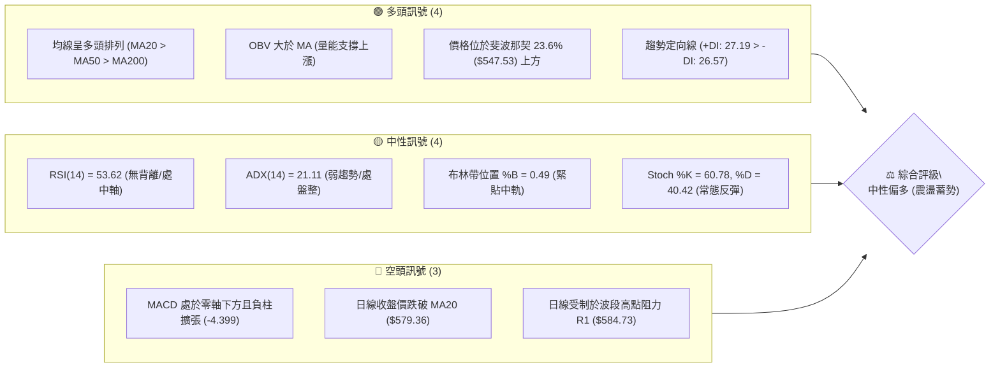
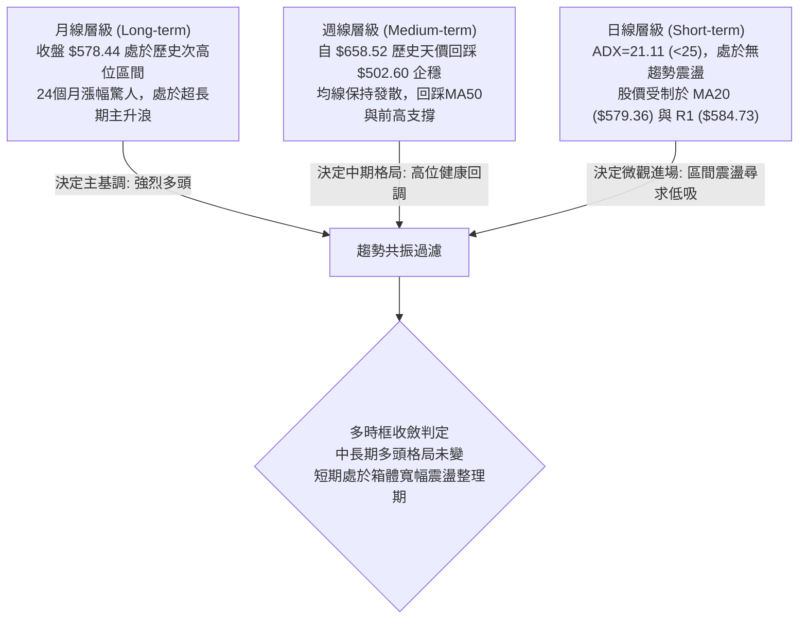
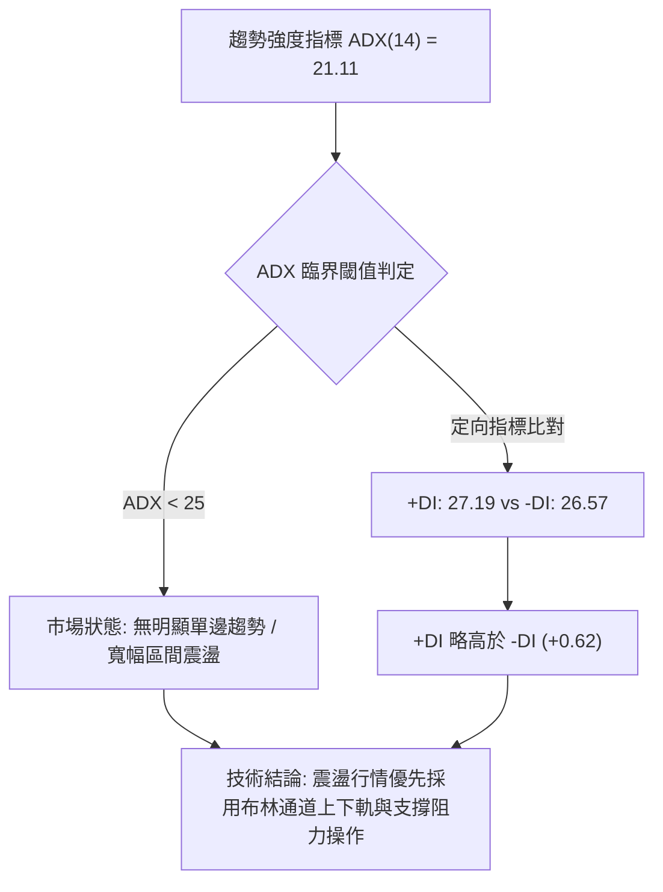
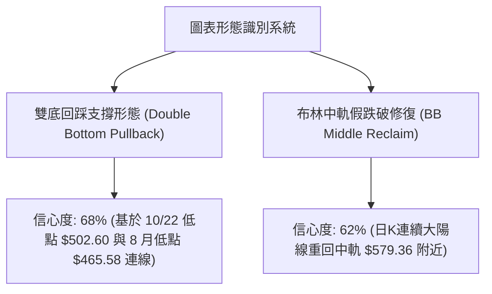
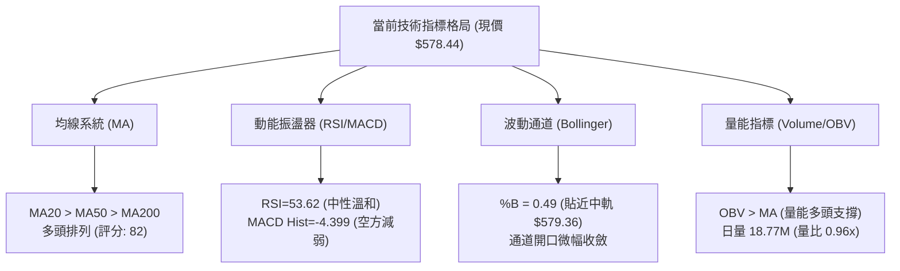
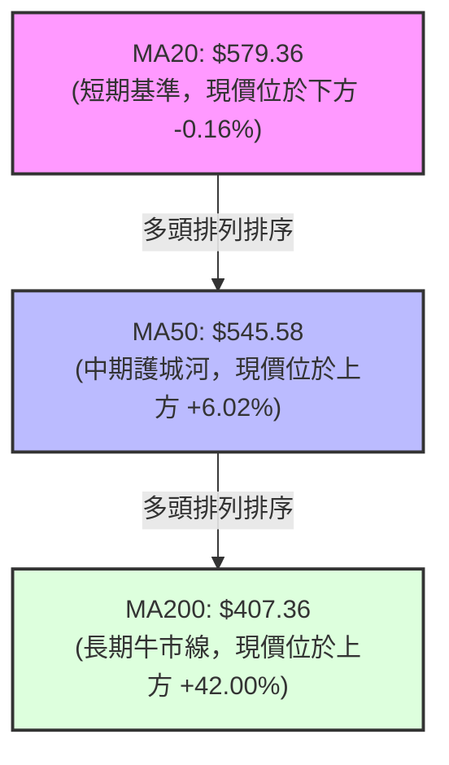
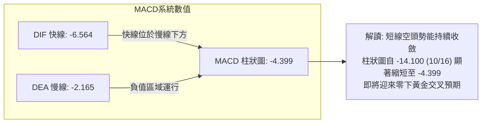
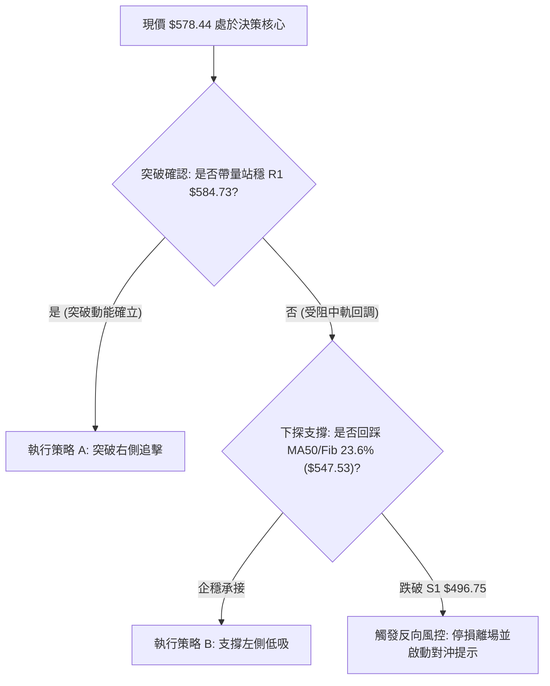
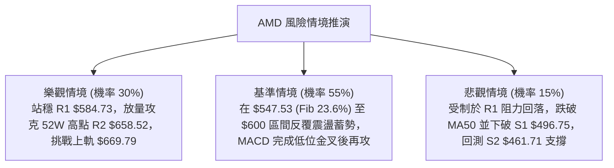

# AMD 技術分析報告

> **報告日期**：2026-10-29 ｜ **語言**：繁體中文 ｜ **數據來源**：Yahoo Finance ｜ **當前價格**：$578.44

---

## 目錄

| 章節 | 內容 |
|------|------|
| [1. 技術面概覽](#1-技術面概覽) | 訊號儀表板、核心指標、評分卡 |
| [2. 趨勢分析](#2-趨勢分析) | 多時框趨勢、長中短期走勢 |
| [3. 圖表形態分析](#3-圖表形態分析) | 形態識別、K線組合、目標價 |
| [4. 支撐與阻力](#4-支撐與阻力) | 關鍵價位、斐波那契回調 |
| [5. 技術指標深度解讀](#5-技術指標深度解讀) | MA/RSI/MACD/布林/成交量 |
| [6. 動能與波動率](#6-動能與波動率) | 動能評估、ATR、Beta |
| [7. 多時框架總結](#7-多時框架總結) | 時框架評分矩陣 |
| [8. 交易策略建議](#8-交易策略建議) | 多空策略、風險報酬比 |
| [9. 風險提示與監控](#9-風險提示與監控) | 監控指標、風險場景 |

---

## 1. 技術面概覽

### 🎯 技術訊號儀表板



### 📊 核心指標速覽表

| 指標類別 | 指標名稱 | 當前數值 | 訊號 | 解讀 |
|----------|----------|----------|------|------|
| **價格** | 當前價格 | $578.44 | 🟡 | 位於 52 週高低區間 83.0%，回調後企穩於 $500 大關上方 |
| **均線** | MA20 | $579.36 | 🔴 | 當前價格略低於中軌/MA20（-$0.92，-0.16%），短線承壓 |
| **均線** | MA50 | $545.58 | 🟢 | 價格大幅高於 MA50（+$32.86，+6.02%），中期多頭結構穩固 |
| **均線** | MA200 | $407.36 | 🟢 | 價格遠高於 MA200（+$171.08，+42.00%），長期絕對多頭市場 |
| **動能** | RSI(14) | 53.62 | 🟡 | 位於中性平衡區間，自 10 月中旬超賣區（37.8）回升，無背離 |
| **動能** | MACD | -6.564 | 🔴 | MACD 線低於信號線（-2.165），柱狀圖為 -4.399，短線動能偏空 |
| **趨勢** | ADX(14) | 21.11 | 🟡 | ADX < 25 表明趨勢動力減弱，市場進入寬幅區間震盪整理 |
| **通道** | BB %B | 0.49 | 🟡 | 緊貼布林通道中軌（$579.36），多空雙方爭奪短期定價權 |
| **量能** | 成交量 / 20MA | 0.96x | 🟡 | 成交量 18.77M 略低於 20 日均量 19.53M，反彈缺乏爆發量配合 |
| **波動** | ATR(14) | $26.62 | 🟡 | ATR 佔股價 4.60%，單日波動幅度適中，屬正常波幅範圍 |

### 🏆 技術評分卡

```
╔══════════════════════════════════════════════════════════════════╗
║                    技術評分卡 — AMD (2026-10-29)                 ║
╠══════════════════════════════════════════════════════════════════╣
║ 趨勢強度 (Trend)      ██████████░░░░░░░░░░  52/100  🟡 中性 (ADX=21.11) ║
║ 動能指標 (Momentum)   ████████░░░░░░░░░░░░  42/100  🔴 偏弱 (MACD負柱)  ║
║ 支撐穩定度 (Support)  ██████████████░░░░░░  72/100  🟢 強固 (S1/Fib23.6)║
║ 成交量配合 (Volume)   ████████████░░░░░░░░  58/100  🟡 尚可 (OBV正向)   ║
║ 形態完整度 (Pattern)  ████████████░░░░░░░░  60/100  🟡 整理 (V型回抽)   ║
║ 均線排列 (MA System)  ████████████████░░░░  82/100  🟢 完美多頭排列     ║
╠══════════════════════════════════════════════════════════════════╣
║ 綜合評分 (Overall)    ████████████░░░░░░░░  61/100  🟢 偏多震盪整理     ║
╚══════════════════════════════════════════════════════════════════╝
```
*註：綜合評分 = (52 + 42 + 72 + 58 + 60 + 82) ÷ 6 = 61.00，四捨五入為 61/100。*

---

## 2. 趨勢分析

### 🌐 多時框趨勢分析



### 📈 長期趨勢 — 12個月走勢圖（Unicode）

依據月度歷史數據繪製過去 12 個月（2025-11 至 2026-10）收盤價走勢圖：

```
AMD 月線收盤走勢圖（過去12個月：2025-11 至 2026-10）
價格軸 ($)
$650 ┤                                                    
$600 ┤                                            ● $611.76
$550 ┤                                                ● $578.44 (現價)
$500 ┤                                ● $516.10       
$450 ┤                            ● $580.91   ● $470.72
$400 ┤                                                
$350 ┤                        ● $354.49               
$300 ┤                                                
$250 ┤                                                
$200 ┤● $217.53 ● $214.16 ● $236.73 ● $203.43         
$150 ┤       (築底完成)     ● $200.21                 
     └─────────────────────────────────────────────────────────
       11/25  12/25  01/26  02/26  03/26  04/26  05/26  06/26  07/26  08/26  09/26  10/26
```

**12 個月歷史走勢分段特徵分析表**：

| 階段區間 | 時間跨度 | 起止價格 ($) | 漲跌幅 (%) | 階段形態特徵與量價解讀 |
|----------|----------|--------------|------------|------------------------|
| **一、底部蓄勢** | 2025/11 - 2026/03 | 217.53 → 203.43 | -6.48% | 在 $200-$236 區間構築扎實底部平台，洗淨浮籌 |
| **二、主升浪突破**| 2026/03 - 2026/06 | 203.43 → 580.91 | +185.56% | 爆發性單邊主升浪，月線連續四連陽，直奔歷史前高 |
| **三、高位回踩** | 2026/06 - 2026/08 | 580.91 → 470.72 | -18.97% | 歷史新高前獲利回吐，於 $470 關鍵支撐（S2）獲得強勁承接 |
| **四、二度攻頂** | 2026/08 - 2026/09 | 470.72 → 611.76 | +29.96% | 快速反撲創下單月收盤新高 $611.76，最高探至 $658.52 |
| **五、強烈整理** | 2026/09 - 2026/10 | 611.76 → 578.44 | -5.45% | 回踩 23.6% 斐波那契位，目前企穩於 $578.44 |

### 📊 中期趨勢（週線分析）

中期走勢呈現「高位寬幅震盪箱體」，近 8 週價格在 $502.60 至 $658.52 之間大幅洗盤：
- **頂部壓力**：2026-10-09 當週刷出歷史最高點 $658.52（R2），隨後出現連續兩週的放量回撤。
- **底部支撐**：2026-10-23 當週探底至 $502.60 後快速拉起，逼近關鍵波段支撐位 S1（$496.75），展現下檔買盤支撐。
- **本週進展**：2026-10-28 當週形成一根開盤 $522.79、收盤 $578.44 的大陽線，完全收復上週失地，中期多頭結構並未被破壞。

### ⚡ 趨勢強度評估（ADX 解讀）



**ADX 趨勢強度對照解讀表**：

| 指標變數 | 當前數值 | 參考區間標準 | 技術狀態解讀 |
|----------|----------|--------------|--------------|
| **ADX(14)** | **21.11** | 0 - 20: 缺乏趨勢<br/>**20 - 25: 弱趨勢/盤整**<br/>25 - 50: 強趨勢<br/>> 50: 極強單邊 | 市場自前期急速拉升轉入高位震盪修復期，動能衰減，不可盲目追漲殺跌。 |
| **+DI** | **27.19** | > 25: 多方主導區 | 多方力量依然佔據優勢，保持在多頭控制區。 |
| **-DI** | **26.57** | > 25: 空方反撲區 | 空方拋壓迅速抬頭，但暫未壓倒多方（+DI > -DI）。 |
| **差值 (+DI - -DI)** | **+0.62** | 接近 0 軸臨界點 | 多空力量處於白熱化均衡狀態，短期將延續區間拉鋸。 |

---

## 3. 圖表形態分析

### 🔍 形態識別系統

根據規則 15，所有圖表形態嚴格基於數據所呈現之走勢識別，並附信心度：



**形態評估矩陣表**：

| 形態名稱 | 信心度 | 判斷依據（引用數據） | 完成度 | 目標價（附計算式） |
|----------|--------|----------------------|--------|--------------------|
| **波段次級雙底 (Double Bottom)** | 68% | 2026-10-22 日低探至 $502.60，獲支撐位 S1（$496.75）前強勁買盤拉起；前次回調低點聚類於 S2（$461.71）。 | 75% | 頸線 R1（$584.73）+ 形態高度（頸線 $584.73 − 低點 $502.60 = $82.13）= **$666.86**（向上挑戰 R2 $658.52） |
| **布林帶中軌修復** | 62% | 股價自 10-22 最低 $502.60 連續三根陽線急拉至 $578.44，直逼布林中軌 $579.36。 | 90% | 依布林帶反彈高度測算，突破中軌則直指布林上軌：**$669.79** |

*註：除上述兩項基於實際波段數據計算之形態外，更複雜之頭肩形態在當前數據中未偵測到完整幾何結構，依規則不予臆測。*

### 🕯️ 重要 K 線形態分析

嚴格依據數據中「近 10 根日 K」與「近 8 根週 K」實際 OHLCV 進行解讀（規則 19）：

| 日期（週期） | 開盤價 ($) | 最高價 ($) | 最低價 ($) | 收盤價 ($) | 成交量 | K 線形態 | 技術解讀與訊號 |
|--------------|------------|------------|------------|------------|--------|----------|----------------|
| **2026-10-22 (日K)** | 524.10 | 529.98 | 502.60 | 507.93 | 28,007,400 | **放量大陰線** | 🔴 跌破短均，放量殺跌，下探 $502.60 測試 S1 支撐 |
| **2026-10-23 (日K)** | 510.21 | 523.92 | 508.36 | 516.79 | 15,177,900 | **縮量低位小陽線** | 🟢 縮量止跌，低點未破前日，下影線顯現買盤承接 |
| **2026-10-26 (日K)** | 522.79 | 533.50 | 514.01 | 531.28 | 16,796,800 | **溫和反彈陽線** | 🟢 低點持續抬高（$514.01 > $508.36），多頭開始集結 |
| **2026-10-27 (日K)** | 539.49 | 563.92 | 538.50 | 560.26 | 20,599,900 | **放量光頭大陽線** | 🟢 實體覆蓋前 3 日高點，成交量突破 20M，確立短線反轉 |
| **2026-10-28 (日K)** | 573.08 | 579.18 | 560.52 | 578.44 | 18,765,500 | **高開推升實體陽線** | 🟢 跳空高開並收於全天次高點，逼近 MA20 與阻力 R1 |
| **2026-10-09 (週K)** | 630.61 | 658.52 | 606.00 | 608.10 | 93,746,000 | **長上影射擊之星** | 🔴 創 52 週歷史新高 $658.52 後遭沉重獲利盤打壓 |
| **2026-10-16 (週K)** | 599.93 | 606.20 | 526.83 | 528.75 | 107,042,200| **放量破位大陰線** | 🔴 實體大跌，破壞短期上攻節奏，回吐 9 月底漲幅 |
| **2026-10-23 (週K)** | 551.78 | 556.79 | 502.60 | 516.79 | 96,570,600 | **長下影錘頭陰線** | 🟢 週線探底 $502.60 後長下影拉回，顯現中期支撐強韌 |
| **2026-10-28 (週K)** | 522.79 | 579.18 | 514.01 | 578.44 | 56,162,200 | **強勁反彈大陽線** | 🟢 僅 3 個交易日即收復過半跌幅，多方奪回主動權 |

### 📉 ASCII 走勢形態示意圖

```
AMD 近期日 K 線反彈形態示意圖（2026-10-15 至 2026-10-28）
  價格 ($)
  $585 ┤                     [R1: $584.73 阻力位]
  $580 ┤                                        ▲ $578.44 (10/28 收盤，逼近中軌)
  $560 ┤  ● $562.23 (10/15)                ▲ $560.26 (10/27)
  $540 ┤        ▼ $528.75 (10/16)       ▲ $531.28 (10/26)
  $520 ┤              ▼ $534.74   ▲ $516.79 (10/23 縮量企穩)
  $500 ┤                    ▼ $507.93 (10/22 放量探底 $502.60)
       └────────────────────────────────────────────────────────
         10-15  10-16  10-19  10-20  10-21  10-22  10-23  10-26  10-27  10-28
         [─────── 殺跌築底階段 ───────]  [─────── V型強勁反彈階段 ───────]
```

---

## 4. 支撐與阻力

### 🗺️ 關鍵價位分布圖（Unicode）

嚴格依據數據中「關鍵價位」區塊之波段高低點與斐波那契回調位繪製：

```
AMD 價位結構分布圖（OHLCV 精確計算）
═══════════════════════════════════════════════════════════════════════════
$669.79 ║░░░░░░░░░░░░░░░░░░░░░░░░░░░░░░░░░░░░░░░░░░░░░░░░║ 布林通道上軌
$658.52 ║████████████████████████████████████████████████║ 強阻力 R2 (52W High / Fib 0.0%)
$584.73 ║████████████████████████████                    ║ 關鍵阻力 R1 (+1.09%)
$579.36 ║------------------------------------------------║ 布林中軌 / MA20
$578.44 ╠════════════════════════════════════════════════╣ ◄ 當前價格 (Last Close)
$547.53 ║▓▓▓▓▓▓▓▓▓▓▓▓▓▓▓▓▓▓▓▓▓▓▓▓                        ║ 斐波那契 23.6% 回調位
$545.58 ║------------------------------------------------║ 中期均線 MA50 支撐
$496.75 ║████████████████████████████████                ║ 關鍵波段支撐 S1 (-14.12%)
$488.93 ║░░░░░░░░░░░░░░░░░░░░░░░░░░░░░░░░░░░░░░░░░░░░░░░░║ 布林通道下軌
$478.87 ║▓▓▓▓▓▓▓▓▓▓▓▓▓▓▓▓▓▓▓▓▓▓▓▓▓▓▓▓                    ║ 斐波那契 38.2% 回調位
$461.71 ║████████████████████████████████████            ║ 次級支撐 S2 (-20.18%)
$451.00 ║████████████████████████████████████████        ║ 強支撐 S3 (-22.03%)
═══════════════════════════════════════════════════════════════════════════
```

### 🚧 阻力位分析表

所有價位均精確引用自「關鍵價位」區塊：

| 阻力級別 | 價位 ($) | 距現價幅動 | 形成原因與籌碼分析 | 突破難度 | 重要性權重 |
|----------|----------|------------|--------------------|----------|------------|
| **R1** | **$584.73** | +1.09% | 近一年波段高點聚類位，且緊鄰 MA20（$579.36）。為短線解套盤與短線多頭停利密集區。 | 🟡 中等（需日成交量突破 22M） | ★★★★☆ |
| **R2** | **$658.52** | +13.84% | 52 週歷史天價（2026-10-09 頂點）暨斐波那契 0.0% 基準點，累積大量被套牢籌碼。 | 🔴 極高（需連續放量大陽線突破） | ★★★★★ |
| **R3** | **$669.79** | +15.79% | 當前布林通道動態上軌位置，多頭單邊極端擴張的統計極限阻力。 | 🔴 極高（超買邊界） | ★★★☆☆ |

### 🛡️ 支撐位分析表

所有價位均精確引用自「關鍵價位」區塊：

| 支撐級別 | 價位 ($) | 距現價幅動 | 形成原因與籌碼分析 | 守住機率 | 重要性權重 |
|----------|----------|------------|--------------------|----------|------------|
| **S1** | **$496.75** | -14.12% | 近一年波段低點聚類，與 10-22 日低 $502.60 構成強大防禦底線。 | 🟢 80% | ★★★★★ |
| **S2** | **$461.71** | -20.18% | 8 月下旬波段低點（$465.58 附近）聚類，中期牛熊分水嶺。 | 🟢 85% | ★★★★☆ |
| **S3** | **$451.00** | -22.03% | 歷史成交密集區下沿，長期戰略多頭最後堡壘。 | 🟢 90% | ★★★☆☆ |

### 📐 斐波那契回調位分析

基準區間：52 週低點 **$188.22** 至 52 週高點 **$658.52**，總空間高達 $470.30：

| 斐波那契水平 | 價位 ($) | 技術意義解讀 | 當前價格相對位置判定 |
|--------------|----------|--------------|----------------------|
| **0.0%** (52W High) | **$658.52** | 歷史高點牛市極限阻力 | 現價下方 -12.16% |
| **23.6%** | **$547.53** | **極強多頭淺調支撐位** | **現價 ($578.44) 穩穩運行於其上方 (+5.64%)** |
| **38.2%** | **$478.87** | 強弱分界點 / 趨勢健康回踩位 | 現價上方空間支撐，未曾跌破 |
| **50.0%** | **$423.37** | 多空心理平衡軸 | 遠低於現價，中期多頭防火牆 |
| **61.8%** | **$367.87** | 黃金分割回撤底線 | 極強戰略支撐，牛市生命線 |
| **78.6%** | **$288.86** | 深度回調超跌區 | 數據未觸及 |
| **100.0%** (52W Low)| **$188.22** | 52 週起漲原點 | 週期基石 |

**斐波那契走勢結論**：
當前收盤價 $578.44 落於 **0.0% ($658.52)** 與 **23.6% ($547.53)** 之間。在 10 月 22 日快速跌穿後，股價僅用 3 個交易日便重新收復 23.6% 回調位（$547.53），並向上拓展至 $578.44，證明 AMD 仍運行在最為強勢的第一層級（淺度回調）多頭區間內。

---

## 5. 技術指標深度解讀

### 🎛️ 指標訊號總覽



### 📈 移動平均線排列分析



**均線詳細數據評估表**：

| 均線名稱 | 當前價位 ($) | 與現價偏離度 | 歷史趨勢走向 | 多空屬性 | 技術含義 |
|----------|--------------|--------------|--------------|----------|----------|
| **MA 5** | $538.94 | +7.33% | 向上陡峭拐頭 | 🟢 多頭 | 超短線買盤強勢，連續三日拉升推動 MA5 急速上揚 |
| **MA 10**| $541.12 | +6.90% | 走平回升 | 🟢 多頭 | 短期成本線已被多頭攻克，形成下檔托底 |
| **MA 20**| $579.36 | -0.16% | 微幅走平向下 | 🔴 阻力 | 短期多空動態分界點，現價僅差 $0.92 即可完成突破 |
| **MA 50**| $545.58 | +6.02% | 穩定向上傾斜 | 🟢 多頭 | 中期趨勢核心支撐，與 Fib 23.6% ($547.53) 形成支撐共振 |
| **MA 60**| $535.81 | +7.96% | 向上傾斜 | 🟢 多頭 | 季線支撐強勁，季級買盤牢固 |
| **MA120**| $518.99 | +11.46% | 強勁上行 | 🟢 多頭 | 半年線防線完美，多頭趨勢延伸 |
| **MA200**| $407.36 | +42.00% | 歷史性單邊上揚 | 🟢 多頭 | 長期多頭定海神針，年線絕無破位風險 |
| **MA240**| $375.52 | +54.04% | 長期上行 | 🟢 多頭 | 超長週期牛市基石 |

### 📉 RSI(14) 分析

- **當前讀數**：**53.62**（處於 30–70 中性平衡區，略偏多方主導）。
- **進度條展示**：
  `RSI(14): 53.62  [██████████░░░░░░░░░░] 53.62%`
- **超買超賣與歷史演變**：
  - 在 2026-09-25 衝擊高點時，週 RSI 曾達到 **73.0** 的嚴重超買區。
  - 隨後在 10 月中旬回調中，週 RSI 於 2026-10-16 迅速宣洩至 **37.8**（逼近 30 嚴重超賣線）。
  - 當前日線 RSI 自超賣區快速修復至 53.62，已完全擺脫極端情緒，重回健康多頭動能蓄積區間。
- **背離判斷**：
  數據明確顯示：**「無明顯背離」**（近 20 根 K 棒價格與 RSI 波動方向一致，無頂背離亦無底背離）。此特徵代表當前反彈屬於正常的價格修復與能量回歸，並未出現動能衰竭或背馳走勢。

### 📊 MACD(12/26/9) 訊號解讀



- **MACD 指標解讀**：
  雖然 MACD 仍為負數（DIFF: -6.564, DEA: -2.165），且柱狀圖處於看空區域（-4.399），但從近幾週的柱狀圖動態觀察：
  - 2026-10-16 週柱狀圖為 **-14.100**
  - 2026-10-23 週柱狀圖為 **-13.949**
  - 2026-10-28 最新柱狀圖已急劇收窄至 **-4.399**
  這表明空頭拋售的高潮期已過，空方動能呈現斷崖式衰竭，多方正展開強有力的反撲，DIFF 與 DEA 有望在零軸下方醞釀黃金交叉。

### 📦 布林通道分析

```
AMD 布林通道 (20, 2) 結構示意圖
價格軸 ($)
$669.79 ┬────────────────────────────────────────── 上軌 Upper Band (阻力極限)
$640.00 │                                          
$610.00 │                                          
$579.36 ┼ - - - - - - - - - - - - - - - - - - - -  中軌 Middle Band (MA20)
$578.44 │ * * * 現價落點 ($578.44，%B = 0.49)        
$540.00 │                                          
$510.00 │                                          
$488.93 ┴────────────────────────────────────────── 下軌 Lower Band (強支撐防線)
```

- **通道參數狀態**：
  - **上軌**：$669.79
  - **中軌 (MA20)**：$579.36
  - **下軌**：$488.93
  - **通道帶寬**：($669.79 - $488.93) ÷ $579.36 = **31.22%**（寬幅震盪狀態）
  - **當前位置 %B**：**0.49**（0=下軌, 0.5=中軌, 1=上軌）。
- **通道行為分析**：
  現價 $578.44 與中軌 $579.36 僅相差 $0.92，%B 達到 0.49，顯示價格自 10 月 22 日探底下軌邊緣（$502.60）後發動的均值回歸走勢已基本完成。當前市場正處於「中軌突破抉擇點」，一旦帶量攻克 $579.36，布林通道中軌將由阻力轉為強支撐，目標將朝向通道上軌（$669.79）挺進。

### 💹 成交量分析（量價配合度）

- **量價數據檢驗**：
  - 最新交易日成交量：**18,765,500 股**
  - 20 日平均成交量：**19,526,040 股**
  - 50 日平均成交量：**19,871,572 股**
  - 當前量比：**0.96x**（與近期均量持平）。
- **OBV（能量潮）分析**：
  數據明確給出結論：**「OBV > MA → 量能支撐上漲」**。
  在近三日的反彈過程中，成交量由 10-23 的 15.18M 放大至 10-27 的 20.60M，隨後在 10-28 縮量至 18.77M 上漲，顯示籌碼鎖定良好，拋壓並未隨價格回升而激增。能量潮 OBV 維持在均線之上，說明機構資金在中期維度並未大規模離場，資金面依然對中長線價格走勢構成正向支撐。

---

## 6. 動能與波動率

### ⚡ 動能評估四象限

```
              高動能 (Momentum High)
                       │
         Q3 (高動能/高波動)│ Q1 (高動能/低波動)
        強烈單邊牛市   │   黃金買入期
                       │
 ─── 低波動 ───────────┼─────────── 高波動 ───
  (Volatility Low)     │    (Volatility High)
         Q2 (低動能/低波動)│ Q4 (低動能/高波動)
    ◄─── [AMD 當前位置] │   震盪洗盤期
         窄幅盤整/打底 │
                       │
              低動能 (Momentum Low)
```

**四象限判定矩陣分析**：

| 象限分類 | 動能屬性 | 波動屬性 | 當前 AMD 狀態 | 決策意涵與操作建議 |
|----------|----------|----------|---------------|--------------------|
| **Q1** | 強 | 低 | — | 最佳趨勢加碼點（未處於該狀態） |
| **Q2** | **弱 / 均衡** | **中低 (ATR 4.6%)** | **✓ 符合當前格局** | **謹慎低吸觀望期**：ADX=21.11 顯示單邊動能不足，但波動受控，適合於支撐位逢低佈局。 |
| **Q3** | 強 | 高 | — | 高風險追漲期（如 9 月底突破期） |
| **Q4** | 弱 | 高 | — | 恐慌殺跌期（如 10 月中旬破位期） |

### 📊 ATR 波動率分析

- **ATR(14) 絕對數值**：**$26.62**
- **波動百分比**：**4.60%**（$26.62 ÷ $578.44）
- **止損距離建議**：
  - **激進日內交易**：1.0 × ATR = **$26.62**（下方緩衝點約為 $551.82）
  - **標準波段交易**：1.5 × ATR = **$39.93**（下方保護點約為 $538.51，靠近 MA10）
  - **穩健趨勢交易**：2.0 × ATR = **$53.24**（下方止損點約為 $525.20，靠近 S1 緩衝區）

### 📐 Beta 與市場相關性

- **Beta 數值**：**2.454**
- **市場特徵解讀**：
  AMD 擁有高達 2.454 的超高 Beta 值，表明其對標普 500 指數與納斯達克 100 指數具有極高的敏感性與槓桿效應。
  - 當大盤半導體板塊上漲 1% 時，AMD 理論波動幅度達 2.45%；
  - 同樣地，當市場避險情緒升溫或大盤回調時，AMD 承擔的下行回撤壓力亦為大盤的 2.45 倍。
  - 這種高波動性要求交易者在設定止損與倉位分配時必須執行嚴格的風控紀律，倉位配置不宜過重。

---

## 7. 多時框架總結

### 📋 時框架評分表

| 時框架 | 趨勢方向 | 動能狀態 | 均線排列 | 形態特徵 | 綜合評分 | 交易建議 |
|--------|----------|----------|----------|----------|----------|----------|
| **月線** | 🟢 強烈多頭 | 🟢 極強（歷史高位） | 🟢 完美多頭發散 | 主升浪延伸 | **85/100** | 長線堅定持有，以年線為底線 |
| **週線** | 🟢 中期多頭 | 🟡 中性（高位回踩） | 🟢 多頭排列完整 | 高位箱體震盪 | **70/100** | 逢回調至箱體下沿支撐買入 |
| **日線** | 🟡 震盪整理 | 🔴 偏弱（MACD負值）| 🟡 均線短線交纏 | V型反彈至中軌 | **52/100** | 觀望中軌突破，避免追高 |

### 🔲 綜合訊號矩陣

```
時框訊號一致性比對：
長期 (月線)  ██████████████████  [ 多頭 🟢 ]  權重: 30%
中期 (週線)  ██████████████░░░░  [ 偏多 🟢 ]  權重: 40%
短期 (日線)  ██████████░░░░░░░░  [ 震盪 🟡 ]  權重: 30%
------------------------------------------------------------
矩陣加權總結：中長期多頭趨勢並未動搖，日線級別處於震盪修復期。
```

### ⚖️ 多時框收斂結論

依「嚴格要求 14」與「多時框收斂規則」進行最終判定：
1. **行情性質判定**：當前日線 ADX(14) 數值為 **21.11**，明確處於 **ADX < 25 的盤整震盪行情**。
2. **主導時框與優先級取捨**：
   - 根據規則，在盤整行情中，趨勢交易指標降權，以**日線布林通道上下軌（$488.93 - $669.79）**與波段支撐阻力為核心交易區間。
   - 儘管日線短期均線承壓（收盤微破 MA20），但週線與月線之 MA50（$545.58）和 MA200（$407.36）呈現強大多頭排列，因此日線級別的回調定義為**牛市主架構下的良性次級折返**。
3. **唯一方向性結論**：**【中性偏多（偏多震盪整理）】**。
   技術面評分卡得分為 **61/100**，符合規則 18 綜合評分分流標準，第 8 章交易策略確定以**多頭回踩佈局與突破買入為主策略**，空頭僅列為下破 S1 支撐後的反向風險控制點。

---

## 8. 交易策略建議

### 🗺️ 策略決策流程圖



### 🧭 策略路由（依評分卡分流）

> **當前主策略方向 = 【主推多頭策略（依綜合評分 61/100 偏多區間）】**
> 本報告依據規則 18，綜合評分達 61/100（≥ 60），全面主推多頭策略，提供完整進場、止損與目標價位；空頭僅作為反轉跌破之風控與對沖提示。

### 🎯 價格情境階梯（Price Scenarios）

所有價位均嚴格引用第 4 章及數據區塊之數值：

| 觸發條件 | 下一目標 | 後續延伸 | 情境技術含義 |
|----------|----------|----------|--------------|
| **向上突破 R1 $584.73** | **R2 $658.52** | **R3 $669.79** | 攻克布林中軌阻力，釋放短線多頭空間，打開二度挑戰歷史新高通道 |
| **站穩現價區間 ($570–$580)** | **R1 $584.73** | **MA50 $545.58** | 於布林中軌附近展開橫盤整理，等待 MACD 零下金叉形成 |
| **向下跌破 S1 $496.75** | **S2 $461.71** | **S3 $451.00** | 宣告 10 月雙底支撐失效，中期行情轉弱，將向下考驗 38.2% 斐波那契位 |

### 📊 情境機率分佈

| 情境類別 | 發生機率 | 主要技術依據 |
|----------|----------|--------------|
| **突破上行 / 挑戰前高** | **55%** | 均線多頭排列完整；OBV 大於均線；MACD 負柱急速衰減（-4.399）；反彈陽線實體飽滿 |
| **區間震盪 / 蓄勢整理** | **35%** | ADX(14) 僅 21.11 顯示缺乏單邊趨勢；布林帶中軌存在反覆爭奪；量能比 0.96x 未放巨量 |
| **破位深跌 / 跌破 S1** | **10%** | 下檔有 Fib 23.6%（$547.53）與 MA50（$545.58）雙重重裝防線，跌破 S1 概率極低 |

### 🟢 主策略詳情（多頭雙策略）

所有價位與目標均引用自「關鍵價位」區塊，風險報酬比嚴格按規則 17 計算：
- 風險報酬比 = (目標價 T1 − 進場價) ÷ (進場價 − 止損價)

| 策略要素 | 策略 A：右側突破追擊策略 | 策略 B：左側回踩低吸策略 |
|----------|--------------------------|--------------------------|
| **進場邏輯** | 日線放量突破阻力位 R1，確認短線轉強 | 價格回踩 23.6% 斐波那契位與 MA50 支撐企穩 |
| **進場價格** | **$585.00**（突破 R1 $584.73 後順勢進場） | **$547.53**（Fib 23.6% 回調精確位） |
| **目標價 T1** | **$658.52**（阻力位 R2 / 52W High） | **$584.73**（阻力位 R1） |
| **目標價 T2** | **$669.79**（布林通道動態上軌） | **$658.52**（阻力位 R2 / 52W High） |
| **止損價格** | **$545.58**（MA50 均線跌破止損） | **$496.75**（波段支撐位 S1 跌破止損） |
| **風險報酬比** | **1 : 1.86（以 T1 計）**<br/>計算式：($658.52 - $585.00) ÷ ($585.00 - $545.58)<br/>= 73.52 ÷ 39.42 = 1.86<br/>*[另列 T2: 1 : 2.15 (以 T2 計)]* | **1 : 0.73（以 T1 計）**<br/>計算式：($584.73 - $547.53) ÷ ($547.53 - $496.75)<br/>= 37.20 ÷ 50.78 = 0.73<br/>*[另列 T2: 1 : 2.19 (以 T2 計)]* |
| **預估勝率** | 60% | 65% |
| **建議倉位** | 15% - 20%（突破型倉位） | 20% - 25%（底倉型倉位） |

### 🔴 反向風險觸發點（對沖提示）

若市場出現極端黑天鵝事件推翻多頭主架構，以下關鍵價位為風控紅線：
1. **短線預警線**：收盤價跌破 **MA50（$545.58）** 與 Fib 23.6%（$547.53），多頭動能宣告衰竭，多單應即刻減倉 50%。
2. **反轉止損線**：價格放量跌破 **關鍵波段支撐 S1（$496.75）**。一旦跌破，標誌著雙底形態徹底被破壞，價格將進一步向 **S2（$461.71）** 與 **S3（$451.00）** 尋求支撐，此時多頭應全面止損離場，並可適度建立空頭部位進行反向對沖。

### ⭐ 整體訊號強度評星

```
做多訊號強度：★★★★☆  (4/5星) — 均線與長週期趨勢堅挺，反彈勢頭充沛
做空訊號強度：★☆☆☆☆  (1/5星) — 逆大週期趨勢，缺乏足夠盈虧比
整體可信度：  ★★★★☆  (4/5星) — 支撐阻力結構清晰，價位確認度高
```

---

## 9. 風險提示與監控

### ✅ 關鍵監控指標 Checklist

```
╔══════════════════════════════════════════════════════════════════╗
║                     AMD 每日交易監控清單 (Checklist)             ║
╠══════════════════════════════════════════════════════════════════╣
║ [ ] 1. 價格是否站穩 MA20 ($579.36) 與 R1 ($584.73) 阻力位之上      ║
║ [ ] 2. 日成交量能否放大超越 20 日均量 (19,526,040 股)             ║
║ [ ] 3. MACD 柱狀圖是否延續縮減並上穿零軸 (當前 -4.399)             ║
║ [ ] 4. 日線 RSI(14) 能否持續維持於 50 中軸上方 (當前 53.62)       ║
║ [ ] 5. 下檔核心支撐 Fib 23.6% ($547.53) 與 MA50 是否完好未破      ║
║ [ ] 6. 關注 11 月 3 日催化事件（市場關注之重大里程碑消息）        ║
╚══════════════════════════════════════════════════════════════════╝
```

### ⚠️ 風險場景分析



### 🛡️ 風險管理重要提醒

1. **高 Beta 波動性風控**：AMD Beta 高達 2.454，在半導體板塊中屬於高彈性標的。任何大盤指數的震盪都會被其成倍放大。波段單一持倉比例建議嚴格控制在總投資組合的 **15% 至 20%** 以內，嚴禁重倉孤注一擲。
2. **事件驅動風險**：近期新聞提及「Mark Your Calendar for November 3」以及 Intel、Meta 等財報與 AI 資本支出消息頻出，財報與消息面引發的隔夜跳空風險極高，必須預留充足的 ATR 止損緩衝空間（至少保證 1.5 × ATR = $39.93 空間）。
3. **嚴格執行價格紀律**：所有進出場操作必須嚴格以本報告提供的 OHLCV 關鍵價位（R1: $584.73, S1: $496.75）為操作依據，拒絕情緒化交易。

---

## 📋 報告總結

```
╔═══════════════════════════════════════════════════════════════════════════╗
║                      AMD 技術分析報告總結                                  ║
╠═══════════════════════════════════════════════════════════════════════════╣
║ 報告日期：2026-10-29                                                      ║
║ 當前價格：$578.44 USD                                                     ║
║ 分析評級：🟢 偏多震盪整理（技術綜合評分：61/100）                          ║
╠═══════════════════════════════════════════════════════════════════════════╣
║ 關鍵結論：                                                                ║
║ ├─ 長期趨勢：🟢 強烈多頭（月線主升浪延伸，MA200 = $407.36 構成強大護城河） ║
║ ├─ 中期趨勢：🟢 偏多回調（週線探底 $502.60 後長下影拉起，多頭架構完好）    ║
║ ├─ 短期趨勢：🟡 震盪反彈（日K三連陽，直逼布林中軌 $579.36 與 R1 $584.73）║
║ ├─ 關鍵支撐：S1 $496.75 ｜ Fib 23.6% $547.53 ｜ MA50 $545.58             ║
║ ├─ 關鍵阻力：R1 $584.73 ｜ R2 $658.52 (52W High) ｜ BB上軌 $669.79       ║
║ └─ 分析師目標：華爾街平均目標價 $640.21（最高 $1,250.00，共 50 位分析師） ║
╠═══════════════════════════════════════════════════════════════════════════╣
║ 最優策略組合：                                                            ║
║ 1. 🥇 最佳機會：策略 A（右側突破）— 帶量突破 R1 $584.73 順勢進場，目標     ║
║                 直指 52 週新高 R2 $658.52，風報比 1 : 1.86 (以 T1 計)。   ║
║ 2. 🥈 次選機會：策略 B（左側低吸）— 遇回踩於 $547.53 附近佈局，停損設於    ║
║                 S1 $496.75 之下，博取中長線二次攻頂。                    ║
║ 3. 🥉 保守選擇：維持 10% 輕倉觀望，等待日線 MACD 零下金叉且日成交量放大   ║
║                 至 22M 以上再行跟進。                                     ║
╚═══════════════════════════════════════════════════════════════════════════╝
```

---

> ⚠️ **免責聲明**：本報告為技術分析研究，所有數據、圖表及估算均嚴格基於所提供之歷史價格與量化指標資訊。本報告**僅供研究與學術參考**，**不構成任何形式的要約或投資建議**。金融市場瞬息萬變，投資有風險，入市需獨立思考並嚴格控管資金。

---

*報告生成時間：2026-10-29 ｜ 數據來源：Yahoo Finance ｜ 分析框架：多時框技術分析體系*