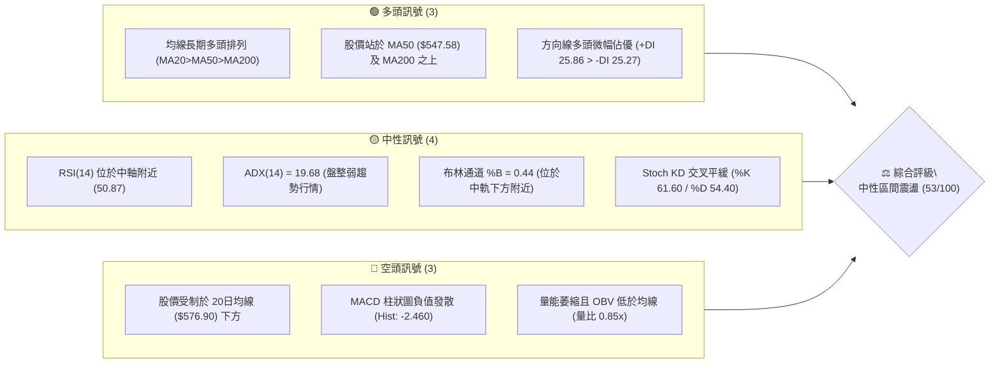
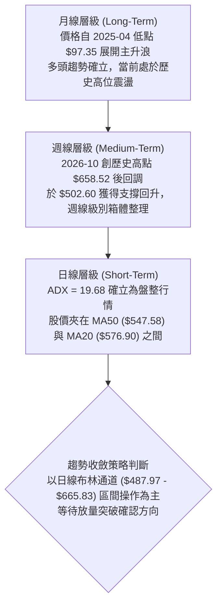
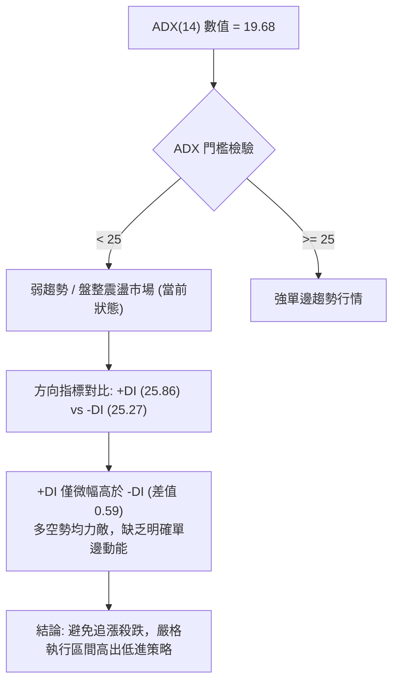
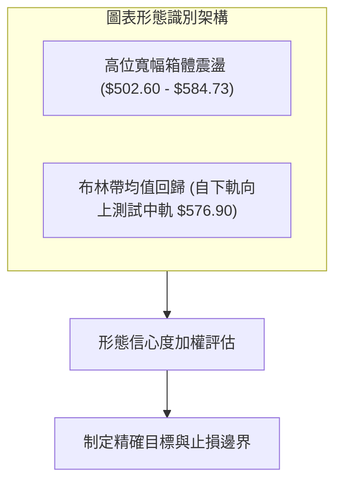
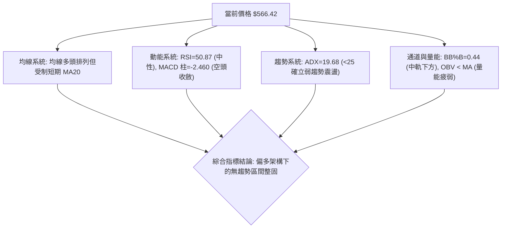
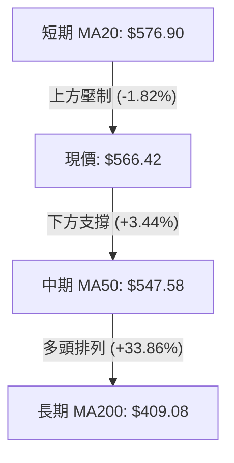
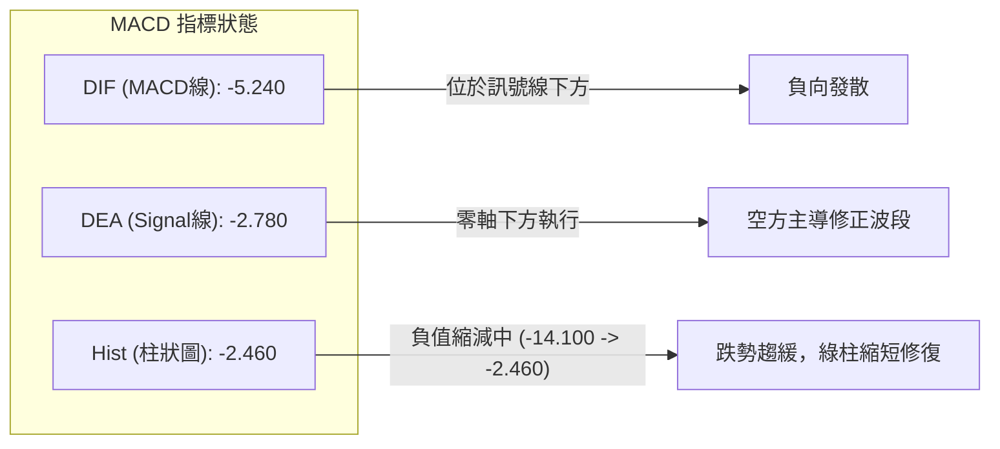
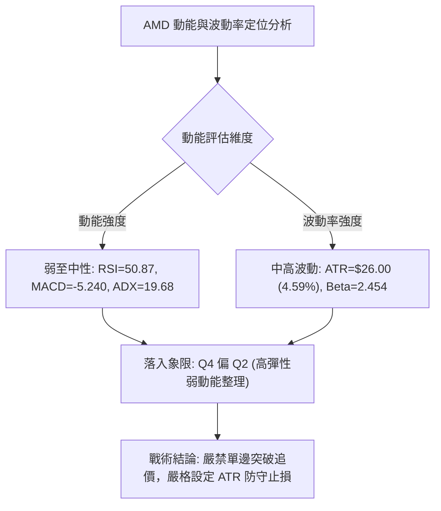
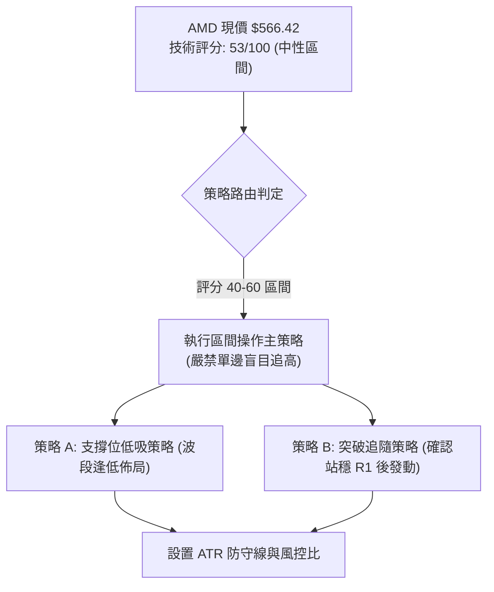
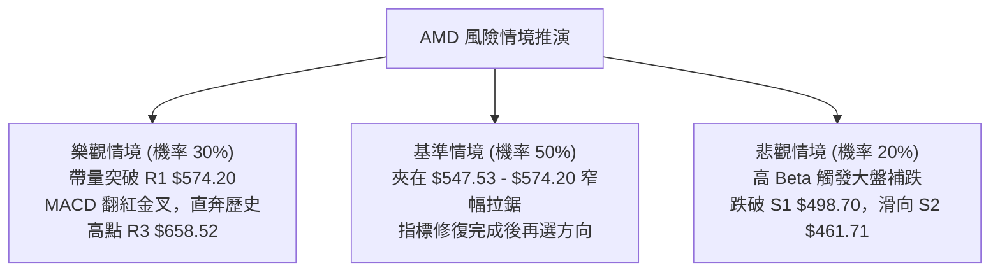

# AMD 技術分析報告

> **報告日期**：2026-10-30 ｜ **語言**：繁體中文 ｜ **數據來源**：Yahoo Finance ｜ **當前價格**：$566.42 USD

---

## 目錄

| 章節 | 內容 |
|------|------|
| [1. 技術面概覽](#1-技術面概覽) | 訊號儀表板、核心指標、評分卡 |
| [2. 趨勢分析](#2-趨勢分析) | 多時框趨勢、長中短期走勢 |
| [3. 圖表形態分析](#3-圖表形態分析) | 形態識別、K線組合、目標價 |
| [4. 支撐與阻力](#4-支撐與阻力) | 關鍵價位、斐波那契回調 |
| [5. 技術指標深度解讀](#5-技術指標深度解讀) | MA/RSI/MACD/布林/成交量 |
| [6. 動能與波動率](#6-動能與波動率) | 動能評估、ATR、Beta |
| [7. 多時框架總結](#7-多時框架總結) | 時框架評分矩陣 |
| [8. 交易策略建議](#8-交易策略建議) | 多空策略、風險報酬比 |
| [9. 風險提示與監控](#9-風險提示與監控) | 監控指標、風險場景 |

---

## 1. 技術面概覽

### 🎯 技術訊號儀表板



---

### 📊 核心指標速覽表

| 指標類別 | 指標名稱 | 當前數值 | 訊號 | 解讀 |
|:---|:---|:---|:---:|:---|
| **價格** | 當前收盤價 | $566.42 | 🟡 | 位於52週區間 80.4% 水位，短線自回調低點回彈 |
| **均線** | 短期 MA20 | $576.90 | 🔴 | 股價位於 MA20 下方 (-1.82%)，短線面臨動態均線壓制 |
| **均線** | 中期 MA50 | $547.58 | 🟢 | 股價位於 MA50 上方 (+3.44%)，中期多頭基底尚存 |
| **均線** | 長期 MA200 | $409.08 | 🟢 | 股價大幅高於 MA200 (+38.46%)，長期結構牛市未改 |
| **動能** | RSI(14) | 50.87 | 🟡 | 位於 30–70 中性平衡區，動能無極端超買或超賣 |
| **動能** | MACD (12,26,9) | -5.240 | 🔴 | MACD 線與訊號線雙雙位於負值區，動能柱為 -2.460 |
| **趨勢強度** | ADX(14) | 19.68 | 🟡 | ADX < 25，顯示當前為弱趨勢／箱體盤整結構 |
| **通道** | 布林通道 %B | 0.44 | 🟡 | 股價介於下軌 ($487.97) 與中軌 ($576.90) 之間 |
| **波動** | ATR(14) | $26.00 | 🟡 | 佔股價 4.59%，波動幅度處於常態偏高水位 |
| **成交量** | 20日量比 | 0.85x | 🔴 | 最新量 16.58M 低於均量 19.50M，OBV < MA 量能疲弱 |

---

### 🏆 技術評分卡

```
╔══════════════════════════════════════════════════════════════╗
║              技術評分卡 — AMD (2026-10-30)                   ║
╠══════════════════════════════════════════════════════════════╣
║ 趨勢強度 (ADX=19.68 弱趨勢)    ██████████░░░░░░░░░░  50/100 🟡 ║
║ 動能指標 (RSI中性/MACD負向)    █████████░░░░░░░░░░░  45/100 🟡 ║
║ 支撐穩定度 (斐波與MA50共振)    ██████████████░░░░░░  70/100 🟢 ║
║ 成交量配合 (量縮/OBV疲弱)      ████████░░░░░░░░░░░░  40/100 🔴 ║
║ 形態完整度 (箱體拉鋸待突破)    ███████████░░░░░░░░░  55/100 🟡 ║
║ 均線排列 (MA20>50>200 多頭)   ████████████░░░░░░░░  60/100 🟢 ║
╠══════════════════════════════════════════════════════════════╣
║ 綜合評分 (六項算術平均)        ███████████░░░░░░░░░  53/100 🟡 ║
║ 評級結論：中性偏多震盪 (Neutral Consolidation)               ║
╚══════════════════════════════════════════════════════════════╝
```
*(註：綜合評分由六項子評分 [50+45+70+40+55+60]/6 = 53.33，依規則 18 四捨五入取整為 53/100)*

---

## 2. 趨勢分析

### 🌐 多時框趨勢分析



---

### 📈 長期趨勢 — 12個月走勢圖（Unicode）

依據月線收盤數據繪製過去 12 個月（2025-11 至 2026-10）價格走勢：

```
AMD 月線收盤走勢圖（過去12個月）
價格軸 ($)
$650 ┤                                      ● $611.76 (09月)
$600 ┤                                     ╱ ╲
$550 ┤                            ● $580.91    ● $566.42 (10月收盤)
$500 ┤                       ● $516.10  ╲    ╱
$450 ┤                                   ●──● $476.15 - $470.72 (07-08月)
$400 ┤
$350 ┤                  ● $354.49 (04月主升啟動)
$300 ┤
$250 ┤
$200 ┤● $217.53 ──● $236.73
$150 ┤       ╲   ╱       ╲
$100 ┤        ● $214.16   ●──● $200.21 - $203.43 (02-03月雙底回踩)
     └────────────────────────────────────────────────────────
       11月 12月 01月 02月 03月 04月 05月 06月 07月 08月 09月 10月
       2025 ────> 2026
```

#### 走勢特徵分析表格

| 階段區間 | 月收盤起止價 | 漲跌幅 | 趨勢性質 | 結構特徵解讀 |
|:---|:---:|:---:|:---:|:---|
| **2025-11 ~ 2026-03** | $217.53 → $203.43 | -6.48% | 築底夯實 | 在 $200.00 關卡形成穩固的底部箱體，完成大級別換手洗盤 |
| **2026-04 ~ 2026-06** | $354.49 → $580.91 | +63.87% | 主升浪爆發 | 單月漲幅激增，量價齊揚，突破長期壓制進入估值重塑期 |
| **2026-07 ~ 2026-08** | $476.15 → $470.72 | -18.97% | 均值回歸 | 主升浪後的高位大幅洗盤，於 $470.00 附近獲得長線支撐 |
| **2026-09 ~ 2026-10** | $611.76 → $566.42 | -7.41% | 高位巨震 | 盤中刷新高點 $658.52 後遇阻回吐，進入次級整理浪 |

---

### 📊 中期趨勢（週線分析）

中期走勢聚焦於 2026 年 9 月至 10 月的高位衝頂與修正波段：

```
週線級別價格壓力與支撐示意
$658.52 ════════════════════════════════════════════ 52週歷史高點 (R3)
        ▲
        │  2026-10-09 當週摸高 $658.52 後引發獲利回吐
        ▼
$584.73 ──────────────────────────────────────────── 波段高點阻力 (R2)
$576.90 ┄┄┄┄┄┄┄┄┄┄┄┄┄┄┄┄┄┄┄┄┄┄┄┄┄┄┄┄┄┄┄┄┄┄┄┄┄┄ 日線 MA20 / 週線均線牽引帶
$566.42 ════════════════════════════════════════════ 【當前現價】
$547.53 ──────────────────────────────────────────── 斐波那契 23.6% 回調位 / 日線 MA50 ($547.58)
        ▲
        │  2026-10-23 當週探底 $502.60 迅速拉回
        ▼
$498.70 ════════════════════════════════════════════ 關鍵支撐 S1 / 心理整數支撐帶
```

---

### ⚡ 趨勢強度評估（ADX 解讀）



#### ADX 趨勢強度對照表

| 指標名稱 | 當前數值 | 參考標準 | 狀態評定 | 操作指引 |
|:---|:---:|:---:|:---:|:---|
| **ADX (14)** | **19.68** | < 20：極弱或無趨勢；20–25：弱趨勢；> 25：單邊趨勢確立 | 🟡 弱趨勢／無方向盤整 | 暫不具備單邊趨勢跟隨條件，重點參考通道邊界 |
| **+DI (14)** | **25.86** | 衡量多頭推升力道 | 🟢 略佔優勢 | 多方守住階段低點，但未拉開攻擊差距 |
| **-DI (14)** | **25.27** | 衡量空頭下壓壓制力 | 🔴 緊咬不放 | 賣壓並未完全釋放，壓制價格向上彈升空間 |

---

## 3. 圖表形態分析

### 🔍 形態識別系統

在日線及近 8 週走勢中，價格在觸及 52 週高點 $658.52 後快速滑落至 $502.60，隨後在近 4 個交易日展開自拔修復，當前處於典型的**寬幅箱體修復與收斂形態**。



#### 形態信心度與判斷依據表（依規則 15）

| 形態名稱 | 信心度 | 判斷依據（引用數據） | 完成度 | 目標價（附精確計算式） |
|:---|:---:|:---|:---:|:---|
| **矩形箱體反彈** | **75%** | 價格於 2026-10-22 低點 $502.60 止跌，近 5 日形成反彈波，受阻於阻力 R1 $574.20 與 R2 $584.73 | 70% | 向上目標 = 箱底 $502.60 + 形態高度 ($584.73 - $502.60 = $82.13) = **$584.73** (已接近達成)；進一步突破則看高點 **$658.52** |
| **布林帶收斂回抽** | **70%** | %B 自超賣邊界回升至 0.44，價格自下軌 $487.97 上方反彈，逼近中軌 $576.90 | 85% | 中軌目標價 = **$576.90** (中軌 MA20 數值) |
| **雙底形態 (W底)** | **40%** | 數據中僅偵測到單一急跌低點 ($502.60)，未完成第二次有效回踩確認 | 30% | *訊號不足，僅做指標型解讀，不預設雙底目標價* |

---

### 🕯️ 重要K線形態分析

嚴格依據提供的「近 10 根日K」與「近 8 根週K」實體與影線價格解讀（依規則 19）：

#### 近 10 根日K 形態解析

| 日期 | 開盤價 | 最高價 | 最低價 | 收盤價 | K線形態名稱 | 技術解讀 | 訊號 |
|:---|:---:|:---:|:---:|:---:|:---|:---|:---:|
| **2026-10-16** | 547.55 | 550.96 | 526.83 | 528.75 | 實體大陰線 | 低開低走收於最低點附近，破位下行確立短線調整 | 🔴 |
| **2026-10-19** | 551.78 | 554.41 | 535.67 | 538.05 | 倒狀反彈小陰線 | 高開後遭遇均線拋壓，反彈受挫 | 🔴 |
| **2026-10-20** | 530.02 | 548.11 | 524.60 | 534.74 | 下影小陽十字星 | 盤中下探 $524.60 獲多頭承接，多空分歧加劇 | 🟡 |
| **2026-10-21** | 545.93 | 556.79 | 537.30 | 552.72 | 溫和放量陽線 | 吞沒前一日實體，嘗試向上修復均線系統 | 🟢 |
| **2026-10-22** | 524.10 | 529.98 | 502.60 | 507.93 | 恐慌長陰殺跌 | 暴跌 -8.1%，巨量 28.00M 探至近期最低點 $502.60 | 🔴 |
| **2026-10-23** | 510.21 | 523.92 | 508.36 | 516.79 | 縮量低位陽線 | 守住 $502.60 低點不破，空頭力竭跡象初顯 | 🟢 |
| **2026-10-26** | 522.79 | 533.50 | 514.01 | 531.28 | 止跌回升陽線 | 連續第二日收高，築底結構逐步成形 | 🟢 |
| **2026-10-27** | 539.49 | 563.92 | 538.50 | 560.26 | 實體大陽線 | 放量上攻突破斐波那契 23.6% ($547.53)，多頭強勁反攻 | 🟢 |
| **2026-10-28** | 573.08 | 579.18 | 560.52 | 578.44 | 衝高小陽線 | 觸及 MA20 上方並摸高 $579.18，遭遇阻力位 R1 ($574.20) | 🟡 |
| **2026-10-29** | 562.27 | 575.10 | 560.57 | 566.42 | 帶上影受阻陰線 | 衝高受制於 R1 拋壓，收盤滑落至 MA20 ($576.90) 下方 | 🔴 |

#### 近 8 根週K 形態解析

| 週結日期 | 開盤價 | 最高價 | 最低價 | 收盤價 | 週K形態名稱 | 技術解讀 | 訊號 |
|:---|:---:|:---:|:---:|:---:|:---|:---|:---:|
| **2026-09-11** | 488.92 | 526.79 | 486.57 | 516.13 | 突破中陽線 | 週線帶量突破 $500 心理關卡，確立主升段重啟 | 🟢 |
| **2026-09-18** | 486.28 | 559.91 | 480.33 | 559.82 | 光頭大陽線 | 單週暴漲逾 40 點，成交量激增至 124.59M | 🟢 |
| **2026-09-25** | 583.88 | 639.00 | 582.27 | 630.63 | 跳空加速陽線 | 放量大推升，週成交量達 132.06M，多頭極盛 | 🟢 |
| **2026-10-02** | 624.90 | 645.46 | 596.07 | 633.91 | 高位十字星 | 週線出現高位長下影星線，顯現高檔換手滯漲 | 🟡 |
| **2026-10-09** | 630.61 | 658.52 | 606.00 | 608.10 | 避雷針長上影 | 摸出 52 週新高 $658.52 後大幅跳水，見頂反轉確立 | 🔴 |
| **2026-10-16** | 599.93 | 606.20 | 526.83 | 528.75 | 斷頭長陰破位 | 重挫回吐，直接摜破多條短期週均線 | 🔴 |
| **2026-10-23** | 551.78 | 556.79 | 502.60 | 516.79 | 探底針狀陰線 | 盤中殺跌至 $502.60 逼近 S1 ($498.70)，留下影線 | 🟡 |
| **2026-10-29** | 522.79 | 579.18 | 514.01 | 566.42 | 止跌反彈中陽 | 週線級別低位反彈，收復上週過半失地 | 🟢 |

---

### 📉 ASCII 走勢形態示意圖

```
日線短波段結構走勢示意圖（2026-10-16 至 2026-10-29）
價格
$584.73 ┤                                        [R2 阻力帶]
$579.18 ┤                             ● (10-28 摸高 $579.18 受阻)
$574.20 ┤┄┄┄┄┄┄┄┄┄┄┄┄┄┄┄┄┄┄┄┄┄┄┄┄┄┄╱┄┄┄┄┄┄ [R1 阻力位]
$566.42 ┤                            ● (10-29 收盤 $566.42 ◄ 現價)
$560.26 ┤                        ●──╱ (10-27 大陽衝刺)
$547.53 ┤┄┄┄┄┄┄┄┄┄┄┄┄┄┄┄┄┄┄┄┄╱┄┄┄┄┄┄┄┄┄┄┄ [斐波那契 23.6% 支撐帶]
$538.05 ┤    ●                  ╱
$528.75 ┤●───╲               ● (10-26 啟動)
$516.79 ┤      ╲           ●╱ (10-23 縮量止跌)
$507.93 ┤        ╲       ●╱
$502.60 ┤         ●─────╯ (10-22 恐慌下影探底 $502.60)
$498.70 ┤┄┄┄┄┄┄┄┄┄┄┄┄┄┄┄┄┄┄┄┄┄┄┄┄┄┄┄┄┄┄┄┄┄ [S1 關鍵波段支撐]
         └─────────────────────────────────────────────────────
          10-16  10-19 10-20 10-21 10-22 10-23 10-26 10-27 10-28 10-29
```

---

### 🎯 形態目標價計算

根據日線自 $502.60 起漲的「箱底反彈波」幾何推算：
1. **箱體波段高度 ($H$)**：
   $$H = \text{箱體上邊界 (R2)} - \text{箱體低點} = \$584.73 - \$502.60 = \$82.13$$
2. **第一階段目標價 (T1)**：
   箱體中樞與阻力重合位 = **$574.20**（阻力位 R1）已於 10-28 觸及，目前轉為壓制檢驗。
3. **第二階段測幅目標價 (T2)**：
   若能有效帶量突破 R2 ($584.73)，全額度量延伸目標為：
   $$\text{目標價} = \text{突破點} + H = \$584.73 + \$82.13 = \$666.86$$
   該推算數值與布林帶上軌 **$665.83** 及歷史極值 **$658.52** 形成強力空間共振阻力區。

---

## 4. 支撐與阻力

### 🗺️ 關鍵價位分布圖（Unicode）

```
AMD 價位結構分布圖
══════════════════════════════════════════════════════════
$665.83 ║██████████████████████████████║ 布林通道上軌
$658.52 ║██████████████████████████████║ 極限阻力 R3 / 52週歷史高點
$584.73 ║████████████████████          ║ 波段阻力 R2 (反彈強壓)
$576.90 ║████████████████              ║ 布林中軌 (MA20 動態壓制)
$574.20 ║██████████████████████        ║ 即時阻力 R1 (+1.37%)
$566.42 ╠══════════════════════════════╣ ◄ 現價 ($566.42)
$547.58 ║▓▓▓▓▓▓▓▓▓▓▓▓▓▓▓▓▓▓            ║ 動態支撐 MA50
$547.53 ║▓▓▓▓▓▓▓▓▓▓▓▓▓▓▓▓▓▓            ║ 斐波那契 23.6% 回調關鍵位
$498.70 ║▓▓▓▓▓▓▓▓▓▓▓▓▓▓▓▓▓▓▓▓▓▓        ║ 關鍵波段支撐 S1 (-11.96%)
$487.97 ║▓▓▓▓▓▓▓▓▓▓▓▓▓▓▓▓              ║ 布林通道下軌
$478.87 ║▓▓▓▓▓▓▓▓▓▓▓▓▓▓                ║ 斐波那契 38.2% 回調位
$461.71 ║████████████████████████      ║ 強支撐 S2 (-18.49%)
$451.00 ║██████████████████████████    ║ 終極防線 S3 (-20.38%)
══════════════════════════════════════════════════════════
```

---

### 🚧 阻力位分析表

*(價位嚴格引用關鍵價位數據，無主觀臆造)*

| 阻力級別 | 精確價位 | 距現價空間 | 形成技術依據 | 突破難度評估 | 重要性 |
|:---|:---:|:---:|:---|:---:|:---:|
| **R1** | **$574.20** | +1.37% | 近一年波段高點聚類位，近兩日日K上影線密集受阻處 | 🟡 中等 (需日線收盤站上) | ★★★★☆ |
| **R2** | **$584.73** | +3.23% | 下降波段反彈防守高點，與布林中軌上方籌碼套牢區重疊 | 🔴 較高 (需成交量增至均量以上) | ★★★★☆ |
| **R3** | **$658.52** | +16.26% | 52週歷史最高點，2026-10-09 週線巨量天花板 | 🔴 極高 (需大級別基本面刺激) | ★★★★★ |

---

### 🛡️ 支撐位分析表

*(價位嚴格引用關鍵價位數據，無主觀臆造)*

| 支撐級別 | 精確價位 | 距現價空間 | 形成技術依據 | 守住機率評估 | 重要性 |
|:---|:---:|:---:|:---|:---:|:---:|
| **S1** | **$498.70** | -11.96% | 近一年波段低點聚類位，逼近 10-22 探底低點 $502.60 與 $500 心理整數關卡 | 🟢 高 (多頭波段防線) | ★★★★★ |
| **S2** | **$461.71** | -18.49% | 2026年 7–8 月多次月線收盤與週線回調聚集點 | 🟢 極高 (中期強結構底) | ★★★★☆ |
| **S3** | **$451.00** | -20.38% | 2026年二季度主升浪向上跳空起點，機構護盤底線 | 🟢 極高 (長線牛熊分水嶺) | ★★★★★ |

---

### 📐 斐波那契回調位分析

本波段斐波那契回調基底嚴格取自 52 週最低點 **$188.22** 至 52 週最高點 **$658.52**（全波段落差幅達 $470.30）：

| 回調比例 | 精確對應點位 | 與當前價格位置關係 | 技術意義深度解讀 |
|:---:|:---:|:---:|:---|
| **0.0% (52W High)** | **$658.52** | 上方距 +16.26% | 多頭極限天花板，強大拋壓區 |
| **23.6%** | **$547.53** | **下方距 -3.33%** | **【核心分界】與日線 MA50 ($547.58) 形成重疊共振支撐，回調未破此處屬強勢整理** |
| **38.2%** | **$478.87** | 下方距 -15.46% | 強回調支撐位，與布林通道下軌 ($487.97) 構成底部防禦區間 |
| **50.0%** | **$423.37** | 下方距 -25.25% | 牛市半數回撤中樞，接近長期 MA200 ($409.08) 防守位 |
| **61.8%** | **$367.87** | 下方距 -35.05% | 黃金分割防禦點，破位則意味著長期上升趨勢遭到破壞 |
| **78.6%** | **$288.86** | 下方距 -49.00% | 深幅回撤防線 |
| **100.0% (52W Low)**| **$188.22** | 下方距 -66.77% | 52 週絕對原始起漲點 |

**現價落點解讀**：
當前收盤價 **$566.42** 明確座落於 **0.0% ($658.52)** 與 **23.6% ($547.53)** 之間。在技術分析定義中，回調未跌破 23.6% 斐波那契位即止跌回升，屬於超強級別的多頭結構性消化；只要股價持續守穩於 $547.53 之上，技術架構便不構成深幅趨勢反轉。

---

## 5. 技術指標深度解讀

### 🎛️ 指標訊號總覽



---

### 📈 移動平均線排列分析



#### 均線各維度數據及狀態評估

| 均線名稱 | 數值 | 現價與均線關係 | 短期斜率 | 訊號評級 | 技術解讀 |
|:---|:---:|:---:|:---:|:---:|:---|
| **MA5** | $550.64 | 價格在上方 (+2.87%) | ▲ 向上 | 🟢 看多 | 超短期多頭排列，反映近 3 日強勁反彈 |
| **MA10** | $541.54 | 價格在上方 (+4.59%) | ▲ 向上 | 🟢 看多 | 拐頭向上，提供短期第一道動態墊高點 |
| **MA20** | $576.90 | 價格在下方 (-1.82%) | ▼ 向下 | 🔴 看空 | 下行中軌壓制，現價連續兩日衝高均在此受阻回落 |
| **MA50** | $547.58 | 價格在上方 (+3.44%) | ▲ 向上 | 🟢 看多 | 中期牛熊分界線，斜率持續走多，為回調的核心鐵板 |
| **MA60** | $537.21 | 價格在上方 (+5.44%) | ▲ 向上 | 🟢 看多 | 中期趨勢輔助線，穩步走升 |
| **MA120** | $519.92 | 價格在上方 (+8.94%) | ▲ 向上 | 🟢 看多 | 半年線支撐強勁，鎖定長線獲利籌碼成本 |
| **MA200** | $409.08 | 價格在上方 (+38.46%)| ▲ 向上 | 🟢 看多 | 遠端年線，定義大級別牛市週期完全完好 |
| **MA240** | $376.85 | 價格在上方 (+50.31%)| ▲ 向上 | 🟢 看多 | 超長期基底線，提供極強的宏觀估值底部 |

---

### 📉 RSI(14) 分析

*   **當前數值**：**50.87**
*   **區間展示**：
    ```
    超賣(0-30)        中性平衡區(30-70)         超買(70-100)
    ├──────────────┼────────────────────────┼──────────────┤
    ░░░░░░░░░░░░░░ ██████████░░░░░░░░░░░░░░░ ░░░░░░░░░░░░░░
                   ▲ (50.87 - 處於多空平衡零軸)
    ```
*   **超買超賣狀態**：數值 50.87 精確座落於中軸 50 附近，既無上方動能過熱耗竭之險，亦無低檔被動恐慌踐踏之虞，屬於典型的平衡市。
*   **背離分析判斷**：
    依據近 20 根 K 棒走勢檢驗，股價自 10-09 高點滑落後，RSI 由 70 附近滑落至 10-16 的 37.8，隨後價格在 10-22 探底 $502.60 時 RSI 築底回升至 39.0，而後伴隨現價反彈回到 50.87。近 20 根首尾方向比對顯示：**「無明顯頂背離或底背離」**，RSI 指標客觀反映了價格的衝高、回撤與弱反彈節奏。

---

### 📊 MACD(12,26,9) 訊號解讀



*   **數值對比**：MACD 線 (-5.240) < Signal 訊號線 (-2.780)，兩者均落於零軸下方，證實中期動能仍處於空頭修正節奏中。
*   **動能柱分析**：負向柱狀圖當前為 **-2.460**。值得高度重視的是，回溯近幾週數據，週線 MACD 柱在 10-16 曾擴大至 **-14.100**，隨後收斂至 **-13.949**，本週收斂至 **-2.460**。這表明**下殺動能已出現斷崖式衰退，空方動能處於快速衰竭與修復週期**，但尚未正式形成零軸下方的黃金交叉。

---

### 📦 布林通道分析

```
日線布林通道結構示意圖 (帶寬與軌道位置)
$665.83 ════════════════════════════════════════ 布林上軌 (阻力天花板)
        ▲
        │  擴軌後的均值回歸區間
        ▼
$576.90 ┄┄┄┄┄┄┄┄┄┄┄┄┄┄┄┄┄┄┄┄┄┄┄┄┄┄┄┄┄┄┄┄┄┄┄┄ 布林中軌 (MA20 壓制線)
$566.42 ──────────────────────────────────────── 【現價落點 (%B = 0.44)】
        ▲
        │  下半通道弱勢震盪區間
        ▼
$487.97 ════════════════════════════════════════ 布林下軌 (極限支撐底線)
```

*   **軌道邊界數值**：
    *   **上軌**：$665.83
    *   **中軌 (MA20)**：$576.90
    *   **下軌**：$487.97
*   **帶寬與通道指標 (%B)**：
    *   當前 %B 為 **0.44**，介於 0 與 0.5 之間，代表現價處於下半通道、且逼近中軌壓制位。
    *   當前通道呈現高位開口後逐漸收口的過程。在價格未帶量站上中軌 $576.90 之前，走勢仍受制於均線引力，傾向於在中軌與下軌之間反覆震盪打底。

---

### 💹 成交量分析（量價配合度）

```
成交量萎縮對比示意
基準均量 (20MA): 19,502,670 █ █ █ █ █ █ █ █ █ █ (1.00x)
最新量 (10-29):   16,584,000 █ █ █ █ █ █ █ █ ░ ░ (0.85x)
```

1.  **量能狀態**：最新單日成交量為 16,584,000 股，相較於 20 日均量 19,502,670 股，量比僅為 **0.85x**。
2.  **OBV（能量潮）狀態**：官方快照顯示 **OBV < MA**，代表資金活躍度較低，場外主力資金在衝破 $658.52 後並未在當前價位大舉進場追價。
3.  **量價背離驗證**：近 4 個交易日價格由 $507.93 推升至 $566.42，但成交量由 10-22 的 28.00M 縮減至當前的 16.58M，呈現典型的**「量縮反彈」**格局。量價背離預示著向上進攻 R1 ($574.20) 與 R2 ($584.73) 的力道將受到約束，若無補量動作，易誘發二次回踩。

---

## 6. 動能與波動率

### ⚡ 動能評估四象限



#### 動能與波動四象限對照表

| 象限標籤 | 動能狀態 | 波動水平 | 典型特徵 | AMD 當前匹配性評估 |
|:---:|:---:|:---:|:---|:---|
| **Q1** | 強動能 | 低波動 | 穩步單邊推升行情 | 不符合。ADX 僅 19.68，缺乏單邊動能。 |
| **Q2** | 弱動能 | 低波動 | 窄幅死水盤整 | 部分特徵符合，但波動率並未降至極低。 |
| **Q3** | 強動能 | 高波動 | 快速主升或極速跳水 | 不符合。當前未出現方向性連續單邊狂飆。 |
| **Q4** | **弱動能** | **高波動** | **寬幅洗盤，來回抽搐 (當前狀態)** | **完全符合 (✓)**。高 Beta 與高 ATR 疊加無趨勢盤整。 |

---

### 📊 ATR 波動率分析

*   **ATR(14) 數值**：**$26.00**（佔股價比例高達 **4.59%**）。
*   **每日波動特性解讀**：
    AMD 單日平均波動空間高達 26 美元，在近 10 根日K中，單日高低點落差多在 $15–$30 美元之間（例如 10-22 單日波幅達 $27.38）。這種高 ATR 特性要求投資人在建立部位時，**絕對不能使用常規小股票的緊密止損**，否則極易在正常的盤中雜訊中被洗出場。
*   **止損與倉位距離科學建議**：
    *   **短線交易止損安全邊界 (1.0 × ATR)**：至少預留 **$26.00** 空間。
    *   **波段交易止損安全邊界 (1.5 × ATR)**：預留 $26.00 × 1.5 = **$39.00** 空間。
    *   **結構波段止損安全邊界 (2.0 × ATR)**：預留 $26.00 × 2.0 = **$52.00** 空間。

---

### 📐 Beta 與市場相關性

*   **Beta 數值**：**2.454**（極高系統性敏感度）。
*   **市場聯動與槓桿效應**：
    Beta 值高達 2.454，表明 AMD 的波動幅度是標普 500 指數的近 2.5 倍。當大盤指數上漲 1% 時，AMD 理論波動幅度為 +2.45%；反之，大盤回調 1%，AMD 易承擔近 -2.5% 的放大跌幅。
*   **半導體週期聯動風險**：
    結合機構持股比例高達 75.3% 的背景，當前股價受總體科技股 ETF 及半導體板塊情緒主導。在 ADX < 25 的盤整期，宏觀市場或同行業龍頭的微幅震盪即可能引發 AMD 出現放大倍數的日內劇震。

---

## 7. 多時框架總結

### 📋 時框架評分表

| 時框架 | 趨勢方向 | 動能狀態 | 均線排列特徵 | 關鍵圖表形態 | 綜合評分 | 戰術建議 |
|:---|:---:|:---:|:---|:---|:---:|:---|
| **長期 (月線)** | 🟢 多頭向上 | 🟢 動能充沛 | MA200 遠端強撐 ($409.08) | 突破 $200 箱體後的大型主升段 | **75/100** | 長線持有，無視短期拉鋸 |
| **中期 (週線)** | 🟡 震盪回調 | 🔴 柱狀負向 | 均線高位多頭糾纏 | 創 $658.52 高點後的次級修正波 | **50/100** | 逢低吸納，不追高突破 |
| **短期 (日線)** | 🟡 盤整收斂 | 🟡 RSI 中性 | MA20 壓制 vs MA50 支撐 | 夾板於 $547–$576 區間整理 | **53/100** | 區間高出低進，以中軌為界 |

---

### 🔲 綜合訊號矩陣

```
訊號一致性交叉檢驗矩陣
────────────────────────────────────────────────────────────────
維度         短期 (日線)          中期 (週線)          長期 (月線)
────────────────────────────────────────────────────────────────
趨勢方向     🟡 橫盤震盪          🔴 衝高受阻          🟢 穩健牛市
均線系統     🔴 MA20 壓制         🟢 處於主要均線上    🟢 完美多頭
動能指標     🟡 RSI=50/中性       🔴 MACD 修正中       🟢 高位強勢
量能配合     🔴 縮量 (0.85x)      🟡 週量收斂          🟢 總體沉澱
────────────────────────────────────────────────────────────────
綜合判定     短線整理             中期回調防守         長牛基底未損
────────────────────────────────────────────────────────────────
```

---

### ⚖️ 多時框收斂結論

**依據多時框收斂規則（規則 14）嚴謹推導**：
1.  **趨勢行情 vs 盤整行情檢驗**：
    當前 ADX(14) 數值為 **19.68**，明確小於 25 的關鍵趨勢門檻。依規則 14 定義，**當前市場不屬於單邊趨勢行情，而是典型的「盤整行情」**。
2.  **主導時框與交易邊界收斂**：
    在 ADX < 25 的盤整結構下，交易策略不宜採用單邊追隨模式，而**必須以日線布林通道 ($487.97 – $665.83) 及箱體上下軌作為主要交易區間**。
3.  **唯一方向性結論**：
    **【中性區間震盪觀望，偏向下軌支撐低吸（Neutral Consolidation）】**。
    當前日線與週線的衝突在於：週線剛完成一波自高點 $658.52 的深幅下殺，空頭慣性仍在；但日線在斐波那契 23.6% ($547.53) 與 MA50 ($547.58) 展現出扎實的抗跌支撐。在量能縮減至 0.85x 的背景下，市場既無力向下直接摜破 S1 ($498.70)，亦無力向上直接衝過 R2 ($584.73)。因此，最終結論收斂為：**依託 $547.53 支撐做防守，在 $547.53–$574.20 的狹窄夾板區內以震盪思維對待**。

---

## 8. 交易策略建議

### 🗺️ 策略決策流程圖



---

### 🧭 策略路由（依評分卡分流）

> **當前主策略方向 = 中性區間操作，以逢低佈局震盪低吸為主（依綜合評分 53/100）**
>
> 依據系統規則，綜合評分 53/100 屬於 40–60 分的中性震盪評級區間。報告主推「區間低吸」與「右側確認突破」策略，空頭方向僅列為反轉跌破風控觸發提示，不作主推操作。

---

### 🎯 價格情境階梯（Price Scenarios）

*(價位嚴格引用第 4 章及數據源關鍵價位)*

| 觸發條件 | 下一目標 | 後續延伸目標 | 情境含義與技術演變路徑 |
|:---|:---:|:---:|:---|
| **向上放量突破 R1 ($574.20)** | **R2 ($584.73)** | **R3 ($658.52)** | 短線全面轉強，收復布林中軌，向上打開至歷史高點通道 |
| **維持在 $547.53 – $574.20** | **MA20 ($576.90)**| **BB下軌 ($487.97)** | 延續當前夾板震盪，量能持續萎縮，指標進行時間換空間 |
| **有效跌破 S1 ($498.70)** | **S2 ($461.71)** | **S3 ($451.00)** | 中期結構破位，回踩 2026年 7–8 月平台，牛市主升段暫告中斷 |

---

### 📊 情境機率分佈

| 演變情境 | 發生機率 | 主要技術依據支撐 |
|:---|:---:|:---|
| **情境一：區間震盪築底** | **50%** | **ADX = 19.68 確立無趨勢**；布林通道寬度收窄；RSI 穩於 50.87 平衡軸；量比 0.85x 支持橫盤換手。 |
| **情境二：回踩支撐後重拾升勢** | **30%** | 均線呈長期多頭排列 (MA20>50>200)；MACD 負柱大幅收縮至 -2.460；斐波那契 23.6% ($547.53) 支撐強固。 |
| **情境三：摜破箱底深幅回調** | **20%** | OBV 持續疲軟低於均線；短期 MA20 形成動態蓋頂；Beta 高達 2.454，若宏觀環境惡化易引發恐慌補跌。 |

---

### 🟢 主策略詳情

依據嚴格規則 17，所有進場、止損、目標價必須引用「關鍵價位」精確數值；風險報酬比嚴格按公式 $(T1 - \text{進場價}) \div (\text{進場價} - \text{止損價})$ 計算：

| 策略要素 | 策略 A（區間下緣逢低吸納策略） | 策略 B（右側放量突破跟隨策略） |
|:---|:---|:---|
| **戰略定位** | 左側防禦型低吸，博弈箱體支撐回彈 | 右側順勢進攻型，確認突破阻力後追隨 |
| **進場條件** | 價格回踩 S1 關鍵波段支撐位企穩不破 | 日線收盤價帶量突破即時阻力位 R1 |
| **精確進場價格** | **$498.70** (精確引用關鍵支撐 S1) | **$574.20** (精確引用阻力位 R1) |
| **目標價 T1** | **$574.20** (精確引用阻力位 R1) | **$658.52** (精確引用阻力位 R3 / 52W高點) |
| **目標價 T2** | **$584.73** (精確引用阻力位 R2) | **$665.83** (精確引用布林通道上軌) |
| **精確止損價格** | **$461.71** (精確引用關鍵支撐 S2) | **$547.53** (精確引用斐波那契 23.6% 支撐) |
| **風險報酬比計算** | 風險 = $498.70 - $461.71 = $36.99<br/>報酬 T1 = $574.20 - $498.70 = $75.50<br/>比值 = 75.50 / 36.99 = **2.04**<br/>**1 : 2.04（以 T1 計）** | 風險 = $574.20 - $547.53 = $26.67<br/>報酬 T1 = $658.52 - $574.20 = $84.32<br/>比值 = 84.32 / 26.67 = **3.16**<br/>**1 : 3.16（以 T1 計）** |
| **歷史成功機率估計** | **65%** (箱體底部疊加 S1 支撐) | **55%** (假突破頻發，需量能配合) |
| **建議配置倉位** | **15% - 20%** (分批建倉) | **10% - 15%** (動量倉位) |

*(註：若策略 A 以 T2 衡量：報酬 = $584.73 - $498.70 = $86.03，比值 = 86.03 / 36.99 = 2.33，風險報酬比為 1 : 2.33（以 T2 計）)*

---

### 🔴 反向風險觸發點（對沖提示）

以下關鍵價位被擊破時，將徹底推翻上述偏多區間操作假設，投資人應立即執行防禦或減倉對沖：
*   **首要警報點**：日線收盤價跌破斐波那契 23.6% 關鍵位 **$547.53**（與 MA50 重疊），表明多頭強支撐失守，應將短線倉位砍半。
*   **趨勢失效點**：價格跌破波段核心支撐 S1 **$498.70**，意味著高位箱體徹底破位，價格將加速滑向 S2 **$461.71**，此時主策略全部停損，禁止任何逆勢抄底。

---

### ⭐ 整體訊號強度評星

```
做多訊號強度：★★★☆☆  (3.0/5星 - 均線多頭底蘊仍在，但受制於量縮與MA20壓制)
做空訊號強度：★★☆☆☆  (2.0/5星 - MACD負柱收斂，下方有斐波23.6%強力承接)
整體可信度：  ★★★★☆  (4.0/5星 - 關鍵價位群聚性高，震盪區間界線明確)
```

---

## 9. 風險提示與監控

### ✅ 關鍵監控指標 Checklist

```
╔══════════════════════════════════════════════════════════════╗
║               AMD 技術面每日盤後監控清單 (Checklist)           ║
╠══════════════════════════════════════════════════════════════╣
║ [ ] 價格是否成功收復布林中軌 / MA20 ($576.90)                 ║
║ [ ] 日成交量是否放大越過 20日均量線 (19.50M 門檻)             ║
║ [ ] 斐波那契 23.6% ($547.53) 與 MA50 ($547.58) 支撐是否完好   ║
║ [ ] MACD 柱狀圖是否持續收窄並翻紅金叉 (當前: -2.460)           ║
║ [ ] ADX(14) 是否放量抬升站回 25 以上 (確認單邊趨勢形成)       ║
║ [ ] RSI(14) 能否突破 55 上方進入多頭攻擊區 (當前: 50.87)      ║
║ [ ] S1 關鍵防線 ($498.70) 是否遭受盤中異常大單砸盤             ║
╚══════════════════════════════════════════════════════════════╝
```

---

### ⚠️ 風險場景分析



---

### 🛡️ 風險管理重要提醒

1.  **高 Beta 與高 ATR 帶來的波動乘數效應**：
    AMD 的 Beta 值高達 2.454，ATR 高達 $26.00。在宏觀市場動盪期，切忌滿倉操作。單一交易部位建議控制在總投資組合的 **10%–15%** 以內，最大不得超過 20%。
2.  **避免「假突破」追價陷阱**：
    在 ADX 處於 19.68 的弱趨勢環境中，各類向上試探阻力位（如 R1 $574.20 或 R2 $584.73）極易演變成帶長上影線的假突破（類似 10-28 衝高至 $579.18 隨即折返）。務必等待日線「實體收盤」確認或回踩確認後再行跟進。
3.  **嚴格執行鐵律止損**：
    左側參與者若在 $547.53 附近低吸，止損必須堅決錨定於 S1 ($498.70) 下方；右側突破參與者，保護性止損絕不可低於 $547.53。切勿將短線交易轉化為被動長線套牢。

---

## 📋 報告總結

```
╔══════════════════════════════════════════════════════════════════╗
║                   AMD 技術分析報告總結                          ║
╠══════════════════════════════════════════════════════════════════╣
║ 報告日期：2026-10-30                                             ║
║ 當前價格：$566.42 USD                                            ║
║ 綜合技術評分：53 / 100 🟡 (六項指標均值，規則 18)                ║
║ 分析評級：⚖️ 中性偏多區間震盪 (Neutral Consolidation)           ║
╠══════════════════════════════════════════════════════════════════╣
║ 關鍵結論：                                                       ║
║ ├─ 長期趨勢：🟢 完好多頭排列，股價大幅高於 MA200 ($409.08)       ║
║ ├─ 中期趨勢：🟡 高位見頂 $658.52 後回調，探底 $502.60 展開修復   ║
║ ├─ 短期趨勢：🟡 ADX=19.68 確立為盤整市，受制於 MA20 ($576.90)    ║
║ ├─ 核心支撐：$547.53 (斐波23.6%) / $498.70 (波段關鍵 S1)         ║
║ ├─ 核心阻力：$574.20 (即時阻力 R1) / $584.73 (波段阻力 R2)       ║
║ └─ 分析師目標均價：$640.21 (相較現價具備 +13.03% 理論空間)       ║
╠══════════════════════════════════════════════════════════════════╣
║ 最優策略組合：                                                   ║
║ 1. 🥇 最佳機會 (策略 A)：回踩波段支撐 S1 ($498.70) 逢低佈局，    ║
║    目標 R1 ($574.20)，止損 S2 ($461.71)，風報比 1 : 2.04        ║
║ 2. 🥈 次選機會 (策略 B)：右側放量突破 R1 ($574.20) 順勢追隨，    ║
║    目標 R3 ($658.52)，止損 $547.53，風報比 1 : 3.16             ║
║ 3. 🥉 保守選擇：在 ADX 脫離盤整區間 (<25) 前，空倉觀望，等待     ║
║    布林中軌 $576.90 的實體突破與量能放大至 19.50M 再行決策      ║
╚══════════════════════════════════════════════════════════════════╝
```

---

> ⚠️ **免責聲明**：本報告為技術分析研究成果，所有價位、指標及情境推算均基於既有市場公開數據進行客觀解讀。本報告**僅供研究與學術參考**，**不構成任何形式的要約、招攬或投資建議**。市場有風險，交易需獨立判斷並自負盈虧。

---
*報告生成時間：2026-10-30 ｜ 數據來源：Yahoo Finance ｜ 分析框架：多時框技術分析模型*