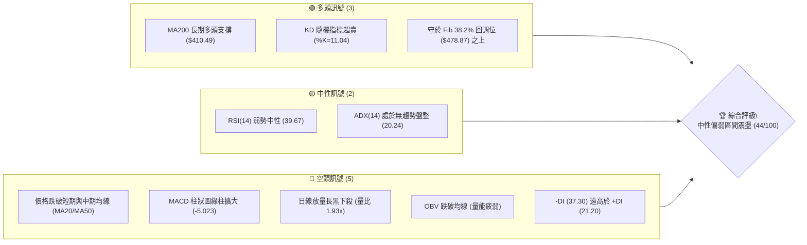
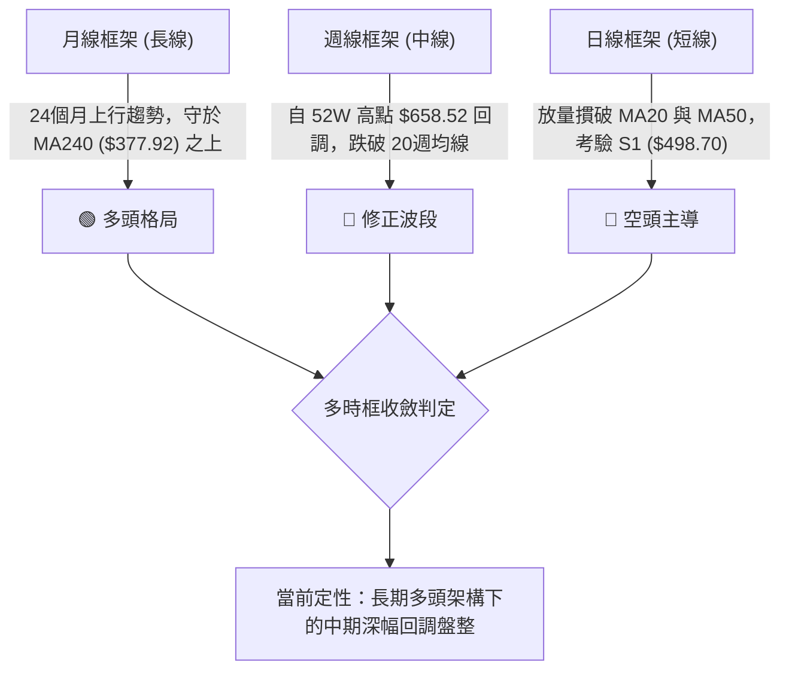
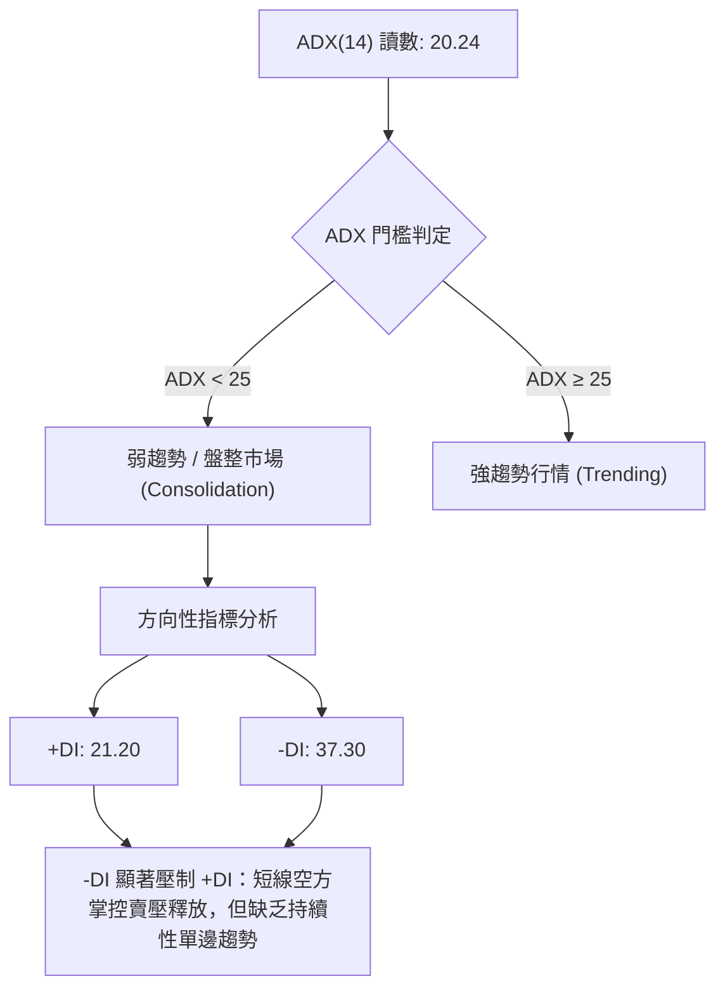
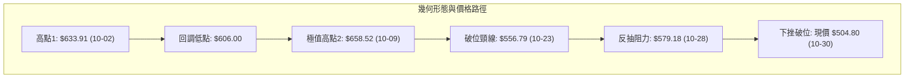
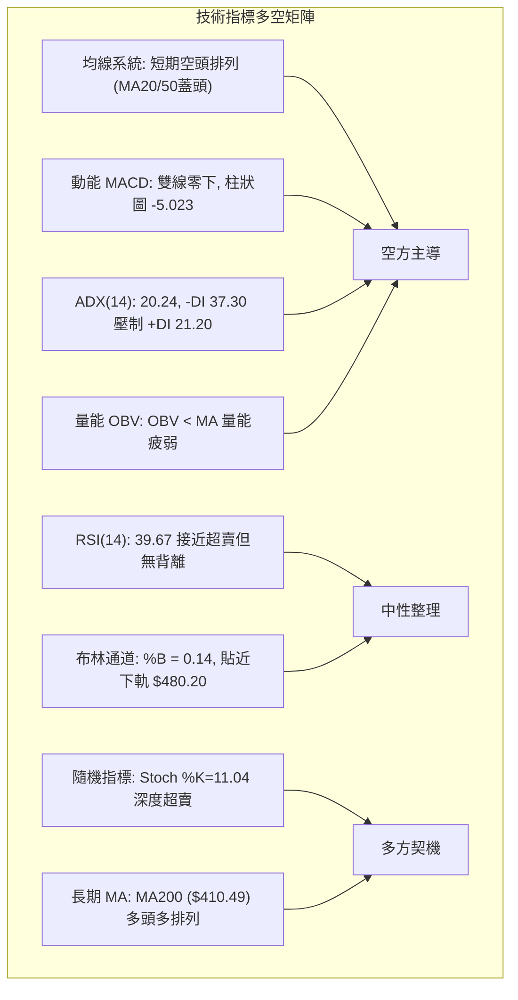
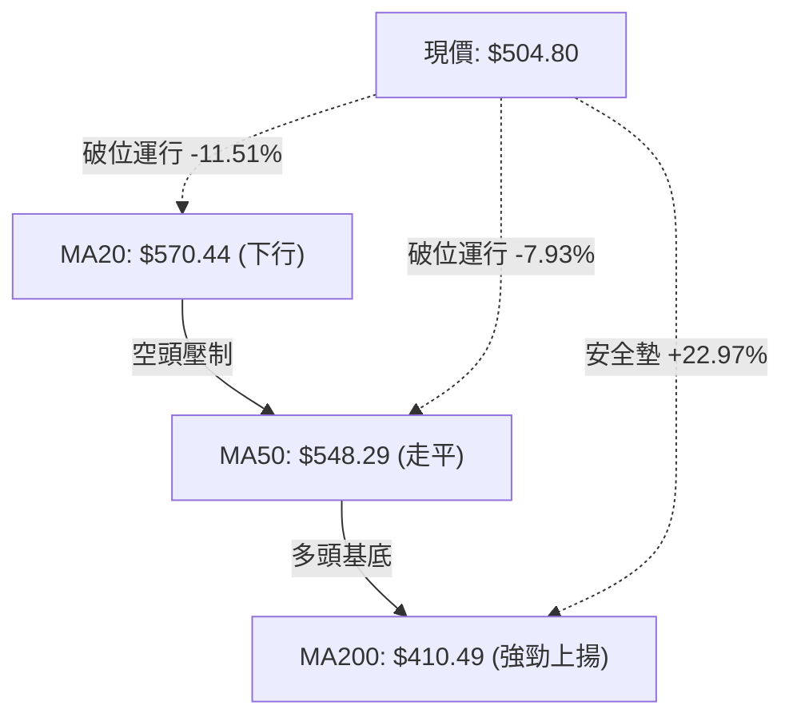
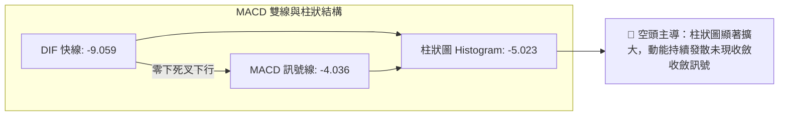
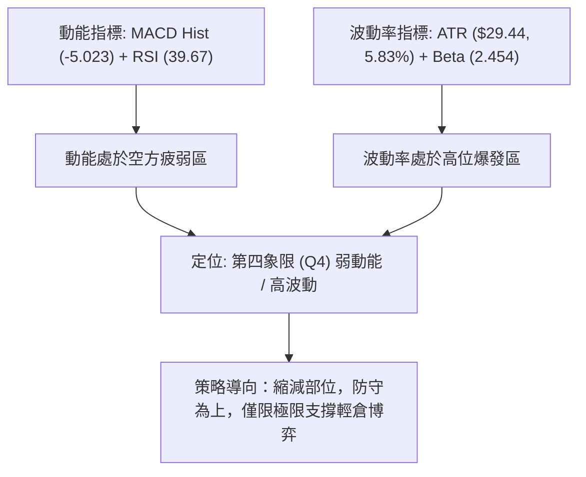
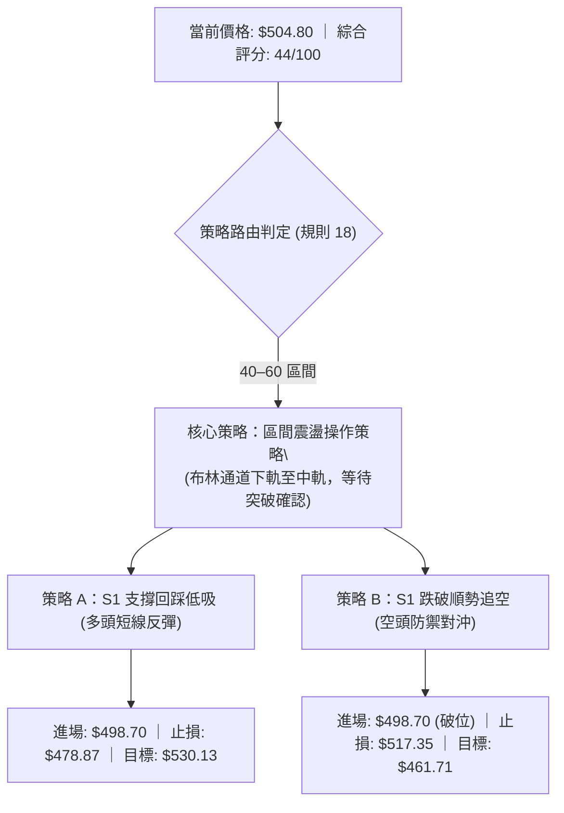
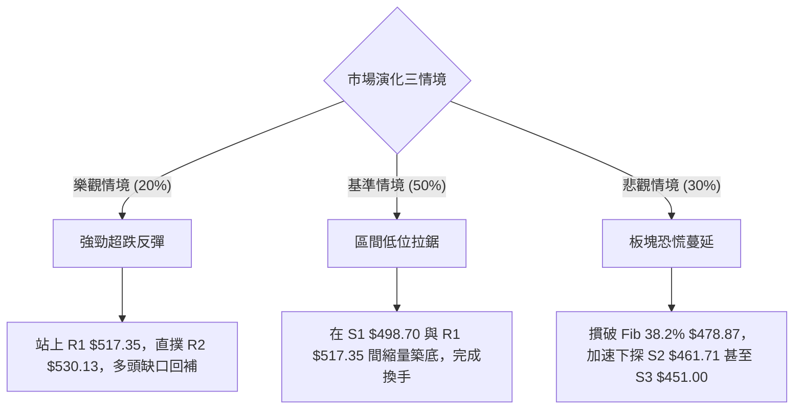

# AMD 技術分析報告

> **報告日期**：2026-10-31 ｜ **語言**：繁體中文 ｜ **數據來源**：Yahoo Finance ｜ **當前價格**：$504.80

---

## 目錄

| 章節 | 內容 |
|------|------|
| [1. 技術面概覽](#1-技術面概覽) | 訊號儀表板、核心指標、評分卡 |
| [2. 趨勢分析](#2-趨勢分析) | 多時框趨勢、長中短期走勢 |
| [3. 圖表形態分析](#3-圖表形態分析) | 形態識別、K線組合、目標價 |
| [4. 支撐與阻力](#4-支撐與阻力) | 關鍵價位、斐波那契回調 |
| [5. 技術指標深度解讀](#5-技術指標深度解讀) | MA/RSI/MACD/布林/成交量 |
| [6. 動能與波動率](#6-動能與波動率) | 動能評估、ATR、Beta |
| [7. 多時框架總結](#7-多時框架總結) | 時框架評分矩陣 |
| [8. 交易策略建議](#8-交易策略建議) | 多空策略、風險報酬比 |
| [9. 風險提示與監控](#9-風險提示與監控) | 監控指標、風險場景 |

---

## 1. 技術面概覽

### 🎯 技術訊號儀表板



### 📊 核心指標速覽表

| 指標類別 | 指標名稱 | 當前數值 | 訊號 | 解讀 |
|----------|----------|----------|------|------|
| **價格** | 當前收盤價 | $504.80 | 🔴 | 跌破 MA20、MA50，受阻於 R1 ($517.35) 下方 |
| **均線** | MA20 | $570.44 | 🔴 | 價格低於 MA20 達 -11.51%，短線空頭排列形成阻力 |
| **均線** | MA50 | $548.29 | 🔴 | 價格低於 MA50 達 -7.93%，中期上升趨勢遭遇破位修正 |
| **均線** | MA200 | $410.49 | 🟢 | 價格高於 MA200 達 +22.97%，超長期結構仍屬多頭格局 |
| **動能** | RSI(14) | 39.67 | 🟡 | 位於弱勢區間 (30–50)，接近超賣區但尚未觸發反轉訊號 |
| **動能** | MACD(12,26,9) | -9.059 | 🔴 | 雙線位於零軸下方，Hist 擴大至 -5.023，空頭動能增強 |
| **擺動** | Stoch %K/%D | 11.04 / 44.48 | 🟢 | %K 深度超賣，短線技術性超跌具備反彈契機 |
| **趨勢** | ADX(14) | 20.24 | 🟡 | ADX < 25 表明處於非趨勢的寬幅盤整震盪市場 |
| **通道** | 布林帶 %B | 0.14 | 🟡 | 價格緊貼布林通道下軌 ($480.20)，呈現短線過度延伸 |
| **成交量**| 成交量 / 20日均量 | 39.59M / 20.50M | 🔴 | 量比達 1.93x，週五伴隨半導體類股下殺形成放量長黑 |
| **波動** | ATR(14) | $29.44 | 🟡 | 每日平均波幅達 5.83%，短線波動率顯著放大 |

### 🏆 技術評分卡

```
╔══════════════════════════════════════════════════════════════╗
║                技術評分卡 — AMD (2026-10-31)                 ║
╠══════════════════════════════════════════════════════════════╣
║ 趨勢強度 (Trend)     ████████░░░░░░░░░░░░  40/100  🔴 偏弱   ║
║ 動能指標 (Momentum)  ███████░░░░░░░░░░░░░  38/100  🔴 偏空   ║
║ 支撐穩定度 (Support) ██████████░░░░░░░░░░  52/100  🟡 中性   ║
║ 成交量配合 (Volume)  ███████░░░░░░░░░░░░░  35/100  🔴 瑕疵   ║
║ 形態完整度 (Pattern) █████████░░░░░░░░░░░  45/100  🟡 震盪   ║
║ 均線排列 (Moving Avg)███████████░░░░░░░░░  54/100  🟡 衝突   ║
╠══════════════════════════════════════════════════════════════╣
║ 綜合評分 (Overall)   █████████░░░░░░░░░░░  44/100  ⚖️ 區間偏弱║
╚══════════════════════════════════════════════════════════════╝
```
*(註：綜合評分由六項子評分算術平均四捨五入得出：(40 + 38 + 52 + 35 + 45 + 54) ÷ 6 = 44.0，符合規則 18)*

---

## 2. 趨勢分析

### 🌐 多時框趨勢分析



### 📈 長期趨勢 — 12個月走勢圖（Unicode）

```
AMD 月線收盤走勢圖（2025-11 至 2026-10）
價格軸 ($)
$650 ┤                                      
$600 ┤                                  ●(09月 $611.76)
$550 ┤                          ●(06月 $580.91)
$500 ┤                      ●(05月 $516.10)       ●←當前收盤 ($504.80)
$450 ┤                              ●(07月 $476.15)
$400 ┤                                      
$350 ┤                  ●(04月 $354.49)     
$300 ┤                                      
$250 ┤                                      
$200 ┤●(11月 $217.53)   ●(03月 $203.43)     
$150 ┤    ●(01月 $236.73)                  
     └──────────────────────────────────────────────────
      11  12  01  02  03  04  05  06  07  08  09  10 (月份)
      2025                 2026
```

#### 走勢特徵分析表格

| 階段區間 | 起止價格 | 漲跌幅 | 結構特徵與量價行為 |
|----------|----------|--------|--------------------|
| **築底蓄勢期** (2025.11–2026.03) | $217.53 → $203.43 | -6.48% | 長達 5 個月的橫盤整理，於 $200 心理關口構築堅實底部支撐 |
| **主升浪爆發期** (2026.03–2026.06) | $203.43 → $580.91 | +185.56% | 突破性爆發噴出，月線連續拉出巨大實體紅K，AI題材加速催化 |
| **高位箱型洗盤** (2026.06–2026.08) | $580.91 → $470.72 | -18.97% | 獲利了結賣壓湧現，價格回測 Fib 38.2% ($478.87) 尋求換手支撐 |
| **次級推升破頂** (2026.08–2026.09) | $470.72 → $611.76 | +29.96% | 衝破前高創出 52W 高點 $658.52，但成交量未能同比例放大形成量價背離 |
| **現階段拉回測試** (2026.09–2026.10) | $611.76 → $504.80 | -17.48% | 晶片板塊重挫伴隨高檔長黑下殺，跌破短期上升趨勢線進入寬幅盤整 |

### 📊 中期趨勢（週線分析）

從近 20 週收盤走勢觀察，AMD 在 2026 年 9 月下旬至 10 月初達到頂峰（2026-09-25 週收 $630.63、2026-10-02 週收 $633.91、2026-10-09 盤中見歷史天價 $658.52 後收 $608.10）。隨後三週遭遇猛烈獲利回吐，連續下挫至當前的 $504.80。週線 MACD 柱狀圖由 2026-09-25 的高峰 +14.199 劇烈翻黑收縮至當前的 -5.023，週線 RSI 亦從 73.0 的超買區急降至 39.7。

```
週線關鍵壓力與支撐階梯示意：
$658.52 ══════════════════════════════════════ [52W 歷史天價阻力]
$633.91 ────────────────────────────────────── [週線雙重頂部頸線區]
$570.44 -------------------------------------- [MA20 週/日通道中軌強阻力]
$504.80 ◄═════════════════════════════════════ [當前現價位置：測試前波箱體頂]
$498.70 -------------------------------------- [S1 近期波段密集支撐]
$478.87 ══════════════════════════════════════ [Fib 38.2% 週線防守底線]
$410.49 ────────────────────────────────────── [MA200 長期牛熊分水嶺]
```

### ⚡ 趨勢強度評估（ADX 解讀）



#### ADX 趨勢強度對照解讀

| ADX 數值區間 | 當前狀態 | 市場結構屬性 | 交易指導原則 |
|--------------|----------|--------------|--------------|
| **0 – 20**   | 接近邊界 | 極弱或無趨勢 | 嚴禁採用突破追單策略，極易遭受假突破洗盤 |
| **20 – 25**  | **20.24 (當前)** | **非趨勢盤整震盪** | **以布林通道上下軌與波段高低點作為區間交易依據** |
| **25 – 40**  | 未達到   | 明確單邊趨勢 | 均線順勢跟隨交易 |
| **40 – 60**  | 未達到   | 強烈單邊行情 | 嚴格持倉，回踩即加碼 |

---

## 3. 圖表形態分析

### 🔍 形態識別系統



#### 形態識別信心度與目標價評估

| 形態名稱 | 信心度 | 判斷依據（嚴格引用數據） | 完成度 | 目標價計算式與推算結果 |
|----------|--------|--------------------------|--------|------------------------|
| **雙重頂 (M-Top)** | 75% | 高點1 ($633.91)、高點2 ($658.52) 構成雙峰，頸線位於 10-23 週K低點區 $556.79，日線已實體跌破 | 85% | 形態高度 = $658.52 − $556.79 = $101.73<br>推算目標價 = 頸線 $556.79 − $101.73 = **$455.06** (落於 S2 $461.71 與 S3 $451.00 之間) |
| **寬幅箱型震盪** | 80% | 頂部阻力於 R3 ($546.44) 至 BB 中軌 ($570.44)，底部依託 S1 ($498.70) 及 Fib 38.2% ($478.87) | 70% | 區間震盪目標：下軌支撐區間 **$480.20 – $498.70**；反彈阻力區間 **$530.13 – $546.44** |
| **頭肩底形態** | 15% | 數據中未偵測到底部反轉雛形，當前處於下行修正波段 | 0% | 訊號不足，僅做指標型解讀（規則 15） |

### 🕯️ 重要K線形態分析

嚴格依據數據中「近10根日K」與「近8根週K」之開高低收數據進行客觀解讀：

#### 近 10 根日K 形態解讀

| 日期 (日K) | 開盤價 | 最高價 | 最低價 | 收盤價 | 成交量 | K線形態 | 專業技術解讀 | 訊號 |
|------------|--------|--------|--------|--------|--------|---------|--------------|------|
| 2026-10-19 | $551.78 | $554.41 | $535.67 | $538.05 | 20,199,700 | 中黑棒 | 實體下挫，跌破 MA50 初現回調壓力 | 🔴 |
| 2026-10-20 | $530.02 | $548.11 | $524.60 | $534.74 | 15,187,000 | 縮量紅陀螺 | 下測低點後小幅拉升，成交量萎縮代表觀望 | 🟡 |
| 2026-10-21 | $545.93 | $556.79 | $537.30 | $552.72 | 17,998,600 | 溫和中紅棒 | 多頭反撲回測 MA50 阻力，量能維持均值 | 🟢 |
| 2026-10-22 | $524.10 | $529.98 | $502.60 | $507.93 | 28,007,400 | 放量大長黑 | 跳空下殺直逼 $500 大關，空頭放量砸盤 | 🔴 |
| 2026-10-23 | $510.21 | $523.92 | $508.36 | $516.79 | 15,177,900 | 止跌小紅棒 | 於 $508 上方獲初步逢低支撐，短線縮量企穩 | 🟡 |
| 2026-10-26 | $522.79 | $533.50 | $514.01 | $531.28 | 16,796,800 | 緩步回升小紅 | 連續兩日小幅走揚，嘗試回補 10-22 跳空缺口 | 🟢 |
| 2026-10-27 | $539.49 | $563.92 | $538.50 | $560.26 | 20,599,900 | 放量實體大紅 | 強力穿透 MA50，多頭動能激增觸及波段高點 | 🟢 |
| 2026-10-28 | $573.08 | $579.18 | $560.52 | $578.44 | 18,848,600 | 高檔長陽星 | 開高走高衝擊 MA20 ($570.44)，呈現短線假突破高點 | 🟡 |
| 2026-10-29 | $562.27 | $575.10 | $560.57 | $566.42 | 16,873,300 | 高位孕線黑棒 | 衝高乏力，多頭未能承接昨日升勢，獲利盤出逃 | 🔴 |
| 2026-10-30 | $508.53 | $520.40 | $492.21 | $504.80 | 39,589,800 | 巨量長黑帶下影 | 受 Intel 財報崩跌波及跳水，探低 $492.21 後收於 $504.80 | 🔴 |

#### 近 8 根週K 形態解讀

| 週末日期 (週K) | 開盤價 | 最高價 | 最低價 | 收盤價 | 週成交量 | K線形態 | 專業技術解讀 | 訊號 |
|----------------|--------|--------|--------|--------|----------|---------|--------------|------|
| 2026-09-11 | $488.92 | $526.79 | $486.57 | $516.13 | 85,350,600 | 突破中長陽 | 突破 $500 關卡，多頭主升段啟動 | 🟢 |
| 2026-09-18 | $486.28 | $559.91 | $480.33 | $559.82 | 124,593,800 | 巨量大長陽 | 連續突破壓力，成交量放大45%，極度強勢 | 🟢 |
| 2026-09-25 | $583.88 | $639.00 | $582.27 | $630.63 | 132,066,300 | 加速光腳陽線 | 衝刺進入 $600 領域，動能處於狂熱極端 | 🟢 |
| 2026-10-02 | $624.90 | $645.46 | $596.07 | $633.91 | 92,386,900 | 高位震盪十字 | 量能萎縮30%，高檔換手滯漲，形成雙頂左峰 | 🟡 |
| 2026-10-09 | $630.61 | $658.52 | $606.00 | $608.10 | 93,746,000 | 墓碑/射擊之星 | 衝刺歷史高點 $658.52 遇強大賣壓，長上影線達 $50 | 🔴 |
| 2026-10-16 | $599.93 | $606.20 | $526.83 | $528.75 | 107,042,200 | 吞噬型大陰線 | 實體重挫 $79，週線 MACD 翻黑，頂部確立 | 🔴 |
| 2026-10-23 | $551.78 | $556.79 | $502.60 | $516.79 | 96,570,600 | 破位下影陰線 | 最低探至 $502.60，暫時守住 $500 大關 | 🟡 |
| 2026-10-30 | $522.79 | $579.18 | $492.21 | $504.80 | 112,708,400 | 長影線巨量穿透 | 衝高 $579.18 假突破後暴跌，下影線透露買盤防守 S1 | 🔴 |

### 📉 ASCII 走勢形態示意圖

```
AMD 頂部雙頂 (M-Top) 破位與頸線回測示意圖
價格軸 ($)
$658.52 ┤                        ▲ 高點2 (10-09)
$633.91 ┤          ▲ 高點1 (10-02) ╲   ╱
$600.00 ┤         ╱ ╲             ╲ ╱
$579.18 ┤        ╱   ╲             ▼ 假反彈頂 (10-28)
$556.79 ┼───────╱─────●────────────╱───╲────── [頸線破位位]
$530.13 ┤      ╱       ╲          ╱     ╲
$504.80 ┤     ╱         ╲        ╱       ●←當前現價 ($504.80)
$492.21 ┤    ╱           ▼ 頸線回測       ▼ (10-30 踩底引線)
$455.06 ┴───┴─────────────────────────────┴───── [雙頂推算理論目標價]
```

### 🎯 形態目標價計算

1. **雙重頂形態測量法則**：
   - 第一頂高點：$633.91
   - 第二頂高點（52週高點）：$658.52
   - 形態有效頸線（10-23 週K開盤與波段反彈防守位）：$556.79
   - 形態垂直幅度（Height） = $658.52 − $556.79 = **$101.73**
   - 理論等幅跌幅滿足點 = 頸線 $556.79 − 形態高度 $101.73 = **$455.06**
   - *落點驗證*：此理論價位精確座落於數據中提供的關鍵支撐位 **S2 ($461.71)** 與 **S3 ($451.00)** 之緩衝帶內。

---

## 4. 支撐與阻力

### 🗺️ 關鍵價位分布圖（Unicode）

```
AMD 價位結構分布圖
══════════════════════════════════════════════════════════════════════
$658.52 ║████████████████████████████████████████║ 52W 歷史極值阻力 / 0.0% Fib
$570.44 ║████████████████████████████            ║ 布林中軌 / MA20 強阻力
$546.44 ║████████████████████                    ║ 波段聚類強阻力 R3
$530.13 ║██████████████                          ║ 短線反彈阻力 R2
$517.35 ║████████                                ║ 關鍵突破短壓 R1
$504.80 ╠════════════════════════════════════════╣ ◄ 當前收盤價 ($504.80)
$498.70 ║▓▓▓▓▓▓▓▓▓▓▓▓▓▓▓▓                        ║ 近期核心波段支撐 S1
$478.87 ║▓▓▓▓▓▓▓▓▓▓▓▓▓▓▓▓▓▓▓▓▓▓▓▓                ║ 關鍵斐波那契 38.2% 回調位
$461.71 ║████████████████████████████            ║ 中期強支撐 S2 (波段聚類低點)
$451.00 ║████████████████████████████████        ║ 結構性底部防守線 S3
$410.49 ║████████████████████████████████████████║ MA200 超長期牛熊生命線
══════════════════════════════════════════════════════════════════════
```

### 🚧 阻力位分析表

*(價位嚴格引用自數據「關鍵價位」區塊)*

| 阻力級別 | 價位 | 與現價距離 | 形成技術原因 | 突破難度評估 | 重要性 |
|----------|------|------------|--------------|--------------|--------|
| **R1** | **$517.35** | +2.49% | 10-23 收盤價與近一年波段高點聚類密集區，短線空頭下壓的第一防線 | 🟡 中等（需補量修復 10-30 長黑實體半數） | ★★★☆☆ |
| **R2** | **$530.13** | +5.02% | 10-26 收盤價與 10-20 反彈高點密集聚類，前期套牢盤籌碼成本區 | 🔴 較高（空方均線下壓 MA10 $539 附近阻截） | ★★★★☆ |
| **R3** | **$546.44** | +8.25% | 近一年波段密集高點聚類，重疊 MA50 ($548.29) 與 Fib 23.6% ($547.53) | 🔴 極高（多空波段分水嶺，具備多重技術共振阻力）| ★★★★★ |

### 🛡️ 支撐位分析表

*(價位嚴格引用自數據「關鍵價位」區塊)*

| 支撐級別 | 價位 | 與現價距離 | 形成技術原因 | 守住機率評估 | 重要性 |
|----------|------|------------|--------------|--------------|--------|
| **S1** | **$498.70** | -1.21% | 近一年密集波段低點聚類，整數心理大關 $500 之技術錨定點 | 🟡 60%（10-30 踩破後收回，多頭具備護盤意願） | ★★★★☆ |
| **S2** | **$461.71** | -8.54% | 近一年強波段低點聚類，接近 2026-08 前波盤整平台底部 ($465.58) | 🟢 75%（雙頂形態滿足目標區，逢低承接買盤強大） | ★★★★★ |
| **S3** | **$451.00** | -10.66%| 2026-04 主升段啟動回踩平台與長期波段密集低點聚類 | 🟢 85%（多頭最後防線，若失守將危及長期牛市） | ★★★★★ |

### 📐 斐波那契回調位分析

依據 52 週絕對波動區間：**最低點 $188.22 → 最高點 $658.52** 進行黃金分割回調測量：

| 斐波那契回調比例 | 精確對應價位 | 技術結構意義與多空攻防解讀 |
|------------------|--------------|----------------------------|
| **0.0% (52W High)** | **$658.52** | 歷史極值天花板，大級別多頭推升終點 |
| **23.6%** | **$547.53** | 第一層淺幅修正位，與 MA50 ($548.29) 及 R3 ($546.44) 完美共振形成空頭天花板 |
| **38.2%** | **$478.87** | **當前關鍵黃金防守位**，緊鄰布林下軌 ($480.20) 與 S1 ($498.70) |
| **50.0%** | **$423.37** | 多空中樞平衡位，中級修正滿足區 |
| **61.8%** | **$367.87** | 強勢回調黃金分割極限位，跌破宣告本輪大牛市行情結束 |
| **78.6%** | **$288.86** | 深幅回撤位，多頭最後殘存結構 |
| **100.0% (52W Low)**| **$188.22** | 2025 年牛市起點底座 |

#### 現價位置定位解讀
當前現價 **$504.80** 處於 **Fib 23.6% ($547.53)** 與 **Fib 38.2% ($478.87)** 之間。在技術分析標準法則中，強勢拉回若能穩守於 38.2% 回調位之上，長期多頭結構並未實質破壞；但若後續放量跌破 Fib 38.2% ($478.87) 與布林下軌 ($480.20)，跌勢將直接向 S2 ($461.71) 及 Fib 50.0% ($423.37) 尋求支撐。

---

## 5. 技術指標深度解讀

### 🎛️ 指標訊號總覽



### 📈 移動平均線排列分析



#### 均線階梯走勢特徵

| 均線名稱 | 當前價位 | 乖離率 (Bias) | 斜率與方向 | 技術解讀 |
|----------|----------|---------------|------------|----------|
| **MA 5** | $548.24 | -7.92% | 急跌向下 ▼ | 短期均線崩落，對日線形成直接下壓阻力 |
| **MA 10** | $539.14 | -6.37% | 下跌向下 ▼ | 短線反彈第一反壓線，重疊 R2 ($530.13) 上方 |
| **MA 20** | $570.44 | -11.51% | 下彎走弱 ▼ | 布林帶中軌，短線趨勢徹底轉空，構成強大反壓 |
| **MA 50** | $548.29 | -7.93% | 趨緩下彎 ▼ | 中期生命線宣告失守，由支撐轉化為極強阻力區 |
| **MA 60** | $537.47 | -6.08% | 走平下拐 ▼ | 季線位置，確認中期調整週期拉長 |
| **MA 120** | $520.30 | -2.98% | 趨緩微升 ▼ | 半年線支撐失守，阻力化 |
| **MA 200** | $410.49 | +22.97%| 持續上揚 ▲ | 長期牛熊分界線，維持完美多頭發散，長牛架構完好 |
| **MA 240** | $377.92 | +33.57%| 持續上揚 ▲ | 兩年線基底極為厚實，超大週期多頭無虞 |

### 📉 RSI(14) 分析

當前數值：**39.67**（Wilder 計算）

```
RSI (14) 刻度尺：
0 ─────── 20 ──────── 30 ────── 39.67 ─────── 50 ─────── 70 ─────── 80 ────── 100
[ 極度超賣 ] [  超賣區  ]       [當前弱勢]      [ 中性 ]  [ 超買區 ] [ 極度超買 ]
進度條展示：
███████████████░░░░░░░░░░░░░░░░░░░░░░ 39.67%
```

- **區間評估**：RSI 處於 30 至 50 的弱勢盤整區間，尚未跌入 30 以下的絕對超賣區，表明空方力量雖大，但尚未引發市場恐慌性拋售之極值。
- **背離分析**：
  - 價格近 20 根 K 棒高點由 10-09 的 $658.52 下滑至 10-30 的 $504.80，RSI 由高點約 70 急降至 39.67。
  - 首尾對比：價格破低，RSI 亦同步走低，**「無明顯背離」（數據確認）**。指標與價格走勢同向確認，預示回調動能仍在自然釋放過程，並無多頭底背離形成的強烈抄底訊號。

### 📊 MACD(12/26/9) 訊號解讀



- **絕對數值**：MACD 線（-9.059）跌破訊號線（-4.036），兩者均已落入零軸下方，屬於標準的「零下空頭擴散」狀態。
- **動能柱狀圖**：Histogram 數值為 -5.023，較前一交易日持續擴大，表明短期下行拋壓仍在加速宣洩，尚未出現收斂紅柱，不可輕言盲目逆勢抄底。

### 📦 布林通道分析

```
AMD 布林通道 (20, 2) 結構示意圖
價格軸 ($)
$660.68 ┼────────────────────────────────────── 上軌 (Upper Band)
$620.00 ┤
$570.44 ┼- - - - - - - - - - - - - - - - - - - - 中軌 (MA20 Mid Band)
$520.00 ┤
$504.80 ┼══════════════════════════════════════ 當前現價 ($504.80, %B = 0.14)
$480.20 ┼────────────────────────────────────── 下軌 (Lower Band)
```

- **布林帶寬與位置**：通道上軌 $660.68、中軌 $570.44、下軌 $480.20。帶寬顯著擴張，表明波動率進入釋放期。
- **%B 指標讀數**：%B = **0.14**。價格深入通道下半區，距離下軌僅剩不足 5% 之空間，已接近通道下邊界之統計學極端值區（超賣邊緣），提示下行空間在短線將受到通道邊界的彈性約束。

### 💹 成交量分析（量價配合度）

```
成交量柱狀對比：
當日成交量 (10-30) : 39,589,800  [████████████████████ 1.93x]
20日平均量 (20MA)   : 20,503,360  [██████████░░░░░░░░░░ 1.00x]
50日平均量 (50MA)   : 20,314,750  [██████████░░░░░░░░░░ 0.99x]
```

- **放量殺跌特性**：10 月 30 日最新成交量激增至 39,589,800 股，相較於 20 日均量產生 **1.93 倍（近兩倍）** 的巨幅放量。此種在破位下跌過程中的長黑放量，屬於典型機構籌碼獲利了結與止損盤踩踏跡象。
- **OBV（能量潮）趨勢**：數據顯示「OBV < MA → 量能疲弱」。OBV 曲線下穿均線，顯示近一個月資金呈現持續淨流出態勢，量能並未對價格的反彈給予確認，構成典型的「量價配合不良」瑕疵。

---

## 6. 動能與波動率

### ⚡ 動能評估

#### 動能強度與波動率矩陣定位

| 象限分類 | 動能狀態 | 波動率狀態 | 當前吻合度 | 戰略含義與操作指引 |
|----------|----------|------------|------------|--------------------|
| **象限一 (Q1)** | 強動能 (Bullish) | 低波動 (Low Vol) | ❌ 不符 | 穩健上升趨勢，最佳加碼持股期 |
| **象限二 (Q2)** | 弱動能 (Bearish) | 低波動 (Low Vol) | ❌ 不符 | 窄幅縮量磨底，適宜觀望等待方向確認 |
| **象限三 (Q3)** | 強動能 (Bullish) | 高波動 (High Vol) | ❌ 不符 | 衝刺噴出階段，高收益與高回撤並存 |
| **象限四 (Q4)** | **弱動能 (Bearish)** | **高波動 (High Vol)** | **✓ 完全吻合** | **高風險下殺整理，嚴禁盲目重倉抄底，嚴防波動擴大** |



### 📊 ATR 波動率分析

- **ATR(14) 讀數**：**$29.44**（以 Wilder 平滑算法計算）。
- **相對價格波動率**：佔收盤價比例達 **5.83%**。這意味著 AMD 當前每日之常態波動振幅接近 $30 美元，呈現典型高科技成長股在重大產業事件擾動下的高波動特徵。
- **止損距離建議**：
  - *短線當沖 / 隔夜交易*：建議採用 1.0 倍 ATR（即約 **$29.50**）作為最小保護性止損間距。
  - *波段擺盪交易 (Swing Trade)*：建議採用 1.5 倍 ATR（即約 **$44.16**）作為防震盪洗盤止損間距。

### 📐 Beta 與市場相關性

- **Beta 係數**：**2.454**（高度進攻型資產）。
- **市場解讀**：AMD 的波動彈性為標普 500 指數的 2.45 倍。在納斯達克指數與半導體板塊走弱時，其下跌慣性將被顯著放大；反之，一旦市場恐慌情緒平復，其反彈爆發力亦將遠超大盤。高 Beta 屬性要求投資者必須嚴格執行倉位控制（Position Sizing），嚴防黑天鵝事件帶來的本金永久性受損。

---

## 7. 多時框架總結

### 📋 時框架評分表

| 時框架 | 趨勢方向 | 動能狀態 | 均線排列狀況 | 圖表形態 | 評級得分 | 戰術建議 |
|--------|----------|----------|--------------|----------|----------|----------|
| **月線 (長期)** | 🟢 多頭架構 | 🟡 動能放緩 | 多頭排列 (MA200遠在下方) | 長期旗形突破後的正常回踩 | 75/100 | 超長線多頭底倉續抱，無須恐慌 |
| **週線 (中期)** | 🟡 寬幅震盪 | 🔴 空方釋放 | 跌破 20週均線，考驗50週線 | 雙頂雛形形成，考驗頸線支撐 | 45/100 | 中線暫停加碼，等待止跌訊號 |
| **日線 (短期)** | 🔴 明確空頭 | 🔴 空方壓制 | 空頭排列 (破 MA20/MA50) | 10-30 放量大長黑摜破短壓 | 35/100 | 嚴格防守，順勢反彈減碼或空方對沖 |

### 🔲 綜合訊號矩陣

```
時框共振檢驗維度：
┌─────────────────┬───────────┬───────────┬───────────┐
│ 分析維度        │ 短期 (日線)│ 中期 (週線)│ 長期 (月線)│
├─────────────────┼───────────┼───────────┼───────────┤
│ 趨勢方向        │  🔴 看空  │  🟡 震盪  │  🟢 看多  │
│ 動能狀態        │  🔴 發散  │  🔴 轉弱  │  🟡 鈍化  │
│ 支撐有效性      │  🟡 S1考驗│  🟢 守住38%│  🟢 堅若磐石│
│ 量價健康度      │  🔴 爆量跌│  🔴 量背離│  🟢 主升放量│
└─────────────────┴───────────┴───────────┴───────────┘
```

### ⚖️ 多時框收斂結論

依據多時框收斂規則（規則 14）：
1. **趨勢/盤整性質判斷**：ADX(14) 當前讀數為 **20.24 (< 25)**，技術上嚴格定性為 **「非趨勢性盤整行情」（Consolidation Market）**。
2. **主導時框與交易區間**：在 ADX < 25 的盤整結構中，日線級別以 **布林通道下軌 ($480.20) 至布林通道中軌 MA20 ($570.44)** 為核心交易區間，中長期均線（MA200 $410.49）提供遠端安全墊。
3. **收斂唯一結論**：**中性偏空區間震盪（以支撐位防守為核心）**。短期賣壓雖然沉重，但下軌與 S1 ($498.70) 及 Fib 38.2% ($478.87) 構成複合密集支撐，不具備單邊持續崩跌之 ADX 趨勢強度；因此策略不可在低位過度追空，亦不可盲目右側大舉做多，應以**區間下緣逢低承接、上軌阻力逢高了結**之震盪思維應對。

---

## 8. 交易策略建議

### 🗺️ 策略決策流程圖



### 🧭 策略路由

**當前主策略方向 = 區間震盪雙向防禦操作（依綜合評分 44/100，落於 40–60 中性震盪區間）**  
當前盤面多空互有牽制：長期多頭架構完好，但短期受到科技股賣壓與破位均線壓制。操作嚴格以關鍵價位為錨，禁止盤中隨意追價。

### 🎯 價格情境階梯（Price Scenarios）

*(價位嚴格引用第 4 章及關鍵價位數據)*

| 觸發條件 | 第一階段目標 | 後續延伸目標 | 情境技術含義 |
|----------|--------------|--------------|--------------|
| **強勢突破 R1 ($517.35)** | R2 ($530.13) | R3 ($546.44) | 企穩 10-30 下殺陰線，短線超跌反彈啟動，挑戰 MA50 |
| **守住現價區間 ($498.70–$517.35)** | — | — | 消化籌碼賣壓，於 $500 大關展開窄幅箱體拉鋸震盪 |
| **放量跌破 S1 ($498.70)** | S2 ($461.71) | S3 ($451.00) | 雙頂形態頸線失守確認，開啟向 Fib 38.2% 下方之深幅回調 |

### 📊 情境機率分佈

| 預期情境 | 發生機率 | 主要技術依據與指標支撐 |
|----------|----------|------------------------|
| **區間下緣震盪企穩** | **50%** | ADX 僅 20.24 無單邊趨勢；Stoch %K (11.04) 處於深度超賣；S1 ($498.70) 具備初步買盤承接 |
| **跌破 S1 回測深支撐** | **30%** | MACD 綠柱持續擴散 (-5.023)；日K 放量 1.93x 長黑下殺慣性；OBV 疲軟資金外流 |
| **強勢反轉收復 R1/R2** | **20%** | 均線 MA20/MA50 蓋頭反壓沉重；整體板塊受 Intel 財報衝擊情緒低迷，反彈空間受限 |

### 🟢 主策略詳情

嚴格按照規則 17 定義計算風險報酬比：$Risk/Reward = (Target - Entry) / (Entry - Stop)$

| 策略要素 | 策略 A（區間逢低承接 / 超賣反彈多單） | 策略 B（破位順勢跟進 / 空頭防禦對沖） |
|----------|---------------------------------------|---------------------------------------|
| **適用時機** | 價格回踩 S1 不破，出現 15分/1小時底背離 | 價格放量跌破 S1 ($498.70)，日線確認破位 |
| **進場價格** | **$498.70**（掛單 S1 支撐位進場） | **$498.70**（實體下破 S1 確認進場） |
| **止損價格** | **$478.87**（嚴格設於 Fib 38.2% 關鍵防守位）| **$517.35**（設於上方第一阻力 R1） |
| **目標價 T1** | **$530.13**（短線反彈目標 R2） | **$461.71**（波段空頭滿足點 S2） |
| **目標價 T2** | **$546.44**（中期反壓目標 R3） | **$451.00**（雙頂形態極限目標 S3） |
| **風險報酬比 (T1)**| **1 : 1.59（以 T1 計）**<br>*(530.13−498.70) ÷ (498.70−478.87) = 31.43 ÷ 19.83* | **1 : 1.98（以 T1 計）**<br>*(498.70−461.71) ÷ (517.35−498.70) = 36.99 ÷ 18.65* |
| **風險報酬比 (T2)**| **1 : 2.41（以 T2 計）**<br>*(546.44−498.70) ÷ (498.70−478.87) = 47.74 ÷ 19.83* | **1 : 2.56（以 T2 計）**<br>*(498.70−451.00) ÷ (517.35−498.70) = 47.70 ÷ 18.65* |
| **預估勝率** | 55% | 45% |
| **建議配置倉位** | 10% – 15% 總資本（輕倉試單） | 10% 總資本（對沖性質） |

### 🔴 反向風險觸發點（對沖與失效提示）

- **多頭策略 A 失效點**：日線收盤價實體跌破 **$478.87 (Fib 38.2%)**，意味著波段支撐全面瓦解，所有短多部位必須無條件止損出局。
- **空頭策略 B 失效點**：價格強勢放量突破 **$517.35 (R1)** 且一小時 K 線站穩其上，代表 10-30 之長黑下殺為主力洗盤引線，做空策略立即失效，空單須全數回補。

### ⭐ 整體訊號強度評星

```
做多訊號強度：★★☆☆☆  (2/5星 — 僅限超跌反彈左側博弈)
做空訊號強度：★★★☆☆  (3/5星 — 順應短線動能，但受制於震盪市)
整體可信度：  ★★★☆☆  (3/5星 — ADX<25 盤整特徵顯著，需防假突破)
```

---

## 9. 風險提示與監控

### ✅ 關鍵監控指標 Checklist

```
╔══════════════════════════════════════════════════════════════╗
║                    每日盤前監控檢查清單                      ║
╠══════════════════════════════════════════════════════════════╣
║ [ ] 價格防守線：收盤是否守於 S1 ($498.70) 之上？            ║
║ [ ] 動能警訊：MACD 柱狀圖是否開始收斂（數值 > -5.023）？    ║
║ [ ] 擺動指標：Stoch %K 是否自 11.04 超賣區向上黃金交叉 %D？  ║
║ [ ] 均線動態：是否回測下壓之 MA10 ($539.14) 與 MA50 ($548)？ ║
║ [ ] 量能異動：成交量是否回落至 20日均量 (約20.5M) 之下縮量？ ║
║ [ ] 板塊連動：SOX 半導體指數與大盤 Nasdaq 是否止跌收紅？     ║
╚══════════════════════════════════════════════════════════════╝
```

### ⚠️ 風險場景分析



### 🛡️ 風險管理重要提醒

1. **極度波動防範**：當前 AMD 之 ATR(14) 達 **$29.44**，Beta 高達 **2.454**，任何單一持倉部位不得超過總資金的 15%，單筆交易所承擔的最大風險額度（Risk per Trade）必須嚴格限制在總資產的 1.0%–1.5% 以內。
2. **財報與板塊連鎖效應**：近期新聞顯示 Intel 股價崩跌近 29% 嚴重衝擊晶片板塊，市場對科技巨頭資本支出（Capex）及 AI 變現能力產生質疑。雖然 50 位華爾街分析師平均目標價維持在 **$640.21**（強烈買進評級），但基本面利多無法立即抵消短線技術面的技術性破位賣壓，切勿以「基本面良好」為由違背技術止損紀律。
3. **無趨勢環境之操作忌諱**：再次強調 ADX(14) 僅為 **20.24**，嚴禁在價格反彈至壓力區（R1 $517.35、R2 $530.13）時盲目追高，盤整市場中的生存法則是「買在無人問津的下軌支撐，賣在人聲鼎沸的上軌阻力」。

---

## 📋 報告總結

```
╔══════════════════════════════════════════════════════════════════╗
║                    AMD 技術分析報告總結                          ║
╠══════════════════════════════════════════════════════════════════╣
║ 報告日期：2026-10-31                                             ║
║ 當前價格：$504.80                                                ║
║ 分析評級：⚖️ 區間偏弱震盪 (綜合評分 44/100)                     ║
╠══════════════════════════════════════════════════════════════════╣
║ 關鍵結論：                                                       ║
║ ├─ 長期趨勢：🟢 完好多頭 (守於 MA200 $410.49 之上 +22.97%)       ║
║ ├─ 中期趨勢：🟡 雙頂回調 (高檔見 $658.52 後回測 Fib 38.2%)      ║
║ ├─ 短期趨勢：🔴 空方下殺 (跌破 MA20/MA50，巨量長黑測試大關)    ║
║ ├─ 核心支撐：S1: $498.70 ｜ Fib 38.2%: $478.87 ｜ S2: $461.71   ║
║ ├─ 核心阻力：R1: $517.35 ｜ R2: $530.13 ｜ R3: $546.44         ║
║ └─ 華爾街共識目標價：$640.21 (共50位分析師評級為 strong_buy)     ║
╠══════════════════════════════════════════════════════════════════╣
║ 最優策略組合：                                                   ║
║ 1. 🥇 最佳機會：在 S1 $498.70 附近輕倉試多，以 Fib 38.2%        ║
║                 $478.87 嚴格止損，博弈向 R2 $530.13 之超跌反彈   ║
║                 (風險報酬比 1 : 1.59)。                          ║
║ 2. 🥈 次選機會：若實體摜破 S1 $498.70，反手順勢建立空頭對沖，    ║
║                 目標直指 S2 $461.71 (風險報酬比 1 : 1.98)。      ║
║ 3. 🥉 保守選擇：完全空倉觀望，靜待日線 MACD 綠柱收斂且價格重新  ║
║                 站穩 R1 $517.35 後再行介入右側交易。             ║
╚══════════════════════════════════════════════════════════════════╝
```

---

> ⚠️ **免責聲明**：本報告為技術分析研究成果，所有數據、圖表及價位推算均基於客觀市場歷史數據（OHLCV）。本報告**僅供研究與學術參考**，**不構成任何形式的要約、招攬或投資買賣建議**。金融市場瞬息萬變，高 Beta 資產蘊含極大波動風險，投資人應獨立評估財務狀況並自負盈虧責任。

---

*報告生成時間：2026-10-31 ｜ 數據來源：Yahoo Finance ｜ 分析框架：多時框量化技術分析*