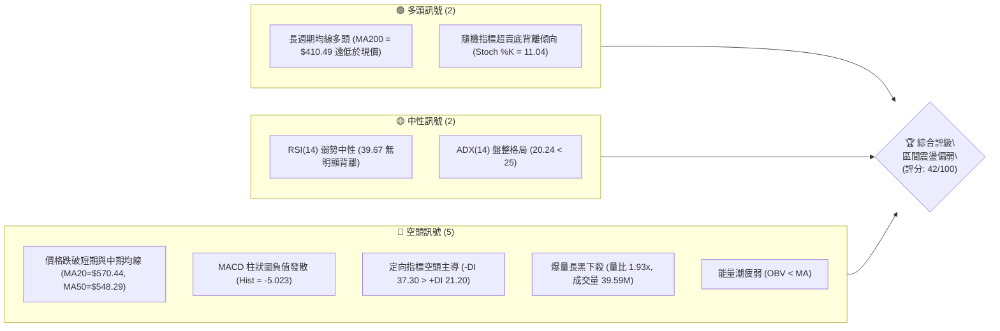
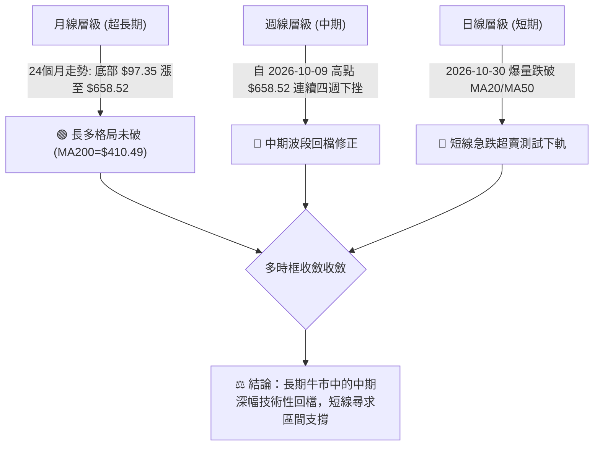
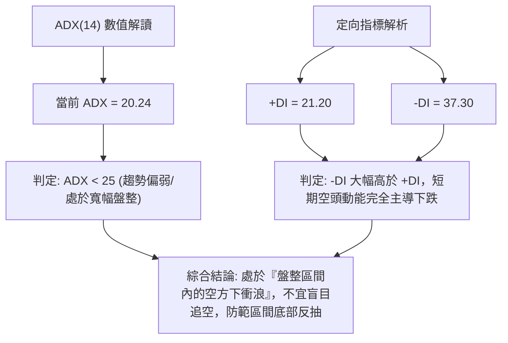
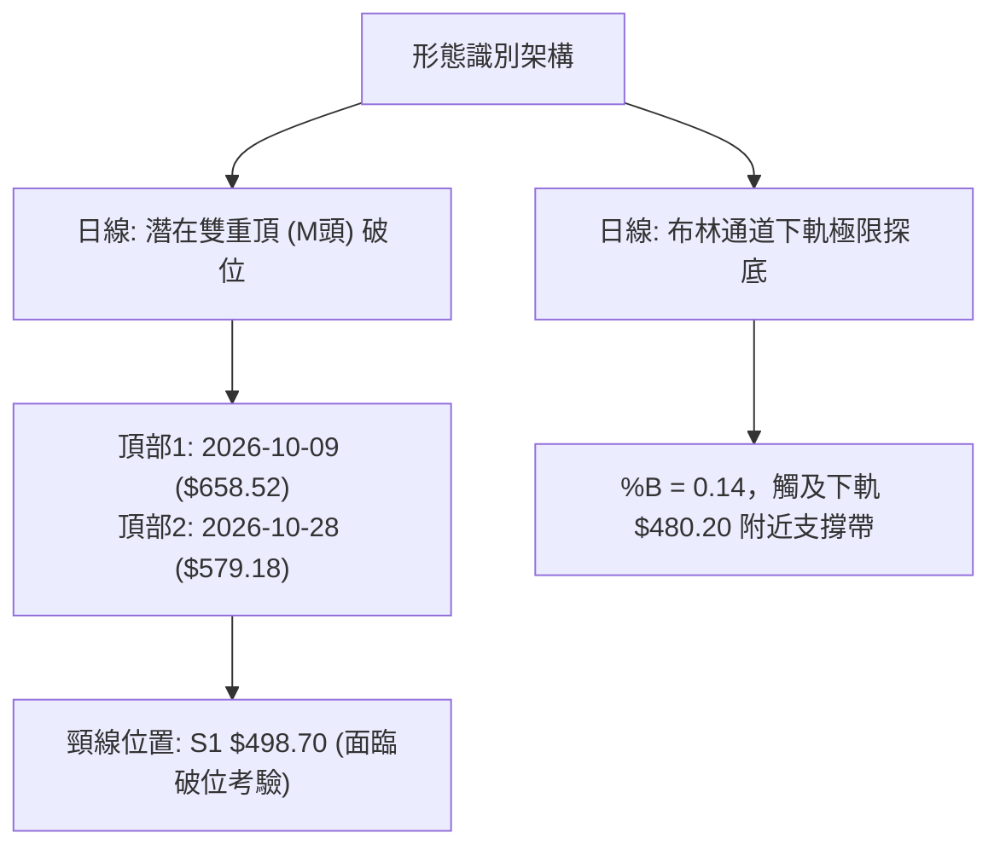
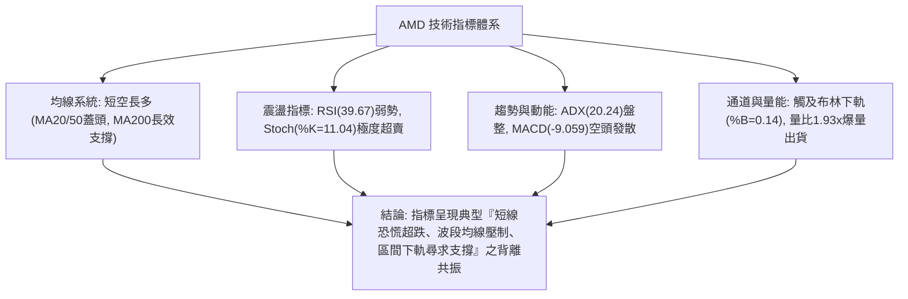
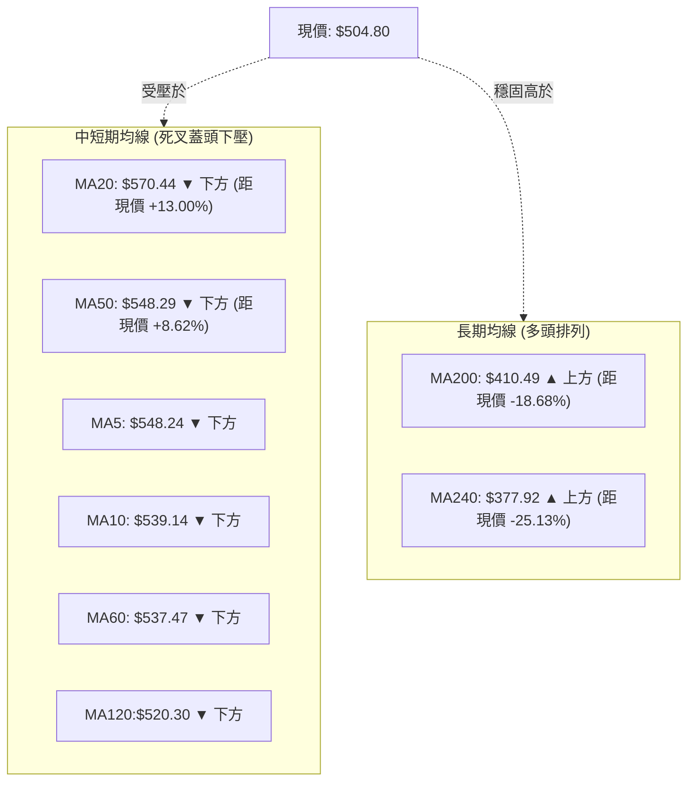
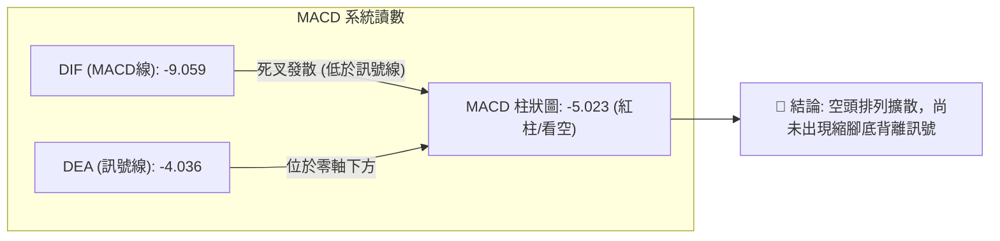
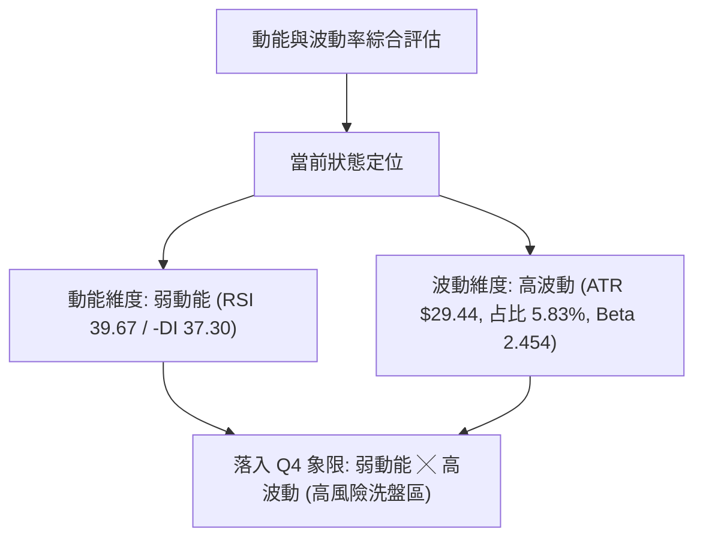
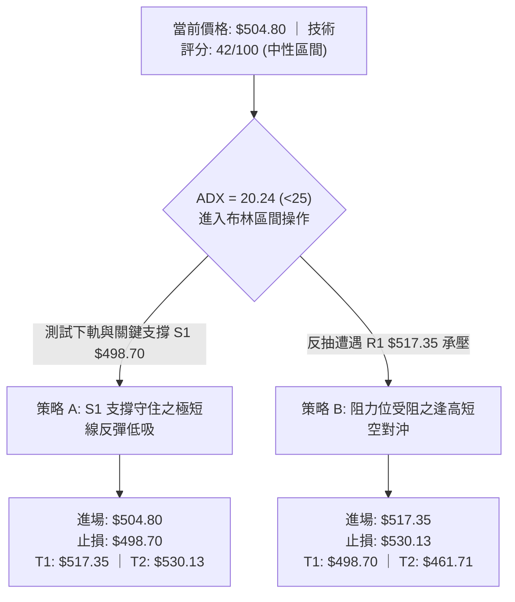
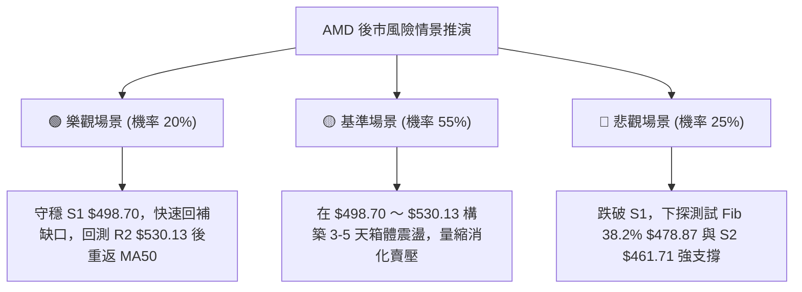

# AMD 技術分析報告

> **報告日期**：2026-11-01 ｜ **語言**：繁體中文 ｜ **數據來源**：Yahoo Finance ｜ **當前價格**：$504.80

---

## 目錄

| 章節 | 內容 |
|------|------|
| [1. 技術面概覽](#1-技術面概覽) | 訊號儀表板、核心指標、評分卡 |
| [2. 趨勢分析](#2-趨勢分析) | 多時框趨勢、長中短期走勢 |
| [3. 圖表形態分析](#3-圖表形態分析) | 形態識別、K線組合、目標價 |
| [4. 支撐與阻力](#4-支撐與阻力) | 關鍵價位、斐波那契回調 |
| [5. 技術指標深度解讀](#5-技術指標深度解讀) | MA/RSI/MACD/布林/成交量 |
| [6. 動能與波動率](#6-動能與波動率) | 動能評估、ATR、Beta |
| [7. 多時框架總結](#7-多時框架總結) | 時框架評分矩陣 |
| [8. 交易策略建議](#8-交易策略建議) | 多空策略、風險報酬比 |
| [9. 風險提示與監控](#9-風險提示與監控) | 監控指標、風險場景 |

---

## 1. 技術面概覽

### 🎯 技術訊號儀表板



### 📊 核心指標速覽表

| 指標類別 | 指標名稱 | 當前數值 | 訊號 | 解讀 |
|----------|----------|----------|------|------|
| **價格** | 當前收盤價 | $504.80 | 🔴 | 位於52週區間67.3%處，單日重挫跌破多道短期均線 |
| **均線** | 短期 MA20 | $570.44 | 🔴 | 現價低於 MA20 達 -11.51%，短線空頭下壓強勁 |
| **均線** | 中期 MA50 | $548.29 | 🔴 | 現價低於 MA50，中期上升波段遭受嚴重破壞 |
| **均線** | 長期 MA200 | $410.49 | 🟢 | 現價高於 MA200 達 +22.97%，超長期多頭結構未破 |
| **動能** | RSI(14) | 39.67 | 🟡 | 進入40以下弱勢中性區，尚未達到極端超賣（<30） |
| **動能** | MACD (12,26,9) | -9.059 | 🔴 | 快線與慢線雙雙落入零軸之下，柱狀圖 -5.023 持續看空 |
| **動能** | Stoch %K / %D | 11.04 / 44.48 | 🟢 | %K 深度超賣，短線存在跌深技術性抽腳契機 |
| **趨勢** | ADX(14) | 20.24 | 🟡 | 數值小於25，代表非強單邊趨勢，屬寬幅盤整與洗盤 |
| **通道** | 布林帶寬 %B | 0.14 | 🔴 | 貼近布林下軌（$480.20），處於極度偏弱通道位置 |
| **量能** | 當日成交量 | 39,589,800 | 🔴 | 達20日均量1.93倍，帶量長黑下殺顯示賣壓沉重 |
| **波動** | ATR(14) | $29.44 | 🔴 | 每日波動幅度達 5.83%，短線洗盤劇烈，進場需防寬幅震盪 |

### 🏆 技術評分卡

```
╔══════════════════════════════════════════════════════════════╗
║                技術評分卡 — AMD (2026-11-01)                 ║
╠══════════════════════════════════════════════════════════════╣
║ 趨勢強度      ████████░░░░░░░░░░░░  42/100  🟡 中性偏弱      ║
║ 動能指標      ███████░░░░░░░░░░░░░  36/100  🔴 空頭主導      ║
║ 支撐穩定度    ██████████░░░░░░░░░░  52/100  🟡 考驗S1支撐    ║
║ 成交量配合    ███████░░░░░░░░░░░░░  34/100  🔴 出貨帶量      ║
║ 形態完整度    █████████░░░░░░░░░░░  44/100  🟡 頭部破頸線    ║
║ 均線排列      █████████░░░░░░░░░░░  44/100  🟡 長多短空背離  ║
╠══════════════════════════════════════════════════════════════╣
║ 綜合評分      ████████░░░░░░░░░░░░  42/100  中性偏弱(區間)   ║
╚══════════════════════════════════════════════════════════════╝
```
> **計算說明（依規則 18）**：綜合評分 = (42 + 36 + 52 + 34 + 44 + 44) ÷ 6 = 252 ÷ 6 = 42/100。數值落於 40–60 區間，依策略路由歸類為「中性區間操作／防守觀望」。

---

## 2. 趨勢分析

### 🌐 多時框趨勢分析



### 📈 長期趨勢 — 12個月走勢圖（Unicode）

以下為 AMD 過去 12 個月（2025-11 至 2026-10）收盤價歷史走勢圖，標注歷史波段關鍵轉折高低點：

```
AMD 月線走勢圖（過去12個月收盤價走勢）
價格軸 ($)
$650 ┤                                      ● (2026-09: $611.76，歷史次高收盤)
$600 ┤                             ● (06: $580.91)
$550 ┤                                                ● (2026-10: $504.80 現價)
$500 ┤                        ● (05: $516.10)
$450 ┤                                  ● (07: $476.15)  ● (08: $470.72)
$400 ┤
$350 ┤                   ● (04: $354.49)
$300 ┤
$250 ┤         ● (01: $236.73)
$200 ┤●(11: $217.53) ●(12: $214.16) ●(02: $200.21低點) ●(03: $203.43)
     └─┬───────┬───────┬───────┬───────┬───────┬───────┬───────┬───────┬───────┬───────┬───────┬─
      11      12      01      02      03      04      05      06      07      08      09      10 (月)
      2025    2025    2026    2026    2026    2026    2026    2026    2026    2026    2026    2026
```

#### 走勢特徵分析表格

| 階段 | 時間跨度 | 起訖收盤價 | 漲跌幅 | 結構特徵與成交量解讀 |
|------|----------|------------|--------|----------------------|
| **第一階段：底部築底** | 2025-11 ～ 2026-03 | $217.53 → $203.43 | -6.48% | 於 $200.00 關卡進行箱型沉澱，量縮築出堅實底部區間 |
| **第二階段：主升暴發** | 2026-03 ～ 2026-06 | $203.43 → $580.91 | +185.56% | 突破 $250 後加速上漲，連續4個月大紅K，AI晶片需求驅動強勁動能 |
| **第三階段：高檔震盪** | 2026-06 ～ 2026-08 | $580.91 → $470.72 | -18.97% | 於 $470-$580 區間進行第一次洗盤，回踩均線後獲買盤承接 |
| **第四階段：衝高見頂** | 2026-08 ～ 2026-09 | $470.72 → $611.76 | +29.96% | 衝破歷史高點，於 2026-10-09 盤中創下 52 週最高價 $658.52 |
| **第五階段：獲利回吐** | 2026-09 ～ 2026-10 | $611.76 → $504.80 | -17.48% | 高檔雙頂雛形形成，財報與同業預警引發短線資金拋售，回測 S1 |

### 📊 中期趨勢（週線分析）

中期技術面觀察，近 8 週 K 棒呈現典型的波段創高後反轉回檔。2026-10-09 該週創下 $658.52 歷史天價後，週 K 出現長上影線陰線，隨後三週連續走低：
- 2026-10-16 週 K 跌破週線短期支撐，收盤重挫至 $528.75（跌幅 -13.05%），週成交量達 107.04M。
- 2026-10-23 週 K 探底 $502.60 後小幅反彈收在 $516.79。
- 2026-10-30 當週衝高 $579.18 後受阻於 MA20，週五暴跌下探 $492.21，收盤僅 $504.80，週成交量放大至 112.71M。

```
近期週線壓力與支撐示意圖
$658.52 ───┬─── 52週最高點 (2026-10-09) [強阻力]
           │
$579.18 ───┼─── 本週反彈高點 / 日線 MA20 壓力帶 ($570.44)
           │
$546.44 ───┼─── 波段阻力 R3
$530.13 ───┼─── 波段阻力 R2
$517.35 ───┼─── 波段阻力 R1
$504.80 ───┼─── 當前收盤價
$498.70 ───┼─── 波段關鍵支撐 S1 (週五下影線測試點 $492.21)
$478.87 ───┼─── 斐波那契 38.2% 回調位 / 布林下軌 ($480.20)
$461.71 ───┴─── 波段關鍵支撐 S2 (強防守底線)
```

### ⚡ 趨勢強度評估（ADX 解讀）



#### ADX 趨勢強度對照表

| 指標變數 | 當前讀數 | 門檻區間 | 趨勢判定 | 交易指導原則 |
|----------|----------|----------|----------|--------------|
| **ADX(14)** | **20.24** | 0 ～ 25 | 弱趨勢 / 無趨勢盤整 | 避免使用追突破策略，以區間震盪、布林上下軌回歸策略為主 |
| **+DI** | **21.20** | - | 多頭動能偏弱 | 多方攻擊動能枯竭，多頭尚未組織有效反攻 |
| **-DI** | **37.30** | - | 空頭動能強勁 | 賣方主導短期定價權，短線下殺動能尚未完全衰竭 |
| **動能差 (+DI - -DI)** | **-16.10** | 負值擴大 | 空方壓制明顯 | 逢反彈皆有解套賣壓，上方阻力位重重 |

---

## 3. 圖表形態分析

### 🔍 形態識別系統



#### 圖表形態信心度評估表（依規則 15）

| 形態名稱 | 信心度 | 判斷依據（嚴格引用數據） | 完成度 | 形態量化推算目標價（附計算式） |
|----------|--------|--------------------------|--------|--------------------------------|
| **短期雙重頂 (M頭)** | **65%** | 第一頂為 2026-10-09 最高價 $658.52；第二頂為 2026-10-28 日K最高價 $579.18；頸線對應前期波段低點聚類 S1 $498.70。 | 75% | 形態高度 = $579.18 - $498.70 = $80.48。<br/>向下量測目標 = 頸線 $498.70 - $80.48 = **$418.22**（極度接近 MA200 $410.49 與 Fib 50.0% $423.37）。 |
| **寬幅箱型震盪** | **70%** | ADX=20.24 確認為盤整格局。箱體上緣受阻於 MA20 $570.44，箱體下緣獲得斐波那契 38.2% ($478.87) 與 S2 ($461.71) 支撐。 | 85% | 區間振幅 = $570.44 - $478.87 = $91.57。<br/>箱底反彈目標價位指向中軌 MA20 **$570.44**。 |
| **頭肩頂形態** | **35%** | （信心度 < 50%）數據不足以構成完整右肩結構，僅有高檔震盪雛形，**訊號不足，僅做指標型解讀**，不強行套用幾何目標。 | 20% | N/A（數據未提供完整右肩，不予計算） |

### 🕯️ 重要 K 線形態分析（依規則 19）

嚴格依據提供的「近10根日K」與「近8根週K」實際開高低收數據進行客觀解讀：

| 日期（時框） | 開盤價 | 最高價 | 最低價 | 收盤價 | 成交量 | K線形態名稱 | 專業技術解讀 | 訊號方向 |
|--------------|--------|--------|--------|--------|--------|-------------|--------------|----------|
| **2026-10-22 (日K)** | 524.10 | 529.98 | 502.60 | 507.93 | 28,007,400 | 中長黑實體陰線 | 跳空低開低走，收在當日低點附近，打破前日反彈，放量下跌 | 🔴 看跌 |
| **2026-10-27 (日K)** | 539.49 | 563.92 | 538.50 | 560.26 | 20,599,900 | 中長紅大陽線 | 低開高走，實體陽線吃掉前數日陰線，成交量溫和放大 | 🟢 看漲 |
| **2026-10-28 (日K)** | 573.08 | 579.18 | 560.52 | 578.44 | 18,848,600 | 衝高小陽線 | 向上跳空開出，最高觸及 $579.18，但上影線顯現受阻於 MA20 | 🟡 滯漲 |
| **2026-10-29 (日K)** | 562.27 | 575.10 | 560.57 | 566.42 | 16,873,300 | 孕線小陰線 | 高檔縮量震盪，開盤受阻，多方攻勢停滯，醞釀回檔 | 🔴 轉弱 |
| **2026-10-30 (日K)** | 508.53 | 520.40 | 492.21 | 504.80 | 39,589,800 | 巨量跳空大黑K (帶下影) | 跳空低開重挫逾10%，盤中摜破 $498.70 觸及 $492.21 後小幅收腳，爆出近月最大量 | 🔴 恐慌拋售但有逢低承接 |
| **2026-10-09 (週K)** | 630.61 | 658.52 | 606.00 | 608.10 | 93,746,000 | 射擊之星 (長上影陰K) | 創 52 週天價 $658.52 後遭逢強大高檔獲利了結賣壓，週K收長上影線 | 🔴 頂部反轉 |
| **2026-10-16 (週K)** | 599.93 | 606.20 | 526.83 | 528.75 | 107,042,200 | 長黑破位陰K | 放量摜破前週低點，直接回吐一個月漲幅，確立週線級別回檔修正 | 🔴 空方吞噬 |
| **2026-10-30 (週K)** | 522.79 | 579.18 | 492.21 | 504.80 | 112,708,400 | 長上下影紡錘黑K | 衝高回落並創下波段新低 $492.21，高低落差達 $86.97，多空激烈博弈 | 🔴 劇烈震盪偏空 |

### 📉 ASCII 走勢形態示意圖

```
AMD 近10個交易日走勢形態示意圖 (2026-10-19 至 2026-10-30)
價格 ($)
$580 ┤               ┌─┐(10/28 高 $579.18 測試 MA20 失敗)
$570 ┤               │ │  ┌─┐
$560 ┤          ┌─┐  │ │  │ │
$550 ┤ ┌─┐  ┌─┐ │ │  │ │  │ │
$540 ┤ │ │┌─┐│ ││ │  │ │  └─┘
$530 ┤ └─┘│ ││ ││ │  └─┘
$520 ┤    └─┘└─┘│ │            ┌─┐
$510 ┤       ┌─┐└─┘            │ │(10/30 收 $504.80 測 S1)
$500 ┤       │ │               │ │   ── S1 支撐帶 ($498.70)
$490 ┤       └─┘               └┬┘   ── 10/30 探底最低 $492.21 抽腳
     └─┬──┬──┬──┬──┬──┬──┬──┬──┬──┴──
      19 20 21 22 23 26 27 28 29 30 (日)
```

---

## 4. 支撐與阻力

### 🗺️ 關鍵價位分布圖（Unicode）

```
AMD 價位結構分布圖（嚴格依據 OHLCV 與斐波那契計算）
═══════════════════════════════════════════════════════════════════
$658.52 ║████████████████████████████████║ 52W 最高點 / Fib 0.0%
$570.44 ║████████████████████████        ║ 布林中軌 (MA20 強壓)
$547.53 ║████████████████████            ║ Fib 23.6% 回調位
$546.44 ║████████████████████            ║ 阻力位 R3 (近一年波段高點聚類)
$530.13 ║██████████████                  ║ 阻力位 R2 (近一年波段高點聚類)
$517.35 ║██████████                      ║ 阻力位 R1 (近一年波段高點聚類)
$504.80 ╠════════════════════════════════╣ ◄◄◄ 當前收盤價 ($504.80)
$498.70 ║▓▓▓▓▓▓▓▓▓▓▓▓▓▓▓▓▓▓▓▓▓▓▓▓        ║ 關鍵支撐 S1 (近一年波段低點聚類)
$480.20 ║████████████████                ║ 布林下軌支撐
$478.87 ║████████████████                ║ Fib 38.2% 回調位
$461.71 ║████████████████████████        ║ 強支撐 S2 (近一年波段低點聚類)
$451.00 ║████████████████████████████    ║ 最終防守支撐 S3 (波段低點聚類)
$423.37 ║████████████████████████████████║ Fib 50.0% / MA200 ($410.49)
═══════════════════════════════════════════════════════════════════
```

### 🚧 阻力位分析表

所有阻力數值嚴格引用自數據「阻力位 (Resistance) — 近一年波段高點聚類」：

| 阻力級別 | 準確價位 | 距現價幅標 | 形成原因與技術共振 | 突破難度評估 | 重要性等級 |
|----------|----------|------------|--------------------|--------------|------------|
| **R1** | **$517.35** | +2.49% | 近一年波段高點聚類，同時共振 10/23 收盤價 $516.79，為多頭反彈第一道心理關卡 | 🟡 中等 (短線易觸及) | ★★★☆☆ |
| **R2** | **$530.13** | +5.02% | 近一年波段高點聚類，10/26 收盤價 $531.28 與前期跳空缺口下沿密集套牢區 | 🔴 較高 (需補量站穩) | ★★★★☆ |
| **R3** | **$546.44** | +8.25% | 近一年波段高點聚類，高度共振斐波那契 23.6% ($547.53) 與 MA50 ($548.29) | 🔴 極高 (強大共振重壓) | ★★★★★ |

### 🛡️ 支撐位分析表

所有支撐數值嚴格引用自數據「支撐位 (Support) — 近一年波段低點聚類」：

| 支撐級別 | 準確價位 | 距現價幅標 | 形成原因與技術共振 | 守住機率評估 | 重要性等級 |
|----------|----------|------------|--------------------|--------------|------------|
| **S1** | **$498.70** | -1.21% | 近一年波段低點聚類，整數 $500 大關心理防線，10/30 探底 $492.21 後收復點 | 🟡 55% (反覆爭奪中) | ★★★★☆ |
| **S2** | **$461.71** | -8.54% | 近一年波段低點聚類，接近 2026 年 7-8 月箱體底部低點 ($470.72) 及 Fib 38.2% | 🟢 75% (具備強買盤) | ★★★★★ |
| **S3** | **$451.00** | -10.66% | 近一年波段低點聚類，中期牛市多頭生命線防守區間 | 🟢 85% (極強結構支撐) | ★★★★★ |

### 📐 斐波那契回調位分析

依據 52 週波段低點 $188.22 攀升至 52 週最高點 $658.52 計算：

| 回調比例 | 斐波那契價位 | 距現價幅度 | 技術意義解讀 |
|----------|--------------|------------|--------------|
| **0.0% (52W High)** | **$658.52** | +30.45% | 歷史天價，中期大頂部壓力 |
| **23.6%** | **$547.53** | +8.46% | 第一道黃金回調位，與 R3 ($546.44) 及 MA50 ($548.29) 完美共振 |
| **38.2%** | **$478.87** | -5.14% | **健康回調關鍵防守線**，高度共振日線布林下軌 ($480.20) |
| **50.0%** | **$423.37** | -16.13% | 多空中樞分水嶺，鄰近上升 MA200 ($410.49) |
| **61.8%** | **$367.87** | -27.13% | 黃金分割強防守位，跌破代表中長期轉空 |
| **78.6%** | **$288.86** | -42.78% | 深度回調防守位 |
| **100.0% (52W Low)**| **$188.22** | -62.71% | 52週起漲點 |

> **當前價位落點解讀**：
> 現價 **$504.80** 精確落在 **23.6% ($547.53)** 與 **38.2% ($478.87)** 之間。在技術分析理論中，強勢牛市回調守住 38.2% 屬於良性洗盤。若 S1 ($498.70) 告失，價格極高機率將下探 Fib 38.2% ($478.87) 與布林下軌 ($480.20) 組成的密集支撐帶。

---

## 5. 技術指標深度解讀

### 🎛️ 指標訊號總覽



### 📈 移動平均線排列分析



#### 均線數據詳細分析表

| 均線名稱 | 當前價格 | 與現價乖離 | 走勢趨向 | 訊號狀態 | 技術解讀 |
|----------|----------|------------|----------|----------|----------|
| **MA5** | $548.24 | -7.92% | ▼ 急墜下彎 | 🔴 看空 | 短線極度下壓，5日均線成為極短線反彈壓制 |
| **MA10** | $539.14 | -6.37% | ▼ 走平下彎 | 🔴 看空 | 短線反彈第一關卡，壓制多頭動能 |
| **MA20** | $570.44 | -11.51% | ▼ 拐頭向下 | 🔴 看空 | 跌破布林中軌生命線，波段趨勢轉弱 |
| **MA50** | $548.29 | -7.93% | ─ 走平鈍化 | 🔴 看空 | 中期上行趨勢線失守，形成上方密集反壓 |
| **MA60** | $537.47 | -6.08% | ▲ 緩步走升 | 🔴 看空 | 現價跌破季線，中期進入整理期 |
| **MA120** | $520.30 | -2.98% | ▲ 持續上揚 | 🔴 看空 | 半年線被長黑擊穿，需等待修復 |
| **MA200** | $410.49 | +22.97% | ▲ 強勁上揚 | 🟢 看多 | 年線多頭趨勢堅挺，超長期牛市基石 |
| **MA240** | $377.92 | +33.57% | ▲ 強勁上揚 | 🟢 看多 | 超長期支撐穩固，無崩盤風險 |

### 📉 RSI(14) 分析

- **當前數值**：**39.67**（Wilder 計算）
- **區間進度條**：
  ```
  [超賣 0] ────── [30] ───●─── [50 中軸] ────────── [70] ────── [100 超買]
  當前位置: ████████░░░░░░░░░░░░  39.67%  (弱勢中性偏空)
  ```
- **超買超賣狀態**：數值低於 50 處於空方控盤區，但尚未跌入 30 以下極端超賣區，表示下行動能雖大，但技術性超賣鈍化尚未形成。
- **背離判斷**：
  - 根據系統判定「**RSI 背離：無明顯背離**」（僅比較近20根K棒首尾價格與RSI方向）。
  - 近期價格自 10/28 高點 $579.18 挫至 $504.80，RSI 同步自中軸下彎至 39.67，呈現量價齊跌與指標同步下行，未見底背離。

### 📊 MACD (12, 26, 9) 訊號解讀


- **柱狀圖動態**：近三週 MACD 柱狀圖分別為 `-14.100`、`-13.949`、`-5.023`。日線雖然在 10/30 出現下殺，但日線 MACD 柱狀圖目前錄得 `-5.023`，顯示短期空頭動能釋放極快，若後續數日能縮腳，將有機會構築短期技術性反彈。

### 📦 布林通道分析

```
AMD 布林通道 (Bollinger Bands, 20日, 2σ) ASCII 分布示意圖
$660.68 ───────────────────────────── 布林上軌 (Upper Band)
        │
        │
$570.44 ─ ─ ─ ─ ─ ─ ─ ─ ─ ─ ─ ─ ─ ─ ─ 布林中軌 (MA20 基準線)
        │
        │   ● 10/28 高點 $579.18 (一度刺穿中軌後受阻崩跌)
        │
$504.80 ─── ◄◄◄ 當前現價 ($504.80, %B = 0.14)
$492.21 ─── 10/30 盤中下探低點
$480.20 ───────────────────────────── 布林下軌 (Lower Band)
```
- **布林寬度與位置解讀**：
  - 上軌：**$660.68**，中軌：**$570.44**，下軌：**$480.20**。
  - 當前 **%B = 0.14**，極度逼近下軌（0 代表下軌，0.5 代表中軌）。通常 %B < 0.20 進入極度超賣與通道擠壓區，價格常伴隨沿下軌弱勢鈍化或引發均值回歸反抽。

### 💹 成交量分析（量價配合度）

- **量比與均量比較**：
  - 最新單日成交量：**39,589,800 股**。
  - 20日平均成交量：**20,503,360 股**。
  - **量比 (Volume Ratio) = 1.93x**（放量近一倍）。
- **能量潮 (OBV) 分析**：
  - 數據明確顯示：「**OBV趨勢：OBV < MA → 量能疲弱**」。
  - 量價關係判斷：10/30 下跌逾 10% 同時伴隨 39.59M 巨量，顯示機構資金在大盤與半導體預警消息下進行籌碼清洗與恐慌釋出。然而，放巨量長黑且低點 $492.21 留下 $12.59 的下影線，顯示在 S1 ($498.70) 附近已有特定被動買盤介入吸籌。

---

## 6. 動能與波動率

### ⚡ 動能評估四象限



#### 四象限特徵定位表

| 象限標記 | 動能維度 | 波動維度 | 象限特徵 | AMD 當前定位 | 操作指導意義 |
|----------|----------|----------|----------|--------------|--------------|
| **Q1** | 強動能 | 低波動 | 穩定上升趨勢 | ─ | 最佳波段加碼區 |
| **Q2** | 弱動能 | 低波動 | 窄幅盤整打底 | ─ | 逢低佈局，等待變盤 |
| **Q3** | 強動能 | 高波動 | 快速主升狂飆 | ─ | 持股續抱，拉緊移動止損 |
| **Q4** | **弱動能** | **高波動** | **劇烈震盪下殺** | **✓ 正處於此象限** | **高風險！嚴控倉位，嚴禁追空與盲目接刀** |

### 📊 ATR 波動率分析

- **ATR(14) 讀數**：**$29.44**（以 Wilder 平滑法計算）。
- **ATR 占股價比**：**5.83%**。
- **止損距離建議**：
  - 由於每日標準波動區間接近 $30，短線任何小於 1.0 倍 ATR（$29.44）的止損設定均極易被日內噪訊掃出場。
  - **保守交易者**：建議止損設定在 1.5 倍至 2.0 倍 ATR（即 $44.16 ～ $58.88 緩衝距離）。
  - **進階波段交易者**：必須以精確的結構性支撐位（如 S1 $498.70、S2 $461.71）作為剛性止損點，而非依賴固定金額。

### 📐 Beta 與市場相關性

- **Beta 係數**：**2.454**（高度進攻型高彈性標的）。
- **市場敏感度解讀**：
  - Beta 高達 2.454，意味著大盤（S&P 500 / 費城半導體指數）每波動 1%，AMD 預期將同向波動 2.454%。
  - 在近期的半導體板塊調整期中，高 Beta 造成超跌現象，但也賦予其在市場企穩後具備遠高於大盤的彈升爆發力。

---

## 7. 多時框架總結

### 📋 時框架評分表

| 時框架 | 趨勢方向 | 動能指標 | 均線排列 | 圖表形態 | 綜合評分 | 操作建議 |
|--------|----------|----------|----------|----------|----------|----------|
| **短期 (日線)** | 🔴 下行偏空 | 🔴 弱勢超賣 (RSI 39.67) | 🔴 跌破 MA20/MA50 | 🟡 測試 S1 支撐腳 | 35/100 | 等待止跌訊號，不盲目追單 |
| **中期 (週線)** | 🟡 震盪回檔 | 🟡 MACD柱負向收斂 | 🟡 MA20受阻回調 | 🟡 高檔箱型洗盤 | 45/100 | 關注 S1/S2 與 Fib 38.2% 承接力 |
| **長期 (月線)** | 🟢 堅挺多頭 | 🟢 長線動能充沛 | 🟢 遠高於 MA200 | 🟢 歷史級主升段良性回踩 | 75/100 | 長期核心多頭底倉續抱 |

### 🔲 綜合訊號矩陣

```
時框架訊號交叉驗證表
╔══════════════╦════════════╦════════════╦════════════╦════════════╗
║ 評估維度     ║ 短期 (日)  ║ 中期 (週)  ║ 長期 (月)  ║ 綜合確認度 ║
╠══════════════╬════════════╬════════════╬════════════╬════════════╣
║ 趨勢方向     ║ 🔴 空頭    ║ 🟡 盤整    ║ 🟢 多頭    ║ 矛盾分化   ║
║ 均線系統     ║ 🔴 均線反壓║ 🟡 爭奪中軌║ 🟢 絕對多頭║ 下檔有強托 ║
║ 震盪動能     ║ 🟡 逼近超賣║ 🔴 柱狀下行║ 🟢 趨勢強勁║ 短線蘊釀彈 ║
║ 成交量能     ║ 🔴 放量下殺║ 🟡 均量水準║ 🟢 多頭推升║ 籌碼快速換 ║
╚══════════════╩════════════╩════════════╩════════════╩════════════╝
```

### ⚖️ 多時框收斂結論（依規則 14）

> **趨勢強度定性**：當前 ADX(14) 讀數為 **20.24 (< 25)**，嚴格判定當前市場處於**「盤整行情（Consolidation Range）」**而非流暢的單邊趨勢行情。
>
> **收斂規則執行**：
> 1. 依據嚴格要求第 14 條：**在盤整行情（ADX < 25）中，以日線布林通道上下軌（$480.20 ～ $660.68）為主要交易區間**。
> 2. 長期週月線多頭（MA200 = $410.49）奠定超長線底部不致崩潰，但短期日線爆量長黑受到 MA20 ($570.44) 與 MA50 ($548.29) 絕對壓制。
> 3. **唯一方向性結論**：**中性觀望偏弱，採取布林下軌區間防守交易**。此結論與第 1 章評分卡（42/100）及第 8 章之策略路由維持嚴格一致。

---

## 8. 交易策略建議

### 🗺️ 策略決策流程圖



### 🧭 策略路由（依評分卡分流）

**當前主策略方向 = 中性區間震盪操作（依評分 42/100，落於 40–60 區間）**
> 綜合評分 42 分定調當前不可孤注一擲盲目追單。市場處於消化 10/30 恐慌長黑之階段，首要以 S1 支撐 ($498.70) 與布林下軌 ($480.20) 作為下檔安全墊，向上以波段阻力 R1 ($517.35) 與 R2 ($530.13) 作為獲利調節目標。

### 🎯 價格情境階梯（Price Scenarios）

所有價位均嚴格引用自數據之實際計算值：

| 觸發條件 | 下一目標 | 後續延伸 | 情境含義與操作指引 |
|----------|----------|----------|--------------------|
| **強勢突破 R1 $517.35** | **R2 $530.13** | **R3 $546.44** | 短線止跌轉強，空頭回補，上看 MA50 壓力帶 |
| **站穩現價區間 ($498.70 ～ $517.35)** | — | — | 消化 10/30 賣壓，於 $500 大關橫盤打底 |
| **放量跌破 S1 $498.70** | **S2 $461.71** | **S3 $451.00** | 探底測試 Fib 38.2% ($478.87) 與下軌，中期修正加深 |

### 📊 情境機率分佈

| 預期情境 | 發生機率 | 主要技術依據（嚴格引用指標數據） |
|----------|----------|----------------------------------|
| **區間震盪築底** | **55%** | ADX(14)=20.24 確立盤整；%B=0.14 已極度逼近布林下軌；S1 $498.70 具整數心理防線 |
| **回落再探底 (跌破S1)**| **30%** | MACD 柱狀圖 -5.023 持續為負；-DI 37.30 強勢壓制；10/30 爆量 39.59M 賣壓尚需沉澱 |
| **強勁反轉上行** | **15%** | MA20 ($570.44) 與 MA50 ($548.29) 均線下彎蓋頂，上檔套牢籌碼沉重，難以直接 V 轉 |

### 🟢 主策略詳情（方向依上方路由）

所有目標價與止損點均嚴格採用「關鍵價位」區塊之具體數值，風險報酬比依規則 17 精確推算：

| 策略要素 | 策略 A：區間下軌防守低吸 (偏多) | 策略 B：反彈遇阻逢高短空 (偏空) |
|----------|----------------------------------|----------------------------------|
| **交易邏輯** | 測試 S1 支撐未破，博弈極度超賣後之均值回歸 | 反彈測試 R1 密集套牢壓力，順應短期空頭均線下壓 |
| **進場條件** | 現價 $504.80 企穩或回踩守住 $498.70 | 價格反彈至 R1 $517.35 遇阻出現滯漲訊號 |
| **進場價格** | **$504.80**（當前現價） | **$517.35**（R1 阻力位） |
| **目標價 T1** | **$517.35**（阻力位 R1） | **$498.70**（支撐位 S1） |
| **目標價 T2** | **$530.13**（阻力位 R2） | **$461.71**（支撐位 S2） |
| **止損價格** | **$498.70**（跌破支撐位 S1） | **$530.13**（突破阻力位 R2） |
| **風險報酬比 (T1)** | **1 : 2.06（以 T1 計）**<br/>計算式：($517.35-$504.80) ÷ ($504.80-$498.70) = $12.55 ÷ $6.10 = 2.057 | **1 : 1.46（以 T1 計）**<br/>計算式：($517.35-$498.70) ÷ ($530.13-$517.35) = $18.65 ÷ $12.78 = 1.459 |
| **風險報酬比 (T2)** | **1 : 4.15（以 T2 計）**<br/>計算式：($530.13-$504.80) ÷ ($504.80-$498.70) = $25.33 ÷ $6.10 = 4.152 | **1 : 4.35（以 T2 計）**<br/>計算式：($517.35-$461.71) ÷ ($530.13-$517.35) = $55.64 ÷ $12.78 = 4.354 |
| **成功機率** | **55%** | **50%** |
| **建議倉位** | **10% ～ 15%**（輕倉試單） | **10%**（嚴格防守） |

### 🔴 反向風險觸發點（對沖提示）

- **多頭反轉停損觸發點**：若日K收盤價有效跌破 **S1 $498.70**，則雙頂破頸線風險大增，應立即終止多頭策略，防範向 S2 **$461.71** 及 Fib 38.2% **$478.87** 滑落。
- **空頭軋空停損觸發點**：若價格以帶量長紅突破並站穩 **R2 $530.13**，則代表 10/30 缺口被完全填補，空單必須全數撤出。

### ⭐ 整體訊號強度評星

```
做多訊號強度：★★☆☆☆  (2/5星 - 僅限極短線超賣博弈)
做空訊號強度：★★★☆☆  (3/5星 - 短線趨勢偏空但空間受制於下軌)
整體可信度：  ★★★☆☆  (3/5星 - 盤整震盪洗盤，需等待方向突破)
```

---

## 9. 風險提示與監控

### ✅ 關鍵監控指標 Checklist

```
╔══════════════════════════════════════════════════════════════╗
║                   關鍵技術指標即時監控清單                   ║
╠══════════════════════════════════════════════════════════════╣
║ [ ] 價位監控：收盤價是否跌破關鍵支撐 S1 $498.70              ║
║ [ ] 通道監控：是否跌破布林下軌 $480.20 (防止單邊破軌暴跌)   ║
║ [ ] 動能監控：RSI(14) 是否跌破 30 進入極度超賣鈍化           ║
║ [ ] 趨勢監控：ADX(14) 是否向上突破 25 (確認新單邊趨勢成形)   ║
║ [ ] 動能監控：MACD 柱狀圖是否由 -5.023 開始收斂翻揚         ║
║ [ ] 均線監控：反彈是否能有效突破並站穩 MA10 ($539.14)        ║
║ [ ] 量能監控：成交量是否自 39.59M 縮減至 20M 以下達到窒息量  ║
╚══════════════════════════════════════════════════════════════╝
```

### ⚠️ 風險場景分析



### 🛡️ 風險管理重要提醒

1. **財報與消息面黑天鵝風險**：新聞顯示 AMD 即將於 11 月 3 日公布財報，且 Intel 近期引發 PC 晶片警訊。財報前引發的 11% 單日重挫具極高不確定性，波動率可能急劇擴大，嚴禁重倉押注。
2. **高 Beta 波動防範**：Beta 高達 2.454，疊加 ATR 高達 $29.44（每日波幅近 6%）。單筆交易最大虧損額必須嚴格限制在總資產的 1% 以內。
3. **倉位管理公理**：在 ADX < 25 且多空分化的盤整震盪期中，總持倉部位不應超過 30%，以現金為王，靜待方向性實體突破。

---

## 📋 報告總結

```
╔════════════════════════════════════════════════════════════════╗
║                      AMD 技術分析報告總結                      ║
╠════════════════════════════════════════════════════════════════╣
║ 報告日期：2026-11-01                                           ║
║ 當前價格：$504.80                                              ║
║ 分析評級：⚖️ 中性觀望 / 區間偏弱震盪 (評分: 42/100)            ║
╠════════════════════════════════════════════════════════════════╣
║ 關鍵結論：                                                     ║
║ ├─ 長期趨勢：🟢 多頭格局未變 (遠高於年線 MA200 = $410.49)      ║
║ ├─ 中期趨勢：🟡 自天價 $658.52 回檔，考驗波段支撐              ║
║ ├─ 短期趨勢：🔴 爆量跌破短期均線，急跌尋求布林下軌支撐        ║
║ ├─ 關鍵支撐：S1 $498.70 ｜ S2 $461.71 ｜ S3 $451.00            ║
║ ├─ 關鍵阻力：R1 $517.35 ｜ R2 $530.13 ｜ R3 $546.44            ║
║ └─ 分析師目標：共識均價 $640.21 (評級: Strong Buy)             ║
╠════════════════════════════════════════════════════════════════╣
║ 最優策略組合：                                                 ║
║ 1. 🥇 最佳機會：在 S1 $498.70 附近輕倉試單，博弈短線超賣反彈   ║
║                (目標 T1 $517.35，風報比 1 : 2.06)              ║
║ 2. 🥈 次選機會：反彈至 R1 $517.35 遇阻順勢短空                 ║
║                (目標 T1 $498.70，風報比 1 : 1.46)              ║
║ 3. 🥉 保守選擇：空倉觀望，等待 11/3 財報公佈與 ADX 突破 25 確認║
╚════════════════════════════════════════════════════════════════╝
```

---

> ⚠️ **免責聲明**：本報告為 AI 自動生成之技術分析，所有數據及估算均嚴格基於提供的歷史價格資訊。本報告**僅供研究與學術參考**，**不構成任何投資建議**。投資有風險，入市需謹慎。

---

*報告生成時間：2026-11-01 ｜ 數據來源：Yahoo Finance ｜ 分析框架：多時框技術分析*