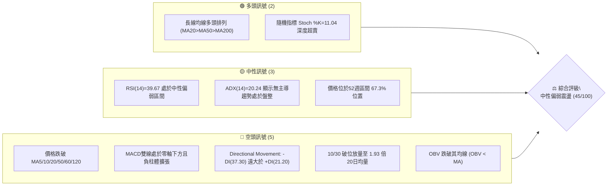
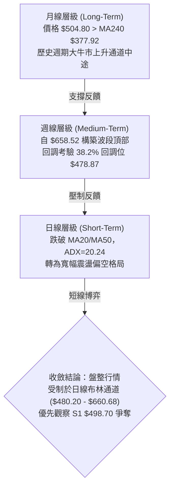
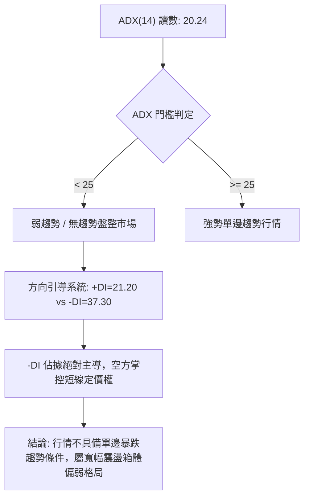
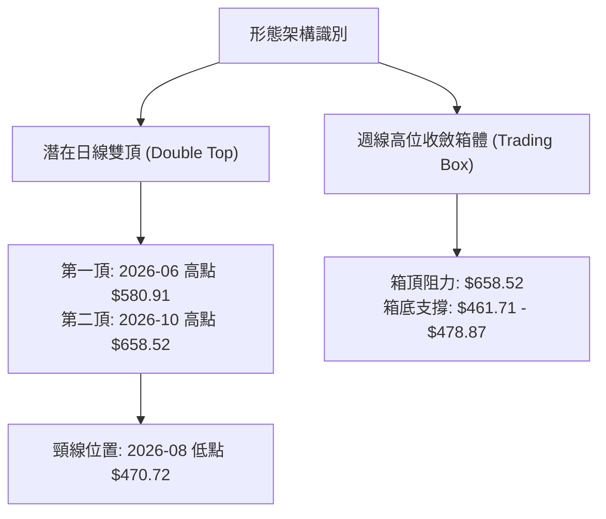
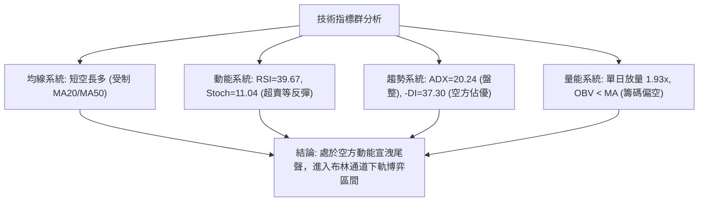
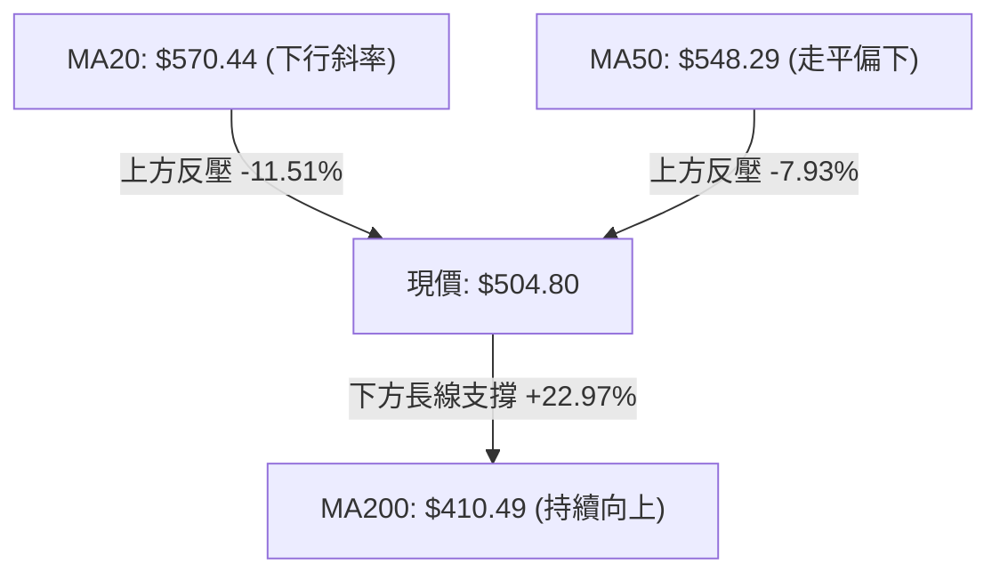
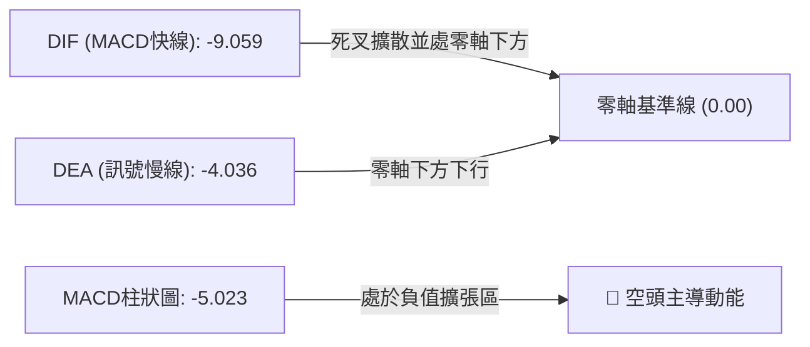
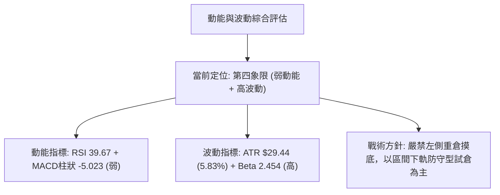
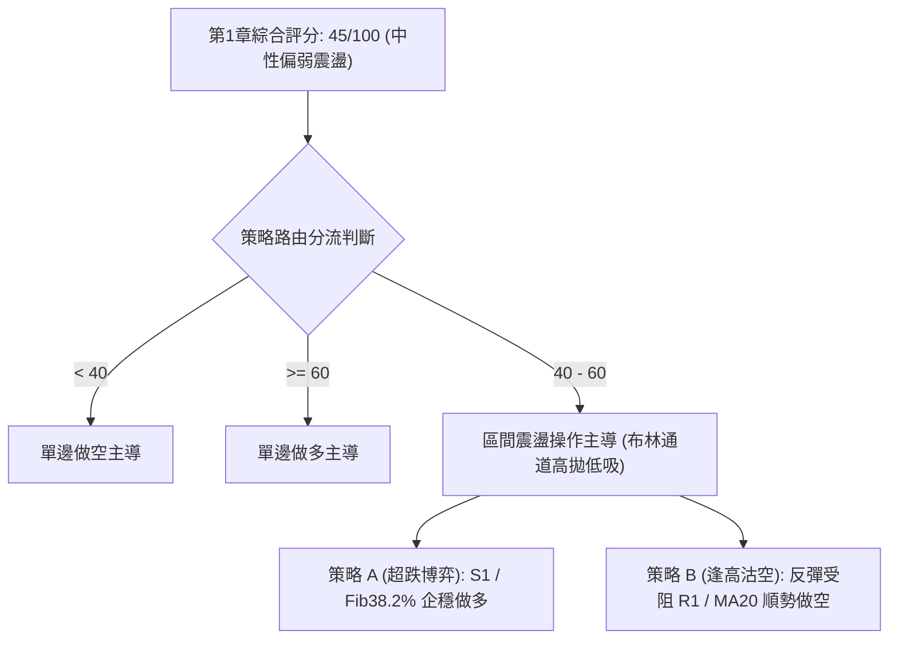
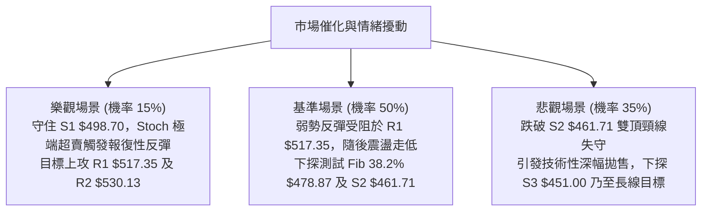

# AMD 技術分析報告

> **報告日期**：2026-11-02 ｜ **語言**：繁體中文 ｜ **數據來源**：Yahoo Finance ｜ **當前價格**：$504.80

---

## 目錄

| 章節 | 內容 |
|------|------|
| [1. 技術面概覽](#1-技術面概覽) | 訊號儀表板、核心指標、評分卡 |
| [2. 趨勢分析](#2-趨勢分析) | 多時框趨勢、長中短期走勢 |
| [3. 圖表形態分析](#3-圖表形態分析) | 形態識別、K線組合、目標價 |
| [4. 支撐與阻力](#4-支撐與阻力) | 關鍵價位、斐波那契回調 |
| [5. 技術指標深度解讀](#5-技術指標深度解讀) | MA/RSI/MACD/布林/成交量 |
| [6. 動能與波動率](#6-動能與波動率) | 動能評估、ATR、Beta |
| [7. 多時框架總結](#7-多時框架總結) | 時框架評分矩陣 |
| [8. 交易策略建議](#8-交易策略建議) | 多空策略、風險報酬比 |
| [9. 風險提示與監控](#9-風險提示與監控) | 監控指標、風險場景 |

---

## 1. 技術面概覽

### 🎯 技術訊號儀表板



### 📊 核心指標速覽表

| 指標類別 | 指標名稱 | 當前數值 | 訊號 | 解讀 |
|----------|----------|----------|------|------|
| **價格** | 當前收盤價 | $504.80 | 🟡 | 位於52週區間 67.3%，自高點 $658.52 回調 -23.34% |
| **均線** | MA20 | $570.44 | 🔴 | 價格低於 MA20 達 -11.51%，短期下行乖離過大 |
| **均線** | MA50 | $548.29 | 🔴 | 價格低於 MA50，中期上升趨勢暫時中斷 |
| **均線** | MA200 | $410.49 | 🟢 | 價格高於 MA200 達 +22.97%，超長期牛市基底完好 |
| **動能** | RSI(14) | 39.67 | 🟡 | 進入 30–40 弱勢緩衝區，尚未出現超賣底背離 |
| **動能** | MACD (12,26,9) | -9.059 | 🔴 | 雙線在零軸下且柱狀圖 -5.023，空頭動能仍佔優勢 |
| **動能** | Stoch %K / %D | 11.04 / 44.48 | 🟢 | %K 跌入極端超賣區 (<20)，短線隨時孕育超跌反彈 |
| **趨勢** | ADX(14) | 20.24 | 🟡 | ADX < 25 表明趨勢力道衰竭，進入寬幅區間拉鋸 |
| **趨勢** | DMI (+DI / -DI) | 21.20 / 37.30 | 🔴 | -DI 大幅高於 +DI，空方力量在短週期牢牢控盤 |
| **通道** | 布林通道 %B | 0.14 | 🟡 | 逼近下軌 $480.20，通道寬度擴張，空頭釋放釋壓 |
| **量能** | 成交量 / 20日均量 | 39.59M / 20.50M | 🔴 | 單日量比 1.93x，且 OBV < MA，大陰線伴隨籌碼派發 |
| **波動** | ATR(14) | $29.44 | 🔴 | 波動率佔股價 5.83%，短線處於高波幅風險釋放期 |

### 🏆 技術評分卡

```
╔══════════════════════════════════════════════════════════════╗
║                 技術評分卡 — AMD (2026-11-02)                ║
╠══════════════════════════════════════════════════════════════╣
║ 趨勢強度 (Trend Strength)   ████████░░░░░░░░░░░░  42/100 🟡  ║
║ 動能指標 (Momentum)         ███████░░░░░░░░░░░░░  38/100 🔴  ║
║ 支撐穩定度 (Support S1-S3)  ███████████░░░░░░░░░  55/100 🟡  ║
║ 成交量配合 (Volume Flow)    ███████░░░░░░░░░░░░░  35/100 🔴  ║
║ 形態完整度 (Pattern Form)   █████████░░░░░░░░░░░  46/100 🟡  ║
║ 均線排列 (MA Hierarchy)     ███████████░░░░░░░░░  54/100 🟡  ║
╠══════════════════════════════════════════════════════════════╣
║ 綜合評分 (Overall Score)    █████████░░░░░░░░░░░  45/100 🟡  ║
║ 評級結論：中性震盪偏弱 (區間操作模式，依規則18算術平均)       ║
╚══════════════════════════════════════════════════════════════╝
```

---

## 2. 趨勢分析

### 🌐 多時框趨勢分析



### 📈 長期趨勢 — 12個月走勢圖（Unicode）

```
AMD 月線收盤走勢圖（過去12個月：2025-11 至 2026-10）
價格軸 ($)
$650 ┤                                      
$600 ┤                                  ●(09月 $611.76)
$550 ┤                          ●(06月 $580.91)
$500 ┤                      ●(05月 $516.10)        ●(10月 $504.80 現價)
$450 ┤                              ●(07月 $476.15)
$400 ┤                                  ●(08月 $470.72)
$350 ┤                  ●(04月 $354.49)
$300 ┤                                      
$250 ┤                                      
$200 ┤  ●(11月 $217) ●(01月 $236)
$180 ┤      ●(12月 $214)  ●(02月 $200) ●(03月 $203)
     └───────────────────────────────────────────────────────
       11   12   01   02   03   04   05   06   07   08   09   10 (月份)
```

**走勢特徵分析表格**：

| 階段區間 | 時間跨度 | 起訖收盤價 | 漲跌幅 | 走勢特徵與結構定義 |
|----------|----------|------------|--------|--------------------|
| **底部築底期** | 2025-11 至 2026-03 | $217.53 → $203.43 | -6.48% | 於 $200–$236 區間窄幅打底，籌碼完成長線沉澱換手 |
| **主升爆發期** | 2026-03 至 2026-06 | $203.43 → $580.91 | +185.56% | 爆發性 AI 浪潮主升浪，突破所有均線，連續四個月大陽線 |
| **高位箱體期** | 2026-06 至 2026-08 | $580.91 → $470.72 | -18.97% | 首度遭遇獲利盤了結，回踩 $470 支撐帶後止跌回穩 |
| **末升衝頂期** | 2026-08 至 2026-09 | $470.72 → $611.76 | +29.96% | 假突破創歷史新高 $658.52，量價出現動能衰竭背馳 |
| **波段修正期** | 2026-09 至 2026-10 | $611.76 → $504.80 | -17.48% | 構築次級頭部後急跌破位，回吐前波漲幅並回踩下軌 |

### 📊 中期趨勢（週線分析）

```
AMD 近 8 週阻力與支撐收斂結構示意
   $658.52 ──┬── [歷史高點 52W High] 2026-10-09
             │   ╲ 
             │    ╲  
   $570.44 ──┼─────▼── [BB中軌 / MA20 壓力位]
             │      ╲
   $546.44 ──┼───────●── [R3 聚類阻力]
   $517.35 ──┼────────●── [R1 短線反彈阻力]
   $504.80 ──┼─────────◄── [當前收盤價]
   $498.70 ──┼────────●── [S1 近期波段關鍵支撐]
   $478.87 ──┼───────▲── [Fib 38.2% 回調位 / BB下軌附近 $480.20]
   $461.71 ──┴──────▲── [S2 強支撐位]
```

週線指標層面，MACD 柱狀圖在 2026-09-25 達到最高峰 +14.199 後迅速收斂，至 2026-10-30 週收盤已翻負至 -5.023（前兩週更一度擴大至 -14.100 與 -13.949）。這表明中期上漲波段的推進力道已被空頭動能完全瓦解，目前處於中期修正波的 ABC 結構拉鋸之中。

### ⚡ 趨勢強度評估（ADX 解讀）



**ADX 趨勢強度對照解讀表**：

| 指標變數 | 當前讀數 | 門檻區間 | 趨勢判定 | 操作策略指導意義 |
|----------|----------|----------|----------|------------------|
| **ADX(14)** | 20.24 | 0 – 25 | 弱趨勢 / 震盪走勢 | 嚴禁採用突破追單系統；應以區間邊界高拋低吸為主 |
| **+DI(14)** | 21.20 | 參照線 | 多方動能低迷 | 多方進攻意願脆弱，反彈往往在阻力位前乏力止步 |
| **-DI(14)** | 37.30 | 顯著擴張 | 空方短期控盤 | 空方佔優但因 ADX 偏低，下殺容易引發技術性抵抗回抽 |

---

## 3. 圖表形態分析

### 🔍 形態識別系統



**圖表形態信心度評估表（依規則 15）**：

| 形態名稱 | 信心度 | 判斷依據（引用數據） | 完成度 | 目標價（附嚴謹計算式） |
|----------|--------|----------------------|--------|------------------------|
| **潛在寬幅雙頂 (Double Top)** | 58% | 2026-06收盤 $580.91 與 2026-10-09高點 $658.52 形成雙峰，頸線鎖定 2026-08月收盤 $470.72 | 60%（尚未有效跌破頸線） | 跌破頸線 $470.72 後理論量幅：<br/>$470.72 − ($658.52 − $470.72) = **$282.92**（接近 Fib 78.6% $288.86） |
| **高位箱體震盪 (Box Consolidation)** | 78% | 過去5個月收盤價完全落在 $470.72 至 $611.76 間，ADX=20.24 確立無趨勢狀態 | 85% | 箱體下軌支撐目標：**$478.87** (Fib 38.2%) 及 **$461.71** (S2支撐位) |
| **短線下降三角收斂** | 42% | 數據訊號不足（僅近兩週日K局部收斂），信心度 < 50% | 30% | *訊號不足，僅做指標型解讀，不計算幾何目標價* |

### 🕯️ 重要K線形態分析

依據提供的「近10根日K」與「近8根週K」之精確 OHLC 數據進行解讀：

| 日期與時框 | 開盤價 | 最高價 | 最低價 | 收盤價 | K線形態名稱 | 技術解讀與量價關係 | 訊號 |
|------------|--------|--------|--------|--------|-------------|--------------------|------|
| **2026-10-21 (日K)** | 545.93 | 556.79 | 537.30 | 552.72 | 實體陽線 | 向上挑戰 MA50，成交量 17.99M 溫和放量，短線呈現反彈 | 🟢 |
| **2026-10-22 (日K)** | 524.10 | 529.98 | 502.60 | 507.93 | 跳空破位大陰線 | 低開低走跌破 $510，成交量激增至 28.00M，空方主力大幅拋壓 | 🔴 |
| **2026-10-27 (日K)** | 539.49 | 563.92 | 538.50 | 560.26 | 帶長上影中陽線 | 盤中上衝測試 MA20 承壓，多頭回抽乏力，成交量 20.59M | 🟡 |
| **2026-10-28 (日K)** | 573.08 | 579.18 | 560.52 | 578.44 | 高開陽線 | 觸及波段高點 $579.18，受制於 MA20 $570.44 上方重壓區 | 🟡 |
| **2026-10-30 (日K)** | 508.53 | 520.40 | 492.21 | 504.80 | 長下影帶量大陰線 | 低開下殺打出低點 $492.21 後小幅收窄，成交量飆升至 39.59M 巨量派發 | 🔴 |
| **2026-10-09 (週K)** | 630.61 | 658.52 | 606.00 | 608.10 | 流星線 (Shooting Star) | 衝擊歷史新高 $658.52 遭遇斷崖式拋壓，留下長上影線確立波段見頂 | 🔴 |
| **2026-10-16 (週K)** | 599.93 | 606.20 | 526.83 | 528.75 | 長實體斷頭大陰線 | 一舉摜破 MA20，成交量 107.04M，中級修正確立 | 🔴 |
| **2026-10-30 (週K)** | 522.79 | 579.18 | 492.21 | 504.80 | 衝高回落長影陰線 | 週內反彈高點 $579.18 受阻於布林中軌，收盤跌破 $510 支撐帶 | 🔴 |

### 📉 ASCII 走勢形態示意圖

```
AMD 近期雙頂回調與頸線測試示意圖
$660 ┤                  ▲ 頂2 ($658.52)
$620 ┤                 ╱ ╲
$580 ┤    ▲ 頂1 ($580)╱   ╲       ▲ 反彈次高點 ($579.18)
$540 ┤   ╱ ╲         ╱     ╲     ╱ ╲
$500 ┤  ╱   ╲       ╱       ╲   ╱   ● 現價 ($504.80)
$470 ┤─┴─────▼──────┴─────────▼─┴──────── 關鍵頸線/箱底 ($470.72)
      06月   07月   08月      09月  10月
```

### 🎯 形態目標價計算

根據雙頂幾何空間模型與當前箱體震盪幅度，目標價嚴格基於歷史價位推算如下：

1. **若跌破頸線 $470.72 之極端目標**：
   - 形態高度 $H = \text{最高點 } \$658.52 - \text{頸線 } \$470.72 = \$187.80$
   - 破位向下等幅投射目標 $= \$470.72 - \$187.80 = \mathbf{\$282.92}$（該價位與斐波那契 78.6% 回調位 **$288.86** 呈現高度幾何重合）。
2. **短期箱體底部震盪反彈目標**：
   - 測試 S1 **$498.70** 及斐波那契 38.2% 回調位 **$478.87** 若能成功企穩，將展開向箱體中軸 R1 **$517.35** 及 R3 **$546.44** 的回抽修復行情。

---

## 4. 支撐與阻力

### 🗺️ 關鍵價位分布圖（Unicode）

```
AMD 價位結構分布圖
══════════════════════════════════════════════════════════════════
$658.52 ║██████████████████████████████║ 52W 最高點 / 歷史強阻力
$570.44 ║██████████████████████      ║ 布林中軌 / MA20 強阻力
$546.44 ║████████████████████████    ║ 強阻力 R3 (波段密集高點)
$530.13 ║████████████████            ║ 阻力 R2 (反彈中繼壓力)
$517.35 ║████████████████████        ║ 關鍵阻力 R1 (日線轉強分水嶺)
$504.80 ╠════════════════════════════╣ ◄ 當前收盤價 ($504.80)
$498.70 ║▓▓▓▓▓▓▓▓▓▓▓▓▓▓▓▓▓▓          ║ 近期核心支撐 S1 (-1.21%)
$478.87 ║▓▓▓▓▓▓▓▓▓▓▓▓▓▓▓▓▓▓▓▓▓▓      ║ 斐波那契 38.2% / 布林下軌附近
$461.71 ║████████████████████████    ║ 強支撐 S2 (中期多頭防線)
$451.00 ║████████████████████████████║ 極限強支撐 S3 (-10.66%)
══════════════════════════════════════════════════════════════════
```

### 🚧 阻力位分析表

所有阻力價位均直接引用數據中由 OHLCV 聚類計算得出之數值：

| 阻力級別 | 精確價位 | 距現價空間 | 形成原因與技術意涵 | 突破難度 | 重要性 |
|----------|----------|------------|--------------------|----------|--------|
| **R1** | **$517.35** | +2.49% | 近期波段密集成交反彈高點聚類；跌破後的短線第一道反壓 | 🟡 中等 | ★★★☆☆ |
| **R2** | **$530.13** | +5.02% | 10月中旬平台震盪下沿，多空籌碼轉換中繼位 | 🔴 較高 | ★★★★☆ |
| **R3** | **$546.44** | +8.25% | 緊鄰斐波那契 23.6% 回調位 ($547.53) 與 MA50 ($548.29) 重合共振壓制區 | 🔴 極高 | ★★★★★ |

### 🛡️ 支撐位分析表

所有支撐價位均直接引用數據中由 OHLCV 聚類計算得出之數值：

| 支撐級別 | 精確價位 | 距現價空間 | 形成原因與技術意涵 | 守住機率 | 重要性 |
|----------|----------|------------|--------------------|----------|--------|
| **S1** | **$498.70** | -1.21% | 近一年波段低點聚類核心，整數關口 $500 防線緩衝帶 | 65% | ★★★★☆ |
| **S2** | **$461.71** | -8.54% | 2026年7-8月波段修正低點密集區，中期箱體底部結構下沿 | 80% | ★★★★★ |
| **S3** | **$451.00** | -10.66% | 中長期多頭防守底線，跌破則預示多頭結構徹底瓦解 | 90% | ★★★★★ |

### 📐 斐波那契回調位分析

依據 52 週極值區間（低點 **$188.22** → 高點 **$658.52**，總波幅 $470.30）計算：

| 回調比率 | 價位 | 當前相對位置與技術解讀 |
|----------|------|------------------------|
| **0.0%** (52W High) | **$658.52** | 歷史峰值，中期頭部壓制頂部 |
| **23.6%** | **$547.53** | 弱勢回調防守位，目前已有效跌破，轉化為上方重阻力（與 R3 $546.44 形成共振帶） |
| **38.2%** | **$478.87** | **現價 ($504.80) 位於 23.6% 與 38.2% 區間**；該位為強勢牛市拉回之黃金分割支撐，緊鄰布林下軌 $480.20 |
| **50.0%** | **$423.37** | 多空力量強弱分水嶺，鄰近長線 MA200 ($410.49) |
| **61.8%** | **$367.87** | 深幅黃金回調位，牛市生命線邊界 |
| **78.6%** | **$288.86** | 週期性回調極限防守位 |
| **100.0%** (52W Low) | **$188.22** | 啟動本輪大牛市行情的原始起點 |

---

## 5. 技術指標深度解讀

### 🎛️ 指標訊號總覽



### 📈 移動平均線排列分析



當前移動平均線呈現典型的「**長週期多頭排列、短週期空頭破位**」矛盾結構：
- 長期均線架構上，MA20 ($570.44) > MA50 ($548.29) > MA200 ($410.49)，顯示宏觀大趨勢仍未轉入熊市；
- 短期微觀層面，價格 ($504.80) 已連續擊穿 MA5 ($548.24)、MA10 ($539.14)、MA20、MA50、MA60 ($537.47) 及 MA120 ($520.30)。短期均線群全部構成頭頂上的階梯式反壓，短多若要逆轉，必須逐級放量收復。

### 📉 RSI(14) 分析

```
RSI(14) 讀數強度進度條：
[███████████████░░░░░░░░░░░░░░░] 39.67 / 100 🟡 (中性偏弱區間)
0         30(超賣)           70(超買)      100
```

- **區間診斷**：RSI(14) 數值為 39.67，脫離了前期強勢多頭區（50–70），進入空頭掌控的弱勢區間（30–50）。
- **背離分析**：檢視近 20 根 K 棒走勢，價格自 2026-10-09 高點 $658.52 下跌至當前 $504.80，RSI 同步由 70.1 快速降至 39.67。**數據明確顯示：無明顯背離現象**。這意味著當前的下跌是真實動能驅動的趨勢性下挫，並非多頭蓄勢的假摔洗盤。

### 📊 MACD(12/26/9) 訊號解讀



MACD 指標在零軸之下出現死叉且柱狀圖讀數為 -5.023，確認了短線動能處於空方主導。然而，觀察週線層面，MACD 柱狀圖已自前兩週的 -14.100 與 -13.949 收斂至 -5.023，顯示中週期的空方拋售動能已跨越最猛烈階段，短線下行斜率開始放緩。

### 📦 布林通道分析

```
AMD 日線布林通道 (20, 2) 結構示意圖
$660.68 ──┬── [布林上軌 Upper Band]
          │
$570.44 ──┼── [布林中軌 Middle Band = MA20]
          │
$504.80 ──┼── ◄ 現價 (位於通道 14% 位置，%B = 0.14)
          │
$480.20 ──┴── [布林下軌 Lower Band]
```

當前布林帶帶寬顯著擴張，價格收在 $504.80，%B 指標僅為 **0.14**，高度逼近布林下軌 $480.20。根據統計套利原則，當 %B 跌入 0.15 以下時，股價通常具有均值回歸至中軌 ($570.44) 的內在反彈需求，下行空間在 $480–$498 區間將受到極強的帶狀支撐阻尼效應。

### 💹 成交量分析（量價配合度）

- **最新成交量**：39,589,800 股，較 20 日均量 (20,503,360 股) 擴大 **1.93 倍**。
- **量價配合診斷**：10 月 30 日收出大陰線並伴隨近兩倍巨量，顯示在跌破 $510 支撐時引發了程式化止損盤與融資盤平倉；
- **能量潮 OBV**：數據確認「**OBV < MA**」，代表量能趨勢呈現疲弱淨流出狀態。放量下殺而未見縮量止跌，說明底部買盤目前多為被動承接，尚未形成主動推升的多頭量能。

---

## 6. 動能與波動率

### ⚡ 動能評估四象限

| 象限 | 動能維度 | 波動維度 | 股票當前狀態歸屬 | 戰術應對評估 |
|------|----------|----------|------------------|--------------|
| **第一象限 (Q1)** | 強動能 (Bullish) | 低波動 (Low Vol) | — | 最佳趨勢加碼環境 |
| **第二象限 (Q2)** | 弱動能 (Bearish) | 低波動 (Low Vol) | — | 謹慎觀望，窄幅縮量 |
| **第三象限 (Q3)** | 強動能 (Bullish) | 高波動 (High Vol) | — | 突破行情，高風險高回報 |
| **第四象限 (Q4)** | **弱動能 (Bearish)** | **高波動 (High Vol)** | **✓ AMD 當前定位** | **高風險釋放期，嚴控倉位防下挫** |



### 📊 ATR 波動率分析

- **ATR(14)** 讀數為 **$29.44**，佔當前股價比例達 **5.83%**（採用 Wilder 平滑算法）。
- **日內波動幅度**：代表 AMD 每個交易日的平均真實波幅接近 $30 美元。
- **止損距離建議**：在震盪市況中，合理的防噪音止損緩衝應設定為 $1.0 \times \text{ATR} \approx \$29.40$ 至 $1.5 \times \text{ATR} \approx \$44.16$。這解釋了為何關鍵支撐 S1 ($498.70) 距現價僅約 0.2 個 ATR，極易被日內毛刺刺破，因此重要防守位必須退守至 S2 ($461.71) 或斐波那契 38.2% ($478.87)。

### 📐 Beta 與市場相關性

- **Beta 係數**：高達 **2.454**。
- **市場敏感度**：AMD 屬於超高敏感性成長型半導體晶片股，波動幅度為標普500指數的近 2.5 倍。在整體大盤進入調整期時，其回撤幅度將被同向放大；反之，若科技股大盤回穩，其反彈爆發力亦將居科技板塊前列。

---

## 7. 多時框架總結

### 📋 時框架評分表

| 時框架 | 趨勢方向 | 動能狀態 | 均線排列特徵 | 形態架構 | 綜合評分 | 戰術建議 |
|--------|----------|----------|--------------|----------|----------|----------|
| **月線 (長期)** | 🟢 多頭趨勢 | 🟡 動能高位鈍化 | 價格遠高於 MA240 ($377.92) | 歷史多頭主升浪後的大級別整理 | **75/100** | 長線多頭底倉持有 |
| **週線 (中期)** | 🟡 寬幅箱體 | 🔴 動能收斂下行 | 考驗 MA20 中軌，回踩 38.2% | 雙頂未遂，高位大箱體震盪 | **48/100** | 中期區間高拋低吸 |
| **日線 (短期)** | 🔴 震盪破位 | 🔴 處於超賣釋放期 | 跌破 MA5 至 MA120，受制 MA20 | 帶量下殺測試 S1 支撐帶 | **38/100** | 短線嚴禁盲目追空，防超跌反彈 |

### 🔲 綜合訊號矩陣

```
時框維度與技術要素一致性矩陣：
╔══════════════╦══════════════╦══════════════╦══════════════╗
║ 評估維度     ║ 長期 (月線)  ║ 中期 (週線)  ║ 短期 (日線)  ║
╠══════════════╬══════════════╬══════════════╬══════════════╣
║ 趨勢方向     ║   🟢 偏多    ║   🟡 震盪    ║   🔴 偏空    ║
║ 均線系統     ║   🟢 多頭    ║   🟡 糾結    ║   🔴 空頭    ║
║ 動能指標     ║   🟡 鈍化    ║   🔴 死叉    ║   🔴 超賣    ║
║ 量價結構     ║   🟢 健康    ║   🟡 分歧    ║   🔴 派發    ║
╚══════════════╩══════════════╩══════════════╩══════════════╝
訊號衝突度：日線與月線高度背馳，中期週線處於方向收斂的關鍵節點。
```

### ⚖️ 多時框收斂結論

依據「**嚴格要求 14：多時框收斂規則**」判定：
1. **行情屬性判定**：當前日線 **ADX(14) = 20.24 (< 25)**，明確指示當前市場屬於**盤整行情（無趨勢狀態）**。
2. **主導時框與優先級**：盤整行情下，趨勢跟隨指標失效，**必須以日線布林通道上下軌 ($480.20 – $660.68) 為主要交易區間**。
3. **唯一方向性結論**：**【中性觀望偏弱震盪】**。
   - 儘管超長期月線多頭強勁，但短線受制於 -DI(37.30) 控盤與 1.93 倍大陰線壓制，股價直接反轉向上的機率偏低；
   - 由於價格已深跌至布林下軌邊緣 (%B=0.14) 且隨機指標深度超賣 (Stoch %K=11.04)，空方下行空間將在斐波那契 38.2% 回調位 **$478.87** 與 S1 **$498.70** 受到強烈抵抗。因此，交易應定位為「**區間箱體操作，等待下軌企穩或反彈遇阻後的結構性機會**」。此結論與第 1 章評分卡（45/100 偏弱中性）及第 8 章交易策略完全一致。

---

## 8. 交易策略建議

### 🗺️ 策略決策流程圖



### 🧭 策略路由（依評分卡分流）

**當前主策略方向 = 【中性區間震盪策略（偏向反彈阻力位做空與極限支撐短多博弈）】（依技術評分卡：45/100）**

### 🎯 價格情境階梯（Price Scenarios）

價位嚴格引用自數據之關鍵價位與斐波那契計算結果：

| 觸發條件 | 下一目標 | 後續延伸 | 情境技術含義 |
|----------|----------|----------|--------------|
| **強勢突破 R1 $517.35** | **R2 $530.13** | **R3 $546.44** | 短線空頭衰竭，展開向布林中軌修復的超跌反彈 |
| **守住 S1 $498.70 區間** | **現價 $504.80** | **R1 $517.35** | 維持在 $498–$517 狹窄箱體內弱勢橫盤築底 |
| **有效跌破 S1 $498.70** | **Fib $478.87** | **S2 $461.71** | 下行破位測試布林下軌，空方釋放剩餘拋壓 |

### 📊 情境機率分佈

| 預測情境 | 發生機率 | 主要技術依據 |
|----------|----------|--------------|
| **情境一：延續回落 / 再探低點** | **50%** | -DI 高達 37.30、MACD 負柱體擴張、10/30 單日放量 1.93x 破位殺跌 |
| **情境二：區間震盪 / 築底拉鋸** | **35%** | ADX 僅 20.24 確立盤整無趨勢、布林 %B=0.14 跌入極限下軌防守帶 |
| **情境三：強勢反轉 / 向上突破** | **15%** | MA5 至 MA120 全線蓋頂，OBV < MA 顯示量能枯竭，暫無持續上攻動能 |

### 🟢 主策略詳情（區間高拋低吸模型）

所有價位均直接取自數據中之計算點位，風險報酬比嚴格依規則 17 計算：

| 策略要素 | 策略 A（區間下軌超跌反彈短多） | 策略 B（弱勢反彈阻力位高空 — 優先主選） |
|----------|--------------------------------|-----------------------------------------|
| **策略邏輯** | 測試 S1 支撐未破，利用超賣指標博弈回抽 | 順應日線破位大陰線壓制，於 R1 阻力位反彈受阻放空 |
| **進場條件** | 股價回踩 S1 $498.70 不破並出現日線長下影反彈 | 股價盤中向上反彈至 R1 $517.35 遇阻並收陰線確認 |
| **進場價格** | **$498.70**（引用 S1 支撐位） | **$517.35**（引用 R1 阻力位） |
| **目標價 T1** | **$517.35**（引用 R1 阻力位） | **$498.70**（引用 S1 支撐位） |
| **目標價 T2** | **$530.13**（引用 R2 阻力位） | **$461.71**（引用 S2 強支撐位） |
| **止損價格** | **$478.87**（引用 Fib 38.2% 回調位） | **$530.13**（引用 R2 阻力位） |
| **風險報酬比** | **1 : 0.94（以 T1 計）**<br>*(計算：(517.35−498.70) ÷ (498.70−478.87) = 18.65 ÷ 19.83)*<br>另：1 : 1.58（以 T2 計） | **1 : 1.46（以 T1 計）**<br>*(計算：(517.35−498.70) ÷ (530.13−517.35) = 18.65 ÷ 12.78)*<br>另：1 : 4.35（以 T2 計） |
| **成功機率** | 45%（逆短期趨勢博反彈，勝率偏低） | 65%（順應破位日K動能，勝率較高） |
| **建議倉位** | 10%（輕倉試探） | 20%（標準風控倉位） |

### 🔴 反向風險觸發點（對沖提示）

- **推翻做空邏輯之信號**：若日線放量收復 **R2 $530.13** 且 MACD 柱狀圖翻正，代表空頭結構失效，應即刻空單止損離場；
- **推翻做多邏輯之信號**：若日線實體跌破斐波那契 38.2% **$478.87** 及 S2 **$461.71**，代表下行空間全面打開，多單必須無條件止損。

### ⭐ 整體訊號強度評星

```
做多訊號強度：★★☆☆☆  (2/5星 - 僅依賴超賣指標，均線形態嚴重劣勢)
做空訊號強度：★★★☆☆  (3/5星 - 日線動能偏空，但受制於下軌支撐阻尼)
整體可信度：  ★★★☆☆  (3/5星 - 盤整行情指標互相掣肘，信噪比較高)
```

---

## 9. 風險提示與監控

### ✅ 關鍵監控指標 Checklist

```
╔══════════════════════════════════════════════════════════════╗
║               AMD 交易風險監控清單 (Checklist)               ║
╠══════════════════════════════════════════════════════════════╣
║ [ ] 價格是否跌破 S1 $498.70 並引發新一輪程序化止損賣盤？       ║
║ [ ] RSI(14) 能否在 30 附近止跌形成底背離信號？               ║
║ [ ] 日成交量是否萎縮回 20日均量 (20.50M) 以下完成止跌換手？   ║
║ [ ] 股價反彈至 R1 $517.35 是否出現縮量滯漲並遭空頭再次打壓？  ║
║ [ ] 斐波那契 38.2% 回調位 ($478.87) 處是否有機構大單防禦？   ║
║ [ ] 宏觀與半導體板塊波動是否引發 Beta=2.454 的槓桿擴散效應？ ║
╚══════════════════════════════════════════════════════════════╝
```

### ⚠️ 風險場景分析



### 🛡️ 風險管理重要提醒

1. **極高 Beta 倉位降溫原則**：AMD 的 Beta 值高達 **2.454**，且 ATR 達 **$29.44 (5.83%)**。在當前弱勢震盪行情中，總持倉部位不宜超過可支配投資本金的 **15%–20%**，單筆交易虧損金額應嚴格限制在總資產的 **1.0%** 以內。
2. **區間操作嚴守止損點**：在 ADX < 25 的盤整結構中，切忌在區間中軸追價。多頭切勿在 $515 以上追買，空頭亦不宜在 $500 邊緣重注追空；嚴格依據點位執行紀律止損。

---

## 📋 報告總結

```
╔══════════════════════════════════════════════════════════════╗
║                   AMD 技術分析報告總結                       ║
╠══════════════════════════════════════════════════════════════╣
║ 報告日期：2026-11-02                                         ║
║ 當前收盤價：$504.80                                          ║
║ 綜合技術評分：45 / 100                                       ║
║ 分析評級：⚖️ 中性觀望偏弱 (高位寬幅震盪結構)                  ║
║                                                              ║
║ 關鍵結論：                                                   ║
║ ├─ 長期趨勢：🟢 宏觀牛市完好 (MA200 = $410.49，長線排列多頭)║
║ ├─ 中期趨勢：🟡 雙頂蓄勢回調 (考驗 Fib 38.2% $478.87 支撐)   ║
║ ├─ 短期趨勢：🔴 空頭主導破位 (跌破多條短均線，-DI = 37.30)  ║
║ ├─ 關鍵支撐：S1 $498.70 ｜ S2 $461.71 ｜ S3 $451.00          ║
║ ├─ 關鍵阻力：R1 $517.35 ｜ R2 $530.13 ｜ R3 $546.44          ║
║ └─ 分析師目標：均價 $640.21 (低 $365.00 / 高 $1250.00)       ║
║                                                              ║
║ 最優策略組合：                                               ║
║ 1. 🥇 最佳機會：策略 B — 逢反彈測試 R1 $517.35 受阻高空，     ║
║                 止損設於 R2 $530.13，目標下看 S1 $498.70。   ║
║ 2. 🥈 次選機會：策略 A — 若回踩 S1 $498.70 或 Fib 38.2%      ║
║                 $478.87 企穩出現超賣鈍化，輕倉博弈短線反彈。 ║
║ 3. 🥉 保守選擇：空倉觀望，靜待日線站穩 MA20 ($570.44) 或     ║
║                 跌透至 S2 ($461.71) 出現右側量價反轉再行介入。║
╚══════════════════════════════════════════════════════════════╝
```

---

> ⚠️ **免責聲明**：本報告為 AI 自動生成之技術分析，所有數據及估算均基於提供的歷史價格資訊。本報告**僅供研究與學術參考**，**不構成任何投資建議**。投資有風險，入市需謹慎。

---

*報告生成時間：2026-11-02 ｜ 數據來源：Yahoo Finance ｜ 分析框架：多時框技術分析*