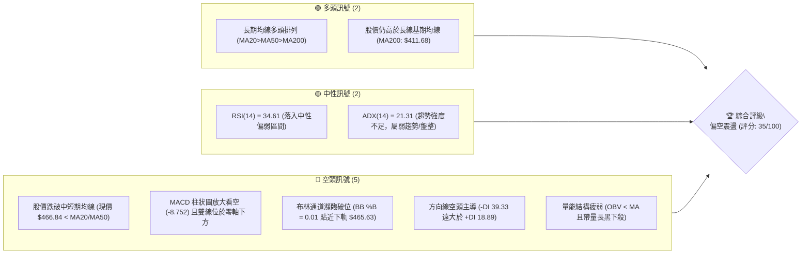
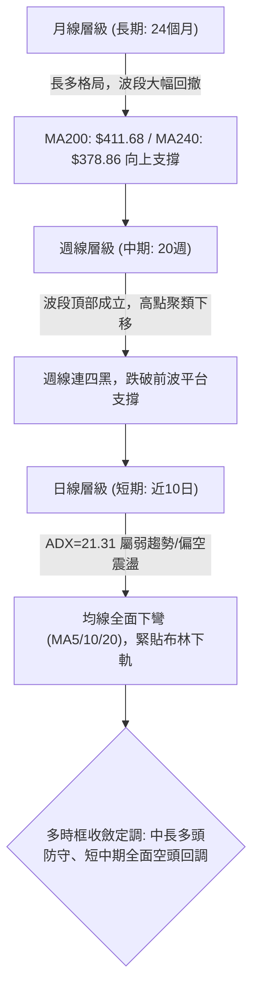
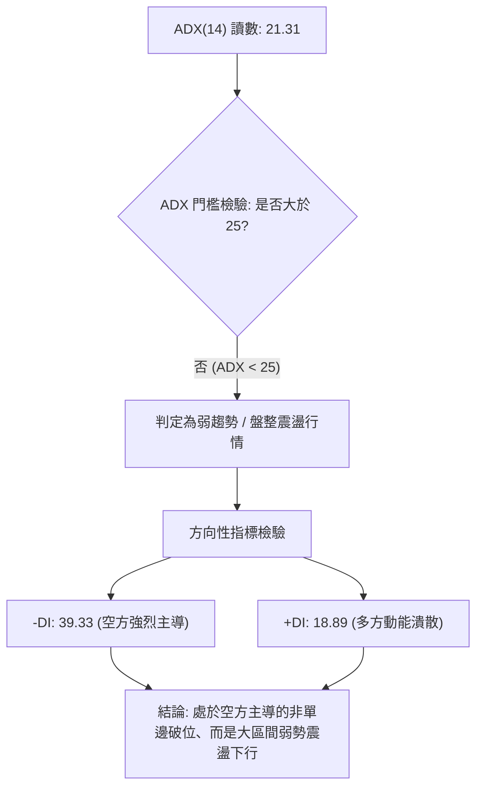
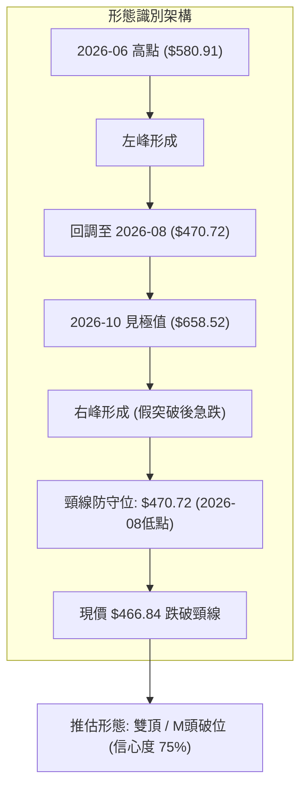
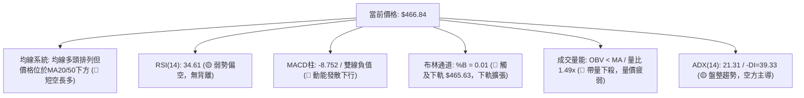
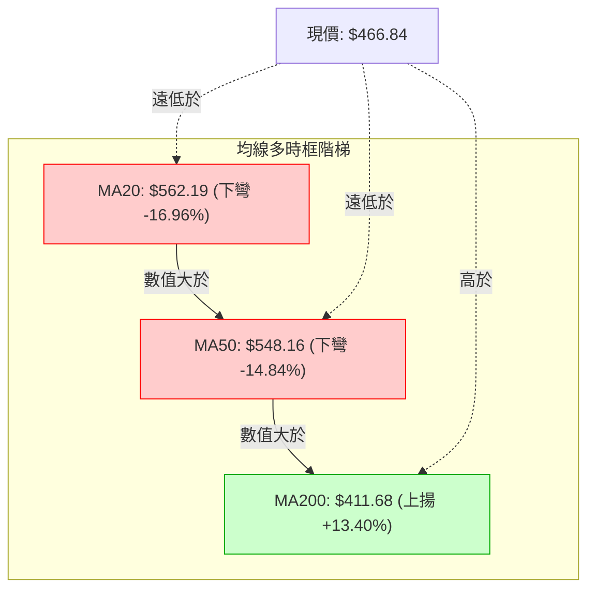
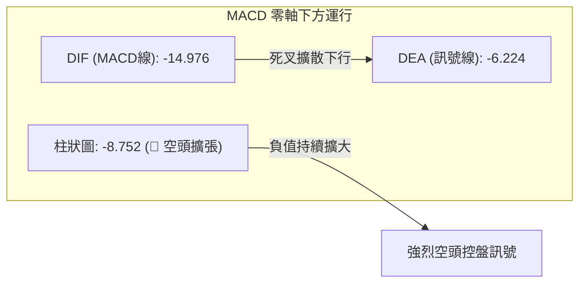
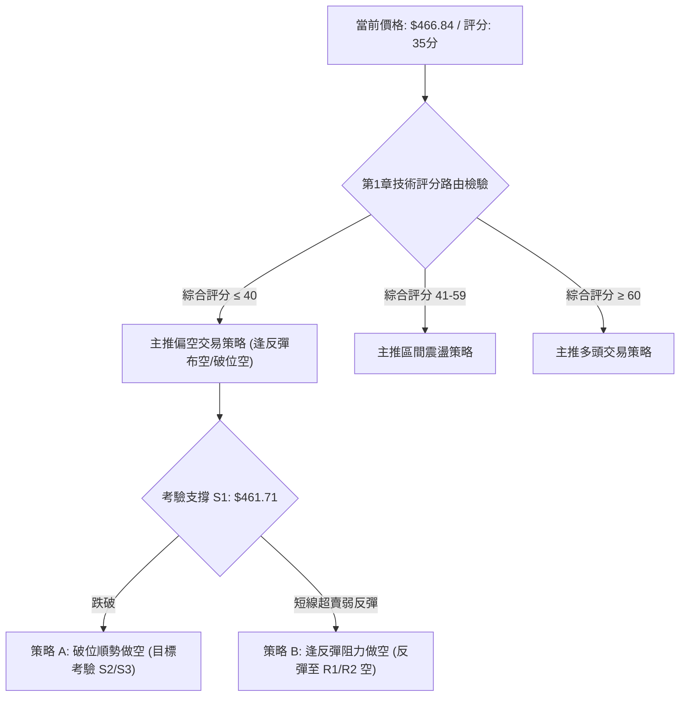
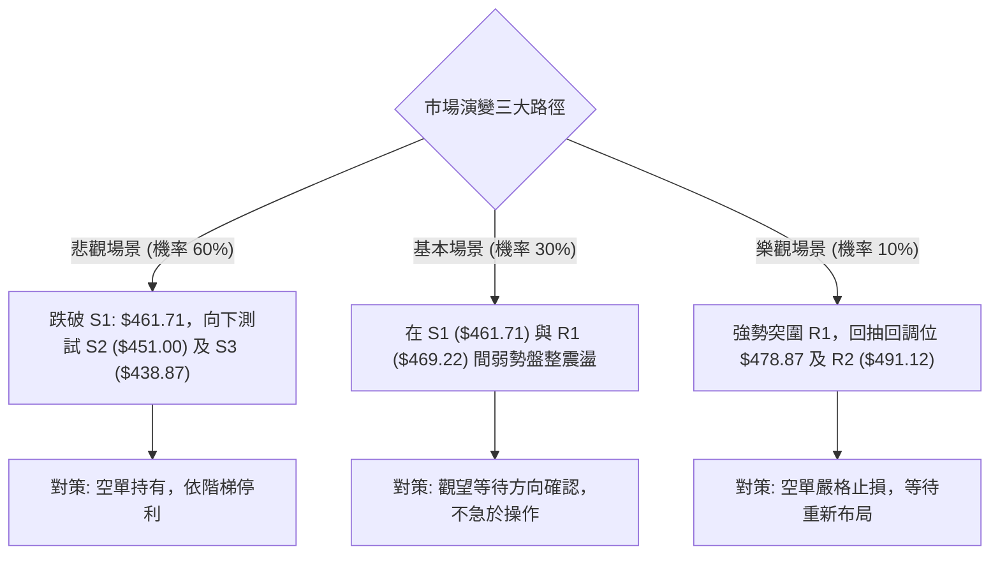

# AMD 技術分析報告

> **報告日期**：2026-11-03 ｜ **語言**：繁體中文 ｜ **數據來源**：Yahoo Finance ｜ **當前價格**：$466.84

---

## 目錄

| 章節 | 內容 |
|------|------|
| [1. 技術面概覽](#1-技術面概覽) | 訊號儀表板、核心指標、評分卡 |
| [2. 趨勢分析](#2-趨勢分析) | 多時框趨勢、長中短期走勢 |
| [3. 圖表形態分析](#3-圖表形態分析) | 形態識別、K線組合、目標價 |
| [4. 支撐與阻力](#4-支撐與阻力) | 關鍵價位、斐波那契回調 |
| [5. 技術指標深度解讀](#5-技術指標深度解讀) | MA/RSI/MACD/布林/成交量 |
| [6. 動能與波動率](#6-動能與波動率) | 動能評估、ATR、Beta |
| [7. 多時框架總結](#7-多時框架總結) | 時框架評分矩陣 |
| [8. 交易策略建議](#8-交易策略建議) | 多空策略、風險報酬比 |
| [9. 風險提示與監控](#9-風險提示與監控) | 監控指標、風險場景 |

---

## 1. 技術面概覽

### 🎯 技術訊號儀表板



### 📊 核心指標速覽表

| 指標類別 | 指標名稱 | 當前數值 | 訊號 | 解讀 |
|----------|----------|----------|------|------|
| **價格** | 當前價格 | $466.84 | 🔴 | 較52週高點回撤29.11%，位於52週區間59.2%位置，短線大幅承壓 |
| **均線** | MA20 | $562.19 | 🔴 | 股價低於MA20達 -16.96%，短線趨勢呈現極度空頭排列與下壓 |
| **均線** | MA50 | $548.16 | 🔴 | 股價低於MA50達 -14.84%，中期上升趨勢遭到嚴重破壞 |
| **均線** | MA200 | $411.68 | 🟢 | 股價高於MA200達 +13.40%，長期多頭年線支撐仍未失守 |
| **動能** | RSI(14) | 34.61 | 🟡 | 位於30–70常態區間邊緣，尚未進入極端超賣，但呈現明顯弱勢 |
| **動能** | MACD(12,26,9) | -14.976 | 🔴 | MACD線(-14.976)低於訊號線(-6.224)，柱狀圖為-8.752，動能持續發散偏空 |
| **動能** | 隨機指標 (Stoch %K/%D) | 0.61 / 24.42 | 🟡 | %K降至極低水準(0.61)，短線極度超賣，存在技術性乖離修復需求 |
| **波動** | ATR(14) | $30.68 | 🔴 | 佔股價6.57%，單日波動幅度極大，持倉風險高 |
| **趨勢** | ADX(14) / DMI | 21.31 | 🟡 | ADX<25顯示大波段單邊趨勢鈍化，-DI(39.33)主導，屬偏空震盪探底格局 |
| **通道** | 布林帶 (%B) | 0.01 | 🔴 | 股價緊貼下軌($465.63)，軌道開口擴大，呈現弱勢下行推擠特徵 |
| **量能** | 成交量 / OBV | 31,990,800 | 🔴 | 較20日均量放大1.49倍，且OBV<MA，放量下殺確認資金持續淨流出 |

### 🏆 技術評分卡

```
╔══════════════════════════════════════════════════════════════╗
║                 技術評分卡 — AMD (2026-11-03)                ║
╠══════════════════════════════════════════════════════════════╣
║ 趨勢強度      ██████░░░░░░░░░░░░░░  30/100  🔴 空頭主導/弱趨勢║
║ 動能指標      ████░░░░░░░░░░░░░░░░  20/100  🔴 MACD強烈看空  ║
║ 支撐穩定度    ████████░░░░░░░░░░░░  40/100  🟡 臨近S1/S2支撐 ║
║ 成交量配合    ████░░░░░░░░░░░░░░░░  20/100  🔴 放量下殺量價背離║
║ 形態完整度    ████████░░░░░░░░░░░░  40/100  🟡 高位雙頂結構   ║
║ 均線排列      ████████████░░░░░░░░  60/100  🟡 長多中短空矛盾 ║
╠══════════════════════════════════════════════════════════════╣
║ 綜合評分      ███████░░░░░░░░░░░░░  35/100  偏空 (規則18算術均)║
╚══════════════════════════════════════════════════════════════╝
```
*(註：綜合評分由六項子評分 [30 + 20 + 40 + 20 + 40 + 60] ÷ 6 = 35.0，四捨五入為 35/100)*

---

## 2. 趨勢分析

### 🌐 多時框趨勢分析



### 📈 長期趨勢 — 12個月走勢圖（Unicode）

```
AMD 月線走勢圖（2025-12 至 2026-11）
價格軸 ($)
$650 ┤                                  ●(2026-09: $611.76)
$600 ┤                            ●(2026-06: $580.91)
$550 ┤                      ●(2026-05: $516.10)
$500 ┤                                        ●(2026-10: $504.80)
$450 ┤                                              ●(現價: $466.84)
$400 ┤
$350 ┤                ●(2026-04: $354.49)
$300 ┤
$250 ┤
$200 ┤●(2025-12) ●(2026-01)  ●(2026-03: $203.43)
$150 ┤        ●(2026-02: $200.21)
     └─────────────────────────────────────────────────────────────
       12    01    02    03    04    05    06    07    08    09    10    11 (月份)
```

**走勢特徵分析表格**：

| 時間階段 | 月份區間 | 起訖收盤價 ($) | 區間漲跌幅 | 走勢結構與技術特徵 |
|----------|----------|----------------|------------|--------------------|
| 第一階段：築底蓄勢 | 2025-12 ~ 2026-03 | $214.16 → $203.43 | -5.01% | 於$200整數關卡形成長達4個月之箱型底部平台 |
| 第二階段：主升暴發 | 2026-03 ~ 2026-06 | $203.43 → $580.91 | +185.56% | 爆發性單邊主升浪，突破所有均線束縛，成交量顯著推升 |
| 第三階段：高位震盪 | 2026-06 ~ 2026-08 | $580.91 → $470.72 | -18.97% | 首度遭遇強烈獲利回吐，於$470–$480區域尋求第一道波段支撐 |
| 第四階段：二度衝頂 | 2026-08 ~ 2026-09 | $470.72 → $611.76 | +29.96% | 創下歷史次高與月線最高收盤，但隨後於10月見52週極值$658.52後滯漲 |
| 第五階段：高位破位 | 2026-09 ~ 2026-11 | $611.76 → $466.84 | -23.69% | 月K連二黑，高位形成大型雙頭回落，跌破前期平台，轉入中期空頭調整 |

### 📊 中期趨勢（週線分析）

中期走勢自2026年10月09日見頂 $658.52 後急轉直下，近四週收盤價連續破位（$528.75 → $516.79 → $504.80 → $466.84）。

```
週線級別阻力與支撐示意圖：
阻力 R3: $517.35 ══════════════════════════════════════ [10月下旬反彈平台高點]
阻力 R2: $491.12 ══════════════════════════════════════ [10/30日K下影線與前低聚類]
阻力 R1: $469.22 ══════════════════════════════════════ [近週跳空破位下邊緣]
───────────────────────────────────────────────────────
當前價格: $466.84 ◄── (貼近布林下軌 $465.63，考驗前期平台)
───────────────────────────────────────────────────────
支撐 S1: $461.71 ────────────────────────────────────── [波段低點聚類防線]
支撐 S2: $451.00 ══════════════════════════════════════ [強支撐低點聚類]
支撐 S3: $438.87 ══════════════════════════════════════ [中期多頭終極退守防線]
```

### ⚡ 趨勢強度評估（ADX 解讀）



**ADX 強度對照與解讀表**：

| 指標 | 數值 | 狀態區間 | 技術意義 | 交易指導方針 |
|------|------|----------|----------|--------------|
| **ADX(14)** | 21.31 | 弱趨勢 (< 25) | 市場缺乏單邊持續推升動能，過去的主升浪已轉為寬幅震盪整理 | 依規則14，以日線布林通道上下軌與區間邊界為主要依據 |
| **+DI** | 18.89 | 弱勢 (< 20) | 多頭買盤力道衰退，無法形成有效推升推力 | 嚴禁盲目左側重倉追多 |
| **-DI** | 39.33 | 極強 (> 30) | 空方在盤面佔據絕對支配地位，賣壓沈重 | 反彈逢阻力點位減倉或順勢布空 |
| **方向差距** | -20.44 | 空方淨優勢 | (-DI) 顯著輾壓 (+DI)，顯示短期下行動能尚未被多頭化解 | 必須等待 ADX 拐頭向上伴隨 +DI 金叉，方可確認反轉 |

---

## 3. 圖表形態分析

### 🔍 形態識別系統



**形態信心度與目標價計算表**（依規則 13、15）：

| 形態名稱 | 信心度 | 判斷依據（引用數據） | 完成度 | 目標價（附嚴格計算式） |
|----------|--------|----------------------|--------|------------------------|
| **高位雙頂 (M頭)** | 75% | 左頂收盤 $580.91(2026-06)，右頂極值 $658.52(2026-10)，頸線取自2026-08低點 $470.72；現價 $466.84 已收於頸線下方 | 85% | 由形態高度推算：頸線 $470.72 − 形態高度($658.52 − $470.72 = $187.80) = **$282.92**。但受制於數據中已有長期支撐，短中期先看斐波那契50%位 **$423.37** |
| **頭肩頂形態** | 40% | 左右肩結構極度不對稱（2026-06頂與2026-09頂交錯），缺乏標準左肩對應 | 30% | 訊號不足，僅做指標型解讀，不預設該形態之目標價 |
| **布林帶下軌突破** | 80% | 現價 $466.84 擊穿布林下軌 $465.63，%B 跌至 0.01，呈極度推軌特徵 | 90% | 由指標型推算：目標考驗下方波段低點聚類支撐 **S1: $461.71** 與 **S2: $451.00** |

### 🕯️ 重要K線形態分析

嚴格依據數據中「近10根日K」與「近8根週K」之開高低收進行客觀形態識別（規則 19）：

#### (1) 近10根日K形態分析表

| 日期 | 開 | 高 | 低 | 收 | 成交量 | K線形態 | 技術解讀 | 訊號 |
|------|----|----|----|----|--------|---------|----------|------|
| 2026-10-20 | 530.02 | 548.11 | 524.60 | 534.74 | 15,187,000 | 小陽線 | 縮量小幅反彈，受制於MA20下壓 | 🟡 |
| 2026-10-21 | 545.93 | 556.79 | 537.30 | 552.72 | 17,998,600 | 中陽線 | 延續反彈，但未能越過前期起跌點 | 🟢 |
| 2026-10-22 | 524.10 | 529.98 | 502.60 | 507.93 | 28,007,400 | 放量大長黑 | 跳空低開低走，完全吞噬前兩日漲幅，空頭吞噬 | 🔴 |
| 2026-10-23 | 510.21 | 523.92 | 508.36 | 516.79 | 15,177,900 | 孕線小陽 | 縮量於大黑棒腹中震盪，多方反抗無力 | 🟡 |
| 2026-10-26 | 522.79 | 533.50 | 514.01 | 531.28 | 16,796,800 | 溫和小陽 | 試圖收復失地，量能依然低迷 | 🟡 |
| 2026-10-27 | 539.49 | 563.92 | 538.50 | 560.26 | 20,599,900 | 放量長中陽 | 向上挑戰MA20均線，量能溫和放大 | 🟢 |
| 2026-10-28 | 573.08 | 579.18 | 560.52 | 578.44 | 18,848,600 | 衝高小陽棒 | 開高走高挑戰波段高點，但留下上影線 | 🟡 |
| 2026-10-29 | 562.27 | 575.10 | 560.57 | 566.42 | 16,873,300 | 偽陰十字星 | 跳空低開，盤中衝高回落，顯露多頭力竭跡象 | 🔴 |
| 2026-10-30 | 508.53 | 520.40 | 492.21 | 504.80 | 39,697,500 | 巨量向下跳空大黑K | 崩跌跳空低開，成交量近4000萬股，破位確立 | 🔴 |
| 2026-11-02 | 510.71 | 512.82 | 466.07 | 466.84 | 31,990,800 | 破位放量大光腳黑K | 低開低走收在全日最低點附近，空頭極度強勢 | 🔴 |

#### (2) 近8根週K形態分析表

| 日期 | 開 | 高 | 低 | 收 | 成交量 | K線形態 | 技術解讀 | 訊號 |
|------|----|----|----|----|--------|---------|----------|------|
| 2026-09-18 | 486.28 | 559.91 | 480.33 | 559.82 | 124,593,800 | 突破大陽K | 放量拔高長紅，確認主升段延伸 | 🟢 |
| 2026-09-25 | 583.88 | 639.00 | 582.27 | 630.63 | 132,066,300 | 高位強陽K | 跳空拉升，多頭進入最後瘋狂加速期 | 🟢 |
| 2026-10-02 | 624.90 | 645.46 | 596.07 | 633.91 | 92,386,900 | 吊人小陽K | 量縮滯漲，高位震盪，下影線透露買盤猶豫 | 🟡 |
| 2026-10-09 | 630.61 | 658.52 | 606.00 | 608.10 | 93,746,000 | 倒狀長上影流星陰K | 創52W高點$658.52後大幅跳水，主力出貨見頂 | 🔴 |
| 2026-10-16 | 599.93 | 606.20 | 526.83 | 528.75 | 107,042,200 | 實體長黑K | 跳空重挫，跌破MA20週線，確立反轉向下 | 🔴 |
| 2026-10-23 | 551.78 | 556.79 | 502.60 | 516.79 | 96,570,600 | 弱勢下探十字陰K | 空方壓制下探$500整數大關，缺乏承接盤 | 🔴 |
| 2026-10-30 | 522.79 | 579.18 | 492.21 | 504.80 | 112,816,100 | 長上影倒T黑K | 盤中反彈遭強大賣壓無情壓回，放量破位 | 🔴 |
| 2026-11-02 | 510.71 | 512.82 | 466.07 | 466.84 | 31,990,800 | 光腳大黑K (截至當日) | 延續跳水態勢，直接擊破$470關鍵防線 | 🔴 |

### 📉 ASCII 走勢形態示意圖

```
AMD 日線級別雙重頂 (M-Top) 形態示意圖：
價格 ($)
$658.52 ┤                        ▲ 2026-10-09 歷史高點 (右頂)
$600.00 ┤        ▲ 2026-06頂     │
        │       ╱  ╲              │  ╲
$560.00 ┤──────╱────╲────────────┼───╲─── 2026-10-28 反彈次高 $579.18
        │     ╱      ╲          ╱     ╲
$500.00 ┤    ╱        ╲        ╱       ╲   2026-10-30 跳空大黑K
        │   ╱          ╲      ╱         ╲
$470.72 ┼───頸線平台────▼─────┼───────────▼────── 頸線被擊穿 ($470.72)
        │              2026-08低點         ╲
$466.84 ┤                                   ● 現價破位確認 ($466.84)
$461.71 ┤                                   ▼ 第一防守 S1
$451.00 ┤                                   ▼ 第二防守 S2
```

### 🎯 形態目標價計算

根據雙重頂形態測算標準公式：
1. **頸線價位**：$470.72（2026-08月線低點平台）
2. **形態極值高點**：$658.52（2026-10-09創出之52週高點）
3. **垂直形態高度**：$658.52 − $470.72 = **$187.80**
4. **理論等距下量目標價**：
   $$\text{理論目標價} = \text{頸線} - \text{高度} = 470.72 - 187.80 = \$282.92$$
5. **數據收斂與客觀約束**：
   由於理論目標價 $282.92 低於長期年線支撐 MA200 ($411.68) 及斐波那契 61.8% 位 ($367.87)，在當前 ADX 為 21.31 的震盪格局下，下行不可能一步到位。故中短期下行目標必須依據數據中已計算出的斐波那契回調位：
   - 第一波段回調目標（50.0%）：**$423.37**
   - 第二極限回調目標（61.8%）：**$367.87**

---

## 4. 支撐與阻力

### 🗺️ 關鍵價位分布圖（Unicode）

```
AMD 價位結構分布圖（嚴格依據 OHLCV 聚類與現價計算）
═══════════════════════════════════════════════════════════
$517.35 ║████████████████████████║ 強阻力 R3 (+10.82%)
$491.12 ║████████████████████    ║ 中阻力 R2 (+5.20%)
$469.22 ║████████████████        ║ 短線阻力 R1 (+0.51%)
$466.84 ╠════════════════════════╣ ◄ 現價 ($466.84)
$461.71 ║▓▓▓▓▓▓▓▓▓▓▓▓▓▓▓▓        ║ 近期支撐 S1 (-1.10%)
$451.00 ║████████████████████    ║ 強支撐 S2 (-3.39%)
$438.87 ║████████████████████████║ 極限支撐 S3 (-5.99%)
═══════════════════════════════════════════════════════════
```

### 🚧 阻力位分析表

依據數據「關鍵價位」區塊波段高點聚類數值：

| 阻力級別 | 價位 | 距現價幅度 | 形成技術依據 | 突破難度 | 重要性 |
|----------|------|------------|--------------|----------|--------|
| **R1** | $469.22 | +0.51% | 近期波段高點聚類下緣，同時與頸線破位點極度重合，短線空頭反撲第一道關卡 | 🟡 中等 | 短線轉強閥值 |
| **R2** | $491.12 | +5.20% | 10月30日低點附近聚類，整數心理關卡 $500 下方之套牢解套賣壓密集區 | 🔴 極高 | 波段修復分水嶺 |
| **R3** | $517.35 | +10.82% | 近期反彈波段頂部聚類，重疊 10/23 日K收盤價 ($516.79) 與週K平台 | 🔴 難以逾越 | 中期反轉確認位 |

### 🛡️ 支撐位分析表

依據數據「關鍵價位」區塊波段低點聚類數值：

| 支撐級別 | 價位 | 距現價幅度 | 形成技術依據 | 守住機率 | 重要性 |
|----------|------|------------|--------------|----------|--------|
| **S1** | $461.71 | -1.10% | 近一年波段低點聚類第一層，緊鄰當前布林下軌 ($465.63)，為多方第一道防線 | 🟡 50% | 短線防守生死線 |
| **S2** | $451.00 | -3.39% | 近一年重要波段低點聚類核心，整數關卡買盤承接平台 | 🟢 65% | 核心多頭防守壁壘 |
| **S3** | $438.87 | -5.99% | 近一年波段低點聚類下界，若遭有效放量跌破將直面年線 $411.68 | 🟢 80% | 中期生命線基石 |

### 📐 斐波那契回調位分析

依據52週區間極值（$188.22 → $658.52）直接引用數據算定數值：

```
0.0%  (52W High) ─────────────────────────────── $658.52
23.6%            ─────────────────────────────── $547.53
38.2%            ─────────────────────────────── $478.87
═════════════════════════════════════════════════ 現價 $466.84 (落於 38.2% 至 50.0% 之間)
50.0%            ─────────────────────────────── $423.37
61.8%            ─────────────────────────────── $367.87
78.6%            ─────────────────────────────── $288.86
100.0% (52W Low) ─────────────────────────────── $188.22
```

**斐波那契區間深度解讀**：
- **當前位置**：收盤價 $466.84 **已確認跌破 38.2% 回調位 ($478.87)**，並運行在 38.2% ($478.87) 與 50.0% ($423.37) 的技術真空區間。
- **技術含義**：在傳統道氏理論與斐波那契框架中，若強勢回調跌破 38.2% 支撐，原先的高角度單邊上升趨勢即宣告終結，市場將不可避免地向下尋求 **50.0% 平衡回調位 ($423.37)** 之支撐。
- **均線共振**：斐波那契 50.0% 位 ($423.37) 與下方的長期年線 **MA200 ($411.68)** 極度接近，兩者構成了中長期多頭格局的「強共振防守帶」，此區域預計具備強大的機構買盤承接力。

---

## 5. 技術指標深度解讀

### 🎛️ 指標訊號總覽



### 📈 移動平均線排列分析



**移動平均線系統詳細狀態表**：

| 均線類別 | 數值 | 價格相距 | 乖離率 | 排列方向與技術意涵 |
|----------|------|----------|--------|--------------------|
| **MA5**  | $535.35 | -$68.51 | -12.80% | 極短線下墜速度極快，呈現崩跌走勢 |
| **MA10** | $532.02 | -$65.18 | -12.25% | 短線反壓沉重，反彈之短線減倉點位 |
| **MA20** | $562.19 | -$95.35 | -16.96% | 月線下彎形成沉重蓋頂，短中期反轉阻力點 |
| **MA50** | $548.16 | -$81.32 | -14.84% | 季線遭失守，中期上升趨勢暫告終結 |
| **MA60** | $537.20 | -$70.36 | -13.10% | 中長期通道受阻，短期籌碼全面套牢 |
| **MA120**| $520.45 | -$53.61 | -10.30% | 半年線失守，顯示回調進入大波段級別 |
| **MA200**| $411.68 | +$55.16 | +13.40% | 年線向上延伸，提供長線價值投資者終極支撐防線 |
| **MA240**| $378.86 | +$87.98 | +23.22% | 超長期基期均線，多頭終極底線 |

*解讀：雖然長週期均線系統呈現名義上的「多頭排列」（MA20 > MA50 > MA200），但股價卻斷崖式摜破短中長期多道均線（MA5至MA120全面在股價上方），形成嚴重的「均線空頭蓋頂」，中短期操作絕對禁止視為強勢多頭追價。*

### 📉 RSI(14) 分析

- **RSI 數值進度條**：
  `RSI(14): 34.61 ▓▓▓▓▓▓▓░░░░░░░░░░░░░ [34.61/100] 🟡 弱勢區間`
- **超買超賣區間判斷**：
  目前 RSI(14) 讀數為 **34.61**。由於未跌破 30.00，在嚴格的量化標準下尚未構成極端超賣，意味著下行動能雖然有所鈍化，但空方尚未宣洩完畢，仍有進一步下探的技術空間。
- **背離判斷**：
  **無明顯背離**。檢驗近 20 根 K 棒走勢，價格自 2026-10-09 的 $658.52 下跌至當前的 $466.84，RSI 同步自 70.1 下降至 34.61，價格創新低伴隨 RSI 創波段新低，未見任何日線底背離跡象，技術指標確認下跌走勢。

### 📊 MACD(12,26,9) 訊號解讀



- **MACD 線**：-14.976
- **訊號線 (Signal)**：-6.224
- **柱狀圖 (Histogram)**：-8.752
- **深度解析**：MACD 線已大幅穿過零軸進入負值區域，且 DIF 與 DEA 差距持續拉大，柱狀圖負值自前期 -5.023 擴大至 -8.752，顯示市場處於典型的「空頭加速」動能釋放期，下行趨勢無鈍化或金叉預期。

### 📦 布林通道分析

```
布林通道 (20, 2) 結構示意圖：
上軌 (Upper Band): $658.76 ───────────────────────────────────────
                                    ▲
中軌 (MA20):      $562.19 ───────────────────────────────────────
                                    │ 下行推擠空間
下軌 (Lower Band): $465.63 ───────────────────────────────────────
現價:             $466.84 ───► ● (%B = 0.01，緊貼下軌下邊界)
```

- **帶寬與位置**：BB 上軌為 $658.76，中軌為 $562.19，下軌為 $465.63。通道寬度達 $193.13。
- **%B 指標分析**：目前 %B 為 **0.01**（極度貼近 0），代表價格幾乎完全被壓制在布林帶下軌之外。在布林帶向下開口的過程中，價格貼著下軌運行稱為「下軌騎行 (Riding the Lower Band)」，為強烈下行突破特徵，切勿單憑 %B 接近 0 盲目猜底。

### 💹 成交量分析（量價配合度）

```
量價配合度分析圖：
成交量 (2026-11-02): 31,990,800 股
20日均量 (MA20):     21,422,410 股
量比: 1.49x  ████████████████████████ (放量下殺)
OBV 趨勢:    OBV < MA ──────────────── (資金持續撤離，量價同步向下確認)
```

- **放量破位**：最新成交量放大至 3,199 萬股，為 20 日均量的 1.49 倍，且近兩個交易日（10/30、11/02）合計換手超過 7,100 萬股，均以帶量跳空大黑 K 報收，顯示主力資金與機構法人在季報公佈前夕進行避險撤離。
- **OBV 量能線**：數據明確標示「OBV < MA → 量能疲弱」，OBV 未能與先前的股價高點同步創高，且在回調過程中快速跌破其均線，代表本輪下跌並非縮量洗盤，而是實打實的放量派發。

---

## 6. 動能與波動率

### ⚡ 動能評估四象限

```
動能與波動率定位：
  波動率 (ATR% = 6.57%, 高波動)
         ▲
         │
   Q3    │    Q4 (當前位置: 弱動能 / 高波動)
  高波動 │    ▲
  強動能 │    │ AMD: ATR高達6.57%, 但多頭動能潰散 (-DI=39.33)
         │    ● [高風險、脆弱下探階段]
─────────┼─────────────────────────────────► 動能強度 (RSI/MACD 偏空)
         │
   Q1    │    Q2
  低波動 │   低波動
  強動能 │   弱動能
         │
```

| 象限 | 動能維度 | 波動維度 | AMD 當前狀態 | 交易環境與風控策略 |
|------|----------|----------|--------------|--------------------|
| **Q1** | 強 | 低 | ✕ | 趨勢穩健上行，適合順勢加碼 |
| **Q2** | 弱 | 低 | ✕ | 區間縮量盤整，適合波段網格低吸高拋 |
| **Q3** | 強 | 高 | ✕ | 主升狂飆暴利期，風險與收益同在 |
| **Q4** | **弱 (負向強)** | **高** | **✓ (當前處於此象限)** | **弱勢下挫伴隨極高日內波動，下檔承接脆弱，極易遭遇停損盤踐踏** |

### 📊 ATR 波動率分析

- **ATR(14) 絕對值**：**$30.68**
- **波動率佔比 (ATR % of Price)**：**6.57%**（以 Wilder 平滑法計算）
- **技術解讀**：
  AMD 當前的單日平均真實波幅高達 $30.68，佔現價比例高達 6.57%，屬於極高波動度股票（典型科技股常態為 2.5%–4.0%）。這意味著 AMD 在常態日間交易中的正常震盪區間即達到 ±$30 以上。
- **風控止損設定標準**：
  - **日內防守點距**：至少需預留 1.0 倍 ATR（即約 $30.70）。
  - **波段防守點距**：建議設定 1.5 至 2.0 倍 ATR（即 $46.00 至 $61.35），以避免在正常的下軌測試過程中被雜訊洗出場。

### 📐 Beta 與市場相關性

- **Beta 係數**：**2.542**
- **市場代表意義**：
  Beta 值高達 2.542，展現出對大盤（S&P 500）的高度槓桿敏感性。當美股大盤回調 1% 時，AMD 理論上將呈現 2.54% 的同向波動。在當前科技半導體族群受利率預期與財報考驗的背景下，超高 Beta 是造成近日跌勢兇猛的主要外部催化因素之一。

---

## 7. 多時框架總結

### 📋 時框架評分表

| 時框架 | 趨勢方向 | 動能狀態 | 均線排列特徵 | 形態識別結論 | 綜合評分 | 建議方針 |
|--------|----------|----------|--------------|--------------|----------|----------|
| **長期 (月線)** | 🟢 多頭回調 | 🟡 頂部鈍化 | MA200/MA240 向上發散 | 24個月大箱型突破後回踩 | 65/100 | 長期基本面持股者關注回踩防守位 |
| **中期 (週線)** | 🔴 明顯看空 | 🔴 MACD轉負 | 跌破 MA20 週線平台 | 形成雙頂破位雛形 | 35/100 | 波段交易者反彈減碼、建立對沖空單 |
| **短期 (日線)** | 🔴 極度偏空 | 🔴 RSI弱勢/MACD發散 | 跌破 MA5/10/20/50 全面蓋頂 | 緊貼布林下軌放量破位 | 20/100 | 嚴禁左側抄底，順勢以逢高偏空防守 |

### 🔲 綜合訊號矩陣

```
時框架訊號收斂矩陣：
╔══════════╦══════════════╦══════════════╦══════════════╗
║ 評估維度 ║  短期 (日線) ║  中期 (週線) ║  長期 (月線) ║
╠══════════╬══════════════╬══════════════╬══════════════╣
║ 趨勢方向 ║   🔴 看空    ║   🔴 看空    ║   🟢 看多    ║
║ 均線系統 ║   🔴 空頭蓋頂║   🔴 破位下行║   🟢 多頭排列║
║ 動能指標 ║   🔴 極度發散║   🔴 轉入負值║   🟡 漲勢趨緩║
║ 量能配合 ║   🔴 放量下殺║   🔴 週量放大║   🟢 總量健康║
║ 波動狀態 ║   🔴 高波動Q4║   🔴 ATR偏高 ║   🟡 歷史中樞║
╚══════════╩══════════════╩══════════════╩══════════════╝
```

### ⚖️ 多時框收斂結論

依「嚴格要求 14」與指標客觀狀態進行最終收斂判斷：
1. **行情性質判定**：當前日線 **ADX(14) 為 21.31（ADX < 25）**，在規則定義下歸類為**弱趨勢 / 盤整震盪行情**。
2. **主導規則收斂**：在 ADX < 25 的盤整結構中，分析以**日線布林通道上下軌與區間邊界（下軌 $465.63、上軌 $658.76）**為主要交易區間。然而，當前價格已觸及下軌極限，且空方力量 -DI 達 39.33 佔據絕對支配。
3. **時框優先級衝突化解**：雖然週線/月線等長期均線多頭排列尚未崩毀（MA200 仍遠在 $411.68），但日線與週線的破位具有直接主導性，不可因長線多頭而忽視短中期的崩跌風險。
4. **唯一方向性結論**：**偏空震盪下探（偏空）**。操作上以第 8 章之**偏空策略為主導**，嚴禁在未見止跌訊號前盲目接刀。

---

## 8. 交易策略建議

### 🗺️ 策略決策流程圖



### 🧭 策略路由（依評分卡分流）

> **當前主策略方向 = 偏空策略（主推空頭，依綜合評分 35/100 ≤ 40 嚴格定調）**

依規則 18 與評分卡分流原則，綜合評分為 35/100，落於 ≤ 40 的「偏空」區間。因此，**本報告主推空頭交易策略**；多頭反彈僅作為風險與空頭平倉參考，不作主推。

### 🎯 價格情境階梯（Price Scenarios）

價位嚴格引用自「關鍵價位」區塊：

| 觸發條件 | 下一目標 | 後續延伸 | 情境含義 |
|----------|----------|----------|----------|
| **強勢向上收復 R1 $469.22** | R2 $491.12 | R3 $517.35 | 短線超賣引發技術性抽頭，考驗上方頸線缺口 |
| **維持在現價區間 ($461.71–$469.22)** | — | — | 於布林下軌暫時止跌，多空進入弱勢拉鋸 |
| **放量摜破 S1 $461.71** | S2 $451.00 | S3 $438.87 | 破位下殺展開新一輪跌勢，考驗中期支撐平台 |

### 📊 情境機率分佈

| 情境類別 | 預估機率 | 主要技術依據（引用指標狀態） |
|----------|----------|------------------------------|
| **延續弱勢探底 / 回落** | **60%** | MACD 柱狀圖 -8.752 持續擴張、-DI 高達 39.33、OBV < MA 放量下殺確認 |
| **低位區間震盪整理** | **30%** | ADX = 21.31 屬弱趨勢/盤整行情，Stoch %K (0.61) 極度超賣限制急跌空間 |
| **強烈 V 型反轉向上** | **10%** | 均線 MA5 至 MA120 全面呈空頭蓋頂，上方套牢籌碼極度沉重，缺乏增量資金 |

### 🔴 主策略詳情（空頭主導，方向依上方路由）

所有價位均取自數據中已計算之阻力位（R1, R2, R3）與支撐位（S1, S2, S3），風險報酬比依規則 17 嚴格計算：
$$\text{做空風險報酬比} = \frac{\text{進場價} - \text{目標價 T1}}{\text{止損價} - \text{進場價}}$$

| 策略要素 | 策略 A（跌破順勢追空） | 策略 B（反彈阻力承接沽空） |
|----------|------------------------|----------------------------|
| **策略邏輯** | 股價放量跌穿支撐 S1，確認雙頂加速 | 利用超賣反彈至第一阻力 R1 時逆向布空 |
| **進場條件** | 日K收盤有效跌破支撐 S1 | 盤中反彈測試阻力 R1 受阻回落 |
| **進場價格** | **$461.71**（取支撐 S1 突破點） | **$469.22**（取阻力 R1 點位） |
| **目標價 T1** | **$451.00**（取支撐 S2） | **$451.00**（取支撐 S2） |
| **目標價 T2** | **$438.87**（取支撐 S3） | **$438.87**（取支撐 S3） |
| **止損價格** | **$466.84**（取當前收盤價） | **$478.87**（取斐波那契38.2%回調位） |
| **風險報酬比** | **1 : 2.09（以 T1 計）**<br>*(計算式: (461.71-451.00) ÷ (466.84-461.71) = 10.71 ÷ 5.13)*<br>另以 T2 計為 1 : 4.45 | **1 : 1.89（以 T1 計）**<br>*(計算式: (469.22-451.00) ÷ (478.87-469.22) = 18.22 ÷ 9.65)*<br>另以 T2 計為 1 : 3.15 |
| **成功機率** | 60% | 65% |
| **建議倉位** | 10%–15% 輕倉參與 | 15%–20% 標準波段倉位 |

### 🟢 反向風險觸發點（對沖提示）

若出現以下情境，宣告空頭主策略失效，空單必須立即全數離場止損，甚至反手建立防禦性多單：
1. **關鍵價位反轉點**：股價強勢突破斐波那契 38.2% 位 **$478.87**，並進一步收復阻力 **R2: $491.12**。
2. **技術指標背馳訊號**：日線級別出現 RSI(14) 向上突破 45 且伴隨 MACD 柱狀圖收斂至零軸上方。
3. **量能逆轉**：成交量在 $460–$470 區間縮量後突發單日暴增（達 20 日均量 2 倍以上）拉出大陽線。

### ⭐ 整體訊號強度評星

```
╔══════════════════════════════════════════════════════════════╗
║  做多訊號強度：★☆☆☆☆  (1/5星) ── 均線壓制，空方掌控局勢     ║
║  做空訊號強度：★★★★☆  (4/5星) ── 破位加速，動能全面偏空     ║
║  整體可信度：  ★★★★☆  (4/5星) ── 多時框指標共振指向回調     ║
╚══════════════════════════════════════════════════════════════╝
```

---

## 9. 風險提示與監控

### ✅ 關鍵監控指標 Checklist

```
╔══════════════════════════════════════════════════════════════╗
║                    關鍵監控指標清單 Checklist                ║
╠══════════════════════════════════════════════════════════════╣
║ [ ] 支撐 S1 防守: 觀察收盤是否跌破 $461.71                  ║
║ [ ] 布林軌道變化: 觀察下軌 $465.63 是否持續開口擴張          ║
║ [ ] 阻力反彈測試: 檢視反彈能否越過阻力 R1 ($469.22)         ║
║ [ ] 斐波那契底線: 留意 50.0% 關鍵回調位 $423.37 承接買盤     ║
║ [ ] 動能柱狀監控: MACD 柱狀圖能否縮小至 -5.00 之內          ║
║ [ ] 超賣指標收斂: Stoch %K 能否自 0.61 極低水準金叉向上      ║
║ [ ] 異常放量警訊: 日成交量若暴增超過 40,000,000 股防範大震盪 ║
╚══════════════════════════════════════════════════════════════╝
```

### ⚠️ 風險場景分析



### 🛡️ 風險管理重要提醒

1. **財報前夕引發之跳空風險（Earnings Event）**：
   近期新聞顯示 AMD 即將公佈 Q3 財報。歷史數據顯示財報發佈後股價常伴隨巨大跳空，且當前隱含波動度大幅上升。在事件不確定性明朗化前，嚴禁滿倉下注任何單一方向，倉位上限建議嚴格控制在 15% 以內。
2. **高 Beta 放大效應**：
   AMD 的 Beta 係數為 2.542，單日波幅 ATR 高達 $30.68（6.57%）。投資人必須嚴格以固定資金虧損比例（例如單筆交易虧損不超過總資金 1.5%）倒推持股口數，切忌以固定股數承擔過度波動風險。
3. **長期均線生命線認知**：
   雖然短期走勢險峻，但多頭年線 MA200 仍位於 $411.68（相距約 13.40%），在未擊破年線與斐波那契 50% ($423.37) 之前，大格局尚未落入實質性長期熊市，空方亦需隨時注意機構長線資金在深幅回調處的強力阻擊。

---

## 📋 報告總結

```
╔════════════════════════════════════════════════════════════════╗
║                   AMD 技術分析報告總結                         ║
╠════════════════════════════════════════════════════════════════╣
║ 報告日期：2026-11-03                                           ║
║ 當前價格：$466.84                                              ║
║ 分析評級：⚖️ 偏空震盪（綜合技術評分: 35/100）                 ║
╠════════════════════════════════════════════════════════════════╣
║ 關鍵結論：                                                     ║
║ ├─ 長期趨勢：🟢 仍處長期多頭上升架構，MA200 ($411.68) 為重要基石║
║ ├─ 中期趨勢：🔴 雙頂雛形顯現，週線跌破均線支撐，轉為中期修正 ║
║ ├─ 短期趨勢：🔴 放量大黑K摜壓，股價貼布林下軌運行，動能極弱  ║
║ ├─ 關鍵支撐：S1: $461.71 ｜ S2: $451.00 ｜ S3: $438.87        ║
║ ├─ 關鍵阻力：R1: $469.22 ｜ R2: $491.12 ｜ R3: $517.35        ║
║ └─ 分析師目標：共識均價 $646.74（低 $430.00 / 高 $1250.00）   ║
╠════════════════════════════════════════════════════════════════╣
║ 最優策略組合（依據偏空路由主導）：                            ║
║ 1. 🥇 最佳機會：策略 B（反彈至阻力 R1 $469.22 受阻時建立空單，║
║                 停損設於 $478.87，目標 T1 $451.00）            ║
║ 2. 🥈 次選機會：策略 A（若直接跌穿支撐 S1 $461.71 順勢追空，   ║
║                 停損設於 $466.84，目標 T1 $451.00）            ║
║ 3. 🥉 保守選擇：場外空倉觀望，靜待股價回踩斐波那契 50% 回調位 ║
║                 $423.37 或年線 $411.68 尋求右側企穩買點。      ║
╚════════════════════════════════════════════════════════════════╝
```

---

> ⚠️ **免責聲明**：本報告為 AI 自動生成之技術分析，所有數據及估算均基於提供的歷史價格資訊。本報告**僅供研究與學術參考**，**不構成任何投資建議**。投資有風險，入市需謹慎。

---

*報告生成時間：2026-11-03 ｜ 數據來源：Yahoo Finance ｜ 分析框架：多時框技術分析*