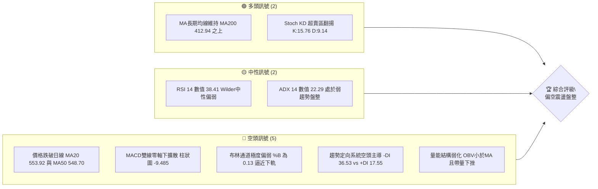
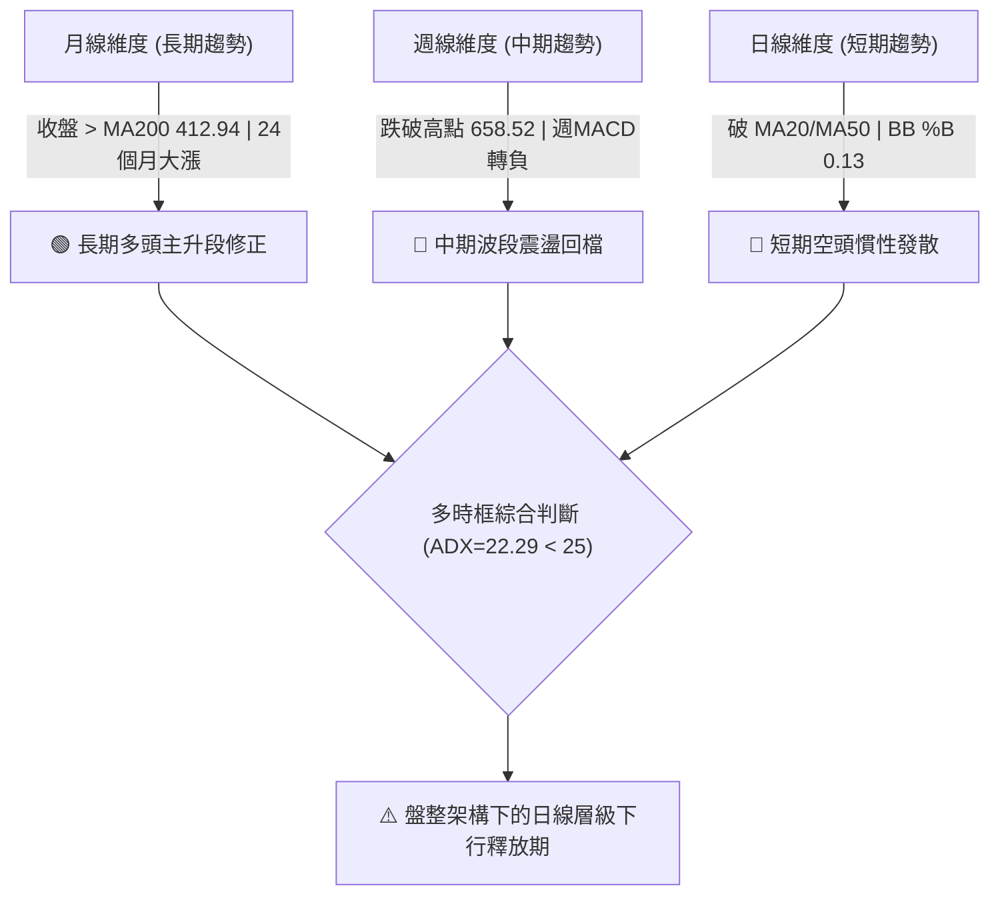
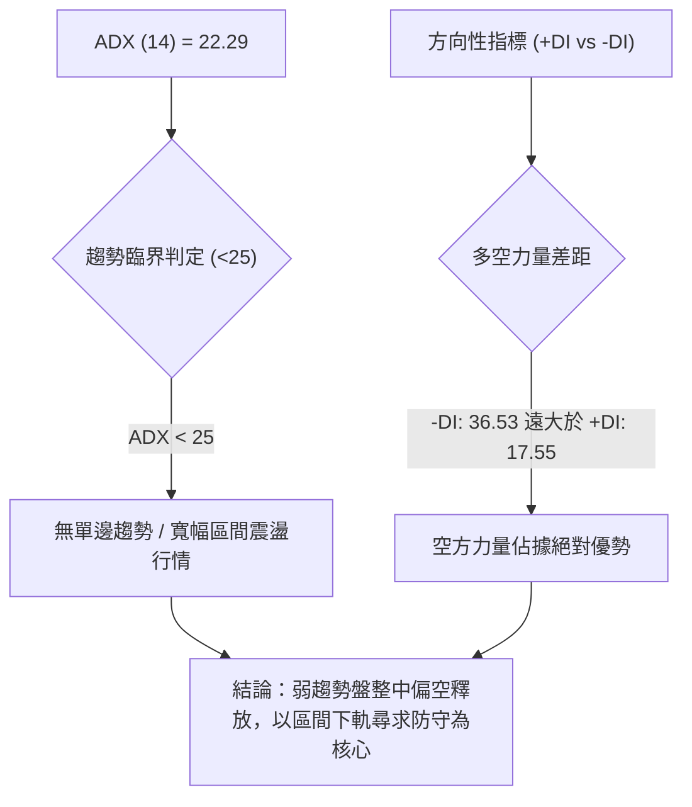
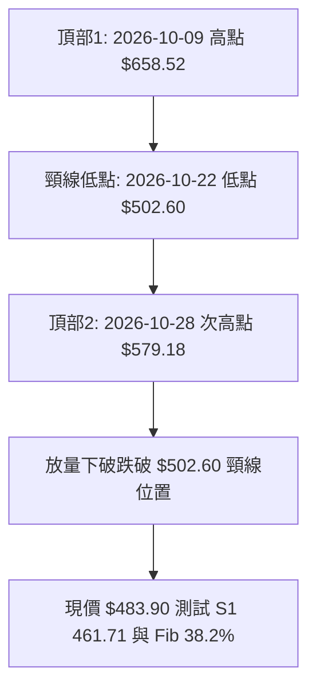
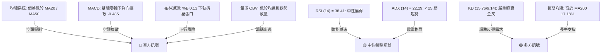
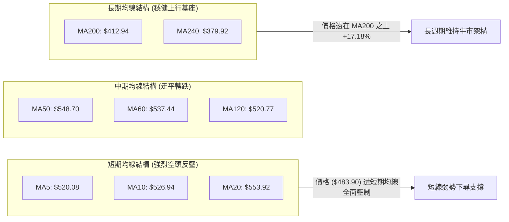
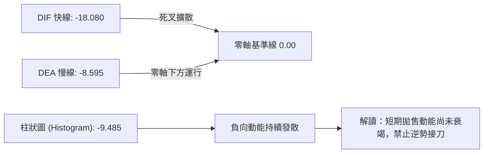
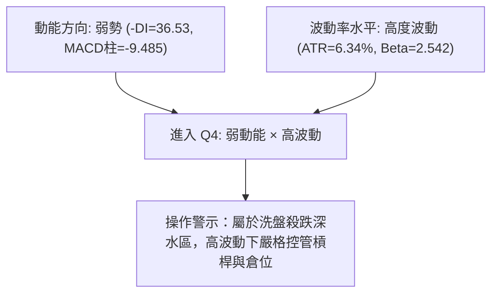
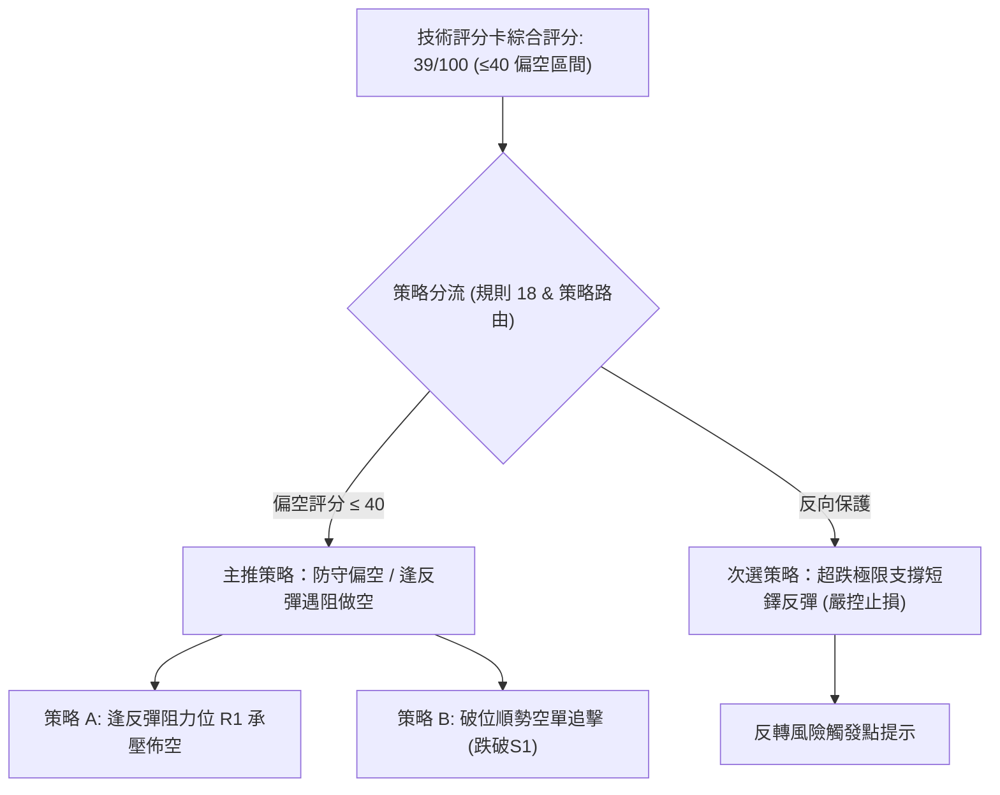
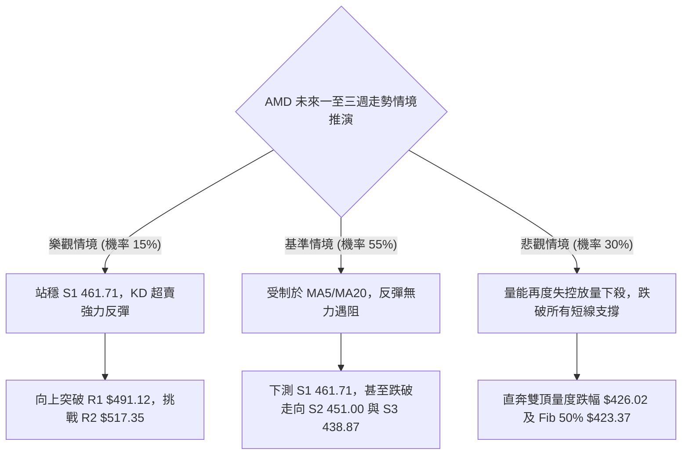

# AMD 技術分析報告

> **報告日期**：2026-11-04 ｜ **語言**：繁體中文 ｜ **數據來源**：Yahoo Finance ｜ **當前價格**：$483.90

---

## 目錄

| 章節 | 內容 |
|------|------|
| [1. 技術面概覽](#1-技術面概覽) | 訊號儀表板、核心指標、評分卡 |
| [2. 趨勢分析](#2-趨勢分析) | 多時框趨勢、長中短期走勢 |
| [3. 圖表形態分析](#3-圖表形態分析) | 形態識別、K線組合、目標價 |
| [4. 支撐與阻力](#4-支撐與阻力) | 關鍵價位、斐波那契回調 |
| [5. 技術指標深度解讀](#5-技術指標深度解讀) | MA/RSI/MACD/布林/成交量 |
| [6. 動能與波動率](#6-動能與波動率) | 動能評估、ATR、Beta |
| [7. 多時框架總結](#7-多時框架總結) | 時框架評分矩陣 |
| [8. 交易策略建議](#8-交易策略建議) | 多空策略、風險報酬比 |
| [9. 風險提示與監控](#9-風險提示與監控) | 監控指標、風險場景 |

---

## 1. 技術面概覽

### 🎯 技術訊號儀表板



### 📊 核心指標速覽表

| 指標類別 | 指標名稱 | 當前數值 | 訊號 | 解讀 |
|----------|----------|----------|------|------|
| **價格** | 當前收盤價 | $483.90 | 🔴 | 較52週高點 $658.52 回檔 -26.52%，位於52W區間 62.9% |
| **均線** | 短期 MA20 | $553.92 | 🔴 | 股價位於 MA20 下方 -12.64%，短線呈空頭發散 |
| **均線** | 中期 MA50 | $548.70 | 🔴 | 股價位於 MA50 下方 -11.81%，中期上升動能遭受破壞 |
| **均線** | 長期 MA200 | $412.94 | 🟢 | 股價高於 MA200 達 +17.18%，長線多頭架構尚未扭曲 |
| **動能** | RSI(14) | 38.41 | 🟡 | 位於中性偏弱區間（30–70），未達極端超賣，下行動能尚未衰竭 |
| **動能** | MACD(12,26,9)| -18.080 | 🔴 | DIF 線與訊號線（-8.595）在零軸下方死叉發散，柱體 -9.485 持續走弱 |
| **動能** | Stoch %K/%D | 15.76 / 9.14 | 🟢 | 雙線低於 20 呈現超賣黃金交叉，短線具技術性抽頭反彈需求 |
| **趨勢強度**| ADX(14) | 22.29 | 🟡 | 數值小於 25，顯示當前為弱趨勢／寬幅震盪行情，空方動能佔優（-DI: 36.53） |
| **通道通道**| 布林通道 %B | 0.13 | 🔴 | 逼近下軌 $460.51，帶狀向下張口，顯示強烈下行壓力 |
| **量能** | 20日成交量比 | 1.56x | 🔴 | 日量 34,179,800 大於20日均量 21,926,615，呈現放量殺跌弱勢格局 |
| **波動** | ATR(14) | $30.67 | 🟡 | 佔現價 6.34%，每日日內波幅巨大，短線交易需嚴設防守點 |

### 🏆 技術評分卡

```
╔════════════════════════════════════════════════════════════════╗
║                   技術評分卡 — AMD (2026-11-04)                ║
╠════════════════════════════════════════════════════════════════╣
║ 趨勢強度      ██████░░░░░░░░░░░░░░  30/100  🔴 弱趨勢且空方主導 ║
║ 動能指標      ███████░░░░░░░░░░░░░  35/100  🔴 MACD弱勢但KD超賣 ║
║ 支撐穩定度    ██████████░░░░░░░░░░  50/100  🟡 Fib 38.2%臨界點   ║
║ 成交量配合    ██████░░░░░░░░░░░░░░  30/100  🔴 OBV向下量價背離  ║
║ 形態完整度    ████████░░░░░░░░░░░░  40/100  🔴 短期偏向破位下行 ║
║ 均線排列      ██████████░░░░░░░░░░  50/100  🟡 長多中空嚴重分歧 ║
╠════════════════════════════════════════════════════════════════╣
║ 綜合評分      ███████░░░░░░░░░░░░░  39/100  🔴 偏空震盪 (規則18)║
╚════════════════════════════════════════════════════════════════╝
```

---

## 2. 趨勢分析

### 🌐 多時框趨勢分析



### 📈 長期趨勢 — 12個月走勢圖（Unicode）

```
AMD 月線走勢圖（過去12個月：2025-12 至 2026-11）
價格軸 ($)
$650 ┤                                  ● 611.76 (09月)
$600 ┤                          ● 580.91 (06月)
$550 ┤                                        
$500 ┤                    ● 516.10             ● 504.80 (10月)
$450 ┤                                  ● 470.72  ▲ 現價 $483.90
$400 ┤                                        
$350 ┤              ● 354.49 (04月)
$300 ┤                                        
$250 ┤                                        
$200 ┤● 214.16  ● 200.21 (02月)
     └─────────────────────────────────────────────────────────────
      12月  01月  02月  03月  04月  05月  06月  07月  08月  09月  10月  11月
     (2025) ----------------------- (2026) ----------------------->
```

#### 走勢特徵分析表格

| 階段區間 | 起訖月份 | 起點價格 | 終點價格 | 區間漲跌幅 | 走勢結構與量價特徵解讀 |
|:---|:---:|:---:|:---:|:---:|:---|
| **第一階段：底部築底** | 2025-12 ~ 2026-03 | $214.16 | $203.43 | -5.01% | 圍繞 $200 平台強烈洗盤蓄勢，在 $188.22 形成年度絕對低點。 |
| **第二階段：主升暴動** | 2026-03 ~ 2026-06 | $203.43 | $580.91 | +185.56% | 爆發性單邊主升浪，突破全部均線，多頭單邊走勢極度凌厲。 |
| **第三階段：高位分歧** | 2026-06 ~ 2026-08 | $580.91 | $470.72 | -18.97% | 第一次深度洗盤，回探 $470.00 平台，多空分歧初現。 |
| **第四階段：衝頂回落** | 2026-08 ~ 2026-09 | $470.72 | $611.76 | +29.96% | 二次衝高創下 52 週最高點 $658.52（月收盤 $611.76），量價背離。 |
| **第五階段：下行釋放** | 2026-09 ~ 2026-11 | $611.76 | $483.90 | -20.90% | 高位見頂後斷頭下殺，跌破短期均線，目前在 $483.90 尋求支撐。 |

### 📊 中期趨勢（週線分析）

從近 8 週的 K 線結構可見，週線自 2026-10-09 當週創下 52 週天價 $658.52 後，連續出現大陰線壓制。週 MACD 柱狀圖由 2026-09-25 的極值 `+14.199` 迅速翻負收窄至最新一週的 `-9.485`，顯示中期動能全面逆轉為空頭佔優。

```
週線級別價格壓力與支撐示意圖：
  $658.52 ──────────────────────────── 52W 高點強阻力
           \
            \  [空頭回檔推動浪]
             \
  $547.53 ────▼─────────────────────── Fib 23.6% / MA50 壓力帶
               \
                \
  $483.90 ───────●──────────────────── 當前收盤價位
  $478.87 ──────────────────────────── Fib 38.2% 黃金回調支撐
  $461.71 ──────────────────────────── 波段低點聚類 S1 / 支撐防線
```

### ⚡ 趨勢強度評估（ADX 解讀）



#### ADX 趨勢強度對照表

| 指標變數 | 當前讀數 | 門檻區間 | 趨勢狀態評判 | 交易指導意義 |
|:---|:---:|:---:|:---:|:---|
| **ADX (14)** | 22.29 | < 25 | 弱趨勢 / 盤整震盪 | 嚴禁盲目追單邊破位，震盪策略勝率優於單邊趨勢跟隨。 |
| **+DI (14)** | 17.55 | < 20 | 多頭動能匱乏 | 多方買盤缺乏主動進攻意願，反彈力道疲弱。 |
| **-DI (14)** | 36.53 | > 30 | 空頭主導強勢 | 空方拋壓持續釋放，短線價格仍有慣性下探風險。 |
| **動能差值** | -18.98 | 負值擴大 | 熊市佔優 | 短線未見反轉信號前，嚴禁重倉抄底。 |

---

## 3. 圖表形態分析

### 🔍 形態識別系統

在日線與週線結構上，價格自 2026-10-09 高點 $658.52 展開下跌，並在 2026-10-28 形成次高點 $579.18 後急挫，整體結構呈現「雙重頂（M頭）回調形態」，目前正測試中繼支撐區域。



#### 形態識別與信心度評估表

| 形態名稱 | 信心度 | 判斷依據（引用數據） | 完成度 | 目標價（附計算式） |
|:---|:---:|:---|:---:|:---|
| **雙重頂 (M-Top)** | 75% | 頂1: $658.52，頂2: $579.18，2026-10-30 放量下破頸線 $502.60 | 90% | 破位已接近量度跌幅：<br/>形態頸線 $502.60 − (頂2 $579.18 − 頸線 $502.60) = **$426.02** |
| **下行通道旗形** | 45% | 高低點逐步下移，但 ADX=22.29 顯示趨勢未成熟 | 40% | 信心度不足 50%，依規則 15 僅作指標型弱勢解讀，不預設延伸目標。 |

### 🕯️ 重要K線形態分析

嚴格依據技術數據區塊中「近10根日K」與「近8根週K」的實際 OHLCV 進行解讀：

| 日期（週期） | 開盤價 | 最高價 | 最低價 | 收盤價 | 成交量 | K線形態名稱 | 實質解讀與市場多空意涵 | 訊號 |
|:---|:---:|:---:|:---:|:---:|:---:|:---|:---|:---:|
| **2026-10-28 (日K)** | 573.08 | 579.18 | 560.52 | 578.44 | 18,848,600 | 衝高小陽線 | 縮量挑戰 $579.18 次高點未果，買盤動能衰竭。 | 🟡 |
| **2026-10-29 (日K)** | 562.27 | 575.10 | 560.57 | 566.42 | 16,873,300 | 孕線高位回吐 | 價格完全包覆於前一日高低點內，動能顯著停滯。 | 🟡 |
| **2026-10-30 (日K)** | 508.53 | 520.40 | 492.21 | 504.80 | 39,697,500 | 跳空大陰線 | 放量（39.69M）跳空摜破 $520 關卡，空方全面爆發。 | 🔴 |
| **2026-11-02 (日K)** | 510.71 | 512.82 | 466.07 | 466.84 | 32,141,000 | 光腳大陰線 | 盤中殺破 $470.00，收於全日極低點 $466.84，拋壓宣洩。 | 🔴 |
| **2026-11-03 (日K)** | 479.99 | 497.40 | 473.54 | 483.90 | 34,179,800 | 下影小陽十字 | 低檔放量換手，下影線長達 $10.36，顯示 S1 前逢低買盤進駐。 | 🟢 |
| **2026-10-09 (週K)** | 630.61 | 658.52 | 606.00 | 608.10 | 93,746,000 | 墓碑上影線 | 創年度高點 $658.52 後長上影線收黑，確立歷史級別頂部。 | 🔴 |
| **2026-10-16 (週K)** | 599.93 | 606.20 | 526.83 | 528.75 | 107,042,200| 放量長陰吞噬 | 跌幅達 -13.05%，直接吃掉前期漲幅，中線轉空標誌。 | 🔴 |
| **2026-10-30 (週K)** | 522.79 | 579.18 | 492.21 | 504.80 | 112,816,100| 倒轉上影槌頭 | 多頭週初試圖反撲至 $579.18 慘遭壓制，留下極長上影線。 | 🔴 |
| **2026-11-03 (週K)** | 510.71 | 512.82 | 466.07 | 483.90 | 66,320,800 | 帶下影錘頭縮量 | 測試 $466.07 低點後浮現買盤，具超跌反彈雛形。 | 🟢 |

### 📉 ASCII 走勢形態示意圖

```
雙重頂破位與近期日K結構示意圖：
      $658.52 (2026-10-09 頂1)
         /\
        /  \            $579.18 (2026-10-28 頂2)
       /    \             /\
      /      \           /  \
     /        \_________/    \
    /       $502.60 (頸線)     \
   /                            \==== 跳空下破缺口 ($520.40 - $560.57)
  /                              \
                                  \   $497.40 (11-03高)
                                   \    |
                                    \  [+] $483.90 (現價收盤)
                                     \  |
                                      └─┴─ $466.07 (11-02最低低點探測)
```

### 🎯 形態目標價計算

根據雙重頂形態原理計算：
- **第一頂部**：$658.52 (2026-10-09)
- **次級頂部**：$579.18 (2026-10-28)
- **破位頸線點**：$502.60 (2026-10-22 低點聚類)
- **形態垂直高度**：$579.18 − $502.60 = **$76.58**
- **量度跌幅理論目標價**：$502.60 − $76.58 = **$426.02**
- **與既有技術支撐點驗證**：理論計算值 $426.02 與 52 週回調 50.0% 關鍵位 **$423.37** 高度共振，同時上方有波段低點支撐聚類 **S3: $438.87** 進行層層攔截。

---

## 4. 支撐與阻力

### 🗺️ 關鍵價位分布圖（Unicode）

```
AMD 價位結構分布圖（基準收盤價：$483.90）
═════════════════════════════════════════════════════════════════
$547.53 ║████████████████████████████████║ 斐波那契 23.6% 回調關鍵強壓
$530.13 ║████████████████████████████    ║ 強阻力 R3 (波段高點聚類)
$517.35 ║████████████████████            ║ 阻力 R2 (反彈第一道壓力)
$491.12 ║████████████                    ║ 關鍵阻力 R1 (短線均線反壓)
$483.90 ╠════════════════════════════════╣ ◄ 當前收盤價 ($483.90)
$478.87 ║▓▓▓▓▓▓▓▓▓▓▓▓▓▓▓▓▓▓▓▓▓▓▓▓▓▓▓▓    ║ 斐波那契 38.2% 回調重要防線
$461.71 ║████████████████████████        ║ 近期支撐 S1 (近期下影低點區)
$451.00 ║████████████████████████████    ║ 強支撐 S2 (波段多頭生命線)
$438.87 ║████████████████████████████████║ 極限支撐 S3 (回檔深水防線)
═════════════════════════════════════════════════════════════════
```

### 🚧 阻力位分析表

阻力位嚴格引用關鍵價位區塊之數值：

| 阻力級別 | 價位 | 距離現價幅度 | 形成原因與籌碼特徵 | 突破難度 | 重要性 |
|:---|:---:|:---:|:---|:---:|:---:|
| **R1** | **$491.12** | +1.49% | 近一年波段高點聚類、11-03反彈高點 $497.40 下方密集套牢區 | 🟡 中等 | ★★★☆☆ |
| **R2** | **$517.35** | +6.91% | 近期破位缺口下沿，2026-10-23 收盤價 $516.79 平台共振點 | 🔴 極高 | ★★★★☆ |
| **R3** | **$530.13** | +9.55% | 10-26 波段反彈高點聚類，接近 MA60 ($537.44) 下壓處 | 🔴 極強 | ★★★★★ |

### 🛡️ 支撐位分析表

支撐位嚴格引用關鍵價位區塊之數值：

| 支撐級別 | 價位 | 距離現價幅度 | 形成原因與籌碼特徵 | 守住機率 | 重要性 |
|:---|:---:|:---:|:---|:---:|:---:|
| **S1** | **$461.71** | -4.59% | 近一年波段低點聚類，與布林下軌 $460.51、11-02低點 $466.07 形成共振護城河 | 🟢 65% | ★★★★☆ |
| **S2** | **$451.00** | -6.80% | 整數關卡緩衝帶、前期大型震盪平台中樞低點聚類 | 🟡 50% | ★★★★☆ |
| **S3** | **$438.87** | -9.31% | 深度回檔極限支撐，鄰近量度跌幅 $426.02 與 Fib 50% ($423.37) | 🟢 80% | ★★★★★ |

### 📐 斐波那契回調位分析

依據 52 週絕對區間（低點 **$188.22** → 高點 **$658.52**，總波幅 $470.30）計算：

| 斐波那契回調級別 | 精確價位 | 相對現價位置 | 技術分析與結構意涵解讀 |
|:---|:---:|:---:|:---|
| **0.0% (52W High)** | $658.52 | +36.09% | 2026-10-09 構築的歷史天花板，牛市極致泡沫回調起點。 |
| **23.6%** | $547.53 | +13.15% | 強勢回檔分水嶺，當前與 MA50 ($548.70) 形成雙重鋼鐵重壓。 |
| **38.2%** | **$478.87** | **-1.04%** | **牛市正常回檔臨界位！現價 $483.90 正運行於 38.2% 臨界線之上。** |
| **50.0%** | $423.37 | -12.51% | 多空平衡中樞軸，與量度跌幅 $426.02、MA200 ($412.94) 呼應。 |
| **61.8%** | $367.87 | -23.98% | 黃金分割防守底線，跌破則長期牛市架構宣告終結。 |
| **78.6%** | $288.86 | -40.31% | 深度熊市流動性枯竭位。 |
| **100.0% (52W Low)**| $188.22 | -61.10% | 52 週循環起漲基石底點。 |

> **回調位總評**：當前收盤價 **$483.90** 穩固黏合在 **Fib 38.2% ($478.87)** 關鍵支撐上方僅 +1.04%，同時下方緊鄰 **S1: $461.71**。此區域為多頭捍衛中期趨勢的生死防線；若有效跌破 $478.87，價格將朝 50.0% 回調位 **$423.37** 與量度跌幅目標 **$426.02** 尋求支撐。

---

## 5. 技術指標深度解讀

### 🎛️ 指標訊號總覽



### 📈 移動平均線排列分析



#### 均線數據偏離度評估

| 均線名稱 | 數值 | 距現價差距 ($) | 偏離百分比 (%) | 均線斜率形態特徵 | 訊號評估 |
|:---|:---:|:---:|:---:|:---|:---:|
| **MA5** | $520.08 | -$36.18 | -6.96% | 陡峭向下俯衝，形成短線第一道動態死叉線 | 🔴 |
| **MA10** | $526.94 | -$43.04 | -8.17% | 空頭加速下穿，反映近兩週籌碼嚴重套牢 | 🔴 |
| **MA20** | $553.92 | -$70.02 | -12.64% | 迅速反轉下彎，布林中軌全面失守 | 🔴 |
| **MA50** | $548.70 | -$64.80 | -11.81% | 走平轉下，跌破中期生命線 | 🔴 |
| **MA60** | $537.44 | -$53.54 | -9.96% | 季線下彎，中線多方退守 | 🔴 |
| **MA120** | $520.77 | -$36.87 | -7.08% | 半年線支撐遭擊穿，均線糾結被向下打破 | 🔴 |
| **MA200** | $412.94 | +$70.96 | +17.18% | 穩定向上傾斜，長期牛熊分界線提供強力心理緩衝 | 🟢 |
| **MA240** | $379.92 | +$103.98| +27.37% | 年線上行強勁，長線基本面籌碼堅挺 | 🟢 |

### 📉 RSI(14) 分析

- **RSI(14) 讀數**：`38.41`（Wilder 計算方法）
- **動能評估進度條**：
  ```
  弱勢超賣 0 ├──────────[38.41]──────┼──────────┤ 100 強勢超買
             ███████████████░░░░░░░░░░░░░░░░░░░░░░  (38.41%)
  ```
- **超買超賣區間判斷**：38.41 落在中性弱勢區間（30–50）。指標並未跌破 30 進入極度恐慌超賣區，反映市場拋壓雖然沉重，但尚未出現空頭動能枯竭的無序下殺。
- **背離判定**：檢視近 20 根日 K 棒首尾之價格與 RSI 走勢，價格自高位回落，RSI 亦同步走低，**無明顯頂背離或底背離**。指標與價格運行保持一致性，代表下行趨勢屬於實質拋售，而非技術性假摔。

### 📊 MACD(12/26/9) 訊號解讀



- **MACD DIF 快線**：`-18.080`
- **MACD Signal 慢線**：`-8.595`
- **MACD Histogram 柱狀圖**：`-9.485`
- **信號結論**：快線在零軸下方以較大角度下穿慢線，且柱狀圖處於 `-9.485` 的深水空頭區。這表明空方依然控制著短線交易節奏，任何日內反彈若無法促使 MACD 柱狀體快速收斂，均屬弱勢誘多。

### 📦 布林通道分析

```
布林通道結構與價格位置圖：
  $647.33 ────────────────────────────── 布林上軌 (Upper Band)
           │
           │  帶寬帶動張口走闊
           │
  $553.92 ────────────────────────────── 布林中軌 (MA20 Baseline)
           │
  $483.90 ─┼─── 現價 ($483.90, %B = 0.13)
           │
  $460.51 ────────────────────────────── 布林下軌 (Lower Band)
```

- **上軌**：$647.33
- **中軌 (MA20)**：$553.92
- **下軌**：$460.51
- **通道位置 (%B)**：`0.13`
- **通道走勢研判**：%B 為 0.13 代表價格已極度貼近下軌（0.0 代表觸及下軌，0.5 代表中軌）。在日線跳空下殺後，布林下軌正在被動向下撐開，通常預示著行情進入極端下行段。但伴隨隨機指標超賣，價格在接近下軌 $460.51 及 S1 $461.71 處隨時可能引發技術性抽頭收斂。

### 💹 成交量分析（量價配合度）

- **最新日成交量**：34,179,800
- **20日均量**：21,926,615（**量比：1.56x**，顯著放量）
- **50日均量**：21,024,398
- **OBV 能量潮趨勢**：`OBV < MA`，呈現能量潮下破均線的疲弱空頭結構。
- **量價行為解讀**：在 2026-10-30 價格重挫時，日量爆出 39.69M；11-02 殺跌收 $466.84 續放 32.14M；11-03 雖拉出下影小陽線，量能仍達 34.18M。量能連續三個交易日大於 20 日均量 1.5 倍以上，顯示機構資金在此區間出現激烈的換手與減倉行為，OBV 疲軟佐證籌碼面空方勝出。

---

## 6. 動能與波動率

### ⚡ 動能評估四象限

| 象限 | 動能維度 | 波動維度 | 典型市場特徵 | AMD 當前狀態評定 |
|:---:|:---:|:---:|:---|:---:|
| **Q1** | 強動能 (Bullish) | 低波動 (Low Vol) | 穩定單邊牛市推升 | ─ |
| **Q2** | 弱動能 (Bearish) | 低波動 (Low Vol) | 陰跌盤整蓄勢 | ─ |
| **Q3** | 強動能 (Extreme) | 高波動 (High Vol) | 牛市瘋狂加速噴出 | ─ |
| **Q4** | **弱動能 (Bearish)** | **高波動 (High Vol)** | **恐慌殺跌、多空劇烈分歧、破位宣洩** | **✓ 符合當前格局 (Q4象限)** |



### 📊 ATR 波動率分析

- **ATR(14) 讀數**：`$30.67`
- **佔現價比例**：`6.34%`（屬於極高波動度標的）
- **日內波動意涵**：AMD 目前每日平均潛在波幅高達 $30.67，意味著任何短線突破或回調極易出現假破位。
- **止損距離建議**：
  - *日間超短線策略*：建議使用 1.0 × ATR = **$30.67** 防守緩衝。
  - *波段波段交易策略*：建議使用 1.5 × ATR = **$46.00** 或 2.0 × ATR = **$61.34** 的防守緩衝，以防被正常市場雜訊洗盤出場。

### 📐 Beta 與市場相關性

- **Beta 係數**：`2.542`
- **市場特徵分析**：AMD 的 Beta 值高達 2.542，代表其波動敏感度是大盤（S&P 500 指數）的 2.5 倍以上。在大盤回調期間，AMD 呈現放大式下殺；相應地，一旦大盤技術性止跌，其彈性亦居全市場前列。
- **機構籌碼背景**：機構持股比例達 75.3%，空頭部位比例僅 2.3%（Short Ratio 1.74）。此結構表明當前的拋售主要來自機構獲利盤的集體再平衡，而非市場惡意放空。

---

## 7. 多時框架總結

### 📋 時框架評分表

| 時框架 | 趨勢方向 | 動能指標狀態 | 均線排列特徵 | 形態識別結論 | 綜合評分 | 交易建議導向 |
|:---|:---:|:---|:---|:---|:---:|:---|
| **長期 (月線)** | 🟢 偏多 | RSI=55，均線維持多頭擴散 | 價格遠在 MA200 之上 | 24個月大級別主升後的良性獲利回吐 | 70/100 | 核心底倉不動，長線買點等待深幅回調。 |
| **中期 (週線)** | 🔴 偏空 | 週MACD柱轉負 (-9.485)，RSI=38.4 | 跌破5週與10週線，逼近中軌 | 52週頂部墓碑線引發的波段下行調整浪 | 35/100 | 波段多單離場觀望，嚴禁盲目加碼。 |
| **短期 (日線)** | 🔴 偏空 | KD低檔金叉，MACD綠柱擴散 | 均線空頭排列，遭 MA20 壓制 | 跌破頸線 $502.60 的雙頂下測型態 | 30/100 | 以反彈受阻高空或嚴格跌破下軌止損為主。 |

### 🔲 綜合訊號矩陣

```
時框衝突與共振診斷：
┌─────────────────┬─────────────────┬─────────────────┐
│ 短期 (日線級別) │ 中期 (週線級別) │ 長期 (月線級別) │
├─────────────────┼─────────────────┼─────────────────┤
│    🔴 空頭      │    🔴 空頭      │    🟢 多頭      │
│  (均線壓制下行) │  (動能全面收斂) │  (均線底座支撐) │
└─────────────────┴─────────────────┴─────────────────┘
  診斷結果：短中期形成「空頭共振」，長期多頭結構正遭受嚴峻測試。
```

### ⚖️ 多時框收斂結論

依據多時框收斂規則（嚴格要求 14）：
1. **行情性質判定**：當前日線 **ADX(14) 讀數為 22.29**（< 25 臨界線），定義為**弱趨勢／寬幅震盪盤整行情**。
2. **主導維度與衝突取捨**：雖然長期月線維持多頭，但在 ADX < 25 的盤整結構中，日線級別布林通道與短期均線直接主導交易區間。中期週線指標（週 MACD 轉負 -9.485、連續陰線）與短期日線（價格位於 MA20、MA50 下方，-DI 達 36.53）均呈現空頭一致性共振。
3. **唯一方向性結論**：**偏空震盪觀望（偏空主導）**。短期任何向上的反彈均受制於密集均線反壓，市場正處於下探布林下軌 $460.51 及波段支撐 S1 $461.71、Fib 38.2% $478.87 的尋底過程中。

---

## 8. 交易策略建議

### 🗺️ 策略決策流程圖



### 🧭 策略路由（依評分卡分流）

> **當前主策略方向 = 偏空高空防守（依技術綜合評分 39/100，落入 ≤40 偏空範疇）**
> 
> 根據報告評分系統規則，綜合評分為 39 分，市場由空方掌控。策略主推逢反彈阻力位高空與破位做空策略，多頭僅列為反彈超跌短線試倉與對沖風控提示，不進行兩頭強推。

### 🎯 價格情境階梯（Price Scenarios）

價位嚴格引用關鍵價位區塊與斐波那契回調數據：

| 觸發條件 | 下一目標 | 後續延伸 | 情境含義與對應策略行動 |
|:---|:---:|:---:|:---|
| **強勢升破 R1 $491.12** | R2 $517.35 | R3 $530.13 | 短線超賣暴力修復，空單應離場，多方測試 MA20 壓力區。 |
| **承壓於現價與 R1 間** | S1 $461.71 | Fib 38.2% ($478.87) | 弱勢震盪整理，逢反彈至阻力處建立空頭頭寸。 |
| **跌破 S1 $461.71 防線** | S2 $451.00 | S3 $438.87 | 空頭新一波破位跌勢開啟，直接滑向量度跌幅 $426.02。 |

### 📊 情境機率分佈

| 預期情境 | 機率 | 主要技術依據（引用數據指標） |
|:---|:---:|:---|
| **情境一：弱勢震盪後破位下測** | **55%** | MACD 零軸下深水走弱（-18.080）、-DI=36.53 空方主導、OBV 趨勢低於均線放量走跌。 |
| **情境二：依託 S1 展開技術性盤整** | **30%** | ADX=22.29 顯示單邊趨勢不連續、Stoch KD 出現超賣（15.76/9.14）黃金交叉修復。 |
| **情境三：直接 V 型反轉向上突破** | **15%** | 均線 MA20 ($553.92) 與 MA50 ($548.70) 形成密集死叉蓋頂，上方量能套牢盤過重。 |

### 🟢 主策略詳情（方向依上方路由：偏空主導）

所有價位均取自技術數據「關鍵價位」與「斐波那契」精確數值；風險報酬比嚴格按規則 17 計算：
- *空頭風報比公式*：`(進場價 − 目標價) ÷ (止損價 − 進場價)`
- *進場若為區間，以區間中點計算*

| 策略要素 | 策略 A（反彈遇阻做空 — 主推） | 策略 B（跌破 S1 順勢跟進做空） |
|:---|:---:|:---:|
| **操作邏輯** | 測試 R1 與整數關卡受阻確認後進場 | 放量有效跌破 S1 支撐後空頭動能釋放 |
| **進場價格** | **$491.12**（精確取自 R1 阻力位） | **$461.71**（精確取自 S1 破位點） |
| **目標價 T1** | **$461.71**（精確取自 S1 支撐位） | **$438.87**（精確取自 S3 支撐位） |
| **目標價 T2** | **$438.87**（精確取自 S3 支撐位） | **$423.37**（精確取自 Fib 50.0% 回調位） |
| **止損價格** | **$504.80**（取自 2026-10-30 日K收盤壓力） | **$473.54**（取自 2026-11-03 日K最低點回抽位） |
| **風險報酬比** | **1 : 2.15**（以 T1 計）<br>*(491.12 - 461.71) ÷ (504.80 - 491.12) = 29.41 ÷ 13.68*<br>*(以 T2 計：1 : 3.82)* | **1 : 1.93**（以 T1 計）<br>*(461.71 - 438.87) ÷ (473.54 - 461.71) = 22.84 ÷ 11.83*<br>*(以 T2 計：1 : 3.24)* |
| **成功機率** | 65% | 55% |
| **建議倉位** | 15% 總資金規模 | 10% 總資金規模 |

### 🔴 反向風險觸發點（對沖提示）

若市場出現以下走勢，代表空頭結構失效，多頭將奪回主控權，所有空單必須無條件止損或反向對沖：
1. **價位突破信號**：日線收盤價強勢升破 **R2: $517.35**，宣告下行缺口與 10-30 長陰線被全面修復。
2. **指標轉折信號**：日線 MACD 柱狀圖（當前 -9.485）連續 3 天顯著翻紅縮腳，且 DIF 線突破慢線。
3. **動能結構變化**：+DI 線向上穿過 -DI 線，且 ADX 超過 25 形成多頭強趨勢。
- *短線多單試倉專用（極限左側博弈）*：若股價在 **S1: $461.71** 企穩不破，且 KD 金叉有效，可配置 ≤5% 極輕倉位博弈反彈，止損設置於 $451.00 (S2)，第一目標看 R1 ($491.12)。

### ⭐ 整體訊號強度評星

```
╔════════════════════════════════════════════════╗
║ 做多訊號強度：★★☆☆☆  (2/5星 — 僅超賣修復動能) ║
║ 做空訊號強度：★★★★☆  (4/5星 — 均線與量能主導) ║
║ 整體可信度：  ★★★★☆  (4/5星 — 多時框指標共振) ║
╚════════════════════════════════════════════════╝
```

---

## 9. 風險提示與監控

### ✅ 關鍵監控指標 Checklist

```
╔══════════════════════════════════════════════════════════════════╗
║                   每日交易盤後技術監控清單 (Checklist)             ║
╠══════════════════════════════════════════════════════════════════╣
║ [ ] 價格防線：日線收盤是否跌破 Fib 38.2% ($478.87) 或 S1 ($461.71)║
║ [ ] 動能變換：MACD 柱狀圖是否跌破 -10.00 擴大，抑或開始向零軸收斂║
║ [ ] 均線動態：價格與 MA5 ($520.08) 的乖離是否得到修復            ║
║ [ ] 量能異動：日成交量是否回落至 21.92M 均量以下（確認洗盤結束）  ║
║ [ ] 通道極限：布林帶 %B 是否脫離超賣低位（0.13 向上回升至 0.30）   ║
║ [ ] 市場情緒：Beta 2.542 環境下半導體板塊與納指整體走勢關聯度   ║
╚══════════════════════════════════════════════════════════════════╝
```

### ⚠️ 風險場景分析



### 🛡️ 風險管理重要提醒

1. **極高波動性風險管理**：
   AMD 的 ATR 為 **$30.67 (6.34%)**，單日上下波動 6% 屬於常態。投資者絕對禁止在未設置硬性條件止損單的情況下隔夜持倉。
2. **槓桿與倉位嚴格控制**：
   鑑於 Beta 高達 **2.542**，在技術評分僅 39 分的偏空震盪環境下，股票總倉位建議壓低至 **20%~25%** 以內，嚴禁使用融資槓桿交易。
3. **事件驅動防範**：
   當前處於美國大選後政策發酵與財報後續討論期，消息面新聞頻繁。任何未預期的產業鏈波動都會引發流動性抽離，關鍵價位突破需以「收盤價」確認，嚴防日內影線假突破誘多誘空。

---

## 📋 報告總結

```
╔════════════════════════════════════════════════════════════════╗
║                   AMD 技術分析報告總結                          ║
╠════════════════════════════════════════════════════════════════╣
║ 報告日期：2026-11-04                                           ║
║ 當前價格：$483.90                                              ║
║ 分析評級：⚖️ 偏空震盪盤整（技術評分：39/100，規則 18）        ║
║                                                                ║
║ 關鍵結論：                                                     ║
║ ├─ 長期趨勢：🟢 偏多主升（價格穩居 MA200 $412.94 之上 +17.18%）║
║ ├─ 中期趨勢：🔴 雙頂壓制（週MACD負向擴散，高位墓碑線確認下行）║
║ ├─ 短期趨勢：🔴 空頭主導（均線全線下壓，布林通道 %B 為 0.13） ║
║ ├─ 關鍵支撐：S1: $461.71 ｜ S2: $451.00 ｜ Fib 38.2%: $478.87 ║
║ ├─ 關鍵阻力：R1: $491.12 ｜ R2: $517.35 ｜ MA20: $553.92      ║
║ └─ 分析師目標：均價 $649.38（最高 $1250.00 / 最低 $430.00）    ║
║                                                                ║
║ 最優策略組合：                                                 ║
║ 1. 🥇 最佳機會：逢反彈至 R1 $491.12 受阻佈空，下看 S1 $461.71  ║
║                 (止損 $504.80，風報比 1:2.15)                  ║
║ 2. 🥈 次選機會：破位順勢空單，跌破 S1 $461.71 追空至 S3 $438.87║
║                 (止損 $473.54，風報比 1:1.93)                  ║
║ 3. 🥉 保守選擇：空倉觀望，耐心等待價格下探至 Fib 50% $423.37  ║
║                 或放量站穩 MA20 $553.92 後再行進場             ║
╚════════════════════════════════════════════════════════════════╝
```

---

> ⚠️ **免責聲明**：本報告為技術分析模型根據歷史量價數據自動生成，所有數據（OHLCV、指標數值、均線與回調位）均嚴格基於所提供之即時資料庫計算。本報告**僅供研究與學術參考**，**不構成任何形式的要約、招攬或具體投資建議**。金融市場具有高度風險，資產價格可升可跌，投資者應根據個人財務狀況獨立判斷並承擔全部交易盈虧。

---

*報告生成時間：2026-11-04 ｜ 數據來源：Yahoo Finance ｜ 分析框架：多時框技術分析模型*