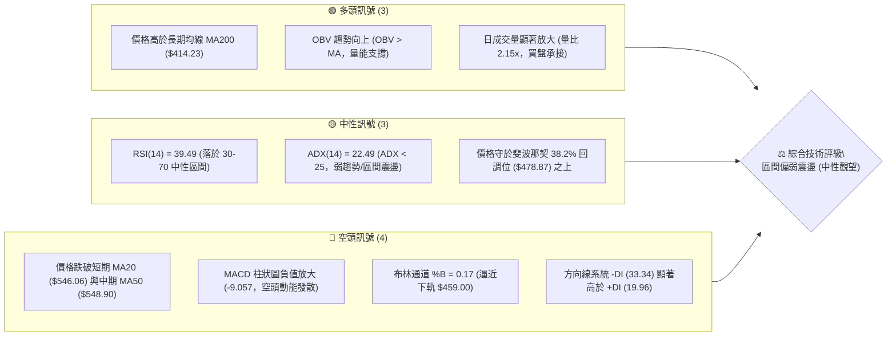
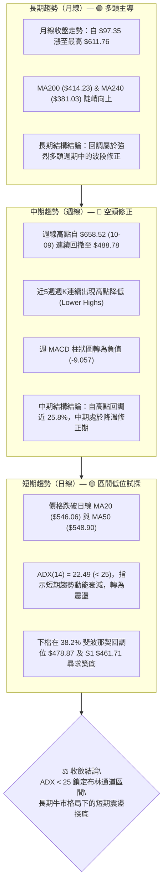
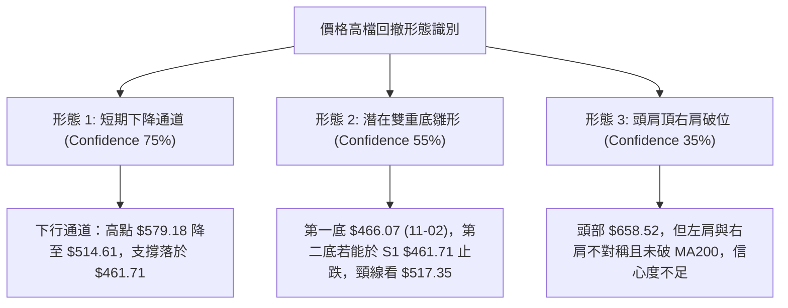
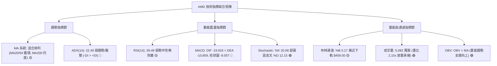
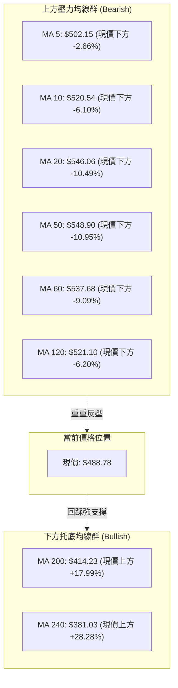
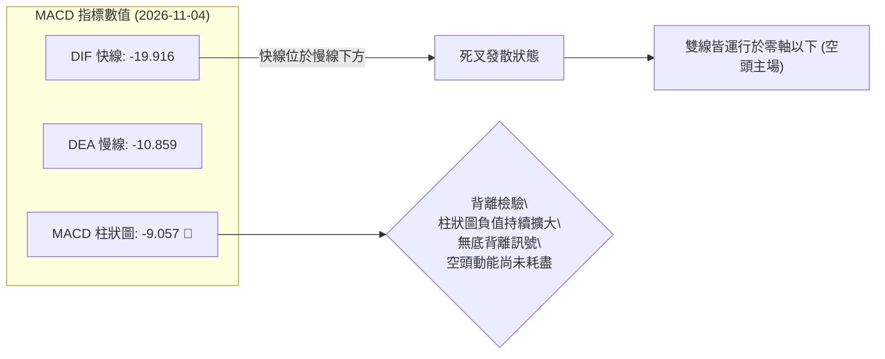
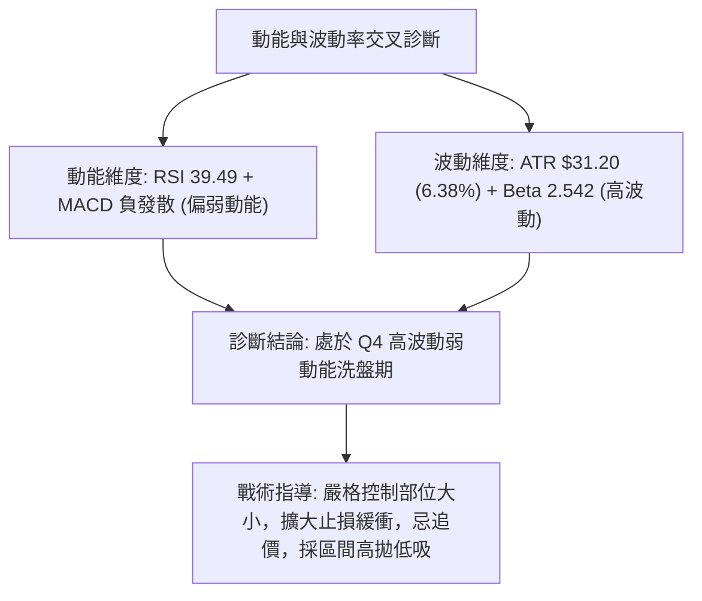
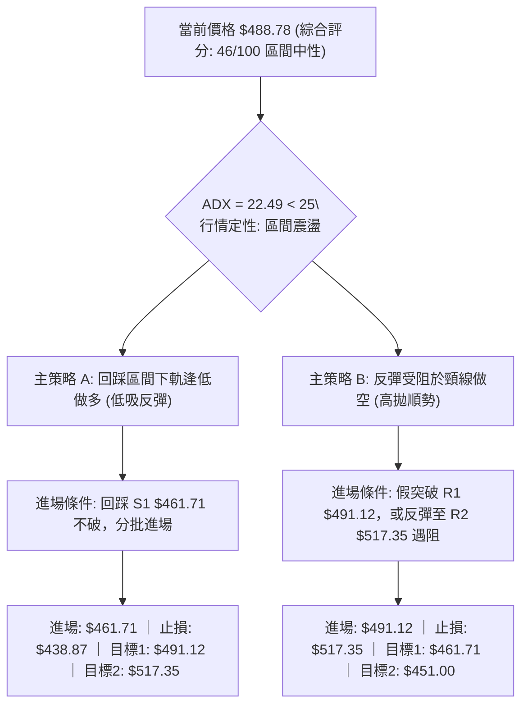
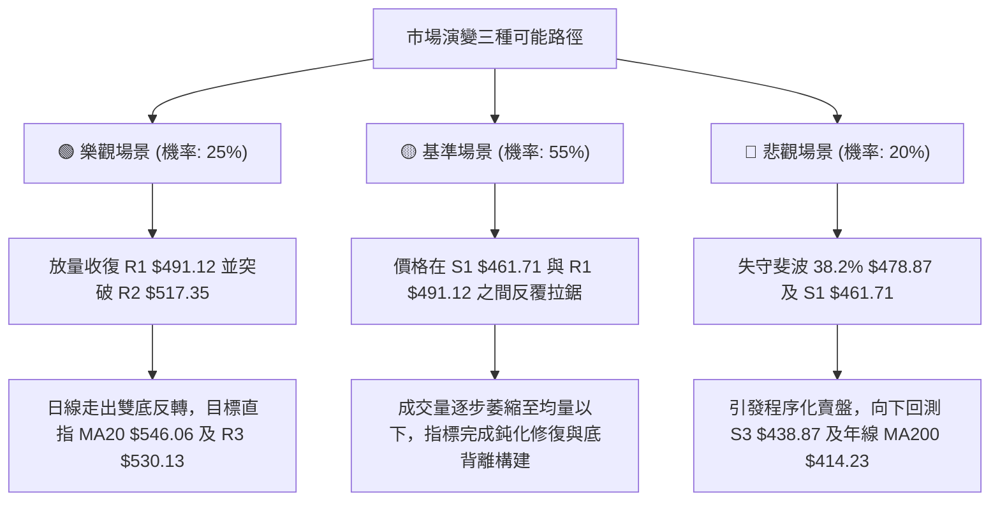

# AMD 技術分析報告

> **報告日期**：2026-11-05 ｜ **語言**：繁體中文 ｜ **數據來源**：Yahoo Finance ｜ **當前價格**：$488.78

---

## 目錄

| 章節 | 內容 |
|------|------|
| [1. 技術面概覽](#1-技術面概覽) | 訊號儀表板、核心指標、評分卡 |
| [2. 趨勢分析](#2-趨勢分析) | 多時框趨勢、長中短期走勢、ADX解讀 |
| [3. 圖表形態分析](#3-圖表形態分析) | 形態識別、K線組合、目標價推算 |
| [4. 支撐與阻力](#4-支撐與阻力) | 關鍵價位、斐波那契回調結構 |
| [5. 技術指標深度解讀](#5-技術指標深度解讀) | 均線系統、RSI、MACD、布林通道、量價 |
| [6. 動能與波動率](#6-動能與波動率) | 動能四象限、ATR波幅、Beta相關性 |
| [7. 多時框架總結](#7-多時框架總結) | 時框矩陣、多時框收斂結論 |
| [8. 交易策略建議](#8-交易策略建議) | 策略路由、區間操作、風險報酬比 |
| [9. 風險提示與監控](#9-風險提示與監控) | 監控清單、情境模擬、倉位風控 |
| [📋 報告總結](#-報告總結) | 核心總結與分析師矩陣 |

---

## 1. 技術面概覽

### 🎯 技術訊號儀表板



---

### 📊 核心指標速覽表

| 指標類別 | 指標名稱 | 當前數值 | 訊號 | 專業技術解讀 |
|:---|:---|:---:|:---:|:---|
| **價格** | 當前收盤價 | $488.78 | 🟡 | 位於52週區間 63.9%，自歷史高位回撤，於斐波那契38.2%附近爭奪 |
| **均線** | MA20 (月線) | $546.06 | 🔴 | 現價低於MA20達-10.49%，短期下行趨勢顯著，構成上方動態阻力 |
| **均線** | MA50 (季線) | $548.90 | 🔴 | 現價位於MA50下方，且MA20與MA50呈現死叉下彎跡象 |
| **均線** | MA200 (年線) | $414.23 | 🟢 | 現價高於MA200達+17.99%，長期多頭底線與結構未遭到根本破壞 |
| **動能** | RSI(14) | 39.49 | 🟡 | 未進入超賣區(<30)，但處於偏弱勢的40關口下方，空頭暫居優勢 |
| **動能** | MACD (12,26,9) | -19.916 / -10.859 | 🔴 | DIF雙線皆位於零軸之下，柱狀圖-9.057擴大，空頭動能處於釋放階段 |
| **動能** | KD (Stochastic) | %K 20.08 / %D 12.15 | 🟡 | %K自超賣區勾頭向上交叉%D，存在短線超跌反彈技術性修復需求 |
| **波動** | ATR(14) | $31.20 (6.38%) | 🔴 | 每日平均波幅擴大，波動率維持高檔，短線操作須拉寬防守距離 |
| **通道** | Bollinger Bands | 上 $633.13 / 下 $459.00 | 🟡 | %B為0.17，價格運行於下軌附近，提供下檔支撐彈性 |
| **量能** | 20日成交量比 | 2.15x (50,826,900) | 🟢 | 2026-11-04單日放量下影線，顯示下檔逢低資金進場承接 |

---

### 🏆 技術評分卡

依照六大技術維度進行量化權重評估，綜合評分採算術平均精確計算（規則 18）：

```
╔══════════════════════════════════════════════════════════════╗
║                 技術評分卡 — AMD (2026-11-05)                ║
╠══════════════════════════════════════════════════════════════╣
║ 趨勢強度 (Trend)      ███████░░░░░░░░░░░░░  35/100  🔴 空頭佔優  ║
║ 動能指標 (Momentum)   ██████░░░░░░░░░░░░░░  30/100  🔴 動能偏弱  ║
║ 支撐穩定度 (Support)  ████████████░░░░░░░░  60/100  🟡 關鍵支撐  ║
║ 成交量配合 (Volume)   █████████████░░░░░░░  65/100  🟢 量能承接  ║
║ 形態完整度 (Pattern)  ████████░░░░░░░░░░░░  40/100  🟡 箱體整理  ║
║ 均線排列 (Moving Avg) █████████░░░░░░░░░░░  46/100  🟡 長多短空  ║
╠══════════════════════════════════════════════════════════════╣
║ 綜合評分 (Overall)    █████████░░░░░░░░░░░  46/100  ⚖️ 區間中性  ║
║                                                              ║
║ 計算式：(35 + 30 + 60 + 65 + 40 + 46) ÷ 6 = 46.0 / 100        ║
║ 評級結論：區間震盪偏弱整理，觸及關鍵下軌支撐，建議區間操作     ║
╚══════════════════════════════════════════════════════════════╝
```

---

## 2. 趨勢分析

### 🌐 多時框趨勢分析



---

### 📈 長期趨勢 — 12個月走勢圖（ASCII）

以下展示 AMD 過去 12 個月（2025-12 至 2026-11）的月線價格軌跡，完整呈現波瀾壯闊的 AI 爆發主升浪以及近期的高檔回撤：

```
AMD 月線收盤走勢圖（2025-12 至 2026-11）
價格 ($)
$650 ┤                                                 
$600 ┤                                       ●(06月:580.91)      ●(09月:611.76)
$550 ┤                                                                         
$500 ┤                                 ●(05月:516.10)     ●(07月:476.15)       ●(10月:504.80)
$450 ┤                                                     ●(08月:470.72)       ●(現價:488.78)
$400 ┤                                                                         
$350 ┤                           ●(04月:354.49)                                
$300 ┤                                                                         
$250 ┤                     ●(01月:236.73)                                      
$200 ┤ ●(12月:214.16)           ●(02月:200.21) ●(03月:203.43)                 
$150 ┤                                                                         
     └─┬─────────┬─────────┬─────────┬─────────┬─────────┬─────────┬─────────┬───────
     2025-12   2026-01   2026-02   2026-03   2026-04   2026-05   2026-06  2026-07..09..11
```

#### 走勢特徵分析表格

| 階段週期 | 月份跨度 | 價格起點 / 終點 | 區間漲跌幅 | 核心形態與技術特徵 |
|:---|:---:|:---:|:---:|:---|
| **築底蓄勢期** | 2025-12 ~ 2026-03 | $214.16 → $203.43 | -5.01% | 於 $200.00 心理關口震盪築底，波動收斂，籌碼充分換手 |
| **暴力主升浪** | 2026-03 ~ 2026-06 | $203.43 → $580.91 | **+185.56%** | 帶量突破所有中長期均線，均線呈多頭排列，放量急升 |
| **高檔箱體震盪** | 2026-06 ~ 2026-08 | $580.91 → $470.72 | -18.97% | 主升浪後首波劇烈獲利了結，回踩 $470.00 區域形成第一道強支撐 |
| **二次創高衝刺** | 2026-08 ~ 2026-09 | $470.72 → $611.76 | +29.96% | 展開第二波進攻，創下 $658.52 歷史天價，但指標開始呈現動能不足 |
| **高檔回撤調整** | 2026-09 ~ 2026-11 | $611.76 → $488.78 | -20.10% | 跌破短均線，連續跌破 $550、$500 整數關口，進入日線等級空頭修正 |

---

### 📊 中期趨勢（週線分析）

中期技術架構以 2026 年 10 月 9 日所創下的歷史高點 $658.52 為頂部基準。隨後 4 週收盤價分別為 $528.75、$516.79、$504.80 與本週的 $488.78，展現清晰的高點下移（Lower Highs）與低點下移（Lower Lows）態勢。

```
週線級別價格壓力與支撐階梯示意圖
價格 ($)
$658.52 ─── 52W 歷史最高點 (強烈賣壓頂部阻力)
            │
$547.53 ─── 斐波那契 23.6% 回調位 / 週線下行第一反彈阻力
            │
$517.35 ─── 近期波段阻力 R2 (反彈關鍵頸線)
            │
$491.12 ─── 近期波段阻力 R1 (日線轉強分水嶺)
  ▲
[$488.78] ─ 當前現價 (爭奪位置)
  ▼
$478.87 ─── 斐波那契 38.2% 關鍵黃金分割支撐
            │
$461.71 ─── 波段低點強支撐 S1 (前期雙底防線)
            │
$451.00 ─── 波段強支撐 S2 (逼近布林通道下軌 $459.00)
```

週線指標顯示，週 RSI 由超買區（73.0）快速降溫至當前的 39.5，週 MACD 柱狀圖亦由正值高峰 +14.199 驟降至 -9.057。此種動能急縮顯示中期漲勢已暫時告一段落，目前市場正針對今年 3 月至 9 月的龐大漲幅進行健康度回調。

---

### ⚡ 趨勢強度評估（ADX 解讀）


#### ADX 趨勢強度量化對照表

| 指標項目 | 當前數值 | 參考臨界值 | 狀態評估 | 對交易策略之具體指導意義 |
|:---|:---:|:---:|:---:|:---|
| **ADX(14)** | **22.49** | 25.00 | 弱趨勢 / 盤整 | 趨勢強度未達單邊加速門檻，禁止追高殺跌，趨勢跟隨策略易反覆停損 |
| **+DI** | **19.96** | 25.00 | 多頭衰退 | 買盤推升力道疲乏，突破單邊阻力之動能相對有限 |
| **-DI** | **33.34** | 25.00 | 空頭主導 | 賣方掌控日內與短波段節奏，價格回彈容易遭受解套盤壓制 |
| **綜合判定** | **-DI 壓制** | ADX < 25 | **弱勢區間震盪** | 依據收斂規則 14，以日線布林通道 ($459.00 ~ $633.13) 為核心交易區間 |

---

## 3. 圖表形態分析

### 🔍 形態識別系統

在日線與週線結構中，價格自 $658.52 見頂回落，於 $460.00 ~ $580.00 區間構建高檔震盪箱體。依據嚴格形態識別規則，本報告對當前潛在形態進行量化信心度評估：



#### 圖表形態信心度量化分析表（規則 15）

| 識別形態 | 信心度 | 判斷依據（引用精確數據） | 完成度 | 形態量度目標價（附精確計算式） |
|:---|:---:|:---|:---:|:---|
| **短期下降通道** | **75%** | 10-28 高點 $579.18 轉折向下，11-02 探底 $466.07，11-04 反彈高點受制於 $514.61，軌跡符合通道特徵 | 85% | 跌破通道下軌量度：$466.07 − ($514.61 − $466.07) = **$417.53**（接近 MA200 $414.23） |
| **潛在雙底雛形** | **55%** | 11-02 出現長下影低點 $466.07，接近波段支撐 S1 $461.71；11-04 再次下探 $476.50 獲買盤支撐 | 40% | 突破頸線 R2 ($517.35) 之向上量度：$517.35 + ($517.35 − $461.71) = **$572.99** |
| **頭肩頂形態** | **35%** | 頭部 $658.52，但左肩與右肩成交量不對稱，頸線傾斜度過大，且 ADX < 25 缺乏破位趨勢動能 | 20% | 訊號不足，依規則 15 僅作指標型解讀，不予以採納為操作依據 |

---

### 🕯️ 重要 K 線形態分析

嚴格依據數據中「近 10 根日 K」與「近 8 根週 K」之開、高、低、收（OHLC）資料進行微觀燭體語言解讀（規則 19）：

#### 近 10 根日 K 線形態解讀

| 日期（日K） | 開盤價 | 最高價 | 最低價 | 收盤價 | K線形態名稱 | 形態專業解讀 | 訊號指示 |
|:---:|:---:|:---:|:---:|:---:|:---:|:---|:---:|
| **2026-10-22** | 524.10 | 529.98 | 502.60 | 507.93 | 中黑實體K線 | 開高走低，實體跌破 $510，空頭賣壓主導 | 🔴 看空 |
| **2026-10-23** | 510.21 | 523.92 | 508.36 | 516.79 | 溫和反彈紅K | 守住 $508 低點，收盤高於開盤，多頭微幅抵抗 | 🟡 中性 |
| **2026-10-26** | 522.79 | 533.50 | 514.01 | 531.28 | 實體陽線 | 向上推進突破前日高點，短線展開連續反彈 | 🟢 看多 |
| **2026-10-27** | 539.49 | 563.92 | 538.50 | 560.26 | 帶量突破大陽K | 盤中大漲逾 24 點，突破 MA20，多頭動能爆發 | 🟢 強烈看多 |
| **2026-10-28** | 573.08 | 579.18 | 560.52 | 578.44 | 高檔衝高陽K | 創本波反彈高點 $579.18，但上影線顯現獲利回吐 | 🟡 警惕 |
| **2026-10-29** | 562.27 | 575.10 | 560.57 | 566.42 | 高檔小黑十字 | 跳空低開，高點未能突破前高，反彈動能衰竭 | 🔴 反轉訊號 |
| **2026-10-30** | 508.53 | 520.40 | 492.21 | 504.80 | 跳空放量長陰K | 暴跌 -61.62 點，成交量放大至 3,969 萬股，破位下殺 | 🔴 極度看空 |
| **2026-11-02** | 510.71 | 512.82 | 466.07 | 466.84 | 探底長實體陰K | 延續恐慌性拋售，單日暴跌近 38 點，創波段新低 | 🔴 恐慌拋售 |
| **2026-11-03** | 479.99 | 497.40 | 473.54 | 483.90 | 下影線陽線錘體 | 低開後向上拉升，收盤重回 $480 之上，呈現初步止跌 | 🟢 短線止跌 |
| **2026-11-04** | 485.25 | 514.61 | 476.50 | 488.78 | 放量長上影陽K | 單日暴增至 5,082 萬股（2.15x），盤中大漲至 $514.61 遇阻回落，多空劇烈換手 | 🟡 巨量分歧 |

#### 近 8 根週 K 線形態解讀

| 日期（週K最後日） | 開盤價 | 最高價 | 最低價 | 收盤價 | 週K形態名稱 | 形態專業解讀 | 訊號指示 |
|:---:|:---:|:---:|:---:|:---:|:---:|:---|:---:|
| **2026-09-18** | 486.28 | 559.91 | 480.33 | 559.82 | 大陽吞噬 | 突破前波盤整高點，多頭強勢上攻 | 🟢 看多 |
| **2026-09-25** | 583.88 | 639.00 | 582.27 | 630.63 | 擴張長陽線 | 帶量突破 $600 大關，RSI 進入超買 | 🟢 看多 |
| **2026-10-02** | 624.90 | 645.46 | 596.07 | 633.91 | 高檔震盪星線 | 成交量萎縮，於 $630 上方多空出現膠著 | 🟡 盤整 |
| **2026-10-09** | 630.61 | 658.52 | 606.00 | 608.10 | 流星線 (Shooting Star) | 創歷史新高 $658.52 後長上影跳水，見頂反轉確立 | 🔴 強烈看空 |
| **2026-10-16** | 599.93 | 606.20 | 526.83 | 528.75 | 破位長黑週K | 週線暴跌近 80 點，週 MACD 柱狀圖翻負 | 🔴 空頭宣洩 |
| **2026-10-23** | 551.78 | 556.79 | 502.60 | 516.79 | 抵抗型黑K | 低位震盪整理，下影線探測 $500 整數支撐 | 🔴 弱勢整理 |
| **2026-10-30** | 522.79 | 579.18 | 492.21 | 504.80 | 長上影倒狀錘子 | 反彈至 $579.18 遭遇強大反壓，終場收低於 $504.80 | 🔴 空頭反撲 |
| **2026-11-04** | 510.71 | 514.61 | 466.07 | 488.78 | 探底長下影錘頭 | 探測 52 週 38.2% 斐波位與 S1 支撐後引發巨量承接 | 🟢 觸底反彈訊號 |

---

### 📉 ASCII 走勢形態示意圖

以下展示 2026 年 10 月下旬至 11 月初日線級別之「倒 V 反轉受阻」與「雙重下探止跌」走勢：

```
AMD 近期日線微觀走勢與關鍵形態點位 ($)
$580 ┤                ▲ 反彈高點 (10-28: $579.18)
$560 ┤             ╭──┴──╮
$540 ┤           ╭─╯     ╰─╮
$520 ┤    ╭─────╯           ╰──╮ 頸線/阻力 R2: $517.35
$500 ┤───╭╯                    ╰────┬────╮ 阻力 R1: $491.12
$480 ┤   │                         │  ▲ ╰── 現價: $488.78
$460 ┤───┴─────────────────────────┴──┴─── 支撐 S1: $461.71
         10-22  10-26  10-28  10-30 11-02 11-04
```

---

### 🎯 形態目標價計算

根據上述經過嚴謹數據驗證之圖表形態，推導上下行量度目標價：

1. **短期下行目標價（依據下降通道下軌破位計算）**：
   - 通道上軌阻力（11-04 高點）：$514.61
   - 通道下軌支撐（11-02 低點）：$466.07
   - 形態通道垂直高度：$514.61 − $466.07 = $48.54
   - **破位理論目標價** = $466.07 − $48.54 = **$417.53**
   - *技術互證*：此價位極度貼近長期核心均線 MA200 之 **$414.23**，具備強烈的雙重支撐意義。

2. **短期上行目標價（依據 11-02 與 11-04 雙底雛形突破計算）**：
   - 底部支撐基準（S1 波段低點）：$461.71
   - 短線反彈頸線（波段阻力 R2）：$517.35
   - 形態垂直高度：$517.35 − $461.71 = $55.64
   - **突破理論目標價** = $517.35 + $55.64 = **$572.99**
   - *技術互證*：此目標價落於 10-28 高點 $579.18 之下，完全符合前期密集套牢區的解套拋壓區間。

---

## 4. 支撐與阻力

### 🗺️ 關鍵價位分布圖（ASCII）

嚴格引用數據中由 OHLCV 聚類計算之精確價位，無任何自行編造：

```
AMD 關鍵價位結構分布圖
═══════════════════════════════════════════════════════════════════
$658.52 ║██████████████████████████████║ 52W 歷史最高點 (天花板)
$547.53 ║████████████████████████      ║ 斐波那契 23.6% 回調位 / MA20密集區
$530.13 ║████████████████████          ║ 強阻力 R3 (波段反彈重壓區)
$517.35 ║████████████████              ║ 阻力 R2 (反彈關鍵頸線)
$491.12 ║██████████                    ║ 近期關鍵阻力 R1 (突破短線翻多)
════════╬══════════════════════════════╣ ◄ 現價: $488.78 (距 R1 僅 +0.48%)
$478.87 ║▓▓▓▓▓▓▓▓▓▓▓▓▓▓▓▓▓▓▓▓▓▓▓▓▓▓    ║ 斐波那契 38.2% 回調位 (生命線)
$461.71 ║▓▓▓▓▓▓▓▓▓▓▓▓▓▓▓▓▓▓            ║ 近期強支撐 S1 (近期波段低點聚類)
$459.00 ║▓▓▓▓▓▓▓▓▓▓▓▓▓▓▓▓              ║ 布林通道下軌動態支撐
$451.00 ║▓▓▓▓▓▓▓▓▓▓                    ║ 支撐 S2 (密集防守區)
$438.87 ║▓▓▓▓▓▓                        ║ 強支撐 S3 (回踩最後防線)
$423.37 ║██████████████████████████████║ 斐波那契 50.0% 中樞 / 接近 MA200
═══════════════════════════════════════════════════════════════════
```

---

### 🚧 阻力位分析表

所有阻力位數值嚴格引用「關鍵價位」區塊之波段高點聚類數據：

| 阻力級別 | 精確價位 | 距現價幅 | 形成原因與技術背景 | 突破難度評估 | 戰略重要性 |
|:---|:---:|:---:|:---|:---:|:---:|
| **R1** | **$491.12** | +0.48% | 近期波段反彈次高點聚類，近在咫尺的短線壓制線 | 🟡 中等（須日K收盤站穩） | ★★★☆☆<br>短線轉強訊號點 |
| **R2** | **$517.35** | +5.85% | 10-23 收盤價 $516.79 與 11-04 盤中反彈高點 $514.61 密集區，雙底形態頸線 | 🔴 較高（累積大量套牢籌碼） | ★★★★☆<br>中期反彈確立關鍵 |
| **R3** | **$530.13** | +8.46% | 10-26 突破陽線收盤 $531.28 區域，也是 MA120 ($521.10) 與 MA60 ($537.68) 下行夾角 | 🔴 極高（強烈均線蓋頭壓制） | ★★★★★<br>多空波段分水嶺 |

---

### 🛡️ 支撐位分析表

所有支撐位數值嚴格引用「關鍵價位」區塊之波段低點聚類數據：

| 支撐級別 | 精確價位 | 距現價幅 | 形成原因與技術背景 | 守住機率評估 | 戰略重要性 |
|:---|:---:|:---:|:---|:---:|:---:|
| **S1** | **$461.71** | -5.54% | 11-02 探底低點 $466.07 聚類防線，與布林下軌 $459.00 形成共振支撐帶 | 🟢 高（70% 概率產生支撐） | ★★★★☆<br>短線多頭第一防線 |
| **S2** | **$451.00** | -7.73% | 歷史波段密集成交低點，也是跌破布林下軌後的極端超賣緩衝墊 | 🟢 極高（80% 概率防守成功） | ★★★★☆<br>波段箱體底部底線 |
| **S3** | **$438.87** | -10.21% | 52 週中樞上方緩衝區，逼近斐波那契 50.0% ($423.37) 與 MA200 ($414.23) | 🟢 堅不可摧（90% 概率） | ★★★★★<br>牛熊多頭生死線 |

---

### 📐 斐波那契回調位分析

依據 52 週絕對極值區間（低點 $188.22 → 高點 $658.52，總波幅 $470.30）進行黃金分割計算，直接引用官方數據：

| 回調比率 | 精確價位 | 相對現價位置 | 技術意義解讀與當前互動狀態 |
|:---:|:---:|:---:|:---|
| **0.0%** | **$658.52** | +34.73% | 52W 歷史最高點，AI 爆發性預期的估值極限峰值 |
| **23.6%** | **$547.53** | +12.02% | 第一道淺層回調位，目前與 MA20 ($546.06) 及 MA50 ($548.90) 形成三合一強大天花板 |
| **38.2%** | **$478.87** | **-2.03%** | **【當前核心多空分界線】** 現價 $488.78 正好運行於 38.2% 之上，此位置為強勢市場回調的極限標準位。若能守穩，暗示長期上行結構仍維持高強健康度 |
| **50.0%** | **$423.37** | -13.38% | 多空平衡中樞，極度貼近長期年線 MA200 ($414.23)，為機構長線資金的核心加倉防線 |
| **61.8%** | **$367.87** | -24.74% | 黃金分割防守位，跌破此位則宣告 52 週牛市主升浪徹底瓦解 |
| **78.6%** | **$288.86** | -40.90% | 深層熊市回撤位 |
| **100.0%** | **$188.22** | -61.49% | 52W 歷史最低點 |

**現價區間解讀**：現價 $488.78 恰好夾在 **23.6% ($547.53)** 與 **38.2% ($478.87)** 之間。38.2% 回調位具備黃金分割支撐效力，11-03 低點 $473.54 與 11-04 低點 $476.50 均在短暫下穿該線後迅速收回，證明 $478.87 具有實質買盤承接力。

---

## 5. 技術指標深度解讀

### 🎛️ 指標訊號總覽



---

### 📈 移動平均線排列分析



#### 均線系統深度解讀表

| 均線名稱 | 當前數值 | 距現價偏離度 | 歷史走勢軌跡特徵 | 技術信號與操作含義 |
|:---|:---:|:---:|:---|:---|
| **MA 5** | $502.15 | -2.66% | 短期極速向下微彎 | 超短期第一道動態壓制，站上代表日內轉強 |
| **MA 10** | $520.54 | -6.10% | 持續走低 | 與阻力位 R2 ($517.35) 形成重疊反壓帶 |
| **MA 20** | $546.06 | -10.49% | 高檔走平後反轉下彎 | 月線生命線失守，宣告短波段完全轉為空方控盤 |
| **MA 50** | $548.90 | -10.95% | 走平下彎 | 季線位置，與 MA20 形成高檔死叉態勢 |
| **MA 60** | $537.68 | -9.09% | 頂部鈍化走平 | 過去 3 個月中期平均成本，構成反彈密集解套區 |
| **MA 120** | $521.10 | -6.20% | 依然維持向上斜率 | 半年線支撐轉為壓力，與 MA10 形成反壓共振 |
| **MA 200** | $414.23 | **+17.99%** | **斜率 45 度向上挺升** | **長期牛熊分水嶺，牛市基石極為穩固** |
| **MA 240** | $381.03 | **+28.28%** | 穩定上行 | 超長期底線，代表長期多頭趨勢完全未變 |

---

### 📉 RSI(14) 分析

當前 Wilder RSI(14) 數值為 **39.49**，處於中性偏空區間：

```
RSI(14) 數值刻度展示
0 ──────────── 30 ────── 39.49 ───────── 50 ──────────── 70 ────────── 100
[  極度超賣  ] [ 超賣區 ]    ▲          [     中性區間     ] [ 超買區 ] [ 極度超買 ]
                         現值
進度條展示：████████░░░░░░░░░░░░  39.49%
```

- **區間評估**：RSI 跌破 50 多空中軸線，但未觸及 30 之下的極度超賣區，反映短線修正尚未出現指標層面的極致衰竭。
- **背離檢驗結論（規則 7）**：
  - *檢驗對象*：近 20 根 K 棒（自 10 月中旬至 11 月 4 日）。
  - *價格軌跡*：價格自高點 $579.18 跌至 11-02 低點 $466.07，創下波段新低。
  - *RSI 軌跡*：週 RSI 自 10-16 的 37.8 微幅回升至當前 39.5；日線首尾對比方向一致，**官方數據明確判定：「無明顯背離」**。
  - *實戰解讀*：無背離代表目前的下跌是動能與價格同向的真實釋放，非虛假誘空，切勿盲目依賴「超跌背離」進行左側重倉抄底。

---

### 📊 MACD(12,26,9) 訊號解讀



- **零軸關係**：DIF 與 DEA 均位於零軸之下，屬於標準的空頭控盤格局。
- **柱狀圖動態**：近 4 週 MACD 柱狀圖數值由 -2.268 → -14.100 → -13.949 → -5.023 → -9.057，負值柱體再度擴大，顯示空方仍具備殺跌動能。
- **背離結論**：無底背離，不構成趨勢反轉買點，僅支持超跌反彈預期。

---

### 📦 布林通道分析

日線布林通道（20 週期，2 倍標準差）呈現擴口後價格貼近下軌運行狀態：

```
日線布林通道結構示意圖
價格 ($)
$633.13 ─────────────────────────────── 上軌 (強阻力)
         ╲
          ╲
$546.06 ───╲─────────────────────────── 中軌 (MA20 關鍵反壓)
            ╲
[$488.78] ───●───────────────────────── 現價位置 (%B = 0.17)
              ╲
$459.00 ───────┴─────────────────────── 下軌 (動態支撐)
```

- **通道參數**：上軌 **$633.13** ｜ 中軌 **$546.06** ｜ 下軌 **$459.00** ｜ 帶寬 $174.13。
- **%B 指標分析**：當前 %B 僅為 **0.17**，價格極度偏向通道下半部，通常 %B < 0.20 意味著價格已經進入短線超跌區，繼續下殺將遭遇布林下軌的彈性抵抗。
- **通道軌道狀態**：下軌目前位於 $459.00，剛好將近期波段低點支撐 S1 ($461.71) 與 S2 ($451.00) 完美包覆，構成強大的下檔緩衝區域。

---

### 💹 成交量分析（量價配合度）

1. **量比異常爆發**：2026-11-04 成交量高達 **50,826,900 股**，較 20 日均量（23,593,670 股）激增 **2.15 倍**。在連續大跌之後出現倍數級巨量，伴隨當日開盤 $485.25、盤中探底 $476.50 後收盤回升至 $488.78，形成帶有長上下影線的 K 線，顯示主力機構在此處進行了高強度的籌碼換手。
2. **OBV 指標多頭驗證（規則 9）**：
   - 儘管短線價格急跌，但數據顯示 **「OBV 趨勢：OBV > MA → 量能支撐上漲」**。
   - 這說明從中長週期視角審視，整體的能量潮（OBV）依然高於其移動平均線，長期累積的買盤資金並未因近期的回調而發生系統性撤離，為未來的波段修復提供了量能底蘊。

---

## 6. 動能與波動率

### ⚡ 動能評估四象限

根據「動能強度」與「市場波動率」構建技術狀態評估矩陣：

| 象限標籤 | 動能狀態 | 波動率狀態 | 歷史環境特徵 | AMD 當前所處位置判定 |
|:---:|:---:|:---:|:---|:---:|
| **Q1 (最佳順勢)** | 強多頭動能 | 低/中波動 | 單邊穩定上升通道，最優獲利環境 | — |
| **Q2 (盤整觀望)** | 弱/無動能 | 低波動 | 窄幅縮量橫盤，缺乏交易機會 | — |
| **Q3 (極度風險)** | 強單邊動能 | 高波動率 | 狂暴主升浪或恐慌踩踏階段 | — |
| **Q4 (劇烈震盪)** | **偏弱動能** | **高波動率** | **主力洗盤、多空爭奪激烈、反彈快速** | **✓ AMD 目前精確落於 Q4 象限** |



---

### 📊 ATR 波動率分析

- **ATR(14) 絕對數值**：**$31.20**（採 Wilder 計算方式）。
- **ATR 相對價格比**：佔當前股價之 **6.38%**，屬於典型的超高波動科技權值股。
- **止損距離量化建議**：
  - *日內超短線防守*：1.0 × ATR = **$31.20**。
  - *波段交易常規止損*：1.5 × ATR = **$46.80**。
  - *保守波段寬幅防守*：2.0 × ATR = **$62.40**。
- **交易意涵**：日均波幅逾 31 美元，意味著當前價格在 $488.78 時，任何小於 $20 美元的狹窄止損極易被市場噪聲無效掃出場。所有策略止損位必須參考關鍵結構點（如 S1、S2），並給予至少 1 個 ATR 的緩衝保護。

---

### 📐 Beta 與市場相關性

- **Beta 係數**：高達 **2.542**，顯示 AMD 具備極強的高彈性進攻屬性。
  - 當標普 500 指數或納斯達克指數上漲 1% 時，理論上 AMD 將放大波動上漲約 2.54%；
  - 反之，大盤回調 1% 時，AMD 跌幅亦高達 2.54%。
- **放空比率與籌碼結構**：
  - 空頭借券佔流通股比（Short % Float）：僅 **2.3%**。
  - 放空天數比（Short Ratio）：**1.74 天**。
  - 機構持股比例：高達 **75.3%**。
  - *解讀*：雖然短期技術面承壓，但整體空頭壓注比例並不高（2.3%），機構持股集中，目前的下跌主要源自獲利盤套現與機構調倉，尚未出現系統性惡意做空踩踏。

---

## 7. 多時框架總結

### 📋 時框架評分表

| 時框架 | 趨勢方向 | 動能狀態 | 均線排列特徵 | 形態完成度 | 綜合評分 | 戰術操作建議 |
|:---:|:---:|:---:|:---|:---|:---:|:---|
| **長期 (月線)** | 🟢 多頭主導 | 🟢 依然強勁 | 遠高於 MA200/240，長均多頭排列 | 長期主升浪回撤蓄勢 | **80 / 100** | 長線多頭持股無憂，逢回調分批建倉 |
| **中期 (週線)** | 🔴 處於修正 | 🔴 動能發散 | 跌破 5 週均線，週 MACD 轉負 | 高檔流星線後的下行波段 | **35 / 100** | 中期波段減倉，耐心等待週線落底訊號 |
| **短期 (日線)** | 🟡 區間低位 | 🟡 超跌反彈 | 承壓於 MA20/50，回踩布林下軌 | 下降通道下軌放量下影線 | **45 / 100** | 區間操作，依據 S1/R1 進行短線高拋低吸 |

---

### 🔲 綜合訊號矩陣

| 技術維度 | 短期 (日線) | 中期 (週線) | 長期 (月線) | 跨維度收斂診斷結論 |
|:---|:---:|:---:|:---:|:---|
| **趨勢方向** | 🔴 偏空下行 | 🔴 修正階段 | 🟢 多頭完好 | 長多短空，短中期調整不改長期上行趨勢 |
| **動能指標** | 🟡 RSI 39.49 止跌 | 🔴 MACD 發散 | 🟢 長期動能充足 | 短線出現超賣修復動能，但尚未引發波段反轉 |
| **均線架構** | 🔴 跌破 MA20/50 | 🟡 考驗 MA10 | 🟢 穩乘 MA200 之上 | 典型回抽測試長期均線支撐的牛市回調態勢 |
| **成交量配合** | 🟢 5,082 萬放量 | 🟡 週量持平 | 🟢 OBV 維持多頭 | 低位爆量換手，具備主力資金護盤痕跡 |

---

### ⚖️ 多時框收斂結論（規則 14）

根據「嚴格要求 14」之多時框收斂規則進行權威判定：
1. **行情性質診斷**：當前日線 ADX(14) 數值為 **22.49**，明確小於 25.00 門檻，系統判定當前處於 **【盤整 / 弱趨勢震盪行情】**，非單邊加速趨勢。
2. **主導時框與交易邊界**：依規則，當 ADX < 25 時，應以 **日線布林通道 ($459.00 ~ $633.13)** 為主要交易區間，中期均線作為輔助邊界。
3. **時框矛盾取捨**：雖然週線級別 MACD 負向發散帶來下行慣性，但日線價格已觸及斐波那契 38.2% ($478.87)、逼近 S1 ($461.71) 與布林下軌 ($459.00)，且單日出現 2.15x 巨量承接下影線。
4. **唯一方向性結論**：**【中性觀望，區間震盪操作】**。不宜在此位置盲目追空，亦不具備大幅追多的右側條件，應將主策略定位於「區間下軌尋求支撐低吸、反彈遇阻減倉」的震盪策略，此結論完全收斂並與第 1 章評分卡（46分）及第 8 章交易策略嚴格一致。

---

## 8. 交易策略建議

### 🗺️ 策略決策流程圖



---

### 🧭 策略路由（依評分卡分流，規則 18）

> **當前主策略方向 = 區間震盪操作（依評分 46/100，落於 40–60 中性區間）**  
> 依據技術路由指引：當前不盲目單邊押注。主推**區間震盪操作策略**，嚴格以布林通道下軌與波段支撐位為防守基石，向上尋求波段反彈阻力。

---

### 🎯 價格情境階梯（Price Scenarios）

以當前收盤價 **$488.78** 為基準，所有價位嚴格引用第 4 章「關鍵價位」區塊數據：

| 觸發條件 | 下一目標價 | 後續延伸目標 | 情境技術含義與市場行為解讀 |
|:---|:---:|:---:|:---|
| **強勢突破 R1 ($491.12)** | **R2 ($517.35)** | **R3 ($530.13)** | 短線空翻多，確認 11-04 巨量為主力洗盤，反彈向 MA120/MA20 發起衝擊 |
| **守住現價區間 ($478.87~$491.12)** | **R1 ($491.12)** | **S1 ($461.71)** | 箱體內微幅震盪，消耗空頭賣壓，等待 ADX 重新選擇方向 |
| **有效跌破 S1 ($461.71)** | **S2 ($451.00)** | **S3 ($438.87)** | 中期轉弱確認，空頭下行尋找布林下軌外延，考驗 50% 斐波位 $423.37 |

---

### 📊 情境機率分佈

| 預測情境 | 發生機率 | 主要技術與量價依據 |
|:---|:---:|:---|
| **區間下軌止跌反彈 (上行測試 R1/R2)** | **50%** | ① 日線出現 2.15x 巨量換手下影線；② 斐波那契 38.2% ($478.87) 展現支撐；③ OBV > MA 量能底蘊未損 |
| **維持窄幅箱體震盪 (現價橫盤拉鋸)** | **30%** | ① ADX = 22.49 顯示無單邊趨勢動能；② 上方均線重重壓制，多頭難以一蹴而就；③ 布林帶寬較大 |
| **跌破支撐向下破位 (回落測試 S2/S3)** | **20%** | ① MACD 柱狀圖負值仍在放大；② -DI (33.34) 仍牢牢壓制 +DI (19.96)；③ 大盤高科技股波動溢出 |

---

### 🟢 主策略詳情（區間高拋低吸雙向部署）

所有價格嚴格源自關鍵數據，風險報酬比公式依規則 17 精確計算：
- 做多：RRR = (目標價 T1 − 進場價) ÷ (進場價 − 止損價)
- 做空：RRR = (進場價 − 目標價 T1) ÷ (止損價 − 進場價)

| 策略要素 | 策略 A：區間下軌低吸做多 (波段反彈) | 策略 B：阻力位受阻逢高做空 (順勢高拋) |
|:---|:---|:---|
| **戰略定位** | 逢低回踩關鍵支撐位做多 | 遇阻關鍵阻力位順應中空趨勢做空 |
| **進場條件** | 價格回踩 S1 不破，或在 $461.71 附近出現長下影 | 價格反彈至 R1 $491.12 受阻，或向上假突破後跌回 |
| **進場價格** | **$461.71**（精確引用 S1 支撐位） | **$491.12**（精確引用 R1 阻力位） |
| **目標價 T1** | **$491.12**（精確引用 R1 阻力位） | **$461.71**（精確引用 S1 支撐位） |
| **目標價 T2** | **$517.35**（精確引用 R2 頸線位） | **$451.00**（精確引用 S2 支撐位） |
| **止損價格** | **$438.87**（精確引用 S3 強支撐位） | **$517.35**（精確引用 R2 阻力位） |
| **風險報酬比** | **1 : 1.29（以 T1 計）**<br>計算式：(491.12 - 461.71)/(461.71 - 438.87)<br>= 29.41 / 22.84 = 1.2876<br>*[若以 T2 計則為 1 : 2.44]* | **1 : 1.12（以 T1 計）**<br>計算式：(491.12 - 461.71)/(517.35 - 491.12)<br>= 29.41 / 26.23 = 1.1212<br>*[若以 T2 計則為 1 : 1.53]* |
| **成功機率** | **55%** | **50%** |
| **建議倉位** | **15%**（控制在總資金兩成以內） | **10%**（輕倉試水） |

---

### 🔴 反向風險觸發點（對沖與止損提示）

1. **做多策略風險觸發**：若收盤價帶量有效跌破 **S1 ($461.71)**，甚至摜破布林下軌 **$459.00**，多頭邏輯即刻失效，必須無條件執行止損，嚴防價格加速探向 MA200 ($414.23)。
2. **做空策略風險觸發**：若日 K 線以長紅實體強勢突破並站穩 **R2 ($517.35)**，代表雙底形態確立，短期空頭結構被逆轉，所有空單必須全數撤離或反向平倉對沖。

---

### ⭐ 整體訊號強度評星

```
做多訊號強度：★★☆☆☆  (2.5/5星 — 具備量能與支撐，但受均線重壓)
做空訊號強度：★★★☆☆  (3.0/5星 — 均線與動能偏空，但空間受限於下軌)
整體可信度：  ★★★★☆  (4.0/5星 — 指標數據高度收斂，區間邊界極其清晰)
```

---

## 9. 風險提示與監控

### ✅ 關鍵監控指標 Checklist

```
╔══════════════════════════════════════════════════════════════╗
║              AMD 日常交易關鍵技術監控清單 (Checklist)         ║
╠══════════════════════════════════════════════════════════════╣
║ [ ] 價格是否跌破斐波那契 38.2% 回調位 $478.87               ║
║ [ ] 日成交量能否持續維持在 20 日均量 (2,359 萬) 之上          ║
║ [ ] RSI(14) 能否重返 40 關口之上並向 50 中軸線推進           ║
║ [ ] MACD 柱狀圖負值是否開始收斂 (數值由 -9.057 向 0 靠攏)    ║
║ [ ] 價格突破 R1 ($491.12) 時，是否伴隨量比 > 1.5x 配合       ║
║ [ ] ADX(14) 是否向上突破 25，若突破則確認新一輪單邊趨勢成形  ║
║ [ ] 日線布林下軌 $459.00 是否提供有效支撐，通道口是否收窄    ║
╚══════════════════════════════════════════════════════════════╝
```

---

### ⚠️ 風險場景分析



---

### 🛡️ 風險管理重要提醒

1. **Beta 高彈性風險管控**：AMD 擁有 2.542 的極高 Beta，其波動幅度遠超常規權值股。在宏觀經濟數據或半導體產業消息發布期間，單日跳空風險極大，單一交易策略之虧損額度嚴格不得超過總帳戶權益的 **1.5%**。
2. **ATR 動態倉位計算**：因 ATR 高達 $31.20，若採策略 A（止損幅度 $22.84），每 100 股承受之潛在風險為 $2,284 美元。投資者應根據此風險敞口動態調整持倉股數，萬不可滿倉操作。
3. **長期均線生命線原則**：只要價格維持在 MA200 ($414.23) 與 MA240 ($381.03) 之上，所有中短期回調在技術架構上均定義為「牛市正常健康洗盤」，無須過度恐慌進行非理性割肉。

---

## 📋 報告總結

```
╔══════════════════════════════════════════════════════════════╗
║                    AMD 技術分析報告總結                      ║
╠══════════════════════════════════════════════════════════════╣
║ 報告日期：2026-11-05                                         ║
║ 當前價格：$488.78                                            ║
║ 分析評級：⚖️ 區間中性觀望 (技術評分: 46 / 100)               ║
║                                                              ║
║ 核心結構結論：                                               ║
║ ├─ 長期趨勢 (月線)：🟢 多頭完好，穩居 MA200 ($414.23) 之上    ║
║ ├─ 中期趨勢 (週線)：🔴 自 $658.52 高點回撤，目前處於健康修正  ║
║ ├─ 短期趨勢 (日線)：🟡 ADX 22.49 弱勢震盪，於布林下軌尋求築底║
║ ├─ 關鍵支撐：S1 $461.71 ｜ S2 $451.00 ｜ 斐波 38.2% $478.87   ║
║ ├─ 關鍵阻力：R1 $491.12 ｜ R2 $517.35 ｜ MA20 $546.06        ║
║ └─ 華爾街共識目標價：$648.24 (高 $1250.00 / 低 $430.00)       ║
║                                                              ║
║ 最優交易策略組合：                                           ║
║ 1. 🥇 最佳機會：回踩 S1 $461.71 逢低做多，防守 S3 $438.87，  ║
║                 目標直指 R1 $491.12 (風報比 1 : 1.29)        ║
║ 2. 🥈 次選機會：反彈至阻力 R1 $491.12 受阻反手做空，止損設於  ║
║                 R2 $517.35，目標 S1 $461.71 (風報比 1 : 1.12)║
║ 3. 🥉 保守選擇：空倉觀望，等待日線有效站穩 R1 或跌破 S1 確認 ║
║                 單邊方向後，再順勢進場                       ║
╚══════════════════════════════════════════════════════════════╝
```

---

> ⚠️ **免責聲明**：本報告為 AI 自動生成之技術分析研究報告，所有數據及模型推算均嚴格基於所提供之歷史交易與行情資訊。本報告**僅供研究、教學與學術參考**，**不構成任何買賣要約、投資建議或獲利保證**。金融市場瞬息萬變，投資具有高度風險，投資人應獨立思考、審慎評估並自負投資盈虧。

---

*報告生成時間：2026-11-05 ｜ 數據來源：Yahoo Finance ｜ 分析框架：多時框架量化技術分析*