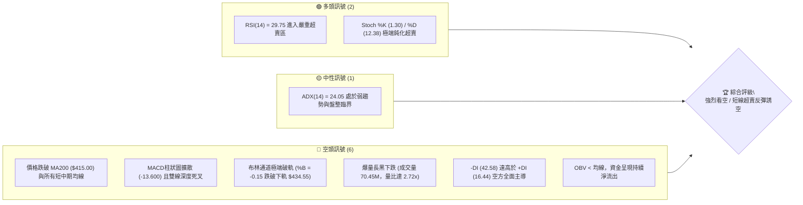
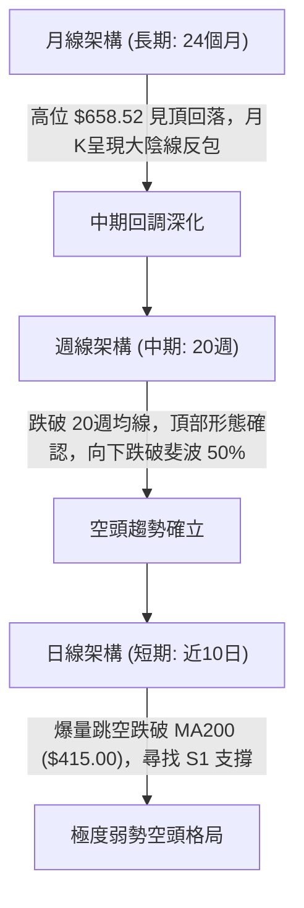
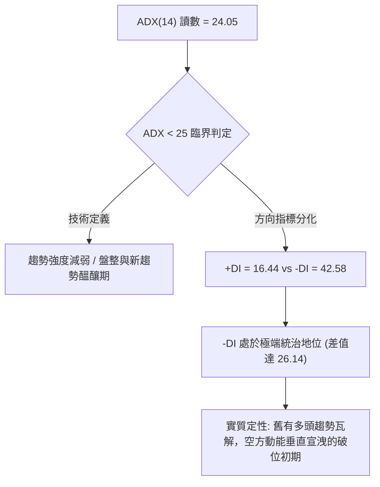
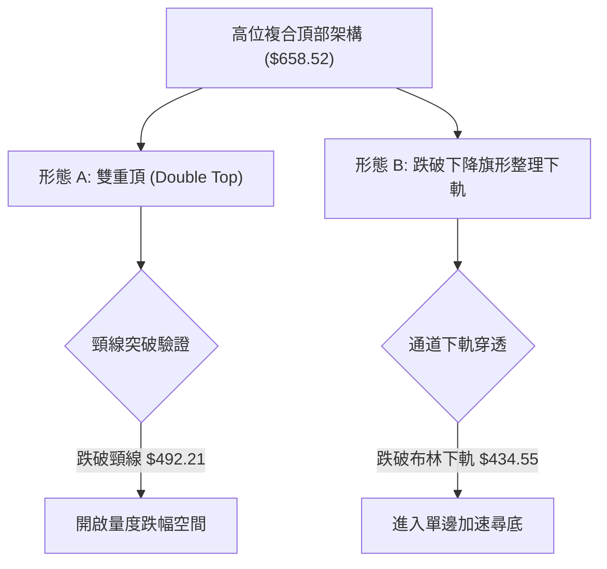
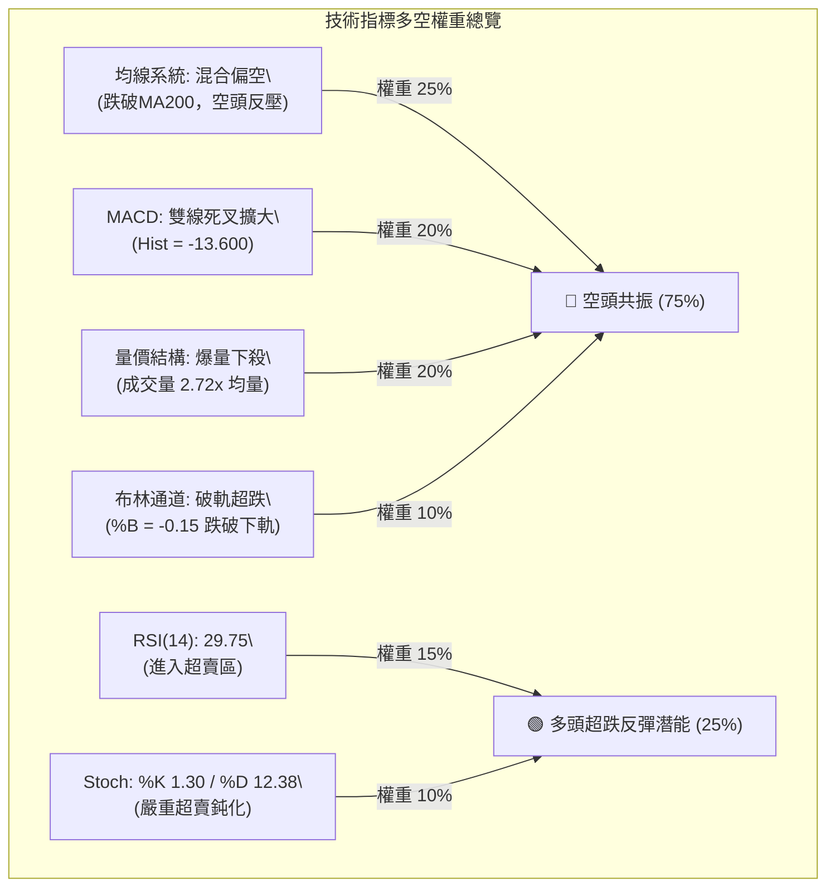
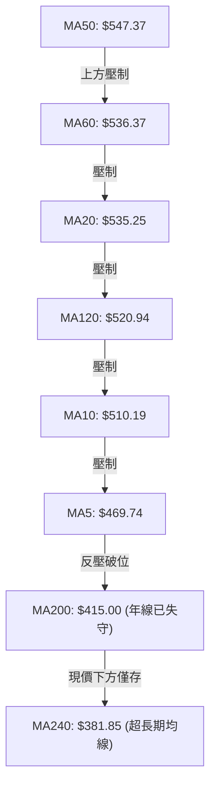
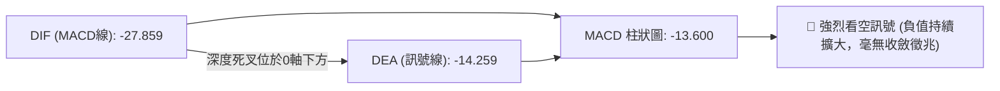
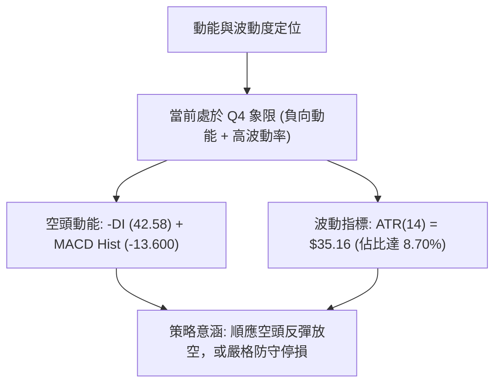
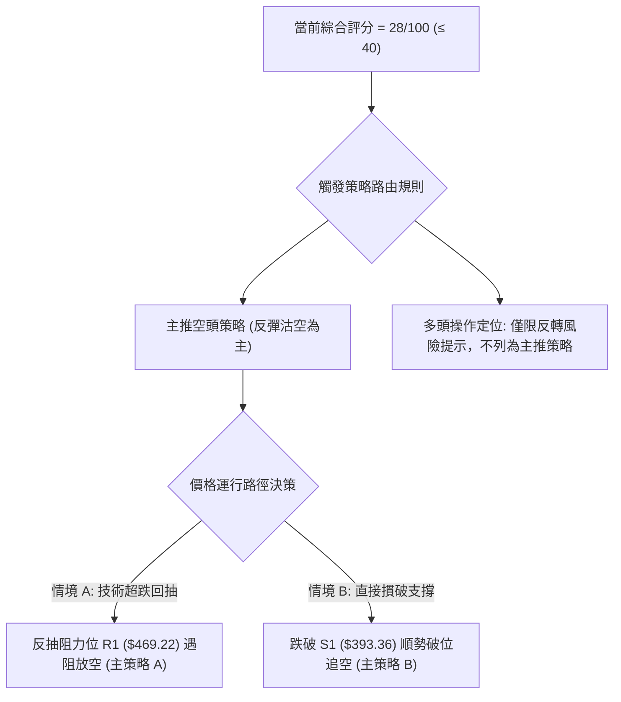
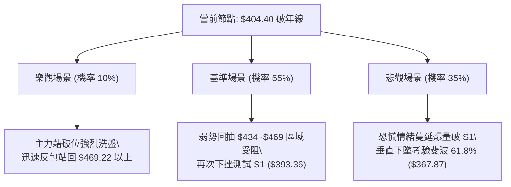

# AMD 技術分析報告

> **報告日期**：2026-11-06 ｜ **語言**：繁體中文 ｜ **數據來源**：Yahoo Finance ｜ **當前價格**：$404.40

---

## 目錄

| 章節 | 內容 |
|------|------|
| [1. 技術面概覽](#1-技術面概覽) | 訊號儀表板、核心指標速覽表、技術評分卡 |
| [2. 趨勢分析](#2-趨勢分析) | 多時框趨勢、12個月走勢圖、中期趨勢、ADX趨勢強度評估 |
| [3. 圖表形態分析](#3-圖表形態分析) | 形態識別系統、重要K線形態分析、ASCII形態示意圖、形態目標價 |
| [4. 支撐與阻力](#4-支撐與阻力) | 關鍵價位分布圖、阻力位分析表、支撐位分析表、斐波那契回調分析 |
| [5. 技術指標深度解讀](#5-技術指標深度解讀) | 指標訊號總覽、均線系統、RSI、MACD、布林通道、量價結構 |
| [6. 動能與波動率](#6-動能與波動率) | 動能評估四象限、ATR波動率分析、Beta與市場相關性 |
| [7. 多時框架總結](#7-多時框架總結) | 時框架評分表、綜合訊號矩陣、多時框收斂結論 |
| [8. 交易策略建議](#8-交易策略建議) | 策略決策流程圖、策略路由、價格情境階梯、主策略詳情、評星 |
| [9. 風險提示與監控](#9-風險提示與監控) | 關鍵監控指標 Checklist、風險場景分析、風險管理重要提醒 |
| [📋 報告總結](#-報告總結) | 核心結論與最優策略組合速查表 |

---

## 1. 技術面概覽

### 🎯 技術訊號儀表板



### 📊 核心指標速覽表

| 指標類別 | 指標名稱 | 當前數值 | 訊號 | 解讀 |
|:---|:---|:---|:---:|:---|
| **價格** | 當前收盤價 | $404.40 | 🔴 | 跌破年線 MA200 ($415.00)，位於 52 週區間 46.0% 位置 |
| **短期均線** | MA5 | $469.74 | 🔴 | 價格低於 MA5 達 -13.91%，短線垂直陡峭下墜 |
| **中期均線** | MA20 | $535.25 | 🔴 | 價格低於 MA20 達 -24.45%，中期趨勢嚴重受損 |
| **中期均線** | MA50 | $547.37 | 🔴 | 價格低於 MA50，均線下彎形成沉重空頭排列壓制 |
| **長期均線** | MA200 | $415.00 | 🔴 | 跌破長期多空分水嶺年線，正式轉入中長期偏性格局 |
| **超長期均線**| MA240 | $381.85 | 🟡 | 現價尚在 MA240 之上 (+5.90%)，為下方最後均線防線 |
| **動能震盪** | RSI(14) | 29.75 | 🟢 | 跌破 30 超賣門檻，技術性隨時存在超跌抽腳動能 |
| **趨勢動能** | MACD (12,26,9) | -27.859 / -14.259 | 🔴 | DIF 遠在 DEA 下方，柱狀圖 -13.600，空方動能無衰竭跡象 |
| **隨機指標** | Stoch %K / %D | 1.30 / 12.38 | 🟢 | 進入極度超賣區間，反映短線恐慌拋售盤達到頂點 |
| **趨勢強度** | ADX(14) | 24.05 (-DI: 42.58) | 🔴 | ADX 低於 25 代表先前趨勢耗盡，但 -DI 達 42.58 顯示空頭單向宣洩 |
| **通道指標** | 布林通道下軌 | $434.55 (%B: -0.15) | 🔴 | 實體 K 棒直接貫穿下軌破位，開口急劇放大，波動率飆升 |
| **量能指標** | 成交量 / 20日均量 | 70.45M / 25.95M | 🔴 | 量比高達 2.72x，伴隨恐慌拋售，OBV 低於均線確認資金出逃 |
| **波動指標** | ATR(14) | $35.16 | 🔴 | 佔股價 8.70%，每日振幅極大，持倉風險急劇攀升 |

### 🏆 技術評分卡

```
╔══════════════════════════════════════════════════════════════╗
║               技術評分卡 — AMD (2026-11-06)                  ║
╠══════════════════════════════════════════════════════════════╣
║ 趨勢強度 (Trend)     █████░░░░░░░░░░░░░░░  25/100  🔴 極弱勢 ║
║ 動能指標 (Momentum)  ███████░░░░░░░░░░░░░  35/100  🔴 空頭主導║
║ 支撐穩定度 (Support) ██████░░░░░░░░░░░░░░  30/100  🔴 關鍵失守║
║ 成交量配合 (Volume)  █████░░░░░░░░░░░░░░░  25/100  🔴 爆量殺跌║
║ 形態完整度 (Pattern) ███████░░░░░░░░░░░░░  35/100  🔴 頭部成形║
║ 均線排列 (Moving Avg)████░░░░░░░░░░░░░░░░  20/100  🔴 空頭壓制║
╠══════════════════════════════════════════════════════════════╣
║ 綜合評分 (Overall)   ██████░░░░░░░░░░░░░░  28/100  🔴 強烈看空║
╚══════════════════════════════════════════════════════════════╝
```
> **計算說明（依規則 18）**：綜合評分 = (25 + 35 + 30 + 25 + 35 + 20) ÷ 6 = 170 ÷ 6 = 28.33 → **28/100**。評級判定：**強烈看空（≤40）**。

---

## 2. 趨勢分析

### 🌐 多時框趨勢分析



### 📈 長期趨勢 — 12個月走勢圖（Unicode）

```
AMD 月線走勢圖（2025-12 至 2026-11 過去12個月）
價格軸 ($)
$650 ┤                                      ● $611.76 (09月)
$600 ┤                                  ● $580.91 (06月)
$550 ┤                              ● $516.10 (05月)      ● $504.80 (10月)
$500 ┤                                          ● $470.72 (08月)
$450 ┤                                              
$400 ┤                                                  ● $404.40 (11月現價)
$350 ┤                          ● $354.49 (04月)
$300 ┤                                  
$250 ┤                                  
$200 ┤● $214.16 (12月)  ● $203.43 (03月)
$150 ┤      ● $236.73 (01月)
     └────────────────────────────────────────────────────────────
      12月   01月   02月   03月   04月   05月   06月   07月   08月   09月   10月   11月
     (2025) (----------------------- 2026 -----------------------)
```

#### 走勢特徵分析表格

| 階段區間 | 時間跨度 | 起訖收盤價 | 區間漲跌幅 | 走勢特徵與結構意涵 |
|:---|:---|:---|:---:|:---|
| **第一階段：底部築底盤整** | 2025-12 ~ 2026-03 | $214.16 → $203.43 | -5.01% | 圍繞 $200.00~$230.00 長期底部構築箱體，波動率收斂，沉澱籌碼 |
| **第二階段：主升浪爆發** | 2026-03 ~ 2026-06 | $203.43 → $580.91 | +185.56% | 伴隨 AI 算力中心爆發性營收增長，呈現單邊階梯式主升暴拉，創歷史新高 |
| **第三階段：高位劇烈震盪** | 2026-06 ~ 2026-09 | $580.91 → $611.76 | +5.31% | 歷經 7-8 月大幅洗盤（$470.72）後於 9 月再度衝刺 $611.76，形成雙重頂雛形 |
| **第四階段：全面破位殺跌** | 2026-09 ~ 2026-11 | $611.76 → $404.40 | -33.90% | 10月與11月遭遇高估值修正與板塊重挫，自歷史高點回撤達 -38.59%，跌破年線 |

### 📊 中期趨勢（週線分析）

從近 20 週收盤走勢可見，AMD 股價於 2026-10-09 當週刷出 52 週高點 $658.52 後，週線連續 4 週收黑（$608.10 → $528.75 → $516.79 → $504.80 → $404.40）。本週（截至 2026-11-05）收盤 $404.40，週成交量暴增至 188,834,800 股，為過去半年的歷史天量，週跌幅高達 -19.89%，呈現典型的高位放量多殺多結構。

```
中期壓力與支撐結構示意圖（週線維度）
阻力區間 R3: $517.35 ══════════════════════════ [10月下旬密集套牢週K震盪中樞]
阻力區間 R1: $469.22 ────────────────────────── [近週跳空下殺跌破口]
當前現價:     $404.40 ◄─── (貫穿年線 MA200: $415.00，測試下方頸線)
支撐區間 S1: $393.36 ┄┄┄┄┄┄┄┄┄┄┄┄┄┄┄┄┄┄┄┄┄┄┄┄ [近一年波段低點聚類防線]
支撐區間 S2: $198.67 ══════════════════════════ [2026年初主升起漲箱體頂部]
```

### ⚡ 趨勢強度評估（ADX 解讀）



#### ADX 趨勢強度對照表

| 指標名稱 | 實際數值 | 參考臨界值 | 狀態定性 | 技術意涵解讀 |
|:---|:---:|:---:|:---:|:---|
| **ADX(14)** | **24.05** | 25.00 | 弱趨勢 / 轉折 | 數值自高位回落至 25 以下，顯示先前多頭主升浪結束；正處於空頭破位加速引導 ADX 重新上揚的轉折點 |
| **+DI(14)** | **16.44** | 20.00 | 多頭衰竭 | 買盤力量極度渙散，無力組織任何反擊波段 |
| **-DI(14)** | **42.58** | 40.00 | 空頭極度強勢 | 數值突破 40 警戒線，顯示市場由恐慌性單邊賣壓主導 |

---

## 3. 圖表形態分析

### 🔍 形態識別系統



#### 形態識別與信心度評估表（依規則 15）

| 識別形態名稱 | 信心度 | 判斷依據（嚴格引用數據） | 形態完成度 | 理論目標價（附精確計算式） |
|:---|:---:|:---|:---:|:---|
| **雙重頂 (M頭)** | **85%** | 第一頂為 2026-09-25 週高點 $639.00，第二頂為 2026-10-09 歷史高點 $658.52；頸線為 2026-10-30 日低點 **$492.21**。11-05 實體大陰線收 $404.40 確認有效跌破。 | **100% (已破位)** | 頸線 $492.21 − 形態高度 ($658.52 − $492.21 = $166.31) = **$325.90** |
| **下降通道破位** | **75%** | 10-23 至 11-04 形成向下的平行通道，11-05 跌破通道下軌支撐並跌破布林下軌 $434.55，伴隨 70.45M 爆量。 | **90%** | 通道寬度約 $45.00，破位點 $466.07 − $45.00 = **$421.07** (已達標並超跌) |
| **頭肩頂形態** | 40% | 數據不足以確認完整左肩（缺乏對稱時間跨度） | 30% | *訊號不足，僅做指標型解讀，不計算幾何目標價* |

### 🕯️ 重要 K 線形態分析

依規則 19，嚴格基於數據中提供的「近10根日K」與「近8根週K」之實際開高低收進行精確解讀：

#### 近10根日 K 線形態解讀表

| 日期 | 開盤價 ($) | 最高價 ($) | 最低價 ($) | 收盤價 ($) | 成交量 (股) | 識別 K 線形態 | 技術解讀與多空意涵 | 訊號 |
|:---|:---:|:---:|:---:|:---:|:---:|:---|:---|:---:|
| 2026-10-23 | 510.21 | 523.92 | 508.36 | 516.79 | 15,177,900 | 窄幅小陽線 | 縮量企穩於 $510 上方，多空暫時平衡 | 🟡 |
| 2026-10-26 | 522.79 | 533.50 | 514.01 | 531.28 | 16,796,800 | 溫和走揚中陽線 | 價格重返 MA20 附近，量能微增，反彈延續 | 🟢 |
| 2026-10-27 | 539.49 | 563.92 | 538.50 | 560.26 | 20,599,900 | 帶上影長陽線 | 向上試探 MA50 壓力，高位遭遇解套拋壓 | 🟡 |
| 2026-10-28 | 573.08 | 579.18 | 560.52 | 578.44 | 18,848,600 | 高位跳空中陽線 | 創波段反彈高點 $579.18，但量能未能同步放大，呈現量價背離 | 🟡 |
| 2026-10-29 | 562.27 | 575.10 | 560.57 | 566.42 | 16,873,300 | 滯漲小陰線 | 開盤走低，高點不再刷新，反彈動能衰竭 | 🔴 |
| 2026-10-30 | 508.53 | 520.40 | 492.21 | 504.80 | 39,697,500 | **跳空長黑吞噬** | 爆量下挫跌破 $500 大關與短期均線，空方動能啟動 | 🔴 |
| 2026-11-02 | 510.71 | 512.82 | 466.07 | 466.84 | 32,141,000 | **光腳大黑K** | 收在全日最低點附近，跌破 38.2% 斐波位，多頭防線瓦解 | 🔴 |
| 2026-11-03 | 479.99 | 497.40 | 473.54 | 483.90 | 35,255,100 | 低位反彈小陽線 | 盤中嘗試回抽但受阻於 $497.40，反抽無力 | 🟡 |
| 2026-11-04 | 485.25 | 514.61 | 476.50 | 488.78 | 50,984,800 | 帶長上影倒錘陽線 | 衝高 $514.61 遭遇巨量拋壓，形成典型多頭陷阱 | 🔴 |
| 2026-11-05 | 452.50 | 456.20 | 402.10 | 404.40 | 70,453,900 | **爆量破位斷頭鍘大陰線** | 70.45M 巨量摜破年線 MA200 ($415.00)，直逼 S1 ($393.36) | 🔴 |

#### 近8根週 K 線形態解讀表

| 日期 (週結) | 開盤價 ($) | 最高價 ($) | 最低價 ($) | 收盤價 ($) | 成交量 (股) | 識別週 K 形態 | 趨勢研判 | 訊號 |
|:---|:---:|:---:|:---:|:---:|:---:|:---|:---|:---:|
| 2026-09-18 | 486.28 | 559.91 | 480.33 | 559.82 | 124,593,800 | 突破大陽線 | 帶量突破前高，啟動主升浪末升段 | 🟢 |
| 2026-09-25 | 583.88 | 639.00 | 582.27 | 630.63 | 132,066,300 | 高位加速長陽線 | 衝上 $630 大關，第一波主升頂部確立 | 🟢 |
| 2026-10-02 | 624.90 | 645.46 | 596.07 | 633.91 | 92,386,900 | 高位十字星 | 量能萎縮，高檔出現獲利了結與猶豫 | 🟡 |
| 2026-10-09 | 630.61 | 658.52 | 606.00 | 608.10 | 93,746,000 | **長上影流星線 (Shooting Star)** | 刷出 52W 高點 $658.52 後遭強力摜壓，確認見頂 | 🔴 |
| 2026-10-16 | 599.93 | 606.20 | 526.83 | 528.75 | 107,042,200 | 放量下挫中長陰線 | 一舉跌破 5週均線，獲利盤踩踏湧出 | 🔴 |
| 2026-10-23 | 551.78 | 556.79 | 502.60 | 516.79 | 96,570,600 | 下跌中繼孕線 | 跌勢暫歇，於 $500 大關上方微幅抵抗 | 🟡 |
| 2026-10-30 | 522.79 | 579.18 | 492.21 | 504.80 | 112,816,100 | 長上影弱勢陰線 | 衝高試探 $579.18 失敗，頸線岌岌可危 | 🔴 |
| 2026-11-05 | 510.71 | 514.61 | 402.10 | 404.40 | 188,834,800 | **歷史天量崩跌大陰線** | 爆量長陰直接跌穿頸線與週均線支撐，形態全面破敗 | 🔴 |

### 📉 ASCII 走勢形態示意圖

```
AMD 雙重頂破位與斷頭鍘走勢結構圖
價格
$658.52 ┤                    頂2: $658.52 (10-09)
        │                      ╭─╮
$639.00 ┤        頂1: $639.00 ╱   │
        │          ╭─╮      ╱     │
$579.18 ┤         ╱   │     ╱      │       反彈遇阻: $579.18 (10-28)
        │        ╱     │    ╱       │          ╭─╮
$535.25 ┤───────╱───────╰───╯────────╰─────────╱───│── (MA20 壓制線)
$492.21 ┤================ 頸線支撐位 ($492.21) ======│=== (10-30 破位頸線)
        │                                         ╰──╮
$415.00 ┤---------------- 年線 MA200 關鍵支撐 -----------------╰─╮ (11-05 放量摜破)
$404.40 ┤                                                    ●◄─── 收盤現價 ($404.40)
$393.36 ┤- - - - - - - - 關鍵支撐 S1 ($393.36) - - - - - - - - - - 
$325.90 ┤................ 雙頂量度跌幅目標位 ($325.90) ............
```

### 🎯 形態目標價計算

1. **雙重頂形態測量計算**：
   - 頂部高點取值：最高峰值 $658.52（2026-10-09）
   - 頸線關鍵低點：$492.21（2026-10-30 波段低點）
   - 形態垂直高度 $H$ = $658.52 − $492.21 = **$166.31**
   - 破位量度跌幅目標 $T$ = 頸線價 − $H$ = $492.21 − $166.31 = **$325.90**
2. **測算結果意涵**：目前收盤價 $404.40 距離最終量度目標 $325.90 仍有 -$78.50（約 -19.41%）的潛在下行空間，顯示當前下行趨勢尚未完全對稱耗盡。

---

## 4. 支撐與阻力

### 🗺️ 關鍵價位分布圖（Unicode）

```
AMD 價位結構分布圖（嚴格依據 OHLCV 計算聚類點）
══════════════════════════════════════════════════════════════
$517.35 ║████████████████████████║ 強阻力 R3（波段高點聚類）
$491.12 ║████████████████████    ║ 阻力 R2（跳空缺口反抽位）
$469.22 ║████████████████████████║ 關鍵阻力 R1（MA5 / 近期破位反壓）
$415.00 ║┄┄┄┄┄┄┄┄┄┄┄┄┄┄┄┄┄┄┄┄║ 年線多空分水嶺 MA200
$404.40 ╠════════════════════════╣ ◄ 當前收盤現價 ($404.40)
$393.36 ║▓▓▓▓▓▓▓▓▓▓▓▓▓▓▓▓        ║ 近期核心支撐 S1（波段低點聚類，-2.73%）
$198.67 ║████████████████████████║ 極強歷史支撐 S2（2026起漲箱體頂部）
$191.52 ║████████████████████████║ 終極歷史支撐 S3（波段低點聚類）
══════════════════════════════════════════════════════════════
```

### 🚧 阻力位分析表

> **數據引用紀律**：所有阻力位數值嚴格引用「關鍵價位」區塊之波段高點聚類數據。

| 阻力級別 | 準確價位 | 距現價幅標 | 形成原因與技術共振 | 突破難度 | 重要性等級 |
|:---|:---:|:---:|:---|:---:|:---:|
| **R1** | **$469.22** | +16.03% | 近一年波段高點聚類位，高度共振 5日均線 MA5 ($469.74) 與 11-02 破位開盤下殺點 | 🔴 極高 | 關鍵短線反壓 🟢🟢🟢 |
| **R2** | **$491.12** | +21.44% | 頸線破位點 $492.21 下方密集拋壓聚類，亦為 11-03 反彈高點附近 | 🔴 極高 | 波段防線 🟢🟢🟢🟢 |
| **R3** | **$517.35** | +27.93% | 10月下旬密集籌碼換手下沿，共振 11-04 假突破高點 $514.61 與 10-23 收盤價 $516.79 | 🔴 難以逾越 | 中期強阻力 🟢🟢🟢🟢🟢 |

### 🛡️ 支撐位分析表

> **數據引用紀律**：所有支撐位數值嚴格引用「關鍵價位」區塊之波段低點聚類數據。

| 支撐級別 | 準確價位 | 距現價幅標 | 形成原因與技術共振 | 守住機率 | 重要性等級 |
|:---|:---:|:---:|:---|:---:|:---:|
| **S1** | **$393.36** | -2.73% | 近一年波段低點聚類支撐，僅距當前低點 $402.10 一步之遙，多頭最後防線 | 🟡 45% | 近期核心支撐 🟢🟢🟢🟢🟢 |
| **S2** | **$198.67** | -50.87% | 2026年1-3月長期築底箱體頂部聚類點（2026-02收盤 $200.21, 2026-03收盤 $203.43） | 🟢 85% | 長期強支撐 🟢🟢🟢🟢 |
| **S3** | **$191.52** | -52.64% | 52週低點 $188.22 上方之波段低點聚類區域，為兩年牛熊分界基石 | 🟢 95% | 終極底部防線 🟢🟢🟢 |

### 📐 斐波那契回調位分析

依據 52 週完整波動區間（低點 **$188.22** 至 高點 **$658.52**，總落差 $470.30）計算：

```
斐波那契回調結構階梯圖
0.0%  (52W High) ─────────────── $658.52 (歷史頂點)
23.6%            ─────────────── $547.53 (共振 MA50: $547.37)
38.2%            ─────────────── $478.87 (共振 MA5: $469.74 反彈第一受阻位)
50.0%            ─────────────── $423.37 (多空平衡中軸，已於11-05跌破)
      現價位於 50.0% ~ 61.8% 區間 ◄─── $404.40
61.8% (黃金分割) ─────────────── $367.87 (回調黃金支撐位，下方緩衝區)
78.6%            ─────────────── $288.86 (深層回調位)
100.0% (52W Low) ─────────────── $188.22 (52週原始起漲低點)
```

#### 斐波那契回調位解讀
1. **現價區間定位**：當前收盤價 **$404.40** 跌破 50.0% 關鍵平衡位（$423.37），目前運行於 **50.0% ($423.37)** 與 **61.8% ($367.87)** 之間。
2. **破位意義**：50.0% 回調位通常是強勢牛市拉回的極限防線，一旦跌破，暗示先前自 $188.22 暴漲至 $658.52 的主升浪已徹底破壞，技術結構轉為「深度回撤」模式。若 S1 ($393.36) 失守，價格將無懸念考驗 61.8% 黃金分割位 **$367.87**。

---

## 5. 技術指標深度解讀

### 🎛️ 指標訊號總覽



### 📈 移動平均線排列分析



#### 均線數據明細與乖離率

| 均線名稱 | 數值 ($) | 價格相對於均線乖離 | 排列狀態 | 趨勢意涵 |
|:---|:---:|:---:|:---:|:---|
| **MA5** | $469.74 | -13.91% | 極度空頭負乖離 | 短線超賣，隨時可能產生向 MA5 靠近的技術性回抽 |
| **MA10** | $510.19 | -20.74% | 下穿所有中長期均線 | 快速下墜，形成第二道動態壓制帶 |
| **MA20** | $535.25 | -24.45% | 中期生命線下彎 | 月線級別徹底失守，中期反轉確立 |
| **MA50** | $547.37 | -26.12% | 季線下行 | 確立波段牛市終結 |
| **MA200** | $415.00 | -2.55% | **跌破年線** | **牛熊分界線失守，長期多頭結構遭遇致命破壞** |
| **MA240** | $381.85 | +5.90% | 上方支撐 | 超長期最後均線緩衝防線，位於 S1 之下 |

### 📉 RSI(14) 分析

```
RSI(14) 讀數進度條：
0 ─────── 20 ──────── 30 ──────────────────────── 70 ─────── 100
[█████████░░░░░░░░░░░░░░░░░░░░░░░░░░░░░░░░░░░░░░░] 29.75 (超賣)
```

1. **區間判斷**：RSI(14) 最新讀數為 **29.75**，跌破 30 超賣臨界線，屬於技術性嚴重超賣。
2. **背離判斷（嚴格依據數據）**：
   - 數據明確標示：**「RSI 背離：無明顯背離」**（近20根K棒首尾之價格由高處下落，RSI 同步自高位滑落至 29.75）。
   - **結論**：目前為**指標跟隨價格下行**的「無背離超賣」，此種超賣通常反映空頭拋盤強勁，容易出現「指標鈍化」現象，不可單憑超賣即判定為反轉點。

### 📊 MACD (12, 26, 9) 訊號解讀



- **MACD 線**：-27.859
- **信號線 (Signal)**：-14.259
- **柱狀圖 (Histogram)**：-13.600
- **深度研判**：DIF 與 DEA 不僅處於 0 軸之下的空頭領域，且差距進一步拉開至 -13.600，負向柱狀圖持續向下放大。這證明空頭加速下跌的動能仍在肆虐，完全排除底背離可能。

### 📦 布林通道分析

```
AMD 布林通道破軌示意圖
$635.95 ┬────────────────────────────────────────── BB 上軌
        │
$535.25 ┼────────────────────────────────────────── BB 中軌 (MA20)
        │
$434.55 ┴────────────────────────────────────────── BB 下軌
        │   
$404.40 ───●◄ 現價 ($404.40，處於下軌下方，$404.40 < $434.55)
        │   %B 讀數: -0.15 (極端負值破軌)
```

- **通道參數**：上軌 $635.95 ｜ 中軌 $535.25 ｜ 下軌 $434.55 ｜ 帶寬 $201.40
- **%B 指標**：**-0.15**。%B 小於 0 代表價格已實質貫穿布林帶下軌。這屬於極度恐慌下的「極端外軌運行」，技術上具有強烈的回歸下軌之均值回歸拉力，但下軌目前正急劇向下開口，需警惕「開口下行沿軌下殺」風險。

### 💹 成交量分析（量價配合度）

1. **量價特徵**：最新單日成交量高達 **70,453,900 股**，相對於 20 日均量（25,949,850 股）形成 **2.72 倍的巨量量比**。在長黑下殺破位中放量，呈現典型的「放量破位殺多」。
2. **OBV 能量潮趨勢**：數據明確指出「**OBV < MA → 量能疲弱**」。說明資金在過去 20 個交易日內呈現持續淨流出態勢，本波放量下跌並非機構主力承接，而是止損盤與去槓桿籌碼的多殺多宣洩。

---

## 6. 動能與波動率

### ⚡ 動能評估四象限

| 象限 | 動能狀態 | 波動率狀態 | 當前定位 | 交易環境技術評估 |
|:---:|:---:|:---:|:---:|:---|
| **第一象限 (Q1)** | 強動能 (多頭) | 低波動 | — | 穩定多頭主升浪（已於 2026-06 結束） |
| **第二象限 (Q2)** | 弱動能 (盤整) | 低波動 | — | 底部築底震盪區（如 2026-01 至 03） |
| **第三象限 (Q3)** | 強動能 (多頭) | 高波動 | — | 狂熱頂部派發期（2026-09 至 10） |
| **第四象限 (Q4)** | **弱/負動能 (空頭)** | **高波動** | **✓ AMD 當前狀態** | **極高風險宣洩期：空方動能強大且伴隨劇烈振幅，嚴禁盲目抄底** |



### 📊 ATR 波動率分析

- **ATR(14) 數值**：**$35.16**（採用 Wilder 平滑計算）
- **價格相對佔比**：高達 **8.70%**（$35.16 ÷ $404.40）
- **止損距離與倉位建議**：
  - 由於單日正常預期波動已達 $35.16，一般以 **1.5 倍 ATR（約 $52.74）** 作為防守容忍寬度。
  - 考量到現價距關鍵支撐 S1 ($393.36) 僅差 $11.04，若在現價設置過窄止損，極易因常規 ATR 波動而被掃出場。
  - **倉位管理**：單筆交易風險敞口建議壓縮至總資金的 **1.0% 以內**，整體槓桿降至最低。

### 📐 Beta 與市場相關性

- **Beta 係數**：**2.542**
- **市場特徵解讀**：
  - AMD 展現極度高敏感的科技成長股特性，其波動幅度為標普 500 指數的 2.54 倍。
  - 當前市場新聞反映「Nasdaq 遭遇 18 個月來最慘跌勢，AI 交易遭受質疑，晶片板塊全面大跌」，在宏觀去風險環境下，高 Beta 屬性引發放大的去槓桿踩踏。

---

## 7. 多時框架總結

### 📋 時框架評分表

| 時框架 | 趨勢方向 | 動能指標狀態 | 均線排列特徵 | 形態識別與完成度 | 綜合評分 | 建議操作維度 |
|:---|:---:|:---|:---|:---|:---:|:---|
| **長期 (月線)** | 🟡 轉向中立 | MACD 多頭柱狀收斂，自歷史高點回落 | 位於 MA240 之上，但頂部吞噬 | 雙頂高位成形 (70%) | 45/100 | 長期投資者減磅觀望 |
| **中期 (週線)** | 🔴 明確走空 | 週 RSI 自 73 暴跌至 29.7，放量長黑 | 跌穿 5週、10週、20週中樞 | 雙重頂破位確認 (85%) | 25/100 | 順勢尋找反彈空點 |
| **短期 (日線)** | 🔴 崩跌超賣 | 日 RSI 29.75，Stoch 1.30 極端鈍化 | 跌破 MA200 年線，全面空頭排列 | 爆量下探尋找 S1 (90%) | 20/100 | 嚴禁盲目猜底，等待止跌 |

### 🔲 綜合訊號矩陣

```
時框維度          趨勢      均線系統      動能狀態      量價配合      矩陣一致性
短期 (日線)       🔴 空頭    🔴 空頭壓制   🟢 嚴重超賣   🔴 爆量殺跌   75% 偏空
中期 (週線)       🔴 空頭    🔴 破位死叉   🔴 空頭擴散   🔴 天量流出   100% 偏空
長期 (月線)       🟡 震盪    🟡 均線上方   🔴 動能衰竭   🔴 頂部派發   75% 偏空
────────────────────────────────────────────────────────────────────────
全時框共振判定:   🔴🔴 空方全面掌控局面 (日線超賣僅能引發短暫技術性反抽)
```

### ⚖️ 多時框收斂結論（依規則 14）

1. **行情屬性判定**：當前 ADX(14) 讀數為 **24.05 (< 25)**。依多時框收斂規則，數值低於 25 原屬「盤整/弱趨勢」範疇，以日線布林通道區間為主。然而，由於最新 K 棒實體已經以放量大陰線**跌破布林下軌 $434.55 (%B: -0.15)**，打破了原有的區間平衡。
2. **時框衝突收斂**：日線雖然發出極端超賣訊號（RSI 29.75, Stoch 1.30），但中長期週線頂部破位已成定局（MA200 關鍵支撐 $415.00 已宣告失守）。依優先級收斂原則：**以中長期空頭方向為主導，日線的超賣不作為逆勢做多依據，僅作為空單避免在破軌處盲目追空、等待反彈至阻力位再行沽空的進場時機**。
3. **唯一方向性結論**：**強烈偏空（中長期下行趨勢成形，短線等待反彈遇阻再行佈空）**。

---

## 8. 交易策略建議

### 🗺️ 策略決策流程圖



### 🧭 策略路由（依評分卡分流，依規則 18）

- **當前主策略方向 = 強烈偏空（主推空頭策略，依技術評分 28/100）**
- 綜合評分 28/100 低於 40 分標準，全面封殺左側抄底多頭建議，專注於空頭波段的精確卡位與風控防守。

### 🎯 價格情境階梯（Price Scenarios）

> **數值紀律**：所有階梯觸發價位與目標均直接引用第 4 章「關鍵價位」數據。

| 觸發條件 | 下一目標 | 後續延伸 | 情境技術含義 |
|:---|:---:|:---:|:---|
| **強勢反彈突破 R1 ($469.22)** | R2 ($491.12) | R3 ($517.35) | 短線超賣宣洩後之強反彈，修復日線負乖離，但仍屬空頭反抽 |
| **受制於現價至 MA200 區間** | S1 ($393.36) | — | 於 $404.40~$415.00 弱勢震盪整理，隨後考驗 S1 防線 |
| **放量有效跌破 S1 ($393.36)** | S2 ($198.67) | S3 ($191.52) | 年線確認實質破位，開啟向 2026 年初起漲中樞的大級別尋底 |

### 📊 情境機率分佈

| 情境劇本 | 發生機率 | 主要技術與量價依據 |
|:---|:---:|:---|
| **情境一：弱勢反抽後下行 (Bearish Pullback)** | **55%** | RSI(14) = 29.75 與 Stoch 極度超賣，極易引發技術性回抽 MA5/MA200 反壓，但上方均線層層重壓，反抽即是空點 |
| **情境二：直接摜破 S1 跌向深層支撐** | **35%** | 11-05 單日 70.45M 巨量踩踏，-DI 達 42.58 空方動能強盛，若市場情緒持續惡化，將無抵抗直接跌穿 S1 ($393.36) |
| **情境三：V型強勢反轉站回 R2** | **10%** | 必須伴隨特大利好將跳空缺口徹底回補並收復 $491.12，以目前 MACD Hist -13.600 來看機率極低 |

### 🟢 主策略詳情（方向：空頭沽空策略）

> **計算規範（依規則 17）**：
> - 策略 A：進場價 $469.22，目標 T1 $404.40，止損 $491.12。
>   - 獲利空間 = $469.22 − $404.40 = $64.82
>   - 止損空間 = $491.12 − $469.22 = $21.90
>   - 風險報酬比 = $64.82 ÷ $21.90 = **1 : 2.96（以 T1 計）**
>   - 目標 T2 = $393.36，獲利空間 = $75.86，風險報酬比 = $75.86 ÷ $21.90 = **1 : 3.46（以 T2 計）**
> - 策略 B：進場價 $393.36，目標 T1 $367.87，止損 $404.40。
>   - 獲利空間 = $393.36 − $367.87 = $25.49
>   - 止損空間 = $404.40 − $393.36 = $11.04
>   - 風險報酬比 = $25.49 ÷ $11.04 = **1 : 2.31（以 T1 計）**
>   - 目標 T2 = $198.67，獲利空間 = $194.69，風險報酬比 = $194.69 ÷ $11.04 = **1 : 17.63（以 T2 計）**

| 策略要素 | 策略 A（反彈遇阻沽空 — 首選） | 策略 B（跌破 S1 順勢追空 — 次選） |
|:---|:---|:---|
| **進場條件** | 股價短線超跌反抽，在阻力位 **R1 ($469.22)** 附近出現長上影線或滯漲時進場 | 實體 K 棒放量跌破關鍵支撐 **S1 ($393.36)** 並確認收破時右側進場 |
| **進場價格** | **$469.22** | **$393.36** |
| **第一目標價 (T1)** | **$404.40** (當前收盤價位) | **$367.87** (斐波那契 61.8% 黃金分割位) |
| **第二目標價 (T2)** | **$393.36** (關鍵支撐位 S1) | **$198.67** (歷史箱體強支撐位 S2) |
| **止損價格** | **$491.12** (阻力位 R2 上方) | **$404.40** (前波破位平台即現價) |
| **風險報酬比** | **1 : 2.96（以 T1 計）** ｜ *1 : 3.46（以 T2 計）* | **1 : 2.31（以 T1 計）** ｜ *1 : 17.63（以 T2 計）* |
| **成功機率預估** | **65%** | **55%** |
| **建議配置倉位** | **15%** (總資金比例) | **10%** (右側確認後建立) |

### 🔴 反向風險觸發點（對沖提示）

若出現以下情境，宣告本空頭模型被推翻，空單必須立即全數無條件離場觀望：
1. **價位突破信號**：日線收盤價強勢收復 **R2 ($491.12)**，代表 10-30 頸線假跌破，空頭陷阱成立。
2. **均線與指標信號**：股價重新站上 MA200 ($415.00) 且 MACD 柱狀圖在零軸下呈現連續 3 日強勢收斂翻紅。

### ⭐ 整體訊號強度評星

```
╔══════════════════════════════════════════════════════════════╗
║ 做多訊號強度：★☆☆☆☆  (1/5星 — 僅存在超跌技術修復可能)        ║
║ 做空訊號強度：★★★★☆  (4/5星 — 均線與形態全面共振走空)        ║
║ 整體可信度：  ★★★★☆  (4/5星 — 天量長黑破位，趨勢明確)        ║
╚══════════════════════════════════════════════════════════════╝
```

---

## 9. 風險提示與監控

### ✅ 關鍵監控指標 Checklist

```
╔══════════════════════════════════════════════════════════════╗
║               關鍵技術監控指標清單 (Checklist)               ║
╠══════════════════════════════════════════════════════════════╣
║ [ ] 監控項 1: 收盤價是否實質擊穿 S1 ($393.36)                ║
║     ↳ 觸發含義: 一旦跌破，直接打開向下測試 $367.87 空間     ║
║ [ ] 監控項 2: 價格反抽時能否有效收復年線 MA200 ($415.00)     ║
║     ↳ 觸發含義: 若受阻於 $415，坐實年線壓制效應              ║
║ [ ] 監控項 3: RSI(14) 何時脫離 30 以下超賣區                 ║
║     ↳ 觸發含義: 脫離 30 若未能帶動放量上攻，為絕佳空點       ║
║ [ ] 監控項 4: 單日成交量是否回落至 20日均量 (25.95M) 附近     ║
║     ↳ 觸發含義: 縮量代表恐慌拋盤暫竭，開始構築抵抗平台       ║
║ [ ] 監控項 5: ADX(14) 是否向上穿越 25 並帶動 -DI 擴張       ║
║     ↳ 觸發含義: 標誌空頭單邊主跌趨勢正式成形                ║
╚══════════════════════════════════════════════════════════════╝
```

### ⚠️ 風險場景分析



### 🛡️ 風險管理重要提醒

1. **極度波動防禦（ATR 風險）**：
   - 當前 ATR 高達 **$35.16**，日波幅 8.70%。任何合約交易或融資槓桿必須嚴格控制，單日波動極易擊穿常規窄幅止損點。
2. **事件驅動與宏觀連鎖反應**：
   - 近期新聞指出「Nasdaq 創 18 個月最大單日跌幅，AI 監管擔憂與大選不確定性蔓延」。半導體類股遭受去槓桿衝擊，Beta 值高達 **2.542** 的 AMD 極易受輝達（NVDA）及總體科技板塊情緒連鎖拖累。
3. **倉位配置鐵律**：
   - 總部位虧損警戒線設為總資產的 1.5%。若採策略 A 在 $469.22 沽空，於 $491.12 止損，單股風險空間為 $21.90。以一萬美元賬戶風險限額 150 美元計算，最多僅能操作 6 至 7 股，嚴防重倉博弈。

---

## 📋 報告總結

```
╔══════════════════════════════════════════════════════════════╗
║                   AMD 技術分析報告總結                       ║
╠══════════════════════════════════════════════════════════════╣
║ 報告日期：2026-11-06                                         ║
║ 當前價格：$404.40                                            ║
║ 分析評級：🔴 強烈看空（技術綜合評分：28/100）                ║
╠══════════════════════════════════════════════════════════════╣
║ 關鍵結論：                                                   ║
║ ├─ 長期趨勢：🟡 高位雙頂構建完成，由牛市主升轉為深度回調期   ║
║ ├─ 中期趨勢：🔴 放量跌破週線中樞與頸線，確立中期下行通道     ║
║ ├─ 短期趨勢：🔴 爆量貫穿年線 MA200 ($415.00)，空方動能強烈  ║
║ ├─ 關鍵支撐：S1: $393.36 ｜ 斐波61.8%: $367.87 ｜ S2: $198.67║
║ ├─ 關鍵阻力：R1: $469.22 ｜ R2: $491.12 ｜ R3: $517.35       ║
║ └─ 分析師目標：均價 $648.24 (最低 $430.00 / 最高 $1250.00)  ║
╠══════════════════════════════════════════════════════════════╣
║ 最優策略組合：                                               ║
║ 1. 🥇 最佳機會：反彈至阻力位 R1 ($469.22) 遇阻分批建立空單   ║
║    (目標 T1: $404.40，止損: $491.12，風報比 1 : 2.96)        ║
║ 2. 🥈 次選機會：實體長黑確認擊穿 S1 ($393.36) 順勢右側追空   ║
║    (目標 T1: $367.87，止損: $404.40，風報比 1 : 2.31)        ║
║ 3. 🥉 保守選擇：多頭現階段嚴禁抄底，保持空倉觀望等待止跌確認║
╚══════════════════════════════════════════════════════════════╝
```

---

> ⚠️ **免責聲明**：本報告為 AI 自動生成之技術分析，所有數據及估算均基於提供的歷史價格資訊。本報告**僅供研究與學術參考**，**不構成任何投資建議**。投資有風險，入市需謹慎。

---

*報告生成時間：2026-11-06 ｜ 數據來源：Yahoo Finance ｜ 分析框架：多時框技術分析*