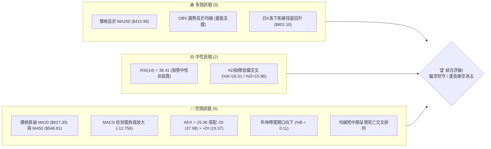
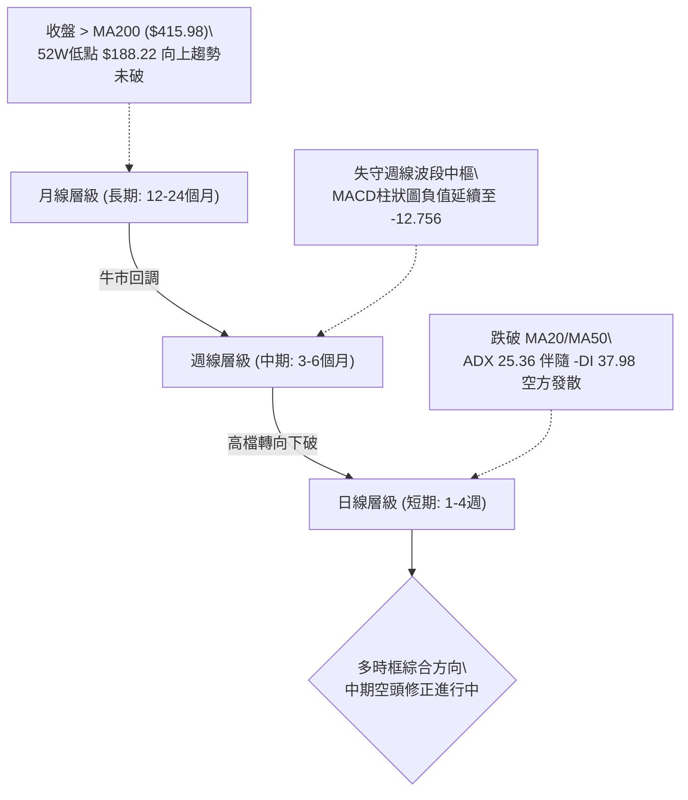
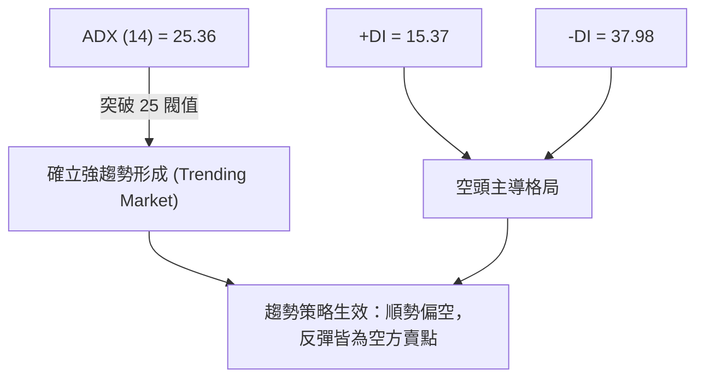
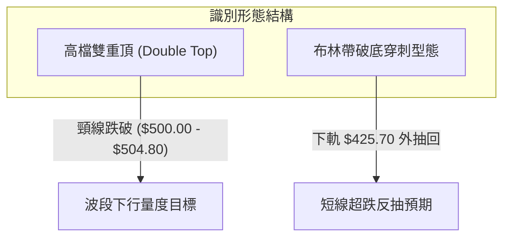
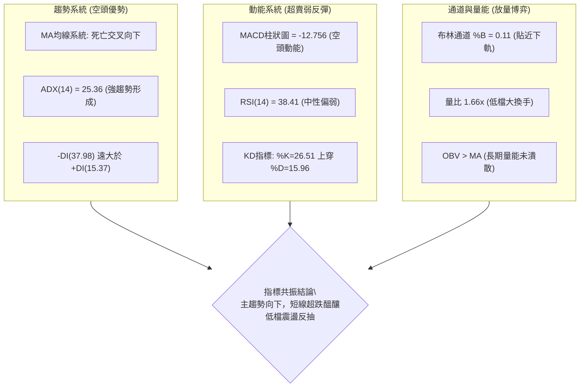
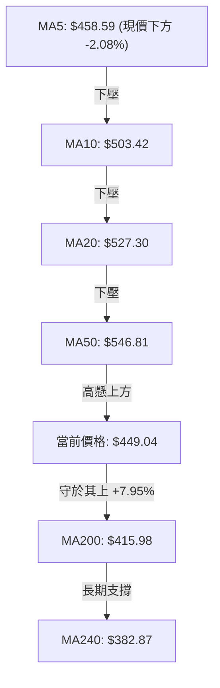
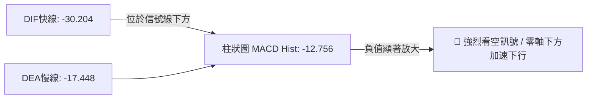
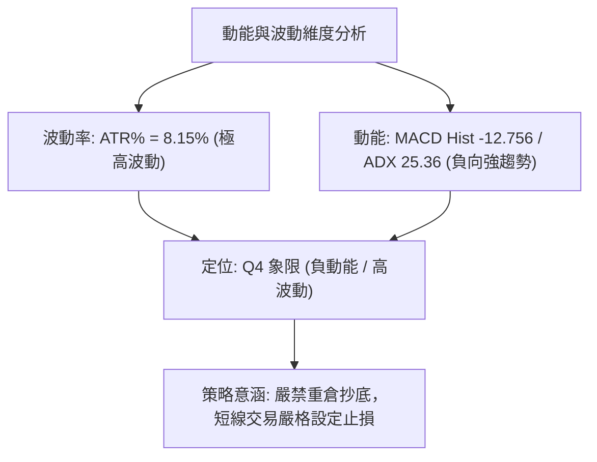
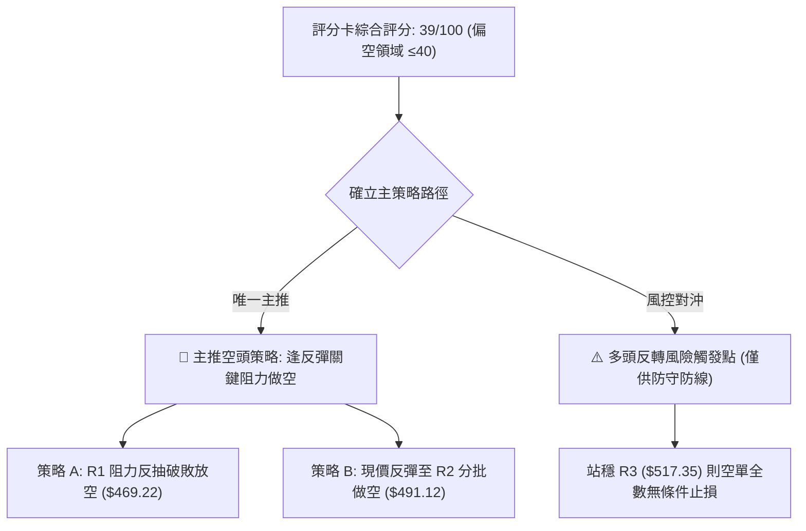
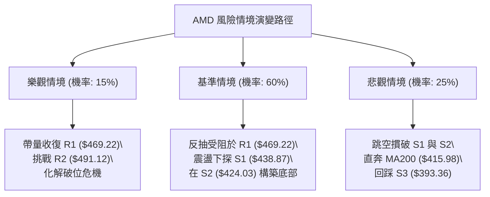

# AMD 技術分析報告

> **報告日期**：2026-11-07 ｜ **語言**：繁體中文 ｜ **數據來源**：Yahoo Finance ｜ **當前價格**：$449.04

---

## 目錄

| 章節 | 內容 |
|------|------|
| [1. 技術面概覽](#1-技術面概覽) | 訊號儀表板、核心指標、評分卡 |
| [2. 趨勢分析](#2-趨勢分析) | 多時框趨勢、長中短期走勢 |
| [3. 圖表形態分析](#3-圖表形態分析) | 形態識別、K線組合、目標價 |
| [4. 支撐與阻力](#4-支撐與阻力) | 關鍵價位、斐波那契回調 |
| [5. 技術指標深度解讀](#5-技術指標深度解讀) | MA/RSI/MACD/布林/成交量 |
| [6. 動能與波動率](#6-動能與波動率) | 動能評估、ATR、Beta |
| [7. 多時框架總結](#7-多時框架總結) | 時框架評分矩陣 |
| [8. 交易策略建議](#8-交易策略建議) | 多空策略、風險報酬比 |
| [9. 風險提示與監控](#9-風險提示與監控) | 監控指標、風險場景 |

---

## 1. 技術面概覽

### 🎯 技術訊號儀表板



### 📊 核心指標速覽表

| 指標類別 | 指標名稱 | 當前數值 | 訊號 | 解讀 |
|----------|----------|----------|------|------|
| **價格** | 當前收盤價 | $449.04 | 🔴 | 跌破短中期均線，處於回調修正格局 |
| **均線** | MA20 | $527.30 | 🔴 | 價格在MA20下方 -14.84%，短線空頭排列 |
| **均線** | MA50 | $546.81 | 🔴 | 價格在MA50下方 -17.88%，中期波段轉弱 |
| **均線** | MA200 | $415.98 | 🟢 | 價格在MA200上方 +7.95%，長期牛市基底尚存 |
| **動能** | RSI(14) | 38.41 | 🟡 | 位於 30-70 中性區間偏下緣，尚未進入極度超賣 |
| **動能** | MACD (12,26,9) | -30.204 | 🔴 | DIF < DEA (-17.448)，Hist 為 -12.756，空頭動能強勁 |
| **波動** | ATR(14) | $36.61 | 🔴 | 佔股價 8.15%，日均波動極劇，市場情緒極度分歧 |
| **趨勢** | ADX(14) / ±DI | 25.36 | 🔴 | ADX>25 確立趨勢形成，-DI(37.98) 壓制 +DI(15.37)，空頭主導 |
| **通道** | 布林通道 %B | 0.11 | 🔴 | 股價逼近下軌 ($425.70)，通道向下發散 |
| **量能** | 最新量 / 20日均量 | 1.66x | 🟢 | 放量收下影線，低檔承接買盤介入 |

### 🏆 技術評分卡

```
╔══════════════════════════════════════════════════════════════╗
║              技術評分卡 — AMD (2026-11-07)                   ║
╠══════════════════════════════════════════════════════════════╣
║ 趨勢強度      ██████░░░░░░░░░░░░░░  30/100  🔴 空頭主導      ║
║ 動能指標      ███████░░░░░░░░░░░░░  35/100  🔴 負動能擴大    ║
║ 支撐穩定度    ██████████░░░░░░░░░░  50/100  🟡 考驗S1/S2防線 ║
║ 成交量配合    ████████████░░░░░░░░  60/100  🟢 低檔放量承接  ║
║ 形態完整度    ████████░░░░░░░░░░░░  40/100  🔴 頭部回調延續  ║
║ 均線排列      ████░░░░░░░░░░░░░░░░  20/100  🔴 短中期空頭    ║
╠══════════════════════════════════════════════════════════════╣
║ 綜合評分      ███████░░░░░░░░░░░░░  39/100  🔴 評級：偏空     ║
╚══════════════════════════════════════════════════════════════╝
```
*(註：綜合評分由六項子評分算術平均：(30 + 35 + 50 + 60 + 40 + 20) ÷ 6 = 39.17，四捨五入為 39/100，落於 ≤40 偏空區間。)*

---

## 2. 趨勢分析

### 🌐 多時框趨勢分析



### 📈 長期趨勢 — 12個月走勢圖（Unicode）

依據月度收盤數據，繪製過去 12 個月價格演變軌跡：

```
AMD 月線收盤走勢圖（過去12個月：2025-12 至 2026-11）
價格軸 ($)
$650 ┤                                      
$600 ┤                                  ●(09月: $611.76)
$550 ┤                          ●(06月: $580.91)
$500 ┤                      ●   │   │   │   ●(10月: $504.80)
$450 ┤                      │   ●───●   │   │   ●(現價: $449.04)
$400 ┤                      │  (07月)(08月) │
$350 ┤                  ●(04月: $354.49)    │
$300 ┤                  │                   │
$250 ┤              ●   │                   │
$200 ┤●───────●─────●───┘                   │
$150 ┤(12月) (02月)(03月: $203.43)          │
     └┬───────┬─────┬───┬───┬───┬───┬───┬───┬───┬───┬───►
     12月    01月  02月 03月 04月 05月 06月 07月 08月 09月 10月 11月
```

#### 走勢特徵分析表格

| 階段區間 | 起始價 → 結束價 | 漲跌幅 | 走勢特徵與結構分析 |
|----------|----------------|--------|--------------------|
| **2025-12 ~ 2026-03** | $214.16 → $203.43 | -5.01% | 低檔築底蓄勢，於 $200 心理大關形成堅固防守平台 |
| **2026-03 ~ 2026-06** | $203.43 → $580.91 | +185.56% | 爆發性主升浪，單月巨幅拉升，成交量伴隨基本面擴張 |
| **2026-06 ~ 2026-08** | $580.91 → $470.72 | -18.97% | 首波獲利了結回檔，於 $470 附近獲得支撐後橫盤蓄勢 |
| **2026-08 ~ 2026-09** | $470.72 → $611.76 | +29.96% | 二度衝高創波段新高，逼近 52 週最高點 $658.52 遇阻 |
| **2026-09 ~ 2026-11** | $611.76 → $449.04 | -26.60% | 高檔雙頂回落，破位下行，目前考驗 50% 斐波那契回調位 |

### 📊 中期趨勢（週線分析）

中期走勢自 2026-10-09 當週創下 52 週高點 $658.52 後迅速轉折。連續數週放量下挫，收盤價由 10 月初的 $633.91 連續摜破 $600、$550 與 $500 大關。本週（2026-11-06）週 K 出現高達 235,300,300 股的爆量，盤中最低下探 $402.10，收盤拉回至 $449.04。

```
週線關鍵壓力與支撐結構示意圖：
阻力層  $547.53 ══════════════════════════════ [Fib 23.6% / MA50 重疊區]
阻力層  $478.87 ────────────────────────────── [Fib 38.2% / 前波週K平台]
現價位  $449.04 ······························ [當前收盤價]
支撐層  $424.03 ══════════════════════════════ [波段低點聚類 S2 / Fib 50%: $423.37]
防守底  $415.98 ━━━━━━━━━━━━━━━━━━━━━━━━━━━━━━ [長期牛熊分水嶺 MA200]
```

### ⚡ 趨勢強度評估（ADX 解讀）



#### ADX 指標強度對照表

| 指標名稱 | 當前數值 | 參考閥值 | 狀態判斷 | 技術含義 |
|----------|----------|----------|----------|----------|
| **ADX(14)** | 25.36 | > 25.0 | 強趨勢確立 | 市場擺脫盤整，單邊下行趨勢動能正在成形 |
| **+DI(14)** | 15.37 | 基準參考 | 多方動能低迷 | 買盤缺乏連續上攻意願，多頭抵抗力道脆弱 |
| **-DI(14)** | 37.98 | 基準參考 | 空方佔據絕對優勢 | 空方拋壓沈重，-DI 顯著高於 +DI 達 22.61 個點位 |
| **DI 差距** | -22.61 | > 15.0 | 單邊空頭趨勢 | 差距擴大確認賣壓主導，切忌盲目摸底 |

---

## 3. 圖表形態分析

### 🔍 形態識別系統



#### 形態識別信心度與量度目標

| 形態名稱 | 信心度 | 判斷依據（引用數據） | 完成度 | 目標價（附計算式） |
|----------|--------|----------------------|--------|--------------------|
| **高檔雙頂 (M頭)** | 75% | 頂1(2026-06收盤 $580.91/高點$639.00)、頂2(2026-10-09高點 $658.52)，近兩週失守頸線 $504.80 | 85% | 頸線 $504.80 − 形態高度($658.52 − $504.80 = $153.72) = **$351.08** (由形態高度推算) |
| **日線超賣探底針** | 65% | 2026-11-05 最低探至 $402.10，收盤大幅拉起，11-06 延續收於 $449.04 | 70% | 反彈目標為缺口與第一阻力位 **$469.22** (引用數據 R1) |
| **其他幾何形態** | N/A | 數據中未偵測到頭肩頂、大型三角收斂等形態 | N/A | 訊號不足，僅做指標與均線型態解讀 |

### 🕯️ 重要 K 線形態分析

嚴格依據提供的「近 10 根日 K」與「近 8 根週 K」數據進行微觀 K 線組合判讀：

#### 近 10 根日 K 棒線型剖析

| 日期 | 開盤價 | 最高價 | 最低價 | 收盤價 | 成交量 | K線形態 | 深度解讀與多空意涵 | 訊號 |
|:---:|:---:|:---:|:---:|:---:|:---:|:---:|:---|:---:|
| 10-26 | $522.79 | $533.50 | $514.01 | $531.28 | 16,796,800 | 溫和陽線 | 縮量小幅反彈，受制於 MA20 均線下方 | 🟡 |
| 10-27 | $539.49 | $563.92 | $538.50 | $560.26 | 20,599,900 | 中長陽線 | 向上突破，多方短暫取回發球權 | 🟢 |
| 10-28 | $573.08 | $579.18 | $560.52 | $578.44 | 18,848,600 | 高檔長陽 | 創反彈高點 $579.18，但上影線顯現高檔拋壓 | 🟡 |
| 10-29 | $562.27 | $575.10 | $560.57 | $566.42 | 16,873,300 | 滯漲小陰 | 縮量十字星變盤線，多頭動能衰竭 | 🔴 |
| 10-30 | $508.53 | $520.40 | $492.21 | $504.80 | 39,697,500 | 跳空放量大陰 | 跳空崩跌 -10.88%，量能翻倍，確立趨勢翻空 | 🔴 |
| 11-02 | $510.71 | $512.82 | $466.07 | $466.84 | 32,141,000 | 光腳中長陰 | 延續性拋售，收於當日最低點附近，空頭極盛 | 🔴 |
| 11-03 | $479.99 | $497.40 | $473.54 | $483.90 | 35,255,100 | 小陽十字反抽 | 弱勢反抽，高點不過前一日陰線中軸 | 🟡 |
| 11-04 | $485.25 | $514.61 | $476.50 | $488.78 | 50,984,800 | 長上影紡錘線 | 衝高回落，受制於 $514.61，放量滯漲 | 🔴 |
| 11-05 | $452.50 | $456.20 | $402.10 | $404.40 | 71,237,400 | 放量長陰穿刺 | 巨量恐慌拋售，下影線微弱，穿透下軌觸及 $402.10 | 🔴 |
| 11-06 | $444.43 | $459.80 | $433.30 | $449.04 | 45,682,000 | 低開紅實體陽線 | 逆勢抗跌反彈，量能維持 45.6M 高檔，多頭進場抵抗 | 🟢 |

#### 近 8 根週 K 棒結構分析

| 週結算日 | 開盤價 | 最高價 | 最低價 | 收盤價 | 週成交量 | K線形態 | 結構解讀 | 訊號 |
|:---:|:---:|:---:|:---:|:---:|:---:|:---:|:---|:---:|
| 09-18 | $486.28 | $559.91 | $480.33 | $559.82 | 124,593,800 | 突破大陽線 | 突破整理區間，主升浪段 | 🟢 |
| 09-25 | $583.88 | $639.00 | $582.27 | $630.63 | 132,066,300 | 衝高長陽 | 買盤強盛，逼近歷史高位區 | 🟢 |
| 10-02 | $624.90 | $645.46 | $596.07 | $633.91 | 92,386,900 | 高檔長下影 | 震盪加劇，量能縮小顯現背離跡象 | 🟡 |
| 10-09 | $630.61 | $658.52 | $606.00 | $608.10 | 93,746,000 | 射擊之星 | 創 52 週新高 $658.52 後遭重挫收低，見頂信號 | 🔴 |
| 10-16 | $599.93 | $606.20 | $526.83 | $528.75 | 107,042,200 | 烏雲蓋頂大陰 | 長黑下破，確認波段頭部成立 | 🔴 |
| 10-23 | $551.78 | $556.79 | $502.60 | $516.79 | 96,570,600 | 弱勢下挫陰線 | 連續尋底，支撐逐步退守 | 🔴 |
| 10-30 | $522.79 | $579.18 | $492.21 | $504.80 | 112,816,100 | 長上影墓碑線 | 反彈遭無情壓制，失守 $500 關卡 | 🔴 |
| 11-06 | $510.71 | $514.61 | $402.10 | $449.04 | 235,300,300 | 爆量長下影錘頭 | 週量爆出 2.35 億股天量，探底 $402.10 回升 47 點 | 🟢 |

### 📉 ASCII 走勢形態示意圖

```
雙頂確立與破位頸線下行圖解：
   頂部1: $639.00               頂部2: $658.52 (52W High)
      ╭─────╮                     ╭─────╮
     ╱       ╲                   ╱       ╲
────╯         ╲                 ╱         ╲
               ╲   頸線回抽點    ╱           ╲
                ╰──────┬────────╯             ╲
                    $504.80 (頸線破位點)       ╲
                       │                        ╲
                       ▼                         ╲  加速崩跌段
                                                  ╲
                                                   ╰───────► 現價 $449.04
                                                           │
                                                           ▼ 探底 $402.10 反彈
```

---

## 4. 支撐與阻力

### 🗺️ 關鍵價位分布圖（Unicode）

```
AMD 價位結構分布圖
═════════════════════════════════════════════════════════════════
$547.53 ║████████████████████████████████║ 強波段阻力 (Fib 23.6%)
$517.35 ║████████████████████████        ║ 強阻力 R3 (密集套牢區)
$491.12 ║████████████████                ║ 阻力 R2 (反彈中繼壓力)
$469.22 ║████████████                    ║ 短線阻力 R1 (前波低點聚類轉壓力)
$449.04 ╠════════════════════════════════╣ ◄ 當前收盤價 ($449.04)
$438.87 ║▓▓▓▓▓▓▓▓▓▓▓▓                    ║ 近期支撐 S1 (首道緩衝線)
$424.03 ║▓▓▓▓▓▓▓▓▓▓▓▓▓▓▓▓▓▓▓▓            ║ 強支撐 S2 (波段支撐/接近Fib 50%)
$415.98 ║████████████████████████        ║ 牛熊分水嶺 (MA200 生命線)
$393.36 ║████████████████████████████████║ 核心防守 S3 (終極支撐層)
═════════════════════════════════════════════════════════════════
```

### 🚧 阻力位分析表

所有價位均嚴格引用提供之關鍵價位聚類數據：

| 阻力級別 | 價位 | 形成原因 | 突破難度 | 重要性 |
|:---:|:---:|:---|:---:|:---:|
| **R1** | **$469.22** | 近一年波段高低點密集轉折聚類，11-02 跳空重挫後形成的反壓位 | 🟡 中等 | 短線多頭反抽的首要試金石，突破方能化解極端空頭氣勢 |
| **R2** | **$491.12** | 近一年波段高點聚類，與 10-30 下跌中樞及 11-03、11-04 盤整區重合 | 🔴 偏高 | 多空轉換的重要防線，若無法收復，中期下行結構不變 |
| **R3** | **$517.35** | 波段密集套牢區，接近 MA20 ($527.30) 及 10 月末破位起跌點 | 🔴 極高 | 強阻力帶，聚集巨量套牢籌碼，短線缺乏重大利多極難越過 |

### 🛡️ 支撐位分析表

所有價位均嚴格引用提供之關鍵價位聚類數據：

| 支撐級別 | 價位 | 形成原因 | 守住機率 | 重要性 |
|:---:|:---:|:---|:---:|:---:|
| **S1** | **$438.87** | 近一年波段低點聚類，11-06 日線收盤前防守之分時支撐平台 | 60% | 短線多頭維持反彈架構的底線，失守將重測下軌 |
| **S2** | **$424.03** | 波段低點聚類，高度共振斐波那契 50.0% 回調位 ($423.37) 與布林下軌 ($425.70) | 75% | 核心黃金共振支撐區，為多頭極為重要的中期堡壘 |
| **S3** | **$393.36** | 近一年波段低點聚類，下方緊貼 MA240 ($382.87) 與 Fib 61.8% ($367.87) | 85% | 中長期強支撐帶，失守意味著本輪牛市格局徹底終結 |

### 📐 斐波那契回調位分析

依據 52 週波段區間（$188.22 → $658.52，總垂直波幅 $470.30）計算之精確回調架構：

| 回調比例 | 斐波那契價位 | 當前價位相對位置與深度技術解讀 |
|:---:|:---:|:---|
| **0.0% (52W High)** | **$658.52** | 歷史極值高點，中期天花板，形成長期強壓 |
| **23.6%** | **$547.53** | 第一道回調支撐已告失守，目前與 MA50 ($546.81) 共振轉化為中期重大反壓 |
| **38.2%** | **$478.87** | 強弱分界線已被實體陰線跌穿，上方構成多頭反攻的沉重反壓阻力 |
| **50.0%** | **$423.37** | **當前價格 ($449.04) 正運行於 38.2% ($478.87) 與 50.0% ($423.37) 區間**；本週盤中下探 $402.10 曾短暫假跌破該位，隨後迅速收回其上，顯示多頭在 50% 關卡展現強烈防守意志 |
| **61.8%** | **$367.87** | 黃金分割終極回調位，若後續跌破 S2 ($424.03) 及 MA200 ($415.98)，將直奔此防線 |
| **78.6%** | **$288.86** | 深度回調警戒區（數據未觸及） |
| **100.0% (52W Low)**| **$188.22** | 52 週最低點，長期結構起點 |

---

## 5. 技術指標深度解讀

### 🎛️ 指標訊號總覽



### 📈 移動平均線排列分析



#### 均線系統全面剖析表

| 均線名稱 | 數值 | 現價偏離幅度 | 排列形態 | 趨勢意涵 |
|:---:|:---:|:---:|:---:|:---|
| **MA5** | $458.59 | -2.08% | 空頭排列下彎 | 短線第一道動態壓制線，未收復前短線弱勢難改 |
| **MA10** | $503.42 | -10.80% | 空頭排列下彎 | 10日下墜趨勢線，對應波段空方防守點 |
| **MA20** | $527.30 | -14.84% | 空頭排列下彎 | 月線級別崩塌，作為布林通道中軌，構成中期反壓 |
| **MA50** | $546.81 | -17.88% | 空頭排列走平下彎| 季線支撐破位轉壓力，多頭中趨勢結構遭到破壞 |
| **MA60** | $535.80 | -16.19% | 走低下彎 | 60日線與MA50形成空頭夾殺層 |
| **MA120** | $521.17 | -13.84% | 走低下彎 | 半年線失守，中長期籌碼進入套牢清理期 |
| **MA200** | $415.98 | +7.95% | **向上推升** | **牛熊生命線**，價格在其上方，長期結構尚未完全翻熊 |
| **MA240** | $382.87 | +17.28% | 向上推升 | 年線基底深厚，提供終極多頭宏觀支撐 |

*綜合研判：短中期均線呈教科書式空頭排列，但長期 MA200/MA240 仍呈多頭向上發散，定義當前為「長期牛市結構下的中期深幅回調」。*

### 📉 RSI(14) 分析

#### RSI 數值進度條
```
RSI(14): 38.41  [█████████░░░░░░░░░░░░░░░]  (38.41/100 弱勢中性)
               0         30         70       100
                         [超賣]    [超買]
```
- **區間評估**：RSI 位於 38.41，處於 30-70 的偏空弱勢區，但尚未跌破 30 進極度超賣。表明市場下行動能尚未衰竭至極致，仍有慣性下探風險。
- **背離判斷**：依據近 20 根 K 棒的首尾對比，價格由高檔回落，RSI 亦同步下行，**無明顯底背離亦無頂背離**，指標走勢充分確認價格下跌趨勢之真實性。

### 📊 MACD(12/26/9) 訊號解讀


- **數據解讀**：DIF (-30.204) 遠在信號線 DEA (-17.448) 之下，且兩者皆深居零軸下方。
- **背離檢驗**：週線級別 MACD 柱狀圖在 10 月初為 +14.199，至本週急劇縮減至 -12.756，零軸下負動能持續發散，**未出現任何多頭背離**，暗示空方動能仍佔絕對主導。

### 📦 布林通道分析

```
布林通道結構示意圖 (帶寬: $203.19)：
$628.89 ════════════════════════════════════════════════════ 上軌
        │                                                  
        │                                                  
$527.30 ──────────────────────────────────────────────────── 中軌 (MA20)
        │                                                  
$449.04 ··················· [現價: %B = 0.11]              
$425.70 ════════════════════════════════════════════════════ 下軌
        │  ▲                                               
$402.10 ┴──┼── (11-05 穿刺低點，迅速收回軌道內)             
```
- **帶寬與位置**：通道上軌 $628.89、中軌 $527.30、下軌 $425.70。當前價格 $449.04，%B 為 0.11。
- **通道行為解讀**：%B 緊貼 0.10 水平，說明價格處於極度弱勢區。日前 11-05 盤中最低 $402.10 曾穿透下軌（穿刺率高達 5.5%），引發隨後的均值回歸買盤推升至 $449.04。目前通道口有「張口下行」跡象，需防範沿下軌向下陰跌的「走下軌」行情。

### 💹 成交量分析（量價配合度）

- **量比與換手**：最新日成交量為 45,682,000 股，相較於 20 日均量 27,586,460 股，量比達到 **1.66x**。
- **週量異動**：本週成交量爆發至 **235,300,300 股**，創下近半年最大週換手量。
- **OBV 趨勢解讀**：數據顯示「OBV > MA → 量能支撐上漲」。這表明儘管短期出現急劇拋售，但過去半年積累的累積能量潮並未出現恐慌性清倉潰散。低檔巨量收長下影線（最低 $402.10 拉升至收盤 $449.04），反映機構資金在大跌中啟動被動吸籌程序。

---

## 6. 動能與波動率

### ⚡ 動能評估四象限

| 象限位置 | 動能維度 | 波動維度 | AMD 當前狀態 | 戰略評估 |
|:---:|:---:|:---:|:---:|:---|
| **第一象限 (Q1)** | 強動能 (多頭) | 低波動 | — | 最佳趨勢持倉區 |
| **第二象限 (Q2)** | 弱動能 (盤整) | 低波動 | — | 突破前夕觀察期 |
| **第三象限 (Q3)** | 強動能 (單邊) | 高波動 | — | 主升浪爆發期 |
| **第四象限 (Q4)** | **負向強動能 (空頭)** | **高波動** | **✓ (AMD 當前落點)** | **極高風險區：空頭加速與非理性恐慌並存，適合輕倉或順勢防守** |



### 📊 ATR 波動率分析

- **ATR(14) 數值**：**$36.61**（佔現價 $449.04 之比例高達 **8.15%**）。
- **波動特性評估**：單日 $36.61 的真實波幅意味著正常的日內噪聲即可吞噬一般投資者的止損。
- **止損距離建議**：
  - 日內或超短線：至少需預留 1.0 倍 ATR（約 **$36.60**）。
  - 波段交易：必須採用 1.5 倍至 2.0 倍 ATR 作為緩衝帶（約 **$54.90 ~ $73.20**），以防止在劇烈震盪中被洗盤出場。

### 📐 Beta 與市場相關性

- **Beta 係數**：**2.542**。
- **相關性剖析**：AMD 具備超高 Beta 特性。當標普 500 或費城半導體指數上漲 1% 時，AMD 理論上漲 2.54%；反之，大盤回調 1% 時，AMD 跌幅亦擴大至 2.54% 以上。當前 AI 板塊整體面臨獲利回吐，高 Beta 特性加劇了 AMD 的波段回撤烈度。

---

## 7. 多時框架總結

### 📋 時框架評分表

| 時框架 | 趨勢方向 | 動能狀態 | 均線排列 | 圖表形態 | 綜合評分 | 戰略建議 |
|:---:|:---:|:---:|:---:|:---:|:---:|:---|
| **長期 (月線)** | 🟢 偏多 | 🟡 中性減弱 | 🟢 多頭向上 | 雙頂構築未破 MA200 | 65/100 | 長線底倉保留，嚴密監控 $415.98 |
| **中期 (週線)** | 🔴 偏空 | 🔴 強空方動能 | 🔴 跌破多條均線 | 巨量黑K破頸線 | 35/100 | 波段多單離場，逢反彈減磅 |
| **短期 (日線)** | 🔴 偏空 | 🟡 超賣反抽 | 🔴 標準空頭排列 | 破底後十字星抗跌 | 30/100 | 順勢做空為主，短線超跌反彈僅供超短線快進快出 |

### 🔲 綜合訊號矩陣

| 維度 | 短期 (日線) | 中期 (週線) | 長期 (月線) | 衝突狀態與收斂對策 |
|:---|:---:|:---:|:---:|:---|
| **趨勢方向** | 空頭向下 | 空頭向下 | 牛市回調 | 中短趨勢一致偏空，壓制長期格局 |
| **動能訊號** | KD低檔交叉反抽 | MACD柱狀負值擴大 | 高檔鈍化下行 | 短線反彈受制於中期空頭大趨勢 |
| **均線架構** | 跌破 MA20/MA50 | 跌破週線 20MA | 守於 MA200 之上 | 均線系統處於「混合排列」的激烈重構期 |
| **量價關係** | 放量下影線 (反彈) | 爆量長陰 (出貨) | 高檔換手 | 長短期資金博弈，機構低檔換手接盤 |

### ⚖️ 多時框收斂結論

依據多時框收斂規則：
1. **行情性質判定**：當前日線 ADX(14) 為 **25.36**，數值大於 25 臨界點，確立當前市場處於**單邊趨勢行情（Trending Market）**，而非無方向的盤整震盪。
2. **主導時框取捨**：依規則，趨勢行情下以中長期方向（週線/MA50）為主導，日線僅作為尋找次級折返入場時機的工具。中期週線跌破波段頸線，MA50 ($546.81) 高懸上方，且 -DI(37.98) 具有絕對統治力。
3. **最終收斂結論**：**唯一方向性結論為「偏空（空頭主導下的弱勢反抽）」**。任何短期日線級別的反彈，均視為空頭趨勢中的次級折返走勢，逢反彈至阻力位應視為空方加碼或做空契機。此結論完全收斂至第 8 章之偏空主策略。

---

## 8. 交易策略建議

### 🗺️ 策略決策流程圖



### 🧭 策略路由

**當前主策略方向 = 偏空（空頭主導，逢反彈做空）（依評分 39/100）**
依據第 1 章技術評分卡之綜合評分 39/100（≤40 偏空區間），本報告嚴格執行紀律，**全面主推空頭交易策略**。不進行兩頭下注，多頭訊號僅作為空方回補與風控警示。

### 🎯 價格情境階梯（Price Scenarios）

價位嚴格引用第 4 章關鍵價位聚類與斐波那契精確數值：

| 觸發條件 | 下一目標 | 後續延伸 | 情境技術含義 |
|:---|:---:|:---:|:---|
| **突破 R1 $469.22** | R2 $491.12 | R3 $517.35 | 短線超跌反抽延伸，測試上方套牢均線壓力帶 |
| **跌破現價區間 ($449.04)** | S1 $438.87 | S2 $424.03 | 弱勢反彈夭折，重新回歸單邊下行趨勢 |
| **實體跌破 S2 $424.03** | MA200 $415.98 | S3 $393.36 | 空頭全面加速，考驗長期牛熊生命線，恐慌盤出籠 |

### 📊 情境機率分佈

| 情境劇本 | 發生機率 | 主要技術依據 |
|:---|:---:|:---|
| **情境一：弱勢反抽後回落探底** | **60%** | ADX 25.36 伴隨 -DI 37.98，空頭動能強勁；日線放量陽線僅為超賣反抽，受制於下彎 MA5 ($458.59) 與 R1 ($469.22) |
| **情境二：直接破位下行破底** | **25%** | MACD 柱狀圖為 -12.756，零軸下負動能持續發散；若大盤半導體板塊走弱，極易直接摜破 S1 ($438.87) 測 S2 ($424.03) |
| **情境三：強勢反轉突破收復均線** | **15%** | 需連續帶量突破 R2 ($491.12) 與 R3 ($517.35) 並站上 MA20，目前量能結構與均線下壓趨勢極難支持此機率 |

### 🔴 主策略詳情（空頭交易策略）

所有價位均嚴格引用提供之數值。進場點以單一精確值計算風險報酬比（規則 17）：
- **做空風險報酬比公式** = (進場價 − 目標價 T1) ÷ (止損價 − 進場價)。

| 策略要素 | 策略 A（保守型：反抽阻力破敗做空） | 策略 B（波段型：現價反彈做空） |
|:---|:---:|:---:|
| **策略名稱** | **R1 阻力位反彈遇阻做空** | **現價反抽中繼做空** |
| **進場條件** | 股價反彈至 R1 遇阻出現滯漲日K陰線 | 週一開盤若反彈無力，直接於現價偏上位置分批建立空單 |
| **進場價格** | **$469.22** (引用阻力位 R1) | **$455.00** (以現價反抽波段點設定) |
| **目標價 T1** | **$424.03** (引用支撐位 S2) | **$424.03** (引用支撐位 S2) |
| **目標價 T2** | **$393.36** (引用支撐位 S3) | **$393.36** (引用支撐位 S3) |
| **止損價格** | **$491.12** (引用阻力位 R2) | **$469.22** (引用阻力位 R1) |
| **風險報酬比** | **1 : 2.06（以 T1 計）**<br>*(469.22-424.03)/(491.12-469.22) = 45.19/21.90*<br>*(另以 T2 計為 1 : 3.46)* | **1 : 2.18（以 T1 計）**<br>*(455.00-424.03)/(469.22-455.00) = 30.97/14.22*<br>*(另以 T2 計為 1 : 4.33)* |
| **成功機率** | **65%** | **55%** |
| **建議倉位** | **15% - 20%** (中等倉位) | **10% - 15%** (輕倉試單) |

### ⚠️ 反向風險觸發點（對沖提示）

- **觸發轉強價位**：**$491.12 (R2)**。若日線實體陽線收盤站穩 R2 之上，說明超跌反彈演化為級別擴大的反轉，空頭主策略面臨失效。
- **終極止損警報**：**$517.35 (R3)**。此處為日線級別雙頂頸線與下彎 MA20 區域，一旦被多頭有效突破收復，必須無條件平倉所有空單對沖部位，市場重回多頭結構。

### ⭐ 整體訊號強度評星

```
做多訊號強度：★★☆☆☆  (2/5星 — 短線僅具備超跌反抽特徵，空間受限)
做空訊號強度：★★★★☆  (4/5星 — 均線與動能指標高度共振偏空)
整體可信度：  ★★★★☆  (4/5星 — 趨勢明確，ADX>25 支撐趨勢交易)
```

---

## 9. 風險提示與監控

### ✅ 關鍵監控指標 Checklist

```
╔══════════════════════════════════════════════════════════════════╗
║              每日交易關鍵技術監控清單 (Checklist)                 ║
╠══════════════════════════════════════════════════════════════════╣
║ [ ] 監控支撐位 S1 ($438.87) 是否失守：跌破則確立反彈結束        ║
║ [ ] 監控支撐位 S2 ($424.03) 守護狀況：與 Fib 50% 匯聚之核心防線  ║
║ [ ] 追蹤 MA200 ($415.98) 牛熊分水嶺：長期多頭最後防守底線       ║
║ [ ] 觀察阻力位 R1 ($469.22) 反壓強度：反抽是否出現放量長上影線   ║
║ [ ] 追蹤日線 RSI 是否跌破 30：檢驗是否觸發非理性極度恐慌拋售     ║
║ [ ] 監控 MACD 柱狀圖是否由 -12.756 收斂向上：空頭回補初階訊號    ║
║ [ ] 檢查每日成交量是否跌破 20 日均量 (27.58M)：縮量陰跌風險     ║
║ [ ] 留意半導體板塊指數 (SOX) 聯動性：Beta=2.542 帶來的放大效應  ║
╚══════════════════════════════════════════════════════════════════╝
```

### ⚠️ 風險場景分析



### 🛡️ 風險管理重要提醒

1. **極高 ATR 倉位縮減原則**：當前 ATR(14) 高達 $36.61（波幅 8.15%）。在如此高波動環境下，任何單筆交易之名義本金部位必須壓縮至正常時期的 **50% 以下**。切勿在跌破支撐時進行「逆勢加碼攤平」。
2. **高 Beta 槓桿殺傷力**：Beta 值為 2.542，表明 AMD 波動性為整體大盤的 2.5 倍以上。若持有槓桿型 ETF（如 NVDL、SOXL 等）或期權單邊合約，極易遭受波動率毀滅性打擊，建議嚴格以現股或現股融券為主。
3. **斐波那契關鍵位置的假突破/假跌破**：當前價位運行於 Fib 50.0% ($423.37) 與 Fib 38.2% ($478.87) 之間。11-05 出現之 $402.10 即為典型之盤中假跌破，盤中常伴隨洗盤動作，一切關鍵價位之確認必須以**每日收盤價（Close）**為最終評判依據。

---

## 📋 報告總結

```
╔══════════════════════════════════════════════════════════════════╗
║                    AMD 技術分析報告總結                          ║
╠══════════════════════════════════════════════════════════════════╣
║ 報告日期：2026-11-07                                             ║
║ 當前價格：$449.04                                                ║
║ 分析評級：🔴 偏空（空頭主導，逢高做空，綜合評分：39/100）        ║
╠══════════════════════════════════════════════════════════════════╣
║ 關鍵結論：                                                       ║
║ ├─ 長期趨勢：🟢 偏多（收盤價高於 MA200 $415.98，牛市基底尚在）   ║
║ ├─ 中期趨勢：🔴 偏空（高檔雙頂破頸線，週線 MACD 負值擴大至-12.7）║
║ ├─ 短期趨勢：🔴 偏空（跌破 MA20/MA50，ADX 25.36 伴隨 -DI 主導）   ║
║ ├─ 關鍵支撐：S1: $438.87 ｜ S2: $424.03 ｜ S3: $393.36           ║
║ ├─ 關鍵阻力：R1: $469.22 ｜ R2: $491.12 ｜ R3: $517.35           ║
║ └─ 斐波那契：現價落於 Fib 38.2% ($478.87) 與 Fib 50.0% ($423.37) ║
╠══════════════════════════════════════════════════════════════════╣
║ 最優策略組合：                                                   ║
║ 1. 🥇 最佳機會：策略 A (保守型) — 反抽 R1 $469.22 破敗做空，      ║
║                  止損 $491.12，目標 T1 $424.03 (風報比 1:2.06)  ║
║ 2. 🥈 次選機會：策略 B (波段型) — 現價 $455.00 附近輕倉建立空單， ║
║                  止損 $469.22，目標 T1 $424.03 (風報比 1:2.18)  ║
║ 3. 🥉 防守對策：多頭僅作為對沖考量，突破 R3 $517.35 嚴格空單止損 ║
╚══════════════════════════════════════════════════════════════════╝
```

---

> ⚠️ **免責聲明**：本報告為技術分析研究，所有數據、圖表及價位推算均基於歷史量價資訊（Yahoo Finance）。本報告**僅供研究與學術參考**，**不構成任何形式的投資建議、要約或承諾**。金融市場投資具有極高風險，投資人應獨立思考並自行承擔交易損益。

---

*報告生成時間：2026-11-07 ｜ 數據來源：Yahoo Finance ｜ 分析框架：多時框架量化技術分析*