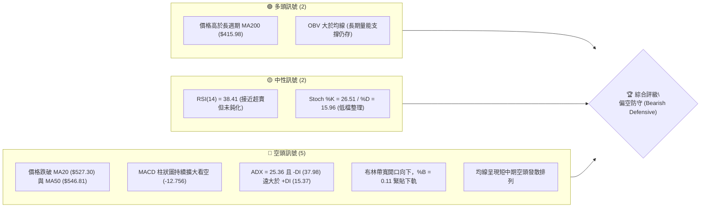
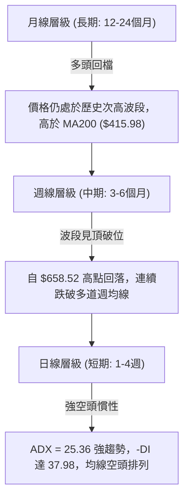
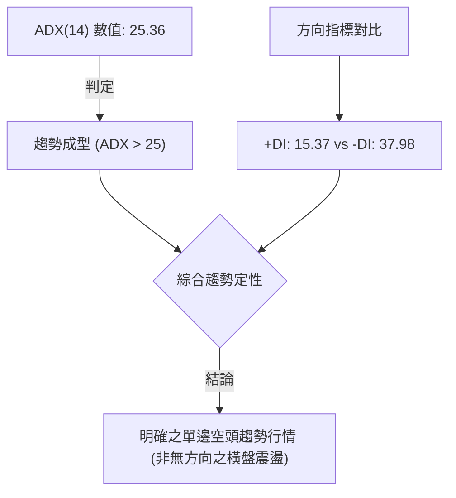
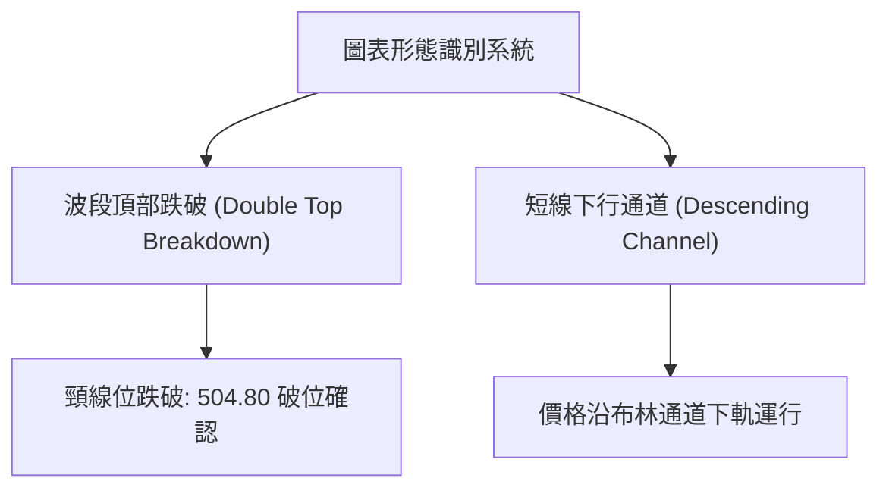
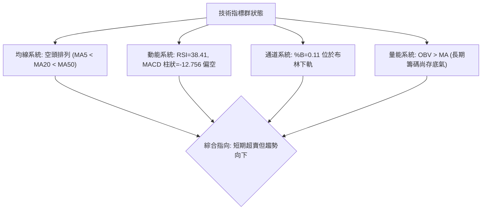
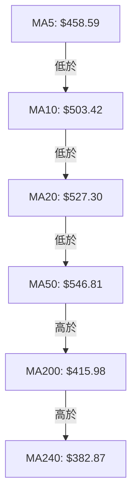
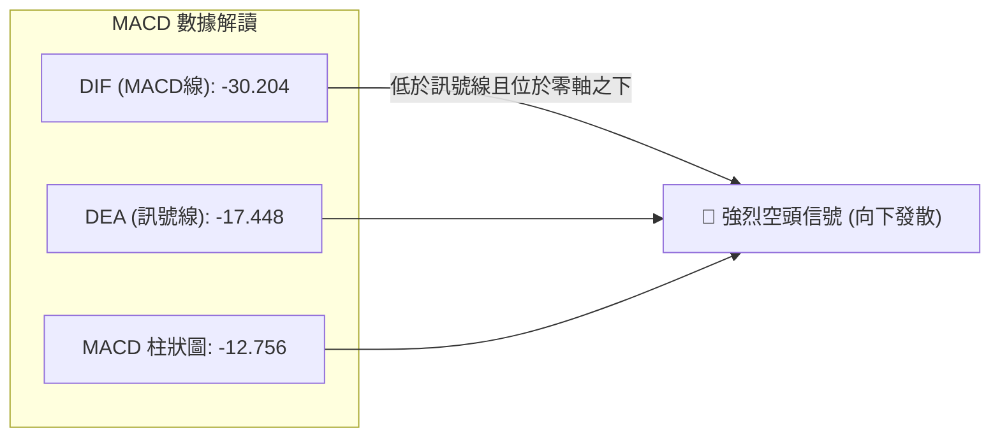
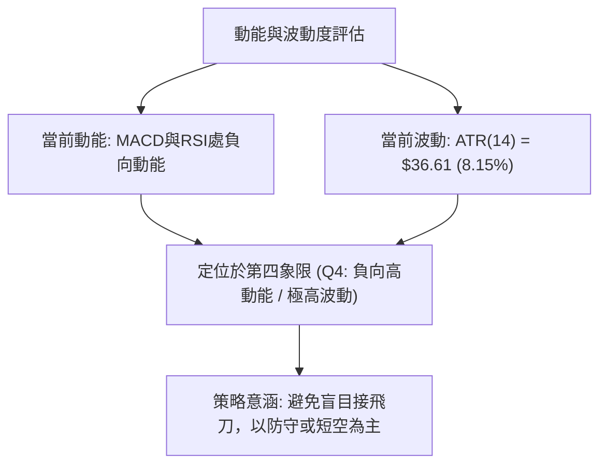
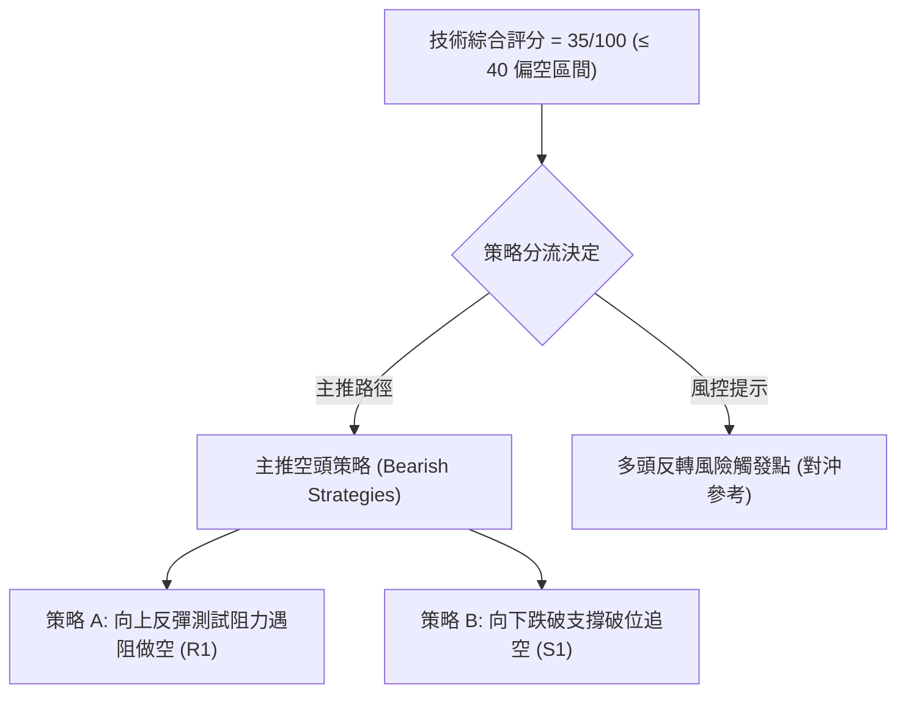
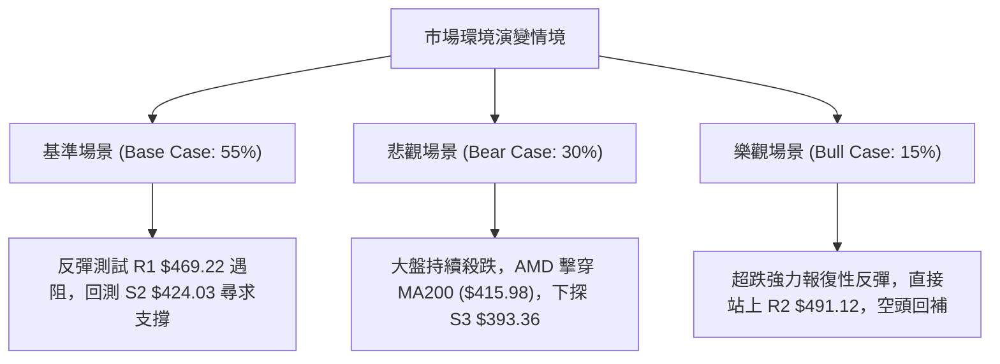

# AMD 技術分析報告

> **報告日期**：2026-11-08 ｜ **語言**：繁體中文 ｜ **數據來源**：Yahoo Finance ｜ **當前價格**：$449.04

---

## 目錄

| 章節 | 內容 |
|------|------|
| [1. 技術面概覽](#1-技術面概覽) | 訊號儀表板、核心指標、評分卡 |
| [2. 趨勢分析](#2-趨勢分析) | 多時框趨勢、長中短期走勢 |
| [3. 圖表形態分析](#3-圖表形態分析) | 形態識別、K線組合、目標價 |
| [4. 支撐與阻力](#4-支撐與阻力) | 關鍵價位、斐波那契回調 |
| [5. 技術指標深度解讀](#5-技術指標深度解讀) | MA/RSI/MACD/布林/成交量 |
| [6. 動能與波動率](#6-動能與波動率) | 動能評估、ATR、Beta |
| [7. 多時框架總結](#7-多時框架總結) | 時框架評分矩陣 |
| [8. 交易策略建議](#8-交易策略建議) | 多空策略、風險報酬比 |
| [9. 風險提示與監控](#9-風險提示與監控) | 監控指標、風險場景 |

---

## 1. 技術面概覽

### 🎯 技術訊號儀表板



### 📊 核心指標速覽表

| 指標類別 | 指標名稱 | 當前數值 | 訊號 | 解讀 |
|----------|----------|----------|:----:|------|
| **價格** | 當前價格 | $449.04 | 🔴 | 位於 52 週區間 55.5%，自近期高點劇烈回檔 |
| **均線** | MA20 | $527.30 | 🔴 | 現價低於 MA20 達 -14.84%，短中期下行壓力沉重 |
| **均線** | MA50 | $546.81 | 🔴 | 跌破中期生命線，中期結構轉弱 |
| **均線** | MA200 | $415.98 | 🟢 | 現價高於長期年線 +7.95%，長期牛市基底尚未瓦解 |
| **動能** | RSI(14) | 38.41 | 🟡 | 位於 30–70 中性偏弱區間，尚未進入極端超賣區 (<30) |
| **動能** | MACD | -30.204 | 🔴 | MACD線低於訊號線 (-17.448)，差值擴大，空頭主導 |
| **波動** | ATR(14) | $36.61 | 🔴 | 波動佔股價 8.15%，屬極高波動狀態，風險溢價上升 |

### 🏆 技術評分卡

```
技術評分卡 — AMD (2026-11-08)
════════════════════════════════════════════════════
趨勢強度      █████░░░░░░░░░░░░░░░  25/100  🔴 空頭趨勢
動能指標      ██████░░░░░░░░░░░░░░  30/100  🔴 動能疲弱
支撐穩定度    █████████░░░░░░░░░░░  45/100  🟡 考驗支撐
成交量配合    ████████░░░░░░░░░░░░  40/100  🔴 放量下挫
形態完整度    ███████░░░░░░░░░░░░░  35/100  🔴 頭部破位
均線排列      ███████░░░░░░░░░░░░░  35/100  🔴 空頭排列
════════════════════════════════════════════════════
綜合評分      ███████░░░░░░░░░░░░░  35/100  🔴 偏空防守
════════════════════════════════════════════════════
* 註：綜合評分為上述六項指標之算術平均值 (210 ÷ 6 = 35)
```

---

## 2. 趨勢分析

### 🌐 多時框趨勢分析



### 📈 長期趨勢 — 12個月走勢圖（Unicode）

```
AMD 月線收盤走勢圖（過去12個月：2025-12 至 2026-11）
價格軸 ($)
$650 ┤                                      
$600 ┤                             ● ($611.76)
$550 ┤                     ● ($580.91)
$500 ┤                 ● ($516.10)        ● ($504.80)
$450 ┤                                        ● ($449.04 現在)
$400 ┤                                      
$350 ┤             ● ($354.49)              
$300 ┤                                      
$250 ┤                                      
$200 ┤ ● ($214.16) 
$150 ┤     ● ($200.21)
     └─┬─────┬─────┬─────┬─────┬─────┬─────┬─────┬─────┬───
     12月   01月  02月  03月  04月  05月  06月  09月  11月
    (2025) (2026)--------------------------------(2026)
```

#### 走勢特徵分析表格

| 階段區間 | 時間跨度 | 起訖收盤價 | 漲跌幅 | 走勢特徵與量價結構 |
|----------|----------|------------|:------:|--------------------|
| **底部蓄勢期** | 2025-12 ~ 2026-03 | $214.16 → $203.43 | -5.01% | 於 $200 心理關口震盪築底，波動收斂，籌碼充分沉澱 |
| **主升浪突破** | 2026-03 ~ 2026-06 | $203.43 → $580.91 | +185.56% | 爆發性多頭單邊行情，連續跳空突破各均線阻力 |
| **高位雙頂區** | 2026-06 ~ 2026-10 | $580.91 → $504.80 | -13.10% | 創下 52W 高點 $658.52 後高位震盪，量價背離顯現 |
| **加速修正期** | 2026-10 ~ 2026-11 | $504.80 → $449.04 | -11.05% | 跌破短中期均線，空方加速釋放拋壓，測試長週期支撐 |

### 📊 中期趨勢（週線分析）

中期走勢顯示，自 2026 年 10 月 9 日該週創下 52 週歷史高點 $658.52 後，週線連續 4 週收黑（從 $608.10 連續回調至 $449.04），且跌幅顯著加劇。

```
近期週線壓力與支撐結構示意圖：
阻力位 R3  $517.35  ════════════════════════════════════ (近一年波段高點聚類)
阻力位 R2  $491.12  ──────────────────────────────────── (波段反彈反壓)
阻力位 R1  $469.22  ···································· (短期反彈第一壓力)
當前價格   $449.04  <<<< 現價位置 (2026-11-06 週收盤)
支撐位 S1  $438.87  ···································· (近一年波段低點聚類)
支撐位 S2  $424.03  ──────────────────────────────────── (重疊斐波 50.0% $423.37)
支撐位 S3  $393.36  ════════════════════════════════════ (深層防守位 / 接近 MA240)
```

### ⚡ 趨勢強度評估（ADX 解讀）



| 指標名稱 | 讀數 | 門檻標準 | 狀態評估 | 實戰解讀 |
|----------|:----:|:--------:|:--------:|----------|
| **ADX(14)** | 25.36 | > 25.0 | 強趨勢成型 | 行情已脫離無方向盤整，進入動能加速軌道 |
| **+DI** | 15.37 | < 20.0 | 多頭衰竭 | 買盤推升意願顯著低落，反彈力度受限 |
| **-DI** | 37.98 | > 30.0 | 空頭極強 | 空方完全主導定價權，拋售慣性強烈 |

---

## 3. 圖表形態分析

### 🔍 形態識別系統



#### 形態識別與信心度評估表

| 形態類別 | 信心度 | 判斷依據（引用數據） | 完成度 | 目標價（附精確計算式） |
|----------|:------:|----------------------|:------:|------------------------|
| **波段雙頂回落** | 75% | 2026年9-10月於 $630–$658 兩次遇阻（高點 $658.52），隨後跌破頸線 $504.80（10-30 收盤） | 85% | 頸線 $504.80 − 形態高度 ($658.52 − $504.80 = $153.72) = **$351.08**（指標型極限目標） |
| **短期反彈通道破位** | 70% | 11-04 觸及高點 $514.61 後，11-05 單日重挫至最低 $402.10，直接擊穿短期震盪區底部 | 90% | 破位點 $466.84 − 旗面高度 ($514.61 − $466.84 = $47.77) = **$419.07**（接近 S2 $424.03） |

### 🕯️ 重要K線形態分析

嚴格依據提供的「近10根日K」與「近8根週K」實際開高低收數據進行客觀解讀：

| 日期（日K/週K） | 開 | 高 | 低 | 收 | K線形態 | 解讀 | 訊號 |
|------------------|:---:|:---:|:---:|:---:|---------|------|:----:|
| **2026-10-30 (日K)** | 508.53 | 520.40 | 492.21 | 504.80 | 跳空大黑K | 帶量 (39.7M) 跳空破位，確立 500 元關卡失守 | 🔴 |
| **2026-11-02 (日K)** | 510.71 | 512.82 | 466.07 | 466.84 | 長黑實體K | 實體跌幅巨大，收在全日極低點，空頭慣性延續 | 🔴 |
| **2026-11-04 (日K)** | 485.25 | 514.61 | 476.50 | 488.78 | 帶長上影中陽K | 盤中反彈測試 $514.61 遇阻回落，量增至 50.9M，多頭解套賣壓沉重 | 🟡 |
| **2026-11-05 (日K)** | 452.50 | 456.20 | 402.10 | 404.40 | 巨量恐慌殺跌K | 爆量 71.2M 暴跌，盤中探底 $402.10 創近半年新低，出現流動性出清 | 🔴 |
| **2026-11-06 (日K)** | 444.43 | 459.80 | 433.30 | 449.04 | 低開回升陽K | 低開後向上回補，收在偏高位置，成交量縮至 45.6M，呈現跌勢暫歇 | 🟢 |
| **2026-10-09 (週K)** | 630.61 | 658.52 | 606.00 | 608.10 | 歷史高點長上影K | 創 52W 高點 $658.52 後衝高受阻，典型波段見頂訊號 | 🔴 |
| **2026-11-06 (週K)** | 510.71 | 514.61 | 402.10 | 449.04 | 巨量長下影陰K | 單週成交量爆發至 235.3M，自 $402.10 強力抽腳近 47 美元，浮現防守買盤 | 🟡 |

### 📉 ASCII 走勢形態示意圖

```
AMD 近期雙頂破位與恐慌拋售形態示意圖：
$658.52 ───────● (頂部 1: 10-09)
               / \            ● (頂部 2: 10-02/10-09 高位區)
              /   \          / \
$560.00 ─────/─────\────────/───\───────────────
            /       \      /     \
$504.80 ───/─────────●────/───────▼───── [頸線破位點: 10-30]
          /          (10-23)       \
$469.22 ─/──────────────────────────▼─── [反彈受阻位 R1]
                                     \
$449.04 ──────────────────────────────●─ [最新收盤價: 11-06]
                                     /
$402.10 ────────────────────────────●─── [恐慌拋售下影低點: 11-05]
```

### 🎯 形態目標價計算

1. **頭部形態量度跌幅計算**：
   - 頂部水平聚類高點：$658.52
   - 波段頸線支撐位：$504.80
   - 形態垂直高度 $H = \$658.52 - \$504.80 = \$153.72$
   - 理論量度滿足點 $= \$504.80 - \$153.72 = \mathbf{\$351.08}$（該位置落於 MA240 $382.87 與斐波那契 61.8% $367.87 之下）。
2. **短期階梯目標推算**：
   - 短期下行第一目標已於 11-05 觸及 $402.10（跌破 S2 $424.03，並接近 S3 $393.36 後反彈）。
   - 當前由低點回升，上方最近關鍵壓力為近一年波段高點聚類 **R1: $469.22**。

---

## 4. 支撐與阻力

### 🗺️ 關鍵價位分布圖（Unicode）

```
AMD 價位結構分布圖 (由 OHLCV 與斐波那契計算)
═══════════════════════════════════════════════════════════════════
$547.53 ║██████████████████████████████║ 斐波那契 23.6% 回調位
$517.35 ║████████████████████████      ║ 強阻力 R3 (近一年波段高點聚類)
$491.12 ║██████████████████            ║ 阻力 R2 (反彈重要關卡)
$478.87 ║██████████████                ║ 斐波那契 38.2% 回調位
$469.22 ║██████████████████████        ║ 關鍵阻力 R1 (+4.49%)
$449.04 ╠══════════════════════════════╣ ◄ 現價收盤位置 (2026-11-06)
$438.87 ║▓▓▓▓▓▓▓▓▓▓▓▓▓▓▓▓              ║ 近期支撐 S1 (-2.27%)
$424.03 ║████████████████████████      ║ 強支撐 S2 (-5.57%, 密集低點)
$423.37 ║████████████████████████      ║ 斐波那契 50.0% 關鍵平衡位
$415.98 ║██████████████████████████    ║ 長期年線 MA200 牛熊分水嶺
$393.36 ║██████████████████████████████║ 極限防守支撐 S3 (-12.40%)
═══════════════════════════════════════════════════════════════════
```

### 🚧 阻力位分析表

所有價位均嚴格取自系統計算之波段高點聚類：

| 阻力級別 | 價位 | 形成原因 | 突破難度 | 重要性 |
|:--------:|:----:|----------|:--------:|:------:|
| **R1** | **$469.22** | 近一年波段高點聚類，接近 11-02 破位缺口下緣 | 中等 | ★★★★☆ |
| **R2** | **$491.12** | 近期反彈高點聚類，跌破 $500 大關前的最後換手平台 | 高 | ★★★★☆ |
| **R3** | **$517.35** | 近一年重要波段高點密集群，重疊 11-04 盤中高點 ($514.61) | 極高 | ★★★★★ |

### 🛡️ 支撐位分析表

所有價位均嚴格取自系統計算之波段低點聚類：

| 支撐級別 | 價位 | 形成原因 | 守住機率 | 重要性 |
|:--------:|:----:|----------|:--------:|:------:|
| **S1** | **$438.87** | 近一年波段低點聚類，11-06 日K實體下緣支撐區 | 55% | ★★★☆☆ |
| **S2** | **$424.03** | 波段低點聚類，與斐波那契 50.0% ($423.37) 形成強共振 | 70% | ★★★★★ |
| **S3** | **$393.36** | 近一年深層波段低點聚類，MA200 跌破後的最後緩衝屏障 | 85% | ★★★★☆ |

### 📐 斐波那契回調位分析

依據 52 週絕對極值區間（低點 **$188.22** → 高點 **$658.52**，總落差 $470.30）計算：

| 回調比例 | 價位 | 當前價位相對位置與意義解讀 |
|:--------:|:----:|----------------------------|
| **0.0% (52W High)** | $658.52 | 歷史頂部壓力 |
| **23.6%** | $547.53 | 第一道回檔位（目前已實質跌破，轉為長期重壓） |
| **38.2%** | $478.87 | 強勢回檔分水嶺（現價已落於其下方，確認進入深度回檔） |
| **50.0%** | **$423.37** | **多空牛熊半數均衡位**（與 S2 $424.03 完美重合，共振支撐） |
| **61.8%** | $367.87 | 黃金分割防守極限位（若失守宣告長期多頭行情終結） |
| **78.6%** | $288.86 | 深度修正位 |
| **100.0% (52W Low)**| $188.22 | 52 週起漲點 |

**位置解讀**：現價 **$449.04** 正好落於 **38.2% ($478.87)** 與 **50.0% ($423.37)** 之間。技術上，跌破 38.2% 意味著主升浪告終，市場正向下尋求 50.0% 關鍵心理分水嶺的支撐穩定度。

---

## 5. 技術指標深度解讀

### 🎛️ 指標訊號總覽



### 📈 移動平均線排列分析



| 均線名稱 | 數值 | 現價差距 | 乖離率 | 排列型態與解讀 |
|:--------:|:----:|:--------:|:------:|----------------|
| **MA5** | $458.59 | -$9.55 | -2.08% | 短線極限反壓，近日連續受壓於此線下方 |
| **MA10** | $503.42 | -$54.38 | -10.80%| 短期快速下行，下行角度陡峭 |
| **MA20** | $527.30 | -$78.26 | -14.84%| 中期月線反壓，代表過去一個月平均套牢成本 |
| **MA50** | $546.81 | -$97.77 | -17.88%| 季線下彎，短中期「死叉」確立 |
| **MA200**| $415.98 | +$33.06 | +7.95% | **多頭最後防線**，目前維持上行走勢，下方核心屏障 |
| **MA240**| $382.87 | +$66.17 | +17.28%| 長期牛熊基石 |

### 📉 RSI(14) 分析

- **當前數值**：**38.41** (Wilder's RSI)
- **強度進度條**：
  ```
  超賣區 (0-30)        中性區 (30-70)               超買區 (70-100)
  [████████████░░░░░░░░░░░░░░░░░░░░░░░░░░░░] 38.41%
  ```
- **狀態解讀**：RSI 位於 38.41，處於偏弱的中性格局。雖然逼近 30 超賣門檻，但並未形成低檔鈍化，顯示下行動能雖強但尚未引發全面性的技術性竭盡買盤。
- **背離判斷**：
  - **結論**：**無明顯背離**（比對近 20 根 K 棒，價格自高點回落過程中，RSI 同步自高檔下滑至 38 附近，動能與價格同向回落，未見底背離或頂背離訊號）。

### 📊 MACD(12/26/9) 訊號解讀



- **線型關係**：DIF (-30.204) 遠在 DEA (-17.448) 之下，且兩者均處於負值深水區。
- **柱狀圖動能**：Histogram 為 **-12.756**，呈現顯著負值，顯示空方動能仍持續發散，短線上尚未出現紅柱收斂的拐點信號。

### 📦 布林通道分析

```
AMD 布林通道結構示意圖 (帶寬寬度劇烈放大)
$628.89 ┬──────────────────────────────────────────── BB 上軌
        │
$527.30 ┼──────────────────────────────────────────── BB 中軌 (MA20)
        │
$449.04 │                      ● 現價位置 (%B = 0.11)
$425.70 ┴──────────────────────────────────────────── BB 下軌
```

- **通道參數**：上軌 **$628.89** ｜ 中軌(MA20) **$527.30** ｜ 下軌 **$425.70**
- **%B 指標分析**：當前 `%B = 0.11`。數值緊貼下軌（0 代表下軌，0.5 為中軌）。由於帶寬因急跌而急劇放大，價格沿著下軌「通道貼軌下跌」，屬標準之空頭強趨勢特徵，在未重新站上中軌前不宜盲目預設底部。

### 💹 成交量分析（量價配合度）

```
成交量對比柱狀圖：
最新成交量 (11-06) : 45,682,000  ████████████████████ (1.66x 均量)
20日均量           : 27,586,460  ████████████
50日均量           : 23,408,162  ██████████
```

- **最新成交量**：**45,682,000** 股，相較於 20 日均量 (27,586,460) 之量比達 **1.66 倍**。
- **量價行為解讀**：
  - 11-05 恐慌拋售量達 71,237,400 股，週成交量飆升至 235,300,300 股（近 20 週天量）。
  - 11-06 縮量至 45.6M 並收陽線，顯示短線殺跌盤初現減退，但 1.66 倍的量比反映多空分歧依然劇烈。
- **OBV 趨勢**：數據顯示 `OBV > MA → 量能支撐上漲`。長期累積能量線仍高於其均線，代表本輪急跌主要為高槓桿資金出清與短線獲利了結，尚未徹底破壞 2026 上半年累積的長期法人底倉。

---

## 6. 動能與波動率

### ⚡ 動能評估四象限

| 象限 | 動能強度 (Momentum) | 波動率水準 (Volatility) | 當前狀態標記 | 技術特徵與應對方針 |
|:----:|:-------------------:|:-----------------------:|:------------:|--------------------|
| **Q1** | 強 (多頭) | 低波動 | — | 穩定多頭慢牛，最佳順勢做多機會 |
| **Q2** | 弱 (空頭) | 低波動 | — | 橫盤陰跌整理，流動性枯竭，謹慎觀望 |
| **Q3** | 強 (單邊) | 高波動 | — | 突破單邊暴漲，追隨趨勢快速獲利 |
| **Q4** | **弱 (負動能)** | **極高波動** | **✓ (當前所處區間)** | **恐慌出清下跌，價格劇烈甩轎，嚴格控管風險** |



### 📊 ATR 波動率分析

- **ATR(14) 讀數**：**$36.61**（佔現價 $449.04 之比例高達 **8.15%**）。
- **實戰風控距離設定**：
  - **常規止損防護邊界 (1.0 × ATR)**：**$36.61**
  - **寬鬆止損防護邊界 (1.5 × ATR)**：**$54.92**
- **解讀**：AMD 日內平均震幅超過 36 美元，意味著當前任何窄幅止損（如 1–2%）極易被日常隨機波動「雜訊」清洗出局。交易部位規模必須縮減至常規水準的 30%–50%，方能承受正常市場波動。

### 📐 Beta 與市場相關性

- **Beta 係數**：**2.542**
- **解讀**：AMD 對大盤（S&P 500 / Nasdaq）之敏感度極高（具備 2.54 倍之放大效應）。在大盤調整期間，AMD 呈現放大殺跌效應；反之，若科技股大盤止跌反彈，該股亦具備強勁之反彈彈性。

---

## 7. 多時框架總結

### 📋 時框架評分表

| 時框架 | 趨勢方向 | 動能狀態 | 均線排列 | 形態結構 | 綜合評分 | 操作建議 |
|:------:|:--------:|:--------:|:--------:|:--------:|:--------:|:--------:|
| **日線 (短期)** | 🔴 強烈看空 | 🔴 MACD擴散 | 🔴 空頭排列 | 破位下行通道 | **25/100** | 逢反彈尋找空點 |
| **週線 (中期)** | 🔴 頂部回調 | 🔴 連續收黑 | 🟡 跌破MA20 | 波段雙頂跌破 | **35/100** | 減碼防守，靜待回測 |
| **月線 (長期)** | 🟢 多頭格局 | 🟡 高檔整理 | 🟢 位於年線之上 | 主升浪後深回檔 | **60/100** | 守住年線前多頭未死 |

### 🔲 綜合訊號矩陣

```
時框收斂訊號矩陣：
╔══════════════════╦══════════════╦══════════════╦══════════════╗
║ 評估維度         ║ 短期 (日線)  ║ 中期 (週線)  ║ 長期 (月線)  ║
╠══════════════════╬══════════════╬══════════════╬══════════════╣
║ 趨勢方向 (Trend) ║ 🔴 強空      ║ 🔴 偏空      ║ 🟢 偏多      ║
║ 動能指標 (Mom)   ║ 🔴 下發散    ║ 🔴 轉弱      ║ 🟡 鈍化中    ║
║ 均線結構 (MA)    ║ 🔴 空頭排列  ║ 🟡 破中期均線║ 🟢 多頭均線  ║
║ 支撐防禦 (Supp)  ║ 🟡 考驗S1/S2 ║ 🟡 回測年線  ║ 🟢 遠高於起漲║
╚══════════════════╩══════════════╩══════════════╩══════════════╝
```

### ⚖️ 多時框收斂結論

依據多時框收斂規則：
1. **趨勢/盤整定性**：當前 **ADX(14) = 25.36 > 25**，市場處於**單邊趨勢行情**而非震盪盤整行情。
2. **主導時框裁決**：在單邊趨勢行情下，必須以中長期（週線 / MA50 / MA200）方向為主導，日線僅作為順勢切入時機判定。當前週線層級自 $658.52 見頂回落，日線跌破 MA50 並呈現標準空頭排列，週線與日線同步指向下行修正。
3. **唯一方向性結論**：**偏空防守（Bearish Defensive）**。整體技術評分為 **35/100**，確認中短期空方佔據絕對壓制地位。交易策略應**主推空頭（反彈遇阻做空或破位做空）**，多頭策略僅作為極短線超賣反彈看待。

---

## 8. 交易策略建議

### 🗺️ 策略決策流程圖



### 🧭 策略路由

> **當前主策略方向 = 空頭主導 / 逢反彈做空（依評分 35/100，嚴格執行弱勢策略路由）**

### 🎯 價格情境階梯（Price Scenarios）

價位嚴格引用系統計算之關鍵高低點聚類數值：

| 觸發條件 | 下一目標 | 後續延伸 | 情境含義 |
|----------|----------|----------|----------|
| **反彈受阻於 R1 $469.22** | S1 $438.87 | S2 $424.03 | 短線死貓反彈結束，重回空頭主跌段 |
| **突破 R1 並站上 R2 $491.12** | R3 $517.35 | $547.53 (Fib 23.6%) | 空頭動能衰退，短線轉為強勢反彈 |
| **直接擊穿 S1 $438.87** | S2 $424.03 | S3 $393.36 | 空方加速宣洩，下探測試 MA200 年線防守 |

### 📊 情境機率分佈

| 情境 | 機率 | 主要依據 |
|------|:----:|----------|
| **反彈遇阻回落 / 延續跌勢** | **55%** | ADX 達 25.36 確立空頭趨勢；MACD 柱狀負向擴大至 -12.756；均線全面蓋頭反壓 |
| **區間低檔震盪 (S2~R1)** | **30%** | RSI (38.41) 接近超賣邊界；週K出現天量長下影線 (235M)；S2 具斐波 50% 共振 |
| **強勢反轉直接收復 R2** | **15%** | 除非有重大基本面催化劑，否則在布林下軌發散與空頭排列下難以單日扭轉 |

### 🟢 主策略詳情（空頭主推策略）

嚴格依據定義計算：風險報酬比 $= (\text{進場價} - \text{目標價 T1}) \div (\text{止損價} - \text{進場價})$。所有價位嚴格採用第四章確認之真實點位：

| 策略要素 | 策略 A（反彈遇阻做空） | 策略 B（跌破支撐追空） |
|----------|------------------------|------------------------|
| **進場條件** | 價格反彈至 R1 遇阻回落 | 價格實體跌破 S1 確認破位 |
| **進場價格** | **$469.22** (R1 阻力位) | **$438.87** (S1 支撐位) |
| **目標價 T1** | **$424.03** (S2 強支撐位) | **$393.36** (S3 極限支撐位) |
| **目標價 T2** | **$393.36** (S3 支撐位) | **$367.87** (斐波那契 61.8%) |
| **止損價格** | **$491.12** (R2 阻力上方) | **$458.59** (MA5 短期均線) |
| **風險報酬比** | **1 : 2.06（以 T1 計）** | **1 : 2.31（以 T1 計）** |
| *(T2 風險報酬比)*| *(1 : 3.46 以 T2 計)* | *(1 : 3.60 以 T2 計)* |
| **成功機率** | **60%** | **55%** |
| **建議倉位** | **10%–15%** (輕倉操作) | **8%–10%** (破位順勢倉) |

> **數學驗證**：
> - 策略 A (T1): $(\$469.22 - \$424.03) \div (\$491.12 - \$469.22) = \$45.19 \div \$21.90 = \mathbf{2.063}$ $\rightarrow$ **1 : 2.06**
> - 策略 B (T1): $(\$438.87 - \$393.36) \div (\$458.59 - \$438.87) = \$45.51 \div \$19.72 = \mathbf{2.308}$ $\rightarrow$ **1 : 2.31**

### 🔴 反向風險觸發點（對沖與停損提示）

若出現以下技術訊號，代表空頭結構遭到破壞，空單必須無條件離場並考慮對沖：
1. **多頭收復關鍵線**：日線收盤價強勢突破 **R2: $491.12**，且伴隨成交量突破 20 日均量 (27.5M)。
2. **指標金叉訊號**：日線 MACD 柱狀圖由負轉正，且 RSI(14) 重新站上 50 中軸。
3. **長週期支撐確認**：價格在 **S2: $424.03 / MA200: $415.98** 區間形成雙底型態並帶量回升。

### ⭐ 整體訊號強度評星

```
做多訊號強度：★★☆☆☆  (2/5 星 - 僅具備超賣反彈機會)
做空訊號強度：★★★★☆  (4/5 星 - 順應中短期空頭趨勢)
整體可信度：  ★★★★☆  (4/5 星 - 多項指標共振印證)
```

---

## 9. 風險提示與監控

### ✅ 關鍵監控指標 Checklist

```
╔════════════════════════════════════════════════════════════════════╗
║                   關鍵技術監控清單 (Checklist)                     ║
╠════════════════════════════════════════════════════════════════════╣
║ [ ] 監控點 1：現價是否跌破 S1 ($438.87)，引發新一輪順勢拋壓       ║
║ [ ] 監控點 2：MA200 年線 ($415.98) 之動態防禦，觀察是否出現護盤買盤║
║ [ ] 監控點 3：反彈測試 R1 ($469.22) 時之成交量，量縮則反彈乏力     ║
║ [ ] 監控點 4：ATR 是否自 $36.61 異常擴大，若突破 $45 需極端風控   ║
║ [ ] 監控點 5：MACD 柱狀圖負值是否收斂至 -5.0 以內，警惕技術性拐點 ║
╚════════════════════════════════════════════════════════════════════╝
```

### ⚠️ 風險場景分析



### 🛡️ 風險管理重要提醒

1. **極高 Beta 與波動管理**：AMD 當前 Beta 高達 **2.542**，且日 ATR 達到 **$36.61 (8.15%)**。在市場情緒動盪時，單日波動極其劇烈，所有單筆交易最大虧損嚴格限制在總資產之 **1.0%–1.5%** 範圍內。
2. **部位縮減原則**：有鑑於高達 8% 的單日波動，進場部位規模應降至正常水準之 **30%–50%**，並嚴禁在下降趨勢中逆勢向下加碼「攤平成本」。
3. **長期年線保護機制**：長期投資者需密切緊盯 **MA200 ($415.98)** 與 **斐波那契 50% ($423.37)** 區域。若此共振支撐區間在週線級別被實質跌破，代表過去兩年之牛市結構遭受根本性破壞，長線部位必須嚴格執行減碼停損。

---

## 📋 報告總結

```
AMD 技術分析報告總結
════════════════════════════════════════════════════════
報告日期：2026-11-08
當前價格：$449.04
分析評級：🔴 偏空防守 (技術評分: 35/100)

關鍵結論：
├─ 長期趨勢：🟢 偏多維持 (價格仍高於年線 MA200 $415.98)
├─ 中期趨勢：🔴 偏空修正 (雙頂破位，$658 高點回落，週線連黑)
├─ 短期趨勢：🔴 單邊下行 (ADX=25.36 空頭主導，均線蓋頭反壓)
├─ 關鍵支撐：S1: $438.87 ｜ S2: $424.03 (重疊斐波50%) ｜ S3: $393.36
├─ 關鍵阻力：R1: $469.22 ｜ R2: $491.12 ｜ R3: $517.35
└─ 斐波分水：38.2% ($478.87) 已破，考驗 50.0% ($423.37)

最優策略組合：
1. 🥇 最佳機會：策略 A (反彈遇阻做空，R1 $469.22 空，風報比 1:2.06)
2. 🥈 次選機會：策略 B (破位順勢追空，跌破 S1 $438.87 追，風報比 1:2.31)
3. 🥉 保守選擇：場外觀望，靜待回測 MA200 ($415.98) 築底信號
════════════════════════════════════════════════════════
```

---

> ⚠️ **免責聲明**：本報告為 AI 自動生成之技術分析，所有數據及估算均基於提供的歷史價格資訊。本報告**僅供研究與學術參考**，**不構成任何投資建議**。投資有風險，入市需謹慎。

---

*報告生成時間：2026-11-08 ｜ 數據來源：Yahoo Finance ｜ 分析框架：多時框技術分析*