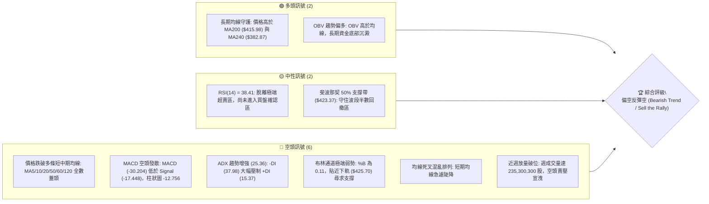
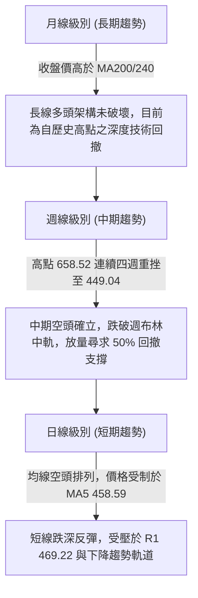
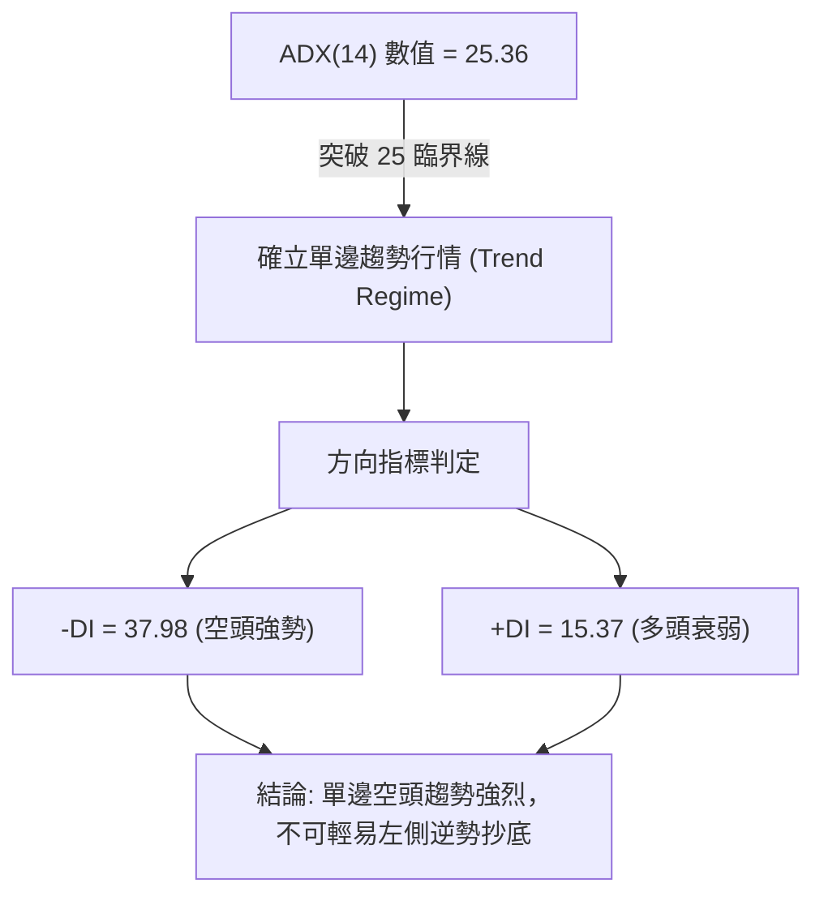
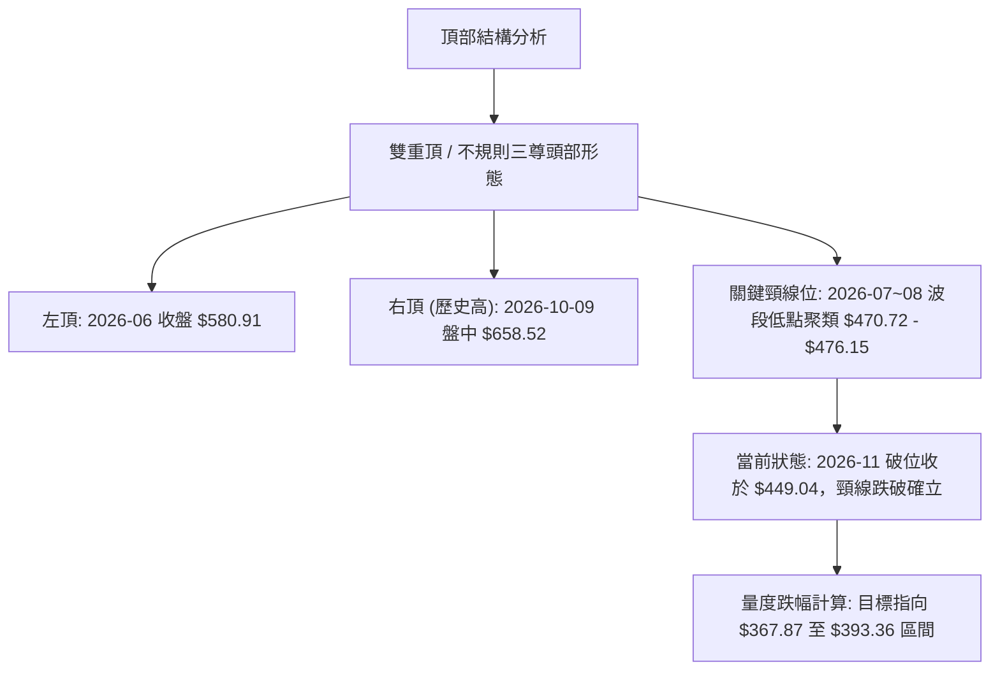
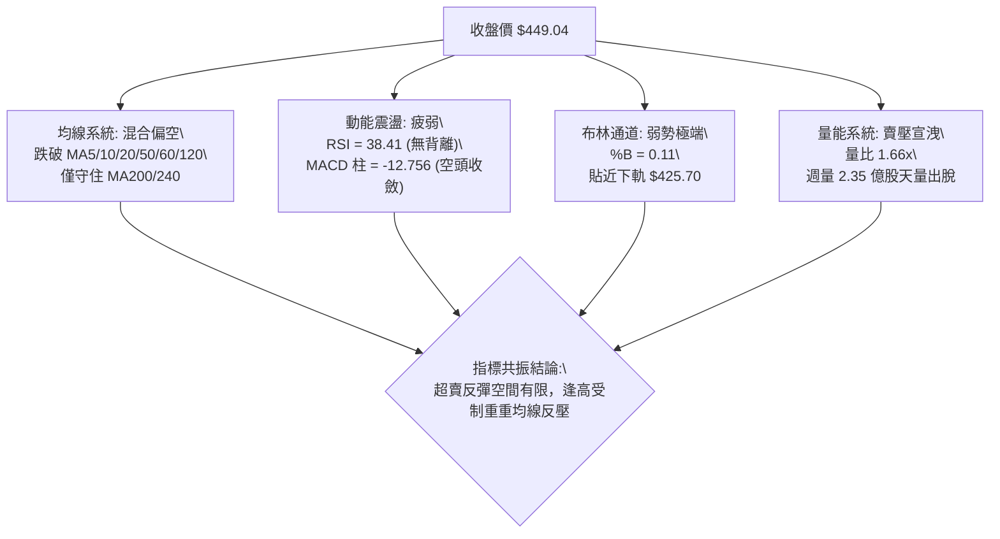
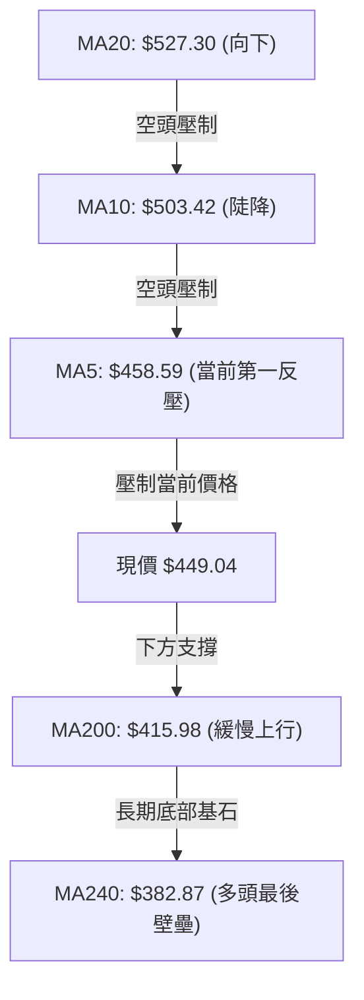
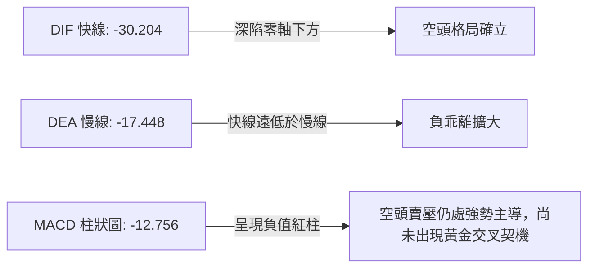
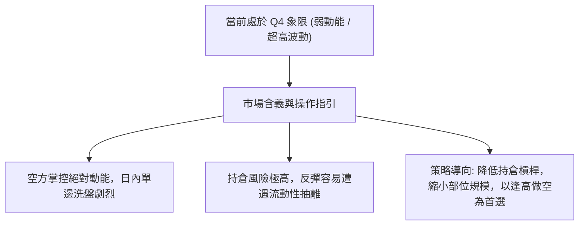
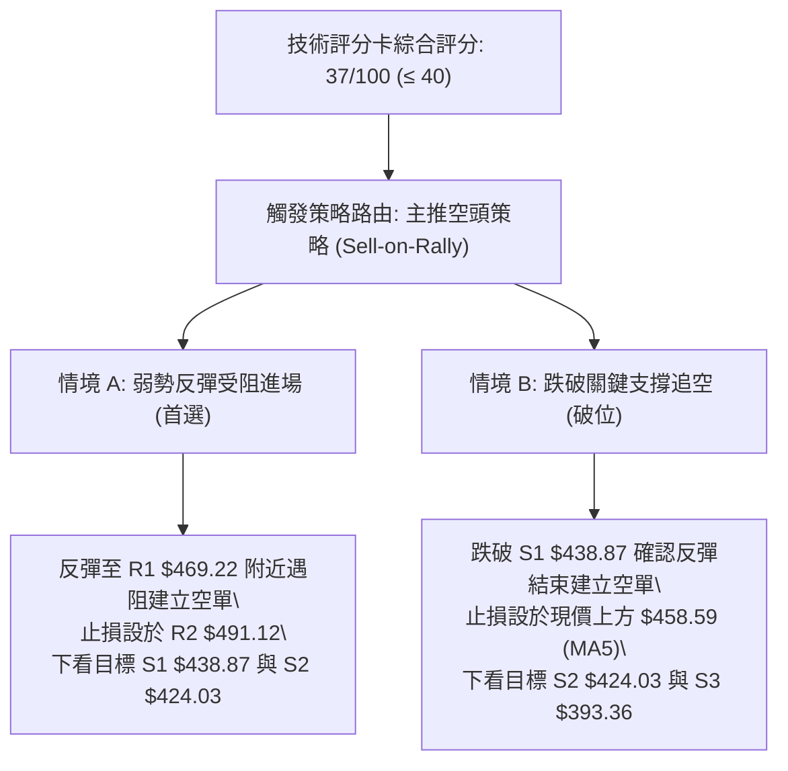
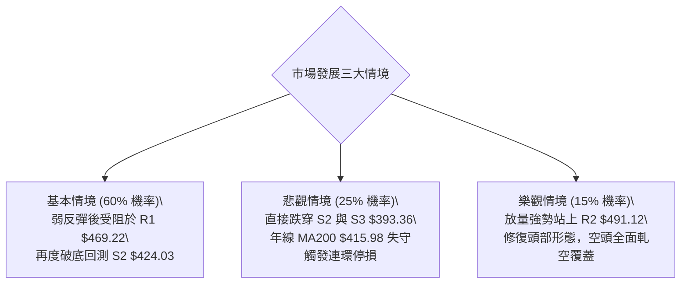

# AMD 技術分析報告

> **報告日期**：2026-11-09 ｜ **語言**：繁體中文 ｜ **數據來源**：Yahoo Finance ｜ **當前價格**：$449.04

---

## 目錄

| 章節 | 內容 |
|------|------|
| [1. 技術面概覽](#1-技術面概覽) | 訊號儀表板、核心指標、評分卡 |
| [2. 趨勢分析](#2-趨勢分析) | 多時框趨勢、長中短期走勢 |
| [3. 圖表形態分析](#3-圖表形態分析) | 形態識別、K線組合、目標價 |
| [4. 支撐與阻力](#4-支撐與阻力) | 關鍵價位、斐波那契回調 |
| [5. 技術指標深度解讀](#5-技術指標深度解讀) | MA/RSI/MACD/布林/成交量 |
| [6. 動能與波動率](#6-動能與波動率) | 動能評估、ATR、Beta |
| [7. 多時框架總結](#7-多時框架總結) | 時框架評分矩陣 |
| [8. 交易策略建議](#8-交易策略建議) | 多空策略、風險報酬比 |
| [9. 風險提示與監控](#9-風險提示與監控) | 監控指標、風險場景 |

---

## 1. 技術面概覽

### 🎯 技術訊號儀表板



---

### 📊 核心指標速覽表

| 指標類別 | 指標名稱 | 當前數值 | 訊號 | 解讀 |
|----------|----------|----------|------|------|
| **價格** | 當前收盤價 | $449.04 | 🔴 | 位於52週區間55.5%位置，自高點$658.52大幅拉回31.81% |
| **均線** | MA20 | $527.30 | 🔴 | 價格低於MA20達-14.84%，中期趨勢明顯轉弱 |
| **均線** | MA50 | $546.81 | 🔴 | 價格低於MA50，季線形成沉重上方反壓套牢帶 |
| **均線** | MA200 | $415.98 | 🟢 | 價格位於年線MA200上方+7.95%，長期牛熊分水嶺未破 |
| **動能** | RSI(14) | 38.41 | 🟡 | 位於30-70中性偏弱區間，空頭動能主導但尚未極度鈍化 |
| **動能** | MACD (12/26/9) | -30.204 | 🔴 | 雙線位於零軸下方深度負值區，柱狀圖-12.756延續空頭動能 |
| **趨勢** | ADX (14) | 25.36 | 🔴 | ADX>25確立趨勢行情；-DI(37.98)大幅高於+DI(15.37)，空頭主導 |
| **通道** | 布林通道 %B | 0.11 | 🔴 | 位於中軌$527.30與下軌$425.70之間，緊貼下軌運作 |
| **波動** | ATR(14) | $36.61 | 🔴 | 日波幅佔股價8.15%，屬於超高波動狀態，操作需放大防守間距 |
| **量能** | 當日成交量 | 45,682,000 | 🔴 | 相較20日均量(27,586,460)放大1.66倍，大跌後反彈量縮不顯著 |

---

### 🏆 技術評分卡

```
╔══════════════════════════════════════════════════════════════════╗
║                 技術評分卡 — AMD (2026-11-09)                    ║
╠══════════════════════════════════════════════════════════════════╣
║ 趨勢強度 (Trend)       ███████░░░░░░░░░░░░░  36/100  🔴 空頭強勢 ║
║ 動能指標 (Momentum)    ██████░░░░░░░░░░░░░░  30/100  🔴 動能疲軟 ║
║ 支撐穩定度 (Support)   ██████████░░░░░░░░░░  50/100  🟡 考驗低點 ║
║ 成交量配合 (Volume)    ███████░░░░░░░░░░░░░  34/100  🔴 放量下殺 ║
║ 形態完整度 (Pattern)   ████████░░░░░░░░░░░░  38/100  🔴 頭部成形 ║
║ 均線排列 (MA System)   ███████░░░░░░░░░░░░░  34/100  🔴 蓋頭排列 ║
╠══════════════════════════════════════════════════════════════════╣
║ 綜合評分               ███████░░░░░░░░░░░░░  37/100  🔴 空頭主導 ║
║ 評分定義：六項算術平均四捨五入 = (36+30+50+34+38+34)/6 = 37/100  ║
╚══════════════════════════════════════════════════════════════════╝
```

---

## 2. 趨勢分析

### 🌐 多時框趨勢分析



---

### 📈 長期趨勢 — 12個月走勢圖（Unicode）

```
AMD 月線收盤走勢圖（2025-12 至 2026-11）
價格軸 ($)
$620 ┤                                                ● $611.76 (09月)
$580 ┤                                      ● $580.91
$540 ┤
$500 ┤                                ● $516.10       ● $504.80 (10月)
$460 ┤                                                      ● $449.04 (11月現價)
$420 ┤
$380 ┤                          
$340 ┤                          ● $354.49 (04月突破)
$300 ┤
$260 ┤
$220 ┤● $214.16  ● $236.73      
$180 ┤                ● $200.21 ● $203.43 (03月雙底)
     └───────────────────────────────────────────────────────────────
      25-12   26-01   26-02   26-03   26-04   26-05   26-06   26-07   26-08   26-09   26-10   26-11
```

#### 走勢特徵分析表格

| 階段區間 | 起止月份 | 價格變動 | 累計漲跌幅 | 走勢特徵與量價解讀 |
|----------|----------|----------|------------|--------------------|
| **築底蓄勢期** | 2025-12 至 2026-03 | $214.16 → $203.43 | -5.01% | 於 $200.00 整數關卡附近構築雙重底，波動度壓縮，量能沉澱。 |
| **主升主浪期** | 2026-03 至 2026-06 | $203.43 → $580.91 | +185.56% | 爆發性單邊推升，突破前高阻力，AI伺服器題材帶動月線連續強陽。 |
| **高位箱體震盪**| 2026-06 至 2026-08 | $580.91 → $470.72 | -18.97% | 歷史高點前之籌碼換手，於 $470-$580 形成對稱寬幅震盪。 |
| **假突破創高期**| 2026-08 至 2026-09 | $470.72 → $611.76 | +29.96% | 向上衝刺見到 52 週最高價 $658.52，月收 $611.76，呈現量價背離。 |
| **急速反轉回撤**| 2026-09 至 2026-11 | $611.76 → $449.04 | -26.60% | 頂部反轉巨陰，跌破所有短期均線，週量擴大至2.35億股之恐慌宣洩。 |

---

### 📊 中期趨勢（週線分析）

```
AMD 週線結構支撐與阻力走勢示意圖
$660 ┤                                  ▲ 52W High $658.52 (10-09)
$620 ┤                          ╭───●───╯   ╲
$580 ┤                  ╭───●───╯            ╲
$540 ┤          ╭───●───╯                     ╲ 跌破 MA50 $546.81
$500 ┤───●──────╯                              ╲───── [R2 $491.12 / 頸線]
$460 ┤                                            ●─── [現價 $449.04]
$420 ┤                                              ▲ [S2 $424.03 / Fib 50% $423.37]
$380 ┤                                                [MA240 $382.87 / S3 $393.36]
```

- 中期波段由 2026-10-09 當週高點 $658.52 啟動四連陰重挫，連失 5 週均線、10 週均線與 20 週均線。
- 2026-11-06 當週最低下探 $402.10，單週振幅高達 $112.51，週收盤拉回至 $449.04，收出帶長下影線之放量週K棒。

---

### ⚡ 趨勢強度評估（ADX 解讀）



#### ADX 強度對照表

| 指標名稱 | 當前數值 | 門檻區間 | 當前狀態判定 | 操作指導原則 |
|----------|----------|----------|--------------|--------------|
| **ADX(14)** | **25.36** | > 25.0 | 趨勢行情確立 | 依據多時框收斂規則，以中長期空頭方向為主導，禁止盤整思維。 |
| **+DI(14)** | **15.37** | < 20.0 | 多方動能潰散 | 缺乏買盤攻擊訊號，多方僅能依託超賣防守。 |
| **-DI(14)** | **37.98** | > 35.0 | 空方動能主導 | 空頭牢牢掌控盤面，任何反彈遇阻力均為潛在順勢做空點。 |

---

## 3. 圖表形態分析

### 🔍 形態識別系統



#### 形態識別與信心度評估表

| 形態名稱 | 信心度 | 判斷依據（引用數據） | 完成度 | 目標價（附計算式） |
|----------|--------|----------------------|--------|--------------------|
| **雙重頂 (Double Top)** | **75%** | 兩次高峰分別為 2026-06 ($580.91) 與 2026-10-09 ($658.52)；頸線跌破 2026-07-31 收盤 $476.15 與 2026-08-28 收盤 $465.58 區間。 | 85% | 頸線基準 $476.15 − (高點 $580.91 − 頸線 $476.15) = 476.15 − 104.76 = **$371.39**（高度逼近 Fib 61.8% **$367.87**） |
| **頭肩頂形態破位** | **60%** | 左肩 2026-06 ($580.91)，頭部 2026-10-09 ($658.52)，右肩 2026-10-28 日高點 ($579.18)，跌破頸線 $491.12 (R2)。 | 90% | 頸線 $491.12 − (頭部 $658.52 − 頸線 $491.12) = 491.12 − 167.40 = **$323.72**（極限回撤目標） |
| **日線下降通道** | **80%** | 近10日日K高點逐步降低 (579.18 → 575.10 → 520.40 → 514.61 → 459.80)，維持標準空頭階梯。 | 95% | 下軌支撐指向支撐位 S2 **$424.03** 與 S3 **$393.36** |

---

### 🕯️ 重要K線形態分析

嚴格依據數據中「近10根日K」與「近8根週K」之四價（開、高、低、收）進行專業解讀：

#### 近10根日K形態解析

| 日期 | 開 | 高 | 低 | 收 | 成交量 | K線形態名稱 | 技術解讀 | 訊號 |
|------|----|----|----|----|--------|-------------|----------|------|
| **2026-10-26** | 522.79 | 533.50 | 514.01 | 531.28 | 16,796,800 | 溫和紅K | 於MA20下方窄幅整理，縮量小陽線。 | 🟡 |
| **2026-10-27** | 539.49 | 563.92 | 538.50 | 560.26 | 20,599,900 | 中長陽線 | 向上突破MA50，買盤短暫發力。 | 🟢 |
| **2026-10-28** | 573.08 | 579.18 | 560.52 | 578.44 | 18,848,600 | 衝高小陽 | 創反彈高點 $579.18，但上影線顯現拋壓。 | 🟡 |
| **2026-10-29** | 562.27 | 575.10 | 560.57 | 566.42 | 16,873,300 | 高位孕線黑K | 縮量滯漲，多頭攻擊受挫於 $575.10。 | 🔴 |
| **2026-10-30** | 508.53 | 520.40 | 492.21 | 504.80 | 39,697,500 | 跳空放量長陰 | 跳空重挫-10.88%，量能擴大至近40M，破位下殺。 | 🔴 |
| **2026-11-02** | 510.71 | 512.82 | 466.07 | 466.84 | 32,141,000 | 光腳大陰線 | 毫無抵抗連續殺跌，收在當日最低點附近。 | 🔴 |
| **2026-11-03** | 479.99 | 497.40 | 473.54 | 483.90 | 35,255,100 | 低檔十字星陽K | 試圖抵抗，回補部分跳空缺口，但受制於 $497.40。 | 🟡 |
| **2026-11-04** | 485.25 | 514.61 | 476.50 | 488.78 | 50,984,800 | 放量衝高長上影 | 爆量50.98M衝高至 $514.61 遭空頭迎頭痛擊，長上影線。 | 🔴 |
| **2026-11-05** | 452.50 | 456.20 | 402.10 | 404.40 | 71,237,400 | 恐慌崩跌巨陰 | 單日崩跌至 $402.10，巨量71.2M，收於 $404.40 冰點。 | 🔴 |
| **2026-11-06** | 444.43 | 459.80 | 433.30 | 449.04 | 45,682,000 | 破底翻長陽補漲 | 高開震盪收高，守住 $433.30，收復 $449.04，展現低接買盤。 | 🟢 |

#### 近8根週K形態解析

| 日期 (週五) | 開 | 高 | 低 | 收 | 週成交量 | 週K形態名稱 | 技術解讀 | 訊號 |
|-------------|----|----|----|----|----------|-------------|----------|------|
| **2026-09-18** | 486.28 | 559.91 | 480.33 | 559.82 | 124,593,800 | 突破大陽週K | 脫離箱體向上突破，多頭主浪啟動。 | 🟢 |
| **2026-09-25** | 583.88 | 639.00 | 582.27 | 630.63 | 132,066,300 | 連續長陽K | 強力推升突破 $630，成交量放大確認。 | 🟢 |
| **2026-10-02** | 624.90 | 645.46 | 596.07 | 633.91 | 92,386,900 | 高位窄幅十字 | 創高量縮，買盤力竭徵兆浮現。 | 🟡 |
| **2026-10-09** | 630.61 | 658.52 | 606.00 | 608.10 | 93,746,000 | 避雷針長上影 | 盤中創 $658.52 歷史天價後遭獲利了結收低。 | 🔴 |
| **2026-10-16** | 599.93 | 606.20 | 526.83 | 528.75 | 107,042,200 | 空頭吞噬大陰 | 重挫破位，跌破前三週低點，確立頂部反轉。 | 🔴 |
| **2026-10-23** | 551.78 | 556.79 | 502.60 | 516.79 | 96,570,600 | 弱勢下移陰K | 跌勢延續，測試 $500 整數心理防線。 | 🔴 |
| **2026-10-30** | 522.79 | 579.18 | 492.21 | 504.80 | 112,816,100 | 倒錘頭高檔反撲失敗 | 週中衝高至 $579.18 遭全面壓制，收最低附近。 | 🔴 |
| **2026-11-06** | 510.71 | 514.61 | 402.10 | 449.04 | 235,300,300 | 巨量長下影錘頭 | 爆出 2.35 億股天量，探底 $402.10 後強彈 $47。 | 🟡 |

---

### 📉 ASCII 走勢形態示意圖

```
雙重頂破位與當前破底反彈走勢示意圖
$658.52 ─────────────────────── 頂部 2 (2026-10-09)
              ╭───╮
$580.91 ─── 頂部 1 ───│   │
          ╭───╮       │   │
$527.30 ──│───│───────│───│─────── 中軌/MA20 反壓
          │   │       │   ╰──╮
$491.12 ──│───│───────│──────│─── 頸線位 / R2 (阻力區間)
          │   ╰───────╯      ╰──╮
$449.04 ──│──────────────────────● 現價 (反彈受阻於 R1 $469.22)
          │                      │
$424.03 ──│──────────────────────┴── S2 / Fib 50% 核心支撐
$402.10 ──╰───────────────────────── 2026-11-05 恐慌低點 (極限下影線)
```

---

### 🎯 形態目標價計算

1. **頭部形態量度等幅跌幅**：
   - 頂部中心高點 = $658.52
   - 形態突破頸線 = $491.12 (數據中 R2 阻力位)
   - 形態垂直高度 $H = 658.52 - 491.12 = \$167.40$
   - 完整破位量度目標 = $\text{頸線 } 491.12 - 167.40 = \mathbf{\$323.72}$

2. **短線反彈高度測量（保守反彈情境）**：
   - 近期波段起跌點（2026-10-28 高點）= $579.18$
   - 本波急跌最低點（2026-11-05 低點）= $402.10$
   - 跌幅總高度 = $579.18 - 402.10 = \$177.08$
   - 0.382 弱勢反彈目標 = $402.10 + (177.08 \times 0.382) = \mathbf{\$469.74}$（精確對接阻力位 **R1: $469.22**）
   - 0.500 中度反彈目標 = $402.10 + (177.08 \times 0.500) = \mathbf{\$490.64}$（精確對接阻力位 **R2: $491.12**）

---

## 4. 支撐與阻力

### 🗺️ 關鍵價位分布圖（Unicode）

```
AMD 價位結構分布圖 (依據 OHLCV 波段聚類計算)
═══════════════════════════════════════════════════════════════════
$547.53 ║████████████████████████████████║ Fib 23.6% 回調位 / MA50 ($546.81)
$527.30 ║██████████████████████████      ║ MA20 中軌重要關卡
$517.35 ║████████████████████████        ║ 強阻力 R3 (波段高點聚類)
$491.12 ║████████████████████            ║ 關鍵頸線阻力 R2 (反彈重壓區)
$478.87 ║████████████████                ║ Fib 38.2% 回調位
$469.22 ║████████████                    ║ 近期第一阻力 R1 (MA5 $458.59 上方)
$449.04 ╠════════════════════════════════╣ ◄ 當前收盤價 ($449.04)
$438.87 ║▓▓▓▓▓▓▓▓▓▓▓▓                    ║ 近期波段支撐 S1 (-2.27%)
$424.03 ║████████████████████            ║ 核心波段支撐 S2 / 布林下軌 ($425.70)
$423.37 ║████████████████████            ║ Fib 50.0% 回調位 (多頭防線)
$415.98 ║████████████████████████        ║ 牛熊分水嶺 MA200 (年線支撐)
$393.36 ║████████████████████████████    ║ 強支撐 S3 (-12.40% 極端防守位)
$367.87 ║████████████████████████████████║ Fib 61.8% 黃金分割強支撐
═══════════════════════════════════════════════════════════════════
```

---

### 🚧 阻力位分析表

所有價位均直接引用數據「關鍵價位」區塊之波段高點聚類與計算值：

| 阻力級別 | 精確價位 | 距現價幅標 | 形成原因與技術共振 | 突破難度 | 重要性 |
|----------|----------|------------|--------------------|----------|--------|
| **R1** | **$469.22** | +4.49% | 近期日K反彈密集成交頂部；共振 MA5 ($458.59) 下降切線。 | 🟡 中等 | 短線多空分水嶺，未突破前維持短線弱勢。 |
| **R2** | **$491.12** | +9.37% | 頭肩頂破位頸線；10-30 跳空長陰下緣與 11-03 反彈高點集結區。 | 🔴 極高 | 中期趨勢反轉關鍵，需巨量陽線方可克服。 |
| **R3** | **$517.35** | +15.21% | 前期週線支撐跌破後轉為強壓力；共振 MA120 ($521.17) 與布林中軌。 | 🔴 極高 | 結構性套牢沉重賣壓區，波段多頭極限反彈目標。 |

---

### 🛡️ 支撐位分析表

所有價位均直接引用數據「關鍵價位」區塊之波段低點聚類與計算值：

| 支撐級別 | 精確價位 | 距現價幅標 | 形成原因與技術共振 | 守住機率 | 重要性 |
|----------|----------|------------|--------------------|----------|--------|
| **S1** | **$438.87** | -2.27% | 11-06 日K低點 $433.30 之聚類支撐帶；短線第一道防禦網。 | 60% | 跌破則短線反彈宣告夭折，再度下探下軌。 |
| **S2** | **$424.03** | -5.57% | 與布林下軌 ($425.70) 及 Fib 50.0% ($423.37) 形成強大三重共振。 | 75% | 多方中期生命線，不容有失的技術結構壁壘。 |
| **S3** | **$393.36** | -12.40% | 逼近 11-05 恐慌低點 $402.10 與長期均線 MA240 ($382.87) 緩衝帶。 | 85% | 終極機構買盤介入區，跌破將引發系統性停損。 |

---

### 📐 斐波那契回調位分析

依據 52 週絕對波動區間（低點 **$188.22** → 高點 **$658.52**，總垂直波幅 **$470.30**）：

| 回調比例 | 斐波那契價位 | 當前相對位置 | 技術意義與行情解讀 |
|----------|--------------|--------------|--------------------|
| **0.0% (52W High)** | **$658.52** | +46.65% | 2026-10-09 歷史天價，波段多頭行情的終結點。 |
| **23.6%** | **$547.53** | +21.93% | 高度共振季線 MA50 ($546.81)，為前期多頭回踩極限，現轉為極強反壓。 |
| **38.2%** | **$478.87** | +6.64% | 位於 R1 ($469.22) 與 R2 ($491.12) 之間，為多頭強勢回調之防禦上限。 |
| **50.0%** | **$423.37** | -5.72% | **目前關鍵防禦帶**：現價落於 38.2% ($478.87) 與 50.0% ($423.37) 之間。此位與 S2 ($424.03) 形成完美重合，是牛市回撤的最後黃金平衡點。 |
| **61.8%** | **$367.87** | -18.08% | 黃金分割強支撐，若失守 50% 回調位，股價將直奔此區域尋求年線下方底座。 |
| **78.6%** | **$288.86** | -35.67% | 深度回撤防線，標誌著長期多頭趨勢的徹底瓦解。 |
| **100.0% (52W Low)**| **$188.22** | -58.08% | 52週週期起點，結構性絕對底部。 |

---

## 5. 技術指標深度解讀

### 🎛️ 指標訊號總覽



---

### 📈 移動平均線排列分析



#### 均線階梯架構分析表

| 均線名稱 | 數值 | 距現價幅度 | 坡度與趨勢特徵 | 訊號評估 |
|----------|------|------------|----------------|----------|
| **MA5** | $458.59 | +2.13% | 陡峭向下 (-2.08%)，形成日內極短線反壓。 | 🔴 短線受阻 |
| **MA10** | $503.42 | +12.11% | 深度向下彎折 (-10.80%)，空頭加速推進線。 | 🔴 蓋頭壓制 |
| **MA20** | $527.30 | +17.43% | 明顯下行 (-14.84%)，月線生命線全面潰退。 | 🔴 中期偏空 |
| **MA50** | $546.81 | +21.77% | 下彎壓制，季線形成巨大中期套牢籌碼峰。 | 🔴 重大阻力 |
| **MA60** | $535.80 | +19.32% | 下穿形成死亡交叉排列。 | 🔴 偏空格局 |
| **MA120** | $521.17 | +16.06% | 半年線拐頭下行，中長期支撐轉阻力。 | 🔴 結構偏空 |
| **MA200** | $415.98 | -7.36% | 維持平緩上揚，為牛市長期生命線基石。 | 🟢 長期支撐 |
| **MA240** | $382.87 | -14.74% | 向上傾斜 (+17.28%)，年線下檔保護極強。 | 🟢 堅固底座 |

---

### 📉 RSI(14) 分析

```
RSI(14) 動能進度條：
0 ────── 超賣(30) ────────────── 中軸(50) ────────────── 超買(70) ────── 100
[███████████████░░░░░░░░░░░░░░░░░░░░░░░░] 38.41
```

- **超買超賣狀態評估**：RSI(14) 最新讀數為 **38.41**（Wilder計算），位於 30 至 70 之普通中性偏空區間。雖然脫離了 2026-11-05 跌破 30 的極端恐慌超賣區，但目前數值仍受壓於 50 中軸下方，表明市場多頭完全不具備攻擊動能，僅屬於修正指標超賣的弱勢修復。
- **背離分析判斷**：
  - 檢視數據明確結論：「RSI 背離：無明顯背離（僅比較近20根K棒首尾的價格與RSI方向）」。
  - 價格自 10 月中旬 $600 以上階梯式暴跌至 $449.04，RSI 亦同步自 70 以上一路俯衝至 38.41，價格創新低與 RSI 走勢相符，**並無底背離形成**。因此，不可視為趨勢反轉，僅能視為空頭波段中的弱勢抵抗。

---

### 📊 MACD(12/26/9) 訊號解讀



- **數值關係解讀**：
  - 快線 DIF = -30.204，訊號線 DEA = -17.448，DIF < DEA。
  - 柱狀圖 Histogram = -12.756 🔴，處於大額負值區。
- **趨勢意義**：
  - 雙線在零軸下方急遽擴大負間距，顯示空頭主跌段的殺傷力。
  - 雖然負柱狀圖較前一波急跌略有收縮（近週從 -14.100 收斂至 -12.756），但因快慢線絕對數值極度偏低，距離金叉尚有漫長築底過程，技術面嚴禁將單日反彈解讀為波段反轉。

---

### 📦 布林通道分析

```
布林通道結構與現價位置示意圖
$628.89 ┬──────────────────────────────────────────── BB 上軌 (+40.05%)
        │
        │
$527.30 ┼──────────────────────────────────────────── BB 中軌 / MA20 (+17.43%)
        │
$449.04 ┼──────● [現價 $449.04，%B = 0.11] ─── (極度偏向通道下緣)
$425.70 ┴──────────────────────────────────────────── BB 下軌 (-5.20%)
```

- **通道帶寬與形態**：上軌 $628.89 與下軌 $425.70 形成高達 $203.19 之超寬通道，反映近期劇烈波動導致通道急遽開口散開。
- **%B 位置解讀**：當前 **%B = 0.11**，意味著現價僅位於整個布林通道由下而上 11% 的極低位置。在 11-05 跌破下軌 ($402.10) 後，價格重新收回下軌 ($425.70) 之內，屬於典型的「超賣乖離收斂修復」，上方反彈的第一技術壓力即為中軌 $527.30。

---

### 💹 成交量分析（量價配合度）

```
成交量對比柱狀圖 (股)
當前日量 45.68M  [████████████████████████████] (量比 1.66x)
20日均量 27.59M  [█████████████████░░░░░░░░░░]
50日均量 23.41M  [██████████████░░░░░░░░░░░░░]
```

- **量價特徵**：最新交易日成交量為 45,682,000 股，顯著高於 20 日均量 (27,586,460 股)，量比達到 1.66 倍。
- **OBV 深度解讀**：指標數據顯示「OBV > MA → 量能支撐上漲」。這代表在 2026 年初至 9 月的長期多頭行情中，累積了龐大的機構多頭持倉底倉；儘管近期四週出現連續巨量恐慌拋售（近週週量飆升至 235,300,300 股的天量），長期 OBV 仍未全面下穿均線。然而，短期籌碼已出現主力機構高位派發現象，天量下影線代表多空在此區間發生毀滅性對決，需要時間重新沉澱籌碼。

---

## 6. 動能與波動率

### ⚡ 動能評估四象限

| 象限 | 動能維度 | 波動維度 | 象限特徵 | 當前狀態判定 |
|------|----------|----------|----------|--------------|
| **Q1 (最佳擴張)** | 強動能 (Bullish) | 低波動 (Low Vol) | 穩定單邊推升行情，趨勢最健康 | ─ |
| **Q2 (震盪整理)** | 弱動能 (Bearish) | 低波動 (Low Vol) | 窄幅盤整，成交量萎縮，無方向 | ─ |
| **Q3 (風險博弈)** | 強動能 (Bullish) | 高波動 (High Vol) | 狂熱主升段或末升段，暴漲暴跌 | ─ |
| **Q4 (恐慌殺跌)** | **弱動能 (Bearish)** | **高波動 (High Vol)** | **暴跌破位、恐慌釋放、ATR暴增** | **✓ 當前精準落點 (Q4)** |



---

### 📊 ATR 波動率分析

- **數值讀數**：ATR(14) 當前高達 **$36.61**（Wilder計算），佔當前股價 $449.04 的比例高達 **8.15%**。
- **市場意涵**：在正常的成熟大型半導體權值股中，ATR 佔比通常在 2.5% 至 4.0% 之間。高達 8.15% 的日波幅意味著 AMD 每日平均震盪區間接近 $37，任何日內雜訊都極易觸發過於狹窄的止損點。
- **風控參數設置規範**：
  - **極短線止損距離**：必須至少給予 $1.0 \times \text{ATR} = \$36.61$ 之防守空間。
  - **波段交易止損距離**：應設定在 $1.5 \times \text{ATR} = \$54.92$ 以上，以防止被市場高頻量化洗盤震盪出局。

---

### 📐 Beta 與市場相關性

- **Beta 係數**：當前 AMD Beta 值為 **2.542**。
- **系統性風險特徵**：
  - 高達 2.542 的 Beta 表明該股具有超高市場彈性，對標普500指數或費城半導體指數的敏感度為大盤的 2.54 倍。
  - 當半導體板塊出現負面消息（如近期英特爾 PC 警告或 AI 資本支出擔憂）時，AMD 面臨乘數效應之拋壓釋放；反之，板塊反彈時其彈性亦大。當前宏觀板塊情緒偏弱，高 Beta 特性加劇了下行動能。

---

## 7. 多時框架總結

### 📋 時框架評分表

| 時框架 | 趨勢方向 | 動能狀態 | 均線排列 | 形態結構 | 綜合評分 | 操作指導建議 |
|--------|----------|----------|----------|----------|----------|--------------|
| **長期 (月線)** | 🟢 偏多 | 🟡 中性回落 | 🟢 多頭守護 (在MA200之上) | 突破後深幅回踩 | **65/100** | 長線多頭未死，但需耐心等待回調落底。 |
| **中期 (週線)** | 🔴 偏空 | 🔴 強烈空頭 | 🔴 跌破多條週均線 | 雙重頂/頭肩頂破位 | **32/100** | 中期下降趨勢確立，反彈均為減倉/做空點。 |
| **短期 (日線)** | 🔴 偏空 | 🟡 超賣反彈 | 🔴 短期均線蓋頭空頭排列 | 下降通道內弱勢反彈 | **35/100** | 日線超跌修復，受阻於 R1 $469.22。 |

---

### 🔲 綜合訊號矩陣

```
時框共振檢驗矩陣：
┌───────────┬─────────────┬─────────────┬─────────────┬─────────────┐
│  時框層級 │  均線訊號   │  動能訊號   │  通道位置   │  綜合傾向   │
├───────────┼─────────────┼─────────────┼─────────────┼─────────────┤
│ 短期日線  │  🔴 偏空    │  🟡 中性    │  🔴 貼近下軌│  🔴 偏空    │
│ 中期週線  │  🔴 空頭    │  🔴 衰竭    │  🔴 破中軌  │  🔴 偏空    │
│ 長期月線  │  🟢 多頭    │  🟡 轉弱    │  🟡 寬幅箱體│  🟡 中性    │
└───────────┴─────────────┴─────────────┴─────────────┴─────────────┘
時框矛盾收斂：中期與短期高度共振看空，長期多頭僅提供遠端支撐底座。
```

---

### ⚖️ 多時框收斂結論

依據多時框收斂規則（規則 14）：
1. **行情模式判定**：當前 ADX(14) 讀數為 **25.36 > 25**，且 -DI (37.98) 碾壓 +DI (15.37)，明確確立當前盤面屬於**趨勢行情 (Trend Regime)**，而非區間震盪行情。
2. **時框主導權收斂**：在趨勢行情下，必須以中長期（週線/MA50、MA200）方向為主導。週線呈現巨量破位且連續跌穿 MA20 與 MA50，中期空頭格局牢不可破。日線級別出現的放量下影線與單日反彈，僅為次級折返走勢，僅能作為空頭尋求更高盈虧比進場點之時機。
3. **唯一方向性結論**：**整體技術面確立為【偏空主導 / 逢反彈做空】**。綜合評分為 **37/100 (≤ 40)**，此結論與第 8 章之主推空頭策略完全一致。

---

## 8. 交易策略建議

### 🗺️ 策略決策流程圖



---

### 🧭 策略路由

> **當前主策略方向 = 空頭策略（依技術評分卡綜合評分 37/100 偏空判定，主推逢反彈沽空）**

---

### 🎯 價格情境階梯（Price Scenarios）

所有價位均嚴格引用第 4 章及數據計算值：

| 觸發條件 | 下一目標 | 後續延伸 | 情境含義與操作對策 |
|----------|----------|----------|--------------------|
| **突破 R1 $469.22** | R2 $491.12 | R3 $517.35 | 短線超跌反彈擴大，空頭停損觀望，等待 R2 重壓區之空頭二次訊號。 |
| **受阻於 $449.04 - $469.22** | S1 $438.87 | S2 $424.03 | **基準情境**：反彈無力，重回空頭主跌階梯，為最佳放空佈局區。 |
| **跌破 S1 $438.87** | S2 $424.03 | S3 $393.36 | 空頭攻勢重啟，反彈結束，直奔 50% 斐波那契回調位 $423.37。 |
| **跌破 S2 $424.03** | S3 $393.36 | Fib 61.8% $367.87 | 中期結構全面瓦解，向年線 MA200 ($415.98) 及更深支撐尋求清算。 |

---

### 📊 情境機率分佈

| 情境劃分 | 機率估計 | 主要技術依據與數據驗證 |
|----------|----------|------------------------|
| **反彈受阻再探底 (空頭延續)** | **60%** | ADX 25.36 確立趨勢；-DI 37.98 壓制；MACD 柱狀圖 -12.756 深度負值；多重均線空頭排列形成強大重力。 |
| **低位寬幅震盪 (S1~R1 箱體)** | **25%** | 11-06 巨量下影線提供短期買盤緩衝；布林下軌 $425.70 限制短線跌速；RSI 脫離 30 暫獲支撐。 |
| **強勢反轉向上 (突破 R2)** | **15%** | 需連續大陽線封閉 10-30 缺口並站上 $491.12，目前量能結構與均線扣高壓力下機率極低。 |

---

### 🟢 主策略詳情（空頭主導策略）

精確遵循風險報酬比計算規範：做空風險報酬比 = $(\text{進場價} - \text{目標價}) \div (\text{止損價} - \text{進場價})$，以「1 : X.XX（以 T1 計）」格式列出：

| 策略要素 | 策略 A（逢高沽空 — 反彈受阻佈局） | 策略 B（順勢破位做空 — 跌破進場） |
|----------|-----------------------------------|-----------------------------------|
| **進場條件** | 價格反彈至 R1 遇阻回落，或於現價與 R1 間佈局 | 日K實體跌破支撐位 S1，空頭再度發力確認 |
| **進場價格** | **$460.00**（區間中點，介於現價與 R1 $469.22） | **$435.00**（確認跌破 S1 $438.87 後順勢切入） |
| **目標價 T1** | **$438.87**（支撐位 S1） | **$424.03**（支撐位 S2 / Fib 50%） |
| **目標價 T2** | **$424.03**（支撐位 S2） | **$393.36**（支撐位 S3） |
| **止損價格** | **$475.00**（越過 R1 $469.22 上方約 $5.78） | **$449.04**（收盤價兼 MA5 反壓基準位） |
| **風險報酬比** | **1 : 1.41（以 T1 計）**<br>計算式：$(460.00 - 438.87) \div (475.00 - 460.00) = 21.13 \div 15.00 = 1.4087$<br>*[註：以 T2 計則為 1 : 2.40]* | **1 : 0.78（以 T1 計）**<br>計算式：$(435.00 - 424.03) \div (449.04 - 435.00) = 10.97 \div 14.04 = 0.7813$<br>*[註：以 T2 計則為 1 : 2.97]* |
| **成功機率** | **65%** | **55%** |
| **建議倉位** | **15%**（控制在總風險資本可控範圍） | **10%**（追空部位，從緊配置） |

---

### 🔴 反向風險觸發點（對沖與停損提示）

若出現以下訊號，代表空頭主策略被推翻，空單必須立即無條件止損，轉入防守或短多對沖：
1. **多頭反轉關鍵價位**：日K收盤價強勢突破阻力位 **R2: $491.12**，此為頭肩頂破位頸線。一旦收復，代表假跌破成形。
2. **動能結構反轉**：MACD 出現零軸下二次黃金交叉，且柱狀圖由負翻正超過 +5.00。
3. **趨勢反轉確認**：日K線連續兩日站穩於 MA20 ($527.30) 之上，且成交量持續放大至 50M 以上。

---

### ⭐ 整體訊號強度評星

```
做多訊號強度：★★☆☆☆  (2/5星 - 僅屬跌深反彈，非波段買點)
做空訊號強度：★★★★☆  (4/5星 - 順應週日線空頭趨勢與均線壓制)
整體可信度：  ★★★★☆  (4/5星 - ADX>25趨勢確認，量價關係清晰)
```

---

## 9. 風險提示與監控

### ✅ 關鍵監控指標 Checklist

```
╔══════════════════════════════════════════════════════════════════╗
║                    每日盤面技術監控清單 (Checklist)              ║
╠══════════════════════════════════════════════════════════════════╣
║ [ ] 價格是否跌破 S1 ($438.87)？ (是: 空頭波段確認；否: 延續震盪)  ║
║ [ ] 價格是否突破 R1 ($469.22)？ (是: 短線反彈擴大至 R2 $491.12)  ║
║ [ ] 日成交量是否萎縮至 25M 以下？ (量縮為反彈動能衰竭徵兆)        ║
║ [ ] RSI(14) 是否無法突破 50 中軸反轉下行？ (是: 空頭持續控盤)    ║
║ [ ] MACD 柱狀圖是否持續收斂至 -5.0 以上？ (注意空頭平倉力道)     ║
║ [ ] ATR(14) 是否縮小至 $30 以下？ (波動率降溫有利於底部構築)     ║
╚══════════════════════════════════════════════════════════════════╝
```

---

### ⚠️ 風險場景分析



---

### 🛡️ 風險管理重要提醒

1. **極度波動性保護**：
   - 目前 ATR 為 **$36.61 (8.15%)**，屬於極端危險波幅級別。單筆交易最大虧損嚴格限制在總投資組合淨值的 **1.0%** 以內。
   - 倉位規模計算公式：$\text{允許持股數} = (\text{總資產} \times 1\%) \div (\text{進場價} - \text{止損價})$。不可因追求獲利而過度放大頭寸。

2. **高 Beta 槓桿雙刃劍**：
   - AMD Beta 值為 **2.542**，在宏觀半導體板塊劇烈動盪之際，必須密切關注納斯達克指數與費城半導體指數 (SOX) 之動向。若大盤指數破位，AMD 將承擔 2.5 倍之跌幅放大效應。

3. **財報與事件風險防範**：
   - 目前分析師目標價均值為 $659.77，最高達 $1250.00，基本面共識與當前嚴峻之技術面出現嚴重脫節。在技術面走平修復前，絕不可單憑基本面目標價進行盲目左側加碼。

---

## 📋 報告總結

```
╔══════════════════════════════════════════════════════════════════╗
║                    AMD 技術分析報告總結                          ║
╠══════════════════════════════════════════════════════════════════╣
║ 報告日期：2026-11-09                                            ║
║ 當前價格：$449.04                                                ║
║ 綜合技術評分：37 / 100                                          ║
║ 分析評級：🔴 空頭主導 / 逢反彈沽空 (Bearish / Sell the Rally)   ║
╠══════════════════════════════════════════════════════════════════╣
║ 關鍵結構結論：                                                   ║
║ ├─ 長期趨勢：🟢 偏多回調 (價格穩居年線 MA200 $415.98 之上)       ║
║ ├─ 中期趨勢：🔴 單邊偏空 (雙重頂破位，週線連四陰重挫)           ║
║ ├─ 短期趨勢：🔴 弱勢反彈 (受制於 MA5 $458.59 與 R1 $469.22)     ║
║ ├─ 關鍵支撐：S1: $438.87 ｜ S2: $424.03 (Fib 50%) ｜ S3: $393.36 ║
║ ├─ 關鍵阻力：R1: $469.22 ｜ R2: $491.12 ｜ R3: $517.35          ║
║ └─ 趨勢強度：ADX = 25.36 (-DI 37.98 絕對主導單邊走勢)           ║
╠══════════════════════════════════════════════════════════════════╣
║ 最優策略組合：                                                   ║
║ 1. 🥇 最佳機會：策略 A (逢高於 $460.00 建立空單，停損 $475.00， ║
║                  下看 T1 $438.87，風報比 1 : 1.41)               ║
║ 2. 🥈 次選機會：策略 B (跌破 S1 $438.87 後於 $435.00 順勢追空，  ║
║                  停損 $449.04，下看 T2 $393.36，風報比 1 : 2.97) ║
║ 3. 🥉 保守選擇：場外空倉觀望，耐心等待價格測試 S2 $424.03 與    ║
║                  Fib 50% 共振支撐區之築底形態完成。              ║
╚══════════════════════════════════════════════════════════════════╝
```

---

> ⚠️ **免責聲明**：本報告為技術分析研究成果，所有數據、圖表及價位推算均基於市場歷史交易資訊。本報告**僅供研究與學術參考**，**不構成任何要約、招攬或投資建議**。金融市場具有高度風險，投資人應獨立評估自身財務狀況與風險承受能力，並自負盈虧責任。

---

*報告生成時間：2026-11-09 ｜ 數據來源：Yahoo Finance ｜ 分析框架：多時框技術分析體系*