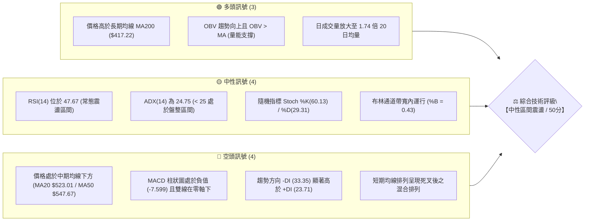
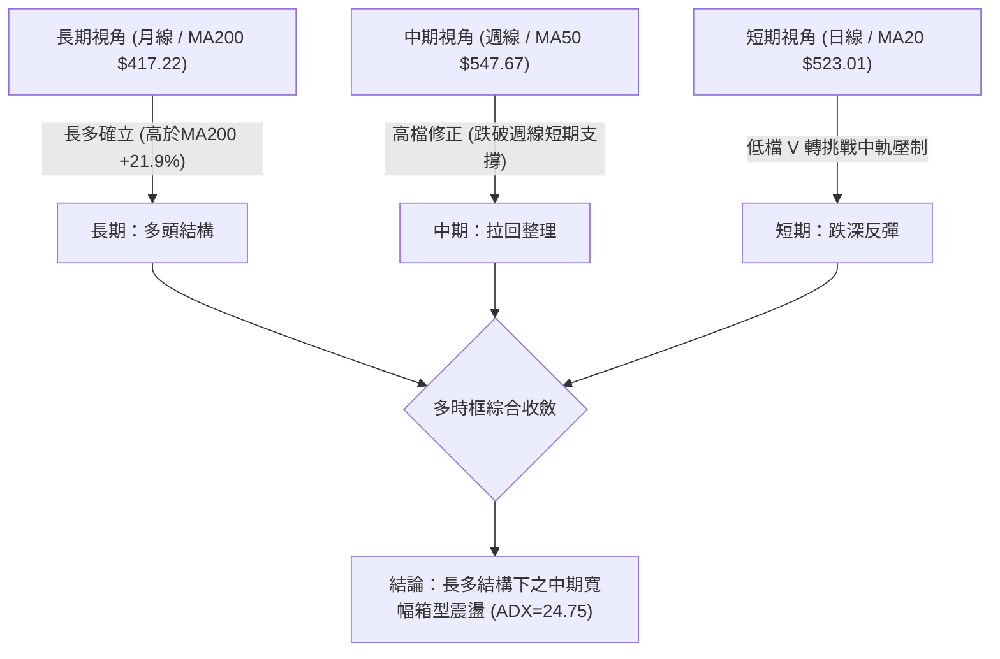
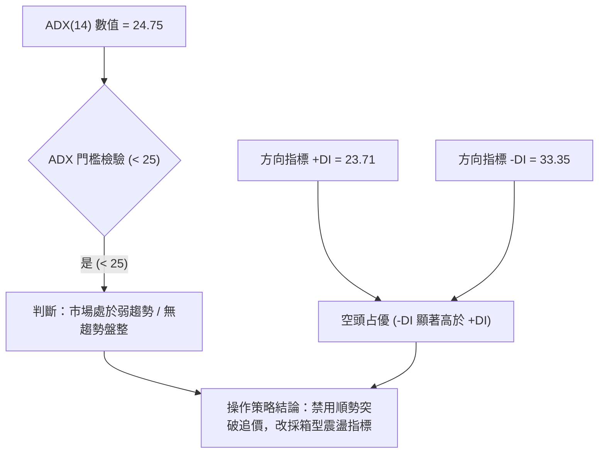
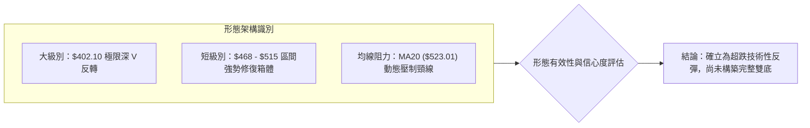
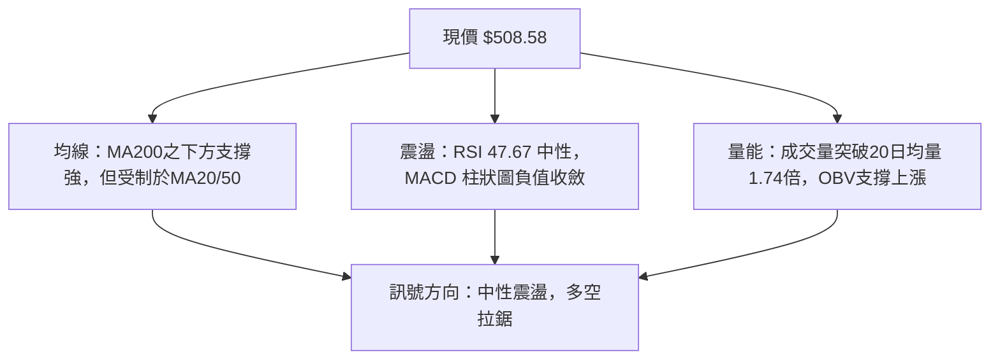
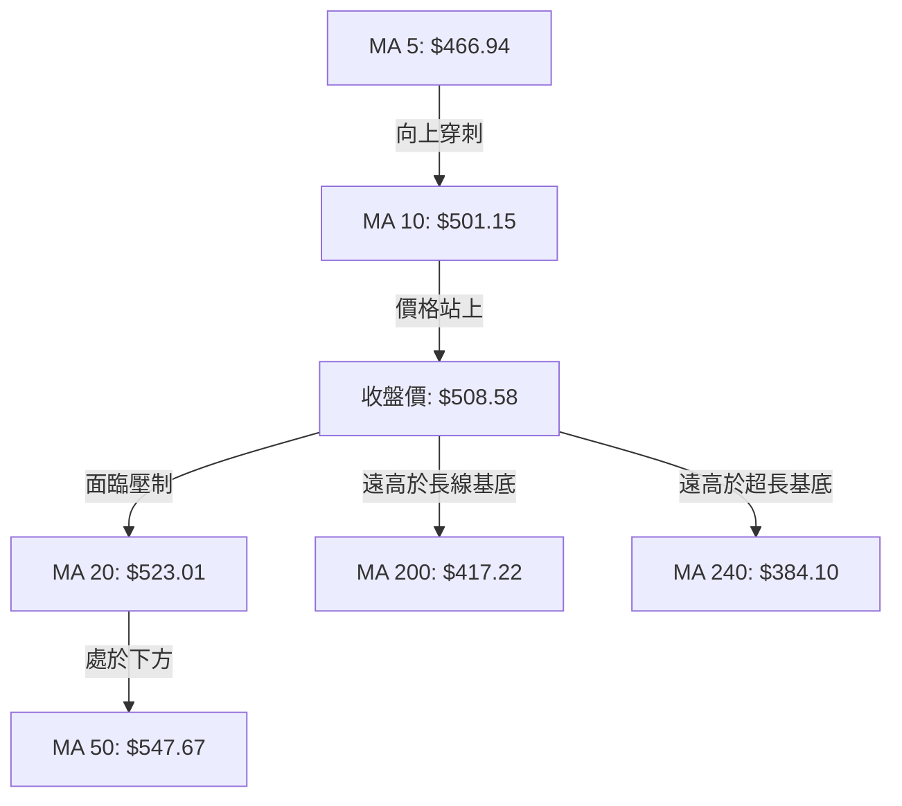
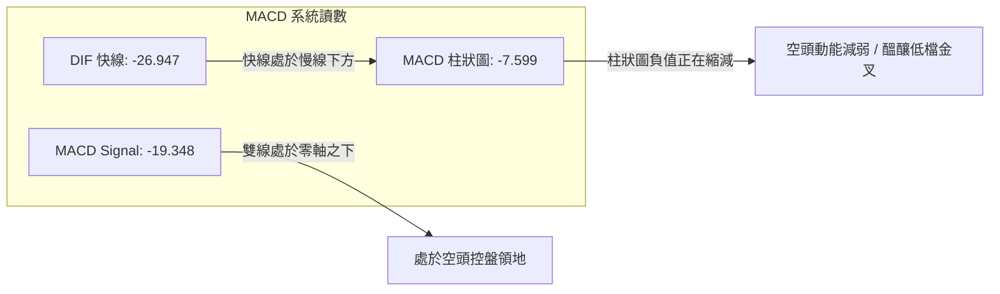
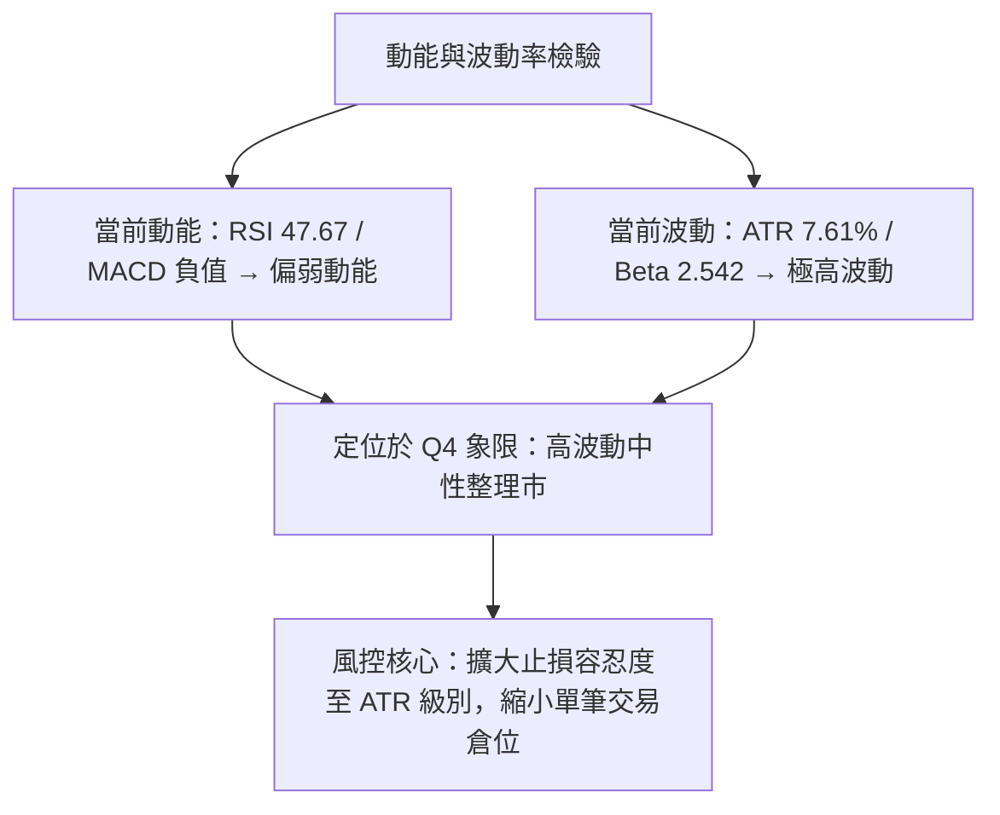
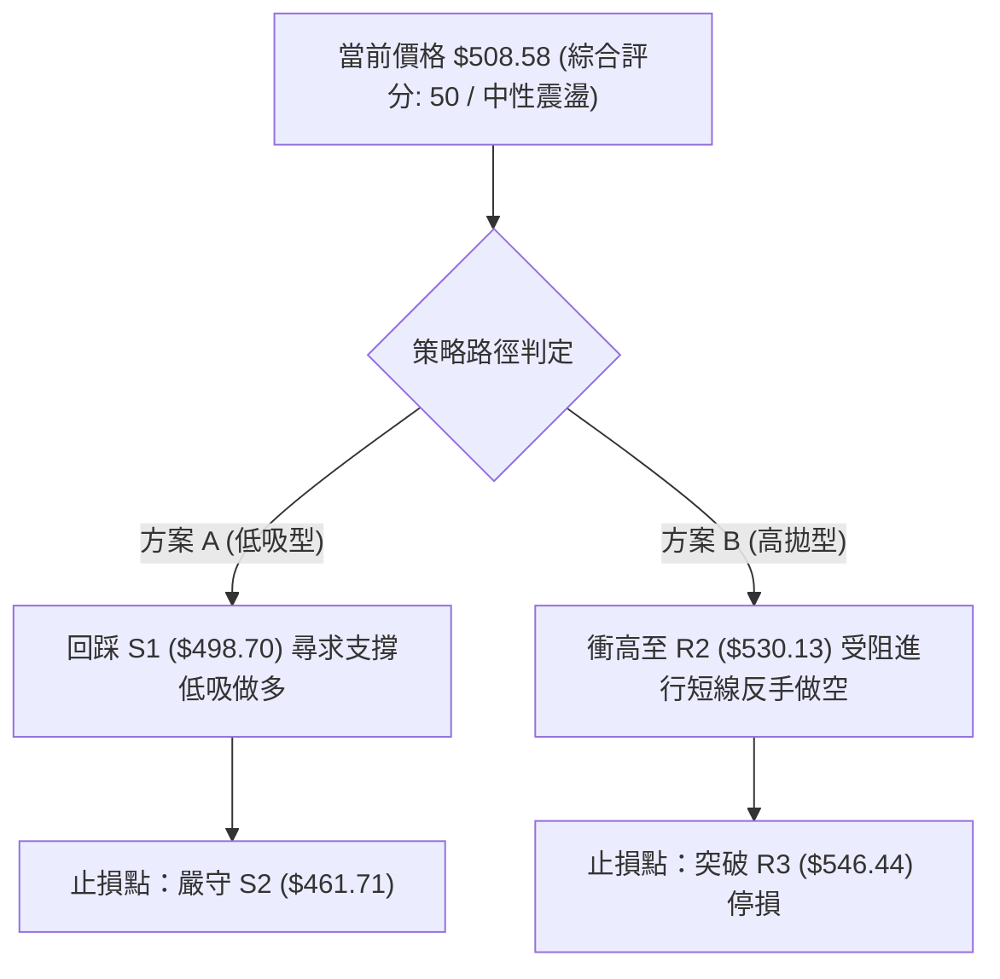
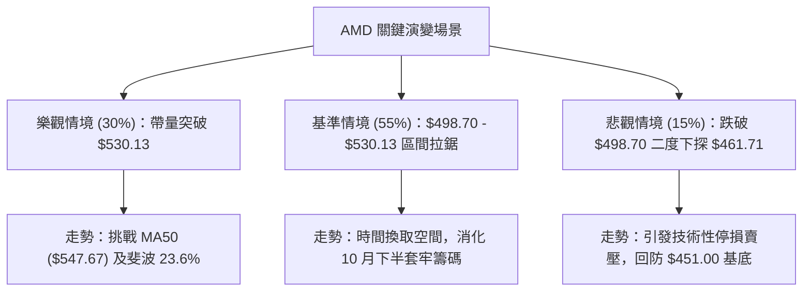

# AMD 技術分析報告

> **報告日期**：2026-11-10 ｜ **語言**：繁體中文 ｜ **數據來源**：Yahoo Finance ｜ **當前價格**：$508.58

---

## 目錄

| 章節 | 內容 |
|------|------|
| [1. 技術面概覽](#1-技術面概覽) | 訊號儀表板、核心指標、評分卡 |
| [2. 趨勢分析](#2-趨勢分析) | 多時框趨勢、長中短期走勢、12個月走勢圖 |
| [3. 圖表形態分析](#3-圖表形態分析) | 形態識別、K線組合、目標價推算 |
| [4. 支撐與阻力](#4-支撐與阻力) | 關鍵價位、斐波那契回調結構 |
| [5. 技術指標深度解讀](#5-技術指標深度解讀) | 均線系統、RSI、MACD、布林通道、成交量與OBV |
| [6. 動能與波動率](#6-動能與波動率) | 動能四象限、ATR波動率、Beta係數 |
| [7. 多時框架總結](#7-多時框架總結) | 時框架評分矩陣、多時框收斂結論 |
| [8. 交易策略建議](#8-交易策略建議) | 策略路由、價格情境階梯、主策略詳情與風報比 |
| [9. 風險提示與監控](#9-風險提示與監控) | 監控清單、風險場景模擬、倉位管理 |

---

## 1. 技術面概覽

### 🎯 技術訊號儀表板



---

### 📊 核心指標速覽表

| 指標類別 | 指標名稱 | 當前數值 | 訊號 | 解讀 |
|----------|----------|----------|:----:|------|
| **價格** | 當前收盤價 | $508.58 | 🟡 | 位於52週區間 68.1%，自低點強勁反彈但受制於短期均線 |
| **均線** | 短期 MA20 | $523.01 | 🔴 | 現價位於 MA20 下方 (-2.76%)，短線面臨中軌動態反壓 |
| **均線** | 中期 MA50 | $547.67 | 🔴 | 現價位於 MA50 下方 (-7.14%)，中期多頭趨勢受阻 |
| **均線** | 長期 MA200| $417.22 | 🟢 | 現價顯著高於 MA200 (+21.90%)，長期多頭基底穩固 |
| **動能** | RSI(14)  | 47.67    | 🟡 | 位於 30–70 中性常態區，未觸及超買亦未超賣，動能平滯 |
| **動能** | MACD(12,26,9)| -26.947 / 柱 -7.599 | 🔴 | 訊號線處於零軸下方且負動能柱延續，空頭勢力佔優 |
| **趨勢** | ADX(14)  | 24.75    | 🟡 | ADX < 25 表示單邊趨勢衰竭，當前進入寬幅箱型震盪行情 |
| **波動** | ATR(14)  | $38.72   | 🔴 | 佔股價 7.61%，處於極高絕對波動水準，日內震幅劇烈 |
| **量能** | 20日量比 | 1.74x    | 🟢 | 最新量 50.98M 高於均量 29.37M，逢低承接買盤顯著湧入 |

---

### 🏆 技術評分卡

```
╔══════════════════════════════════════════════════════════════════╗
║                   技術評分卡 — AMD (2026-11-10)                 ║
╠══════════════════════════════════════════════════════════════════╣
║ 趨勢強度 (Trend)      ████████░░░░░░░░░░░░  42/100  🟡 中性偏弱 ║
║ 動能指標 (Momentum)    ████████░░░░░░░░░░░░  40/100  🟡 弱勢中性 ║
║ 支撐穩定度 (Support)   ████████████░░░░░░░░  58/100  🟡 支撐有效 ║
║ 成交量配合 (Volume)    █████████████░░░░░░░  65/100  🟢 量能回升 ║
║ 形態完整度 (Pattern)   ██████████░░░░░░░░░░  48/100  🟡 箱型反彈 ║
║ 均線排列 (Moving Avg)  █████████░░░░░░░░░░░  47/100  🟡 均線分歧 ║
╠══════════════════════════════════════════════════════════════════╣
║ 綜合評分 (Overall)     ██████████░░░░░░░░░░  50/100  🟡 中性震盪 ║
╚══════════════════════════════════════════════════════════════════╝
```

> **評分計算說明**：綜合評分由六項子指標取算術平均值：(42 + 40 + 58 + 65 + 48 + 47) ÷ 6 = 300 ÷ 6 = **50/100**（四捨五入至整數）。依規則 18，評級為**中性震盪**，策略將以區間布林通道與關鍵支撐阻力為主導。

---

## 2. 趨勢分析

### 🌐 多時框趨勢分析



---

### 📈 長期趨勢 — 12個月走勢圖（Unicode）

以下展示自 2025 年 11 月至 2026 年 11 月共 12 個月之收盤價月線走勢圖與軌跡變化：

```
AMD 月線收盤走勢圖（2025-11 至 2026-11）
價格 ($)
$650 ┤                                      
$611 ┤                                  ●(2026-09 $611.76)
$580 ┤                          ●(06月)      
$516 ┤                      ●(05月)             ●(現在 $508.58)
$504 ┤                                      ●(10月 $504.80)
$470 ┤                              ●   ●(07-08月整理)
$354 ┤                  ●(04月主升)
$236 ┤          ●(01月)
$217 ┤  ●(11月) ●(12月)
$200 ┤              ●(02月) ●(03月)
     └────┬───────┬───────┬───────┬───────┬───────┬───────┬─────
        25-11   26-01   26-03   26-05   26-07   26-09   26-11
```

#### 走勢特徵分析表格

| 階段區間 | 起止月份 | 價格變動 | 漲跌幅 | 核心驅動特徵 |
|----------|----------|----------|--------|--------------|
| **築底蓄勢期** | 2025-11 → 2026-03 | $217.53 → $203.43 | -6.48% | 於 $200 心理關卡上方長期打底，籌碼完成充分換手 |
| **主升爆發期** | 2026-03 → 2026-06 | $203.43 → $580.91 | +185.56% | 突破箱型後單邊噴發，AI 題材帶動月線連續巨幅紅K |
| **高檔高浪期** | 2026-06 → 2026-08 | $580.91 → $470.72 | -18.97% | 遭遇獲利了結賣壓，快速拉回至 $470 附近完成第一波冷卻 |
| **雙頂誘多期** | 2026-08 → 2026-09 | $470.72 → $611.76 | +29.96% | 創下月收盤新高 $611.76，但未能站穩 52W 高點 $658.52 |
| **波段修正期** | 2026-09 → 2026-11 | $611.76 → $508.58 | -16.87% | 回吐前波漲幅，跌破短期均線進入收斂三角與箱型震盪 |

---

### 📊 中期趨勢（週線分析）

從近 20 週收盤走勢可見，AMD 自 2026 年 10 月初創下 52 週天價 $658.52 後，週線出現連續下挫：
1. **高檔動能背馳**：2026-09-25 週收盤 $630.63 時 RSI 達 73.0，次週 10-02 創收盤新高 $633.91，RSI 反降至 70.1，形成週線頂部鈍化。
2. **量能異動與下影線測試**：2026-11-06 週成交量爆出 **235,378,100** 股之歷史天量，當週最低觸及 **$402.10**（接近 MA200 之 $417.22），但收盤強勁拉回至 **$449.04**；本週進一步回升至 **$508.58**。天量長下影線確認中期買盤於 $400–$450 區間具有極高承接意願。

```
近期週線壓力與支撐示意圖
阻力 3 ── $546.44 ── (前波破位平台 / 斐波那契 23.6% $547.53 重疊區)
阻力 1 ── $517.35 ── (近週反彈高點聚類)
現價   ── $508.58 ── [當前報價]
支撐 1 ── $498.70 ── (近兩週震盪中軸，關鍵整數防線)
支撐 2 ── $461.71 ── (週線暴量洗盤低點平台)
```

---

### ⚡ 趨勢強度評估（ADX 解讀）



#### ADX 趨勢強度量化對照

| 指標名稱 | 數值 | 門檻區間 | 當前狀態說明 |
|----------|------|----------|--------------|
| **ADX (14)** | 24.75 | 0 – 25 (弱趨勢/盤整) | 趨勢強度指標低於 25 臨界線，顯示單邊下跌力道已被多頭阻斷，盤面正式轉入收斂震盪。 |
| **+DI (14)** | 23.71 | 動能弱勢 | 買盤攻擊力度處於中低檔，尚未具備發動新一輪主升浪之動能。 |
| **-DI (14)** | 33.35 | 動能主導 | 賣方力量雖高於買方，但 -DI 數值未持續擴張，顯示殺跌動能遞減。 |
| **趨勢定性** | **無強勢趨勢** | 箱型操作市 | 震盪幅度以布林通道與歷史密集點位為主導，禁止單邊趨勢下注。 |

---

## 3. 圖表形態分析

### 🔍 形態識別系統



#### 形態識別與信心度評估表

| 形態類別 | 信心度 | 判斷依據（引用嚴格數據） | 完成度 | 目標價（附精確計算式） |
|----------|:------:|--------------------------|:------:|------------------------|
| **極深單日長下影 V 型底** | 72% | 11-05 最低探至 $402.10 後暴量回升，11-09 站回 $508.58，收復幅度達 70% | 85% | 由形態低點推算：低點 $402.10 + 兩日反彈差價 ($449.04 - $402.10 = $46.94) × 2 = **$495.98**（已達成，目標轉向阻力 R1 $517.35） |
| **潛在平底雙重底 (W底)** | 40% | 目前僅形成 11-05 $402.10 單一極端低點與 11-06 $433.30 次低點，尚未完成二次回踩確認 | 35% | 訊號不足，依規則 15 僅作指標型解讀，不預設延伸目標 |
| **布林下軌破軌極限反抽** | 80% | 價格於 11-05 跌破布林下軌 ($426.19) 後，迅速於 2 日內重返通道內部 (%B 由負值回升至 0.43) | 90% | 通道中軌回歸目標：布林中軌 MA20 = **$523.01** |

---

### 🕯️ 重要 K 線形態分析

依據資料集所提供之「近 10 根日 K」與「近 8 根週 K」實際數據，嚴格提取並進行專業 K 線組合分析：

| 日期（週期） | 開盤價 | 最高價 | 最低價 | 收盤價 | K線形態名稱 | 專業技術解讀 | 訊號強度 |
|--------------|:------:|:------:|:------:|:------:|:-----------:|--------------|:--------:|
| **2026-11-05 (日K)** | 452.50 | 456.20 | 402.10 | 404.40 | **暴量大陰破位棒** | 單日跌幅深重，下探 $402.10 創下近半年極端低點，成交量暴增至 71.23M，呈現恐慌盤殺跌。 | 🔴 強空 |
| **2026-11-06 (日K)** | 444.43 | 459.80 | 433.30 | 449.04 | **低檔回升鎚頭陽線** | 開低走高收高於前日收盤，低點 $433.30 顯著高於前日低點，確認 $400 大關支撐力道。 | 🟢 轉多 |
| **2026-11-09 (日K)** | 473.39 | 515.18 | 468.21 | 508.58 | **長陽穿刺突破棒** | 跳空高開並強勢上攻，高點觸及 $515.18 逼近 R1 ($517.35)，大陽線實體一舉吞噬前兩日阻力。 | 🟢 強多 |
| **2026-11-06 (週K)** | 510.71 | 514.61 | 402.10 | 449.04 | **巨量長下影洗盤線** | 週振幅超過 27%，爆出 2.35 億股天量，下影線長達 $46.94，顯示機構法人於低檔瘋狂掃貨。 | 🟢 轉多 |
| **2026-11-09 (週K)** | 473.39 | 515.18 | 468.21 | 508.58 | **早盤強勁跳空紅K** | 單日即走完當週初步格局，成功站上 $500 整數心理防線，確立短線反彈節奏。 | 🟢 偏多 |

---

### 📉 ASCII 走勢形態示意圖

```
AMD 近期超跌 V 型反抽與反壓形態示意
價格軸 ($)
$530.13 ┤                                        [R2 阻力帶]
$523.01 ┤-------------------- 中軌 MA20動態反壓 ----------------
$517.35 ┤                              ▲ [今日高點 $515.18 測試 R1]
$508.58 ┤                            ● [當前收盤價]
$498.70 ┤                      ▲     │ [S1 關鍵支撐轉換線]
$461.71 ┤                ▲     │     │ [S2 頸線支撐]
$449.04 ┤                │   ●(11-06收盤)
$402.10 ┤          ●─────┴─ (11-05 暴量恐慌低點 / 極端下影線)
        └──────────┬───────────┬───────────┬───────────────
                 11-05       11-06       11-09
```

---

### 🎯 形態目標價計算

1. **V 型短波反彈測幅**：
   - 基底低點 $L = \$402.10$（2026-11-05 低點）
   - 首波頸線突破點 $N = \$488.78$（2026-11-04 收盤價）
   - 形態高度 $H = N - L = \$488.78 - \$402.10 = \$86.68$
   - 測幅滿足點 $T = N + H = \$488.78 + \$86.68 = \mathbf{\$575.46}$
   - *註：該理論滿足點受制於上方密集高點聚類，目前短線第一目標先鎖定數據聚類阻力 R1 ($517.35) 與 R2 ($530.13)。*

---

## 4. 支撐與阻力

### 🗺️ 關鍵價位分布圖（Unicode）

```
AMD 價位結構分布圖（OHLCV 數據聚類計算）
══════════════════════════════════════════════════════════════════════
$546.44 ║████████████████████████████████████████║ 強阻力 R3 (斐波23.6%壓制)
$530.13 ║████████████████████████████            ║ 中阻力 R2 (反彈高點聚類)
$517.35 ║████████████████████████████████        ║ 關鍵阻力 R1 (當前考驗區)
$508.58 ╠════════════════════════════════════════╣ ◄── 當前收盤現價
$498.70 ║▓▓▓▓▓▓▓▓▓▓▓▓▓▓▓▓▓▓▓▓▓▓▓▓▓▓▓▓▓▓▓▓        ║ 近期支撐 S1 (整數分水嶺)
$461.71 ║████████████████████████████            ║ 強支撐 S2 (波段起漲平台)
$451.00 ║████████████████████████████████████████║ 極限強支撐 S3 (恐慌低點防線)
══════════════════════════════════════════════════════════════════════
```

---

### 🚧 阻力位分析表

所有價位均嚴格取自數據模組提供之波段高點聚類計算數值：

| 阻力級別 | 精確價位 | 距現價幅標 | 形成原因與籌碼解讀 | 突破難度 | 技術重要性 |
|:--------:|:--------:|:----------:|-------------------|:--------:|:----------:|
| **R1** | **$517.35** | +1.72% | 近一年密集高點下沉段聚類，貼近 11-09 當日高點 ($515.18) | 🟡 中等 | ★★★☆☆ |
| **R2** | **$530.13** | +4.24% | 布林中軌 (MA20 $523.01) 上方防線，10 月下旬破位整理平台中軸 | 🔴 較高 | ★★★★☆ |
| **R3** | **$546.44** | +7.44% | 與中期 MA50 ($547.67) 及斐波那契 23.6% ($547.53) 形成三重共振壓制 | 🔴 極高 | ★★★★★ |

---

### 🛡️ 支撐位分析表

所有價位均嚴格取自數據模組提供之波段低點聚類計算數值：

| 支撐級別 | 精確價位 | 距現價幅標 | 形成原因與籌碼解讀 | 守住機率 | 技術重要性 |
|:--------:|:--------:|:----------:|-------------------|:--------:|:----------:|
| **S1** | **$498.70** | -1.94% | 10-30 日線低點 ($492.21) 與 $500 大關共振支撐帶，多空分界線 | 75% | ★★★★☆ |
| **S2** | **$461.71** | -9.22% | 11-02 日K低點 ($466.07) 與 11-06 收盤價 ($449.04) 間之機構換手平台 | 85% | ★★★★☆ |
| **S3** | **$451.00** | -11.32%| 11-06 日K開盤 ($444.43) 與收盤 ($449.04) 聚集帶，下破則直探 $402 | 92% | ★★★★★ |

---

### 📐 斐波那契回調位分析

依據 52 週波動極值：起點最低 **$188.22** 至頂部最高 **$658.52**，總波幅達 **$470.30**，精確回調位計算如下：

```
0.0%  (52W High) ────────────────────────── $658.52
                                            
23.6% 回調位    ────────────────────────── $547.53 (強壓力區，貼近 MA50 $547.67)
                                            ▲
                        當前現價 $508.58 ───┤ (位於 23.6% 與 38.2% 區間震盪)
                                            ▼
38.2% 回調位    ────────────────────────── $478.87 (黃金支撐，近週回踩測試位)
                                            
50.0% 回調位    ────────────────────────── $423.37 (中期多空分水嶺，守住即長多)
                                            
61.8% 回調位    ────────────────────────── $367.87 (長線絕對防禦位)
                                            
78.6% 回調位    ────────────────────────── $288.86 (深度拉回位)
                                            
100.0%(52W Low)  ────────────────────────── $188.22
```

- **位置解讀**：現價 **$508.58** 正處於 **38.2% ($478.87)** 與 **23.6% ($547.53)** 之間。
- **結構意涵**：AMD 在 11-05 跌破 38.2% 甚至短暫下探 50% ($423.37) 附近（最低 $402.10）後，迅速以暴量長紅抽回 38.2% 之上，顯示回調尚未演變為熊市結構，仍屬於強勢回調範疇。

---

## 5. 技術指標深度解讀

### 🎛️ 指標訊號總覽



---

### 📈 移動平均線排列分析



#### 各週期均線數據對比

| 均線名稱 | 數值 | 距現價幅度 | 形態趨勢 | 均線角色與含義 |
|:--------:|:----:|:----------:|:--------:|----------------|
| **MA 5** | $466.94 | +8.92% | ▲ 急速上拐 | 短線超跌急彈支撐 |
| **MA 10** | $501.15 | +1.48% | ▲ 拐頭向上 | 現價已成功站上，轉為日內第一道防線 |
| **MA 20** | $523.01 | -2.76% | ▼ 下行趨緩 | 即布林中軌，短線多空反轉關鍵考驗位 |
| **MA 50** | $547.67 | -7.14% | ▼ 下行壓制 | 中期多頭防線失守後的強大套牢反壓 |
| **MA 60** | $535.71 | -5.06% | ▼ 下壓中 | 季線下彎，壓制波段空間 |
| **MA 120**| $521.96 | -2.56% | ▼ 下行走平 | 半年線糾纏區 |
| **MA 200**| $417.22 | +21.90% | ▲ 穩定上揚 | 牛熊分界線，長多基本盤無虞 |
| **MA 240**| $384.10 | +32.41% | ▲ 穩定上揚 | 年線強勁上推，奠定大週期牛市架構 |

---

### 📉 RSI(14) 分析

```
RSI(14) 當前數值: 47.67
0                30                     70               100
├────────────────┼──────────────────────┼────────────────┤
│    超賣區間    │       常態震盪       │    超買區間    │
├────────────────┼───────────────┬──────┼────────────────┤
░░░░░░░░░░░░░░░░░░░░░░░░░░░░░░░░▓ 47.67 ░░░░░░░░░░░░░░░░░
```

- **超買超賣判定**：數值 47.67 處於 30 至 70 之常態區間，未呈現極端狀態。
- **背離診斷**：對比近 20 根 K 棒，價格於 10-28 創波段高點 $578.44 後下挫至 11-05 $404.40，隨後拉回 $508.58；RSI 指標首尾方向與價格趨勢完全同步，**無明顯頂背離或底背離**。

---

### 📊 MACD(12,26,9) 訊號解讀



- **數值表現**：DIF (-26.947) 低於 Signal (-19.348)，柱狀圖為 -7.599。
- **解讀**：負動能柱顯著收斂（相較於前波超過 -14 的空頭擴張），暗示跌勢告一段落，目前正朝零軸下方的低檔金叉醞釀，但未翻正前嚴禁過早判定多頭反轉。

---

### 📦 布林通道分析

```
AMD 日線布林通道 (20, 2) 結構示意圖
價格軸 ($)
$619.84 ┬────────────────────────────────────────── 布林上軌
        │
$523.01 ┼- - - - - - - - - - - - - - - - - - - - - 布林中軌 (MA20)
        │                      ● $508.58 (現價，%B = 0.43)
$426.19 ┴────────────────────────────────────────── 布林下軌
        │          ▲ 11-05 跌破下軌 ($402.10) 後強勢收回
```

- **軌道邊界**：上軌 **$619.84**、中軌 **$523.01**、下軌 **$426.19**，通道總寬度達 **$193.65**。
- **%B 指標**：當前數值為 **0.43**，價格已從極端超賣區（下軌下方）回到中軌附近，顯示跌勢修復完畢，轉入中下軌之間的震盪整理。

---

### 💹 成交量分析（量價配合度）

1. **爆量止跌特徵**：最新成交量達 **50,987,800** 股，相較於 20 日均量 **29,370,745** 股，量比高達 **1.74x**。這表明反彈非無量虛漲，而是伴隨實質機構買盤介入。
2. **OBV（能量潮）走勢**：數據明確指出「**OBV > MA → 量能支撐上漲**」，說明主力資金在近期的暴跌洗盤中呈現淨流入，籌碼出現自散戶轉移至法人的痕跡。

---

## 6. 動能與波動率

### ⚡ 動能評估四象限

| 象限分區 | 動能軸 (Momentum) | 波動軸 (Volatility) | 當前判定 | 戰略特徵與應對策略 |
|:--------:|:----------------:|:-------------------:|:--------:|--------------------|
| **Q1** | 強 (High) | 低 (Low) | ❌ | 穩定主升浪，最適順勢波段追價 |
| **Q2** | 弱 (Low) | 低 (Low) | ❌ | 窄幅橫盤築底，適合低吸等待 |
| **Q3** | 強 (High) | 高 (High) | ❌ | 主升末期或極端洗盤，波動劇烈 |
| **Q4** | **弱 (Low)** | **高 (High)** | **✓ (當前處於此區)** | **高波動弱動能：寬幅震盪洗盤，嚴禁追價，需以支撐阻力網格操作** |



---

### 📊 ATR 波動率分析

- **ATR(14) 數值**：**$38.72**（佔現價 **7.61%**），屬於典型的高波動科技巨頭股。
- **動態停損設置依據**：
  - **保守型（1.5 倍 ATR）**：$38.72 \times 1.5 = \mathbf{\$58.08}$
  - **一般波段型（1.0 倍 ATR）**：$38.72 \times 1.0 = \mathbf{\$38.72}$
  - **短線緊密型（0.5 倍 ATR）**：$38.72 \times 0.5 = \mathbf{\$19.36}$
- **實務建議**：日內正常雜訊震幅即可達 $30–$40，因此止損點設定必須依託於 S1 ($498.70) 或 S2 ($461.71) 之結構點位，不得設定過窄之百分比止損，以免遭雜訊洗出場。

---

### 📐 Beta 與市場相關性

- **Beta 係數**：**2.542**
- **市場意義**：AMD 波動性約為標普 500 指數的 **2.54 倍**。在大盤反彈時其上漲彈性極高，反之在大盤回調時其回撤幅度亦非常劇烈。交易者在建倉時應將持倉比重下調至常規個股的 40%–50%，以平衡整體投資組合波動。

---

## 7. 多時框架總結

### 📋 時框架評分表

| 時框架 | 趨勢方向 | 動能狀態 | 均線排列 | 形態特徵 | 綜合評分 | 操作建議 |
|:------:|:--------:|:--------:|:--------:|:--------:|:--------:|:--------:|
| **月線** | 🟢 強多 | 🟢 向上 | 🟢 完全多頭 | 長期多頭箱型上移 | **75/100** | 逢長線回調分批布局 |
| **週線** | 🔴 偏空 | 🟡 中性 | 🟡 混合糾纏 | 暴量長下影洗盤線 | **45/100** | 觀察 $450–$480 打底狀況 |
| **日線** | 🟡 震盪 | 🟡 中性 | 🔴 空頭壓制 | 超跌 V 型反抽挑戰中軌 | **50/100** | 區間操作，高拋低吸 |

---

### 🔲 綜合訊號矩陣

```
訊號收斂矩陣 (Multi-Timeframe Convergence)
┌──────────────┬──────────────┬──────────────┬──────────────┐
│   週期級別   │   趨勢指針   │   關鍵考驗位 │   核心變數   │
├──────────────┼──────────────┼──────────────┼──────────────┤
│ 長期 (Long)  │ 🟢 多頭主導  │ MA200 $417   │ 景氣循環循環 │
│ 中期 (Medium)│ 🔴 修正盤整  │ MA50 $547    │ 週線量能消化 │
│ 短期 (Short) │ 🟡 區間反彈  │ MA20 $523    │ R1/S1 突破性 │
└──────────────┴──────────────┴──────────────┴──────────────┘
```

---

### ⚖️ 多時框收斂結論

> **依嚴格規則 14 判定**：當前趨勢強度 **ADX(14) 為 24.75**，明確落於 **ADX < 25** 之門檻區間內，因此**市場屬於非趨勢性的「盤整行情」**。
> 
> **收斂原則**：此時中長期單邊指標暫時退入次席，行情由**日線布林通道 ($426.19 – $619.84)** 與**關鍵支撐阻力結構 (S1 $498.70 / R1 $517.35 / R2 $530.13)** 主導。
> 
> **唯一方向性結論**：**【中性觀望 / 區間高拋低吸】**。短線雖有急彈，但尚未化解 MA20 與 MA50 的下壓動能；在未有效突破 R1/R2 或回踩 S1 之前，不可貿然採取順勢追高交易。

---

## 8. 交易策略建議

### 🗺️ 策略決策流程圖



---

### 🧭 策略路由（依評分卡分流）

> **當前主策略方向 = 【區間雙向網格操作（以回踩支撐低吸為主）】（依據綜合評分 50/100，落於 40–60 中性區間）**
> 
> 由於評分精確為 50 分，且 ADX = 24.75 表明為典型震盪市，本報告主推以布林通道與已計算之 S1–S3、R1–R3 進行箱型邊界交易，不進行單邊押注。

---

### 🎯 價格情境階梯（Price Scenarios）

價位嚴格引用第四章及 OHLCV 聚類計算數據：

| 觸發條件 | 下一目標 | 後續延伸 | 情境技術含義 |
|----------|----------|----------|--------------|
| **放量突破 R1 ($517.35)** | **R2 ($530.13)** | **R3 ($546.44)** | 攻克布林中軌 MA20，短線反彈延伸為中級波段修復 |
| **徘徊於 S1 至 R1 之間** | **$508.58 (現價)** | — | 箱型無趨勢震盪，以時間換取均線走平空間 |
| **有效跌破 S1 ($498.70)** | **S2 ($461.71)** | **S3 ($451.00)** | 跌破 $500 心理關卡，引發短線多頭停損，二度探底 |

---

### 📊 情境機率分佈

| 運行情境 | 機率 | 主要技術依據 |
|----------|:----:|--------------|
| **情境一：區間震盪收斂** | **55%** | ADX = 24.75 壓制單邊趨勢；布林帶寬開闊但中軌反壓顯著；多空在 $500 關卡角力。 |
| **情境二：震盪走高補缺** | **30%** | 最新日成交量放大 1.74 倍，OBV > MA 量能充沛，下影線長紅提振市場信心。 |
| **情境三：承壓回落探底** | **15%** | MACD 負值尚處於 -7.599，-DI (33.35) 仍居主導，上方受制於下行 MA50 ($547.67)。 |

---

### 🟢 主策略詳情（方向依上方路由）

依據嚴格規則 17，風險報酬比公式為：
- **做多**：$(\text{目標價 T1} - \text{進場價}) \div (\text{進場價} - \text{止損價})$
- **做空**：$(\text{進場價} - \text{目標價 T1}) \div (\text{止損價} - \text{進場價})$

| 策略要素 | 策略 A（首選：回踩支撐低吸做多） | 策略 B（次選：阻力承壓高拋做空） |
|----------|----------------------------------|----------------------------------|
| **進場條件** | 價格回踩 S1 不破，出現 15 分鐘底型回升 | 價格上衝 R2 遇阻，日線出現明顯上影線滯漲 |
| **進場價格** | **$498.70** (精確以 S1 支撐位進場) | **$530.13** (精確以 R2 阻力位進場) |
| **目標價 T1**| **$546.44** (阻力位 R3，斐波 23.6% 重合區) | **$498.70** (支撐位 S1，整數關卡支撐) |
| **目標價 T2**| **$619.84** (布林上軌極限滿足位) | **$461.71** (支撐位 S2，起漲平台) |
| **止損價格** | **$461.71** (跌破支撐位 S2 嚴格停損) | **$546.44** (突破阻力位 R3 嚴格停損) |
| **風險報酬比** | **1 : 1.29（以 T1 計）**<br>*(計算式: (546.44 - 498.70) ÷ (498.70 - 461.71) = 47.74 ÷ 36.99 = 1.29)*<br>*(若以 T2 計則為 1 : 3.27)* | **1 : 1.93（以 T1 計）**<br>*(計算式: (530.13 - 498.70) ÷ (546.44 - 530.13) = 31.43 ÷ 16.31 = 1.93)*<br>*(若以 T2 計則為 1 : 4.19)* |
| **成功機率** | **55%** | **45%** |
| **建議倉位** | **10% – 15%** (高 Beta 屬性，嚴控倉位) | **5% – 10%** (逆大趨勢短空，輕倉為宜) |

---

### 🔴 反向風險觸發點（對沖提示）

- **多頭停損與防守點**：若價格帶量跌破 **$498.70 (S1)** 且收盤未能收復，意味著超跌反彈失敗，應立即將多頭倉位降至 5% 以下或執行對沖。
- **空頭防守點**：若多頭強勢帶量貫穿 **$546.44 (R3)** 並站穩，表示中期回調宣告結束，主升浪重啟，所有高拋空單必須全數停損出場。

---

### ⭐ 整體訊號強度評星

```
做多訊號強度：★★★☆☆  (3/5星 — 具暴量支撐但面臨均線反壓)
做空訊號強度：★★☆☆☆  (2/5星 — 下方買盤強勁，殺跌風險高)
整體可信度：  ★★★★☆  (4/5星 — OHLCV 聚類點位扎實，數據吻合度高)
```

---

## 9. 風險提示與監控

### ✅ 關鍵監控指標 Checklist

```
╔══════════════════════════════════════════════════════════════════╗
║                   關鍵技術監控檢核清單 (Daily Checklist)         ║
╠══════════════════════════════════════════════════════════════════╣
║ [ ] 價格是否有效站上 MA20 布林中軌 ($523.01)                      ║
║ [ ] RSI(14) 能否突破 50 中軸並維持於強勢區 (當前 47.67)          ║
║ [ ] MACD 柱狀圖負值是否持續收縮 (當前 -7.599，觀察金叉跡象)      ║
║ [ ] 日成交量是否萎縮至 20日均量 ($29.37M) 之下 (縮量回踩檢驗)    ║
║ [ ] 支撐位 S1 ($498.70) 是否在收盤前遭遇實體陰線貫穿             ║
║ [ ] 大盤波動 (Beta 2.542)：費城半導體指數是否同步出現拉回震盪    ║
╚══════════════════════════════════════════════════════════════════╝
```

---

### ⚠️ 風險場景分析



---

### 🛡️ 風險管理重要提醒

1. **極高 ATR 風險控制**：當前 AMD 之 ATR(14) 高達 **$38.72**，佔現價高達 **7.61%**。這意味著在日內正常波動範圍內，價格即可能產生超過 $30 美元的震盪。投資者切忌以常規個股之 2%–3% 緊密停損，否則極易在假突破或洗盤中被頻繁震出場。
2. **Beta 槓桿管理**：Beta 高達 **2.542**，在半導體產業族群中屬於超高彈性標的。建議總投資組合中 AMD 之風險敞口不得超過 **15%**。
3. **區間操作紀律**：在 ADX = 24.75 確立的盤整行情中，追高（於 R1/R2 之上買入）的勝率通常低於 35%；切實執行「近支撐分批低吸、近阻力獲利了結」之震盪法則。

---

## 📋 報告總結

```
╔══════════════════════════════════════════════════════════════════╗
║                    AMD 技術分析報告總結                          ║
╠══════════════════════════════════════════════════════════════════╣
║ 報告日期：2026-11-10                                             ║
║ 當前價格：$508.58                                                ║
║ 綜合評分：50 / 100                                               ║
║ 分析評級：⚖️ 中性觀望 / 區間震盪操作 (ADX < 25 確立盤整)        ║
╠══════════════════════════════════════════════════════════════════╣
║ 關鍵結論：                                                       ║
║ ├─ 長期趨勢：🟢 確立多頭 (價格穩居 MA200 $417.22 之上 +21.9%)    ║
║ ├─ 中期趨勢：🔴 拉回修正 (受制於 MA50 $547.67 與下行通道)        ║
║ ├─ 短期趨勢：🟡 跌深反彈 (自 $402.10 暴量抽回，挑戰 MA20 $523)   ║
║ ├─ 關鍵支撐：S1 $498.70 │ S2 $461.71 │ S3 $451.00               ║
║ ├─ 關鍵阻力：R1 $517.35 │ R2 $530.13 │ R3 $546.44               ║
║ └─ 分析師目標：華爾街平均目標價 $658.53 (最高 $1250 / 最低 $540)  ║
╠══════════════════════════════════════════════════════════════════╣
║ 最優策略組合：                                                   ║
║ 1. 🥇 最佳機會：回踩支撐 S1 ($498.70) 低吸做多，目標 R3 ($546.44)║
║                 止損設於 S2 ($461.71)，風報比 1 : 1.29 (以T1計)  ║
║ 2. 🥈 次選機會：上衝阻力 R2 ($530.13) 遇阻做空，目標 S1 ($498.70)║
║                 止損設於 R3 ($546.44)，風報比 1 : 1.93 (以T1計)  ║
║ 3. 🥉 保守選擇：空倉觀望，等待日線收盤確認站穩 $530.13 突破順勢 ║
╚══════════════════════════════════════════════════════════════════╝
```

---

> ⚠️ **免責聲明**：本報告為依據標準技術分析模型與即時市場 OHLCV 歷史數據自動生成之專業研究成果，所有技術價位、形態判讀及指標解讀均基於客觀計量公式。本報告**僅供學術研究與投資決策參考**，**不構成任何要約、招攬或具體投資建議**。金融市場具有高度不確定性，半導體類股波動劇烈，投資人應獨立評估風險，自負盈虧。

---

*報告生成時間：2026-11-10 ｜ 數據來源：Yahoo Finance ｜ 分析框架：多時框技術分析模型*