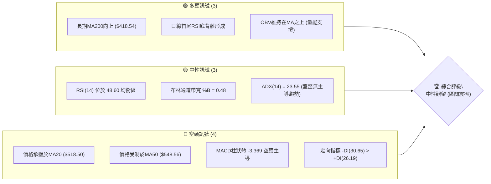
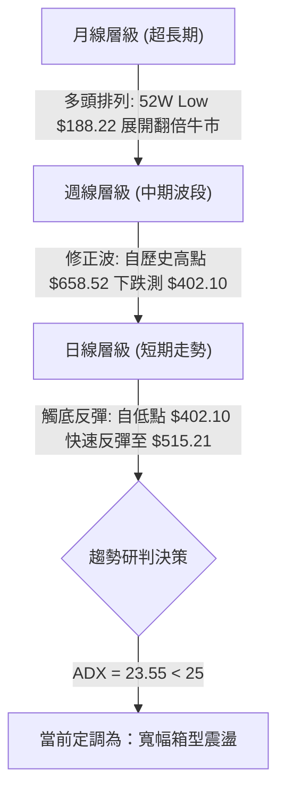
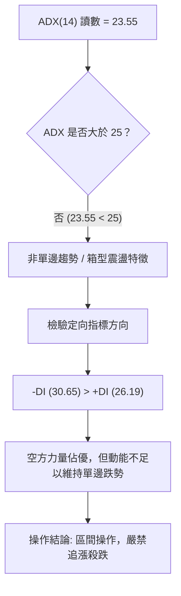
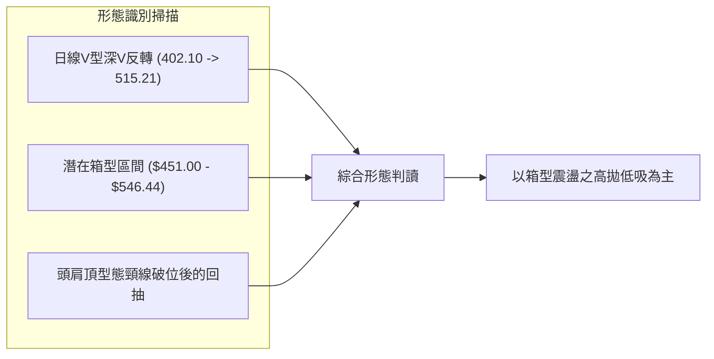
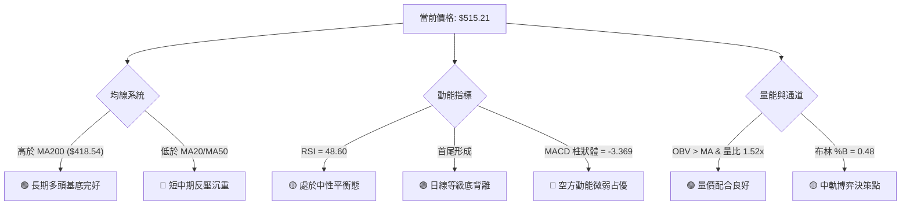
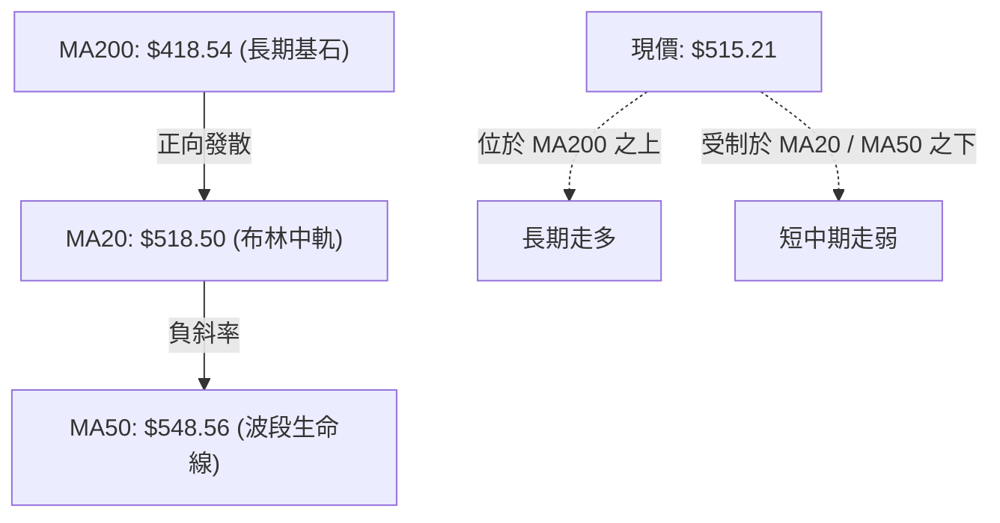
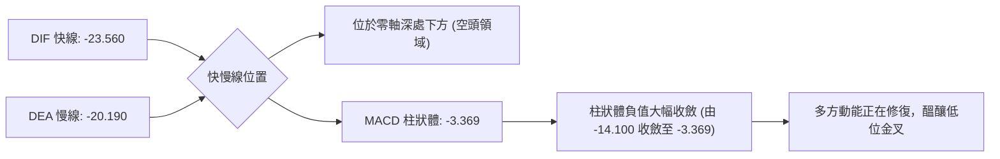
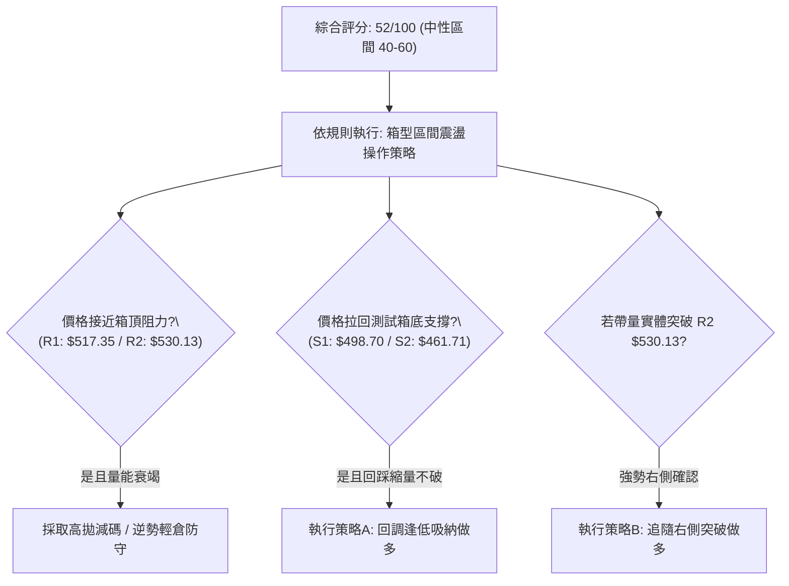
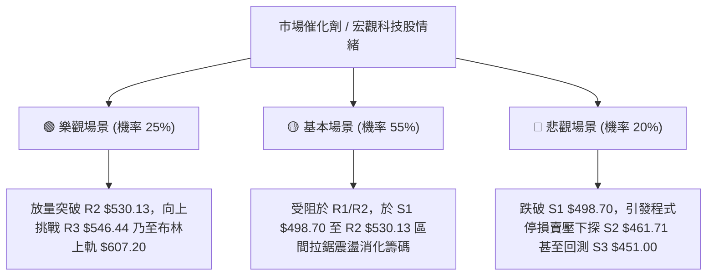

# AMD 技術分析報告

> **報告日期**：2026-11-11 ｜ **語言**：繁體中文 ｜ **數據來源**：Yahoo Finance ｜ **當前價格**：$515.21

---

## 目錄

| 章節 | 內容 |
|------|------|
| [1. 技術面概覽](#1-技術面概覽) | 訊號儀表板、核心指標、評分卡 |
| [2. 趨勢分析](#2-趨勢分析) | 多時框趨勢、長中短期走勢 |
| [3. 圖表形態分析](#3-圖表形態分析) | 形態識別、K線組合、目標價 |
| [4. 支撐與阻力](#4-支撐與阻力) | 關鍵價位、斐波那契回調 |
| [5. 技術指標深度解讀](#5-技術指標深度解讀) | MA/RSI/MACD/布林/成交量 |
| [6. 動能與波動率](#6-動能與波動率) | 動能評估、ATR、Beta |
| [7. 多時框架總結](#7-多時框架總結) | 時框架評分矩陣 |
| [8. 交易策略建議](#8-交易策略建議) | 多空策略、風險報酬比 |
| [9. 風險提示與監控](#9-風險提示與監控) | 監控指標、風險場景 |
| [📋 報告總結](#-報告總結) | 總體結論與策略清單 |

---

## 1. 技術面概覽

### 🎯 技術訊號儀表板



### 📊 核心指標速覽表

| 指標類別 | 指標名稱 | 當前數值 | 訊號 | 解讀 |
|----------|----------|----------|------|------|
| **價格** | 當前收盤價 | $515.21 | 🟡 | 位於52週區間69.5%，近期深幅回調後出現強彈 |
| **均線** | 短期 MA20 | $518.50 | 🔴 | 現價位於MA20下方（-0.63%），短線面臨中軌反壓 |
| **均線** | 中期 MA50 | $548.56 | 🔴 | 現價低於MA50，中期上升波段受阻，構成中線反彈阻力 |
| **均線** | 長期 MA200 | $418.54 | 🟢 | 現價遠高於MA200（+23.09%），長期牛市基底完好 |
| **動能** | RSI(14) | 48.60 | 🟡 | Wilder數值處於30-70中性區，無超買或超賣特徵 |
| **動能** | RSI背離狀態 | 底背離 | 🟢 | 近20根K棒首尾價格破底而RSI抬升，醞釀反彈力道 |
| **動能** | MACD(12,26,9) | -23.560 / -20.190 | 🔴 | DIF在訊號線下方，柱狀體為 -3.369，空方動能減弱但未翻多 |
| **趨勢** | ADX(14) | 23.55 | 🟡 | 數值小於25，代表非強趨勢行情，進入高波動箱型整理 |
| **波動** | ATR(14) | $39.11 | 🔴 | 佔股價達7.59%，波動幅度極大，需擴大止損與風控邊界 |
| **通道** | 布林帶寬 %B | 0.48 | 🟡 | 緊貼布林中軌（$518.50），市場在此尋求方向決策 |

### 🏆 技術評分卡

```
╔══════════════════════════════════════════════════════════════╗
║              技術評分卡 — AMD (2026-11-11)                   ║
╠══════════════════════════════════════════════════════════════╣
║ 趨勢強度      ████████░░░░░░░░░░░░  40/100  🔴 空頭主導      ║
║ 動能指標      ██████████░░░░░░░░░░  50/100  🟡 中性底背離    ║
║ 支撐穩定度    ██████████████░░░░░░  70/100  🟢 402/S3支撐有效║
║ 成交量配合    ████████████░░░░░░░░  60/100  🟢 OBV量能支持   ║
║ 形態完整度    ██████████░░░░░░░░░░  50/100  🟡 箱型反彈測頸  ║
║ 均線排列      ████████░░░░░░░░░░░░  40/100  🔴 均線呈現混合  ║
╠══════════════════════════════════════════════════════════════╣
║ 綜合評分      ██████████░░░░░░░░░░  52/100  🟡 中性觀望      ║
╚══════════════════════════════════════════════════════════════╝
```
*註：綜合評分 = (40 + 50 + 70 + 60 + 50 + 40) ÷ 6 = 51.67，四捨五入至整數為 52/100（依規則 18）。*

---

## 2. 趨勢分析

### 🌐 多時框趨勢分析



### 📈 長期趨勢 — 12個月走勢圖（Unicode）

依據月度收盤價數據繪製近12個月走勢：
```
AMD 月線收盤走勢圖（2025-12 至 2026-11）
價格軸 ($)
$620 ┤                                                ● 611.76
$580 ┤                                    ● 580.91
$520 ┤                              ● 516.10                ● 515.21 (當前)
$500 ┤                                                  ● 504.80
$460 ┤                                        ● 476.15  ● 470.72
$360 ┤                        ● 354.49
$240 ┤        ● 236.73
$200 ┤● 214.16    ● 200.21  ● 203.43
     └────────────────────────────────────────────────────────────────
       12月    01月    02月    03月    04月    05月    06月    07月    08月    09月    10月    11月
       2025   ---------------------- 2026 -----------------------------
```

#### 走勢特徵分析表格

| 階段區間 | 月收盤起止價 | 區間漲跌幅 | 形態與量價特徵 |
|----------|--------------|------------|----------------|
| **築底蓄勢期**<br>(2025-12 ~ 2026-03) | $214.16 → $203.43 | -5.01% | 圍繞 $200.00 整數關卡反覆築底，波動壓縮，籌碼充分沉澱 |
| **主升爆發期**<br>(2026-03 ~ 2026-06) | $203.43 → $580.91 | +185.56% | 突破加速上升段，月K呈現連三大陽線，資金強勢進場推動估值擴張 |
| **高位整理期**<br>(2026-06 ~ 2026-09) | $580.91 → $611.76 | +5.31% | 歷經7-8月拉回（低見$470.72）後再衝頂，9月見收盤高點$611.76 |
| **深幅回調期**<br>(2026-09 ~ 2026-11) | $611.76 → $515.21 | -15.78% | 見高 $658.52 後急速重挫，11月5日下探 $402.10 後出現強勁報復性反彈 |

### 📊 中期趨勢（週線分析）

中期走勢自2026-10-09創下52週高點 $658.52 後展開ABC修正浪。近兩週波動劇烈，2026-11-06該週單週成交量爆出 235,378,100 股的天量，低點下探至 $402.10，隨後拉出長下影線收在 $449.04；本週截至2026-11-10再度反彈至 $515.21，顯示中期強支撐買盤湧入。

```
週線級別阻力支撐示意圖：
  阻力三 (R3): $546.44  ══════════════════════════ [中期多空轉換關鍵]
  阻力二 (R2): $530.13  -------------------------- [短線波段高點反壓]
  阻力一 (R1): $517.35  .......................... [日線MA20中軌附近]
  當前現價:    $515.21  ◄═══ 價格正向上測試 R1 與布林中軌
  支撐一 (S1): $498.70  .......................... [近週成交密集區]
  支撐二 (S2): $461.71  -------------------------- [前次回調反彈轉折點]
  支撐三 (S3): $451.00  ══════════════════════════ [強多方防禦防線]
```

### ⚡ 趨勢強度評估（ADX 解讀）



#### ADX 強度對照表

| 指標名稱 | 數值 | 門檻區間 | 趨勢判定 | 交易策略意涵 |
|----------|------|----------|----------|--------------|
| **ADX(14)** | 23.55 | 0 – 25 | 弱趨勢 / 盤整 | 趨勢指標鈍化，應轉向支撐阻力之區間操作 |
| **+DI(14)** | 26.19 | — | 多方買盤推力 | 反彈帶動多方回升，但未跨過主導門檻 |
| **-DI(14)** | 30.65 | — | 空方賣壓力量 | 空方數值仍處於高位，顯示上方拋壓沉重 |
| **差值 (-DI - +DI)** | +4.46 | > 0 | 空方略勝一籌 | 提示當前仍屬空頭架構下的「超跌反彈」波段 |

---

## 3. 圖表形態分析

### 🔍 形態識別系統



#### 形態識別與信心度評估表

| 形態類別 | 信心度 | 判斷依據（引用數據） | 完成度 | 目標價（附計算式） |
|----------|--------|----------------------|--------|--------------------|
| **極速V型超跌反彈** | 75% | 11/05打出波段低點 $402.10 後，連續3根日K大漲收復失土至 $515.21，成交量放大 | 85% | 依形態高度推算：反彈至阻力位 R3 $546.44（第一目標已達R1 $517.35） |
| **高位箱型整理** | 65% | 價格在 S3 $451.00（與低點聚類區）與 R3 $546.44 之間來回拉鋸 | 60% | 區間震盪無定向目標，以箱體上沿 R3 $546.44 與箱體下沿 S2 $461.71 為邊界 |
| **週線雙頂/頭肩頸線回抽** | 45% | 信心度 < 50%，數據不足以確認完整右肩幾何構型 | N/A | 訊號不足，僅做指標型解讀（布林中軌反壓測試） |

### 🕯️ 重要K線形態分析

根據「近10根日K」與「近8根週K」之精確 OHLCV 數據進行專業識別：

| 日期（日K/週K） | 開 | 高 | 低 | 收 | K線形態 | 解讀 | 訊號 |
|------------------|----|----|----|----|---------|------|------|
| **2026-11-05 (日K)** | 452.50 | 456.20 | 402.10 | 404.40 | **長黑爆量破底線** | 爆出 71.2M 巨量恐慌拋售，長陰摜破450，但引發極限超賣 | 🔴 強空 |
| **2026-11-06 (日K)** | 444.43 | 459.80 | 433.30 | 449.04 | **低檔十字星/止跌槌** | 低點未再破 $402.10，收盤高於開盤，賣壓初顯竭盡跡象 | 🟡 轉折 |
| **2026-11-09 (日K)** | 473.39 | 515.18 | 468.21 | 508.58 | **多頭吞噬強中陽** | 跳空高開高走，完全收復前兩日失地，量能維持 51.2M 配合良好 | 🟢 強多 |
| **2026-11-10 (日K)** | 502.80 | 539.25 | 495.00 | 515.21 | **長上影流星假突破** | 盤中衝高至 $539.25（突破R2）後遭遇解套賣壓，收盤收斂至 $515.21 | 🟡 震盪 |
| **2026-11-06 (週K)** | 510.71 | 514.61 | 402.10 | 449.04 | **爆量長下影鐵鎚棒** | 成交量創 2.35 億股天量，下影線長達 $46.94，具強烈底部洗盤特徵 | 🟢 築底 |
| **2026-11-10 (週K)** | 473.39 | 539.25 | 468.21 | 515.21 | **強勁反彈中陽線** | 承接前週長下影線動能，開低走高突破500關卡，測試阻力區 | 🟢 多頭 |

### 📉 ASCII 走勢形態示意圖

```
AMD 近期日K走勢形態示意（2026-10-28 至 2026-11-10）
價格軸 ($)
$580 ┤ ● (10/28 高點 579.18)
$560 ┤   ●
$540 ┤                         ● (11/10 高點 539.25，遇阻 R2)
$520 ┤       ●                 │
$500 ┤         ● 504.80        │ ● 515.21 (11/10 收盤)
$480 ┤               ●         ● 508.58
$460 ┤                 ● 466.84  │
$440 ┤                       ● 449.04
$400 ┤                   ● (11/05 巨量深坑低點 402.10)
     └────────────────────────────────────────────────────────
       10/28 10/30 11/02 11/03 11/05 11/06 11/09 11/10
```

### 🎯 形態目標價計算

由 2026-11-05 低點 $402.10 展開之極速反彈形態分析：
- **形態基底（Valley Bottom）**：$402.10
- **頸線/第一突破防線（Neckline）**：取前期平台支撐轉阻力 R1 = $517.35
- **第一形態預估目標價**：
  若成功收復並站穩 R1 $517.35，按波段等距推算，短線下一阻力目標直接對應 R2 = $530.13，次級延伸目標對應 R3 = $546.44（計算依據：波段密集高點聚類）。
- **回撤防禦界限**：
  跌破支撐位 S1 = $498.70 則形態失敗，需退守考驗 S2 = $461.71。

---

## 4. 支撐與阻力

### 🗺️ 關鍵價位分布圖（Unicode）

```
AMD 價位結構分布圖 (依 OHLCV 與聚類演算法計算)
═══════════════════════════════════════════════════════════════
$546.44 ║██████████████████████████████║ 強阻力 R3 (波段高點/回調23.6%)
$530.13 ║████████████████████          ║ 阻力 R2 (反彈高點壓力區)
$517.35 ║██████████████████████████    ║ 關鍵短阻力 R1 (布林中軌/MA20)
$515.21 ╠══════════════════════════════╣ ◄ 現價 ($515.21)
$498.70 ║▓▓▓▓▓▓▓▓▓▓▓▓▓▓▓▓▓▓            ║ 近期支撐 S1 (整數心理防線前哨)
$461.71 ║████████████████████████      ║ 強支撐 S2 (前期跳空轉折平台)
$451.00 ║██████████████████████████████║ 極限強支撐 S3 (週K長下影洗盤密集區)
═══════════════════════════════════════════════════════════════
```

### 🚧 阻力位分析表

所有價位精確取自 OHLCV 計算聚類：

| 阻力級別 | 價位 | 與現價距離 | 形成原因與籌碼屬性 | 突破難度 | 重要性 |
|----------|------|------------|--------------------|----------|--------|
| **R1** | $517.35 | +0.42% | 近一年波段高點聚類點，重合日線MA20 ($518.50) | 🟡 中等 | ★★★☆☆ |
| **R2** | $530.13 | +2.90% | 11/10日內長上影線回落區，短線獲利了結籌碼堆積 | 🟡 中高 | ★★★★☆ |
| **R3** | $546.44 | +6.06% | 波段頂部密集成交區，極度貼近斐波那契23.6% ($547.53) 與MA50 | 🔴 極高 | ★★★★★ |

### 🛡️ 支撐位分析表

所有價位精確取自 OHLCV 計算聚類：

| 支撐級別 | 價位 | 與現價距離 | 形成原因與籌碼屬性 | 守住機率 | 重要性 |
|----------|------|------------|--------------------|----------|--------|
| **S1** | $498.70 | -3.20% | 近一年波段低點聚類點，$500.00整數心理關卡防禦位 | 70% | ★★★☆☆ |
| **S2** | $461.71 | -10.38% | 11/02-11/06多根K棒築底回撤平台，多方承接盤堅實 | 80% | ★★★★☆ |
| **S3** | $451.00 | -12.46% | 近一年低點聚類核心，接近斐波那契38.2%與週K爆量買盤防線 | 90% | ★★★★★ |

### 📐 斐波那契回調位分析

依據52週極值區間（低點 $188.22 → 高點 $658.52，總垂直跨度 $470.30）計算：

| 回調比率 | 斐波那契價位 | 當前相對位置 | 技術意義與多空攻防解讀 |
|----------|--------------|--------------|------------------------|
| **0.0%** (52W High) | $658.52 | 現價下方 +27.82% | 歷史天花板，中期牛市最終目標 |
| **23.6%** | $547.53 | 現價上方 +6.27% | **強阻力空網**：與 R3 ($546.44) 完美重疊，為反彈行情最關鍵的生死考驗關卡 |
| **38.2%** | $478.87 | 現價下方 -7.05% | **強支撐黃金位**：介於現價與 S2 之間，為多頭維持強勢修正的極限回踩位 |
| **50.0%** | $423.37 | 現價下方 -17.82% | 多空中樞水準，守住此線上維持多頭主升結構（11/05低點曾短暫下探後拉回） |
| **61.8%** | $367.87 | 現價下方 -28.59% | 牛熊分界黃金分割防禦點，若失守牛市徹底終結 |
| **78.6%** | $288.86 | 現價下方 -43.93% | 深幅回撤防線 |
| **100.0%** (52W Low)| $188.22 | 現價下方 -63.47% | 52週起漲點 |

**現價區間解讀**：
當前收盤價 **$515.21** 精確運行於 **38.2% 回調位 ($478.87)** 與 **23.6% 回調位 ($547.53)** 之間。此區間為典型「寬幅震盪消化套牢區」。只要未實質跌破 38.2% 位，中期多頭架構未遭破壞。

---

## 5. 技術指標深度解讀

### 🎛️ 指標訊號總覽



### 📈 移動平均線排列分析



#### 移動平均線多時態明細表

| 週期均線 | 價格數值 | 相對現價位置 | 差值與幅度 | 當前趨勢與斜率評估 |
|----------|----------|--------------|------------|--------------------|
| **MA 5** | $473.20 | 位於價格下方 | +$42.01 (+8.88%) | 🟢 急速向上勾起，短多動能爆發 |
| **MA 10** | $496.64 | 位於價格下方 | +$18.57 (+3.74%) | 🟢 翻揚向上，短線已提供下檔第一道墊步支撐 |
| **MA 20** | $518.50 | 位於價格上方 | -$3.29 (-0.63%) | 🔴 緩步下行，為日內多空攻防核心頸線 |
| **MA 50** | $548.56 | 位於價格上方 | -$33.35 (-6.08%) | 🔴 空頭排列下壓，與 R3 構成中期阻力鐵壁 |
| **MA 60** | $535.86 | 位於價格上方 | -$20.65 (-3.85%) | 🔴 季線反壓下沉中 |
| **MA 120** | $522.52 | 位於價格上方 | -$7.31 (-1.40%) | 🔴 半年線微幅下沉 |
| **MA 200** | $418.54 | 位於價格下方 | +$96.67 (+23.09%) | 🟢 長期牛市防線，向上傾斜斜率穩健 |
| **MA 240** | $385.39 | 位於價格下方 | +$129.82 (+33.69%) | 🟢 年線大底支撐強固 |

**綜合均線結論**：短天期均線（MA5/10）急速向上金叉收復失土，但中天期（MA20/50/60/120）呈現混合下壓態勢，屬於典型的「均線收斂混合排列」，後續需時間震盪換手化解上檔均線下壓扣抵。

### 📉 RSI(14) 分析

Wilder 算法下的 RSI(14) 讀數為 **48.60**：
```
RSI(14) 強度儀表板:
0 ──────────── 30 ────────────────── 50 ────── 70 ─────────── 100
[   極度超賣   ] [   弱勢整理   ]     ▲   [ 偏多強勢 ] [  極度超買  ]
                                48.60 (中性平衡區)
進度條: ██████████░░░░░░░░░░  48.60%
```

#### 背離判斷與結論
- **背離狀態**：⚠️ **確認形成底背離 (Bullish Divergence)**。
- **背離證據**：檢視近20根K棒首尾，價格自 10/28 高點滑落並於 11/05 創出 $402.10 之波段新低，但 RSI(14) 在此過程中未創新低，率先於低檔走平並反彈回升至 48.60。
- **指標意涵**：底背離訊號驗證了低檔存在強勁的逢低買盤介入，短線空方下殺動能已消耗殆盡，為本波自 $402.10 回升至 $515.21 提供技術面堅實支撐。

### 📊 MACD(12/26/9) 訊號解讀



#### 數值解讀與動態演變
- **DIF 線**：-23.560
- **MACD Signal (DEA)**：-20.190
- **MACD Histogram**：**-3.369**（空頭柱狀體）
- **趨勢解讀**：柱狀體雖然仍為負值（🔴看空），但對比 2026-10-16 該週的 -14.100 與 2026-11-06 的 -12.756，負值已呈現**劇烈收斂**。快線正快速向訊號線靠攏，一旦跨過零軸或在零下完成金叉，將釋放中期買進訊號。

### 📦 布林通道分析

```
AMD 布林通道結構 (20日參數, 2倍標準差)
═══════════════════════════════════════════════════════════════
$607.20 ────────────────────────────────────────── 上軌 (阻力邊界)
         ▲
         │ (通道擴張寬度: $177.40)
         ▼
$518.50 ------------------------------------------ 中軌 (MA20)
$515.21 ·········································· [現價位置, %B = 0.48]
         ▲
         │ (現價距離下軌 +$85.41)
         ▼
$429.80 ────────────────────────────────────────── 下軌 (支撐邊界)
═══════════════════════════════════════════════════════════════
```
- **當前位置**：%B 為 **0.48**，代表價格已自下軌（$429.80）強勢回彈，目前精確貼近布林帶中軌（$518.50）。
- **帶寬特徵**：上下軌帶寬高達 $177.40，反映前期破底造成的劇烈波動。依布林帶操作法，在 %B 接近 0.50 處往往面臨方向再選擇，若能帶量實體陽線站上 $518.50，將打開向上軌 $607.20 尋求補漲的空間。

### 💹 成交量分析（量價配合度）

#### 量價數據對照
- **最新單日成交量**：46,907,700 股
- **20日平均成交量**：30,833,155 股（**量比: 1.52x**，屬於健康放量）
- **50日平均成交量**：24,816,354 股
- **OBV（能量潮）狀態**：**OBV > MA**，量能趨勢確認支持價格向上反彈。

#### 量價行為解讀
1. **爆量洗盤出底部**：2026-11-05 打出破底低點時成交量飆至 71,237,400 股，週成交量更在 11/06 結算達到 235,378,100 股的天量。此為典型「主力機構承接恐慌盤」的爆量特徵。
2. **反彈量能充沛**：11/09（51.2M）與 11/10（46.9M）反彈過程中，量能持續高於20日均量1.5倍以上，顯示並非「無量虛彈」，而是伴隨真金白銀的右側買盤回補。

---

## 6. 動能與波動率

### ⚡ 動能評估四象限

```
動能與波動率定位表
┌──────────────────────┬──────────────────────┐
│  象限二 (Q2): 弱動能 / 低波動│  象限三 (Q3): 強動能 / 高波動│
│  - 盤整修整，無趨勢          │  - 劇烈單邊行情，風險極大    │
├──────────────────────┼──────────────────────┤
│  象限四 (Q4): 弱動能 / 高波動│  象限一 (Q1): 強動能 / 低波動│
│  ★ AMD 當前落點 (✓)         │  - 穩健主升浪，最佳進場區    │
│  - 動能中性偏弱 (RSI 48.60) │                      │
│  - 波動極高 (ATR 7.59%)      │                      │
└──────────────────────┴──────────────────────┘
```

#### 象限矩陣深度評估

| 象限代號 | 動能狀態 | 波動率狀態 | 當前符合度 | 操作意涵與策略應對 |
|----------|----------|------------|------------|--------------------|
| **Q1** | 強動能 (ADX>30, RSI>60) | 低波動 (ATR<3%) | ✕ | 最佳趨勢波段持有區（目前非此環境） |
| **Q2** | 弱動能 (ADX<20, RSI 40-60) | 低波動 (ATR<3%) | ✕ | 低波壓縮整理，適合網格或低吸高拋 |
| **Q3** | 強動能 (趨勢明確加速) | 高波動 (ATR>5%) | ✕ | 突破追價區（當前ADX僅23.55，趨勢不明確） |
| **Q4** | **弱動能 (ADX 23.55)** | **極高波動 (ATR 7.59%)** | **✓ (當前狀態)** | **劇烈震盪洗盤區**：市場充斥情緒性下殺與報復性反彈，應降低槓桿與倉位規模，嚴守關鍵位防守 |

### 📊 ATR 波動率分析

- **ATR(14) 讀數**：**$39.11**（Wilder 標準平滑計算法）
- **ATR 佔比**：高達 **7.59%**（以現價 $515.21 計算）
- **市場意涵**：AMD 屬於極高日內波動度標的。這意味著單日股價出現 ±$40 的擺動屬於正常統計雜訊，並非趨勢翻轉。
- **風控止損距離建議**：
  - *短期波段交易*：止損緩衝距離至少需設置 1.0 倍 ATR（約 $39.11）。
  - *常規中線交易*：止損緩衝距離應設置 1.5 – 2.0 倍 ATR（約 $58.60 – $78.20），以防被盤中毛刺下影線洗出場。

### 📐 Beta 與市場相關性

- **Beta 係數**：**2.542**
- **市場特徵**：Beta 值高達 2.54，顯示 AMD 對標普500指數與那斯達克100指數具有極高的敏感情緒放大效應。當大盤上漲 1% 時，AMD 期望波動為 +2.54%；反之大盤回調 1% 時，其下挫壓力亦為 2.54 倍。
- **避險警示**：高 Beta 屬性要求投資人在科技股大盤面臨宏觀利率或晶片禁令雜音時，必須預留充足保證金與現金緩衝。

---

## 7. 多時框架總結

### 📋 時框架評分表

| 時框架 | 趨勢方向 | 動能狀態 | 均線排列 | 形態特徵 | 綜合評分 | 建議方向 |
|--------|----------|----------|----------|----------|----------|----------|
| **長期 (月線)** | 🟢 多頭向上 | 🟢 強勁偏多 (維持牛市主升) | 🟢 完美多頭 (遠超MA240) | 52W突破回踩確認 | 80/100 | 長線分批定投持有 |
| **中期 (週線)** | 🟡 震盪回調 | 🔴 空方釋放 (MACD柱負值) | 🟡 均線開散混亂 | 週K爆量長下影鐵鎚 | 50/100 | 區間震盪低吸高拋 |
| **短期 (日線)** | 🟡 觸底反彈 | 🟢 底背離修復 (RSI 48.60) | 🔴 混合反壓 (MA20阻力) | V型極速反彈測試頸線 | 52/100 | 短線衝高減碼/回測接 |

### 🔲 綜合訊號矩陣

```
┌────────────────────────────────────────────────────────┐
│               多時框多空訊號收斂矩陣                    │
├────────────┬─────────────┬─────────────┬───────────────┤
│ 維度指標   │ 短期 (日線) │ 中期 (週線) │ 長期 (月線)   │
├────────────┼─────────────┼─────────────┼───────────────┤
│ 主導趨勢   │ 🟡 震盪反彈 │ 🔴 弱勢修正 │ 🟢 明確多頭   │
│ 均線系統   │ 🔴 壓制混亂 │ 🟡 支撐爭奪 │ 🟢 強勁多頭   │
│ 動能指標   │ 🟢 底背離   │ 🔴 負值收斂 │ 🟢 高位強勢   │
│ 成交量配合 │ 🟢 價升量增 │ 🟢 恐慌天量 │ 🟢 總量健康   │
├────────────┴─────────────┴─────────────┴───────────────┤
│ 跨週期矛盾：短期反彈強勁 vs 中期均線下壓壓制          │
└────────────────────────────────────────────────────────┘
```

### ⚖️ 多時框收斂結論

依據「嚴格要求 14」之多時框收斂優先級規則：
1. **行情性質判斷**：當前日線 **ADX(14) = 23.55 < 25**，嚴格滿足「**盤整行情（ADX<25）**」定義。
2. **主導維度收斂**：在 ADX < 25 的盤整結構下，趨勢指標失效，**必須以日線布林通道（下軌 $429.80 至 上軌 $607.20）與密集支撐阻力為主要交易區間**。
3. **最終方向性結論**：**🟡 中性觀望（區間箱型震盪）**。
   日線雖有利多底背離推動反彈，但上方立即面臨日線布林中軌 MA20 ($518.50) 與 R1 ($517.35)、R2 ($530.13) 的沉重解套套牢賣壓；下方則受到週線爆量長下影線（S2 $461.71、S3 $451.00）的堅實托底。因此，不宜在當前 $515.21 盲目單邊做多或強行追空，主策略定調為**區間震盪操作**。

---

## 8. 交易策略建議

### 🗺️ 策略決策流程圖



### 🧭 策略路由（依評分卡分流）

**當前主策略方向 = 🟡 區間操作（等待突破確認，依評分 52/100）**
依規則 18，綜合評分落在 40–60 區間，定調為箱型震盪。主推**回調低吸多頭策略（策略A）**與**右側突破確認加碼策略（策略B）**，並設置嚴謹的下破停損與對沖提示。

### 🎯 價格情境階梯（Price Scenarios）

以當前收盤價 **$515.21** 為基準，嚴格引用「關鍵價位」數據推演：

| 觸發條件 | 下一目標 | 後續延伸 | 情境技術含義 |
|----------|----------|----------|--------------|
| **突破 R1 $517.35 並站穩** | R2 $530.13 | R3 $546.44 | 短線徹底突破布林中軌壓制，多頭轉強回補跳空缺口 |
| **受阻於 R1/R2 並站穩現價區間** | 震盪徘徊 | — | 於 $498.70 – $530.13 構築反彈次級整理平台 |
| **跌破 S1 $498.70** | S2 $461.71 | S3 $451.00 | 中期再度轉弱，空方二次探底考驗週K長下影洗盤區 |

### 📊 情境機率分佈

| 情境劇本 | 機率 | 主要技術依據 |
|----------|------|--------------|
| **情境一：區間震盪 (S1~R2)** | **50%** | ADX=23.55 顯示無主導趨勢；現價正處布林中軌（%B=0.48），上下兩難 |
| **情境二：回測支撐再上攻** | **30%** | 日線RSI底背離成形；OBV量能向上支持；週線爆出2.35億股巨量下影線築底 |
| **情境三：跌破支撐二次探底** | **20%** | MACD柱狀體仍為負值（-3.369）；-DI(30.65)仍大於+DI(26.19)，空方拋壓未消 |

### 🟢 主策略詳情

進場價採固定數值或區間中點計算，所有價位嚴格源自關鍵價位數據，風險報酬比公式為：`(目標價 T1 − 進場價) ÷ (進場價 − 止損價)`。

| 策略要素 | 策略 A（回踩支撐逢低承接） | 策略 B（右側強勢突破跟進） |
|----------|----------------------------|----------------------------|
| **進場條件** | 股價回踩 S1 獲支撐縮量止跌時切入 | 實體日K突破 R2 且量能大於20日均量1.5x |
| **進場價格** | **$498.70**（精確引用 S1） | **$530.13**（精確引用 R2） |
| **目標價 T1** | **$530.13**（精確引用 R2） | **$546.44**（精確引用 R3） |
| **目標價 T2** | **$546.44**（精確引用 R3） | **$607.20**（精確引用 布林上軌） |
| **止損價格** | **$461.71**（精確引用 S2） | **$517.35**（精確引用 R1，阻力轉支撐） |
| **風險報酬比** | **1 : 0.85（以 T1 計）**<br>*(530.13 - 498.70) / (498.70 - 461.71)<br>= 31.43 / 36.99 = 0.85*<br>*(1 : 1.29 以 T2 計)* | **1 : 1.28（以 T1 計）**<br>*(546.44 - 530.13) / (530.13 - 517.35)<br>= 16.31 / 12.78 = 1.28*<br>*(1 : 6.03 以 T2 計)* |
| **成功機率** | 60% | 50% |
| **建議倉位** | 15% 總資金（分批建倉） | 10% 總資金（右側輕倉加碼） |

### 🔴 反向風險觸發點（對沖提示）

若出現以下情境，將徹底推翻上述反彈箱型判斷，投資人應即刻執行停損或建立對沖頭寸：
1. **跌破核心防線**：若日K收盤價實質跌破 **S1 $498.70**，多頭反彈動能衰竭；若進一步灌破 **S2 $461.71**，表明主力資金放棄防守，將直奔 **S3 $451.00** 與前低 **$402.10**。
2. **量價異常訊號**：若價格再次回跌過程中，單日成交量再度超過5000萬股（量比 > 1.6x）且長陰收在最低，代表二次恐慌殺盤啟動，應全面減碼觀望。

### ⭐ 整體訊號強度評星

```
做多訊號強度：★★★☆☆  (3/5星 — 底背離與量能支持，但受均線反壓)
做空訊號強度：★★☆☆☆  (2/5星 — 均線空頭排列，但超跌且具強下影支撐)
整體可信度：  ★★★☆☆  (3/5星 — 處於 ADX<25 盤整震盪期，以區間為主)
```

---

## 9. 風險提示與監控

### ✅ 關鍵監控指標 Checklist

```
╔══════════════════════════════════════════════════════════════╗
║              AMD 日常技術監控清單 (Checklist)                 ║
╠══════════════════════════════════════════════════════════════╣
║ [ ] 價格能否有效收復並站穩 MA20 ($518.50) / R1 ($517.35)     ║
║ [ ] RSI(14) 能否進一步突破 50 中軸進入偏多擴張區             ║
║ [ ] MACD 柱狀體負值是否持續收斂至 0 軸並觸發金叉              ║
║ [ ] ADX(14) 是否持續低於 25，或突然向上飆升確認單邊新趨勢    ║
║ [ ] 成交量是否保持在 20日均量 (30.8M) 以上健康換手           ║
║ [ ] 下檔關鍵防禦點 S1 ($498.70) 整數關卡是否遭遇實體跌破     ║
╚══════════════════════════════════════════════════════════════╝
```

### ⚠️ 風險場景分析



### 🛡️ 風險管理重要提醒

1. **ATR 波動適應原則**：
   AMD 當前 ATR 高達 **$39.11**（波動率 7.59%），Beta 高達 **2.542**。交易者切勿使用緊窄止損（如 1-2%），否則極易在正常的盤中雜訊中被掃出場。嚴格遵守以關鍵價位（如 S1、S2）作為結構性止損依據。
2. **倉位配置上限**：
   在 ADX < 25 且評分為 52/100 的中性震盪市況下，單一股票技術性交易倉位嚴格限制在 **總投資組合的 15% – 20%** 以內，嚴禁在高位滿倉追高。
3. **黑天鵝與禁令事件防範**：
   半導體族群近期面臨晶片監管政策與財報預期等高敏感訊息，消息面驅動易導致日K跳空缺口產生，部位應盡量避開單一高槓桿衍生品裸暴露。

---

## 📋 報告總結

```
╔══════════════════════════════════════════════════════════════════╗
║                    AMD 技術分析報告總結                          ║
╠══════════════════════════════════════════════════════════════════╣
║ 報告日期：2026-11-11                                             ║
║ 當前價格：$515.21                                                ║
║ 分析評級：⚖️ 52/100 中性觀望 (箱型區間震盪整理)                  ║
║                                                                  ║
║ 關鍵結論：                                                       ║
║ ├─ 長期趨勢：🟢 強烈偏多 (股價遠高於MA200 $418.54，長線牛市完好) ║
║ ├─ 中期趨勢：🟡 箱型修復 (週線爆量長下影洗盤，自$402展開反彈)   ║
║ ├─ 短期趨勢：🟡 中軌攻防 (現價逼近MA20 $518.50，受制R1/R2反壓) ║
║ ├─ 關鍵支撐：S1 $498.70 ｜ S2 $461.71 ｜ S3 $451.00              ║
║ ├─ 關鍵阻力：R1 $517.35 ｜ R2 $530.13 ｜ R3 $546.44              ║
║ └─ 分析師目標：共識均價 $657.49 (最低 $525.00 / 最高 $1250.00)   ║
║                                                                  ║
║ 最優策略組合：                                                   ║
║ 1. 🥇 最佳機會：策略 A — 回踩 S1 $498.70 企穩接多，搏擊 R2 $530.13║
║ 2. 🥈 次選機會：策略 B — 帶量突破 R2 $530.13 右側跟進，看至 R3   ║
║ 3. 🥉 保守選擇：場外觀望，等待日線實體K棒收復 MA20 ($518.50) 確認║
╚══════════════════════════════════════════════════════════════════╝
```

---

> ⚠️ **免責聲明**：本報告為技術分析研究，所有數據及估算均基於歷史量價資訊。本報告**僅供研究與學術參考**，**不構成任何投資建議或買賣邀約**。金融市場瞬息萬變，投資有風險，入市需獨立審慎評估。

---

*報告生成時間：2026-11-11 ｜ 數據來源：Yahoo Finance ｜ 分析框架：多時框技術分析*