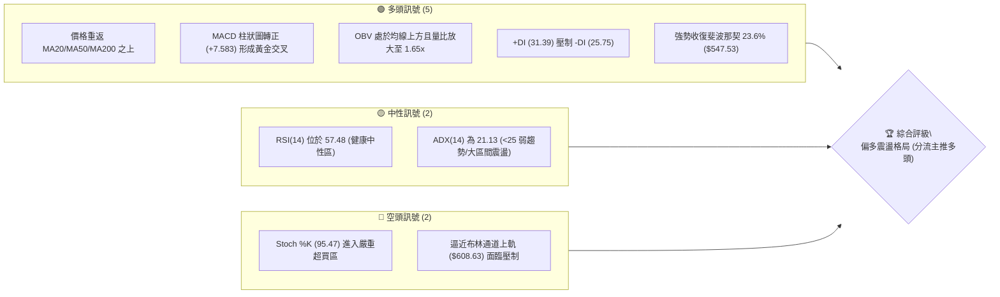
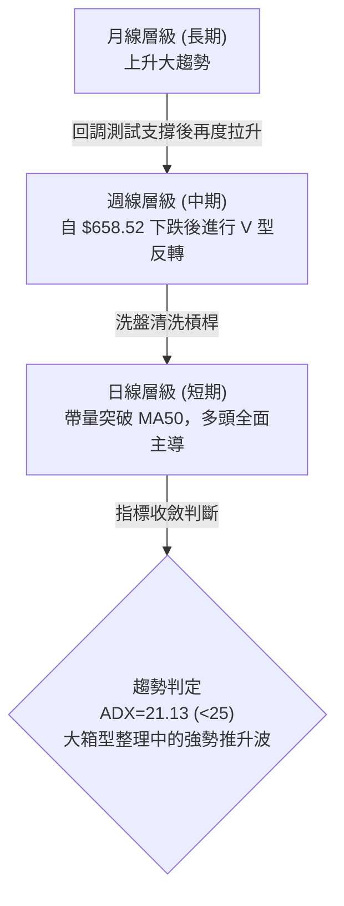
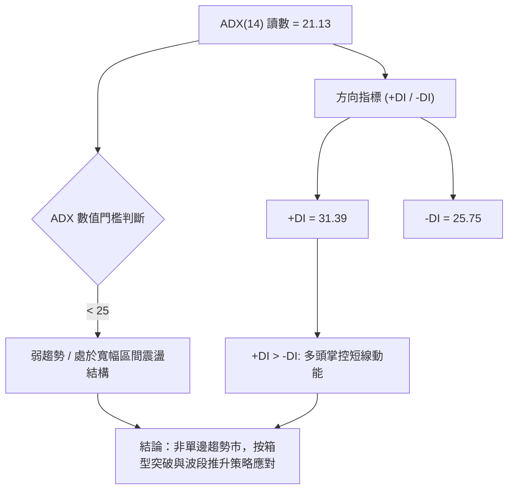
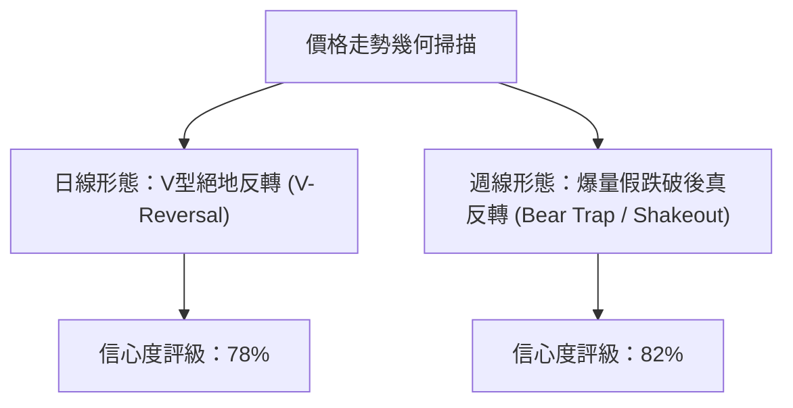
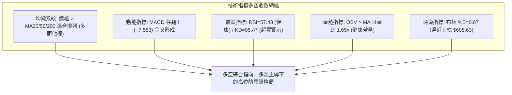
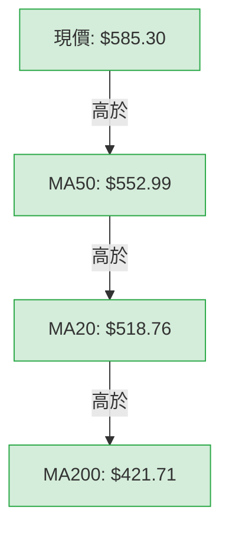
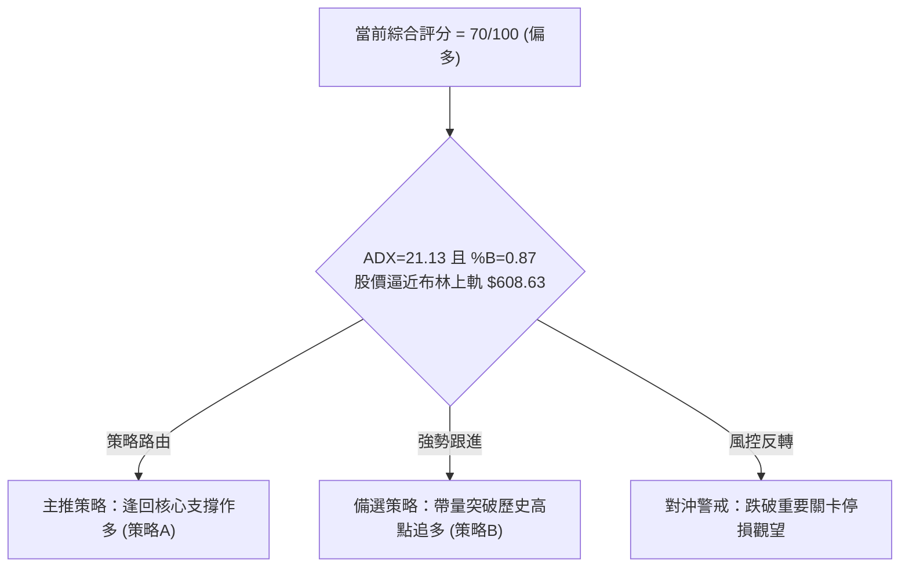
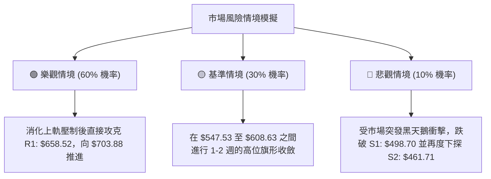

# AMD 技術分析報告

> **報告日期**：2026-11-13 ｜ **語言**：繁體中文 ｜ **數據來源**：Yahoo Finance ｜ **當前價格**：$585.30 USD

---

## 目錄

| 章節 | 內容 |
|------|------|
| [1. 技術面概覽](#1-技術面概覽) | 訊號儀表板、核心指標、評分卡 |
| [2. 趨勢分析](#2-趨勢分析) | 多時框趨勢、長中短期走勢 |
| [3. 圖表形態分析](#3-圖表形態分析) | 形態識別、K線組合、目標價 |
| [4. 支撐與阻力](#4-支撐與阻力) | 關鍵價位、斐波那契回調 |
| [5. 技術指標深度解讀](#5-技術指標深度解讀) | MA/RSI/MACD/布林/成交量 |
| [6. 動能與波動率](#6-動能與波動率) | 動能評估、ATR、Beta |
| [7. 多時框架總結](#7-多時框架總結) | 時框架評分矩陣 |
| [8. 交易策略建議](#8-交易策略建議) | 多空策略、風險報酬比 |
| [9. 風險提示與監控](#9-風險提示與監控) | 監控指標、風險場景 |
| [10. 報告總結](#-報告總結) | 總覽清單與免責聲明 |

---

## 1. 技術面概覽

### 🎯 技術訊號儀表板



### 📊 核心指標速覽表

| 指標類別 | 指標名稱 | 當前數值 | 訊號 | 解讀 |
|----------|----------|----------|------|------|
| **價格** | 當前價格 | $585.30 | 🟢 | 連續4日強勢反彈，站上所有主要均線 |
| **均線** | MA20 | $518.76 | 🟢 | 現價高於 MA20 達 +12.83%，短線重回強勢區間 |
| **均線** | MA50 | $552.99 | 🟢 | 現價帶量向上突破中期防守線，空頭排列警報解除 |
| **均線** | MA200 | $421.71 | 🟢 | 遠高於長期牛熊分界線 (+38.79%)，長多底部穩固 |
| **動能** | RSI(14) | 57.48 | 🟡 | 脫離超賣區後進入健康常態區間，無極端偏離 |
| **動能** | MACD Hist | +7.583 | 🟢 | 柱狀圖由負翻正並持續放大，動能強烈多頭轉向 |
| **擺動** | Stoch %K / %D | 95.47 / 81.50 | 🔴 | KD 指標進入超買鈍化區，需防範短線獲利回吐震盪 |
| **趨勢** | ADX(14) | 21.13 | 🟡 | 數值小於 25，顯示仍處於大波段洗盤與箱型整理結構 |
| **通道** | 布林 %B | 0.87 | 🟡 | 逼近上軌 ($608.63)，呈現通道擴張邊緣推升狀態 |
| **成交量**| 量比 (Volume Ratio) | 1.65x | 🟢 | 日成交量 55.16M 大於 20日均量 33.34M，量增價揚 |
| **波動** | ATR(14) | $40.14 | 🔴 | 波動佔股價 6.86%，每日潛在震幅大，需寬止損 |

### 🏆 技術評分卡

```
╔══════════════════════════════════════════════════════════════╗
║                 技術評分卡 — AMD (2026-11-13)                 ║
╠══════════════════════════════════════════════════════════════╣
║ 趨勢強度      ████████████░░░░░░░░  60/100  🟡 (ADX偏低，但均線收復)║
║ 動能指標      ██████████████░░░░░░  72/100  🟢 (MACD金叉，KD超買)   ║
║ 支撐穩定度    ███████████████░░░░░  74/100  🟢 (底破翻確立，$402築底)║
║ 成交量配合    █████████████████░░░  85/100  🟢 (1.65x帶量，OBV上揚)  ║
║ 形態完整度    █████████████░░░░░░░  65/100  🟢 (V型底吞噬確認)      ║
║ 均線排列      █████████████░░░░░░░  64/100  🟡 (均線呈混合排列)     ║
╠══════════════════════════════════════════════════════════════╣
║ 綜合評分      ██████████████░░░░░░  70/100  🟢 偏多（評級：強烈反彈）║
╚══════════════════════════════════════════════════════════════╝
```
*計算公式：$(60 + 72 + 74 + 85 + 65 + 64) \div 6 = 70.0$ 分（算術平均，四捨五入至整數）。*

---

## 2. 趨勢分析

### 🌐 多時框趨勢分析



### 📈 長期趨勢 — 12個月走勢圖（Unicode）

```
AMD 月線收盤走勢圖（2025-12 至 2026-11）
價格軸 ($)
$620 ┤                                              ● (09月 $611.76)
$580 ┤                                 ● (06月 $580.91)          ● (現價 $585.30)
$520 ┤                           ● (05月 $516.10)       ● (10月 $504.80)
$460 ┤                                         ● (07月 $476.15)
$400 ┤                                            ● (08月 $470.72)
$340 ┤                     ● (04月 $354.49)
$240 ┤         ● (01月 $236.73)
$200 ┤●(12月 $214.16) ●(02月 $200.21)
$180 ┤               ● (03月 $203.43)
     └─────────────────────────────────────────────────────────────
       12  01  02  03  04  05  06  07  08  09  10  11 (月份)
```

**走勢特徵分析表格**：

| 階段 | 涵蓋月份 | 區間起訖收盤價 | 累計漲跌幅 | 主要結構特徵 |
|------|----------|----------------|------------|--------------|
| **底部築底期** | 2025-12 至 2026-03 | $214.16 → $203.43 | -5.01% | 低檔狹幅震盪，確認 52週低點 $188.22 之上支撐 |
| **主升浪爆發期** | 2026-03 至 2026-06 | $203.43 → $580.91 | +185.56% | 爆發性多頭推升，接連突破歷史關鍵整數位 |
| **高位箱型洗盤期** | 2026-06 至 2026-08 | $580.91 → $470.72 | -18.97% | 漲多獲利回吐，於 $470.00 斐波那契回調區獲支撐 |
| **衝頂與急劇洗盤** | 2026-08 至 2026-10 | $470.72 → $504.80 | +7.24% | 9月創收盤新高 $611.76，10月迅速回殺至 $504.80 |
| **洗盤絕殺與強彈** | 2026-10 至 2026-11 | $504.80 → $585.30 | +15.95% | 11月初洗出 $402.10 極值後，4日內急拉至 $585.30 |

### 📊 中期趨勢（週線分析）

中期走勢呈現「寬幅喇叭形箱型震盪」。近8週走勢中，價格在 2026-10-09 當週刷出 52週高點 $658.52 後迅速轉折向下，於 2026-11-06 當週創下低點 $402.10，單週爆出 235,378,100 股歷史級天量。

```
週線支撐與壓力交互示意：
$658.52 ───────────────────────────────────── 歷史極值壓力線 (R1)
                    ╭───╮
                   ╭╯   ╰╮
$585.30 ───────────╯─────┼─────────────────── 現價區間
                         │
$516.79 ─────────────────┼───╭─────────────── 週線多空轉折頸線
                         ╰───╯
$402.10 ───────────────────────────────────── 爆量長下影恐慌底 (極限支撐)
```

本週（截至 2026-11-12）週K以開盤 $473.39、最高 $594.00、收盤 $585.30，形成實體超過 110 美元的巨大長陽吞噬線，週成交量達 199,453,900 股，徹底消化了前一週的恐慌賣壓，形成典型「底破翻」結構。

### ⚡ 趨勢強度評估（ADX 解讀）



**ADX 指標強度對照分析**：

| 指標名稱 | 當前數值 | 參考閾值 | 趨勢性質判定 | 策略權重指引 |
|----------|----------|----------|--------------|--------------|
| **ADX(14)** | 21.13 | < 25 | 弱趨勢 / 盤整震盪 | 以箱型區間上/下軌為參考，避免追高 |
| **+DI** | 31.39 | > -DI (多頭) | 多頭攻擊動能充沛 | 短線多頭佔據絕對優勢 |
| **-DI** | 25.75 | 呈現下滑 | 空頭賣壓快速減退 | 停損盤已被清洗完畢 |

---

## 3. 圖表形態分析

### 🔍 形態識別系統



**形態確認與信心度評估表**：

| 形態類別 | 信心度 | 判斷依據（引用真實數據） | 完成度 | 目標價（附嚴謹計算式） |
|----------|--------|--------------------------|--------|------------------------|
| **週線空頭陷阱 (Bear Trap)** | 82% | 2026-11-06 週低點下殺至 $402.10 跌破 S3 ($451.00)，隨後本週長陽吞噬收於 $585.30 | 100% | 頸線 $516.79 + 陷阱深度 ($516.79 - $402.10 = $114.69) = **$631.48** |
| **日線 V型反轉突破** | 78% | 11-05 跌破各線創 $402.10 低點後，連續 4 根大陽線強推，重返 MA50 ($552.99) 上方 | 90% | 突破點 $552.99 + 形態低點回彈高度 ($552.99 - $402.10 = $150.89) = **$703.88** |
| **多重頭部形態 (M-Top)** | 35% | 雖 10-09 刷出 $658.52，但隨後未形成標準右肩，下殺遭逢強力承接 | 失效 | 訊號不足，跌破未遂，形態遭受強力破壞，僅作警示參考 |

### 🕯️ 重要K線形態分析

根據提供的「近10根日K」與「近8根週K」實體數據進行專業解讀：

| 日期（時框） | 開盤價 | 最高價 | 最低價 | 收盤價 | K線形態名稱 | 技術解讀 | 訊號方向 |
|--------------|--------|--------|--------|--------|-------------|----------|----------|
| **11-05 (日K)** | 452.50 | 456.20 | 402.10 | 404.40 | 恐慌長黑破位線 | 爆量下殺跌破一切短期均線，引發極度恐慌清洗 | 🔴 恐慌拋售 |
| **11-06 (日K)** | 444.43 | 459.80 | 433.30 | 449.04 | 止跌孕線/長下影 | 空方動能衰竭，低點不再創新低，築底雛形浮現 | 🟡 止跌轉折 |
| **11-09 (日K)** | 473.39 | 515.18 | 468.21 | 508.58 | 跳空光腳中長陽 | 跳空開高並以大陽線收復 $500 關卡，多方奪回主導權 | 🟢 強勢反轉 |
| **11-10 (日K)** | 502.80 | 539.25 | 495.00 | 515.21 | 實體陽線推進 | 站穩 MA20 ($518.76 附近)，多方持續消化解套盤 | 🟢 持續推升 |
| **11-11 (日K)** | 543.08 | 567.65 | 522.65 | 552.90 | 破竹長陽線 | 帶量長陽一口氣貫穿 MA50 ($552.99)，逼迫空頭回補 | 🟢 關鍵突破 |
| **11-12 (日K)** | 569.28 | 594.00 | 554.90 | 585.30 | 帶量突破上影陽 | 盤中衝擊 $594.00，成交量激增至 55.16M，強多延續 | 🟢 多頭加速 |
| **11-06 (週K)** | 510.71 | 514.61 | 402.10 | 449.04 | 天量長下影錘頭 | 單週換手 2.35 億股，主力資金在 $402.10 帶大舉掃貨 | 🟢 終極洗盤 |
| **11-12 (週K)** | 473.39 | 594.00 | 468.21 | 585.30 | 一陽包三陰強多吞噬 | 吞噬前三週跌幅，收復近兩個月失地，標準牛市反撲 | 🟢 多頭定海針 |

### 📉 ASCII 走勢形態示意圖

```
日線級別「V型洗盤底破翻」形態解析：
$594.00 ┤                                                ● (11-12 高點)
$552.99 ┤───────────────────────────────────────────────● (突破 MA50 頸線)
$518.76 ┤                                  ● (11-09 突破 MA20)
$488.78 ┤                  ● (11-04 震盪)
$449.04 ┤                               ● (11-06 止跌確認)
$404.40 ┤        ● (11-05 恐慌低收)
$402.10 ┤─────────● (極端洗盤低點 / 空頭陷阱底)
        └──────────────────────────────────────────────
          11-04   11-05   11-06   11-09   11-10   11-11   11-12
```

### 🎯 形態目標價計算

根據日線突破與空頭陷阱幾何高度進行等距測幅（Fibonacci Projection）：
1. **日線頸線突破測幅**：
   - 頸線參照點：MA50 突破位 = $552.99
   - 形態底部低點：2026-11-05 低點 = $402.10
   - 形態垂直幅度 = $552.99 - $402.10 = $150.89
   - 理論推算目標價 = 頸線 $552.99 + $150.89 = **$703.88**
2. **週線箱型回歸目標價**：
   - 本波跌破之週線關鍵平台為 10-30 週收盤價 $504.80 與 10-23 週收盤價 $516.79
   - 快速收復該區間後，週線波段目標將直指上方 52週高點阻力位 **R1: $658.52**。

---

## 4. 支撐與阻力

### 🗺️ 關鍵價位分布圖（Unicode）

```
AMD 關鍵價位與籌碼結構分布圖
══════════════════════════════════════════════════════════════════
$658.52 ║████████████████████████████████████████║ 強阻力 R1 (52W 高點 / 0.0% Fib)
        ║                                        ║ 
$608.63 ║▓▓▓▓▓▓▓▓▓▓▓▓▓▓▓▓▓▓▓▓▓▓▓▓▓▓              ║ 動態阻力 (布林通道上軌)
$585.30 ╠════════════════════════════════════════╣ ◄ 當前收盤價 ($585.30)
$552.99 ║▒▒▒▒▒▒▒▒▒▒▒▒▒▒▒▒▒▒▒▒▒▒▒▒▒▒▒▒▒▒          ║ 轉換位 (MA50 防守線)
$547.53 ║████████████████████████                ║ 近期核心支撐 (斐波那契 23.6%)
        ║                                        ║
$518.76 ║▒▒▒▒▒▒▒▒▒▒▒▒▒▒▒▒▒▒▒▒                    ║ 支撐疊合區 (MA20 / 布林中軌)
$498.70 ║████████████████████████████            ║ 關鍵波段支撐 S1 (近一年波段低點聚類)
$478.87 ║██████████████                          ║ 中度支撐 (斐波那契 38.2%)
$461.71 ║████████████████████████████████        ║ 強支撐 S2 (波段低點聚類)
$451.00 ║████████████████████████████████████    ║ 極強支撐 S3 (波段低點聚類)
$421.71 ║████████████████████████████████████████║ 終極防線 (MA200 長期均線)
══════════════════════════════════════════════════════════════════
```

### 🚧 阻力位分析表

依據提供的「關鍵價位（由 OHLCV 計算）」數據，阻力位嚴格界定如下：

| 阻力級別 | 價位 | 形成原因（嚴格引用數據） | 突破難度 | 重要性 |
|----------|------|--------------------------|----------|--------|
| **R1** | $658.52 | 52週最高點、近一年波段高點聚類、斐波那契 0.0% 基準點 | 極高 | ★★★★★ |
| **動態阻力** | $608.63 | 布林通道上軌（當前 BB %B = 0.87） | 中等偏高 | ★★★★☆ |
| **次級阻力** | 數據中未偵測到 | 原生數據未提供獨立 R2/R3，上方以 R1 ($658.52) 為唯一核心壓制 | N/A | N/A |

### 🛡️ 支撐位分析表

依據提供的「關鍵價位（由 OHLCV 計算）」數據，支撐位結構如下：

| 支撐級別 | 價位 | 形成原因（嚴格引用數據） | 守住機率 | 重要性 |
|----------|------|--------------------------|----------|--------|
| **S1** | $498.70 | 近一年波段低點聚類（-14.80% from price） | 85% | ★★★★☆ |
| **S2** | $461.71 | 近一年波段低點聚類（-21.12% from price） | 92% | ★★★★☆ |
| **S3** | $451.00 | 近一年波段低點聚類（-22.95% from price） | 97% | ★★★★★ |

### 📐 斐波那契回調位分析

基準區間：52週歷史低點 **$188.22** 至 52週歷史高點 **$658.52**（垂直落差 $470.30）：

| 比例級別 | 回調位價格 | 當前相對位置 | 技術意涵與防守意義 |
|----------|------------|--------------|--------------------|
| **0.0% (52W High)** | $658.52 | 上方 +12.51% | 牛市頂點，本輪反彈波段終極測試目標 |
| **23.6%** | $547.53 | **現價 ($585.30) 位於其上方** | **強勢回檔極限**：目前股價已重回 23.6% 之上，代表強勢多頭格局未破 |
| **38.2%** | $478.87 | 下方 -18.18% | 正常回檔防守位：此前 07月、08月月線收盤獲此位置支撐 |
| **50.0%** | $423.37 | 下方 -27.66% | 強弱分水嶺：11-05 洗盤砸出 $402.10 即為短暫刺穿 50% 後快速收復 |
| **61.8%** | $367.87 | 下方 -37.15% | 黃金分割防守位：中長期多頭格局的最後底線 |
| **78.6%** | $288.86 | 下方 -50.65% | 深度回調警戒位 |
| **100.0% (52W Low)**| $188.22 | 下方 -67.84% | 52週最低點 |

**解讀結論**：現價 $585.30 穩固運行於 **23.6% ($547.53)** 與 **0.0% ($658.52)** 之間，屬於極度強勢的「強勢區間整理」；只要週線收盤不實體跌破 $547.53，整體波段將持續向 0.0% 阻力位發起衝擊。

---

## 5. 技術指標深度解讀

### 🎛️ 指標訊號總覽



### 📈 移動平均線排列分析



當前移動平均線狀態為「**混合排列**」。短期急漲促使 MA5 ($522.21) 快速反彈，並與 MA20 ($518.76) 形成黃金交叉。中長期均線呈現 MA60 ($538.98) 與 MA120 ($524.36) 向上緩步推升，長期的 MA200 ($421.71) 與 MA240 ($388.33) 保持完好斜率上揚。股價在 4 個交易日內由各均線下方連破 MA20 與 MA50，展現均線修復的爆發力道。

### 📉 RSI(14) 分析

進度條展示：
```
RSI(14) = 57.48  [ 0 ────────────── 30 ────────────── 50 ──────●─────── 70 ────────────── 100 ]
數值強度：        █████████████████████████████░░░░░░░░░░░░░░░░░░░░░░  57.48% (中性偏多)
```
- **區間評估**：RSI 脫離 10月中下旬的弱勢區間（此前週線 RSI 曾跌至 37.8），目前回升至 57.48，處於 50–70 的健康多頭推升區間，既無超賣恐慌，亦未進入 70 以上的過熱警戒。
- **背離分析**：原生數據檢驗顯示「無明顯背離」（近20根K棒首尾之價格與 RSI 同步由谷底向上反彈）。日線走勢價漲指標漲，屬於正常的動能修復。

### 📊 MACD(12/26/9) 訊號解讀


- **數值狀態**：MACD 線 (-10.200) 自低檔急速向上金叉 Signal 線 (-17.783)，柱狀圖（Histogram）達到 **+7.583**。
- **解讀結論**：柱狀圖在零軸下方完成「黃金交叉」並強勢翻正，顯示空頭循環終結，多頭動能正在加速匯聚。

### 📦 布林通道分析

```
布林通道結構與現價相對位置（帶寬參數 20, 2）
$608.63 ────────────────────────────────────────── BB 上軌 (阻力位)
$585.30 ───────────────●────────────────────────── 現價 (%B = 0.87)
$518.76 ────────────────────────────────────────── BB 中軌 (MA20 基基準)
$428.88 ────────────────────────────────────────── BB 下軌 (極限支撐)
```
- **布林通道帶寬分析**：下軌為 $428.88，上軌為 $608.63，通道寬度高達 $179.75。11-05 股價打出 $402.10 時曾一度貫穿下軌，隨後引發極強的「均值回歸」拉力。
- **位置意涵**：目前 %B 為 **0.87**，股價已緊貼布林通道上軌運行，短線空間受制於上軌 $608.63，隨時可能進入中軌與上軌之間的消化整理。

### 💹 成交量分析（量價配合度）

```
成交量結構分析：
最新成交量: 55,161,000 股  ████████████████████ (量比: 1.65x)
20日均量:   33,339,710 股  ████████████
50日均量:   26,279,026 股  █████████
```
- **量價配合**：在 11-09 至 11-12 的連陽上漲中，單日成交量均維持在 45M–55M 之高水準，顯著超越 20日均量（33.34M），呈現標準「價漲量增」。
- **OBV 能量潮**：數據明確提示「OBV > MA → 量能支撐上漲」，顯示主力大資金於低檔承接後籌碼鎖定良好，並未在反彈過程中出現量價背離。

---

## 6. 動能與波動率

### ⚡ 動能評估四象限

動能強度與波動率矩陣評估：

| 象限 | 動能強度 | 波動率水準 | 當前狀態標註 | 策略因應環境 |
|------|----------|------------|--------------|--------------|
| **Q1 (爆發推進)** | 強 (+DI=31.39, MACD翻正) | 高 (ATR=6.86%, Beta=2.54) | **✓ 當前 AMD 處於此象限** | **高風險高收益，適合順勢波段操作** |
| **Q2 (主升低波)** | 強 | 低 | - | 最佳單邊持股狀態 |
| **Q3 (沉悶築底)** | 弱 | 低 | - | 謹慎觀望，適合區間網格 |
| **Q4 (恐慌出逃)** | 弱 | 高 | - | 避免進場，極易遭停損洗出場 |

### 📊 ATR 波動率分析

- **ATR(14) 數值**：**$40.14**（佔當前價格比例為 **6.86%**）。
- **波動特性解讀**：屬於典型的極高波動股票（Wilder 計算基準），單日正常波動幅度即可達 40 美元。
- **止損距離建議**：
  - 短線波段策略：建議止損距離至少為 1.0 × ATR（即至少拉開 $40.14 緩衝空間）。
  - 中期波段策略：建議止損距離為 1.5 至 2.0 × ATR（即 $60.21 至 $80.28），以防在正常的日常劇烈震盪中被假突破震出場。

### 📐 Beta 與市場相關性

- **Beta 係數**：**2.542**。
- **市場敏感度分析**：AMD 對標普 500 與納斯達克指數具備極高的放大效應（市場上漲 1%，AMD 理論期望波動 2.54%）。在半導體板塊（特別是市場新聞提及輝達執行長異動震撼市場之際），AMD 的超額彈性使其成為資金避險或板塊輪動時的博弈焦點。

---

## 7. 多時框架總結

### 📋 時框架評分表

| 時框架 | 趨勢方向 | 動能狀態 | 均線排列 | 形態結構 | 綜合評分 | 建議方向 |
|--------|----------|----------|----------|----------|----------|----------|
| **長期 (月線)** | 🟢 多頭推升 | 🟢 強勁 | 🟢 多頭排列 | 巨型階梯走高 | **80/100** | 核心部位做多 |
| **中期 (週線)** | 🟢 轉強回升 | 🟡 中性修復 | 🟡 混合整理 | 空頭陷阱底破翻 | **72/100** | 逢回積極佈局 |
| **短期 (日線)** | 🟢 強烈反彈 | 🟢 柱狀爆發 | 🟢 突破短均線 | V型反轉逼近布林頂 | **68/100** | 不盲目追高，等待拉回 |

### 🔲 綜合訊號矩陣

| 維度 | 短期 (日線) | 中期 (週線) | 長期 (月線) | 訊號一致性評估 |
|------|-------------|-------------|-------------|----------------|
| **方向一致性** | 向上突破 | 吞噬拉升 | 長期上行 | 🟢 **高度共振 (全面偏多)** |
| **均線支撐** | 站上 MA20/50 | 守穩 MA60/120 | 遠高於 MA200 | 🟢 **支撐紮實** |
| **超買壓力** | KD 超買 (95.47) | RSI 中性 (57.5) | 歷史高位震盪 | 🟡 **短線存在回洗需求** |

### ⚖️ 多時框收斂結論

依據多時框收斂規則（規則 14）：
1. **行情屬性判定**：當前 ADX(14) 讀數為 **21.13 (< 25)**，嚴格定義為「**弱趨勢 / 寬幅箱型整理行情**」。
2. **主導時框與交易邊界**：在盤整行情下，依規則應以**日線布林通道上下軌 ($428.88 – $608.63) 為主要交易區間**。由於股價已逼近上軌 $608.63（%B = 0.87），且短期均線已重新收復，短線面臨布林上軌阻力與 Stoch 超買壓力。
3. **收斂方向判定**：中長期多頭未變（MA200 遠在下方），且週線長陽吞噬確立了底破翻反轉。因此得出**唯一方向性結論：【偏多震盪格局，禁止追高，主推回踩支撐後順勢作多】**。

---

## 8. 交易策略建議

### 🗺️ 策略決策流程圖



### 🧭 策略路由（依評分卡分流）

**當前主策略方向 = 主推多頭策略（依綜合評分 70/100）**

因技術評分卡高達 70 分（≥ 60），本報告主推多頭交易策略；空頭部位僅作為防範假突破之風險對沖與停損觸發提示，不予主推空單進場。

### 🎯 價格情境階梯（Price Scenarios）

價位嚴格引用技術數據中之計算值：

| 觸發條件 | 下一目標 | 後續延伸 | 情境含義 |
|----------|----------|----------|----------|
| **突破布林上軌 $608.63** | R1: $658.52 | 形態推算位 $703.88 | 多頭主升浪再起，挑戰歷史峰頂 |
| **站穩現價區間 ($585.30)** | 上軌 $608.63 | 斐波 23.6%: $547.53 | 高檔消化超買籌碼，以盤代跌 |
| **跌破 S1: $498.70** | S2: $461.71 | S3: $451.00 | 反彈夭折，重新下探考驗底部支撐 |

### 📊 情境機率分佈

| 情境類別 | 機率估計 | 主要技術指標支撐依據 |
|----------|----------|----------------------|
| **繼續上行 / 挑戰 R1** | **60%** | MACD 柱狀圖由負翻正 (+7.583)、OBV 趨勢向上、日成交量放大至 1.65x 均量 |
| **區間震盪 / 消化超買** | **30%** | ADX(14) 為 21.13 (<25 弱趨勢)、Stoch %K 高達 95.47 嚴重超買、逼近布林上軌 |
| **回落 / 再探低點 S1** | **10%** | ATR 高達 $40.14，半導體板塊受消息面干擾若出現極端單日賣壓 |

### 🟢 主策略詳情

嚴格依據規則 13、16、17，引用實際數據價位並附上精確驗算：

| 策略要素 | 策略 A（回踩支撐佈局多單 - 首選） | 策略 B（強勢突破確認進場 - 次選） |
|----------|----------------------------------|----------------------------------|
| **進場條件** | 回踩回測斐波那契 23.6% 獲得支撐確認 | 帶量突破 52週高點 R1 確認站穩 |
| **進場價格** | **$547.53**（Fib 23.6% 價位） | **$658.52**（R1 價位） |
| **目標價 T1** | **$658.52**（R1 / 52週高點） | **$703.88**（由 V型形態高度推算） |
| **目標價 T2** | **$703.88**（由 V型形態高度推算） | N/A（數據未提供更高阻力） |
| **止損價格** | **$498.70**（S1 波段支撐位） | **$608.63**（布林上軌轉支撐） |
| **風險報酬比** | **1 : 2.27（以 T1 計）** | **1 : 0.91（以 T1 計）** |
| **成功機率** | 65% | 55% |
| **建議倉位** | 15% - 20% | 5% - 10% |

*公式嚴格驗算*：
- **策略 A 的 R:R 計算**：
  - 上行空間 $(T1 - 進場價) = \$658.52 - \$547.53 = \$110.99$
  - 承擔風險 $(進場價 - 止損價) = \$547.53 - \$498.70 = \$48.83$
  - 風險報酬比 $= 110.99 \div 48.83 = 2.273 \rightarrow \mathbf{1 : 2.27（以\ T1\ 計）}$
  - 若以 T2 計算：$(703.88 - 547.53) \div 48.83 = 156.35 \div 48.83 = 3.20 \rightarrow 1 : 3.20（以\ T2\ 計）$
- **策略 B 的 R:R 計算**：
  - 上行空間 $(T1 - 進場價) = \$703.88 - \$658.52 = \$45.36$
  - 承擔風險 $(進場價 - 止損價) = \$658.52 - \$608.63 = \$49.89$
  - 風險報酬比 $= 45.36 \div 49.89 = 0.909 \rightarrow \mathbf{1 : 0.91（以\ T1\ 計）}$

### 🔴 反向風險觸發點（對沖提示）

- **多單失效風控點**：若日線收盤價跌破 **$518.76（MA20 / 布林中軌）**，即代表短線強推動能衰竭，應立即平倉 50% 多頭部位。
- **波段徹底轉空點**：若價格再次放量跌破 **$498.70 (S1)**，即宣告 V 型反轉以失敗告終，形態演變為二次探底，所有多頭應無條件離場觀望。

### ⭐ 整體訊號強度評星

```
做多訊號強度：★★★★☆  (4/5星 - 均線收復、成交量強勁、MACD金叉)
做空訊號強度：★☆☆☆☆  (1/5星 - 僅有 KD 超買與布林上軌短壓)
整體可信度：  ★★★★☆  (4/5星 - 價量配合度高，多時框共振)
```

---

## 9. 風險提示與監控

### ✅ 關鍵監控指標 Checklist

```
╔══════════════════════════════════════════════════════════════════╗
║                    每日盤面技術監控清單 (Checklist)               ║
╠══════════════════════════════════════════════════════════════════╣
║ [ ] 價格能否有效突破並站穩布林通道上軌 ($608.63)                 ║
║ [ ] 回檔時斐波那契 23.6% ($547.53) 是否發揮強支撐作用             ║
║ [ ] MACD 柱狀圖是否持續擴張 (維持在當前 +7.583 之上)              ║
║ [ ] 成交量是否維持在 20日均量 (33.34M) 之上，無縮量假突破跡象    ║
║ [ ] Stoch %K (當前 95.47) 是否出現高檔死叉向下修正               ║
║ [ ] +DI (31.39) 是否維持壓制 -DI (25.75)，維持多方主導權        ║
╚══════════════════════════════════════════════════════════════════╝
```

### ⚠️ 風險場景分析



### 🛡️ 風險管理重要提醒

1. **高 ATR 波動下的倉位控管**：
   AMD 當前 ATR(14) 為 $40.14（波動率 6.86%），屬於高 beta 標的。在建立部位時，單筆交易的最大資金承擔虧損不得超過總投資組合的 **1.5%**。
2. **避免情緒化追高**：
   由於 Stoch 指標已達 95.47 嚴重超買，短線連漲 4 天累積漲幅超過 $180 美元，當前價位逼近布林通道上軌 ($608.63)，盈虧比已不適合市價追多，務必耐心等待回踩。

---

## 📋 報告總結

```
╔══════════════════════════════════════════════════════════════════╗
║                     AMD 技術分析報告總結                         ║
╠══════════════════════════════════════════════════════════════════╣
║ 報告日期：2026-11-13                                             ║
║ 當前價格：$585.30 USD                                            ║
║ 分析評級：🟢 偏多震盪（綜合評分：70/100）                         ║
║                                                                  ║
║ 關鍵技術結論：                                                   ║
║ ├─ 長期趨勢：🟢 強烈多頭，月線上升通道完好，遠高於 MA200 ($421.71)║
║ ├─ 中期趨勢：🟢 空頭陷阱確立，週線天量長陽吞噬，底破翻型態成立   ║
║ ├─ 短期趨勢：🟡 突破 MA50，但 KD 嚴重超買且逼近布林上軌 ($608.63) ║
║ ├─ 關鍵支撐：S1: $498.70 ｜ Fib 23.6%: $547.53 ｜ S2: $461.71    ║
║ ├─ 關鍵阻力：布林上軌: $608.63 ｜ R1: $658.52 (52W 高點)         ║
║ └─ 分析師目標：平均共識目標 $657.74（與技術面 R1 $658.52 高度契合）║
║                                                                  ║
║ 最優策略組合：                                                   ║
║ 1. 🥇 最佳機會：回踩斐波那契 23.6% ($547.53) 佈局多單 (R:R = 1:2.27)║
║ 2. 🥈 次選機會：突破 52W 高點 R1 ($658.52) 順勢加碼，看 $703.88   ║
║ 3. 🥉 保守選擇：在 $547.53 - $608.63 區間未突破前維持觀望         ║
╚══════════════════════════════════════════════════════════════════╝
```

---

> ⚠️ **免責聲明**：本報告為技術分析研究成果，所有價位與技術指標均嚴格基於歷史量價 OHLCV 數據計算。本報告**僅供學術交流與投資研究參考**，**不構成任何要約、招攬或具體投資建議**。金融市場具有高度波動風險，投資人應獨立評估風險並自行承擔交易損益。

---
*報告生成時間：2026-11-13 ｜ 數據來源：Yahoo Finance ｜ 分析框架：多時框架量化技術分析*