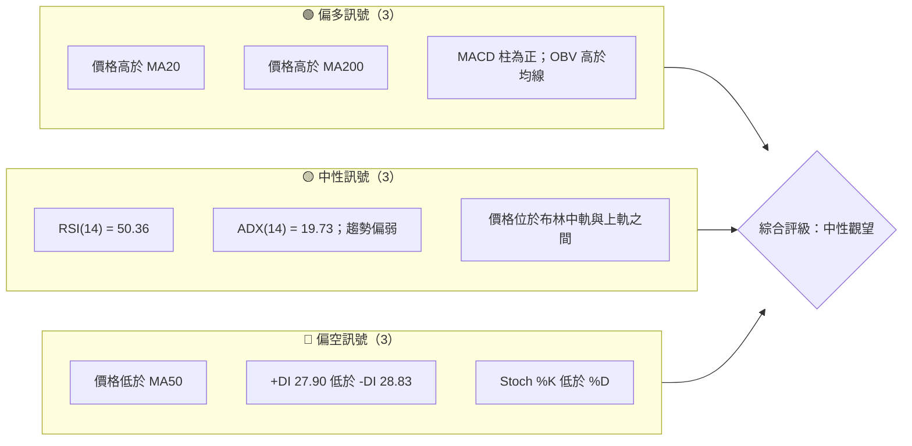
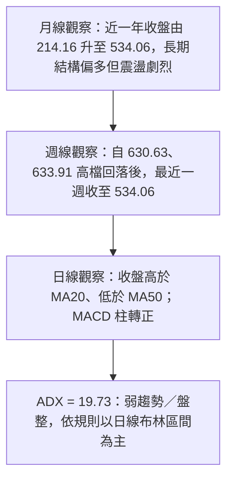
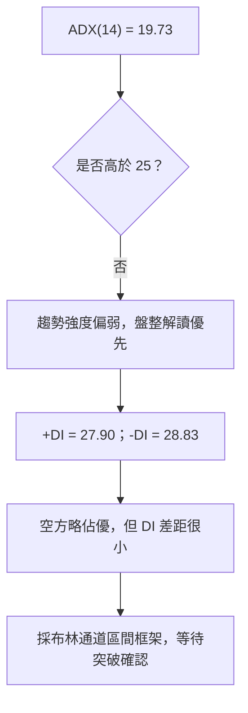
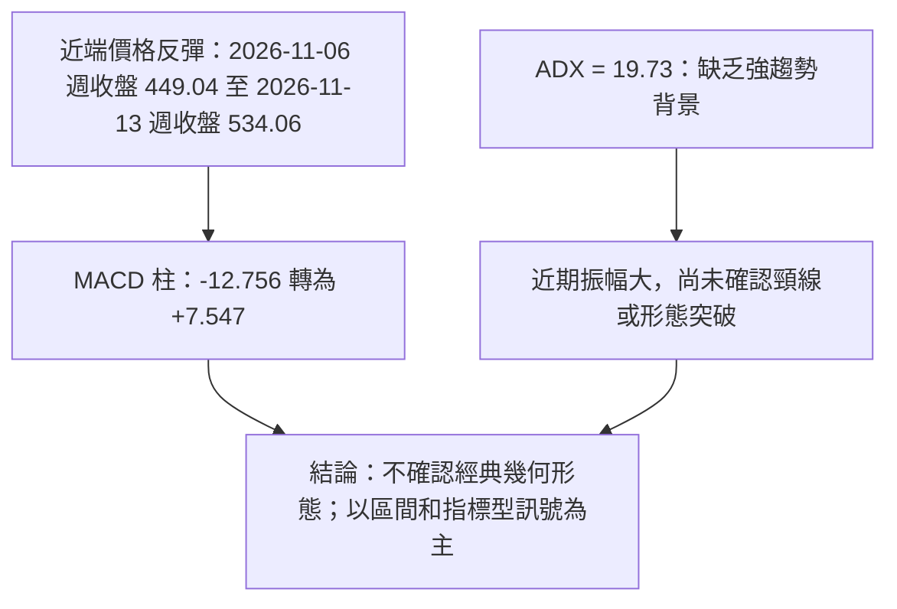
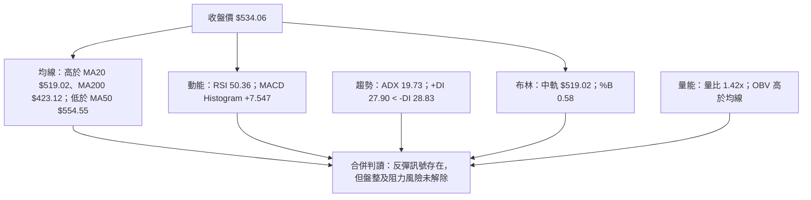
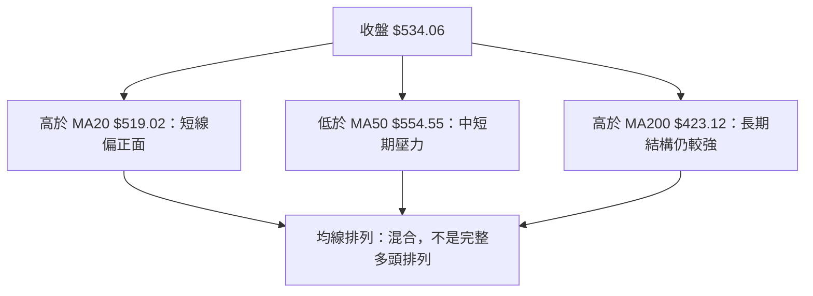
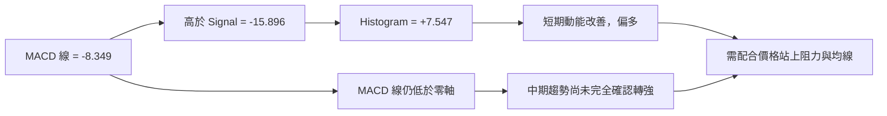
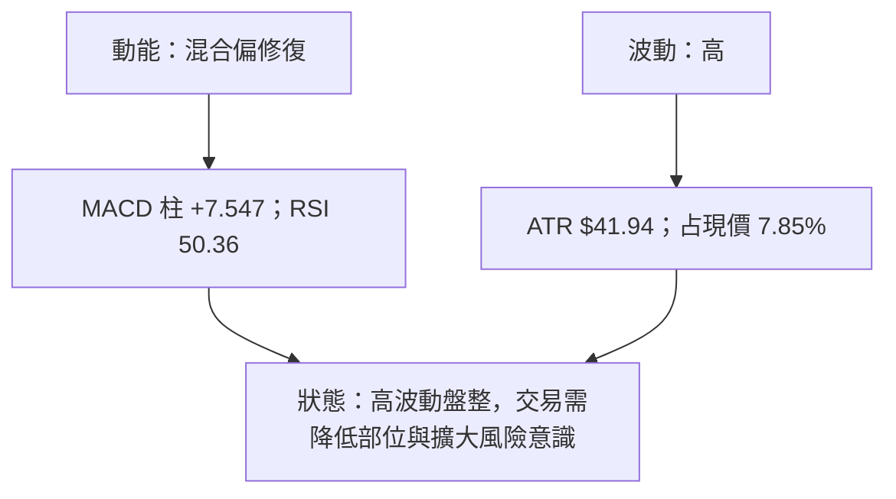
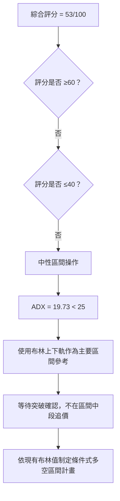
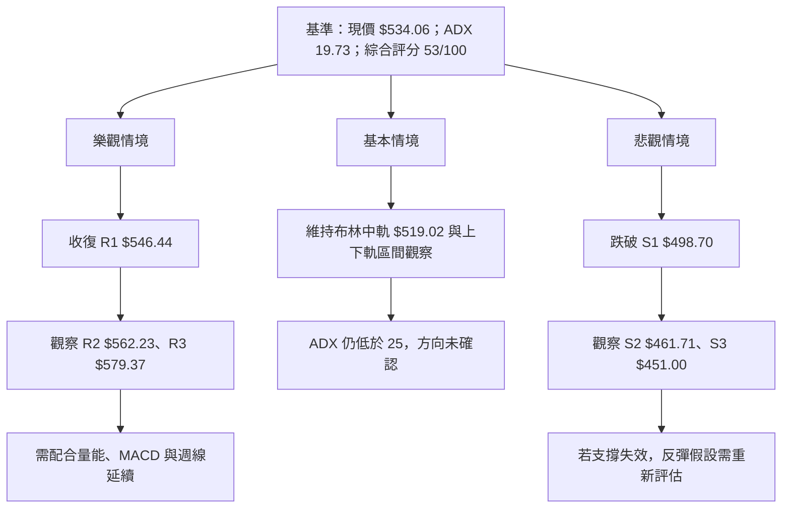

# AMD 技術分析報告

> **報告日期**：2026-11-14 ｜ **語言**：繁體中文 ｜ **數據來源**：使用者提供之 Yahoo Finance 技術數據  
> **當前價格**：**$534.06**（2026-11-13 收盤價）

---

## 目錄

| 章節 | 內容 |
|------|------|
| [1. 技術面概覽](#1-技術面概覽) | 訊號儀表板、核心指標、評分卡 |
| [2. 趨勢分析](#2-趨勢分析) | 多時框趨勢、長中短期走勢 |
| [3. 圖表形態分析](#3-圖表形態分析) | 形態識別、K線組合、目標價 |
| [4. 支撐與阻力](#4-支撐與阻力) | 關鍵價位、斐波那契回調 |
| [5. 技術指標深度解讀](#5-技術指標深度解讀) | MA、RSI、MACD、布林、成交量 |
| [6. 動能與波動率](#6-動能與波動率) | 動能評估、ATR、Beta |
| [7. 多時框架總結](#7-多時框架總結) | 時框架評分矩陣 |
| [8. 交易策略建議](#8-交易策略建議) | 區間策略、風險報酬比 |
| [9. 風險提示與監控](#9-風險提示與監控) | 監控指標、風險場景 |

---

## 1. 技術面概覽

### 🎯 技術訊號儀表板

整體訊號並非單向一致：價格高於 MA20 與 MA200、MACD 柱翻正、OBV 高於其均線，提供反彈支撐；但價格仍低於 MA50、ADX 低於 25，且 +DI 略低於 -DI，反映目前較適合以區間行情理解，而非確認新一輪趨勢。



**儀表板解讀：**

- 🟢 **短線反彈條件有所改善**：MACD 柱為正，股價高於 MA20，且 OBV 高於 OBV 均線。
- 🟡 **趨勢尚未確認**：ADX 19.73 屬弱趨勢／盤整區；+DI 與 -DI 接近，方向優勢不明顯。
- 🔴 **中短期仍有壓力**：收盤價低於 MA50；日線短週期隨機指標 %K 低於 %D。
- 📌 **總結**：多項訊號在回升，但未形成「趨勢強、均線多頭排列、價格突破阻力」的完整確認組合。

### 📊 核心指標速覽表

| 指標類別 | 指標名稱 | 當前數值 | 訊號 | 解讀 |
|----------|----------|----------|------|------|
| **價格** | 當前價格 | **$534.06** | 🟡 | 以 2026-11-13 收盤價為準。 |
| **價格** | 52 週區間位置 | 73.5% | 🟡 | 位於 52 週區間偏上部，但距 52 週高點仍有距離。 |
| **均線** | MA20 | $519.02 | 🟢 | 收盤高於 MA20，短線均值回復訊號偏正面。 |
| **均線** | MA50 | $554.55 | 🔴 | 收盤低於 MA50，中短期上方仍有均線壓力。 |
| **均線** | MA200 | $423.12 | 🟢 | 收盤高於 MA200，長期趨勢結構仍未完全轉弱。 |
| **動能** | RSI(14) | 50.36 | 🟡 | 位於 30–70 中性區，未呈現超買或超賣。 |
| **動能** | MACD／訊號線 | -8.349／-15.896 | 🟢／🟡 | MACD 高於訊號線，柱狀圖為正；但兩線仍低於零軸。 |
| **動能** | MACD Histogram | +7.547 | 🟢 | 動能有改善，但仍需後續價格突破確認。 |
| **趨勢** | ADX(14) | 19.73 | 🟡 | 低於 25，偏向盤整或弱趨勢環境。 |
| **趨勢** | +DI／-DI | 27.90／28.83 | 🔴 | -DI 略高，空方方向優勢極小。 |
| **波動** | ATR(14) | $41.94 | 🔴 | 相當於現價 7.85%，每日波幅風險偏高。 |
| **量能** | 最新量／20 日均量 | 49.16M／34.68M | 🟢 | 量比 1.42 倍，最新交易量高於短期均量。 |
| **量能** | OBV 趨勢 | OBV > MA | 🟢 | 量能指標支持反彈，但不能單獨證明突破有效。 |

### 🏆 技術評分卡

子項均採 **0–100 分**。綜合評分為六項子評分的算術平均，四捨五入至整數。

```text
╔════════════════════════════════════════════════════════════════╗
║              技術評分卡 — AMD（2026-11-14）                    ║
╠════════════════════════════════════════════════════════════════╣
║ 趨勢強度      ▓▓▓▓▓░░░░░░░░░░░░░░  45/100  🟡                 ║
║ 動能指標      ▓▓▓▓▓▓░░░░░░░░░░░░░░  56/100  🟡                 ║
║ 支撐穩定度    ▓▓▓▓▓▓░░░░░░░░░░░░░░  55/100  🟡                 ║
║ 成交量配合    ▓▓▓▓▓▓▓░░░░░░░░░░░░░  70/100  🟢                 ║
║ 形態完整度    ▓▓▓▓▓░░░░░░░░░░░░░░  45/100  🟡                 ║
║ 均線排列      ▓▓▓▓▓░░░░░░░░░░░░░░  48/100  🟡                 ║
╠════════════════════════════════════════════════════════════════╣
║ 六項平均：319 ÷ 6 = 53.17 → 綜合評分 53/100  🟡 中性觀望       ║
╚════════════════════════════════════════════════════════════════╝
```

| 評分維度 | 分數 | 評分理由 |
|----------|------|----------|
| 趨勢強度 | 45/100 | ADX 19.73，未達趨勢行情門檻；+DI 略低於 -DI。 |
| 動能指標 | 56/100 | MACD 柱轉正、RSI 中性，但 MACD 線仍在零軸下方，Stoch %K 低於 %D。 |
| 支撐穩定度 | 55/100 | 多個技術參考位可用，但近週價格振幅大，支撐尚未經過足夠時間的穩定確認。 |
| 成交量配合 | 70/100 | 最新量為 20 日均量 1.42 倍、OBV 高於其均線；惟放量伴隨大幅波動，並非純粹多頭確認。 |
| 形態完整度 | 45/100 | 僅有短線反彈與指標修復，缺乏可高信心確認的成熟幾何形態。 |
| 均線排列 | 48/100 | 價格高於 MA20、MA200，但低於 MA50；整體是混合排列。 |

---

## 2. 趨勢分析

### 🌐 多時框趨勢分析

按 ADX 19.73 判斷，當前屬於**盤整／弱趨勢環境**。因此本報告以日線布林通道作為區間觀察框架，同時用週線和 MA200 判讀較長期方向；不把單日反彈直接視為長期趨勢反轉。



### 📈 長期趨勢 — 12 個月走勢圖

以下為 **2025 年 12 月至 2026 年 11 月**月度收盤價。圖形只連接提供的月收盤數值，不代表月內最高價或最低價；52 週高低點另依資料列示。

```text
AMD 月線走勢圖（2025-12 至 2026-11；月收盤價）
價格（美元）
$600 ┤                                      ●580.91       ●611.76
$550 ┤                                                   ╲       ╲
$500 ┤                          ●516.10                   ╲       ●504.80──●534.06
$450 ┤                                                       ╲   ╱
$400 ┤
$350 ┤                  ●354.49
$300 ┤                ╱
$250 ┤          ●236.73
$200 ┤●214.16       ╲●200.21──●203.43
$150 ┤
     └─────────────────────────────────────────────────────────────
      Dec25 Jan26 Feb26 Mar26 Apr26 May26 Jun26 Jul26 Aug26 Sep26 Oct26 Nov26

已知 52 週高點：$658.52
已知 52 週低點：$188.22
```

#### 月線走勢特徵與階段漲跌幅

| 階段 | 起點收盤 | 終點收盤 | 期間變化 | 技術特徵 |
|------|----------:|----------:|----------:|----------|
| 2025-12 → 2026-02 | $214.16 | $200.21 | **-6.5%** | 先升至 2026-01 的 $236.73，之後於 2026-02 回落。 |
| 2026-02 → 2026-04 | $200.21 | $354.49 | **+77.1%** | 收盤價快速上移，長期趨勢動能明顯增強。 |
| 2026-04 → 2026-06 | $354.49 | $580.91 | **+63.9%** | 延續快速上行，期間月收盤逐步升高。 |
| 2026-06 → 2026-08 | $580.91 | $470.72 | **-19.0%** | 高位修正，反映波動擴大和獲利回吐。 |
| 2026-08 → 2026-09 | $470.72 | $611.76 | **+30.0%** | 再度反彈並創出本組月度收盤序列高位。 |
| 2026-09 → 2026-10 | $611.76 | $504.80 | **-17.5%** | 回檔明顯，短中期趨勢轉為震盪。 |
| 2026-10 → 2026-11 | $504.80 | $534.06 | **+5.8%** | 月度收盤暫時回升；截至 11 月 13 日，尚非完整自然月。 |

**長期判讀：**

- 收盤價高於 MA200 **$423.12**，亦高於 MA240 **$389.64**，長期均線位置仍支持偏多的大結構判讀。
- 但月度收盤波動幅度大；從 2026-09 的 $611.76 到 2026-10 的 $504.80 回落 **17.5%**，近期反彈尚未收復 MA50 **$554.55**。
- 因此長期趨勢屬 **偏多但高波動**；中短期則處於修正後的反彈／盤整階段。

### 📊 中期趨勢（週線分析）

近 20 週收盤路徑顯示：股價先由 2026-08 下旬的 $465.58 回升至 2026-09-25 的 $630.63，之後轉弱，並於 2026-11-06 收至 $449.04；最近一週回升至 $534.06。

```text
週線價位示意（只以提供的週收盤序列表示）
$630.63 ┤                         ● 2026-09-25
$608.10 ┤                                 ● 2026-10-09
$559.82 ┤                    ● 2026-09-18
$534.06 ┤                                                      ● 2026-11-13
$516.79 ┤                                      ● 2026-10-23
$504.80 ┤                                             ● 2026-10-30
$473.25 ┤              ● 2026-08-21
$465.58 ┤         ● 2026-08-28
$449.04 ┤                                                   ● 2026-11-06
         └────────────────────────────────────────────────────────
          8/28       9/18  9/25      10/16  10/30  11/06  11/13
```

**週線分析重點：**

1. 週收盤由 $630.63、$633.91 轉為連續回落，至 2026-11-06 收在 $449.04，反映高位修正仍是中期背景。
2. 最新週收盤回升至 $534.06，週 MACD 柱由前一週 **-12.756** 轉為 **+7.547**，週 RSI 由 **38.4** 回至 **50.4**，週動能明顯改善。
3. 最新週成交量 **248,867,600**，高於前一週的 **235,378,100**；放量與反彈相互呼應，但因最新週線包含大振幅，仍須觀察後續能否守住回升區域。
4. 中期方向尚未完全反轉：最新收盤仍低於 MA50 **$554.55**，而 -DI 仍略高於 +DI。
5. 近期週收盤位置可用於辨識趨勢變化，但不把週收盤本身擅自升格為未提供的「關鍵阻力價」。

### ⚡ 趨勢強度評估（ADX 解讀）



| ADX 區間 | 常見解讀 | AMD 當前位置 |
|----------|----------|--------------|
| ADX < 20 | 弱趨勢或盤整 | **19.73：接近弱趨勢區間上緣** |
| ADX 20–25 | 趨勢發展中，但仍需確認 | 當前未進入 |
| ADX > 25 | 趨勢相對明確 | 當前未進入 |
| ADX > 40 | 趨勢非常強，仍需觀察方向及過熱風險 | 當前未進入 |

ADX 衡量趨勢強度，不直接代表多空方向。方向要配合 +DI、-DI 判斷；目前 -DI 28.83 僅比 +DI 27.90 高 **0.93**，不構成大幅度的空方主導。這一組數值支持「盤整偏弱、方向不明」，不支持單憑 ADX 建立強空結論。

---

## 3. 圖表形態分析

### 🔍 形態識別系統

目前提供的資料足以判讀均線、布林通道、動能與近端價格反彈，但不足以高信心確認頭肩、雙底、三角形或旗形等幾何形態。本報告不把短期低點或波動反彈解讀成已完成的反轉形態。



| 形態／訊號 | 信心度 | 判斷依據（引用數據） | 完成度 | 目標價 |
|------|--------:|------|------|------|
| 雙底 | 低於 50%；不確認 | 週線資料可見 2026-11-06 收盤 $449.04 及週內低點 $402.10，但缺乏可確認的兩個等高低點及頸線突破。 | 未確認 | **數據中未偵測到** |
| 頭肩頂／底 | 低於 50%；不確認 | 提供的週收盤與 10 根日 K 不足以確認完整左肩、頭部、右肩與頸線結構。 | 未確認 | **數據中未偵測到** |
| 旗形／三角形 | 低於 50%；不確認 | 價格振幅明顯且 ADX 偏低，但沒有足夠一致的收斂或旗桿幾何資料支持形態認定。 | 未確認 | **數據中未偵測到** |
| 指標型反彈 | 中等；約 65% | 收盤高於 MA20、MACD 柱為正、週 RSI 由 38.4 升至 50.4、OBV 高於其均線。 | 反彈已出現，趨勢反轉未確認 | 不另行推算形態目標 |
| 布林區間訊號 | 中等；約 60% | ADX 19.73；%B 0.58，收盤位於中軌與上軌之間。 | 區間環境可用，仍待突破或回落確認 | 使用既有布林上下軌，不另造價位 |

> 信心度是對「形態判斷」的分析評估，不是統計勝率。低於 50% 的幾何形態不列為有效型態，也不推算形態目標價。

### 🕯️ 重要 K 線形態分析

下表 K 棒判讀只依照提供的近 10 根日 K、近 8 根週 K 開高低收資料。對於不能明確符合常見 K 線定義的棒形，以「未形成明確單根形態」處理。

| 日期（日 K／週 K） | 開 | 高 | 低 | 收 | K 線形態 | 解讀 | 訊號 |
|------|------:|------:|------:|------:|------|------|------|
| 2026-11-02（日） | $510.71 | $512.82 | $466.07 | $466.84 | 長實體黑 K，收近低位 | 當日賣壓明顯；收盤接近當日低點。 | 🔴 |
| 2026-11-03（日） | $479.99 | $497.40 | $473.54 | $483.90 | 小實體陽 K | 低位回升，但單根 K 不足以確認反轉。 | 🟡 |
| 2026-11-04（日） | $485.25 | $514.61 | $476.50 | $488.78 | 小實體陽 K，波幅較大 | 上下均有波動，方向性不強。 | 🟡 |
| 2026-11-05（日） | $452.50 | $456.20 | $402.10 | $404.40 | 長實體黑 K | 收盤接近低位，反映當日賣方掌控。 | 🔴 |
| 2026-11-06（日） | $444.43 | $459.80 | $433.30 | $449.04 | 小實體陽 K | 相較前一日止跌回升，但未收復前一日跌幅。 | 🟡 |
| 2026-11-09（日） | $473.39 | $515.18 | $468.21 | $508.58 | 長實體陽 K | 強勢反彈，收盤接近當日高位。 | 🟢 |
| 2026-11-10（日） | $502.80 | $539.25 | $495.00 | $515.21 | 陽 K | 延續反彈，收盤高於開盤但仍有上影。 | 🟢 |
| 2026-11-11（日） | $543.08 | $567.65 | $522.65 | $552.90 | 陽 K | 收盤高於開盤，日內振幅仍大。 | 🟢 |
| 2026-11-12（日） | $569.28 | $594.00 | $554.90 | $585.30 | 陽 K | 收盤高於開盤；不能只據此認定趨勢突破。 | 🟢 |
| 2026-11-13（日） | $566.79 | $571.14 | $520.01 | $534.06 | 長實體黑 K | 前一日反彈後回吐，收盤低於開盤；顯示高位賣壓。 | 🔴 |
| 2026-09-25（週 K） | $583.88 | $639.00 | $582.27 | $630.63 | 長實體陽 K | 強勢上行週，收盤位於週內高位區。 | 🟢 |
| 2026-10-02（週 K） | $624.90 | $645.46 | $596.07 | $633.91 | 小實體陽 K | 高位延續但實體收窄，追價動能需觀察。 | 🟡 |
| 2026-10-09（週 K） | $630.61 | $658.52 | $606.00 | $608.10 | 長上影陰 K | 曾觸及 52 週高點後回落，反映高位供給。 | 🔴 |
| 2026-10-16（週 K） | $599.93 | $606.20 | $526.83 | $528.75 | 長實體陰 K | 週內賣壓延續，收盤遠低於開盤。 | 🔴 |
| 2026-10-23（週 K） | $551.78 | $556.79 | $502.60 | $516.79 | 陰 K | 回落延續，但較前週跌幅收窄。 | 🔴 |
| 2026-10-30（週 K） | $522.79 | $579.18 | $492.21 | $504.80 | 寬幅陰 K | 週內反彈未能扭轉收跌，波動擴大。 | 🔴 |
| 2026-11-06（週 K） | $510.71 | $514.61 | $402.10 | $449.04 | 長實體陰 K、下影較長 | 週內曾探低至 $402.10 後收復部分跌幅，但收盤仍低於開盤。 | 🟡 |
| 2026-11-13（週 K） | $473.39 | $594.00 | $468.21 | $534.06 | 大區間陽 K、上影明顯 | 週收高於開盤，但高點至收盤有明顯回吐；呈現反彈與上方賣壓並存。 | 🟡 |

**K 線整合判讀：**

- 日線從 2026-11-09 至 2026-11-12 連續上行，11 月 13 日出現較大幅度回落；短線反彈尚未形成連續無阻力的上漲結構。
- 週線 11 月 13 日收盤高於週開盤，但高點至收盤回落，代表週內反彈明顯、上方供給亦明顯。
- 日 K 與週 K 的描述並不矛盾：週線反映整週收盤高於開盤，日線反映 11 月 13 日單日收盤下跌。

### 📉 ASCII 走勢形態示意圖

以下為**指標與價格路徑示意**，不是已確認的頭肩或雙底幾何形態。

```text
近端週收盤示意（美元；不按比例）
$630.63 ─────────● 2026-09-25
                  ╲
$633.91 ───────────● 2026-10-02
                    ╲
$608.10 ─────────────● 2026-10-09
                      ╲
$528.75 ───────────────● 2026-10-16
                        ╲
$516.79 ─────────────────● 2026-10-23
                          ╲
$504.80 ───────────────────● 2026-10-30
                             ╲
$449.04 ─────────────────────● 2026-11-06
                               ╲╱
$534.06 ────────────────────────● 2026-11-13

觀察：高位回落後出現反彈；尚未確認突破，亦沒有足夠資料建立可靠的形態高度。
```

### 🎯 形態目標價計算

- **經典形態目標價**：目前未確認頭肩、雙底、三角形或旗形，故 **數據中未偵測到** 可用的頸線與形態高度。
- **形態推算價位**：沒有合適的已確認形態，因此不提供形態高度外推目標。
- **可用技術參考價**：策略章節只使用已提供的 MA、布林通道、斐波那契及 OHLCV 計算關鍵位；不將這些參考價冒稱為形態目標。

---

## 4. 支撐與阻力

### 🗺️ 關鍵價位分布圖

以下列出資料中已提供的 R1–R3、S1–S3、布林軌、均線及斐波那契數值。這些價位是不同計算來源的參考位，並非保證價格會在該處反轉。

```text
AMD 價位結構分布圖（美元）
════════════════════════════════════════════════════════════════
$658.52 ║████████████████████████║ 52 週高點／斐波那契 0.0%
$609.05 ║████████████████████    ║ 布林上軌
$579.37 ║██████████████████      ║ R3
$562.23 ║████████████████        ║ R2
$554.55 ║████████████████        ║ MA50
$547.53 ║████████████████        ║ 斐波那契 23.6%
$546.44 ║████████████████        ║ R1
$534.06 ╠════════════════════════╣ ◄ 現價（2026-11-13 收盤）
$519.02 ║────────────────────    ║ MA20／布林中軌
$498.70 ║▓▓▓▓▓▓▓▓▓▓▓▓            ║ S1
$478.87 ║▓▓▓▓▓▓▓▓▓▓              ║ 斐波那契 38.2%
$461.71 ║▓▓▓▓▓▓▓                 ║ S2
$451.00 ║▓▓▓▓▓▓                  ║ S3
$428.99 ║▓▓▓▓▓▓▓▓▓▓              ║ 布林下軌
$423.37 ║▓▓▓▓▓▓▓                 ║ 斐波那契 50.0%
$367.87 ║▓▓▓▓▓▓                  ║ 斐波那契 61.8%
$288.86 ║▓▓▓▓                    ║ 斐波那契 78.6%
$188.22 ║▓▓                      ║ 52 週低點／斐波那契 100.0%
════════════════════════════════════════════════════════════════
```

### 🚧 阻力位分析表

| 阻力級別 | 價位 | 形成原因 | 突破難度 | 重要性 |
|----------|------:|----------|----------|----------|
| R1 | **$546.44** | 近一年波段高點聚類所計算的阻力位；與斐波那契 23.6% 的 $547.53 接近。 | 中 | **高**；短線需有效站上，才能改善回升結構。 |
| R2 | **$562.23** | 近一年波段高點聚類阻力位；同時高於 MA50 $554.55。 | 中至高 | **高**；若升至此處，需觀察能否持續站穩。 |
| R3 | **$579.37** | 近一年波段高點聚類阻力位。 | 高 | **高**；突破需有價格延續與量能配合。 |

### 🛡️ 支撐位分析表

| 支撐級別 | 價位 | 形成原因 | 守住機率 | 重要性 |
|----------|------:|----------|----------|----------|
| S1 | **$498.70** | 近一年波段低點聚類支撐位；亦接近 MA10 $498.90，但計算來源不同。 | 中 | **高**；失守會削弱近期反彈結構。 |
| S2 | **$461.71** | 近一年波段低點聚類支撐位；位於現價下方較深位置。 | 中偏低 | **中高**；若回落至此，代表回升失敗風險升高。 |
| S3 | **$451.00** | 近一年波段低點聚類支撐位；與近期週收盤 $449.04 接近，但兩者是不同資料項目。 | 中偏低 | **高**；失守將令價格重返近期弱勢區。 |

> 「守住機率」為基於目前技術結構的定性判斷，不是統計模型估計，也不代表價位必然有效。

### 📐 斐波那契回調位分析

斐波那契基準區間由 **52 週低點 $188.22** 至 **52 週高點 $658.52**。本節直接使用資料中提供的數值：

| 回調比例 | 資料提供價位 |
|----------|-------------:|
| 23.6% | **$547.53** |
| 38.2% | **$478.87** |
| 50.0% | **$423.37** |
| 61.8% | **$367.87** |
| 78.6% | **$288.86** |

- 當前價格 **$534.06** 位於 **23.6% 回調位 $547.53** 與 **38.2% 回調位 $478.87** 之間。
- 價格低於 23.6% 水準，表示價格仍在高點回落後的修正區間內；若重新收復該位，才較有利於反彈延續。
- 斐波那契位與 R1 **$546.44** 接近，構成同一價區附近的兩個不同技術參考；兩者不可視為同一計算來源。
- 若失守 38.2% 回調位 $478.87，較低的 50.0% 回調位 $423.37 可作下一層參考，但並不等於必然下跌至該處。

---

## 5. 技術指標深度解讀

### 🎛️ 指標訊號總覽



### 📈 移動平均線排列分析

| 均線 | 數值 | 收盤相對位置 | 指標狀態 | 解讀 |
|------|------:|--------------|----------|------|
| MA20 | $519.02 | 收盤高於均線 $15.04 | 🟢 | 短線價格站回均值之上。 |
| MA50 | $554.55 | 收盤低於均線 $20.49 | 🔴 | 中短期反彈仍受到均線壓力。 |
| MA200 | $423.12 | 收盤高於均線 $110.94 | 🟢 | 長期均線仍在價格下方，提供較長周期結構支持。 |
| MA10 | $498.90 | 收盤高於均線 | 🟢 | 極短期均線位於現價下方。 |
| MA60 | $540.06 | 收盤低於均線 | 🔴 | 中期移動均線仍高於現價。 |
| MA120 | $524.61 | 收盤高於均線 | 🟢 | 價格略高於 MA120。 |
| MA240 | $389.64 | 收盤高於均線 | 🟢 | 長周期均線低於現價，但均線距離不能單獨代表支撐必然有效。 |



**整合判讀：**

- 多頭條件：價格在 MA20、MA120、MA200、MA240 之上。
- 空頭／壓力條件：價格仍低於 MA50、MA60，且 MA5 $539.21 略高於現價。
- 總體排列由資料標示為**混合排列**，與當前盤整判讀一致。
- MA20 由 $519.02 提供短線參考；MA50 $554.55 是更高位置的均線壓力，兩者不應混為一個訊號。

### 📉 RSI(14) 分析

**RSI(14)：50.36**

```text
RSI(14) 強弱位置
0          20          30           50.36          70          80         100
|-----------|-----------|--------------●------------|-----------|-----------|
超賣區                 低檔／偏弱      中性       偏強／高檔       超買區

數值進度：▓▓▓▓▓░░░░░ 50.36%
```

- RSI 50.36 位於中性範圍，尚未觸及常用超買門檻 70 或超賣門檻 30。
- RSI 不支持單靠「超賣反彈」來解釋目前上行；同時也沒有顯示強烈的超買狀態。
- 週 RSI 由 2026-11-06 的 **38.4** 回升至 2026-11-13 的 **50.4**，與週 MACD 柱轉正、週收盤反彈互相呼應。
- 日線／快照 RSI 50.36 與週 RSI 50.4 數值接近，但它們代表不同時間框架，不能視為完全相同的序列。

#### RSI 背離判斷

資料快照標示：**底背離（Bullish Divergence）**。

- **結論：有資料來源標示的 RSI 底背離訊號，但無法用本報告所列逐日 RSI 序列獨立驗證背離的兩個價格與 RSI 低點。**
- 依提供說明，該背離僅比較近 20 根 K 棒首尾的價格與 RSI 方向，並非完整的局部轉折點配對。
- 因此將其視為**輔助性反彈線索**，不是單獨做多依據。
- **RSI 頂背離：現有數據未提供明確頂背離判定。**

### 📊 MACD(12/26/9) 訊號解讀

| MACD 元件 | 數值 | 解讀 |
|-----------|------:|------|
| MACD 線 | -8.349 | 位於零軸下方，仍反映前期中期動能尚未完全修復。 |
| Signal 線 | -15.896 | 位於零軸下方。 |
| Histogram | +7.547 | 為正值，代表 MACD 線高於訊號線，近期動能改善。 |



**MACD 背離與整合：**

- MACD 線高於訊號線、柱狀圖為正，確認短期動能正在改善。
- MACD 線本身仍低於零軸，顯示此訊號目前較適合描述為**負值區間內的動能修復**，而不是已確認的中期多頭趨勢。
- 週 MACD 柱由 2026-11-06 的 **-12.756** 轉為 2026-11-13 的 **+7.547**，與週 RSI 回升及週收盤上漲相互確認。
- **MACD 頂背離／底背離：數據中未提供可供獨立確認的 MACD 轉折序列；不額外宣稱存在背離。**

### 📦 布林通道分析

- 上軌：**$609.05**
- 中軌（MA20）：**$519.02**
- 下軌：**$428.99**
- %B：**0.58**
- 收盤：**$534.06**

```text
AMD 布林通道位置示意（美元）
$609.05  上軌 ─────────────────────────────────────
                           │
                           │      現價 $534.06
                           │          ●  %B = 0.58
$519.02  中軌／MA20 ───────┼────────────────────────
                           │
                           │
$428.99  下軌 ─────────────────────────────────────

位置解讀：收盤在中軌上方、上軌下方；不是布林上軌突破，也不是下軌極端超賣。
```

- %B 0.58 表示價格位於中軌之上、但仍未接近上軌極端值。
- 在 ADX 低於 25 的背景下，依本報告的時框收斂規則，布林上、下軌是區間交易的重要參考。
- 若價格向上接近上軌，需要觀察量能及阻力突破是否同步；若回落至中軌附近，需確認是否獲得支撐；若測試下軌，則評估反彈或破位風險。
- 提供資料沒有 BB 帶寬歷史序列，故**不推算帶寬收縮／擴張速度，也不聲稱已形成布林擠壓**。

### 💹 成交量分析（量價配合度）

| 成交量資料 | 數值 | 解讀 |
|------------|------:|------|
| 最新成交量 | 49,163,200 股 | 高於 20 日均量。 |
| 20 日均量 | 34,681,620 股 | 最新量相當於 **1.42 倍**。 |
| 50 日均量 | 26,969,938 股 | 最新量相當於約 **1.82 倍**。 |
| OBV 趨勢 | OBV > MA | 量能趨勢提供反彈支持。 |
| 最新週成交量 | 248,867,600 股 | 高於前週 235,378,100 股，與週收反彈同時發生。 |

**量價整合：**

- 最新交易量高於 20 日及 50 日均量，表明近期交易參與度增加。
- OBV 高於其均線，支持「近期量能沒有完全否定價格反彈」的判讀。
- 但放量並非無條件利多：2026-11-13 日 K 收盤低於開盤，且新聞資料提及當日 AI 晶片板塊賣壓。量能提升同時伴隨較大波動，應確認後續價格能否延續，而非只以高成交量判定買盤勝出。
- **量價背離結論：目前資料不足以判定持續性量價背離；OBV 偏支持反彈，但最新單日收跌提醒上方賣壓仍存在。**

---

## 6. 動能與波動率

### ⚡ 動能評估四象限

以下象限以現有 RSI、MACD、ADX、ATR 資料做定性分類；不代表機率模型或回測結果。

| 象限 | 動能 | 波動 | 當前狀態 | 評估 |
|------|------|------|----------|------|
| Q1 | 強 | 低 | 未符合 | 通常風險較可控，但目前 ATR 不低。 |
| Q2 | 弱 | 低 | 未符合 | 目前波動率不屬低檔。 |
| Q3 | 強 | 高 | 部分符合 | MACD 柱轉正、量能放大，但價格方向仍未確認。 |
| Q4 | 弱或混合 | 高 | **較接近目前狀態** | ADX 偏低，DI 接近，ATR 高；容易出現快速來回。 |



### 📊 ATR 波動率分析

- ATR(14)：**$41.94**
- ATR／現價：**7.85%**
- ATR 是平均真實波幅度量，不是預測方向的指標。
- 以現價 $534.06 為比較基準，單一 ATR 尺度約為 $41.94；在此波動水準下，過緊的固定停損可能較容易被一般日內波動觸及。
- ATR 不是本報告策略止損的自動價格。策略止損採用資料提供的具體技術價位，並需同時檢查其距離與風險報酬比。

```text
波動參考（ATR；非價格預測）
0%       2%       4%       6%       7.85%      10%
|--------|--------|--------|----------●----------|
波動強度：▓▓▓▓▓▓▓▓░░  約 78.5%（以 10% 為視覺刻度上限）
```

**風險含義：**

1. ATR 相對價格達 7.85%，屬顯著波動；不宜用小幅停損搭配過大倉位。
2. 以日收盤價為基準的交易計畫，應避免因盤中波動而頻繁改變原先止損規則。
3. 若策略止損比 ATR 尺度窄，交易者應明白其被一般波動觸發的風險；若止損較寬，則應按可承受的帳戶風險縮小部位。

### 📐 Beta 與市場相關性

- Beta：**2.542**
- Beta 高於 1，表示依資料所採用的歷史估計，AMD 對市場變動的敏感度偏高。
- Beta 不等同於即時相關係數，也不代表每次市場下跌都會精確放大 2.542 倍。
- 半導體與 AI 晶片股亦可能受到產業消息、資本支出預期、競爭動態及風險偏好變化影響；這些因素可以使 AMD 的股價表現偏離廣泛大盤。
- 目前提供資料未列出估計期間、基準指數或相關係數，故**市場相關係數：N/A（數據未提供）**。
- 高 Beta 與高 ATR 組合意味著風險控制與部位大小比方向預測更重要。

---

## 7. 多時框架總結

### 📋 時框架評分表

此處各時框評分是依相同技術資料做的分項評估，**第 1 章綜合評分仍為 53/100**，不因不同時框評分而改動。

| 時框架 | 趨勢方向 | 動能 | 均線排列 | 形態 | 綜合評分 | 建議 |
|--------|----------|------|----------|------|----------:|------|
| 長期（月線／MA200、MA240） | 🟢 偏多 | 🟡 近期修正後回升 | 🟢 價格高於 MA200、MA240 | 🟡 長期走高但波動大 | 61/100 | 長期結構未完全轉弱，但不追逐短線急彈。 |
| 中期（週線／MA50） | 🟡 修正後反彈 | 🟡 週 MACD 柱轉正、RSI 回升 | 🔴 現價低於 MA50 | 🟡 反彈形態未確認 | 50/100 | 等待週線延續與均線壓力改善。 |
| 短期（日線／布林） | 🟡 盤整偏反彈 | 🟡 MACD 改善、Stoch 偏弱 | 🟡 高於 MA20、低於 MA50 | 🟡 缺乏高信心幾何形態 | **53/100（全局評分）** | 以布林區間條件為主，等待突破確認。 |

### 🔲 綜合訊號矩陣

| 技術面向 | 短期（日線） | 中期（週線） | 長期（MA200／月線） | 一致性 |
|----------|--------------|--------------|---------------------|--------|
| 價格趨勢 | 🟡 收復 MA20、低於 MA50 | 🟡 大跌後反彈 | 🟢 高於 MA200 | 部分一致 |
| 動能 | 🟢 MACD 柱為正 | 🟢 週 MACD 柱轉正、RSI 回升 | 🟡 長期序列訊號未完整提供 | 短中期改善 |
| 趨勢強度 | 🟡 ADX 19.73 | 🟡 週線方向未完全確認 | 🟡 只由均線與月收盤判讀 | 盤整訊號為主 |
| 成交量 | 🟢 最新量為 20 日均量 1.42 倍 | 🟡 最新週量較前週增加 | N/A（未提供月成交量序列） | 反彈量能有支持，持續性待確認 |
| 均線 | 🟡 混合排列 | 🔴 收盤低於 MA50 | 🟢 收盤高於 MA200、MA240 | 長期偏多、短中期承壓 |

### ⚖️ 多時框收斂結論

1. **行情分類：盤整／弱趨勢。** ADX(14) 為 **19.73**，低於 25。
2. **主導交易框架：日線布林通道上下軌。** 依規則，盤整行情以日線布林區間作為主要短線交易框架；中長期方向則以週線及 MA200 背景作輔助。
3. **時框衝突處理：** 長期價格高於 MA200、MA240，偏多；但中期收盤仍低於 MA50，短期也有日 K 回落。因 ADX 顯示盤整，不以長期均線方向直接推翻短線區間框架。
4. **唯一方向性結論：中性觀望。** 短線反彈訊號存在，但尚未確認趨勢反轉；採區間策略、等待有效突破或破位確認。
5. **評分一致性：第 1 章與本章引用的整體綜合評分均為 53/100。**

---

## 8. 交易策略建議

### 🗺️ 策略決策流程圖



### 🧭 策略路由

**當前主策略方向 = 中性區間操作（依評分 53/100；等待突破確認）。**

由於綜合分數位於 40–60 的中性範圍，採區間而非單邊追價框架。以下兩個方向是**互斥、條件式計畫**，不代表同時持有多空部位；只在價格接近相應區域且觸發條件成立時評估。

### 🎯 價格情境階梯

下表的價位只引用第 4 章／技術數據提供的數值：

| 觸發條件 | 下一目標 | 後續延伸 | 情境含義 |
|----------|----------:|----------:|----------|
| 突破 R1 **$546.44** 並維持在其上 | R2 **$562.23** | R3 **$579.37** | 短線轉強；另須觀察 MA50 **$554.55** 與斐波那契 23.6% **$547.53**。 |
| 價格於布林中軌與布林上下軌之間波動 | 布林中軌 **$519.02** | 布林上軌 **$609.05**／下軌 **$428.99** | 盤整區間思路；等待方向確認，不在現價中段追價。 |
| 跌破 S1 **$498.70** | S2 **$461.71** | S3 **$451.00** | 近期反彈轉弱；若持續失守支撐，回落風險升高。 |

### 📊 情境機率分佈

以下機率是以目前技術快照、ADX、均線、動能與量能作出的**主觀情境估計**，不是歷史回測結果，也不是保證。

| 情境 | 機率 | 主要依據 |
|------|-----:|----------|
| 繼續上行／反彈 | **30%** | MACD Histogram +7.547、價格高於 MA20、OBV 高於均線、週 RSI 回升至 50.4。惟仍低於 MA50，且阻力尚未突破。 |
| 區間震盪 | **45%** | ADX 19.73 低於 25、+DI 與 -DI 接近、%B 0.58；最符合目前弱趨勢／盤整結構。 |
| 回落／再探底 | **25%** | 收盤低於 MA50、-DI 略高於 +DI、11 月 13 日日 K 回落，若失守 S1 $498.70，支撐層次將面臨測試。 |
| **合計** | **100%** | — |

### 📊 區間策略詳情

為符合中性評分路由，以下設為「下軌附近的條件式反彈策略」及「上軌附近的條件式回落策略」。**兩者不應同時開倉**；必須等價格到達相應區域並出現符合交易者自身規則的確認，否則保持觀望。

#### 策略 A：布林下軌附近的條件式區間多頭

- **條件**：價格回落至布林下軌 $428.99 附近後，出現止跌或價格重新站回該位的確認；若直接跌破，不應把「到價」本身當成買進訊號。
- **方向定位**：區間反彈，不是中長期趨勢反轉判定。
- **止損**：採用已提供的斐波那契 61.8% 回調位 $367.87。
- **風險說明**：停損距離較大，須用較小部位控制帳戶風險。

#### 策略 B：布林上軌附近的條件式區間空頭

- **條件**：價格上行至布林上軌 $609.05 附近但未能延續，並出現回落確認；若有效突破並站穩上軌，策略失效。
- **方向定位**：區間回落，不是看空長期趨勢的判斷。
- **止損**：使用已提供的 52 週高點 $658.52 作為策略失效參考。
- **風險說明**：高 Beta、高 ATR 標的可能快速跳動；策略只適合依風險承受度控制倉位者。

| 策略要素 | 策略 A：下軌條件式區間多頭 | 策略 B：上軌條件式區間空頭 |
|----------|-----------------------------|-----------------------------|
| 進場條件 | 接近布林下軌且出現止跌確認；未確認不進場。 | 接近布林上軌且出現回落確認；若有效突破，不進場。 |
| 進場價格 | **$428.99**（布林下軌） | **$609.05**（布林上軌） |
| 目標價 T1 | **$519.02**（布林中軌） | **$519.02**（布林中軌） |
| 目標價 T2 | **$609.05**（布林上軌） | **$428.99**（布林下軌） |
| 止損價格 | **$367.87**（斐波那契 61.8%） | **$658.52**（52 週高點） |
| 風險報酬比 | **1 : 1.47（以 T1 計）**；1 : 2.95（以 T2 計） | **1 : 1.82（以 T1 計）**；1 : 3.64（以 T2 計） |
| 計算方式 | 風險 = 428.99 − 367.87 = 61.12；T1 獲利 = 519.02 − 428.99 = 90.03；90.03 ÷ 61.12 = 1.47。 | 風險 = 658.52 − 609.05 = 49.47；T1 獲利 = 609.05 − 519.02 = 90.03；90.03 ÷ 49.47 = 1.82。 |
| 成功機率 | **主觀估計 40%**；未經回測，需有下軌止跌確認。 | **主觀估計 40%**；未經回測，需有上軌受阻確認。 |
| 建議倉位 | 僅作風險管理示例：控制單筆最大帳戶風險，而非固定投入比例。 | 僅作風險管理示例：控制單筆最大帳戶風險，而非固定投入比例。 |

**區間策略使用限制：**

- 本表的進場價是條件觸發時使用的既有布林價位，不是對現價 $534.06 的即時買賣建議。
- 兩項策略都需要價格到位及交易者預先定義的確認條件；未觸發前以觀望為主。
- T1、T2 是技術參考目標，碰觸後仍需按實際價格與市場狀況管理，不保證成交。
- 若交易成本、滑價或跳空較大，實際風險報酬比會低於表列數值。
- 進場、止損、目標價均使用已提供的技術數值；未加入資料中不存在的價位。

### 🔴 反向風險觸發點（對沖提示）

| 風險方向 | 觀察條件 | 意義 |
|----------|----------|------|
| 區間多頭失效 | 跌破 S1 **$498.70** 並持續走弱 | 反彈結構受損，向 S2 **$461.71**、S3 **$451.00** 移動的風險增加。 |
| 區間空頭失效 | 有效站上布林上軌 **$609.05** 並持續走強 | 區間回落思路失效，需防止被上行趨勢擠壓。 |
| 空方結構減弱 | 收復 R1 **$546.44**，並進一步改善 MA50 **$554.55** 附近的價格結構 | 反彈由短線修復轉為中期改善的可能性上升；仍需成交量與週線配合。 |

### ⭐ 整體訊號強度評星

```text
區間做多訊號強度：★★★☆☆  (3/5 星)
區間做空訊號強度：★★★☆☆  (3/5 星)
整體可信度：      ★★★☆☆  (3/5 星)
```

評星反映的是「條件式區間交易」的技術依據，不代表單邊方向性機會。方向性綜合結論仍為 **中性觀望**。

---

## 9. 風險提示與監控

### ✅ 關鍵監控指標 Checklist

```text
╔══════════════════════════════════════════════════════════════════╗
║               AMD 技術監控清單（每日／每週）                     ║
╠══════════════════════════════════════════════════════════════════╣
║ □ 收盤是否維持在 MA20 $519.02 之上？                            ║
║ □ 是否收復 R1 $546.44，並觀察斐波那契 23.6% $547.53？            ║
║ □ 是否重新站上 MA50 $554.55？                                   ║
║ □ 若回落，S1 $498.70 是否有效？                                 ║
║ □ 若失守 S1，是否接近 S2 $461.71 或 S3 $451.00？                 ║
║ □ RSI 是否遠離中性區並與價格方向一致？                          ║
║ □ MACD Histogram +7.547 能否維持正值？                          ║
║ □ +DI 是否重新高於 -DI 28.83？                                   ║
║ □ ADX 是否升至 25 以上，確認由盤整轉向趨勢？                    ║
║ □ 成交量是否持續高於 20 日均量 34,681,620？                     ║
║ □ OBV 是否仍高於其均線？                                        ║
║ □ ATR $41.94 是否進一步升高，造成止損與倉位風險擴大？           ║
╚══════════════════════════════════════════════════════════════════╝
```

**監控次序建議：**

1. **先看價格位置**：收盤相對 MA20、MA50，以及 R1、S1 的位置。
2. **再看趨勢確認**：ADX 是否從 19.73 升至 25 以上；若 ADX 仍低，維持區間框架。
3. **最後看量能與動能**：MACD 柱、RSI、OBV、成交量是否對價格突破提供一致確認。
4. **若訊號互相矛盾**：不要因單一指標轉強或轉弱就加碼；回到中性評分 53/100 與盤整判斷。

### ⚠️ 風險場景分析



| 場景 | 觸發條件 | 技術含義 | 風險管理重點 |
|------|----------|----------|--------------|
| 樂觀 | 收復 R1 $546.44，並延續站穩斐波那契 23.6% $547.53 附近 | 短線反彈可能延續；接著觀察 R2、R3 及 MA50。 | 不把單次盤中突破視為確認；關注收盤與成交量。 |
| 基本 | 價格在布林上下軌及關鍵支撐阻力之間波動，ADX 仍低於 25 | 區間整理延續，動能訊號可能反覆。 | 等待接近區間邊界，避免在區間中段追價。 |
| 悲觀 | 跌破 S1 $498.70，並朝 S2 $461.71、S3 $451.00 方向測試 | 近期反彈失敗、價格結構轉弱的風險增加。 | 先重估原策略假設及部位，不以攤平代替風控。 |

### 🛡️ 風險管理重要提醒

- **波動風險**：ATR 為現價的 7.85%，短期波動大；停損距離必須和部位大小共同考量。
- **跳空風險**：半導體及 AI 晶片股容易受公司消息、產業消息與市場風險偏好影響；停損單未必能在預定價位成交。
- **方向不確定**：ADX 19.73、DI 差距小，表示目前沒有強烈趨勢方向優勢。避免因單一指標而重倉押單邊。
- **訊號衝突**：MACD、OBV 與 MA20 支持短線反彈；MA50、-DI 優勢及最新日線收跌則提醒中短期壓力未消。交易規劃需同時容納兩種訊號。
- **部位管理**：先決定單筆可承受的帳戶損失，再依實際進場價與止損價距離反推部位；不要先定大倉位再把止損放遠。
- **策略失效即重新評估**：若進場條件未出現、支撐或阻力被有效突破，原策略條件可能失效；不要把區間交易假設硬套到趨勢行情。
- **資料限制**：本報告依據提供的技術快照與歷史價格資料，未包含完整逐日指標序列、盤中逐筆資料、交易成本、滑價及回測驗證。

---

## 📋 報告總結

```text
AMD 技術分析報告總結
════════════════════════════════════════════════════════════════
報告日期：2026-11-14
當前價格：$534.06（2026-11-13 收盤）
分析評級：🟡 中性觀望（技術綜合評分 53/100）

關鍵結論：
├─ 長期趨勢：🟢 偏多；收盤高於 MA200 $423.12 與 MA240 $389.64
├─ 中期趨勢：🟡 修正後反彈；週 MACD 柱轉正，但仍低於 MA50 $554.55
├─ 短期趨勢：🟡 盤整偏反彈；ADX 19.73，依布林區間框架觀察
├─ 關鍵支撐：S1 $498.70；其下為 S2 $461.71、S3 $451.00
├─ 關鍵阻力：R1 $546.44；其上為 R2 $562.23、R3 $579.37
└─ 分析師目標：$657.74（外部分析師平均目標，不是本報告技術目標）

最優策略組合：
1. 🥇 最佳機會：等待區間邊界確認；不在 $534.06 中段追價。
2. 🥈 次選機會：若接近布林下軌 $428.99 且出現止跌確認，評估條件式區間多頭。
3. 🥉 保守選擇：若價格持續在中軌與上下軌間震盪，保持低曝險並等待 ADX、成交量及價格共同確認。
════════════════════════════════════════════════════════════════
```

> ⚠️ **免責聲明**：本報告為 AI 自動生成之技術分析，依據使用者提供的歷史價格與技術指標資料進行研判。本報告僅供研究與學術參考，不構成任何投資建議。技術價位與情境機率不保證未來走勢，投資有風險，入市需謹慎。

---

*報告生成時間：2026-11-14 ｜ 數據來源：使用者提供之 Yahoo Finance 資料 ｜ 分析框架：多時框技術分析*