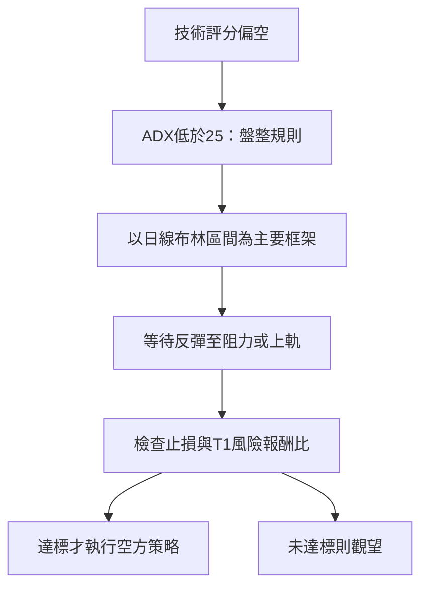

# AMD 技術分析報告

> **報告日期**：2026-11-28 ｜ **語言**：繁體中文 ｜ **數據來源**：Yahoo Finance ｜ **當前價格**：$424.54（2026-11-27 收盤）

---

## 目錄

| 章節 | 內容 |
|------|------|
| [1. 技術面概覽](#1-技術面概覽) | 核心指標速覽、評分卡 |
| [2. 趨勢分析](#2-趨勢分析) | 長中短期走勢、ADX |
| [3. 圖表形態分析](#3-圖表形態分析) | 形態、K線、缺口 |
| [4. 支撐與阻力](#4-支撐與阻力) | 關鍵價位、斐波那契 |
| [5. 技術指標深度解讀](#5-技術指標深度解讀) | MA/RSI/MACD/布林/成交量/進階指標 |
| [6. 動能與波動率](#6-動能與波動率) | ATR、Beta、相對強度 |
| [7. 多時框架總結](#7-多時框架總結) | 時框架矩陣 |
| [8. 交易策略建議](#8-交易策略建議) | 歷史基準、策略、風險報酬比 |
| [9. 風險提示與監控](#9-風險提示與監控) | 監控指標、風險場景 |

---

## 1. 技術面概覽

AMD 短中期技術面偏空，主要依據是日線與週線均低於各自趨勢均線，且日線 MACD 柱仍為負值。另一方面，ADX 顯示目前不是強趨勢行情，因此應按盤整規則，以日線布林通道與明確價位作為交易框架，不宜把短期下跌直接外推為線性趨勢。最大的反向風險是 RSI 出現底背離訊號，若價格重新站回關鍵阻力並獲量能確認，空方策略需要重新評估。

### 📊 核心指標速覽表

| 指標類別 | 指標名稱 | 當前數值 | 訊號 | 解讀 |
|----------|----------|----------|------|------|
| **價格** | 當前價格 | $424.54 | 🔴 | 位於日線及週線趨勢均線下方，短中期仍受壓。 |
| **均線** | MA20 / MA50 / MA200 | 見第 5 章 | 🔴 | 收盤低於三條參考均線，均線排列為混合而非完整多頭。 |
| **動能** | RSI(14)（日線） | 見第 5 章 | 🟡 | 中性區間；有底背離訊號，但尚未確認反轉。 |
| **動能** | MACD 柱（日線） | 見第 5 章 | 🔴 | 負柱顯示日線下行動能仍在。 |
| **趨勢** | ADX(14) | 見第 2 章 | 🟡 | 趨勢強度未達趨勢行情門檻，採盤整市場規則。 |
| **波動** | ATR(14) | 見第 6 章 | 🔴 | 單日波動幅度偏高，止損與倉位需相應收緊。 |
| **多時框** | 一致性 | 見第 7 章 | 🔴 | 日線與週線偏空、月線中性，方向一致性不足但偏空居多。 |

### 🏆 技術評分卡

| 維度 | 評分（0–100） | 訊號 | 主要依據 |
|------|---------------|------|----------|
| 趨勢強度 | 35 | 🔴 | ADX 未達強趨勢門檻，日線與週線方向偏空，詳見第 2、7 章。 |
| 動能指標 | 42 | 🟡 | MACD 偏空，但 RSI 底背離提供反向警示，詳見第 5 章。 |
| 支撐穩定度 | 52 | 🟡 | 價格接近波段支撐與斐波那契中段，但近期低點波動較大，詳見第 4 章。 |
| 成交量配合 | 30 | 🔴 | OBV 顯示量能疲弱，A/D 與價格同步下行，詳見第 5 章。 |
| 形態完整度 | 35 | 🔴 | 沒有足夠數據確認完整反轉或延續形態，詳見第 3 章。 |
| 均線排列 | 35 | 🔴 | 價格在主要日線均線下方，整體排列混合偏弱，詳見第 5 章。 |
| **綜合評分** | **38** | **偏空** | 六項評分算術平均為 38.17，四捨五入為 38。 |

---

## 2. 趨勢分析

**結論：** 長期走勢先大幅上行後出現明顯回撤；近期週線動能轉弱，日線也偏空。不過 ADX 尚未進入趨勢行情，因此依規則以日線區間交易框架為主，而非僅憑中期跌勢追空。

### 📈 長期趨勢（近 12 個月）

下表以月收盤資料分段整理。漲跌幅以各段起訖月收盤計算，描述價格階段，不代表未來機率。

| 期間 | 起訖月收盤 | 漲跌幅 | 階段特徵 |
|------|------------|--------|----------|
| 2025-12 至 2026-03 | $214.16 → $203.43 | -5.0% | 高檔回落後走弱，期間收盤整體偏下。 |
| 2026-04 至 2026-06 | $203.43 → $580.91 | +185.5% | 急速上行，價格快速擴張。 |
| 2026-07 至 2026-09 | $580.91 → $611.76 | +5.3% | 高位震盪後再創階段收盤高點。 |
| 2026-10 至 2026-11 | $611.76 → $424.54 | -30.6% | 高位大幅回撤，趨勢由強轉弱。 |

**長期判讀：** 近期大幅回撤削弱了先前的上升結構。月線方向按多時框指標判為中性，不能僅以長期此前漲幅推定目前已恢復多頭。

### 📊 中期趨勢（週線）

| 觀察項目 | 數據與解讀 |
|----------|------------|
| 週線收盤走勢 | 價格自 2026 年 9 月底的高位區間回落；最近數週波動加大，週收盤先反彈、後再度回落。 |
| 週線 RSI | 最新週 RSI 為 44.7，低於 50，與週線趨勢偏空相符。 |
| 週線 MACD 柱 | 最新週 MACD 柱為 -22.764；近幾週維持負值且走弱，確認中期動能偏空。 |
| 週線均線與方向 | 收盤低於週線趨勢均線，週線方向為偏空；具體數值見第 7 章。 |
| 週量 | 近幾週成交量高於較早期的多個週別，顯示回撤伴隨較高交易活動；但僅憑週量不能判定為有效賣壓出盡。 |

**中期判讀：** 週線趨勢與 MACD 柱互相確認偏空；週 RSI 也低於中性分界。不過近週 K 棒振幅擴大，盤中反彈與回落並存，交易上應優先等待價格到達預先設定的阻力區再評估，而不是在支撐附近無條件追空。

### ⚡ 趨勢強度（ADX）

| 指標 | 數值 | 解讀 |
|------|------:|------|
| ADX(14) | 21.39 | 低於 25，屬弱趨勢／盤整狀態。 |
| +DI | 18.70 | 多方方向性力量較弱。 |
| −DI | 34.75 | 空方方向性力量高於多方。 |
| 市場類型 | 盤整行情 | 依規則 14，以日線布林通道上下軌作為主要區間參考；週線方向只作為偏向與風險背景。 |

**收斂說明：** −DI 高於 +DI，代表目前方向性壓力偏空；但 ADX 未達趨勢行情門檻，故最終策略仍須遵循盤整行情規則。這不是強烈趨勢追空訊號，而是「區間內偏空，等待價格到阻力區再尋找風險報酬比合格的空方進場」。

---

## 3. 圖表形態分析

**結論：** 目前沒有足夠的價格序列證據確認頭肩、雙底、旗形等幾何形態。較明確的是價格落在布林中軌下方、均線下方，且近月下跌後出現 RSI 底背離警訊；因此以指標型解讀為主，不把單一反彈 K 棒視為反轉形態。

### 🔍 形態識別

| 形態 | 信心度 | 判斷依據 | 完成度 | 目標價 |
|------|--------|----------|--------|--------|
| 頭肩、雙底、旗形等價格形態 | 低 | 現有近端 K 棒不足以確認頸線、等高低點、旗桿及整理通道等幾何條件。 | 訊號不足，僅做指標型解讀。 | 不適用；缺少可稽核的形態高度與頸線，不能推算目標。 |
| 日線布林位置 | 中 | 收盤位於布林中軌下方且高於下軌；顯示偏弱但仍在通道內。 | 未形成可確認的通道外突破。 | 不以布林通道位置單獨推算形態目標。 |
| 均線狀態 | 中 | 價格低於 MA20、MA50、MA200；短期均線斜率偏弱，但均線排列被標示為混合。 | 偏空排列尚未形成所有週期均線一致向下的明確結構。 | 不適用。 |

### 🕯️ 重要 K 線形態與缺口

下表所列 K 棒只依近端日 K、週 K 的開高低收判斷；形態名稱採保守描述，不將長影線直接等同反轉確認。

| 日期（日 K／週 K） | 開 | 高 | 低 | 收 | K 線形態 | 解讀 | 訊號 |
|------|------:|------:|------:|------:|----------|------|------|
| 2026-11-25（日 K） | 382.89 | 407.77 | 370.40 | 406.03 | 長下影線、收漲 | 低檔有承接，但收盤仍未確認突破前一日高點，不能視為已完成反轉。 | 🟡 |
| 2026-11-27（日 K） | 420.27 | 426.88 | 398.59 | 424.54 | 小實體、下影線較長 | 盤中跌幅收復，表示低位有買盤；仍需後續收盤確認。 | 🟡 |
| 2026-11-27（週 K） | 476.92 | 477.75 | 370.40 | 424.54 | 長實體下跌、長下影線 | 週內賣壓顯著，但低位出現回收；週收盤仍偏弱，未構成可靠的看漲反轉確認。 | 🔴 |

**K 線判讀：** 低位下影線可作為短期承接跡象，但週線收盤方向仍偏弱；與週線 MACD 負值的訊號尚未形成一致的多頭反轉確認。

#### 近 60 個交易日跳空缺口

下列缺口依市場脈絡資料列示；全部已回補，不能作為尚未回補缺口的待測價位。

| 日期 | 方向 | 缺口區間 | 幅度 | 是否回補 |
|------|------|----------|------|----------|
| 2026-11-09 | 向上跳空 | $459.80–$468.21 | 1.9% | 已回補 |
| 2026-11-05 | 向下跳空 | $456.20–$476.50 | 4.2% | 已回補 |
| 2026-10-30 | 向下跳空 | $520.40–$560.57 | 7.1% | 已回補 |
| 2026-10-22 | 向下跳空 | $529.98–$537.30 | 1.3% | 已回補 |
| 2026-10-02 | 向上跳空 | $619.30–$628.55 | 1.5% | 已回補 |

---

## 4. 支撐與阻力

**結論：** 近端波段支撐區提供較清楚的下方參考，而上方阻力由波段高點聚類形成。因 ADX 顯示盤整，策略上應等待價格接近阻力或支撐後，再依反應與風險報酬比執行；不把任何單一價位視為必然有效。

### 🚧 阻力位分析表

關鍵價位區塊列示為近一年波段高點聚類。

| 阻力級別 | 價位 | 形成原因 | 突破難度 | 重要性 |
|----------|------:|----------|----------|--------|
| R1 | $469.22 | 近一年波段高點聚類；可作第一道反彈壓力觀察。 | 中 | 近端阻力；若突破並站穩，短線空方條件減弱。 |
| R2 | $491.12 | 近一年波段高點聚類；位於前一阻力上方。 | 中 | 反彈延伸的重要確認區。 |
| R3 | $517.35 | 近一年波段高點聚類；較高層級的供給參考區。 | 高 | 若價格到達，需觀察能否有效收復與量能是否改善。 |

### 🛡️ 支撐位分析表

關鍵價位區塊列示為近一年波段低點聚類。

| 支撐級別 | 價位 | 形成原因 | 守住可能性 | 重要性 |
|----------|------:|----------|--------------|--------|
| S1 | $424.03 | 近一年波段低點聚類，屬最近的支撐參考。 | 中 | 價格位於該區附近，若失守，盤整下緣風險升高。 |
| S2 | $402.10 | 近一年波段低點聚類，為下一層支撐。 | 中 | 若 S1 失守，下一個分段觀察區。 |
| S3 | $393.36 | 近一年波段低點聚類，位於 S2 下方。 | 低至中 | 下跌延伸時的支撐參考；不應預設必定止跌。 |

### 📐 斐波那契回調位分析

回調位依 52 週低點至高點區間計算，直接引用價格資料庫中的既定數值。

| 回調層級 | 價位 | 技術意義 |
|----------|------:|----------|
| 23.6% | $547.53 | 較淺回調參考，位於目前價格上方。 |
| 38.2% | $478.87 | 中段反彈壓力參考，與上方波段阻力區接近。 |
| 50.0% | $423.37 | 現價所在區域附近的中位回調參考。 |
| 61.8% | $367.87 | 若中位回調位失守，下一層較深回調參考。 |
| 78.6% | $288.86 | 更深回調參考，屬較遠端價位。 |

**現價位置：** 位於 50.0% 與 38.2% 回調位之間，且接近 50.0% 水平。這個位置兼具支撐觀察與反彈阻力轉換風險；需要收盤與量能確認，不能單憑斐波那契位置斷定底部。

---

## 5. 技術指標深度解讀

**結論：** 均線位置、MACD 與 DI 方向大致偏空；RSI 與隨機指標呈現較弱但未極端超賣的狀態，底背離是主要反向警訊。布林通道顯示價格處於通道下半部而非明確下軌外突破，故指標組合更像「盤整偏空、等待價格確認」，而不是不計價位追空。

### 📈 均線、RSI、MACD、布林通道

| 指標 | 數值 | 訊號 | 解讀 |
|------|------|------|------|
| MA20 / MA50 / MA200 與排列 | MA20 $482.13；MA50 $545.94；MA200 $434.01；排列為混合 | 🔴 | 收盤低於三條均線，價格結構偏弱；MA200 下方尤其反映近期回撤已影響長周期日線位置。 |
| RSI(14)（日線）與背離 | RSI 40.84；程式標記底背離 | 🟡 | RSI 位於中性區，並非超賣。底背離是近 20 根 K 棒首尾方向比較的訊號，尚需價格與動能後續確認。 |
| MACD 線 / Signal / 柱 | MACD -29.578；Signal -20.641；柱 -8.936 | 🔴 | MACD 線低於 Signal 且柱為負，日線下行動能尚未反轉。未有可核實的 MACD 背離標記；目前不宣稱存在確認的 MACD 頂背離或底背離。 |
| Stoch %K / %D | %K 24.21；%D 16.29 | 🟡 | 讀數偏低但分類為中性；若出現交叉回升，仍需價格突破作確認，不能單獨視為買入訊號。 |
| 布林上軌 / 中軌 / 下軌 / %B | 上軌 $584.08；中軌 $482.13；下軌 $380.17；%B 0.22 | 🟡 | 價格位於通道下半部但仍在通道內，反映偏弱位置而非已確認向下突破。 |

**指標整合：** 均線、MACD 與 DI 方向互相支持偏空判讀；RSI 的底背離及低位 K 棒下影線則形成反向警示。布林 %B 位於下半部但未落在通道外，ADX 也未確認強趨勢，因此整體不是「強趨勢追空」，而是「偏空但需等阻力區與價格反應」。

### 💹 成交量（量價配合度）

| 指標 | 數值／狀態 | 解讀 |
|------|------------|------|
| 最新成交量 | 22,329,200 股 | 低於 20 日與 50 日均量，最新一日量能沒有支持明確的反轉確認。 |
| 20 日均量與量比 | 47,387,015 股；量比 0.47x | 當日量能明顯低於近期均量；單日量縮可能代表賣壓暫緩，但也不足以證明買盤回流。 |
| 50 日均量 | 31,490,764 股 | 作為中期量能基準；最新量仍低於該均量。 |
| OBV | OBV < MA，量能疲弱 | OBV 未確認價格反彈，整體量價配合偏弱。 |
| A/D 線 | 近 20 根高於其 20 日均值；A/D 下降、價格下跌 | A/D 與價格同向，程式標記為確認；短期 A/D 水平位置較高，不代表近期下跌已被吸收。 |

**量價結論：** OBV 量能疲弱，A/D 近期下降且價格下跌，對下行結構有確認作用；最新量低於均量則不代表新一輪賣壓正在加速。量能尚未對 RSI 底背離提供明確多頭確認。

### 🧭 進階指標

| 指標 | 數值 | 收盤相對位置 | 解讀 |
|------|------|--------------|------|
| 一目均衡表（轉換線／基準線／雲層） | 轉換線 $462.71；基準線 $482.20；先行帶 A $579.13；先行帶 B $549.51。前方 26 根雲層：A $472.45、B $514.46。 | 收盤在雲層下方；轉換線在基準線下方。 | 現行與前方雲層均呈偏空特徵，與均線、MACD 的弱勢方向一致。 |
| 成交量分布（POC／價值區） | POC $217.61；價值區 $188.22–$501.75，含 73% 成交量。 | 收盤位於價值區內。 | 價格仍在歷史成交量主要分布區內，POC 遠低於現價；價值區本身不是即時方向訊號。 |
| 錨定 VWAP（自 52 週高點／低點） | 自 52 週高點起 $506.21；自 52 週低點起 $432.00。 | 收盤低於兩條錨定 VWAP。 | 高點與低點起算的成交量加權均價均在收盤上方，反映持有成本壓力；與均線偏空結論相符。 |
| A/D 線 | 近 20 根高於其 20 日均值；A/D 下降、價格下跌。 | — | A/D 與價格同向，對近期下跌有確認作用；短期偏高位置不構成已確認背離。 |
| 經典樞軸點 | 樞軸 PR2 $718.15；樞軸 PR1 $611.48；樞軸 P $551.84；樞軸 PS1 $445.17；樞軸 PS2 $385.53。 | 收盤低於樞軸 P、PS1，高於 PS2。 | 樞軸公式值不是波段高低點；波段支撐與阻力已足夠，不將其改標為 R/S。作為輔助觀察時須保留「樞軸」名稱。 |

**進階指標整合：** 一目雲層、轉換線與基準線，以及兩條錨定 VWAP 均指向上方壓力，與均線、MACD 偏空相互確認；價值區內位置則只表示價格仍在歷史成交分布範圍，不能抵銷趨勢訊號。樞軸數值僅供公式參考，不取代波段支撐／阻力。

---

## 6. 動能與波動率

**結論：** AMD 的日常波動幅度相對價格偏高，且 Beta 顯示其對市場變動具有較高敏感度。相對大盤與半導體 ETF 的近期表現不佳，支持謹慎偏空策略；但相對半導體 ETF 的中期超額報酬為正，代表 AMD 的弱勢並非在所有期間都落後產業。

### 📊 ATR 波動率分析

| 指標 | 數值 | 解讀 |
|------|------:|------|
| ATR(14) | $45.21 | 以 Wilder 方法計算的日線平均真實波幅，單日波動金額大。 |
| ATR 佔價格比例 | 10.65% | 相對價格屬高波動，盤中觸及止損的風險較一般低波動股票高。 |
| 1.5 倍 ATR 距離 | $67.82 | 可作為波動尺度參考，不是支撐、阻力或建議止損價。 |
| 2 倍 ATR 距離 | $90.42 | 反映更寬的波動容忍距離；若採較寬止損，應同步縮小倉位。 |

**止損距離運用：** ATR 距離是風險尺度，不應直接取代結構性止損。策略止損應以失效價位為準，再以 ATR 檢查是否過近；若結構性止損所需距離過大，應降低部位而非任意擴大虧損額度。

### 📐 Beta 與相對強度

Beta 為 2.542，代表股票歷史上對市場波動較敏感；此值不是未來波動的保證，也不等同於方向判斷。

#### 相對強度 vs VTI（美國整體市場）

| 期間 | AMD | VTI | 超額報酬 |
|------|----:|----:|---------:|
| 1 個月 | -27.5% | -6.5% | -21.0% |
| 3 個月 | -14.8% | -7.2% | -7.6% |
| 6 個月 | -21.6% | -5.0% | -16.7% |

**比值趨勢：** 相對走弱，股價比值低於其 50 日均值。相較大盤各觀察期間均落後，支持偏空主策略；但相對強弱是比較表現，不足以單獨決定進出場。

#### 相對強度 vs SMH（半導體）

| 期間 | AMD | SMH | 超額報酬 |
|------|----:|----:|---------:|
| 1 個月 | -27.5% | -24.3% | -3.2% |
| 3 個月 | -14.8% | -26.3% | +11.5% |
| 6 個月 | -21.6% | -29.6% | +7.9% |

**比值趨勢：** 相對走弱，股價比值低於其 50 日均值。AMD 在較長比較期間相對半導體 ETF 表現較好，但近期一個月仍落後；這項相對產業韌性與絕對技術面偏空相抵，故支持「等反彈至阻力再做空」，不支持在支撐位盲目追空。

---

## 7. 多時框架總結

**結論：** 多時框一致性依原始指標為 2/3 偏空。日線與週線偏空、月線中性；由於 ADX 未達趨勢行情門檻，交易上以日線布林區間為主，週線偏空用於決定優先方向，日線用於尋找進場時機。

### 📋 時框架評分表

| 時框架 | 趨勢方向 | RSI(14) | MACD 柱 | 收盤 vs 趨勢均線 | 形態 | 建議 |
|--------|----------|---------|---------|------------------|------|------|
| 日線 | 偏空 | 40.84 | -8.936 | 低於 MA50 $545.94 | 價格低於主要日線均線；RSI 底背離僅作反向警示。 | 等待價格反彈至阻力區，再評估空方條件。 |
| 週線 | 偏空 | 44.69 | -22.764 | 低於 MA20 $511.95 | 週線回撤與 MACD 負柱相互確認，近期振幅擴大。 | 偏空作為方向背景；避免忽略反彈風險。 |
| 月線 | 中性 | 55.23 | N/A（數據未提供） | 低於 MA10 $434.31 | 月線 RSI 高於 50，但收盤低於趨勢均線，因此方向為中性。 | 等待月線價格與均線方向重新一致。 |

**多時框一致性：2/3 偏空。**

### ⚖️ 多時框收斂結論

1. **市場狀態：** ADX 低於 25，按規則判為盤整行情。
2. **規則優先級：** 盤整行情以日線布林通道上下軌作為主要交易區間；不以週線偏空直接推定趨勢空單。
3. **方向收斂：** 日線與週線偏空，月線中性，故唯一方向性結論為 **偏空**；實際執行則採「反彈至阻力再進場」的區間偏空策略。
4. **衝突處理：** RSI 底背離與週期性下影線構成反向風險，但尚未扭轉均線、MACD 與相對大盤弱勢。若阻力被有效收復，應撤銷或暫停空方交易假設。

---

## 8. 交易策略建議

**當前主策略方向 = 偏空（依評分 38/100）。** 綜合評分落在偏空區間；但因 ADX 顯示盤整，策略不是在現價追空，而是等待反彈至可稽核阻力或布林上軌附近，並要求風險報酬比達標。

### 🧭 策略路由

### 📊 歷史基準機率

今日狀態為 **RSI(14) 30–50 且收盤在 MA200 下方**。樣本期間為 **2016-11-25 至 2026-11-27**，共 2,515 個交易日；相同狀態交易日共 405 日，分布於 58 段。下表的「上漲比例」是歷史頻率，不是預測；同一段內交易日及持有期互相重疊，並非獨立觀察。

| 持有期 | 相同狀態樣本（段數） | 上漲比例 | 中位數報酬 | 25%–75% 分位 | 全部交易日上漲比例／中位數 |
|--------|----------------------|----------|------------|--------------|-----------------------------|
| 5 日 | 405（58 段） | 51% | +0.3% | -5.1% 至 +5.4% | 55%／+0.8% |
| 20 日 | 405（58 段） | 49% | -0.8% | -9.4% 至 +13.6% | 55%／+1.9% |
| 60 日 | 405（58 段） | 58% | +4.1% | -13.6% 至 +26.9% | 63%／+9.8% |

**歷史基準解讀：** 短期上漲比例略低於全部交易日，20 日中位數為負；較長持有期的相同狀態歷史上漲比例仍低於全部交易日，但中位數回報為正。結果沒有提供穩定的單向預測優勢，且 58 段事件數有限、持有期重疊；因此只對短期偏空觀點提供有限支持，不應把歷史頻率解讀為策略成功機率。

### 🎯 價格情境階梯（Price Scenarios）

| 觸發條件 | 下一目標 | 後續延伸 | 可能性 | 依據 |
|----------|----------|----------|--------|------|
| 突破 R1 | R2 | R3 | 中 | 需觀察收盤能否站穩阻力區；目前均線及 MACD 偏空，突破前不預設延伸成功。 |
| 在現價所在區間維持整理 | — | — | 中 | ADX 顯示盤整；布林通道下半部與支撐附近可能引發雙向震盪。 |
| 跌破 S1 | S2 | S3 | 中 | 日線與週線偏空、量價偏弱支持下探情境；RSI 底背離與低位影線則構成反向風險。 |

### 🟢 主策略詳情

**策略 A：阻力區反彈空；策略 B：布林上軌附近反彈空。** 兩者均為等待型計畫，不代表現價立即進場。進場價及止損皆以指定價位執行；若未觸發，維持觀望。

| 策略要素 | 策略 A | 策略 B |
|----------|--------|--------|
| 最新收盤基準 | $424.54 | $424.54 |
| 進場條件 | 價格反彈至 R1，並出現受阻或日線轉弱確認。 | 價格反彈至布林上軌後受阻；若有效突破並站穩，不執行空單。 |
| 進場價格 | $469.22 | $584.08 |
| 目標價 T1 | $424.03（S1） | $424.03（S1） |
| 目標價 T2 | $402.10（S2） | $402.10（S2） |
| 止損價格 | $491.12（R2） | $658.52（52 週高點） |
| 風險報酬比 | 1 : 2.06（以 T1 計）；1 : 3.06（以 T2 計） | 1 : 2.15（以 T1 計）；1 : 2.44（以 T2 計） |
| 計算核對 | 做空風險 $21.90；T1 潛在報酬 $45.19，故 45.19 ÷ 21.90 = 2.06。 | 做空風險 $74.44；T1 潛在報酬 $160.05，故 160.05 ÷ 74.44 = 2.15。 |
| 把握度 | 中：阻力位明確，且多時框偏空；但盤整狀態及 RSI 底背離可能造成反彈。 | 低至中：上軌是合法的區間參考，但觸及距離較遠，且股價可能先突破而非受阻。 |
| 建議倉位 | 風險資本的 0.25R–0.50R；以止損距離反推股數。 | 風險資本的 0.25R；僅限價格觸及上軌後出現轉弱確認。 |

**比值說明：** 風險報酬比採做空方向計算，即（進場價－目標價）÷（止損價－進場價）；兩項策略的 T1 比值均達最低門檻。若實際成交滑價使比值低於門檻，取消交易，不以調整公式方式保留策略。

### 🔴 反向風險觸發點（對沖提示）

| 反向訊號 | 風險含義 | 動作 |
|----------|----------|------|
| 價格突破 R1 並站穩 | 近端阻力轉為支撐的可能性增加，空方進場條件減弱。 | 不在突破後追空；等待回測確認。 |
| 價格突破 R2 並站穩 | 策略 A 的結構性止損區被觸及，原先阻力假設失效。 | 依計畫止損，不擴大止損距離。 |
| RSI 底背離伴隨量能回升、MACD 柱改善 | 反轉訊號獲得較多指標確認。 | 暫停新增空單，重新評估日線區間方向。 |
| 價格有效站上布林上軌 | 盤整區間假設可能失效，可能轉為向上突破。 | 不執行策略 B，待新區間形成後再評估。 |

---

## 9. 風險提示與監控

**結論：** 主要風險來自高波動、週線偏空與短線反轉訊號同時存在。監控重點應放在波段支撐是否失守、上方阻力是否收復、量能是否確認，以及財報前的跳空風險。止損單無法保證在跳空行情中按預設價格成交。

### ✅ 關鍵監控指標

| 監控項目 | 價位／事件 | 觸發後動作 |
|----------|------------|------------|
| 近端波段支撐 | S1；見第 4 章 | 收盤失守後，觀察下一支撐層級；不在急跌中無條件追空。 |
| 次級支撐 | S2、S3；見第 4 章 | 若逐層失守，評估是否出現加速下跌；同步檢查 RSI、量能及是否接近目標。 |
| 反彈阻力 | R1、R2、R3；見第 4 章 | 反彈至阻力且轉弱時才評估空方進場；有效收復則降低空方暴露。 |
| 布林區間 | 上下軌；見第 5 章 | ADX 仍低於 25 時以區間交易為主；若收盤持續突破通道，重新判斷行情類型。 |
| 量價確認 | OBV、A/D、成交量相對均量 | OBV 回升且 A/D 轉強時，降低對空方訊號的信任；賣出量增且支撐失守時提高風險警戒。 |
| 下次財報日 | 2027-02-02；距最新收盤日 67 個日曆天 | 財報日期可能調整；進入財報持有期間前重新評估倉位與隔夜風險。 |
| 財報跳空風險 | 財報公布時點及市場反應 | 財報可能造成跳空，止損不保證成交；不宜以一般日內波動假設管理事件風險。 |

### ⚠️ 風險場景

| 情境 | 觸發條件 | 價位參考 | 可能性 | 應對 |
|------|----------|----------|--------|------|
| 樂觀 | 價格守住支撐並收復近端阻力，同時 RSI、MACD 或量能出現確認。 | S1、R1；見第 4 章 | 中 | 空單減碼或撤銷；等待突破後回測，不追逐單根反彈。 |
| 基本 | 價格在布林通道及波段支撐／阻力間震盪，未出現有效突破。 | 日線布林通道及 R1／S1；見第 4、5 章 | 中 | 維持小倉位區間交易；僅執行風險報酬比達標的預設單。 |
| 悲觀 | 支撐被收盤有效跌破，且週線偏空、量能或負向動能維持。 | S1、S2、S3；見第 4 章 | 中 | 不追逐急跌；等待反彈至阻力後評估，並按既定止損執行。 |

### 🛡️ 風險管理提醒

- **先定義最大可承受損失，再倒推股數。** 以進場價至止損價的距離計算部位，不因看好或看空而任意加碼。
- **盤整行情避免追價。** 依本報告策略，未到預設進場區或風險報酬比不達標時，應選擇不交易。
- **止損不得向不利方向移動。** 若價格觸及策略失效點，按計畫離場；不可因短線反彈或回撤擴大風險上限。
- **財報前降低隔夜風險。** 事件跳空可能越過止損價，止損單不保證按設定價格成交。
- **重新確認指標一致性。** 若價格、MACD、RSI 與量能出現相反訊號，暫停新增部位，避免把單一指標當作完整交易理由。

---

## 📋 報告總結

| 項目 | 結論 |
|------|------|
| 報告日期 | 2026-11-28 |
| 當前價格 | 2026-11-27 收盤；價格見標題列。 |
| 綜合評分／方向 | 38/100，偏空。 |
| 長期趨勢 | 🟡 先前大幅上行後近期顯著回撤，月線方向中性。 |
| 中期趨勢 | 🔴 週線偏空，週 MACD 柱維持負值。 |
| 短期趨勢 | 🔴 日線偏空但屬盤整環境，避免在支撐附近追空。 |
| 關鍵支撐／阻力 | 支撐 S1／S2、阻力 R1／R2；精確價位見第 4 章。 |
| 🥇 最佳機會 | **觀望等待反彈至策略 A 進場價位；**只有在轉弱確認、止損有效且 T1 風險報酬比達標時執行。 |
| 最大風險 | 高波動下的反轉或財報跳空可能令止損滑價；RSI 底背離亦可能帶來快速反彈。 |

> ⚠️ **免責聲明**：本報告為 AI 自動生成之技術分析，所有數據及估算均基於歷史價格資訊。本報告僅供研究與學術參考，不構成任何投資建議。投資有風險，入市需謹慎。

---

## 資料與來源

| 項目 | 內容 |
|------|------|
| 價格 | 424.54 USD，2026-11-27 收盤（Yahoo Finance 日線） |
| K 棒 | 500 根日線，2024-11-29 至 2026-11-27（Yahoo Finance）；較長期間的價位與基準機率取自價格資料庫 |
| 關鍵價位回溯期間 | 阻力 近一年、支撐 近一年 |
| 下次財報日 | 2027-02-02（Yahoo Finance，日期可能調整） |
| 有回應的資料來源 | Yahoo Finance、Finviz、StockAnalysis、Roic.ai |
| 由程式計算 | 所有指標、R1–S3 與斐波那契價位、多時框方向、相對強度、缺口、歷史基準機率、綜合評分 |
| 撰寫模型 | openai / gpt-6-luna |

> 本區塊由產生報告的程式依實際取得的資料填寫，非模型撰寫。「由程式計算」的數字不是模型的估計；其餘判斷（評分、情境、策略）是模型的分析。
