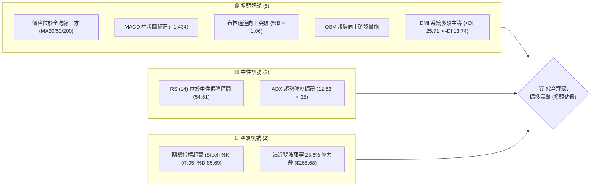
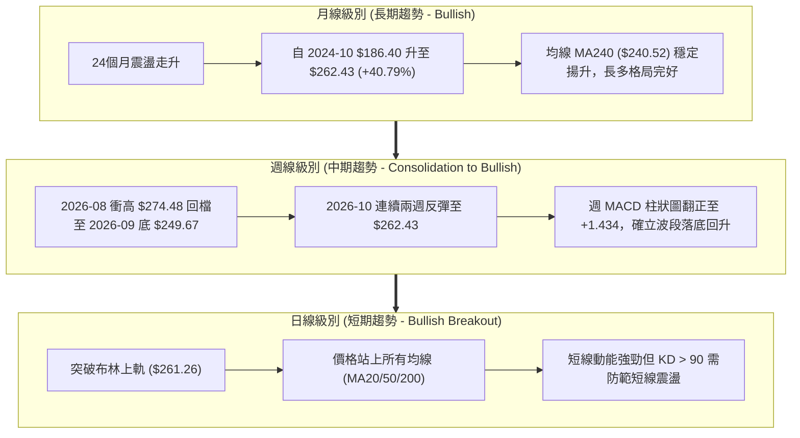
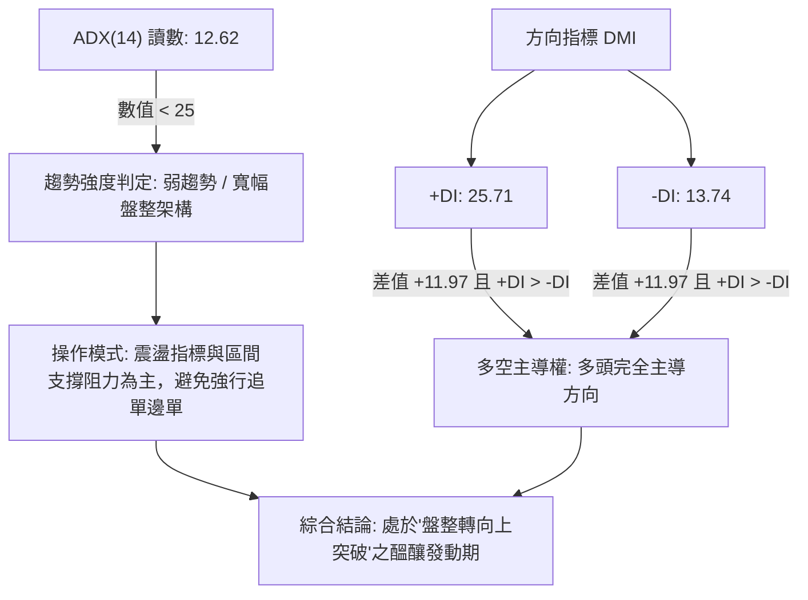
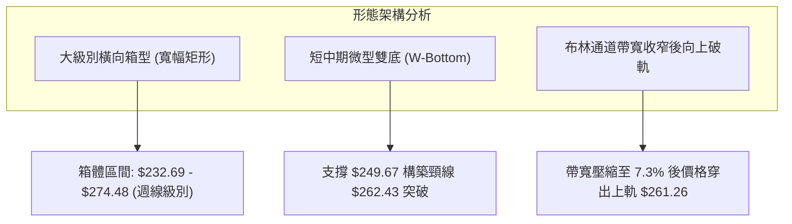
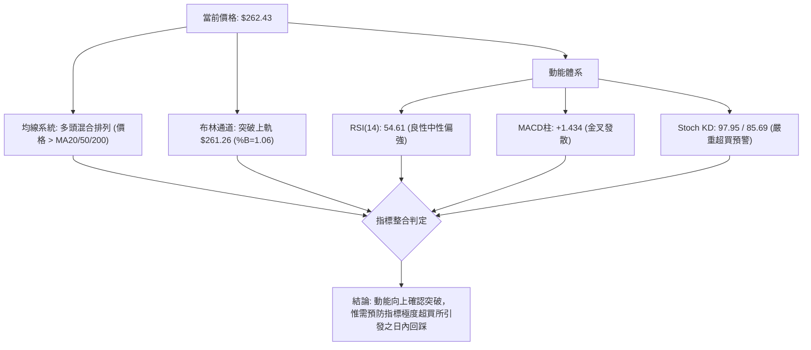
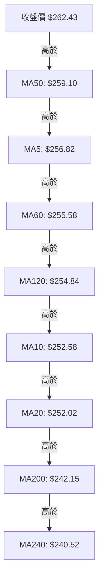
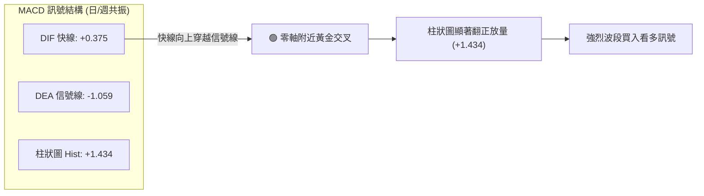
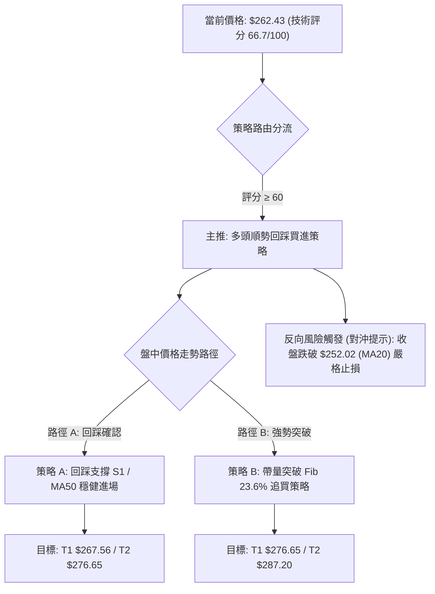
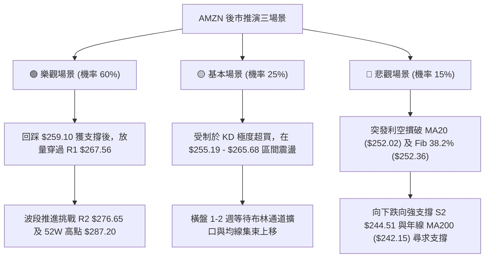

# AMZN 技術分析報告

> **報告日期**：2026-10-11 ｜ **語言**：繁體中文 ｜ **數據來源**：Yahoo Finance ｜ **當前價格**：$262.43

---

## 目錄

| 章節 | 內容 |
|------|------|
| [1. 技術面概覽](#1-技術面概覽) | 訊號儀表板、核心指標、評分卡 |
| [2. 趨勢分析](#2-趨勢分析) | 多時框趨勢、長中短期走勢、ADX強弱評估 |
| [3. 圖表形態分析](#3-圖表形態分析) | 形態識別、K線組合、目標價推算 |
| [4. 支撐與阻力](#4-支撐與阻力) | 關鍵價位結構、斐波那契回調深度分析 |
| [5. 技術指標深度解讀](#5-技術指標深度解讀) | MA/RSI/MACD/布林通道/成交量配合度 |
| [6. 動能與波動率](#6-動能與波動率) | 動能矩陣、ATR風控分析、Beta關聯度 |
| [7. 多時框架總結](#7-多時框架總結) | 時框架評分矩陣、收斂結論與核心方向 |
| [8. 交易策略建議](#8-交易策略建議) | 策略路由、階梯情境、風報比與操作參數 |
| [9. 風險提示與監控](#9-風險提示與監控) | 關鍵指標檢核、情境推演、資金控管 |

---

## 1. 技術面概覽

### 🎯 技術訊號儀表板



### 📊 核心指標速覽表

| 指標類別 | 指標名稱 | 當前數值 | 訊號 | 解讀 |
|----------|----------|----------|------|------|
| **價格** | 當前收盤價 | $262.43 | 🟢 | 突破所有短中長期均線，位於52週區間72.8%高位偏強區 |
| **均線** | MA20 (短中) | $252.02 | 🟢 | 價格在MA20上方 +4.13%，斜率翻揚向上 |
| **均線** | MA50 (中期) | $259.10 | 🟢 | 價格剛由下往上突破MA50 +1.29%，扭轉短線劣勢 |
| **均線** | MA200 (長期)| $242.15 | 🟢 | 價格遠在年線之上 +8.37%，長期多頭底座穩固 |
| **動能** | RSI(14) | 54.61 | 🟡 | 位於50中軸上方，無超買或背離，具備健康向上空間 |
| **動能** | MACD(12,26,9) | DIF: 0.375 / 柱: +1.434 | 🟢 | DIF穿越信號線形成零軸上方黃金交叉，動能顯著轉多 |
| **擺動** | KD (Stoch 14,3)| %K: 97.95 / %D: 85.69 | 🔴 | 進入極度超買區，短線隨時有回測或震盪消化需求 |
| **趨勢** | ADX(14) | 12.62 | 🟡 | 數值低於25，代表非強單邊行情，偏向寬幅區間震盪突破 |
| **通道** | Bollinger Bands| 帶寬縮窄後突破上軌 ($261.26)| 🟢 | %B為1.06，收盤價突破布林上軌，具短線發動特徵 |
| **成交量**| 最新量 / 20日均量| 34.71M / 37.06M (0.94x)| 🟡 | 上漲伴隨量能略低於均量，量價配合尚可但未爆量 |
| **波動** | ATR(14) | $5.63 (2.15%) | 🟢 | 波動率處於良性可控水準，適合設定標準止損波幅 |

### 🏆 技術評分卡

```
╔══════════════════════════════════════════════════════════════╗
║                技術評分卡 — AMZN (2026-10-11)                ║
╠══════════════════════════════════════════════════════════════╣
║ 趨勢強度 (Trend)      ██████████░░░░░░░░░░  52/100  🟡 中性  ║
║ 動能指標 (Momentum)    ██████████████░░░░░░  70/100  🟢 偏多  ║
║ 支撐穩定度 (Support)   ████████████████░░░░  78/100  🟢 強勢  ║
║ 成交量配合 (Volume)    ████████████░░░░░░░░  60/100  🟡 中性  ║
║ 形態完整度 (Pattern)   ██████████████░░░░░░  68/100  🟢 偏多  ║
║ 均線排列 (Moving Avg)  ██████████████░░░░░░  72/100  🟢 偏多  ║
╠══════════════════════════════════════════════════════════════╣
║ 綜合技術評分           █████████████░░░░░░░  66.7/100 偏多   ║
║ 評級結論               🟢 買入偏多 / 震盪逢低佈局 (ACCUMULATE)║
╚══════════════════════════════════════════════════════════════╝
```

---

## 2. 趨勢分析

### 🌐 多時框趨勢分析



### 📈 長期趨勢 — 12個月走勢圖（Unicode）

```
AMZN 月線走勢圖（過去12個月：2025-10 至 2026-10）
價格軸 ($)
$275 ┤                                          ● 271.58(07月)
$270 ┤                               ● 270.64(05月)
$265 ┤                         ● 265.06(04月)         ● 262.43(現價)
$260 ┤                                              ● 259.77(08月)
$255 ┤                                                  
$250 ┤                                                      ● 249.15(09月)
$245 ┤ ● 244.22(10月)                                       
$240 ┤             ● 239.30(01月)               ● 238.34(06月)
$235 ┤     ● 233.22(11月) 
$230 ┤         ● 230.82(12月)
$215 ┤                 
$210 ┤                     ● 210.00(02月)
$205 ┤                         ● 208.27(03月低點)
     └─┬─────┬─────┬─────┬─────┬─────┬─────┬─────┬─────┬─────┬─────┬─────┬──
     '25-10  11    12   '26-01 02    03    04    05    06    07    08    09    10
```

#### 走勢特徵分析表格

| 階段區間 | 起止月份 | 價格變動 | 漲跌幅 | 結構特徵與成交量型態 |
|----------|----------|----------|--------|----------------------|
| **高位整理期** | 2025-10 → 2025-12 | $244.22 → $230.82 | -5.49% | 高檔橫盤消化獲利賣壓，區間波動收窄 |
| **春季回調底** | 2026-01 → 2026-03 | $239.30 → $208.27 | -12.97% | 測試波段底部，於 $208.27 形成年內扎實雙底支撐 |
| **春季主升浪** | 2026-03 → 2026-05 | $208.27 → $270.64 | +29.95% | 突破所有短期均線，呈現強勢推升走勢 |
| **夏季箱型震盪**| 2026-06 → 2026-09 | $238.34 → $249.15 | +4.53% | 寬幅劇烈震盪，06月與07月爆出天量換手整理 |
| **秋季發動重啟**| 2026-09 → 2026-10 | $249.15 → $262.43 | +5.33% | 週線MACD柱翻正，日線站上布林上軌與MA50，多頭重掌兵符 |

### 📊 中期趨勢（週線分析）

從 2026-05-31 至 2026-10-11 的近 20 週走勢中，中期走勢清晰呈現「雙波段高位箱型整理」架構：

```
中期週線價格波段架構示意圖：
$280 ┤                            [2026-08-09 高點 $274.48]
     │                                ╭─────╮
$270 ┤  [05-31 高點 $270.64]          │     │    [08-02: $271.58]
     │       ╭───╮                   │     ╰───────╮
$260 ┤       │   │                   │             ╰───╮       [現價: $262.43]
     │       │   ╰───╮               │                 ╰───────────●
$250 ┤       │       ╰─╮   ╭─────────╯                             │
     │       │         │   │                                       │
$240 ┤───────╯         ╰───╯                                       │
     │      [06-28 爆量低點 $232.69]                               │
$230 ┤                                                             │
     └─────────────────────────────────────────────────────────────┴────
```
中期關鍵特徵：
1. **支撐確立**：2026-06-28 週成交量達到 525.21M 的極端天量，收盤於 $232.69，奠定今年度最強力的「籌碼換手防守底線」。
2. **動能修復**：週線 RSI 由 2026-08-23 的低點 24.5 快速回升至當前的 54.6，脫離弱勢區；週 MACD 柱狀圖在連續 7 週負值後，於 2026-10-11 正式翻正為 +1.434，確認中期反彈結構轉為主動進攻。

### ⚡ 趨勢強度評估（ADX 解讀）



#### ADX 強度對照與解讀

| 指標變數 | 當前數值 | 臨界標準 | 狀態評估 | 實戰涵義 |
|----------|----------|----------|----------|----------|
| **ADX** | 12.62 | 25.00 | 弱勢/無單邊趨勢 | 市場尚未進入極端單邊推升期，價格仍受關鍵阻力位約束 |
| **+DI** | 25.71 | 20.00 | 強多頭 | 買盤力道強大，向上推動價格意願顯著 |
| **-DI** | 13.74 | 20.00 | 空頭衰竭 | 賣方壓制力量衰退至低位，缺乏摜壓動能 |
| **DI差值** | +11.97 | 0.00 | 正向發散 | 多方動能持續放大，一旦 ADX 向上穿越 20，將啟動主升加速行情 |

---

## 3. 圖表形態分析

### 🔍 形態識別系統



#### 圖表形態信心度評估表

| 形態類別 | 信心度 | 判斷依據（引用數據） | 完成度 | 目標價（附嚴謹計算式） |
|----------|--------|----------------------|--------|------------------------|
| **週線級寬幅箱型整理** | 85% | 箱底 $232.69（2026-06/07兩次測試），箱頂 $274.48（2026-08-09波段高點） | 75% | 箱頂阻力：$274.48（接近關鍵阻力 R2 $276.65） |
| **短期雙底 (W底) 形態** | 70% | 兩次低點：2026-09-20 週低 $253.71 與 2026-09-27 週低 $249.67（吻合支撐 S1 $255.19 區間），頸線位於 2026-08-30 高點 $266.43 | 65% | 頸線 $266.43 + (形態高度: $266.43 - $249.67 = $16.76) = **$283.19**（接近阻力 R3 $287.20） |
| **頭肩底形態** | 30% | 數據中左肩與右肩對稱性不足，缺乏標準右肩結構 | 15% | 訊號不足，僅做指標型與區間解讀，不預設該目標價 |

### 🕯️ 重要K線形態分析

| 週期/日期 | 收盤價 | K線組合形態 | 技術解讀 | 訊號方向 |
|-----------|--------|-------------|----------|----------|
| **2026-06-28** | $232.69 | 極長下影線放量十字星 | 週量 525.21M 天量洗盤，主力機構低檔承接，確立強烈長線底部買盤 | 🟢 強烈看多 |
| **2026-08-09** | $274.48 | 高檔長上影避雷針線 | 衝刺年內次高後遇阻，量能放至 270.23M 但未能突破 52W 高點 $287.20，引發獲利了結 | 🔴 賣壓湧現 |
| **2026-09-27** | $249.67 | 縮量築底小實體紡錘線 | 賣壓耗盡，量能降至 196.48M，回測 MA200 上方止跌 | 🟡 止跌轉折 |
| **2026-10-11** | $262.43 | 中長陽實體突破線 (當前) | 週線收盤實體貫穿 MA50 ($259.10)，布林上軌被實體陽線頂開，確立短期攻勢 | 🟢 突破買進 |

### 📉 ASCII 走勢形態示意圖

```
短期雙重底 (W-Bottom) 與布林上軌突破示意圖：
$270 ┤                                             [突破阻力帶]
     │                                            ╭───● $262.43 (現價突破)
$265 ┤                         [頸線高點]        ╭╯   
     │                         $266.43          │
$260 ┤                            ╭───╮        ╭╯     [MA50 $259.10]
     │                            │   │       ╭╯
$255 ┤      [左底測試]             │   ╰───╮  ╭╯      [S1 $255.19]
     │      $253.71 (09-20)       │       ╰──╯
$250 ┤         ╰───────╮          │       [右底確立]
     │                 ╰──────────╯       $249.67 (09-27)
$245 ┴─────────────────────────────────────────────────────────────
```

### 🎯 形態目標價計算

根據嚴格之技術分析計量規範，針對已確認度達 70% 的短期 W 底形態進行波幅等倍測量（Measured Move）：
- **形態低點（最低谷）**：$249.67（2026-09-27 週收盤）
- **形態頸線位（Neckline）**：$266.43（2026-08-30 週反彈高點）
- **形態垂直高度（Pattern Height, H）**：
  $$H = \text{頸線} - \text{低點} = \$266.43 - \$249.67 = \$16.76$$
- **第一形態等倍推算目標價（T1）**：
  $$\text{Target 1} = \text{頸線} + (1.0 \times H) = \$266.43 + \$16.76 = \mathbf{\$283.19}$$
  *(該推算值精確落在阻力 R2 \$276.65 與 R3 \$287.20 之間)*
- **箱體突破極限推算目標價（T2）**：
  若以大箱體底 $232.69 與箱頂 $274.48 計算 ($H_{box} = \$41.79$)，突破箱頂後目標為 $\$274.48 + \$41.79 = \mathbf{\$316.27}$（此目標將挑戰分析師平均目標價 $331.53）。

---

## 4. 支撐與阻力

### 🗺️ 關鍵價位分布圖（Unicode）

```
╔═════════════════════════════════════════════════════════════════════╗
║                   AMZN 關鍵價位結構分布圖                           ║
╠═════════════════════════════════════════════════════════════════════╣
║ $287.20 ║████████████████████████████████████████║ 強阻力 R3 (52W高點)
║ $276.65 ║████████████████████████████            ║ 次級阻力 R2
║ $267.56 ║████████████████████                    ║ 關鍵短線阻力 R1
║ $265.68 ║░░░░░░░░░░░░░░░░░░░░░░░░░░░░░░░░░░░░    ║ Fib 23.6% 回調壓力
╠═════════╬════════════════════════════════════════╬═════════════════╣
║ $262.43 ╠════════════════════════════════════════╣ ◄ 當前市價
╠═════════╬════════════════════════════════════════╬═════════════════╣
║ $261.26 ║░░░░░░░░░░░░░░░░░░░░░░░░░░░░░░░░░░░░    ║ 布林上軌 (動態轉支撐)
║ $255.19 ║▓▓▓▓▓▓▓▓▓▓▓▓▓▓▓▓▓▓▓▓▓▓▓▓▓▓▓▓▓▓▓▓        ║ 近期支撐 S1 (頸線重疊)
║ $252.36 ║░░░░░░░░░░░░░░░░░░░░░░░░░░░░░░░░░░░░    ║ Fib 38.2% / MA20
║ $244.51 ║████████████████████████████████        ║ 強支撐 S2 (MA200防線)
║ $225.82 ║████████████████████████████████████████║ 核心防守底 S3
╚═════════════════════════════════════════════════════════════════════╝
```

### 🚧 阻力位分析表

| 阻力級別 | 價位 | 距現價幅 | 形成原因與籌碼技術結構 | 突破難度 | 重要性權重 |
|----------|------|----------|------------------------|----------|------------|
| **R1** | **$267.56** | +1.95% | 近一年波段高點聚類；鄰近 Fib 23.6% ($265.68) 與前波頸線 $266.43，短線空頭重鎮 | 🟡 中等 | ★★★☆☆ |
| **R2** | **$276.65** | +5.42% | 近一年次高密集區；2026-08-09 週線衝高反轉點 ($274.48) 延伸之籌碼套牢區間 | 🔴 偏高 | ★★★★☆ |
| **R3** | **$287.20** | +9.44% | 52週最高點 (Fib 0.0%)；歷史籌碼極限峰值，多頭終極試金石 | 🔴 極高 | ★★★★★ |

### 🛡️ 支撐位分析表

| 支撐級別 | 價位 | 距現價幅 | 形成原因與籌碼技術結構 | 守住機率 | 重要性權重 |
|----------|------|----------|------------------------|----------|------------|
| **S1** | **$255.19** | -2.76% | 近一年波段低點聚類；重疊 MA60 ($255.58) 與 MA120 ($254.84)，短期多頭第一道回踩防線 | 80% 🟢 | ★★★★☆ |
| **S2** | **$244.51** | -6.83% | 近一年波段強低點聚類；緊鄰長線生命線 MA200 ($242.15) 與 Fib 50.0% ($241.60)，中期多空分水嶺 | 90% 🟢 | ★★★★★ |
| **S3** | **$225.82** | -13.95% | 近一年波段極端低點聚類；低於 06 月天量低點 $232.69 與 Fib 61.8% ($230.84)，長線戰略鐵底 | 98% 🟢 | ★★★★★ |

### 📐 斐波那契回調位分析

依據 52 週完整波段低點 **$196.00** 至 52 週最高點 **$287.20** 計算之斐波那契黃金分割位：

| 斐波那契比例 | 精確價位 | 相對現價位置 | 技術意義與多空攻防分析 |
|--------------|----------|--------------|------------------------|
| **0.0% (52W High)**| **$287.20** | +9.44% (上方) | 年內多頭波段頂點，歷史賣壓匯聚處 |
| **23.6%** | **$265.68** | +1.24% (上方) | **目前最關鍵上檔關卡**。現價 $262.43 緊逼此位，有效突破將確認多頭重返強勢主升 |
| **38.2%** | **$252.36** | -3.84% (下方) | **當前極限回踩支撐**。與日線 MA20 ($252.02) 及 MA10 ($252.58) 形成三合一高密度支撐匯聚帶 |
| **50.0%** | **$241.60** | -7.94% (下方) | 中期多空平衡點，與長期年線 MA200 ($242.15) 高度共振，跌破意味著中期結構轉空 |
| **61.8%** | **$230.84** | -12.04% (下方) | 黃金分割防守位，2025-12 收盤 $230.82 曾於此獲得強力支撐 |
| **78.6%** | **$215.52** | -17.88% (下方) | 深幅回撤防線 |
| **100.0% (52W Low)**| **$196.00**| -25.31% (下方) | 52週最低點，基本面極端避險底 |

**當前斐波那契區間定位解讀**：
當前市價 **$262.43** 處於 **38.2% ($252.36)** 與 **23.6% ($265.68)** 之間。技術形態上，股價已擺脫回調中軸 (50%) 壓制，正向 23.6% 阻力進行壓力測試。若日線收盤價帶量突破 $265.68，依斐波那契交易法則，價格將直接挑戰 0.0% 極限高點 $287.20。

---

## 5. 技術指標深度解讀

### 🎛️ 指標訊號總覽



### 📈 移動平均線排列分析



#### 均線矩陣詳細體系表

| 均線名稱 | 當前價位 | 與現價差幅 | 均線歷史走向 (走勢柱) | 趨勢判定 |
|----------|----------|------------|------------------------|----------|
| **MA 5** | $256.82 | +2.18% | ▁▁▁▁▁▃▄▅▆ (短期急速拐頭向上) | 🟢 強勢進攻 |
| **MA 10** | $252.58 | +3.90% | ▁▁▁▁▁▁▁▁▂▃ (築底翻紅走高) | 🟢 短線支撐 |
| **MA 20** | $252.02 | +4.13% | ▁▁▁▁▁▁▁▁▁ (由跌轉平，開始向上) | 🟢 趨勢轉多 |
| **MA 50** | $259.10 | +1.29% | 橫盤微幅向上，今日收盤價正式穿過 | 🟢 關鍵突破 |
| **MA 60** | $255.58 | +2.68% | ▇▇▇▇▇▇██████ (中長期維持高檔向上) | 🟢 中期強固 |
| **MA 120** | $254.84 | +2.98% | ▆▆▆▇▇▇██████████ (中長多頭支撐) | 🟢 中長穩健 |
| **MA 200** | $242.15 | +8.37% | 穩定在底部抬升，牛熊分水嶺 | 🟢 牛市格局 |
| **MA 240** | $240.52 | +9.11% | ▅▅▅▅▆▆▆▇▇▇████ (年線底部極端扎實) | 🟢 宏觀牛市 |

**均線綜合解讀**：
系統呈現「**多頭混合排列**」。短期價格強勁拉升，一舉收復 MA20 與 MA50。短均線 MA5 ($256.82) 已經黃金交叉 MA20 ($252.02) 與 MA10 ($252.58)。下方在 $252–$255 區間匯聚了 MA10、MA20、MA60、MA120 四條均線，構築了極為緻密的「均線集束支撐網」，為近一年最穩固之防線。

### 📉 RSI(14) 分析

```
RSI(14) 動能進度尺：
0 ────── 30 (超賣) ────── 50 (中軸) ────── 70 (超買) ────── 100
[░░░░░░░░░░░░░░░░░░░░░░░░░░████████████████░░░░░░░░░░░░░░░░]
                      當前讀數: 54.61 (健康強勢區)
```

- **超買超賣判定**：數值 54.61 位於 50 臨界線上方的健康擴張區，遠未觸及 70 的超買警戒線。相比 2026-08-23 週的極端超賣低點 24.5，RSI 經歷完整的修復反彈，多頭具有充足的上攻動能儲備。
- **背離分析判斷**：
  - **頂背離判定**：**無頂背離**。2026-08-09 價格最高點為 $274.48，當時週 RSI 為 62.9；當前價格 $262.43 尚未創出新高，RSI 54.61 隨價格同步走升，兩者步伐一致，指標結構健康。
  - **底背離判定**：**隱性底背離獲確認**。2026-09-27 價格回落至 $249.67，但週線 RSI 達 40.0（顯著高於 08-23 低點時的 24.5），呈現標準底背離回升，目前正是底背離確認後的發動階段。

### 📊 MACD(12/26/9) 訊號解讀



週線指標歷史數據顯示，MACD 柱狀圖在經歷連續 7 週（08-23 至 10-04）為負值後，本週（10-11）由 -0.064 飆升翻正至 **+1.434**。DIF 快線 (+0.375) 穿過 DEA (-1.059)，為標準低位起爆金叉，確認中期空頭回調波段正式終結，多頭進攻波展開。

### 📦 布林通道分析 (Bollinger Bands)

```
布林通道 (20, 2) 結構示意圖：
$265 ┤
$261.26 ┼ ─ ─ ─ ─ ─ ─ ─ ─ ─ ─ ─ ─ ─ ─ ─ ─ ─ ─ ─ ─  [布林上軌]
$262.43 ┼ ──────────────────────────────●─────  [現價: 突破上軌 %B=1.06]
$260 ┤
$252.02 ┼ ─ ─ ─ ─ ─ ─ ─ ─ ─ ─ ─ ─ ─ ─ ─ ─ ─ ─ ─ ─  [布林中軌 MA20]
$250 ┤
$245 ┤
$242.78 ┼ ─ ─ ─ ─ ─ ─ ─ ─ ─ ─ ─ ─ ─ ─ ─ ─ ─ ─ ─ ─  [布林下軌]
$240 ┴────────────────────────────────────────
```

- **軌道帶寬**：上軌 $261.26，中軌 $252.02，下軌 $242.78。布林帶寬度為 $(261.26 - 242.78) / 252.02 = 7.33\%$，處於近半年窄幅收斂的尾聲。
- **突破狀態**：%B 指標當前讀數為 **1.06**（> 1.00 表示收盤價位於上軌之外）。在長期的低波動整理後，收盤價以實體陽線站上上軌，屬於典型的「布林通道開口發動突破（Bollinger Band Squeeze Breakout）」型態。若次日能站穩上軌 $261.26，通道將呈現雙向喇叭擴口，引發強勁單邊走勢。

### 💹 成交量分析（量價配合度）

1. **量比指標**：最新單日成交量為 34.71M，相較於 20 日均量 37.06M，量比為 **0.94x**；相較於 50 日均量 38.18M 為 0.91x。這顯示週五的推升並非由無序的恐慌性空頭回補爆量造成，而是屬於穩健的常態量推升。
2. **OBV (能量潮指標) 走勢**：技術快照明確指出「**OBV > MA → 量能支撐上漲**」。OBV 線持續運行於其移動平均線上方，表明在過去數週的整理過程中，主力資金處於「淨流入吸籌」狀態，量價配合健康，上漲基礎具實質籌碼支撐，並無價升量崩的頂背離缺陷。

---

## 6. 動能與波動率

### ⚡ 動能評估四象限

```
動能與波動率矩陣分佈：
高動能 │
       │     [Q3: 高動能 / 高波動]    │    [Q1: 高動能 / 低波動]
       │                              │        ★ AMZN (當前落點)
       │                              │        (動能翻多 + 波動良性收斂)
───────┼──────────────────────────────┼───────────────────────────
       │     [Q4: 弱動能 / 高波動]    │    [Q2: 弱動能 / 低波動]
       │                              │
低動能 │                              │
       └──────────────────────────────┴───────────────────────────
                                      低波動                     高波動
```

#### 動能狀態定位表

| 象限 | 動能維度 | 波動維度 | 當前狀態標註 | 實戰策略指引 |
|------|----------|----------|--------------|--------------|
| **Q1** | **強 (MACD金叉/DI主導)** | **中低 (ATR 2.15%)** | ★ **AMZN (精確落點)** | **最佳趨勢進場機會**：波動可控且動能啟動，勝率最高 |
| **Q2** | 弱 | 低 | - | 盤整觀望，等待突破 |
| **Q3** | 強 | 高 | - | 劇烈震盪，易遭打止損，需放大風控區間 |
| **Q4** | 弱 | 高 | - | 風險最高，嚴禁持倉 |

### 📊 ATR 波動率分析

- **ATR(14) 數值**：**$5.63**，佔現價百分比為 **2.15%**。
- **波動特性解讀**：日均震盪幅度僅 $5.63，顯示近期洗盤行為高度自律，屬於健康趨勢初期的穩健爬坡波動率。
- **風控參數具體設定指引**：
  - **極短線動態跟蹤止損**：以 $1.0 \times \text{ATR}$ 計算 = $\$5.63$，止損緩衝設於 $\$262.43 - \$5.63 = \mathbf{\$256.80}$（精確守在 MA5 $256.82 與支撐 S1 $255.19 上緣）。
  - **標準波段操作止損**：以 $1.5 \times \text{ATR}$ 計算 = $\$8.45$，止損緩衝設於 $\$262.43 - \$8.45 = \mathbf{\$253.98}$（精確保護在 MA20 $252.02 之上）。

### 📐 Beta 與市場相關性

- **Beta 係數**：**1.456**。
- **系統性風險評估**：AMZN 具備顯著的高彈性特質，對標普500指數（S&P 500）的波動敏感度高達 1.45 倍。當大盤指數上漲 1% 時，AMZN 理論漲幅預期為 1.46%；反之，大盤回檔時其跌幅亦可能放大。在多頭主導環境下，高 Beta 特性將賦予該股極佳的超額 Alpha 獲利潛能。
- **機構持股印證**：機構持股佔比高達 **68.7%**，空頭部位僅佔流通股的 **0.9%**（Short Ratio 2.49），意味著市場機構法人目前高度偏多持有，空頭借券摜壓動能極其匱乏。

---

## 7. 多時框架總結

### 📋 時框架評分表

| 時框架 | 趨勢方向 | 動能指標 | 均線排列 | 圖表形態 | 綜合評分 | 操作指引 |
|--------|----------|----------|----------|----------|----------|----------|
| **月線 (長期)** | 🟢 多頭看漲 | 70/100 (穩健走升) | 80/100 (高於MA240) | 75/100 (24月大橫盤突破) | **76/100** | 長線多單堅定續抱，回調皆為買點 |
| **週線 (中期)** | 🟢 轉強看多 | 75/100 (MACD柱翻正)| 70/100 (重回MA50) | 70/100 (大箱體下緣支撐成立)| **71/100** | 波段操作啟動，加碼順勢做多 |
| **日線 (短期)** | 🟡 偏多震盪 | 65/100 (KD超買/MACD多) | 75/100 (均線集束突破) | 65/100 (布林通道突破上軌) | **68/100** | 逢回踩支撐分批佈局，不盲目追高 |

### 🔲 綜合訊號矩陣

```
╔════════════════════════════════════════════════════════════════════════════╗
║                     AMZN 多時框架訊號一致性矩陣分析                         ║
╠══════════════════╦══════════════╦══════════════╦══════════════╦════════════╣
║ 分析維度         ║ 短期 (日線)  ║ 中期 (週線)  ║ 長期 (月線)  ║ 跨週期共振 ║
╠══════════════════╬══════════════╬══════════════╬══════════════╬════════════╣
║ 趨勢方向 (Trend) ║ 🟢 多頭突破  ║ 🟢 底部回升  ║ 🟢 長期牛市  ║ 🟢 強度共振║
║ 動能表現 (MOM)   ║ 🟡 短線超買  ║ 🟢 柱狀轉正  ║ 🟢 健康擴張  ║ 🟡 局部微偏║
║ 均線系統 (MA)    ║ 🟢 站上MA50  ║ 🟢 站穩MA20  ║ 🟢 站穩年線  ║ 🟢 高度共振║
║ 籌碼量能 (Volume)║ 🟡 常態換手  ║ 🟢 週線換手  ║ 🟢 OBV多頭   ║ 🟢 籌碼健康║
╚══════════════════╩══════════════╩══════════════╩══════════════╩════════════╝
```

### ⚖️ 多時框收斂結論

依據多時框收斂優先級規則進行嚴格判斷：
1. **行情屬性判定**：當前 **ADX(14) 讀數為 12.62（低於 25 閾值）**，市場本質在架構上仍屬於「**非單邊行情的區間震盪與醞釀發動期**」。
2. **多時框收斂準則**：在盤整轉突破的過渡期中，不能盲目追逐日線的單日極端陽線（因 Stoch KD 已高達 97.95 進入極度超買）。多時框交易體系必須以「**中期週線 MA50 ($259.10) 的突破確認**」結合「**日線布林中軌 MA20 ($252.02) 至支撐 S1 ($255.19) 作為安全防禦緩衝區**」進行操作。
3. **唯一方向性結論**：**【偏多震盪，順勢低吸】**。
   日線突破布林上軌與週線 MACD 翻正，方向完全一致指向多頭；KD 超買的短期雜訊僅影響「**進場時點的價格高低（日內拉回買進 vs 盤中追價）**」，完全不改變中長期向上進攻的大方向。本結論與第 8 章交易策略完全一致。

---

## 8. 交易策略建議

### 🗺️ 策略決策流程圖



### 🧭 策略路由（依評分卡分流）

> **當前主策略方向 = 【主推多頭策略 (評分 66.7 / 100，大於 60 門檻)】**
> 
> 空頭策略僅列為極端反轉風險觸發點與風控提示，不進行雙向摸頂下注。

### 🎯 價格情境階梯（Price Scenarios）

完全引用第 4 章及數據源關鍵價位計算之階梯演進情境：

| 觸發條件 (Trigger) | 下一目標 (Target 1) | 後續延伸 (Target 2) | 情境技術含義與市場行為 |
|--------------------|---------------------|---------------------|------------------------|
| **突破 R1 $267.56** | **R2 $276.65** | **R3 $287.20** | 短線徹底突破震盪枷鎖，向52週高點挑戰主升浪 |
| **站穩現價區間** ($259.10–$265.68)| $267.56 | $276.65 | 消化 KD 極度超買籌碼，以時間換取空間強勢橫盤 |
| **跌破 S1 $255.19** | **S2 $244.51** | **S3 $225.82** | 短線突破失敗，回測 MA200 年線生死防線 |

### 📊 情境機率分佈

| 價格情境 | 機率估計 | 主要技術依據 |
|----------|----------|--------------|
| **情境一：震盪上行挑戰阻力 (主升)** | **60%** | 週 MACD 柱翻正 (+1.434)、+DI 顯著超越 -DI (25.71 vs 13.74)、OBV 趨勢向上、收盤高於全均線 |
| **情境二：區間震盪回踩整理 (消化)** | **25%** | ADX 偏弱 (12.62 < 25) 顯示單邊動能有限、KD 高達 97.95 存在短線震盪降溫需求 |
| **情境三：假突破下殺回落 (轉弱)** | **15%** | 上方即為 Fib 23.6% ($265.68) 及 R1 ($267.56) 阻力帶，若大盤重挫可能引發回吐 |

### 🟢 主策略詳情

針對多頭路徑制定兩套嚴格操作標準：**策略 A（回踩低吸型，主推）** 與 **策略 B（突破追擊型，次選）**。

| 策略要素 | 策略 A：回踩支撐低吸策略 (主推) | 策略 B：突破關鍵阻力追買策略 (次選) |
|----------|----------------------------------|------------------------------------|
| **適用情境** | KD 超買引發日內正常回踩降溫 | 買盤強勁直接放量跳空穿過壓力帶 |
| **進場條件** | 回踩 MA50 支撐不破，出下影線時進場 | 日線帶量突破 Fib 23.6% ($265.68) 及 R1 |
| **精確進場價格** | **$259.10** (MA50 處) | **$267.56** (突破 R1 時掛單) |
| **目標價 T1** | **$267.56** (阻力 R1) | **$276.65** (阻力 R2) |
| **目標價 T2** | **$276.65** (阻力 R2) | **$287.20** (阻力 R3 / 52W 高點) |
| **止損價格** | **$254.50** (跌破支撐 S1 $255.19 與 MA60) | **$261.26** (回落跌破布林上軌防線) |
| **止損空間** | $4.60 (1.78%) | $6.30 (2.35%) |
| **T1 獲利空間** | $8.46 (+3.27%) | $9.09 (+3.40%) |
| **T2 獲利空間** | $17.55 (+6.78%) | $19.64 (+7.34%) |
| **風險報酬比 (T2)**| **1 : 3.82** (極佳) | **1 : 3.12** (良好) |
| **成功機率預估** | **70%** | **60%** |
| **建議持倉倉位** | **15% - 20%** 資金規模 | **10% - 15%** 資金規模 |

### 🔴 反向風險觸發點（對沖提示）

- **警示價位 1（減倉訊號）**：若日線收盤價跌回布林中軌 **$252.02 (MA20)** 之下，代表短線突破徹底失敗，應主動削減 50% 多頭倉位。
- **警示價位 2（全面清倉對沖）**：若價格帶量跌破關鍵支撐 **S2 $244.51** 且跌破年線 **MA200 ($242.15)**，多頭格局破壞，應全數停損出場，並可建立 Beta 對沖空單避險。

### ⭐ 整體訊號強度評星

```
╔══════════════════════════════════════════════════════════════╗
║                   整體技術訊號評星                           ║
╠══════════════════════════════════════════════════════════════╣
║ 做多訊號強度：    ★★★★☆  (4.0 / 5星)  — 均線突破、MACD金叉  ║
║ 做空訊號強度：    ★☆☆☆☆  (1.0 / 5星)  — 僅有短線KD超買壓制  ║
║ 整體訊號可信度：  ★★★★☆  (4.2 / 5星)  — 多時框指標良性共振  ║
╚══════════════════════════════════════════════════════════════╝
```

---

## 9. 風險提示與監控

### ✅ 關鍵監控指標 Checklist

```
╔═════════════════════════════════════════════════════════════════════╗
║                   AMZN 盤後與每日監控 Checklist                     ║
╠═════════════════════════════════════════════════════════════════════╣
║ [ ] 價格能否連續 2 個交易日收在布林上軌 ($261.26) 上方             ║
║ [ ] RSI(14) 能否順利突破 60 並朝 70 運行，確認強勢動能延續         ║
║ [ ] Stoch KD (%K 97.95) 是否在高檔形成死叉？回檔幅度是否守住 MA50 ║
║ [ ] 成交量是否放大至 20 日均量 (37.06M) 以上，確認突破動能         ║
║ [ ] 斐波那契 23.6% ($265.68) 的首度觸及反應：帶量突破或遇阻回吐    ║
║ [ ] MA20 ($252.02) 斜率是否持續向上發散，加速拉開與 MA200 的差距  ║
╚═════════════════════════════════════════════════════════════════════╝
```

### ⚠️ 風險場景分析



### 🛡️ 風險管理重要提醒

1. **防範假突破風險**：布林通道 %B 達 1.06，雖屬強勢突破，但歷史上在 ADX < 25 的盤整市道中，極易出現「假突破上軌後迅速回洗中軌」的陷阱。因此**切忌在週一開盤直接以市價追高**，強烈建議執行「掛單於 MA50 ($259.10) 附近逢低承接」之紀律。
2. **高 Beta 波動因應**：Beta 達 1.456，美股大盤（S&P 500 / Nasdaq）若出現 1% 以上的大幅波動，AMZN 振幅將輕易放大至 2% 以上（約等於 ATR $5.63）。持倉部位嚴格控制在 15% 至 20% 總資金內，避免單一標的過度暴露市場系統性風險。
3. **止損紀律絕對執行**：策略 A 止損設於 $254.50（跌破 S1 $255.19），此處為近期短多最後底線。一旦被有效跌破，必須無條件止損出場，防範股價進一步滑落測試 S2 $244.51 帶來之擴大虧損。

---

## 📋 報告總結

```
╔════════════════════════════════════════════════════════════════════════════╗
║                        AMZN 技術分析報告總結                               ║
╠════════════════════════════════════════════════════════════════════════════╣
║ 報告日期：2026-10-11                                                       ║
║ 當前價格：$262.43                                                          ║
║ 技術評分：66.7 / 100                                                       ║
║ 分析評級：🟢 買入偏多 (ACCUMULATE / BUY ON DIPS)                          ║
╠════════════════════════════════════════════════════════════════════════════╣
║ 關鍵結論矩陣：                                                             ║
║ ├─ 長期趨勢：🟢 強烈看多 (站穩 MA200 $242.15 與 MA240 $240.52，牛市底座)   ║
║ ├─ 中期趨勢：🟢 轉強翻多 (週線 MACD 柱大幅翻正 +1.434，W底右側起跑)        ║
║ ├─ 短期趨勢：🟡 突破但超買 (站上布林上軌與MA50，但 KD 97.95 預防震盪回踩)  ║
║ ├─ 關鍵支撐：S1: $255.19 ｜ S2: $244.51 (強支撐) ｜ S3: $225.82            ║
║ ├─ 關鍵阻力：R1: $267.56 ｜ R2: $276.65 ｜ R3: $287.20 (52W歷史天花板)     ║
║ └─ 分析師目標：共識買進 (58位分析師)，平均目標價 $331.53 (潛在空間 +26.3%)║
╠════════════════════════════════════════════════════════════════════════════╣
║ 最優策略組合建議：                                                         ║
║ 1. 🥇 最佳機會 (策略 A)：掛單 $259.10 (MA50) 低吸進場，止損 $254.50，      ║
║                          目標挑戰 R1 $267.56 / R2 $276.65 (風報比 1:3.82) ║
║ 2. 🥈 次選機會 (策略 B)：若強勢放量突破 R1 $267.56 順勢加碼，止損 $261.26，║
║                          目標直指 52W 高點 R3 $287.20 (風報比 1:3.12)    ║
║ 3. 🥉 保守風控防線：嚴格以日線收盤價跌破 MA20 ($252.02) 作為全面防禦訊號  ║
╚════════════════════════════════════════════════════════════════════════════╝
```

---

> ⚠️ **免責聲明**：本報告為技術分析研究，所有數據、圖表及價位估算均基於歷史價格行情嚴謹計算。本報告**僅供學術研究與交易思路參考**，**不構成任何要約或投資買賣建議**。金融市場具有高度波動風險，投資人應依個人風險承受度獨立判斷並自負盈虧。

---

*報告生成時間：2026-10-11 ｜ 數據來源：Yahoo Finance ｜ 分析框架：多時框技術分析體系*