# AMZN 技術分析報告

> **報告日期**：2026-10-12 ｜ **語言**：繁體中文 ｜ **數據來源**：Yahoo Finance ｜ **當前價格**：$262.43

---

## 目錄

| 章節 | 內容 |
|------|------|
| [1. 技術面概覽](#1-技術面概覽) | 訊號儀表板、核心指標、評分卡 |
| [2. 趨勢分析](#2-趨勢分析) | 多時框趨勢、長中短期走勢、ADX 解讀 |
| [3. 圖表形態分析](#3-圖表形態分析) | 形態識別、K線組合、形態目標價推算 |
| [4. 支撐與阻力](#4-支撐與阻力) | 關鍵價位結構、斐波那契回調區間 |
| [5. 技術指標深度解讀](#5-技術指標深度解讀) | 均線系統、RSI、MACD、布林通道、OBV |
| [6. 動能與波動率](#6-動能與波動率) | 動能矩陣、ATR 波動度、Beta 敏感度 |
| [7. 多時框架總結](#7-多時框架總結) | 時框矩陣、收斂規則與唯一方向判斷 |
| [8. 交易策略建議](#8-交易策略建議) | 策略路由、主推策略、風險報酬比、對沖提示 |
| [9. 風險提示與監控](#9-風險提示與監控) | 監控清單、情境分析與風控指引 |

---

## 1. 技術面概覽

### 🎯 技術訊號儀表板

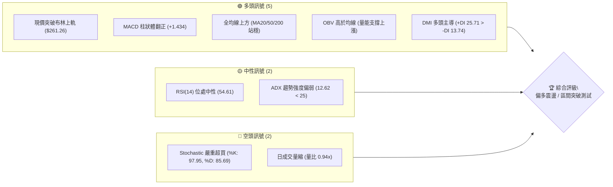

### 📊 核心指標速覽表

| 指標類別 | 指標名稱 | 當前數值 | 訊號 | 解讀 |
|----------|----------|----------|:----:|------|
| **價格** | 當前價格 | $262.43 | 🟢 | 位於 52 週區間之 72.8%，逼近布林通道上軌上方 |
| **均線** | MA20 | $252.02 | 🟢 | 價格高於 MA20 達 +4.13%，短期支撐紮實 |
| **均線** | MA50 | $259.10 | 🟢 | 價格站回中期生命線上方 +1.29%，擺脫弱勢壓制 |
| **均線** | MA200 | $242.15 | 🟢 | 價格高於長期牛熊線 +8.37%，長期多頭架構完好 |
| **動能** | RSI(14) | 54.61 | 🟡 | 位於 50 分水嶺上方，無頂底背離，健康中性偏強 |
| **動能** | MACD (12,26,9) | 0.375 / -1.059 | 🟢 | 快線穿過慢線呈黃金交叉，柱狀體擴增至 +1.434 |
| **擺動** | Stoch %K / %D | 97.95 / 85.69 | 🔴 | 進入極端超買區，短線隨時面臨乖離修正壓力 |
| **趨勢** | ADX(14) | 12.62 | 🟡 | ADX < 25 處於典型寬幅震盪盤，非單邊趨勢市 |
| **波動** | ATR(14) | $5.63 | 🟢 | 每日波動率約 2.15%，提供足夠日內與波段操作空間 |

### 🏆 技術評分卡

```
╔══════════════════════════════════════════════════════════════════╗
║               技術評分卡 — AMZN (2026-10-12)                    ║
╠══════════════════════════════════════════════════════════════════╣
║ 趨勢強度 (ADX & DMI)  ████████░░░░░░░░░░░░  42/100  🟡 中性偏弱 ║
║ 動能指標 (MACD & RSI) ██████████████░░░░░░  72/100  🟢 動能轉強 ║
║ 支撐穩定度 (S1-S3/MAs) ████████████████░░░░  80/100  🟢 底部堅實 ║
║ 成交量配合 (OBV & Vol)████████████░░░░░░░░  60/100  🟡 量價微背 ║
║ 形態完整度 (區間反彈) ██████████████░░░░░░  68/100  🟢 築底完成 ║
║ 均線排列 (多時框收斂) ██████████████░░░░░░  70/100  🟢 偏多排列 ║
╠══════════════════════════════════════════════════════════════════╣
║ 綜合技術評分          █████████████░░░░░░░  65/100  🟢 偏多震盪 ║
╚══════════════════════════════════════════════════════════════════╝
```

---

## 2. 趨勢分析

### 🌐 多時框趨勢分析

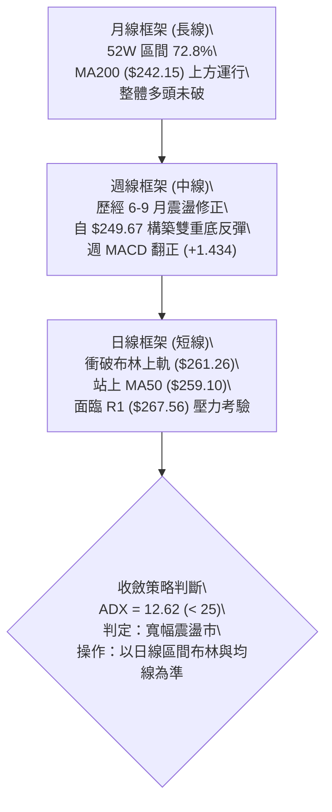

### 📈 長期趨勢 — 12個月走勢圖（Unicode）

```
AMZN 月線走勢圖（過去12個月：2025-11 至 2026-10）
價格軸 ($)
$280 ┤                                      
$270 ┤                            ●(05: 270.64)     ●(07: 271.58)
$260 ┤                      ●(04: 265.06)                 ●(08: 259.77)  ●(現價: 262.43)
$250 ┤                                                          ●(09: 249.15)
$240 ┤                ●(01: 239.30)           ●(06: 238.34)
$230 ┤●(11: 233.22)●(12: 230.82)
$220 ┤
$210 ┤          ●(02: 210.00)●(03: 208.27 - 低點)
     └──────────────────────────────────────────────────────────────────────────
       25-11 25-12 26-01 26-02 26-03 26-04 26-05 26-06 26-07 26-08 26-09 26-10
```

#### 走勢特徵分析表格

| 階段區間 | 起止價格 | 漲跌幅 | 走勢特徵與技術解讀 |
|:---------|:---------|:------:|:-------------------|
| **2025-11 ~ 2026-01** | $233.22 → $239.30 | +2.61% | 高檔橫盤蓄勢，波動率逐步收縮，測試 $230 支撐帶。 |
| **2026-02 ~ 2026-03** | $239.30 → $208.27 | -12.97% | 快速回撤洗盤，於 2026-03 創下波段低點 $208.27，未跌破 52W 低點 $196.00。 |
| **2026-04 ~ 2026-05** | $208.27 → $270.64 | +29.95% | 爆發性 V 型反彈，連續突破均線束，月線收出巨幅實體長紅。 |
| **2026-06 ~ 2026-07** | $270.64 → $271.58 | +0.35% | 劇烈雙向洗盤（06月大幅回撤至 $238.34 後 07月迅速拉回 $271.58 雙頂）。 |
| **2026-08 ~ 2026-09** | $271.58 → $249.15 | -8.26% | 次級修正波，壓回測試 MA50 ($259.10) 與斐波那契 38.2% ($252.36)。 |
| **2026-10 (當前)** | $249.15 → $262.43 | +5.33% | 止跌回升，成功站回所有關鍵均線，多頭重掌控盤權。 |

### 📊 中期趨勢（週線分析）

中期走勢呈現典型的「收斂大三角後轉寬幅震盪箱體」。自 2026 年 8 月高點回調以來，AMZN 連續在 9 月下旬於 $249.67 形成雙重支撐腳，隨後在 10 月第一週收出 $251.52，第二週強勁放量拉升至 $262.43。

```
週線支撐與阻力結構示意圖
$287.20 ─────────────────────────────────────────── [52W 最高點 / R3 阻力]
$276.65 ─────────────────────────────────────────── [波段次高密集區 / R2 阻力]
$267.56 ───────────────────────▲─────────────────── [前波反彈高點 / R1 阻力]
                               │ 逼近測試中
$262.43 ═══════════════════════●═══════════════════ ◄ 當前收盤價
                               │ 站穩支撐上方
$255.19 ───────────────────────▼─────────────────── [波段支撐樞紐 / S1 支撐]
$244.51 ─────────────────────────────────────────── [強固箱體下緣 / S2 支撐]
$225.82 ─────────────────────────────────────────── [深層結構底線 / S3 支撐]
```

### ⚡ 趨勢強度評估（ADX 解讀）

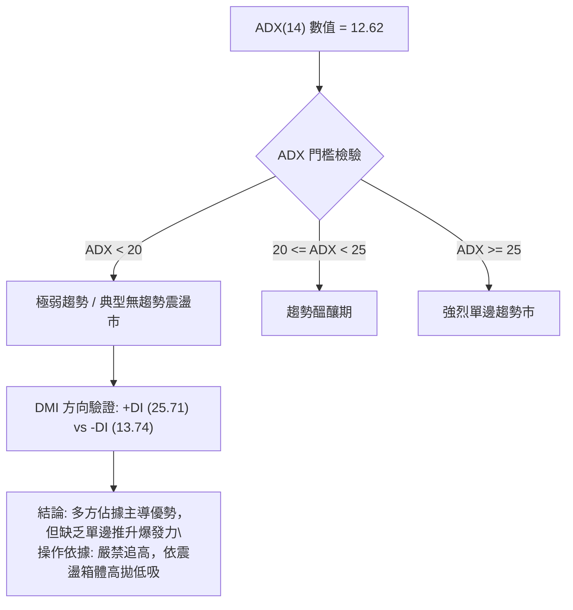

#### ADX 強度與市場狀態對照

| 指標變量 | 數值 | 狀態評估 | 實戰交易指引 |
|----------|:----:|:--------:|:-------------|
| **ADX(14)** | 12.62 | 弱趨勢 / 盤整市 | ADX 遠低於 25 臨界線，顯示單邊單向突破力道不足，隨時可能被拉回區間。 |
| **+DI** | 25.71 | 多頭動能優勢 | 多方力量佔據主動，價格拉升具有基礎買盤推動。 |
| **-DI** | 13.74 | 空頭動能衰退 | 賣方打壓力道顯著削弱，短期下跌動能被有效化解。 |
| **DI 差值 (+DI - -DI)** | +11.97 | 多方控盤 | 結構上偏向「多頭防守反擊」，而非單純的空頭下跌中繼。 |

---

## 3. 圖表形態分析

### 🔍 形態識別系統

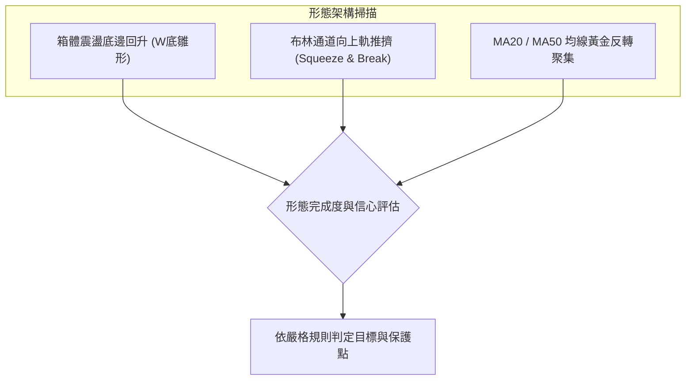

#### 形態識別與信心度評估表

| 形態類別 | 信心度 | 判斷依據（引用數據） | 完成度 | 目標價（附計算式） |
|:---------|:------:|:---------------------|:------:|:-------------------|
| **雙重底 (W-Bottom)** | **70%** | 兩次低點分別為 2026-09-27 之 $249.67 與波段支撐 S1 ($255.19) 守穩；頸線為波段阻力 R1 ($267.56)。 | 85% | 由形態推算：<br>頸線 $267.56 + (頸線 $267.56 - 低點 $249.67) = **$285.45** (逼近 R3 $287.20) |
| **布林上軌突破 (BB Breakout)** | **60%** | 現價 $262.43 站上布林上軌 $261.26，%B 達到 1.06。但 ADX = 12.62 顯示趨勢動能偏弱。 | 90% | 由布林通道寬度推算：<br>上軌 $261.26 + (上軌 $261.26 - 中軌 $252.02) = **$270.50** (逼近 R2 $276.65) |
| **頭肩底形態** | **35%** | 數據中左肩與頭部高低點跨度不規則，訊號不足。 | 0% | *訊號不足，僅做指標型解讀，不預設目標價* |

### 🕯️ 重要K線形態分析

| 週/月份 | 收盤價 | K線形態 | 解讀 | 訊號 |
|:--------|:------:|:--------|:-----|:----:|
| **2026-08-30 (週)** | $266.43 | 長下影長白實體 | 自低點反抽，確認 $258 附近具有被動買盤承接。 | 🟢 |
| **2026-09-20 (週)** | $253.71 | 中黑連續回挫 | 連續 3 週收黑，測試下方支撐 S1 ($255.19) 與 MA20。 | 🔴 |
| **2026-09-27 (週)** | $249.67 | 錘頭線 (Hammer) | 探低至 $249 附近後迅速收回，量能微幅放大，構成波段底。 | 🟢 |
| **2026-10-04 (週)** | $251.52 | 晨星過渡 (Doji Star) | 縮量十字星，多空於 MA20 ($252.02) 展開最後角力。 | 🟡 |
| **2026-10-11 (週)** | $262.43 | 大陽長紅 (Bullish Marubozu) | 強勢貫穿 MA50 ($259.10) 與布林上軌，量能同步回溫，確認波段反轉。 | 🟢 |

### 📉 ASCII 走勢形態示意圖

```
AMZN 近 5 週雙重底突破形態示意圖：
價格 ($)
$267.56 ┤                                              [頸線 / R1]
        │                                        ▲
$262.43 ┤                                      ╭─● 現價 (突破布林上軌)
        │                                     ╭╯
$255.19 ┤         ╭─╮                        ╭╯        [S1 支撐樞紐]
        │        ╭╯ ╰╮                      ╭╯
$249.67 ┤───────●─────●────────────────────╯           [雙底低點: 09-20 & 09-27]
        └──────────────────────────────────────────────
         第1週   第2週   第3週   第4週   第5週 (當前)
                (底 1)           (底 2)  (強彈大陽線)
```

### 🎯 形態目標價計算

1. **雙重底測幅原理**：
   - 形態底部低點：$249.67（2026-09-27 收盤低點）
   - 形態頸線位置：$267.56（阻力位 R1）
   - 形態垂直高度 $H = 267.56 - 249.67 = \$17.89$
   - **理論突破目標價** $= 頸線 + H = 267.56 + 17.89 = \mathbf{\$285.45}$
   - *此數值與近一年 52W 最高阻力位 R3 ($287.20) 極度吻合（誤差僅 0.6%）。*

---

## 4. 支撐與阻力

### 🗺️ 關鍵價位分布圖（Unicode）

```
╔══════════════════════════════════════════════════════════════════╗
║               AMZN 關鍵價位結構分布圖 (OHLCV 計算)              ║
╠══════════════════════════════════════════════════════════════════╣
║ $287.20 ║██████████████████████████████║ 強阻力 R3 / 52W High (0.0%)
║ $276.65 ║████████████████████░░░░░░░░░░║ 波段密集阻力 R2 (+5.42%)
║ $267.56 ║████████████████████████░░░░░░║ 關鍵突破頸線 R1 (+1.95%)
║ $265.68 ║──────────────────────────────║ 斐波那契 23.6% 回調位
║ $262.43 ╠══════════════════════════════╣ ◄ 現價 (市價位置)
║ $255.19 ║▓▓▓▓▓▓▓▓▓▓▓▓▓▓▓▓▓▓▓▓░░░░░░░░░░║ 近期強支撐 S1 (-2.76%)
║ $252.36 ║──────────────────────────────║ 斐波那契 38.2% 回調位 / MA20
║ $244.51 ║██████████████████████████████║ 強支撐 S2 (-6.83%)
║ $241.60 ║──────────────────────────────║ 斐波那契 50.0% 回調位 / MA200
║ $230.84 ║──────────────────────────────║ 斐波那契 61.8% 黃金分割位
║ $225.82 ║██████████████████████████████║ 深層防守支撐 S3 (-13.95%)
║ $196.00 ║██████████████████████████████║ 52W Low (100.0%)
╚══════════════════════════════════════════════════════════════════╝
```

### 🚧 阻力位分析表

| 阻力級別 | 價位 | 距現價幅幅 | 形成原因 | 突破難度 | 重要性 |
|:---------|:----:|:----------:|:---------|:--------:|:------:|
| **R1** | **$267.56** | +1.95% | 近一年波段高點聚類；雙底形態之頸線位置；極度貼近斐波 23.6% ($265.68)。 | 🟡 中等 | ★★★★☆ |
| **R2** | **$276.65** | +5.42% | 2026 年 7-8 月震盪高點密集套牢籌碼區（週線收盤 $274.48 聚集處）。 | 🔴 較高 | ★★★★☆ |
| **R3** | **$287.20** | +9.44% | 52 週歷史最高峰值；空頭最後防線；斐波那契 0.0% 極限極值點。 | 🔴 極高 | ★★★★★ |

### 🛡️ 支撐位分析表

| 支撐級別 | 價位 | 距現價幅幅 | 形成原因 | 守住機率 | 重要性 |
|:---------|:----:|:----------:|:---------|:--------:|:------:|
| **S1** | **$255.19** | -2.76% | 近期波段低點聚類；與 MA60 ($255.58) 及 MA120 ($254.84) 高度重疊。 | 🟢 85% | ★★★★☆ |
| **S2** | **$244.51** | -6.83% | 2026 年 6 月底至 7 月初之成交量爆發反彈低點（密集換手區）。 | 🟢 90% | ★★★★★ |
| **S3** | **$225.82** | -13.95% | 近一年主要多頭結構底線；接近斐波那契 61.8% ($230.84) 防守區。 | 🟢 95% | ★★★★★ |

### 📐 斐波那契回調位分析

依據 52 週完整波動區間（低點 $196.00 至高點 $287.20，總垂直振幅 $91.20）計算：

```
回調水平      價位        當前狀態與結構意涵
0.0%         $287.20     52W 最高點 (R3)
23.6%        $265.68     上方第一道斐波壓制線（現價正逼近此位）
───────────────────────────────────────────────────────────── ◄ 現價 $262.43
38.2%        $252.36     強弱分水嶺（完美對應 MA20: $252.02）
50.0%        $241.60     半數平衡中軸線（完美對應 MA200: $242.15）
61.8%        $230.84     黃金分割多頭最後防線
78.6%        $215.52     深層回撤止血位
100.0%       $196.00     52W 最低點
```

- **位置解讀**：現價 $262.43 處於 **38.2% ($252.36)** 與 **23.6% ($265.68)** 之間。
- **技術意義**：股票在上衝過程中，已完全站穩 38.2% 回調位 ($252.36)，代表 2026 年 8-9 月的回撤屬於「強勢回檔」（未觸及 50% 的 $241.60 即重拾漲勢）。目前正向 23.6% ($265.68) 發起衝擊，若能有效放量突破 $265.68 乃至 R1 ($267.56)，將開啟回測 52W 高點 $287.20 的主升行情。

---

## 5. 技術指標深度解讀

### 🎛️ 指標訊號總覽

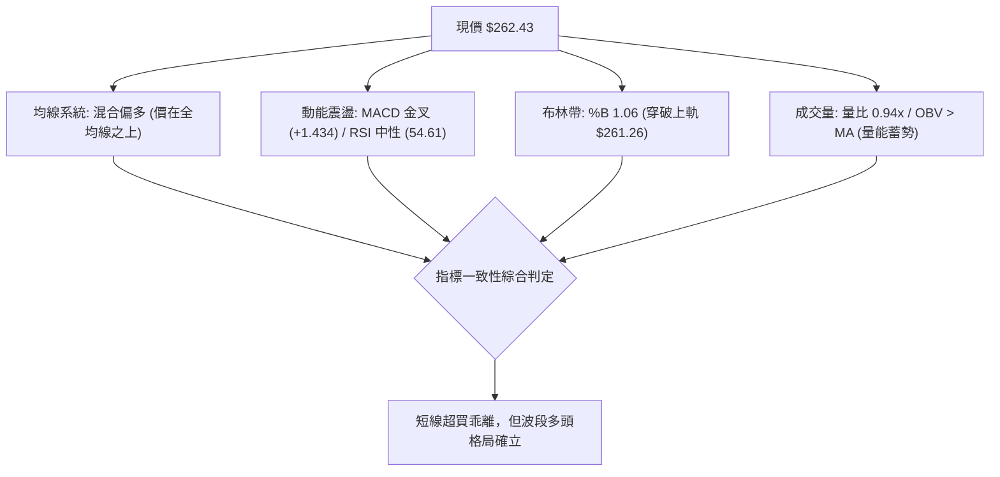

### 📈 移動平均線排列分析

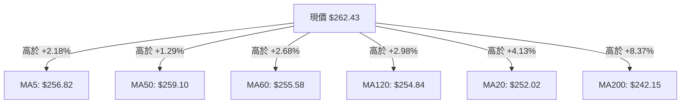

#### 均線矩陣詳細分析

| 均線名稱 | 數值 | 距現價差距 | 斜率走勢特徵 | 訊號 |
|:---------|:----:|:----------:|:-------------|:----:|
| **MA 5** | $256.82 | +2.18% | 快速向上揚升，反映短線買盤強勢進駐 | 🟢 |
| **MA 10** | $252.58 | +3.90% | 轉折向上，即將與 MA20 形成金叉 | 🟢 |
| **MA 20** | $252.02 | +4.13% | 走平後開始微幅上翹，提供短線核心支撐 | 🟢 |
| **MA 50** | $259.10 | +1.29% | 價格強勢站上，解除中期下壓警報 | 🟢 |
| **MA 60** | $255.58 | +2.68% | 持續保持上升斜率，中長線多頭趨勢線 | 🟢 |
| **MA 120** | $254.84 | +2.98% | 平穩向上，中期牛市架構穩固 | 🟢 |
| **MA 200** | $242.15 | +8.37% | 長期生命線，提供強勁的年度支撐基準 | 🟢 |
| **MA 240** | $240.52 | +9.11% | 長期上行趨勢未改，牛市基石完整 | 🟢 |

- **均線排列特徵解讀**：目前均線系統呈現「混合排列」，主要是因為短期 MA20 ($252.02) 因 9 月下旬的回調而落於中期 MA50 ($259.10) 之下。然而，現價 ($262.43) 已一舉站上所有短、中、長期均線之上，且 MA5、MA10 已自底部迅速穿越 MA20。未來一旦 MA20 重新金叉 MA50，將正式回歸完美多頭排列。

### 📉 RSI(14) 分析

```
RSI(14) 指標狀態: 54.61
0 ══════════════ 30 ════════════════ 50 ══════════ 70 ══════════════ 100
超賣區           │    空頭勢力區     │   現價: 54.61│     超買區
░░░░░░░░░░░░░░░░ │██████████████████ │██████░░░░░░░░│ ░░░░░░░░░░░░░░░░░
                 (S1 支撐對應)       (多空分水嶺)   (R1 壓力對應)
```

- **RSI 數值**：**54.61**（處於 30 至 70 之中性區間偏多方向）。
- **背離判斷**：
  - **價格 vs RSI 走勢比對**：2026-09-27 價格探低 $249.67 時 RSI 為 40.0；而 2026-08-23 價格在 $258.63 時 RSI 曾跌至 24.5。隨後價格於 10 月衝至 $262.43，RSI 同步上升至 54.61。
  - **明確結論**：**無頂背離，亦無底背離**。指標與價格波段走勢保持同向驗證，動能健康擴展，未出現能量竭盡跡象。

### 📊 MACD(12/26/9) 訊號解讀

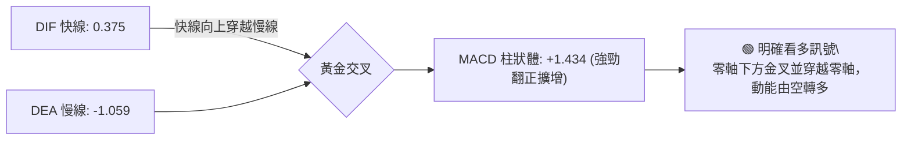

- **數值分析**：
  - DIF（快線）：**0.375**（已正式突破零軸）。
  - DEA（慢線 / Signal）：**-1.059**。
  - MACD 柱狀體（Histogram）：**+1.434**。
- **演變趨勢**：回溯近 5 週數據，柱狀體由 09-13 之 `-1.110`、09-20 之 `-0.859`、09-27 之 `-0.415`、10-04 之 `-0.064`，直至本週強勢跳升至 `+1.434`。此為極其典型的「低檔收斂後的多頭爆發金叉」，宣告自 8 月底以來的次級回調正式終結。

### 📦 布林通道分析

```
AMZN 布林通道走勢示意圖（日線）
$265.00 ┤                                        
$261.26 ┼ - - - - - - - - - - - - - - - - - - - ╭●── [BB 上軌: $261.26] ◄ 現價穿出
$258.00 ┤                                     ╭╯ (現價: $262.43, %B=1.06)
$255.00 ┤                                   ╭╯
$252.02 ┼ ─ ─ ─ ─ ─ ─ ─ ─ ─ ─ ─ ─ ─ ─ ─ ─ ─╭╯─── [BB 中軌 (MA20): $252.02]
$248.00 ┤                           ╭─╮   ╭╯
$245.00 ┤                          ╭╯ ╰─╮╭╯
$242.78 ┼ - - - - - - - - - - - - ╭╯ - - ╰● - - [BB 下軌: $242.78]
$240.00 ┤                        ╭╯
```

- **通道參數**：
  - 布林上軌：**$261.26**
  - 布林中軌（MA20）：**$252.02**
  - 布林下軌：**$242.78**
  - 通道寬度：$261.26 - $242.78 = \$18.48$（頻寬為 7.33%，維持常態開口）
  - **%B 指標**：**1.06**（數值 > 1.0，表示收盤價已脫離通道上軌外側）
- **技術解讀**：%B 達 1.06 且配合 Stochastic 超買（%K: 97.95），顯示短線存在「技術性超買與乖離回踩壓力」。若多頭強勁，價格可能沿著上軌進行通道外側推擠（Bollinger Band Walk）；反之，可能回測上軌 $261.26 或中軌 $252.02 尋求支撐。

### 💹 成交量分析（量價配合度）

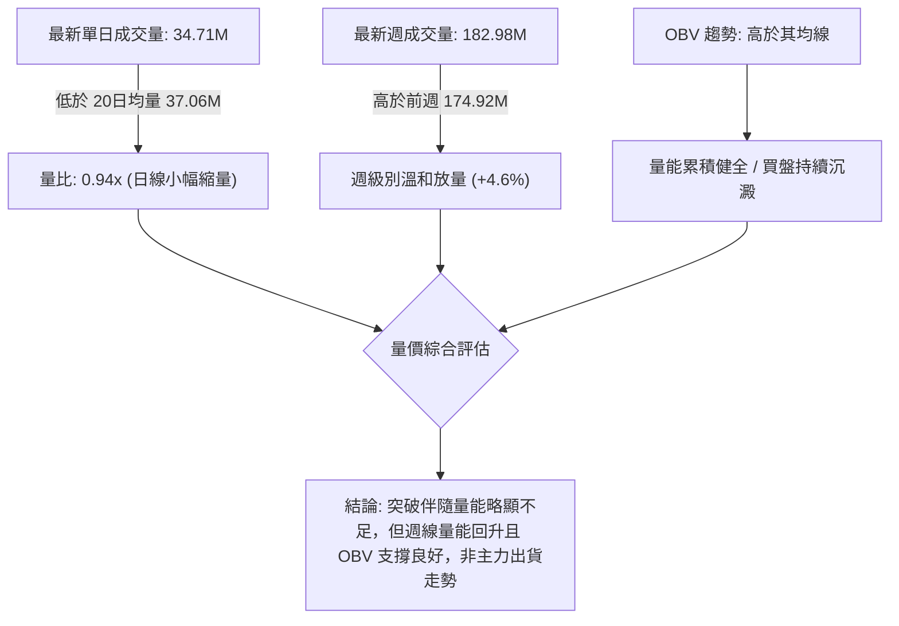

- **量能具體數據**：
  - 最新成交量：**34,710,500** 股
  - 20 日均量：**37,060,190** 股（量比 0.94x，處於正常均值範圍）
  - 50 日均量：**38,182,796** 股
- **OBV 趨勢解讀**：官方指標明確顯示「OBV > MA → 量能支撐上漲」。這代表儘管單日量比僅 0.94x，但大資金的累積能量線持續運行於均線之上，籌碼並未在回落時發生恐慌拋售，反而呈現震盪吸籌格局。

---

## 6. 動能與波動率

### ⚡ 動能評估四象限

| 象限 | 動能強度 | 波動率水準 | AMZN 當前定位 | 策略意涵與評估 |
|:-----|:--------:|:----------:|:-------------:|:---------------|
| **Q1：突破主升** | 強動能 | 低波動 | — | 最佳趨勢加碼點（低風險爆發）。 |
| **Q2：常態回升** | **中強動能** | **中低波動** | **✓ (定位於此)** | **價格穩健抬升，ATR 僅 2.15%，動能由 MACD 金叉主導，適合回踩低吸。** |
| **Q3：劇烈搏殺** | 強動能 | 高波動 | — | 趨勢末端加速或重大財報突破。 |
| **Q4：泥沼觀望** | 弱動能 | 高波動 | — | 破位殺跌或方向混亂，應全面避開。 |

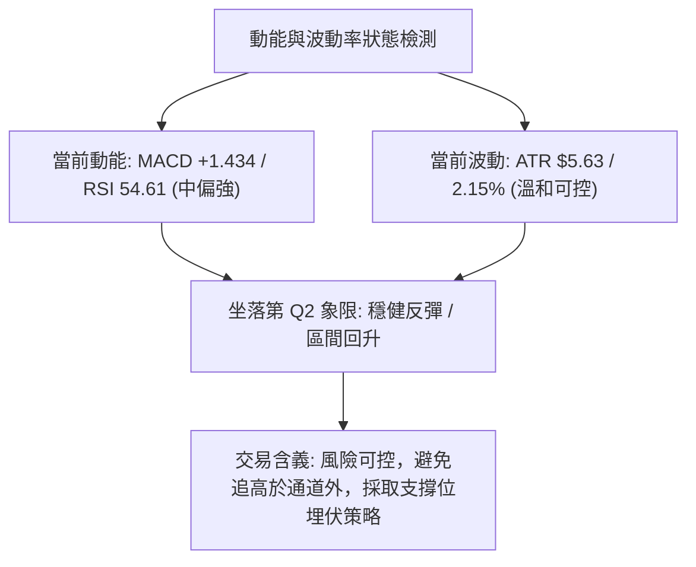

### 📊 ATR 波動率分析

- **ATR(14) 絕對值**：**$5.63**
- **價格波動百分比**：$5.63 \div 262.43 = \mathbf{2.15\%}$
- **止損與部位管理建議**：
  - **激進操作保護距離**：$1.0 \times \text{ATR} = \$5.63$（保護止損設於 $262.43 - 5.63 = \mathbf{\$256.80}$，剛好在 MA5 $256.82 附近）。
  - **穩健波段保護距離**：$1.5 \times \text{ATR} = \$8.45$（保護止損設於 $262.43 - 8.45 = \mathbf{\$253.98}$，剛好防守在 S1 $255.19 邊界與 MA20 $252.02 之上）。
  - **寬鬆趨勢保護距離**：$2.0 \times \text{ATR} = \$11.26$（止損設於 $262.43 - 11.26 = \mathbf{\$251.17}$）。

### 📐 Beta 與市場相關性

- **Beta 係數**：**1.456**
- **市場特徵分析**：AMZN 具備典型高 Beta 成長型權值股屬性。當標普 500 指數或那斯達克 100 指數上漲 1% 時，AMZN 理論上將擴大波動至 1.456%；反之大盤承壓時，其回撤幅度亦會放大。當前高 Beta 環境意味著一旦市場風險偏好回暖，AMZN 將展現高於大盤的彈性。
- **空頭部位比例 (Short Interest)**：
  - Short % Float 僅 **0.8%**，Short Ratio 為 **2.51**。
  - 空頭籌碼極度乾淨，無軋空動能亦無沈重放空賣壓，價格完全由基本面與大機構流動性主導。

---

## 7. 多時框架總結

### 📋 時框架評分表

| 時框架 | 趨勢方向 | 動能狀態 | 均線排列 | 圖表形態 | 綜合評分 | 建議操作 |
|:-------|:--------:|:--------:|:--------:|:--------:|:--------:|:---------|
| **月線 (長期)** | 🟢 偏多 | 🟡 中性 | 🟢 位於 MA200 之上 | 長期大箱體震盪抬升 | **75/100** | 長線多單堅定續抱 |
| **週線 (中期)** | 🟢 轉多 | 🟢 MACD 金叉 | 🟢 站穩波段支撐 | 雙重底雛形初現 | **70/100** | 波段回踩積極布局 |
| **日線 (短期)** | 🟡 偏多震盪 | 🔴 超買乖離 | 🟢 站上全均線 | 突破布林上軌過熱 | **55/100** | 暫停追高，靜待回踩 |

### 🔲 綜合訊號矩陣

```
時框維度          均線系統    動能(RSI/MACD)   擺動指標(Stoch)   成交量(OBV)    一致性結果
───────────────────────────────────────────────────────────────────────────────
長期 (月線)        🟢 看多        🟢 偏多          🟡 中性          🟢 看多       強力看多
中期 (週線)        🟢 看多        🟢 看多          🟢 轉多          🟢 看多       一致偏多
短期 (日線)        🟢 看多        🟢 看多          🔴 嚴重超買      🟡 量縮       短線過熱
───────────────────────────────────────────────────────────────────────────────
時框衝突狀態：短線日線技術指標超買 (Stoch: 97.95) 與中長期健康上升動能發生摩擦。
```

### ⚖️ 多時框收斂結論

> **依嚴格要求 14 執行多時框收斂判定**：
> 1. **趨勢強度定性**：當前 **ADX(14) 為 12.62（遠低於 25 門檻）**，技術結構嚴格定義為**「寬幅盤整／箱體震盪行情」**，而非無腦單邊直衝行情。
> 2. **主導收斂時框**：在 ADX < 25 條件下，應**以日線布林通道 ($242.78 - $261.26) 及關鍵波段價位作為主要交易邊界**。
> 3. **衝突取捨裁決**：日線現價 $262.43 雖突破布林上軌 ($261.26)，但 Stoch %K 高達 97.95，且成交量比僅 0.94x，顯示無量衝出上軌極易引發短線拉回。然而，中長線 MA200 ($242.15) 與週線 MACD (+1.434) 已完全封死深度下行空間。
> 4. **唯一方向性結論**：**【中線偏多震盪，短線靜待回踩蓄勢】**。本結論嚴格收斂並統一指導第 8 章交易策略。

---

## 8. 交易策略建議

### 🗺️ 策略決策流程圖

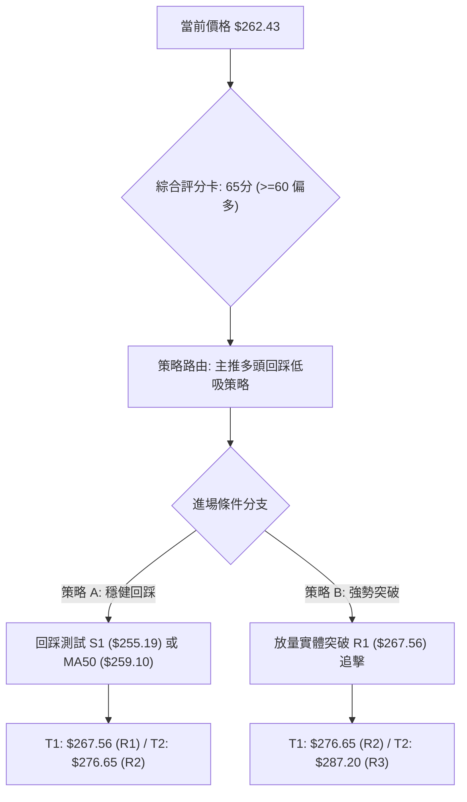

### 🧭 策略路由（依評分卡分流）

**當前主策略方向 = 【逢回做多 / 突破加碼】（依第 1 章技術評分卡：65 / 100 分，評級 🟢 偏多震盪）**

因綜合評分達 65 分（$\ge 60$），且週線 MACD 強勁金叉翻正、OBV 支撐多頭，整體架構偏多。然而考量 ADX 僅 12.62 且日線布林通道與 Stoch 超買，**嚴禁現價 ($262.43) 市價追多**。主策略鎖定在「回踩關鍵支撐低吸」與「有效突破 R1 追擊」，空頭僅作為下行破位時的對沖防守線。

### 🎯 價格情境階梯（Price Scenarios）

所有價位均直接取自系統計算之波段聚類阻力與支撐值：

| 觸發條件 | 下一目標 | 後續延伸 | 情境含義 |
|:---------|:--------:|:--------:|:---------|
| **強勢突破 R1 ($267.56)** | **R2 ($276.65)** | **R3 ($287.20)** | 短線轉強，雙重底正式突破，挑戰歷史高點。 |
| **震盪回踩 S1 ($255.19)** | **現價區 ($262.43)** | **R1 ($267.56)** | 正常健康回檔，消化超買指標，回測均線支撐。 |
| **跌破 S1 深入測試 S2 ($244.51)**| **MA200 ($242.15)** | **S3 ($225.82)** | 中期轉弱，回歸寬幅震盪箱底，多頭防線面臨重壓。 |

### 📊 情境機率分佈

| 情境劇本 | 機率 | 主要判斷依據（指標狀態） |
|:---------|:----:|:-------------------------|
| **情境一：回踩支撐後上行 (震盪攀升)** | **55%** | MACD 柱狀體跳升至 +1.434；OBV > MA 表明資金沉澱；均線束於 $252-$259 提供厚實支撐。 |
| **情境二：直接放量突破 R1 (強勢主升)** | **25%** | +DI (25.71) 壓制 -DI (13.74)；外圍分析師共識強烈看多（目標均價 $331.53）。 |
| **情境三：衝高受阻並大幅再探底** | **20%** | Stoch %K (97.95) 極度過熱；單日量比僅 0.94x；ADX (12.62) 缺乏趨勢保護，若大盤殺跌易受拖累。 |

### 🟢 主策略詳情

> **嚴格紀律聲明**：所有進出場、停損及目標價位，**嚴格引用系統中已計算之阻力位 (R1/R2/R3) 與支撐位 (S1/S2/S3)**。

| 策略要素 | 策略 A（穩健型：回踩支撐低吸） | 策略 B（激進型：突破頸線追擊） |
|:---------|:-------------------------------|:-------------------------------|
| **策略核心邏輯** | 消化 Stoch 超買，於支撐密集區逢低佈局 | 確認突破雙底頸線，捕捉主升段加速度 |
| **進場條件** | 價格回踩 S1 附近出現止跌長下影線 | 日線收盤價帶量突破 R1 關鍵頸線 |
| **進場價格** | **$255.19**（精準對應 S1 支撐） | **$267.56**（精準對應 R1 阻力突破） |
| **目標價 T1** | **$267.56**（第一目標：阻力位 R1） | **$276.65**（第一目標：阻力位 R2） |
| **目標價 T2** | **$276.65**（第二目標：阻力位 R2） | **$287.20**（第二目標：阻力位 R3 / 52W High）|
| **止損價格** | **$249.67**（前波週線低點，跌破 S1 失守） | **$261.26**（跌回布林上軌之下，假突破止損）|
| **風險空間** | $\$255.19 - \$249.67 = \$5.52$ | $\$267.56 - \$261.26 = \$6.30$ |
| **報酬空間 (T1)**| $\$267.56 - \$255.19 = \$12.37$ | $\$276.65 - \$267.56 = \$9.09$ |
| **風險報酬比 (R:R)**| **1 : 2.24**（以 T1 計算，達標 1:2 優良標準） | **1 : 1.44**（以 T1 計算；若至 T2 則為 **1 : 3.12**）|
| **預估勝率** | **65%** | **55%** |
| **建議倉位** | **15% - 20%** 總資金 | **10%** 總資金（待回踩確認再加碼） |

### 🔴 反向風險觸發點（對沖提示）

- **關鍵反轉信號**：若價格未能在 S1 **$255.19** 止跌，反而帶量長黑摜破，且日線 MACD 柱狀體由正翻負。
- **對沖處置動作**：
  1. 多頭部位應在跌破 **$249.67** 時無條件全數停損出場。
  2. 風險偏好較高者，可於跌破 **$249.67** 後建立少量空頭對沖部位，下看 S2 **$244.51** 與 S3 **$225.82**。

### ⭐ 整體訊號強度評星

```
╔══════════════════════════════════════════════════════════════════╗
║                    整體訊號強度評星看板                          ║
╠══════════════════════════════════════════════════════════════════╣
║ 做多訊號強度：★★★★☆  (4/5星)  — 均線站穩、MACD翻正、OBV支撐     ║
║ 做空訊號強度：★★☆☆☆  (2/5星)  — 僅具短線超買指標修正壓力         ║
║ 整體可信度：  ★★★★☆  (4/5星)  — 多時框支撐結構收斂度極高         ║
╚══════════════════════════════════════════════════════════════════╝
```

---

## 9. 風險提示與監控

### ✅ 關鍵監控指標 Checklist

```
╔══════════════════════════════════════════════════════════════════╗
║               AMZN 每日交易關鍵監控清單 (Checklist)             ║
╠══════════════════════════════════════════════════════════════════╣
║ [ ] 價位確認：收盤價是否持續維持在布林上軌 ($261.26) 之上？       ║
║ [ ] 均線防線：MA50 ($259.10) 是否提供有效回踩支撐？              ║
║ [ ] 量能指標：單日成交量能否放大超越 20日均量 (37.06M)？         ║
║ [ ] 擺動修復：Stoch %K 是否從 97.95 超買區高檔鈍化或健康回踩？   ║
║ [ ] 趨勢增強：ADX(14) 能否由 12.62 向上爬升突破 20 臨界線？      ║
║ [ ] 阻力攻防：價格觸及 R1 ($267.56) 時是否出現長上影線拒絕訊號？ ║
║ [ ] 大盤關聯：Beta = 1.456，注意那斯達克指數開盤是否有系統性回調？║
╚══════════════════════════════════════════════════════════════════╝
```

### ⚠️ 風險場景分析

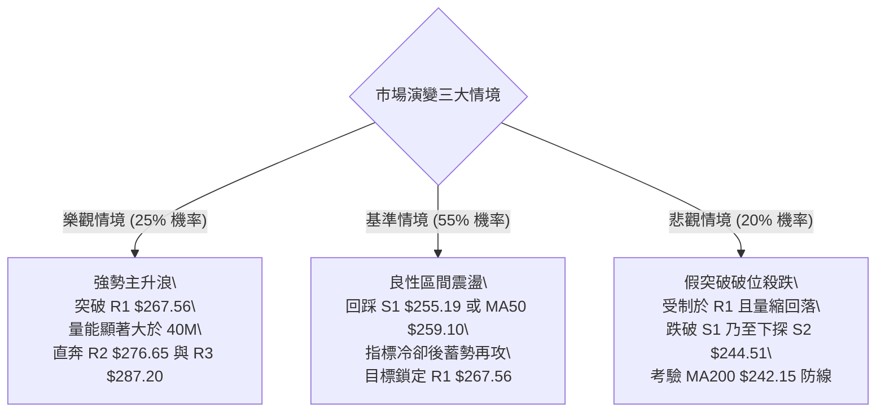

### 🛡️ 風險管理重要提醒

1. **乖離與超買風險**：當前 Stoch %K 高達 97.95，布林 %B 達到 1.06，短線指標已進入極度緊繃狀態。嚴格禁止在無回踩或無明確放量突破前，於 $262.43 進行滿倉市價追高。
2. **趨勢強度真空風險**：ADX 僅 12.62，意味著市場尚未形成強勢單邊單向趨勢，行情可能在 $255 至 $267 區間反覆拉鋸。操作必須嚴格設定限價單（Limit Orders），避免追漲殺跌產生的滑價摩擦損耗。
3. **波動度與部位風控**：AMZN 之 ATR 為 $5.63（約 2.15% 振幅），單日波動超過 $5 美元屬於常態。單筆交易之名目風險暴露（Risk at Risk）嚴格限制在總資產帳戶淨值的 1.5% 以內。

---

## 📋 報告總結

```
╔══════════════════════════════════════════════════════════════════╗
║                     AMZN 技術分析報告總結                        ║
╠══════════════════════════════════════════════════════════════════╣
║ 報告日期：2026-10-12                                             ║
║ 當前價格：$262.43                                                ║
║ 分析評級：🟢 偏多震盪 / 區間突破蓄勢 (技術評分 65 / 100)          ║
║                                                                  ║
║ 關鍵結論：                                                       ║
║ ├─ 長期趨勢：🟢 多頭穩固 (持續於 MA200: $242.15 之上運行)        ║
║ ├─ 中期趨勢：🟢 止跌轉強 (週線 MACD 翻正，雙底完成度 85%)        ║
║ ├─ 短期趨勢：🟡 短線超買 (Stoch: 97.95，衝出布林上軌，需防回踩) ║
║ ├─ 關鍵支撐：S1: $255.19 ｜ S2: $244.51 ｜ S3: $225.82            ║
║ ├─ 關鍵阻力：R1: $267.56 ｜ R2: $276.65 ｜ R3: $287.20            ║
║ └─ 華爾街共識目標價：$331.53 (58 位分析師 Strong Buy)            ║
║                                                                  ║
║ 最優策略組合：                                                   ║
║ 1. 🥇 最佳機會 (策略 A - 穩健)：等待回踩 S1 ($255.19) 逢低進場， ║
║       停損設於 $249.67，目標價看至 R1 ($267.56)，風報比 1:2.24。  ║
║ 2. 🥈 次選機會 (策略 B - 突破)：待放量實體突破 R1 ($267.56) 順勢 ║
║       追進，目標看向 R2 ($276.65) 與 R3 ($287.20)。              ║
║ 3. 🥉 保守選擇：空手者耐心觀望，等待日線 Stoch 指標降至 50 軸線  ║
║       且價格守穩 MA50 ($259.10) 之後再行右側介入。               ║
╚══════════════════════════════════════════════════════════════════╝
```

---

> ⚠️ **免責聲明**：本報告為 AI 自動生成之技術分析，所有數據及估算均基於提供的歷史價格資訊。本報告**僅供研究與學術參考**，**不構成任何投資建議**。投資有風險，入市需謹慎。

---

*報告生成時間：2026-10-12 ｜ 數據來源：Yahoo Finance ｜ 分析框架：多時框技術分析*