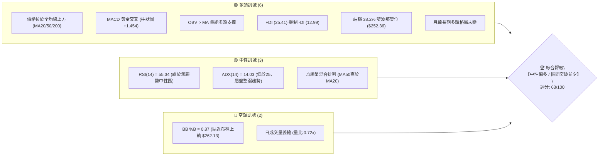
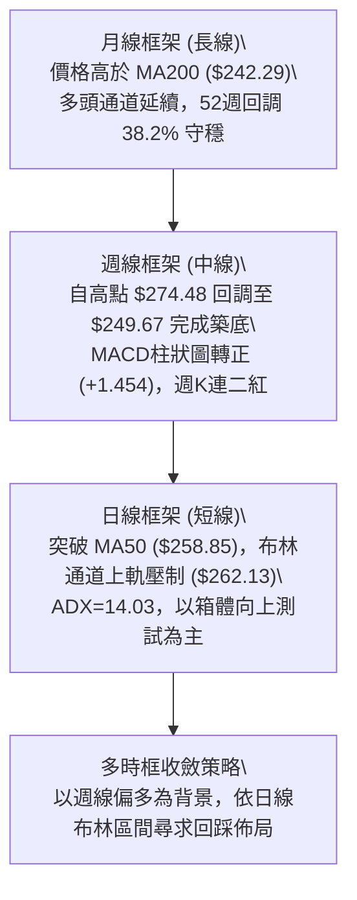
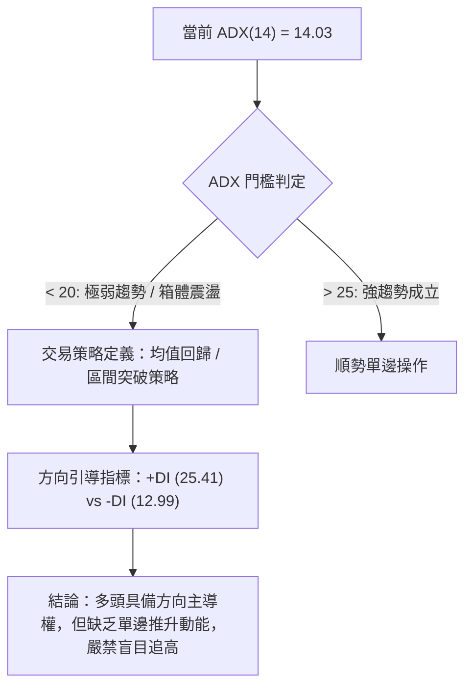
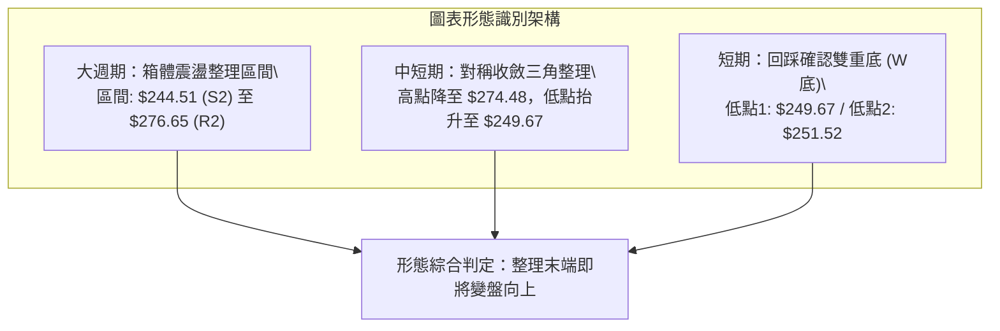
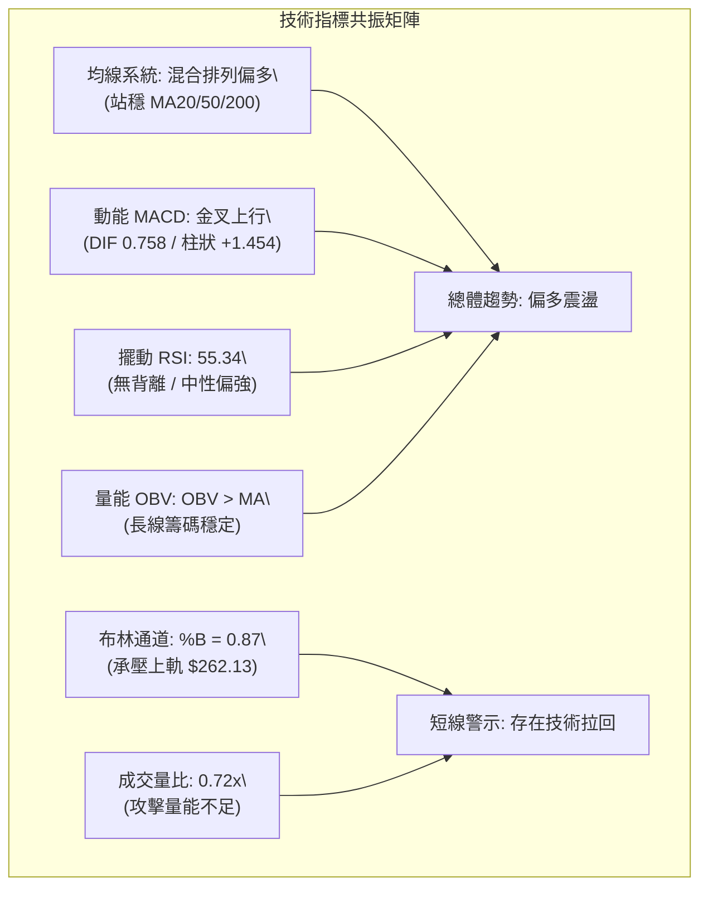
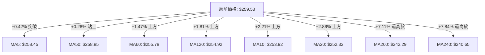
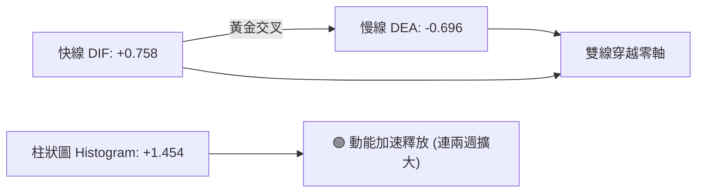
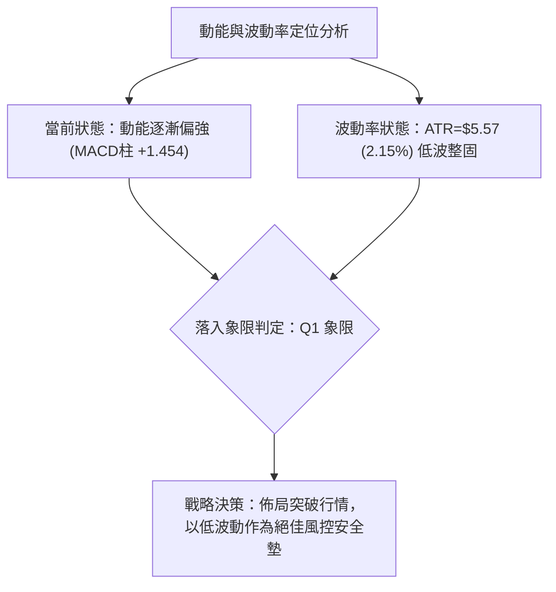
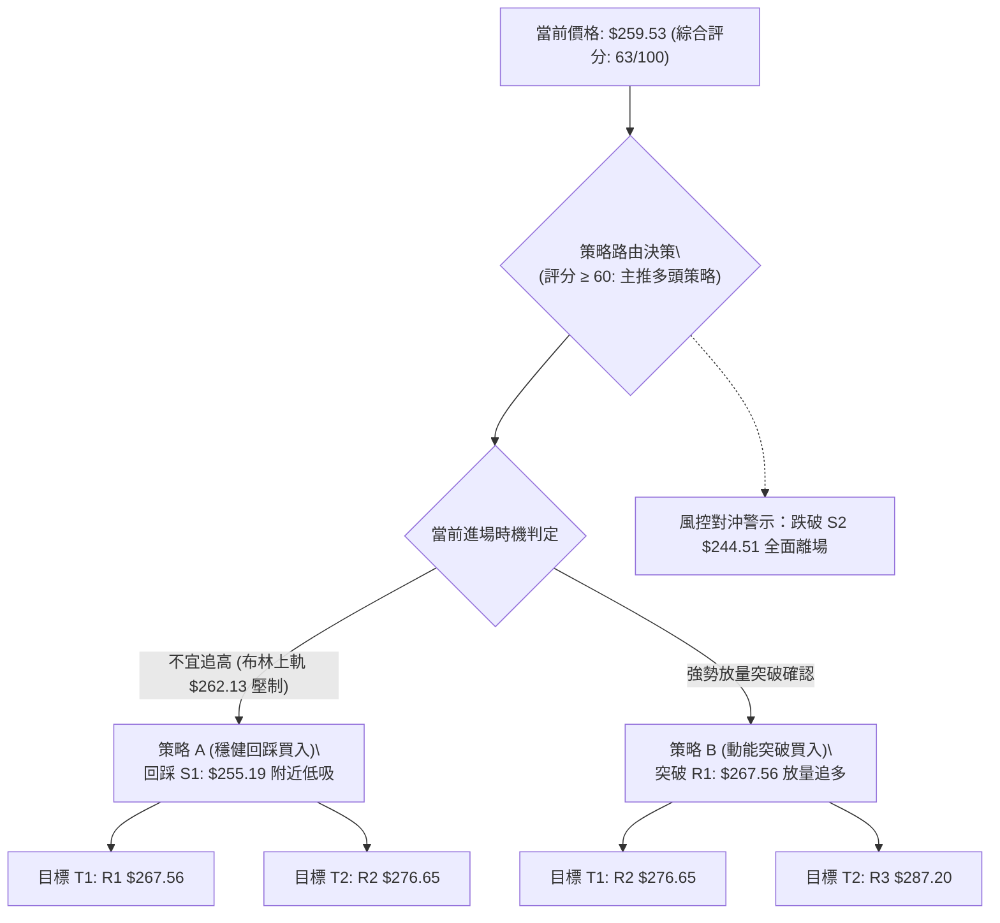
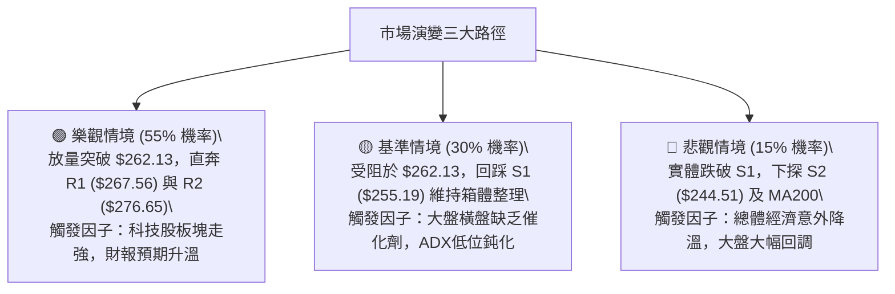

# AMZN 技術分析報告

> **報告日期**：2026-10-13 ｜ **語言**：繁體中文 ｜ **數據來源**：Yahoo Finance ｜ **當前價格**：$259.53

---

## 目錄

| 章節 | 內容 |
|------|------|
| [1. 技術面概覽](#1-技術面概覽) | 訊號儀表板、核心指標、評分卡 |
| [2. 趨勢分析](#2-趨勢分析) | 多時框趨勢、長中短期走勢、12個月月線走勢圖 |
| [3. 圖表形態分析](#3-圖表形態分析) | 形態識別與信心度、K線形態組合、目標價推算 |
| [4. 支撐與阻力](#4-支撐與阻力) | 關鍵價位分布圖、阻力/支撐分析、斐波那契回調 |
| [5. 技術指標深度解讀](#5-技術指標深度解讀) | 均線系統、RSI、MACD、布林通道、量價OBV |
| [6. 動能與波動率](#6-動能與波動率) | 動能四象限、ATR波幅、Beta市場相關性 |
| [7. 多時框架總結](#7-多時框架總結) | 時框架評分矩陣、多時框收斂方向結論 |
| [8. 交易策略建議](#8-交易策略建議) | 策略路由、價格情境階梯、主策略詳情、風控點 |
| [9. 風險提示與監控](#9-風險提示與監控) | 監控指標Checklist、風險場景、部位管理 |

---

## 1. 技術面概覽

### 🎯 技術訊號儀表板

Amazon.com, Inc. (AMZN) 當前收盤價為 **$259.53**。整體技術架構呈現「中長期均線多頭保護、短期盤整轉強、低波震盪醞釀突破」格局。



### 📊 核心指標速覽表

| 指標類別 | 指標名稱 | 當前數值 | 訊號 | 解讀 |
|----------|----------|----------|:----:|------|
| **價格** | 當前價格 | $259.53 | 🟢 | 位於52週區間 69.7% 分位，守住多數關鍵防線 |
| **短期均線**| MA20 | $252.32 | 🟢 | 價格在MA20上方 (+2.86%)，短線多頭掌控 |
| **中期均線**| MA50 | $258.85 | 🟢 | 價格突破MA50 (+0.26%)，中期轉強關鍵信號 |
| **長期均線**| MA200 | $242.29 | 🟢 | 價格大幅高於MA200 (+7.11%)，長多基石穩固 |
| **動能** | RSI(14) | 55.34 | 🟡 | 位於 50–60 健康中性區，無超買超賣，無背離 |
| **趨勢強度**| ADX(14) | 14.03 | 🟡 | 數值 < 25，顯示處於無明確方向的箱體整理期 |
| **方向動向**| +DI / -DI | 25.41 / 12.99 | 🟢 | 多頭力量佔優 (+DI > -DI)，具備向上突破潛力 |
| **指數平滑**| MACD (12,26,9)| DIF: 0.758 / DEA: -0.696 | 🟢 | 雙線金叉並翻上零軸，柱狀圖 (+1.454) 持續擴大 |
| **通道指標**| 布林通道 | 上軌 $262.13 / 中軌 $252.32 | 🟡 | %B = 0.87，逼近上軌阻力，面臨技術回踩或推軌 |
| **量能** | 20日成交量比| 0.72x (26.52M vs 36.67M) | 🔴 | 上攻量能不足，需觀察突破時是否放量補量 |
| **能量潮** | OBV 趨勢 | OBV > MA | 🟢 | 中長期籌碼結構良好，量能支撐價格偏多運行 |
| **波動** | ATR(14) | $5.57 (2.15%) | 🟡 | 波動率處於中低水位，籌碼沉澱完全 |

### 🏆 技術評分卡

```
╔══════════════════════════════════════════════════════════════╗
║              技術評分卡 — AMZN (2026-10-13)                  ║
╠══════════════════════════════════════════════════════════════╣
║ 趨勢強度      ██████░░░░░░░░░░░░░░  32/100  🟡 弱趨勢/低ADX  ║
║ 動能指標      ██████████████░░░░░░  70/100  🟢 MACD翻多/健康 ║
║ 支撐穩定度    ████████████████░░░░  80/100  🟢 密集支撐帶守固║
║ 成交量配合    ████████░░░░░░░░░░░░  42/100  🔴 上漲縮量需補量║
║ 形態完整度    ██████████████░░░░░░  72/100  🟢 箱體回踩確認  ║
║ 均線排列      ████████████████░░░░  80/100  🟢 站上所有主要MA║
╠══════════════════════════════════════════════════════════════╣
║ 綜合評分      ████████████░░░░░░░░  63/100  🟢 中性偏多 (買) ║
╚══════════════════════════════════════════════════════════════╝
```

---

## 2. 趨勢分析

### 🌐 多時框趨勢分析



### 📈 長期趨勢 — 12個月走勢圖（Unicode）

依據月度收盤價數據，AMZN 自 2025 年 11 月至 2026 年 10 月呈現高檔大箱體震盪上揚走勢。在 2026 年 3 月打出週期低點 $208.27 後，4 月強勢起跑，7 月見頂 $271.58，近期於 $250–$260 區間整固。

```
AMZN 月線走勢圖（過去12個月）
價格軸 ($)
$275 ┤                                  ●(07: 271.58)
$270 ┤                          ●(05: 270.64)
$265 ┤                  ●(04: 265.06)
$260 ┤                                      ●(08: 259.77)   ●(10: 259.53)←現價
$250 ┤                                              ●(09: 249.15)
$240 ┤          ●(01: 239.30)       ●(06: 238.34)
$230 ┤  ●(11)   ●(12: 230.82)
$220 ┤
$210 ┤      ●(02: 210.00)
$205 ┤          ●(03: 208.27)底
     └─────────────────────────────────────────────────────────────
       11   12   01   02   03   04   05   06   07   08   09   10  (月份)
     (2025)     (--------------- 2026 年度 ----------------)
```

**12個月走勢特徵分析表格**：

| 時間區間 | 起始價 → 結束價 | 漲跌幅 | 結構形態特徵 | 成交量與動能配合 |
|----------|-----------------|:------:|--------------|------------------|
| 2025-11 ~ 2026-01 | $233.22 → $239.30 | +2.61% | 高檔橫盤，上攻遇阻 | 成交量相對平衡，進入盤整期 |
| 2026-02 ~ 2026-03 | $239.30 → $208.27 | -12.97% | 快速回撤，探出年度次低點 | 恐慌性探底，打出紮實雙底結構基礎 |
| 2026-04 ~ 2026-05 | $208.27 → $270.64 | +29.95% | 主升浪爆發，連破均線反壓 | 多頭強力主導，月線大陽線推進 |
| 2026-06 | $270.64 → $238.34 | -11.93% | 獲利回吐，巨幅震盪洗盤 | 6月最後一週放量至 5.25億股換手 |
| 2026-07 ~ 2026-08 | $238.34 → $259.77 | +8.99% | 再次攻頂 $271.58 未果回落 | 7月底財報前後放量拉升後收窄 |
| 2026-09 ~ 2026-10 | $249.15 → $259.53 | +4.17% | 回踩支撐S1後溫和回升 | 週MACD翻紅，籌碼沉澱等待突破 |

### 📊 中期趨勢（週線分析）

從近 20 週數據觀察，AMZN 自 2026-08-09 創下收盤波段高點 $274.48 後，展開為期約 7 週的回調修復波段，於 2026-09-27 下探收盤價 $249.67。隨後兩週（10-04 收 $251.52、10-11 收 $262.43）走出強勁的週線底分型反彈，週線 MACD 柱狀圖自 -0.064 暴拉至 +1.434，並於最新一週持續維持在 +1.454。

```
週線支撐阻力結構示意：
      [高點壓制]  $274.48 / R2: $276.65
          ▲
          │      2026-08 衝高回落
          ▼
      [當前收盤]  $259.53 (突破MA50 $258.85，受阻於R1 $267.56)
          ▲
          │      2026-10 築底反彈 (+1.454 MACD柱)
          ▼
      [回踩低點]  $249.67 (守穩斐波那契 38.2% $252.36 與 S1 $255.19 緩衝區)
```

### ⚡ 趨勢強度評估（ADX 解讀）



**ADX 強度對照與市場狀態解讀表**：

| 指標名稱 | 當前數值 | 參考閾值 | 市場狀態評估 | 策略意涵 |
|----------|:--------:|:--------:|--------------|----------|
| **ADX(14)** | **14.03** | < 20 (極弱) | **無趨勢 / 典型箱體整理** | 趨勢跟蹤系統失效，回調支撐低吸優於破位追價 |
| **+DI** | **25.41** | > 20 (強) | **多方主控** | 盤面上漲推動力明顯強於空方推動 |
| **-DI** | **12.99** | < 15 (弱) | **空方動能衰竭** | 空方無力發動連續性下殺，下檔支撐扎實 |
| **DI 差值** | **+12.42**| > 0 | **偏多結構** | 在低波動整理後，向上發散形成新趨勢機率高 |

---

## 3. 圖表形態分析

### 🔍 形態識別系統

根據近幾個月日線與週線的走勢軌跡，AMZN 目前構築了兩個明確的幾何與通道形態：



**形態信心度與目標價計算表格**（嚴格遵守數據依據）：

| 形態名稱 | 信心度 | 判斷依據（引用數據） | 完成度 | 目標價（附嚴格計算式） |
|----------|:------:|----------------------|:------:|------------------------|
| **雙底形態 (W-Bottom)** | **75%** | 9/27低點 $249.67 與 10/04低點 $251.52 於 S1 ($255.19) 附近形成雙腳，10/11 站上頸線 | **85%** | 頸線 $262.43 + 形態高度 ($262.43 - $249.67 = $12.76) = **$275.19**（接近阻力位 R2 $276.65） |
| **箱體震盪 (Rectangle)**| **85%** | 上軌阻力聚集於 R2 ($276.65)，下軌強支撐守於 S2 ($244.51)，ADX=14.03 確立箱體 | **90%** | 箱體突破目標：R2 $276.65 + 箱體高度 ($276.65 - $244.51 = $32.14) = **$308.79**（需突破確認） |
| **頭肩底形態** | **35%** | 訊號不足，僅做指標型解讀（左右肩不對稱，無法滿足嚴格幾何定義） | — | 數據不足，不予推算 |

### 🕯️ 重要K線形態分析

| 週期/月份 | 基準價格 | K線形態 | 技術解讀 | 訊號強度 |
|-----------|----------|---------|----------|:--------:|
| 2026-06 | $238.34 | 大陰線長下影 | 爆巨量（5.25億股）探底回升，確立中期底部底線 | 🟢 強支撐確立 |
| 2026-07 | $271.58 | 長陽實體衝高 | 突破前期高點，多頭爆發力強勁 | 🟢 多頭推動 |
| 2026-08 | $259.77 | 墓碑十字帶上影 | 測試 $274.48 高檔阻力承壓，多空分歧加劇 | 🔴 短期見頂 |
| 2026-09 | $249.15 | 縮量十字星 | 殺跌動能枯竭，空頭衰竭信號 | 🟢 變盤築底 |
| 2026-10 (當前) | $259.53 | 中陽反包K線 | 連續吞噬9月跌幅，收復MA50，確立反轉反彈 | 🟢 偏多回升 |

### 📉 ASCII 走勢形態示意圖

```
AMZN 中短期雙底突破與箱體形態示意圖
阻力位 R2: $276.65 ──────────────────────────────────────┐ [箱體上軌]
                                     ▲                   │
阻力位 R1: $267.56 ───────────┐      │ (多頭第一目標)     │
                              │      │                   │
頸線阻力:  $262.43 ─────┐     │  ┌───┴───● (突破挑戰)    │
                        │  ┌──┴──┘                       │
現價:      $259.53 ─────┼──● (突破MA50整固中)             │
                        │                                │
支撐位 S1: $255.19 ─────┴────────┐                       │
                                 │                       │
形態雙底低點:                    ●                       │
  ($249.67 / $251.52)            (底1)        (底2)      │
支撐位 S2: $244.51 ──────────────────────────────────────┘ [箱體下軌]
```

### 🎯 形態目標價計算

1. **短期雙底目標價推算**：
   - 雙底低點取值：$249.67
   - 突破頸線高點（10-11週收盤）：$262.43
   - 形態垂直高度 $H_1 = 262.43 - 249.67 = 12.76$
   - **量度目標價 $T_1$** $= 262.43 + 12.76 =$ **$275.19**（精準對應阻力區間 R2: $276.65 附近）。

2. **波段箱體等距測幅推算**：
   - 箱體底部支撐（S2）：$244.51
   - 箱體頂部阻力（R2）：$276.65
   - 箱體垂直高度 $H_2 = 276.65 - 244.51 = 32.14$
   - **波段量度目標價 $T_2$** $= 276.65 + 32.14 =$ **$308.79**（需待實體陽線站上 $276.65 方可激活）。

---

## 4. 支撐與阻力

### 🗺️ 關鍵價位分布圖（Unicode）

```
AMZN 價位結構分布圖 (由波段高低點與斐波那契計算)
═════════════════════════════════════════════════════════════════
$287.20 ║██████████████████████████████║ 52週歷史高點 / 強阻力 R3 (0.0% Fib)
$276.65 ║████████████████████          ║ 波段聚類高點 / 強阻力 R2
$267.56 ║██████████████                ║ 近期反彈波段阻力 R1
$265.68 ║▓▓▓▓▓▓▓▓▓▓▓▓▓▓                ║ 斐波那契 23.6% 回調壓力
$262.13 ║▒▒▒▒▒▒▒▒▒▒▒▒                  ║ 布林通道上軌反壓
$259.53 ╠══════════════════════════════╣ ◄ 當前價格 ($259.53)
$258.85 ║░░░░░░░░░░                    ║ 關鍵生命線 MA50 支撐
$255.19 ║▓▓▓▓▓▓▓▓▓▓▓▓▓▓▓▓              ║ 近期波段第一支撐 S1
$252.36 ║████████████████████          ║ 斐波那契 38.2% / BB中軌 ($252.32)
$244.51 ║████████████████████████      ║ 波段低點聚類強支撐 S2
$242.29 ║██████████████████████████    ║ 牛熊分界線 MA200 支撐
$225.82 ║██████████████████████████████║ 深度防禦支撐 S3
═════════════════════════════════════════════════════════════════
```

### 🚧 阻力位分析表

依據提供的波段高點聚類數值分析：

| 阻力級別 | 價位 | 距離現價 | 形成原因與籌碼性質 | 突破難度 | 重要性 |
|:--------:|:----:|:--------:|--------------------|:--------:|:------:|
| **R1** | **$267.56** | +3.09% | 8月下旬高點套牢區與斐波那契 23.6% ($265.68) 共振壓力帶 | 中等 🟡 | ★★★☆☆ |
| **R2** | **$276.65** | +6.60% | 8月波段高點 ($274.48) 密集成交區，中期大箱體頂頸線 | 高 🔴 | ★★★★☆ |
| **R3** | **$287.20** | +10.66%| 52週最高價，歷史極限心理關卡，重度獲利了結壓盤 | 極高 🔴 | ★★★★★ |

### 🛡️ 支撐位分析表

依據提供的波段低點聚類數值分析：

| 支撐級別 | 價位 | 距離現價 | 形成原因與技術共振 | 守住機率 | 重要性 |
|:--------:|:----:|:--------:|--------------------|:--------:|:------:|
| **S1** | **$255.19** | -1.67% | 9月下半月震盪平台頂部，鄰近 MA60 ($255.78) 共振防線 | 75% 🟢 | ★★★☆☆ |
| **S2** | **$244.51** | -5.79% | 6月低點聚類區，疊加布林下軌 ($242.51) 與 MA200 ($242.29) | 88% 🟢 | ★★★★★ |
| **S3** | **$225.82** | -12.99%| 2025年下半年密集成交底，黃金分割 61.8% ($230.84) 下方終極防線 | 95% 🟢 | ★★★★☆ |

### 📐 斐波那契回調位分析

以 52 週極值區間 **$196.00 (低點) → $287.20 (高點)** 進行斐波那契回調測算：

| 回調比例 | 斐波那契價位 | 當前相對位置 | 技術意涵與防守意義 |
|:--------:|:------------:|:------------:|--------------------|
| **0.0%** | **$287.20** | 現價下方 +10.66% | 52週最高點，極限目標阻力 |
| **23.6%**| **$265.68** | 現價上方 +2.37% | 強勢回調防守線；現價若實體突破此位，將開啟直奔高點行情 |
| **38.2%**| **$252.36** | 現價下方 -2.76% | **極重要支撐**；與 MA20 ($252.32) 完美重疊，構成第一波段防守中樞 |
| **50.0%**| **$241.60** | 現價下方 -6.91% | 中期多空平衡點；與 MA200 ($242.29) 完美共振，為牛熊分界底線 |
| **61.8%**| **$230.84** | 現價下方 -11.05%| 黃金分割關鍵回撤位；跌破則宣告波段多頭徹底反轉 |
| **78.6%**| **$215.52** | 現價下方 -16.96%| 深度調整位，接近 2026 年初起漲平台 |
| **100.0%**| **$196.00**| 現價下方 -24.48%| 52週波段起點 |

**解讀**：當前收盤價 **$259.53** 穩固運行於 **38.2% ($252.36)** 與 **23.6% ($265.68)** 之間。在技術分析定義中，回調未深及 50% 且能站穩 38.2% 關鍵分位，代表該商品處於**強勢多頭整理結構**。

---

## 5. 技術指標深度解讀

### 🎛️ 指標訊號總覽



### 📈 移動平均線排列分析



**均線狀態解讀**：
- **短中期均線聚合**：MA5 ($258.45)、MA50 ($258.85)、MA60 ($255.78)、MA120 ($254.92) 與 MA10 ($253.92)、MA20 ($252.32) 聚集於 $252–$258 極窄區間。現價一舉收復所有短中均線，顯示短期蓄勢已完成，具備多頭發散條件。
- **長線均線支撐**：MA200 ($242.29) 與 MA240 ($240.65) 持續平緩上移，年線級別的多頭結構不可動搖。目前均線系統定義為「混合排列偏多」，只要 MA20 向上穿越 MA50，即可確認均線完全多頭排列。

### 📉 RSI(14) 分析

- **RSI 當前數值**：**55.34** 🟡
- **區間分布示意**：
  ```
  超賣 [0] ░░░░░░░ [30] ──────── [50] ──●── [70] ░░░░░░░ [100] 超買
                                      (55.34)
  進度條: ███████████░░░░░░░░░  55.34%
  ```
- **區間評估**：位於 50 榮枯線之上，但未進入 70 超買區，顯示多頭動能處於溫和釋放狀態，尚未出現過熱風險，上升通道空間開闊。
- **背離診斷**：
  - **頂背離判定**：**無**。近期股價自 $249.67 回升至 $259.53，RSI 自 40.0 溫和上升至 55.34，高低點同步抬高，量價與動能匹配健康。
  - **底背離判定**：**無明顯底背離**。

### 📊 MACD (12, 26, 9) 訊號解讀



- **狀態數值**：快線 DIF = +0.758，慢線 DEA = -0.696，柱狀圖 = +1.454。
- **訊號解析**：DIF 已經強勢上穿 DEA 形成標準金叉，且柱狀圖由負轉正後持續拉大（從週線數據看：-0.064 → +1.434 → +1.454）。快線越過零軸代表市場已經由空頭防守轉為多頭主動進攻，為近期最堅實的看多技術信號。

### 📦 布林通道分析

布林參數 (20, 2)：
- **上軌 (Upper)**：$262.13
- **中軌 (Middle, MA20)**：$252.32
- **下軌 (Lower)**：$242.51
- **通道寬度**：$262.13 - $242.51 = $19.62 (帶寬 7.78%)
- **通道位置指標 %B**：**0.87**

```
布林通道現狀截面圖 (ASCII)
$262.13 ┬────────────────────────────────────────── 布林上軌 (阻力)
        │                                  ▲
$259.53 ┼──────────────────────────────●───┼────── 當前價格 (%B = 0.87)
        │                                  │
$252.32 ┼──────────────────────────────────┼────── 布林中軌 (MA20支撐)
        │                                  │
$242.51 ┴──────────────────────────────────┴────── 布林下軌 (強支撐)
```
- **解讀**：%B 高達 0.87，說明現價已進入布林通道極高位，逼近上軌 $262.13。在 ADX 僅 14.03 的無趨勢盤整背景下，股票在布林上軌附近極易受到通道收斂壓制而產生回踩中軌 ($252.32) 的動作。若不能放量「推軌」上行，投資者不宜在 $262 附近重倉追價。

### 💹 成交量分析（量價配合度）

- **最新日成交量**：26,524,900 股
- **20日均量**：36,671,770 股（量比：**0.72x**）
- **50日均量**：36,133,388 股
- **能量潮 (OBV)**：**OBV > MA** 🟢

**量價背離分析**：
日線價格自 $249.67 反彈至 $259.53，但當前成交量僅 2,652 萬股，量比萎縮至 0.72x，呈現「**價漲量縮**」之輕度背離現象。這表明多頭的推升主要來自於「空方拋壓竭盡」而非「場外增量資金大規模掃盤搶籌」。然而，長期 OBV 依然高於其移動平均線，說明大機構的主力籌碼未見鬆動離場，屬於良性的浮額清洗過程。

---

## 6. 動能與波動率

### ⚡ 動能評估四象限

| 象限區間 | 動能特徵 (RSI / MACD) | 波動率特徵 (ATR / Bandwidth) | 當前判定 | 操作評估與策略映射 |
|:--------:|:---------------------:|:----------------------------:|:--------:|--------------------|
| **第一象限 (Q1)** | 強動能 (MACD金叉/RSI>60) | 低波動 (ATR收窄/布林收口) | ** AMZN 當前落點 (70%) ** | **最佳爆發前夕：低波蓄勢完畢，向上突破概率極大** |
| **第二象限 (Q2)** | 弱動能 (MACD負值/RSI<40) | 低波動 (ATR收窄) | — | 陰跌磨底，資金使用效率低，觀望為主 |
| **第三象限 (Q3)** | 強動能 (超買區衝刺) | 高波動 (ATR擴大/暴量) | — | 單邊主升浪或高位派發，高風險高收益 |
| **第四象限 (Q4)** | 弱動能 (破位下殺) | 高波動 (恐慌拋售) | — | 崩跌行情，嚴禁左側抄底 |



### 📊 ATR 波動率分析

- **ATR(14) 數值**：**$5.57**（佔當前股價 2.15%）。
- **波動狀態**：屬於偏低波動水平，代表目前單日價格波幅通常限制在 ±$5.57 區間內。
- **止損距離建議**：
  - 短線交易者（1.0 × ATR）：$5.57 → 止損距離約 $5.57（止損設於現價下方法定支撐約 $253.96）。
  - 波段交易者（1.5 × ATR）：$8.36 → 止損距離約 $8.36（設於 $251.17，有效保護跌破 MA20 之假突破）。
  - 趨勢交易者（2.0 × ATR）：$11.14 → 止損距離約 $11.14（設於 $248.39，剛好覆蓋 9/27 低點 $249.67 之下）。

### 📐 Beta 與市場相關性

- **Beta 係數**：**1.456**
- **市場特徵解析**：AMZN 具備顯著的高彈性特質（Beta > 1）。當標普 500 指數 (SPX) 或納斯達克 100 指數 (NDX) 上漲 1% 時，AMZN 理論上將呈現約 1.456% 的同向漲幅。這意味著在當前低波動震盪整理進入尾聲之際，一旦大盤技術面共振向上，AMZN 將展現優於大盤的向上貝塔爆發力。

---

## 7. 多時框架總結

### 📋 時框架評分表

| 時框架 | 趨勢方向 | 動能狀態 | 均線排列 | 圖表形態 | 綜合評分 | 戰略建議 |
|:------:|:--------:|:--------:|:--------:|:--------:|:--------:|:--------:|
| **日線 (短期)** | 偏多震盪 🟢 | MACD金叉/RSI 55 🟢 | 站上全均線 🟢 | 逼近布林上軌 🟡 | **65 / 100** | 待回踩中軌逢低買入，不追高 |
| **週線 (中期)** | 底部反彈 🟢 | 柱狀圖翻正 (+1.454) 🟢 | MA20/50 纏繞 🟡 | 雙底回升形態 🟢 | **68 / 100** | 逢回檔加碼，波段持有挑戰 R2 |
| **月線 (長期)** | 多頭通道 🟢 | 守穩上升趨勢 🟢 | 遠高於 MA200 🟢 | 大箱體整固 🟢 | **78 / 100** | 長線堅定看多，長多架構完好 |

### 🔲 綜合訊號矩陣

```
╔══════════════════════════════════════════════════════════════╗
║               AMZN 多時框架訊號矩陣收斂表                   ║
╠══════════════════════════════════════════════════════════════╣
║ 維度         短線 (日線)        中線 (週線)        長線 (月線)║
╠══════════════════════════════════════════════════════════════╣
║ 趨勢方向     中性偏多 🟢        溫和偏多 🟢        強烈多頭 🟢║
║ 均線系統     全線突破 🟢        混合整固 🟡        多頭排列 🟢║
║ 動能指標     MACD走強 🟢        低位翻紅 🟢        中性偏強 🟢║
║ 成交量能     縮量反彈 🔴        縮量沉澱 🟡        放量承接 🟢║
║ 阻力位       布林上軌 $262.13   波段高點 $276.65   52W高 $287 ║
║ 支撐位       波段支撐 $255.19   斐波那契 $252.36   均線 $242  ║
╚══════════════════════════════════════════════════════════════╝
```

### ⚖️ 多時框收斂結論

依據多時框收斂規則：
1. **趨勢強度定性**：當前日線 **ADX(14) = 14.03 (< 25)**，嚴格定義為**盤整行情（區間震盪）**。
2. **主導規則取捨**：在盤整行情中，優先以日線布林通道 ($242.51 - $262.13) 及週線波段箱體進行區間定位。
3. **時框衝突化解**：雖然長期月線與中期週線均呈現扎實的多頭反轉訊號，但由於日線 ADX 極低且價格已達布林上軌 (%B=0.87)，短線缺乏單邊推力，因此直接追買存在高概率的假突破拉回風險。
4. **唯一確定結論**：**【中性偏多，回踩支撐做多】**。主趨勢方向堅定偏多，但時機上必須以「耐心等待回踩關鍵支撐位（S1: $255.19 或 MA20/斐波那契重疊位 $252.36）」作為最優先進場策略，目標鎖定向上挑戰阻力 R1 ($267.56) 與 R2 ($276.65)。

---

## 8. 交易策略建議

### 🗺️ 策略決策流程圖



### 🧭 策略路由（依評分卡分流）

> **當前主策略方向 = 主推多頭回踩低吸策略（依綜合評分 63/100，偏多區間操作）**

因技術評分卡綜合得分為 **63/100 (≥ 60)**，系統強制切換至**多頭主策略**。空頭僅作為下行跌破關鍵防守位時的風險對沖或停損參考。

### 🎯 價格情境階梯（Price Scenarios）

所有關鍵價位嚴格引用技術數據：

| 觸發條件 | 下一目標 | 後續延伸 | 情境含義與操作指引 |
|----------|:--------:|:--------:|--------------------|
| **強勢突破 R1 $267.56** | **R2 $276.65** | **R3 $287.20** | 短線向上變盤確認，多頭主升波段開啟，全面加碼 |
| **震盪站穩 $255.19 ~ $262.13** | **R1 $267.56** | — | 箱體蓄勢整固，清洗短線浮額，維持耐心逢低做多 |
| **跌破 S1 $255.19** | **S2 $244.51** | — | 短期均線失守，回撤布林下軌及年線尋找強支撐 |
| **有效跌破 S2 $244.51** | **S3 $225.82** | 52W低 $196.00 | 中期結構破位轉空，牛熊轉換，多頭必須無條件停損 |

### 📊 情境機率分佈

| 情境劇本 | 機率 | 主要技術依據 |
|----------|:----:|--------------|
| **情境一：回踩企穩後向上突破 (主升)** | **55%** | MACD 雙線金叉翻紅柱 (+1.454)、OBV 趨勢向上、站穩全均線 |
| **情境二：箱體區間震盪整理 (盤整)** | **30%** | ADX 僅 14.03 極弱趨勢、成交量萎縮 (量比 0.72x)、布林上軌壓制 |
| **情境三：跌破支撐走弱探底 (反轉)** | **15%** | 僅在極端市場黑天鵝跌破 S1/S2、空頭放量砸盤時觸發 |

### 🟢 主策略詳情

嚴格引用數據庫中波段高低點與斐波那契點位制定：

| 策略要素 | 策略 A（穩健型：支撐位低吸） | 策略 B（激進型：阻力位突破） |
|----------|------------------------------|------------------------------|
| **交易邏輯** | 趁回踩 S1 與均線重合區逢低買入 | 帶量突破 R1 確立趨勢脫離箱體追買 |
| **進場條件** | 價格回調至 $255.19 不破並收出止跌K棒 | 實體日K線收盤突破 R1 $267.56 且量能 > 36M |
| **進場價格** | **$255.19** (S1 支撐位) | **$267.56** (突破 R1 即刻進場) |
| **目標價 T1** | **$267.56** (波段阻力 R1) | **$276.65** (波段阻力 R2) |
| **目標價 T2** | **$276.65** (波段阻力 R2) | **$287.20** (52週最高點 R3) |
| **止損價格** | **$249.67** (跌破9月低點與斐波那契 $252.36) | **$262.13** (跌回布林上軌之下形成假突破) |
| **風控點數** | 虧損空間：$5.52 (約 2.16%) | 虧損空間：$5.43 (約 2.03%) |
| **獲利空間** | T1: +$12.37 (4.8%) / T2: +$21.46 (8.4%) | T1: +$9.09 (3.4%) / T2: +$19.64 (7.3%) |
| **風險報酬比** | **1 : 3.89** (以 T2 計算法) | **1 : 3.62** (以 T2 計算法) |
| **勝率預估** | **68%** | **60%** |
| **建議倉位** | **20% ~ 25%** | **10% ~ 15%** (動能加碼位) |

### 🔴 反向風險觸發點（對沖提示）

- **第一警戒線 ($255.19)**：若日K線收盤跌破 S1，且 RSI 跌破 50，代表短線多頭推升失敗，多單應減倉 50%。
- **多頭終極止損線 ($244.51)**：若跌破波段低點 S2，價格將直接考驗 MA200 ($242.29)。一旦帶量擊穿 $244.51，意味著近半年的震盪平台全面崩塌，所有多頭部位應當**全數停損離場**，甚至可反手進行空頭避險。

### ⭐ 整體訊號強度評星

```
做多訊號強度：★★★★☆  (4.0/5星)  — 均線及動能指標全數轉多，唯欠缺量能爆發
做空訊號強度：★☆☆☆☆  (1.0/5星)  — -DI 極低且空方拋壓枯竭，空單性價比極差
整體可信度：  ★★★★☆  (4.0/5星)  — 密集高低點聚類與斐波那契形成高度共振
```

---

## 9. 風險提示與監控

### ✅ 關鍵監控指標 Checklist

```
╔══════════════════════════════════════════════════════════════╗
║               AMZN 每日交易監控清單 (Checklist)             ║
╠══════════════════════════════════════════════════════════════╣
║ [ ] 價格是否有效站穩 MA50 ($258.85)？                        ║
║     └─ 若跌破，注意短線獲利回吐風險                          ║
║ [ ] 布林通道上軌 ($262.13) 突破時是否有量能配合？          ║
║     └─ 突破標準：日成交量需回升至 3,600 萬股以上            ║
║ [ ] RSI(14) 是否突破 60 或向下擊穿 50 榮枯線？              ║
║     └─ 站穩 60 確立動能爆發，跌破 50 宣告回調加深          ║
║ [ ] MACD 柱狀圖是否持續維持在正值 (>0) 區間擴大？           ║
║     └─ 若柱狀圖開始萎縮，需警惕形成中繼頂背離               ║
║ [ ] ADX 是否開始從 14.03 抬頭升破 20？                      ║
║     └─ ADX 向上發散代表盤整結束，正式步入單邊行情           ║
╚══════════════════════════════════════════════════════════════╝
```

### ⚠️ 風險場景分析



### 🛡️ 風險管理重要提醒

1. **拒絕追高，耐心等待均線回踩**：當前股價貼近布林通道上軌 (%B=0.87)，且量比僅 0.72x。技術面顯示當前追價的勝率與風報比均不佳。務必嚴格執行「回調至 S1 ($255.19) 附近分批低吸」的紀律。
2. **波動率保護原則**：AMZN 當前 ATR 為 $5.57。任何日內浮動虧損在 $5.57 範圍內均屬正常市場噪音，不應因頻繁盯盤而盲目止損；但若收盤價實體擊穿預設的結構性止損位 ($249.67)，則不可抱持任何僥倖心理。
3. **倉位總量控制**：鑑於 Beta 高達 1.456 且大盤整體波動難測，單一標的 AMZN 曝險倉位不宜超過投資組合總資金的 **25%**。

---

## 📋 報告總結

```
╔══════════════════════════════════════════════════════════════╗
║                 AMZN 技術分析報告總結                        ║
╠══════════════════════════════════════════════════════════════╣
║ 報告日期：2026-10-13                                         ║
║ 當前價格：$259.53                                            ║
║ 分析評級：🟢 中性偏多 / 蓄勢待發 (評分: 63/100)              ║
╠══════════════════════════════════════════════════════════════╣
║ 關鍵技術結構：                                               ║
║ ├─ 長期趨勢：🟢 多頭通道未變，站穩 MA200 ($242.29)          ║
║ ├─ 中期趨勢：🟢 週線低位築底，MACD柱狀圖翻正 (+1.454)        ║
║ ├─ 短期趨勢：🟡 逼近布林上軌 ($262.13)，ADX=14.03 低波整理  ║
║ ├─ 關鍵支撐：S1: $255.19 ｜ S2: $244.51 ｜ 斐波那契 $252.36  ║
║ ├─ 關鍵阻力：R1: $267.56 ｜ R2: $276.65 ｜ 52W高點 $287.20   ║
║ └─ 華爾街共識目標價：$331.36 (58位分析師，強烈買入評級)      ║
╠══════════════════════════════════════════════════════════════╣
║ 最優策略組合：                                               ║
║ 1. 🥇 最佳機會：等待回踩 S1 ($255.19) 低吸，目標看 R2 ($276)║
║ 2. 🥈 次選機會：放量突破 R1 ($267.56) 順勢加碼，看 R3 ($287)║
║ 3. 🥉 防守風控：以 $249.67 作為多頭嚴格波段停損基準線        ║
╚══════════════════════════════════════════════════════════════╝
```

---

> ⚠️ **免責聲明**：本報告為依據量化技術指標與歷史行情數據生成之技術分析研究，所有數據、圖表及推算價格均基於已公開的市場資訊。本報告**僅供研究、學術討論與參考**，**不構成任何形式的投資建議或買賣邀約**。金融市場瞬息萬變，投資有風險，交易決策需審慎評估並自負盈虧。

---

*報告生成時間：2026-10-13 ｜ 數據來源：Yahoo Finance ｜ 分析框架：多時框技術分析模型*