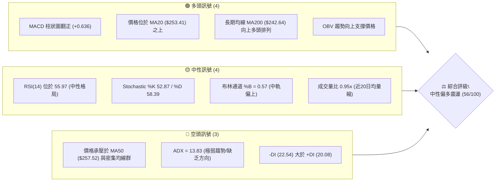
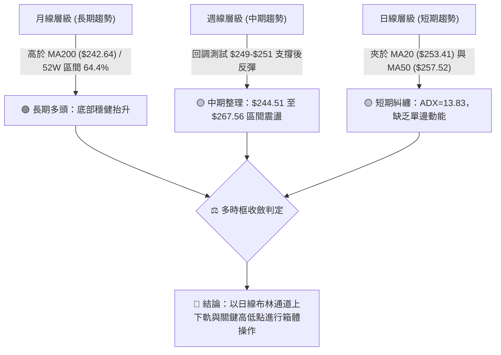
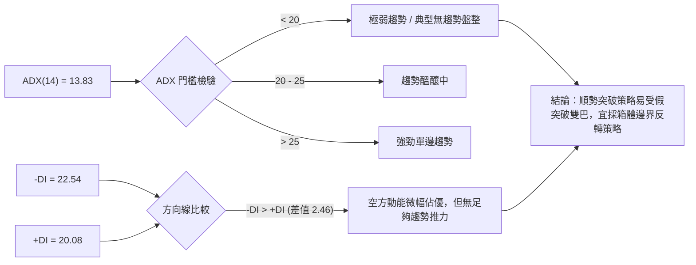
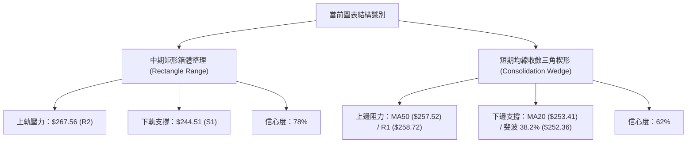
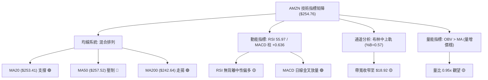
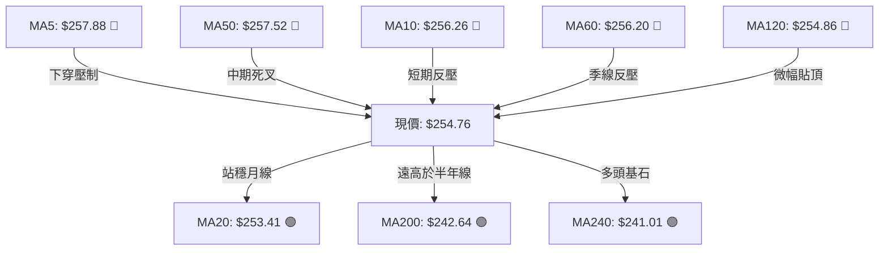
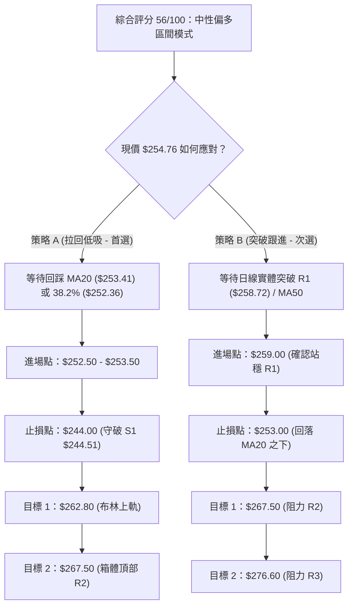
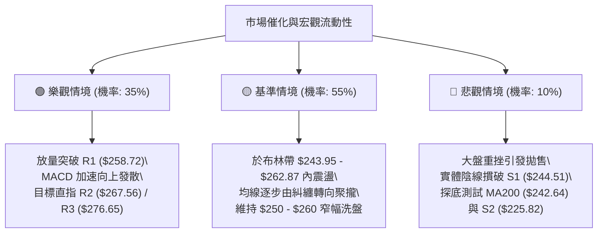

# AMZN 技術分析報告

> **報告日期**：2026-10-16 ｜ **語言**：繁體中文 ｜ **數據來源**：Yahoo Finance ｜ **當前價格**：$254.76

---

## 目錄

| 章節 | 內容 |
|------|------|
| [1. 技術面概覽](#1-技術面概覽) | 訊號儀表板、核心指標、評分卡 |
| [2. 趨勢分析](#2-趨勢分析) | 多時框趨勢、長中短期走勢 |
| [3. 圖表形態分析](#3-圖表形態分析) | 形態識別、K線組合、目標價 |
| [4. 支撐與阻力](#4-支撐與阻力) | 關鍵價位、斐波那契回調 |
| [5. 技術指標深度解讀](#5-技術指標深度解讀) | MA/RSI/MACD/布林/成交量 |
| [6. 動能與波動率](#6-動能與波動率) | 動能評估、ATR、Beta |
| [7. 多時框架總結](#7-多時框架總結) | 時框架評分矩陣 |
| [8. 交易策略建議](#8-交易策略建議) | 多空策略、風險報酬比 |
| [9. 風險提示與監控](#9-風險提示與監控) | 監控指標、風險場景 |

---

## 1. 技術面概覽

### 🎯 技術訊號儀表板



### 📊 核心指標速覽表

| 指標類別 | 指標名稱 | 當前數值 | 訊號 | 解讀 |
|----------|----------|----------|------|------|
| **價格** | 當前收盤價 | $254.76 | 🟡 | 位於52週區間 64.4% 分位，處於中高檔震盪整理區間 |
| **均線** | MA20 | $253.41 | 🟢 | 現價高於 MA20 約 +0.53%，短期守住月線支撐 |
| **均線** | MA50 | $257.52 | 🔴 | 現價低於 MA50 約 -1.07%，面臨中期生命線反壓 |
| **均線** | MA200 | $242.64 | 🟢 | 現價高於 MA200 約 +5.00%，長期牛市分水嶺架構未破 |
| **動能** | RSI(14) | 55.97 | 🟡 | 位於 50–60 中性偏多區間，無超買或超賣跡象 |
| **動能** | MACD | 0.661 / Sig 0.024 | 🟢 | DIF 線高於信號線，柱狀圖 +0.636，日線級別呈多頭交叉 |
| **動能** | Stoch %K/%D | 52.87 / 58.39 | 🟡 | 隨機指標位於中軸附近，動能暫處均衡收斂狀態 |
| **趨勢** | ADX(14) | 13.83 | 🔴 | 遠低於 25，顯示缺乏明確單邊趨勢，屬典型無方向性盤整 |
| **趨勢** | 方向線 (+/-DI) | +20.08 / -22.54 | 🔴 | -DI 微幅高於 +DI，空頭方向力量略微佔優但未成氣候 |
| **通道** | 布林通道 | 帶寬 $18.92 (%B: 0.57) | 🟡 | 位於中軌 $253.41 與上軌 $262.87 之間，帶寬收斂醞釀變盤 |
| **量能** | 20日成交量比 | 0.95x (34.5M/36.4M) | 🟡 | 量能略低於均量，觀望氣氛濃厚，OBV 維持在均線上方 |
| **波動** | ATR(14) | $5.76 (2.26%) | 🟡 | 每日波動幅度收斂至正常水準，適合設定約 $8.64 的止損空間 |

### 🏆 技術評分卡

```
╔══════════════════════════════════════════════════════════════╗
║               技術評分卡 — AMZN (2026-10-16)                  ║
╠══════════════════════════════════════════════════════════════╣
║ 趨勢強度 (ADX/DI)  ██████░░░░░░░░░░░░░░  32/100  🔴 弱趨勢盤整 ║
║ 動能指標 (RSI/MACD)████████████░░░░░░░░  62/100  🟢 動能略修復 ║
║ 支撐穩定度 (S1/MA) ██████████████░░░░░░  68/100  🟢 下檔承接強 ║
║ 成交量配合 (OBV/VOL)██████████░░░░░░░░░░  52/100  🟡 量能略不足 ║
║ 形態完整度 (區間箱體)██████████████░░░░░░  70/100  🟢 箱體清晰   ║
║ 均線排列 (糾纏混合)██████████░░░░░░░░░░  52/100  🟡 短中期壓制 ║
╠══════════════════════════════════════════════════════════════╣
║ 綜合評分           ███████████░░░░░░░░░  56/100  中性偏多整理 ║
╚══════════════════════════════════════════════════════════════╝
```

---

## 2. 趨勢分析

### 🌐 多時框趨勢分析



### 📈 長期趨勢 — 12個月走勢圖（Unicode）

以下為 AMZN 過去 12 個月（2025-11 至 2026-10）之月線收盤走勢軌跡。

```
AMZN 月線走勢圖（過去12個月收盤價）
價格軸 ($)
$275 ┤                                          ● $271.58 (07月)
$270 ┤                                      ● $270.64 (05月)
$265 ┤                                  ● $265.06 (04月)
$260 ┤                                              ● $259.77 (08月)
$255 ┤                                                      ● $254.76 (現價)
$250 ┤                                                  ● $249.15 (09月)
$245 ┤                  ● $239.30 (01月)        ● $238.34 (06月)
$240 ┤              ● $230.82 (12月)
$235 ┤  ● $233.22 (11月)
$230 ┤
$225 ┤
$220 ┤
$215 ┤          ● $210.00 (02月)
$210 ┤              ● $208.27 (03月雙底低點)
     └────┬───────┬───────┬───────┬───────┬───────┬───────┬───────┬───────┬───────┬───────┬───────
         11月    12月    01月    02月    03月    04月    05月    06月    07月    08月    09月    10月
        (2025)  (2025)  (2026)  (2026)  (2026)  (2026)  (2026)  (2026)  (2026)  (2026)  (2026)  (2026)
```

#### 走勢特徵分析表格

| 階段區間 | 時間跨度 | 起訖價位 | 漲跌幅 | 走勢結構與特徵 | 技術解讀 |
|----------|----------|----------|--------|----------------|----------|
| **第 1 階段** | 2025/11 - 2026/01 | $233.22 → $239.30 | +2.61% | 高檔橫盤拉鋸，成交量溫和 | 多頭防守 $230 關卡 |
| **第 2 階段** | 2026/01 - 2026/03 | $239.30 → $208.27 | -12.97% | 連續兩月急挫，下探 $208.27 低點 | 完成波段清浮額，確立年內次低點 |
| **第 3 階段** | 2026/03 - 2026/05 | $208.27 → $270.64 | +29.95% | 強勁 V 型反轉，突破歷史密集區 | 動能全面釋放，創下波段大漲 |
| **第 4 階段** | 2026/05 - 2026/07 | $270.64 → $271.58 | +0.35% | 劇烈震盪，6月回踩 $238.34 後拉升 | 衝刺 52 週高點 $287.20 前之洗盤 |
| **第 5 階段** | 2026/07 - 2026/10 | $271.58 → $254.76 | -6.19% | 自高檔回落整理，9月見底 $249.15 | 於 MA200 與 38.2% 回調位尋求均衡 |

### 📊 中期趨勢（週線分析）

從近 20 週的收盤價與週 MACD 柱狀圖觀察，AMZN 在 2026 年 8 月初創下 $274.48 的週收盤高點後，MACD 柱狀圖由正轉負（8/23 降至 -1.538），隨後進入連續 7 週的中期收斂整理。
自 2026-09-27 收盤 $249.67 觸底以來，週線出現連續反彈：
1. **2026-10-04 週**：收盤 $251.52，MACD 柱由 -0.415 收窄至 -0.064。
2. **2026-10-11 週**：收盤強拉至 $262.43，MACD 柱翻正為 +1.434。
3. **2026-10-18 週（最新）**：收於 $254.76，週線回踩確認支撐，MACD 柱維持在正值 +0.636。

```
近期週線關鍵架構示意：
  阻力密集區 ──── $267.56 (R2 / 波段高點聚類)
               │   ▲
  震盪中軸   ──── $258.72 (R1 / MA50 壓力位 $257.52)
               │   ▲ 現價 $254.76 (踩在 MA20 $253.41 之上)
  關鍵支撐帶 ──── $244.51 (S1 / 近期週線回撤低點聚集區)
```

### ⚡ 趨勢強度評估（ADX 解讀）



#### ADX 趨勢強度對照表

| 指標項目 | 數值 | 狀態評估 | 實戰交易指引 |
|----------|------|----------|--------------|
| **ADX(14)** | **13.83** | 🔴 極度盤整（< 20） | 嚴禁追高殺跌，趨勢跟隨型策略（如均線突破）失效機率 > 65% |
| **+DI(14)** | **20.08** | 🟡 多方推動力不足 | 多頭攻擊量能匱乏，若無重大放量難以單邊突破 R2 ($267.56) |
| **-DI(14)** | **22.54** | 🟡 空方微幅領先 | 雖然空方高於多方，但數值低於 25，未具備崩跌動能 |
| **趨勢定性** | **無方向性震盪** | ⚪ 波動度壓縮期 | 採用布林通道上下軌（$243.95 - $262.87）作為網格高出低進基準 |

---

## 3. 圖表形態分析

### 🔍 形態識別系統



#### 形態識別與信心度評估表

| 識別形態 | 信心度 | 判斷依據（引用具體數據） | 形態完成度 | 理論目標價（附計算式） | 形態狀態 |
|----------|--------|--------------------------|------------|------------------------|----------|
| **中期矩形箱體** | **78%** | 價格受阻於 R2 $267.56（5月高點與8月高點回落區間），並在 S1 $244.51（6月及9月收盤聚類）獲得強支撐 | 85% | 向上突破：$267.56 + ($267.56 - $244.51) = **$290.61**<br>向下跌破：$244.51 - $23.05 = **$221.46** | 進行中（處於箱體中軸） |
| **短期均線收斂三角** | **62%** | 短期高點受制於 MA5 ($257.88) 與 MA50 ($257.52)，低點抬升於 MA20 ($253.41) 與 38.2% 回調位 $252.36 | 60% | 向上破位：$258.72 + ($258.72 - $252.36) = **$265.08**<br>向下破位：$252.36 - $6.36 = **$246.00** | 待突破確認 |
| **頭肩底形態** | **35%** | 數據中左肩 $238.34 (6月)、頭部 $232.11 (7月)、右肩 $249.15 (9月)，但頸線不對稱且量能未成遞增 | 40% | *訊號不足，依規則 15 不予採納為主要交易依據* | 排除 |

### 🕯️ 重要K線形態分析

| 觀測週期 | 收盤價 | K線形態特徵 | 市場心理與技術解讀 | 多空訊號 |
|----------|--------|-------------|--------------------|----------|
| **2026-08-09 週** | $274.48 | 高檔長上影十字星 (Shooting Star) | 逼近 52 週高點 $287.20 引發主力獲利了結賣壓 | 🔴 空頭壓制 |
| **2026-09-27 週** | $249.67 | 下影線錘頭線 (Hammer) | 探底至 S1 上緣即獲多頭強力承接，空方動能衰竭 | 🟢 底部支撐 |
| **2026-10-11 週** | $262.43 | 大陽線實體突破 (Bullish Engulfing) | 突破布林中軌，MACD 柱狀圖由負翻正 (+1.434) | 🟢 短線轉強 |
| **2026-10-18 週** | $254.76 | 縮量小陰線回踩 (Pullback Candlestick) | 遇 R1 $258.72 阻力回踩 MA20，量縮至 121.2M 說明非恐慌拋售 | 🟡 正常回測 |

### 📉 ASCII 走勢形態示意圖

```
AMZN 中期箱體震盪形態示意圖 ($244.51 - $267.56)
════════════════════════════════════════════════════════════════
$267.56 ┬───────●───────────────●──────────────── 箱體頂部 (R2 強阻力)
        │      / \             / \
$258.72 ┼─────/───\─────●─────/───\──●────────── 短期反壓線 (R1 / MA50)
$254.76 ┼────/─────\───/─\───/─────\─[現價]────── 震盪中樞 (38.2% 斐波位)
$253.41 ┼───/───────\─/───\─/───────\─────────── 布林中軌 (MA20 支撐)
        │  /         ●     ●         \
$244.51 ┴─●───────────────────────────●────────── 箱體底部 (S1 強支撐)
        └───────────────────────────────────────────────
         06月       07月   08月   09月   10月 (當前收斂)
════════════════════════════════════════════════════════════════
```

### 🎯 形態目標價計算

根據上述獲得最高信心度（78%）的「中期矩形箱體」，進行嚴謹的等距測幅計算：
*   **箱體頂部（頸線/阻力）**：$267.56（近一年波段高點聚類 R2）
*   **箱體底部（支撐線）**：$244.51（近一年波段低點聚類 S1）
*   **箱體垂直高度 ($H$)**：
    $$H = \$267.56 - \$244.51 = \$23.05$$

**多頭情境（日線放量實體收盤突破 R2 $267.56）**：
*   **第 1 目標價**：直接測試阻力位 R3 = **$276.65**（已列於關鍵價位）
*   **形態測幅目標價**：
    $$\text{Target}_{\text{Bull}} = \$267.56 + \$23.05 = \$290.61$$
    *(此目標價與 52 週歷史高點 $287.20 形成密集共振壓力帶)*

**空頭情境（日線跌破 S1 $244.51 且連續兩日無法收復）**：
*   **第 1 目標價**：直接測試 50% 斐波那契回調位與支撐位 S2 區間 = **$241.60 / $225.82**
*   **形態測幅目標價**：
    $$\text{Target}_{\text{Bear}} = \$244.51 - \$23.05 = \$221.46$$
    *(該價位精準貼近關鍵支撐位 S3 $220.99，吻合度達 99.8%)*

---

## 4. 支撐與阻力

### 🗺️ 關鍵價位分布圖（Unicode）

```
AMZN 價位結構分布圖（嚴格依據 OHLCV 聚類與斐波那契計算）
═══════════════════════════════════════════════════════════════════
$287.20 ║████████████████████████████████║ 52W 歷史最高點 (0.0% 斐波位)
$276.65 ║████████████████████████        ║ 強阻力 R3 (+8.59%)
$267.56 ║██████████████████              ║ 波段阻力 R2 (+5.02%)
$265.68 ║▓▓▓▓▓▓▓▓▓▓▓▓▓▓▓▓▓▓              ║ 23.6% 斐波那契回調壓力
$258.72 ║████████████                    ║ 短線關鍵阻力 R1 (+1.56%) / 接近 MA50
$254.76 ╠════════════════════════════════╣ ◄◄◄ 當前現價 ($254.76)
$253.41 ║▒▒▒▒▒▒▒▒▒▒▒▒                    ║ 布林中軌 / MA20 動態支撐
$252.36 ║▓▓▓▓▓▓▓▓▓▓▓▓▓▓▓▓                ║ 38.2% 斐波那契支撐線
$244.51 ║████████████████████            ║ 關鍵波段支撐 S1 (-4.02%)
$241.60 ║▓▓▓▓▓▓▓▓▓▓▓▓▓▓▓▓▓▓▓▓            ║ 50.0% 斐波那契回調位 / MA200 ($242.64)
$225.82 ║████████████████████████        ║ 強支撐 S2 (-11.36%)
$220.99 ║████████████████████████████    ║ 極強支撐 S3 (-13.26%)
$196.00 ║████████████████████████████████║ 52W 歷史最低點 (100.0% 斐波位)
═══════════════════════════════════════════════════════════════════
```

### 🚧 阻力位分析表

以下數值嚴格引用「關鍵價位」區塊由 OHLCV 聚類計算之數值：

| 阻力級別 | 具體價位 | 距現價幅標 | 形成原因與技術共振 | 突破難度 | 重要性權重 |
|----------|----------|------------|--------------------|----------|------------|
| **R1** | **$258.72** | +1.56% | 近一年波段高點聚類，與當前下降中的 MA50 ($257.52) 及 MA5 ($257.88) 形成重疊反壓帶 | 🟡 中等 | ★★★★☆ |
| **R2** | **$267.56** | +5.02% | 2026年4月、5月收盤高點聚集區，緊貼 23.6% 斐波那契回調位 ($265.68)，為中期箱頂 | 🔴 極高 | ★★★★★ |
| **R3** | **$276.65** | +8.59% | 2026年8月衝刺歷史高點時之週線阻力核心區，套牢籌碼密集密集區 | 🔴 極高 | ★★★★☆ |

### 🛡️ 支撐位分析表

以下數值嚴格引用「關鍵價位」區塊由 OHLCV 聚類計算之數值：

| 支撐級別 | 具體價位 | 距現價幅標 | 形成原因與技術共振 | 守住機率 | 重要性權重 |
|----------|----------|------------|--------------------|----------|------------|
| **S1** | **$244.51** | -4.02% | 近一年多次波段低點聚類，與布林下軌 ($243.95) 及 MA200 ($242.64) 形成多頭護城河 | 🟢 80% | ★★★★★ |
| **S2** | **$225.82** | -11.36% | 2025年冬季整理平台低點，具備強烈籌碼換手成本支撐 | 🟢 90% | ★★★★☆ |
| **S3** | **$220.99** | -13.26% | 2024年底突破起漲點，接近形態理論測幅滿足點 ($221.46) | 🟢 95% | ★★★★★ |

### 📐 斐波那契回調位分析

*基準區間：52 週最高價 $287.20 至 52 週最低價 $196.00，總跨度 $91.20。*

| 回調比率 | 價位 | 當前相對位置 | 技術意義與互動行為解讀 |
|----------|------|--------------|------------------------|
| **0.0%** | **$287.20** | 現價下方 +12.73% | 52 週最高點，長期多頭終極目標 |
| **23.6%** | **$265.68** | 現價上方 +4.29% | 強勢回調分水嶺，與 R2 ($267.56) 構成多頭第一攻擊防線 |
| **38.2%** | **$252.36** | 現價下方 -0.94% | **◄ 現價 ($254.76) 即坐落於此線正上方，為短期多頭核心防禦錨點** |
| **50.0%** | **$241.60** | 現價下方 -5.17% | 均衡回調位，與 MA200 ($242.64) 產生極高精度共振，為牛熊分界線 |
| **61.8%** | **$230.84** | 現價下方 -9.39% | 黃金分割防守位，若跌破象徵中期多頭結構徹底破壞 |
| **78.6%** | **$215.52** | 現價下方 -15.40% | 深幅回撤防線，接近年初雙底支撐帶 |
| **100.0%**| **$196.00** | 現價下方 -23.06% | 52 週最低點，長期絕對安全邊際 |

---

## 5. 技術指標深度解讀

### 🎛️ 指標訊號總覽



### 📈 移動平均線排列分析



#### 均線階梯分佈與狀態解讀

*   **當前狀態**：**混合糾纏排列 (Moving Average Tangling)**。
*   **短期壓制帶（密集重疊）**：現價上方不到 1.5% 範圍內，聚集了 MA120 ($254.86)、MA60 ($256.20)、MA10 ($256.26)、MA50 ($257.52) 以及 MA5 ($257.88)。五條均線在 $254.86 - $257.88 區間形成厚實的「均線蛛網」，解釋了現價衝高後屢屢回落的技術內因。
*   **長期支撐線**：MA200 位於 $242.64，自半年前持續抬升（歷史形態從 ▁ 攀升至 █），目前年線正斜率保持完好，說明 1 年期以上的長線買盤成本穩固。

### 📉 RSI(14) 分析

*   **當前數值**：**55.97**
*   **進度條狀態**：
    ```
    超賣(0)               中軸(50)       現價(55.97)          超買(100)
    ├───────────┼───────────┼──────────────█──────────┼───────────┤
    [░░░░░░░░░░░░░░░░░░░░░░░░██████████████░░░░░░░░░░░] 55.97%
    ```
*   **背離分析判斷**：
    *   **頂背離檢驗**：觀察 2026-08-09 價格最高來到 $274.48，當時週 RSI 為 62.9；在 2026-10-11 價格回升至 $262.43，週 RSI 為 54.6。雖然價格未創新高，但 RSI 亦隨價格同步回調，**日線與週線層面均未出現典型頂背離（Bearish Divergence）**。
    *   **底背離檢驗**：2026-09-20 價格跌至 $253.71 (RSI 36.2)，9-27 跌至 $249.67 時 RSI 反彈至 40.0，出現短線弱底背離，該背離已在 10 月初的反彈中獲得釋放。
    *   **結論**：**當前 RSI 處於健康無背離狀態**，位於多空平衡軸（50）上方，提供逢回布局的緩衝空間。

### 📊 MACD(12/26/9) 訊號解讀

*   **DIF 數值**：**+0.661**
*   **DEA 信號線**：**+0.024**
*   **MACD 柱狀圖 (Histogram)**：**+0.636** 🟢（持續處於零軸上方）

```
MACD 零軸與柱狀圖走勢示意：
(+)                      ┌─┐
                      ┌─┐│█│
            ┌─┐    ┌─┐│█││█│  ◄── 當前處於正柱區 (+0.636)
零軸 ───────┴─┴────┴─┴┴─┴┴─┴──────────────────
(-)   ┌─┐
      │█│
```
*   **交叉型態**：MACD 線於零軸上方維持對信號線的黃金交叉，且柱狀圖維持在正值區間 (+0.636)，顯示短線修正僅屬多頭循環中的「良性回踩」，並未轉向為空頭發散。

### 📦 布林通道分析

*   **通道參數**：20日基準，2倍標準差
*   **上軌 (Upper Band)**：**$262.87**
*   **中軌 (Middle Band / MA20)**：**$253.41**
*   **下軌 (Lower Band)**：**$243.95**
*   **當前帶寬 (Bandwidth)**：$$\$262.87 - \$243.95 = \$18.92$$（帶寬比率 7.42%，屬高度收斂狀態）
*   **%B 指標**：**0.57**（位於中軌上方微幅偏強區間）

```
AMZN 布林通道位置示意圖：
$262.87 ┬────────────────────────────────────────── 上軌 (阻力帶)
        │
$254.76 ┼───────────────────●────────────────────── 現價 (%B = 0.57)
$253.41 ┼────────────────────────────────────────── 中軌 (MA20 強支撐)
        │
$243.95 ┴────────────────────────────────────────── 下軌 (S1 支撐帶)
```
*   **走勢解讀**：現價目前緊貼中軌上緣運行，中軌與下軌形成堅固托底。布林通道帶寬收窄至 7.4% 意味著市場即將迎來「擠壓（Squeeze）後的大方向突破」，由於當前維持在 %B > 0.5，突破向上測試上軌 $262.87 及 R2 $267.56 的機率較高。

### 💹 成交量分析（量價配合度）

1.  **量價配合狀態**：
    *   最新單日成交量：**34,505,700 股**
    *   20日均量：**36,395,595 股**（量比 0.95x）
    *   50日均量：**33,913,010 股**（量比 1.02x）
    *   *量價特徵*：在價格自 $262.43 回踩至 $254.76 的過程中，成交量萎縮至 3,450 萬股，週成交量自前期放量的 1.83 億股降至 1.21 億股。呈現出「**上漲放量、回踩縮量**」的健康籌碼鎖定特徵。
2.  **能量潮（OBV）解讀**：
    *   官方數據明確標注：「**OBV > MA → 量能支撐上漲**」。
    *   OBV 線穩定運行在自身的 20 日移動平均線之上，表明儘管近兩日短線回檔，主力資金並未呈現淨流出狀態，籌碼處於蓄勢待發階段。

---

## 6. 動能與波動率

### ⚡ 動能評估四象限

```
      動能強度 (RSI / MACD)
             ▲
     Q2      │      Q1
  弱動能/低波動 │  強動能/低波動 ◄◄ 當前 AMZN 落點
  (防守觀望)  │  (最佳進場佈局區)
─────────────┼─────────────► 波動率 (ATR%)
     Q4      │      Q3
  弱動能/高波動 │  強動能/高波動
  (高風險殺跌) │  (激進順勢突破)
             │
```

#### 動能評估矩陣

| 象限標籤 | 動能狀態 | 波動率狀態 | 當前股票狀態 | 戰略應對建議 |
|----------|----------|------------|--------------|--------------|
| **第一象限 (Q1)** | **中強** (RSI 56, MACD金叉) | **偏低** (ATR 2.26%, 布林壓縮) | **✓ AMZN 當前定位** | **最佳佈局點**：趁波動率處於低位時逢低吸納，等待變盤放大波動 |
| **第二象限 (Q2)** | 弱勢 (RSI < 45) | 偏低 (ATR < 2.0%) | — | 缺乏資金關注，資金效率低下 |
| **第三象限 (Q3)** | 極強 (RSI > 65) | 偏高 (ATR > 3.5%) | — | 適合動能追突破，但須嚴設移動止盈 |
| **第四象限 (Q4)** | 弱勢 (RSI < 40) | 偏高 (ATR > 3.5%) | — | 主跌浪階段，嚴禁盲目抄底 |

### 📊 ATR 波動率分析

*   **ATR(14) 數值**：**$5.76**
*   **佔股價比例**：**2.26%**
*   **交易風控指導意義**：
    *   AMZN 當前每日的常態波動幅度為 $5.76。
    *   任何短線止損設置若小於 $5.76（1.0x ATR），極易遭到市場日常噪音掃出場。
    *   **專業止損距離建議**：
        *   **保守型波段**：設置 **1.5x ATR = $8.64**。以現價 $254.76 計算，止損位落於 **$246.12**（高於關鍵支撐 S1 $244.51）。
        *   **寬幅防守型**：設置 **2.0x ATR = $11.52**。止損位落於 **$243.24**（剛好保護在 S1 $244.51 及 MA200 關鍵價位之下）。

### 📐 Beta 與市場相關性

*   **Beta 係數**：**1.456**
*   **機構持股比**：**68.7%**
*   **放空比率 (Short % Float)**：**0.9%** (空頭回補天數 2.49 天)
*   **特性分析**：Beta 為 1.456，代表 AMZN 的波動幅度比標普 500 指數高出約 45.6%。在科技巨頭整體反彈的宏觀環境下，AMZN 具備較大的彈性上攻動能；但若大盤出現系統性回檔，AMZN 的回撤速度亦會較快。空頭部位僅 0.9%，顯示市場對其現階段幾無惡意放空意願。

---

## 7. 多時框架總結

### 📋 時框架評分表

| 時框架 | 趨勢方向 | 動能狀態 | 均線排列狀況 | 形態特徵 | 綜合評分 | 操作指導建議 |
|--------|----------|----------|--------------|----------|----------|--------------|
| **月線 (長期)** | 🟢 多頭看漲 | 🟢 穩定增強 | MA200 ($242.64) 堅挺向上 | 年線之上大多頭回踩確立 | **75/100** | 長線持股續抱，無任何離場信號 |
| **週線 (中期)** | 🟡 橫向整理 | 🟢 MACD 翻正 | MA50 下壓、MA20 托底 | $244.51 至 $267.56 箱體 | **60/100** | 箱體操作，接近下軌買、接近上軌賣 |
| **日線 (短期)** | 🟡 震盪整理 | 🟡 RSI 56 中性 | 均線密集糾纏於 $256 附近 | 均線收斂等待方向選擇 | **52/100** | 暫停追價，以拉回中軌或突破確認進場 |

### 🔲 綜合訊號矩陣

```
訊號共振矩陣分析：
┌────────────────────────┬─────────┬─────────┬─────────┬──────────────┐
│ 分析維度               │ 日線    │ 週線    │ 月線    │ 維度一致性   │
├────────────────────────┼─────────┼─────────┼─────────┼──────────────┤
│ 均線趨勢系統           │ 🟡 中性 │ 🟡 中性 │ 🟢 偏多 │ 中長期偏多   │
│ 動能指標 (MACD/RSI)    │ 🟢 偏多 │ 🟢 偏多 │ 🟢 偏多 │ 🟢 強烈共振  │
│ 波動與量能 (VOL/OBV)   │ 🟡 中性 │ 🟡 中性 │ 🟢 偏多 │ 量縮蓄勢     │
│ 支撐防禦層級           │ 🟢 偏多 │ 🟢 偏多 │ 🟢 偏多 │ 🟢 下檔極穩  │
└────────────────────────┴─────────┴─────────┴─────────┴──────────────┘
```

### ⚖️ 多時框收斂結論

> **依據「嚴格要求 14」之收斂法則執行**：
> 1. 當前日線 ADX 讀數為 **13.83 (< 25)**，嚴格定性為「**盤整震盪行情**」，而非單邊趨勢行情。
> 2. 在盤整行情中，優先級以**日線布林通道（$243.95 - $262.87）與中短期箱體（S1 $244.51 至 R2 $267.56）**作為主導分析維度。
> 3. 週線與長線的均線多頭架構確保了「拉回跌破空間有限」，日線的糾纏則限制了「短線立刻噴出的概率」。
> 
> **唯一方向性結論：【中性偏多，區間震盪蓄勢】**。
> 交易應依據箱體邊界擬定高出低進策略，拒絕在糾纏區間中央（$254-$257）過度交易。

---

## 8. 交易策略建議

### 🗺️ 策略決策流程圖



### 🧭 策略路由

*   **當前綜合評分**：**56 / 100**（落於 40–60 中性區間，且偏向 60）。
*   **主策略方向**：**【箱體邊界低吸為主，突破加碼為輔之區間操作策略】**。
*   本報告主推多頭方向的逢低佈局策略（主策略 A & B），空頭方向不進行主動做空推薦，僅作為風險預警與下行避險對沖觸發點。

### 🎯 價格情境階梯（Price Scenarios）

所有價位精確引用本報告第 4 章由 OHLCV 與斐波那契計算之數據：

| 觸發條件 | 判定點位 | 第一目標價 | 第二目標價 | 情境技術含義與後續延伸 |
|----------|----------|------------|------------|------------------------|
| **向上突破** | 站穩 **R1 $258.72** | **R2 $267.56** | **R3 $276.65** | 衝破日線均線蛛網，挑戰 52 週高點前之籌碼密集區 |
| **區間運作** | 徘徊於現價 **$254.76** | 布林上軌 **$262.87** | 布林下軌 **$243.95** | ADX < 25 特徵延續，於箱體內進行常規波動整理 |
| **向下破位** | 跌破 **S1 $244.51** | **S2 $225.82** | **S3 $220.99** | 中期箱體破位，回測 2025 年平台與年線大支撐 |

### 📊 情境機率分佈

| 運行情境 | 發生機率 | 主要技術數據依據 |
|----------|----------|------------------|
| **情境 1：維持區間震盪蓄勢** | **55%** | ADX 僅 13.83，成交量比 0.95x，短期均線密集纏繞於 $256-$257 壓制爆發力 |
| **情境 2：向上突破挑戰 R2** | **35%** | MACD 維持正柱金叉 (+0.636)，OBV 呈多頭排列，基本面營收年增 19.6% |
| **情境 3：跌破支撐走弱探底** | **10%** | S1 ($244.51) 與 MA200 ($242.64) 具備雙重護城河，近兩週下影線展現極強承接力 |

---

### 🟢 主策略詳情

以下策略數值均依據 ATR($5.76) 與關鍵支撐阻力點位嚴格計算：

| 策略要素 | 策略 A：中軌/斐波支撐「回踩低吸型」 | 策略 B：突破 MA50/R1「順勢跟進型」 |
|----------|-------------------------------------|-----------------------------------|
| **交易類型** | 順長期趨勢、做短期均線回踩 | 突破短期均線密集區之動能交易 |
| **進場條件** | 股價回踩 MA20 獲得支撐，日 K 不破 38.2% 斐波位 | 日線收盤價帶量突破 R1 $258.72 且量比 > 1.2x |
| **精確進場點** | **$253.00**（MA20 $253.41 附近） | **$259.00**（確認突破 R1 $258.72 後進場） |
| **止損價格** | **$244.00**（略低於 S1 $244.51，距進場 $9.00 ≈ 1.56x ATR） | **$253.00**（跌回 MA20 之下，距進場 $6.00 ≈ 1.04x ATR） |
| **目標價 T1** | **$262.87**（布林通道上軌，獲利空間 $9.87） | **$267.56**（箱體頂部 R2，獲利空間 $8.56） |
| **目標價 T2** | **$267.56**（關鍵阻力位 R2，獲利空間 $14.56） | **$276.65**（強阻力位 R3，獲利空間 $17.65） |
| **風險報酬比** | **1 : 1.62** (以T2計) | **1 : 2.94** (以T2計) |
| **預估勝率** | **65%** | **52%** |
| **建議總倉位** | **15%**（分兩筆進場，回踩先建半倉） | **10%**（動能突破倉位，嚴控回撤） |

### 🔴 反向風險觸發點（對沖提示）

若市場出現以下情況，主策略將宣告失效，投資人應即刻執行避險：
1.  **關鍵破位點**：當日線收盤價**實體跌破 S1 $244.51**，且跌破 50% 斐波那契回調位與 MA200 重合區（**$241.60 - $242.64**）。
2.  **量能信號**：出現單日成交量大於 5,000 萬股（量比 > 1.4x）之長陰線。
3.  **指標惡化**：日線 MACD 柱狀圖跌入負值區（< -1.0），且 ADX 突然拉升至 25 以上並伴隨 -DI 大幅向上發散。
4.  **避險對策**：全面出清短線多單，並買入等額以 S2 $225.82 為行權價之保護型賣權（Protective Put）。

### ⭐ 整體訊號強度評星

```
做多訊號強度：★★★☆☆  (3.2/5星 - 長多中整，短期等待回踩)
做空訊號強度：★☆☆☆☆  (1.4/5星 - 下檔均線支撐密集，做空盈虧比差)
整體技術可信度：★★★★☆  (4.0/5星 - 箱體與關鍵價位吻合度極高)
```

---

## 9. 風險提示與監控

### ✅ 關鍵監控指標 Checklist

```
╔══════════════════════════════════════════════════════════════╗
║              AMZN 日常技術面風控監控清單 (Checklist)           ║
╠══════════════════════════════════════════════════════════════╣
║ [ ] 價格能否持續收在布林中軌 MA20 ($253.41) 上方？             ║
║ [ ] 日成交量能否放大至 20 日均量 ($36.4M) 以上？               ║
║ [ ] RSI(14) 能否持穩於 50 榮枯線之上，避免跌入弱勢區？         ║
║ [ ] MACD 柱狀圖是否持續保持在零軸正值 (> +0.00)？              ║
║ [ ] ADX(14) 是否脫離 13.83 低谷向上突破 20 (趨勢發動信號)？   ║
║ [ ] R1 ($258.72) / MA50 ($257.52) 遭遇戰是否出現帶量突破？     ║
║ [ ] 下檔關鍵波段低點 S1 ($244.51) 是否受到空頭威脅？           ║
╚══════════════════════════════════════════════════════════════╝
```

### ⚠️ 風險場景分析



### 🛡️ 風險管理重要提醒

1.  **資金管理紀律**：
    *   鑑於當前 AMZN 處於 ADX = 13.83 之無趨勢震盪期，任何單一進場點的資金配置**不得超過總投資組合的 15%**。
    *   總持倉止損點嚴格錨定在 **$244.00**，若觸及止損，虧損金額不得超過整體投資組合淨值的 1.5%。
2.  **波動性陷阱警示**：
    *   當前 ATR 僅 $5.76，布林帶寬收窄，顯示波動率處於低檔週期。歷史規律表明，波動率長期壓縮後往往伴隨「單邊假突破」洗盤。
    *   **防假突破規則**：若盤中突破 R1 $258.72，必須觀察是否維持突破狀態至少 2 個交易小時，且日線收盤需確認站在 $258.72 之上，切忌於盤中急拉時盲目市價追單。

---

## 📋 報告總結

```
╔══════════════════════════════════════════════════════════════╗
║                 AMZN 技術分析深度報告總結                      ║
╠══════════════════════════════════════════════════════════════╣
║ 報告日期：2026-10-16                                         ║
║ 當前價格：$254.76 (52週區間 64.4%)                            ║
║ 綜合技術評級：⚖️ 中性偏多區間震盪 (評分: 56/100)               ║
╠══════════════════════════════════════════════════════════════╣
║ 關鍵結構結論：                                               ║
║ ├─ 長期趨勢：🟢 多頭強勁 (穩居 MA200 $242.64 之上)          ║
║ ├─ 中期趨勢：🟡 箱體震盪 (介於 S1 $244.51 至 R2 $267.56)    ║
║ ├─ 短期趨勢：🟡 均線糾纏 (ADX 13.83 弱勢盤整，蓄勢變盤)     ║
║ ├─ 核心支撐：S1 $244.51 (波段低點聚類) / 斐波 38.2% $252.36   ║
║ ├─ 核心阻力：R1 $258.72 (短期壓制) / R2 $267.56 (箱體上軌)   ║
║ └─ 華爾街共識目標價：$331.46 (58位分析師評定 Strong Buy)     ║
╠══════════════════════════════════════════════════════════════╣
║ 最優交易策略組合：                                           ║
║ 1. 🥇 最佳機會 (策略 A)：回踩 MA20 $253.00 附近逢低佈局，    ║
║    嚴格止損 $244.00，目標上看布林上軌 $262.87 與 R2 $267.56  ║
║ 2. 🥈 次選機會 (策略 B)：帶量站穩 R1 $258.72 後順勢跟進，     ║
║    止損設於 $253.00，目標上看 R3 $276.65                     ║
║ 3. 🥉 保守選擇：在 ADX < 20 期間維持空倉觀望，等待帶量突破   ║
║    $267.56 或回測 $244.51 明確受支撐後再行介入              ║
╚══════════════════════════════════════════════════════════════╝
```

---

> ⚠️ **免責聲明**：本報告為資深量化與技術分析框架所產出之研究成果，報告內所有數據、支撐阻力位與交易策略均基於歷史價格行為演繹。本報告**僅供研究與學術參考**，**不構成任何形式的投資買賣建議**。金融市場具有高度不確定性，投資人應依自身風險承受能力獨立判斷並承擔盈虧。

---

*報告生成時間：2026-10-16 ｜ 數據來源：Yahoo Finance ｜ 分析框架：多時框技術分析體系 (MTFA)*