# AMZN 技術分析報告

> **報告日期**：2026-10-18 ｜ **語言**：繁體中文 ｜ **數據來源**：Yahoo Finance ｜ **當前價格**：$250.00

---

## 目錄

| 章節 | 內容 |
|------|------|
| [1. 技術面概覽](#1-技術面概覽) | 訊號儀表板、核心指標、評分卡 |
| [2. 趨勢分析](#2-趨勢分析) | 多時框趨勢、長中短期走勢 |
| [3. 圖表形態分析](#3-圖表形態分析) | 形態識別、K線組合、目標價 |
| [4. 支撐與阻力](#4-支撐與阻力) | 關鍵價位、斐波那契回調 |
| [5. 技術指標深度解讀](#5-技術指標深度解讀) | MA/RSI/MACD/布林/成交量 |
| [6. 動能與波動率](#6-動能與波動率) | 動能評估、ATR、Beta |
| [7. 多時框架總結](#7-多時框架總結) | 時框架評分矩陣 |
| [8. 交易策略建議](#8-交易策略建議) | 多空策略、風險報酬比 |
| [9. 風險提示與監控](#9-風險提示與監控) | 監控指標、風險場景 |

---

## 1. 技術面概覽

### 🎯 技術訊號儀表板

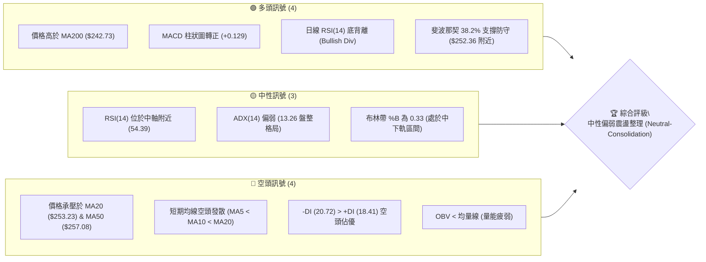

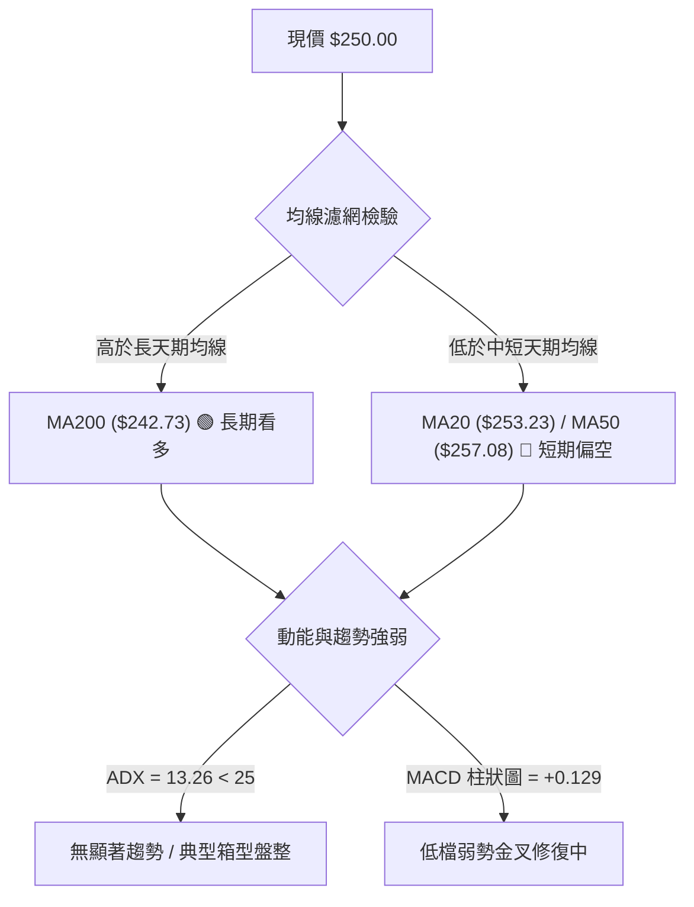

### 📊 核心指標速覽表

| 指標類別 | 指標名稱 | 當前數值 | 訊號 | 解讀 |
|----------|----------|----------|------|------|
| **價格** | 當前價格 | $250.00 | 🟡 | 位於52週區間59.2%位置，處於中位震盪區間 |
| **均線** | MA20 | $253.23 | 🔴 | 現價低於MA20 (-1.27%)，短線面臨中軌反壓 |
| **均線** | MA50 | $257.08 | 🔴 | 現價低於MA50 (-2.75%)，中期結構尚未修復 |
| **均線** | MA200 | $242.73 | 🟢 | 現價高於MA200 (+2.99%)，長期牛熊分水嶺未破 |
| **動能** | RSI(14) | 54.39 | 🟡 | 處於45-55中性平衡帶，但伴隨日線底背離跡象 |
| **動能** | MACD | 0.186 / Sig 0.057 | 🟢 | 快線位於慢線上方，柱狀圖 +0.129，動能微幅轉正 |
| **趨勢** | ADX(14) | 13.26 | 🟡 | 數值遠低於25，代表無單邊趨勢，屬於區間震盪行情 |
| **定向** | +DI / -DI | 18.41 / 20.72 | 🔴 | -DI > +DI，空方力量略佔上風，但差距不大 |
| **通道** | 布林通道 | $243.65 - $262.80 | 🟡 | %B = 0.33，位於中軌($253.23)與下軌($243.65)之間 |
| **量能** | 20日成交量比 | 1.13x (40.31M) | 🟡 | 單日量能略微放大，但OBV低於均線，量能未全面確認 |
| **波動** | ATR(14) | $5.90 (2.36%) | 🟡 | 日均波幅適中，維持於正常健康震盪波動區間 |

### 🏆 技術評分卡

```
╔══════════════════════════════════════════════════════════════════╗
║               技術評分卡 — AMZN (2026-10-18)                     ║
╠══════════════════════════════════════════════════════════════════╣
║ 趨勢強度 (ADX=13.26)    ██████░░░░░░░░░░░░░░  30/100 🔴 弱趨勢/盤整║
║ 動能指標 (RSI/MACD)     ███████████░░░░░░░░░  55/100 🟡 中性微底背 ║
║ 支撐穩定度 (S1=$244.51) ██████████████░░░░░░  70/100 🟢 S1/MA200重疊║
║ 成交量配合 (OBV偏弱)    ████████░░░░░░░░░░░░  40/100 🔴 量價背離   ║
║ 形態完整度 (箱型整理)   ██████████░░░░░░░░░░  50/100 🟡 區間待突破 ║
║ 均線排列 (短空長多)     █████████░░░░░░░░░░░  45/100 🟡 混合糾纏   ║
╠══════════════════════════════════════════════════════════════════╣
║ 綜合評分                ██████████░░░░░░░░░░  48/100 ⚖️ 中性觀望   ║
╚══════════════════════════════════════════════════════════════════╝
```

---

## 2. 趨勢分析

### 🌐 多時框趨勢分析

根據多時框架構收斂原則，由於日線 ADX(14) 僅為 13.26（遠低於 25），顯示市場處於**盤整震盪行情**，而非單邊趨勢行情。各時框之間存在結構性分歧：月線級別呈現大週期多頭擴張後的平臺休整，週線呈現區間收斂，而日線則處於受壓於 MA20/MA50 之中短線回檔修復。

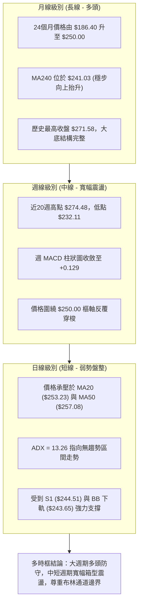

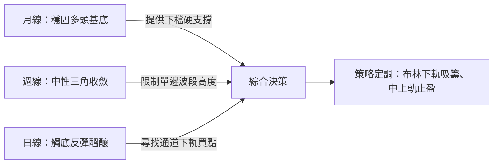

### 📈 長期趨勢 — 12個月走勢圖（Unicode）

以下為 2025 年 11 月至 2026 年 10 月 AMZN 月線收盤走勢全貌：

```
AMZN 月線走勢圖（2025-11 至 2026-10）
價格軸 ($)
$275 ┤                               ● $271.58
$270 ┤                   ● $270.64    │
$265 ┤             ● $265.06          │
$260 ┤             │                  │     ● $259.77
$255 ┤             │                  │     │
$250 ┤             │                  │     │     ● $249.15 ──● $250.00 (現在)
$245 ┤             │                  │     │     │
$240 ┤       ● $239.30          ● $238.34
$235 ┤ ● $233.22   │
$230 ┤       ● $230.82
$225 ┤
$220 ┤
$215 ┤
$210 ┤             ● $210.00
$205 ┤                   ● $208.27 (低點)
     └─────────────────────────────────────────────────────────────
       11    12    01    02    03    04    05    06    07    08    09    10  (月份)
```

**走勢特徵分析表格**：

| 階段區間 | 起訖月份 | 價格變化 | 漲跌幅 | 結構特徵與量能意涵 |
|----------|----------|----------|--------|--------------------|
| 第一階段：高檔震盪 | 2025-11 ~ 2026-01 | $233.22 → $239.30 | +2.61% | 承接前波漲勢，高檔橫盤構築整理平臺 |
| 第二階段：深度回踩 | 2026-01 ~ 2026-03 | $239.30 → $208.27 | -12.97% | 快速去槓桿回調，於 52W 低點 $196.00 上方止跌築底 |
| 第三階段：強烈脈衝 | 2026-03 ~ 2026-05 | $208.27 → $270.64 | +29.95% | 多頭報復性反彈，創出年內主升浪段 |
| 第四階段：二度衝高 | 2026-05 ~ 2026-07 | $270.64 → $271.58 | +0.35% | 盤中衝至 52W 高點 $287.20 後收斂，雙頂雛形初現 |
| 第五階段：均值回歸 | 2026-07 ~ 2026-10 | $271.58 → $250.00 | -7.95% | 回踩年線均值，圍繞斐波那契 38.2% ($252.36) 展開整理 |

### 📊 中期趨勢（週線分析）

從近 20 週收盤走勢觀察，AMZN 在 2026-06-28 爆出 5.25 億股的巨量換手（收盤 $232.69），隨後展開強勁彈升至 2026-08-09 的高點 $274.48。然而，隨後週成交量逐步萎縮至 1.61 億股左右，形成標準的「縮量回踩」。

```
週線關鍵阻力與支撐格局分佈：
阻力位 R2 ─── $267.56 (08-30 波段反彈高點 $266.43 聚類)
阻力位 R1 ─── $258.72 (MA50 $257.08 與 09-06 週收盤高點重疊)
現  價   ─── $250.00
支撐位 S1 ─── $244.51 (MA200 $242.73 與多週密集下影線區)
支撐位 S2 ─── $225.82 (06-28 爆量換手下影線保護區)
```

### ⚡ 趨勢強度評估（ADX 解讀）

當前技術讀數顯示，AMZN 的日線 ADX(14) 數值僅為 **13.26**。在量化技術指標定義中：
- ADX > 25：確認處於明確趨勢行情（Trend Phase）
- ADX < 20：處於極度低迷的無趨勢/箱型盤整行情（Consolidation / Range-bound Phase）
- 13.26 屬於「極度鈍化」狀態，意味著任何單邊突破或破位信號都極易引發假突破。

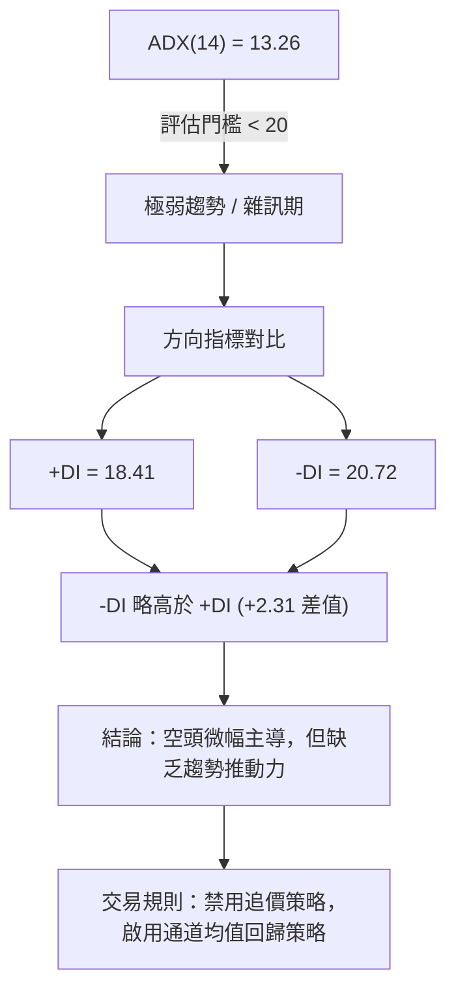

| ADX 區間 | 趨勢強度特徵 | 當前狀態對照 | 交易操作指導方針 |
|----------|--------------|--------------|------------------|
| 0 - 20   | 弱趨勢 / 盤整震盪 | **AMZN (13.26)** | 嚴禁右側順勢追單；嚴守通道上下軌逆勢交易 |
| 20 - 25  | 趨勢正在醞釀 | - | 觀察成交量異動，等待突破收盤確認 |
| 25 - 40  | 強烈單邊趨勢 | - | 順勢操作，採用均線追隨與移動止損 |
| 40 以上  | 極端超買/超賣趨勢 | - | 警惕趨勢衰竭，尋找動能背離平倉點 |

---

## 3. 圖表形態分析

### 🔍 形態識別系統

在多週期日線與週線結構中，AMZN 目前展現出一個由 2026 年 5 月高點 $270.64 與 7 月高點 $271.58（盤中最高 $287.20）構築的大型平臺回調形態，下方則由 2026-06 底的低點 $232.11 與當前 S1 ($244.51) 支撐構築支撐弧底。

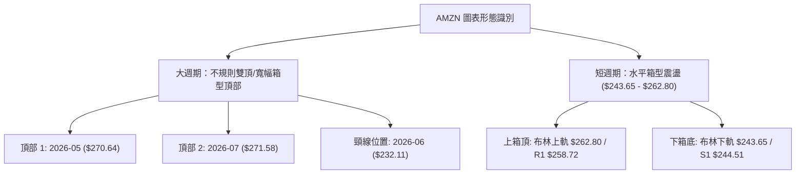

| 形態名稱 | 信心度 | 判斷依據（引用數據） | 完成度 | 目標價（附計算式） |
|----------|--------|----------------------|--------|--------------------|
| 中期雙重頂 (Double Top) | 55% | 兩次高點月收盤為 2026-05 ($270.64) 與 2026-07 ($271.58)，極端高點 $287.20；中間頸線為 06-28 低點 $232.11 | 60% (尚未跌破頸線) | 若跌破頸線 $232.11：目標 = 頸線 $232.11 - (形態高點 $271.58 - 頸線 $232.11) = **$192.64** (接近 52W 低點 $196.00) |
| 短期水平箱型 (Trading Range) | 85% | 價格被壓縮於布林通道上下軌之間，過去數週收盤價均落在 $243.65 至 $262.80 之間 | 90% (持續運行中) | 箱頂突破目標 = $262.80 + ($262.80 - $243.65) = **$281.95**；箱底跌破目標 = $243.65 - 19.15 = **$224.50** (貼近 S2 $225.82) |
| 日線下降楔形收斂 (Falling Wedge) | 45% | 高點由 $274.48 → $266.43 → $262.43 逐步下移，低點在 $249.67 → $250.00 鈍化 | 訊號不足 | 信心度 < 50%，僅做指標型解讀，不予測算激進目標價 |

### 🕯️ 重要K線形態分析

| 月份/週期 | 收盤價 | K線形態 | 解讀 | 訊號 |
|-----------|--------|---------|------|------|
| 2026-06 | $238.34 | 長下影錘子線 | 月線急殺後逢低買盤湧入，爆出單週 5.25 億巨量，確立 $232 區域具備強烈買盤 | 🟢 看多反彈 |
| 2026-07 | $271.58 | 長陽線帶長上影 | 觸及 52W 高點 $287.20 後引發獲利了結盤，多頭上攻受阻 | 🟡 滯漲警告 |
| 2026-08 | $259.77 | 倒轉中陰線 | 吞噬前月漲幅中軸，確認 $270 上方套牢賣壓沉重 | 🔴 轉入回調 |
| 2026-09 | $249.15 | 縮量十字星 | 實體極窄，成交量銳減至 1.14 億~1.96 億低水位，多空進入觀望休整 | 🟡 變盤蓄勢 |
| 2026-10-18 | $250.00 | 小陰十字星 | 日線與週線交匯於斐波那契 38.2% ($252.36) 下方，多空處於極致僵局 | 🟡 窄幅整固 |

### 📉 ASCII 走勢形態示意圖

```
AMZN 2026-05 至 2026-10 頂部與箱型結構演變示意圖
價格
$287.20 ┬                       ▲ 52W 極限高點
$271.58 ┤         ● 頂部 1      │      ● 頂部 2
        │        ╱ ╲            │     ╱ ╲
$262.80 ┼───────╱───╲──────────┼────╱───╲─────── 布林通道上軌
$258.72 ┤      ╱     ╲          │   ╱     ╲        阻力位 R1
$250.00 ┤     ╱       ╲         │  ╱       ● ─── 現價 ($250.00)
$243.65 ┼────╱─────────╲───────┼─╱────────────── 布林通道下軌
$242.73 ┤   ╱           ╲      │╱                MA200 牛熊線
$232.11 ┴──● 頸線低點 ───●─────┴──────────────── 06-28 爆量防守低點
        └────────────────────────────────────────
          2026-05      2026-06   2026-07   2026-09   2026-10
```

### 🎯 形態目標價計算

根據雙重頂及水平箱型之幾何量度規則，各關鍵形態之測算如下：

1. **短期箱型震盪形態量度**：
   - 箱頂（BB上軌）= **$262.80**
   - 箱底（BB下軌）= **$243.65**
   - 箱型高度 $H = 262.80 - 243.65 = \mathbf{\$19.15}$
   - 若向上實體突破 $262.80，測算目標價 = $262.80 + 19.15 = \mathbf{\$281.95}$（貼近 52W 高點 $287.20）
   - 若向下實體跌破 $243.65，測算目標價 = $243.65 - 19.15 = \mathbf{\$224.50}$（直接測試 S2 支撐位 **$225.82**）

2. **中期大雙頂形態（預警性質，信心度 55%）**：
   - 頂部均值 = $(270.64 + 271.58) / 2 = \mathbf{\$271.11}$
   - 頸線 = **$232.11**（2026-06-28 低點）
   - 形態落差 = $271.11 - 232.11 = \mathbf{\$39.00}$
   - 理論測量跌幅 = $232.11 - 39.00 = \mathbf{\$193.11}$（僅在正式跌破 $232.11 時方行觸發）

---

## 4. 支撐與阻力

### 🗺️ 關鍵價位分布圖（Unicode）

```
AMZN 價位結構分布圖（嚴格依據 OHLCV 聚類計算）
═══════════════════════════════════════════════════════════════
$287.20 ║ 52週最高點 (0.0% 斐波那契基準)
$276.65 ║████████████████████████ 強阻力 R3 (年內次高反彈極限)
$267.56 ║████████████████████    阻力 R2 (08-30反彈波段高點)
$265.68 ║ 23.6% 斐波那契回調位
$258.72 ║████████████████████████ 關鍵阻力 R1 (MA50 $257.08 聚類)
$252.36 ║ 38.2% 斐波那契回調位 (現價緊鄰阻力)
$250.00 ╠════════════════════════ ◄ 當前市價 ($250.00)
$244.51 ║▓▓▓▓▓▓▓▓▓▓▓▓▓▓▓▓        近端支撐 S1 (近期波段低點聚類)
$242.73 ║ 200日移動平均線 MA200 (生命線)
$241.60 ║ 50.0% 斐波那契回調位 (多空平衡中樞)
$230.84 ║ 61.8% 斐波那契黃金分割位
$225.82 ║████████████████████████ 強支撐 S2 (06-28爆量換手低點)
$220.99 ║████████████████████████ 極限支撐 S3 (年內深度回撤低位)
$196.00 ║ 52週最低點 (100.0% 斐波那契基準)
═══════════════════════════════════════════════════════════════
```

### 🚧 阻力位分析表

所有阻力數值完全引用系統提供之波段高點聚類數值，嚴禁捏造：

| 阻力級別 | 價位 | 形成原因 | 突破難度 | 重要性 |
|----------|------|----------|----------|--------|
| **R1** | **$258.72** | 近期波段高點聚類，且與日線 MA50 ($257.08) 及 MA60 ($256.47) 形成強烈均線壓制帶 | 🟡 中等偏高 | 🔴 核心短線空頭防線，唯有收盤站上此位，短線結構方能翻多 |
| **R2** | **$267.56** | 2026-08-30 波段反彈高點聚類，並與斐波那契 23.6% ($265.68) 共振 | 🔴 困難 | 🟡 中期多頭反彈強阻力區，若無 2.5 億以上週量能難以有效攻克 |
| **R3** | **$276.65** | 逼近 2026-08-09 週線高點 $274.48 與 52W 高點 $287.20 之解套賣壓密集區 | 🔴 極度困難 | 🟢 長期牛市延伸之關鍵分水嶺，決定是否能改寫歷史新高 |

### 🛡️ 支撐位分析表

所有支撐數值完全引用系統提供之波段低點聚類數值：

| 支撐級別 | 價位 | 形成原因 | 守住機率 | 重要性 |
|----------|------|----------|----------|--------|
| **S1** | **$244.51** | 近一年波段低點聚類，與布林下軌 ($243.65) 及 MA200 ($242.73) 高度重疊 | 🟢 75% | 🔴 短線防守之生死線，跌破則意味著均線全線失守且轉為弱勢 |
| **S2** | **$225.82** | 2026-06-28 週線爆出 5.25 億天量換手區之低點密集防守帶 | 🟢 85% | 🟢 中期強結構性底部，為機構多頭法人重金構建的護城河底線 |
| **S3** | **$220.99** | 2025 年秋季突破平臺的頂底轉換位，深幅回調的極限承接帶 | 🟢 90% | 🟡 崩盤防守位，失守將考驗 52W 低點 $196.00 |

### 📐 斐波那契回調位分析

依據 52 週波動區間：低點 **$196.00**（2025年回調低點）至高點 **$287.20**（2026年歷史峰值），波幅全寬為 $91.20。各黃金分割位嚴格引用系統計算值：

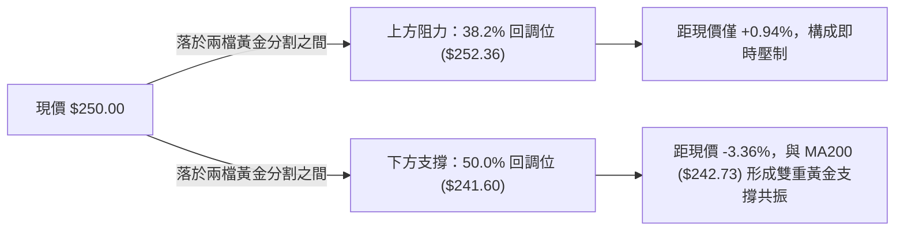

- **0.0% (52W High)**: **$287.20**
- **23.6% 回調位**: **$265.68** — 過去多輪衝高回落的第一承接位，目前轉化為強壓。
- **38.2% 回調位**: **$252.36** — **【現價 $250.00 正處於此位下方極近處】**。此位在技術分析中為強勢整理的標準極限，現價在此處膠著，顯示多方正試圖守護強勢回調框架。
- **50.0% 回調位**: **$241.60** — 多空力量均勻分水嶺，與 MA200 ($242.73) 僅相差 $1.13，為多頭絕不可失守的防線。
- **61.8% 回調位**: **$230.84** — 黃金分割關鍵防線，若跌破此位，原本的上升趨勢將遭到實質破壞。
- **78.6% 回調位**: **$215.52** — 深度空頭回撤位。
- **100.0% (52W Low)**: **$196.00** — 週期底部基準點。

---

## 5. 技術指標深度解讀

### 🎛️ 指標訊號總覽

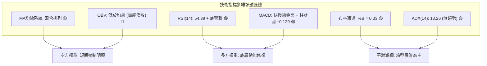

### 📈 移動平均線排列分析

AMZN 當前均線呈現標準的「短空長多」混合糾纏排列格局：

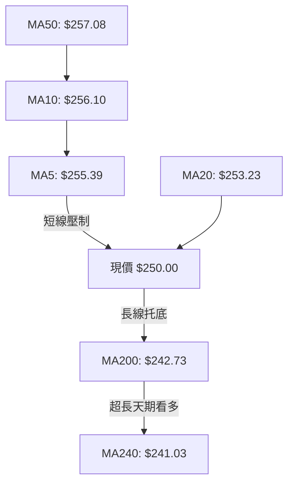

```
均線系統數值與乖離率一覽表：
╔═══════════════════════════════════════════════════════════════════════════╗
║ 均線種類   數值      現價相對位置   乖離率 (%)   趨勢微型圖               ║
╠═══════════════════════════════════════════════════════════════════════════╣
║ MA 5      $255.39      ▼ 下方        -2.11%     ▇▇▇▆▆▅▄▃▂▃▄▅▄▄▂   ║
║ MA 10     $256.10      ▼ 下方        -2.38%     ██▇▇▇▆▅▄▄▃▃▃▃▃▂   ║
║ MA 20     $253.23      ▼ 下方        -1.27%     ██▇▆▆▆▅▅▄▄▄▄▃▃▃▂   ║
║ MA 50     $257.08      ▼ 下方        -2.75%     (中期生命線，反壓)       ║
║ MA 60     $256.47      ▼ 下方        -2.52%     ▁▁▁▁▂▂▂▃▃▃▄▅▅▆▆▆   ║
║ MA120     $254.77      ▼ 下方        -1.87%     ▁▁▁▂▂▃▃▄▄▅▅▆▆▇▇█   ║
║ MA200     $242.73      ▲ 上方        +2.99%     (長期牛熊線，有力托底)   ║
║ MA240     $241.03      ▲ 上方        +3.72%     ▁▁▁▁▂▂▂▂▃▃▃▄▄▄▅▅   ║
╚═══════════════════════════════════════════════════════════════════════════╝
```

**均線綜合解讀**：
1. 短天期均線（MA5、MA10、MA20）形成微幅空頭發散，且 MA50 ($257.08) 與 MA60 ($256.47) 在上方 $256.50 - $258.70 構築密集的均線反壓蓋頂。
2. 長天期均線（MA200 $242.73 與 MA240 $241.03）則保持健康的向上傾斜角度，對現價形成堅實的動態支撐，阻斷了空頭深幅下挫的空間。

### 📉 RSI(14) 分析

當前日線 RSI(14) 讀數為 **54.39**，位於 30-70 的常態中性區間。

```
RSI(14) 數值進度條：
0 ════════════ 30 ══════════════════ 54.39 ════════════ 70 ════════════ 100
[    超賣區    ] [       中性平衡區    ▲       ] [    超買區    ]
進度條：███████████████████████░░░░░░░░░░░░░░░░░░░ 54.39%
```

- **背離診斷（重要）**：系統明確偵測到 **⚠️ 底背離 (Bullish Divergence)** 訊號。
  - **形態依據**：回顧 2026-09-20 至 2026-09-27 期間，價格由 $253.71 回落至 $249.67，但週線與日線 RSI 分別由 36.2 抬升至 40.0，隨後在 10-04 站上 47.5、10-18 達到 54.4。價格在 $250 關卡形成平底低點，而動能指標卻持續墊高，確認空方下殺動能已出現顯著竭盡。

### 📊 MACD(12/26/9) 訊號解讀

- **MACD 線 (DIF)**：0.186
- **訊號線 (DEA)**：0.057
- **MACD 柱狀圖 (Histogram)**：**+0.129** (🟢 柱體翻正且擴張)

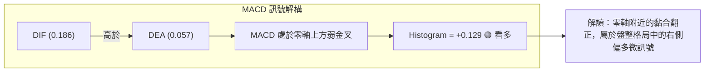

回顧近 4 週的週線 MACD 柱狀圖走勢：-0.415 (09-27) → -0.064 (10-04) → +1.434 (10-11) → +0.129 (10-18)。柱狀圖成功翻紅，顯示中短期空方拋壓已經被多頭承接吸收。

### 📦 布林通道分析

布林參數為標準日線 (20, 2)：
- **布林上軌**：**$262.80**
- **布林中軌 (MA20)**：**$253.23**
- **布林下軌**：**$243.65**
- **當前帶寬 (Bandwidth)**：$(262.80 - 243.65) / 253.23 = \mathbf{7.56\%}$ (處於收斂縮口狀態)
- **當前位置 %B**：**0.33**

```
布林通道當前結構 ASCII 示意圖：
$262.80 ┬────────────────────────────────────────── 布林上軌 (Resistance)
        │
$253.23 ┼ - - - - - - - - - - - - - - - - - - - -  布林中軌 (MA20 反壓)
        │                 ● 現價 $250.00 (%B = 0.33)
$243.65 ┴────────────────────────────────────────── 布林下軌 (Support)
```

**通道解讀**：%B 為 0.33，代表現價處於中軌與下軌之間的下半部弱勢區。但由於帶寬僅為 7.56%，通道處於收口後的橫盤蓄勢期，下軌 $243.65 與支撐位 S1 ($244.51) 幾乎重合，構成即時的高勝率支撐防線。

### 💹 成交量分析（量價配合度）

- **最新成交量**：40,306,000 股
- **20日均量**：35,800,085 股（量比：**1.13x**）
- **50日均量**：34,106,842 股
- **OBV (能量潮指標)**：**OBV < MA → 狀態顯示量能疲弱**

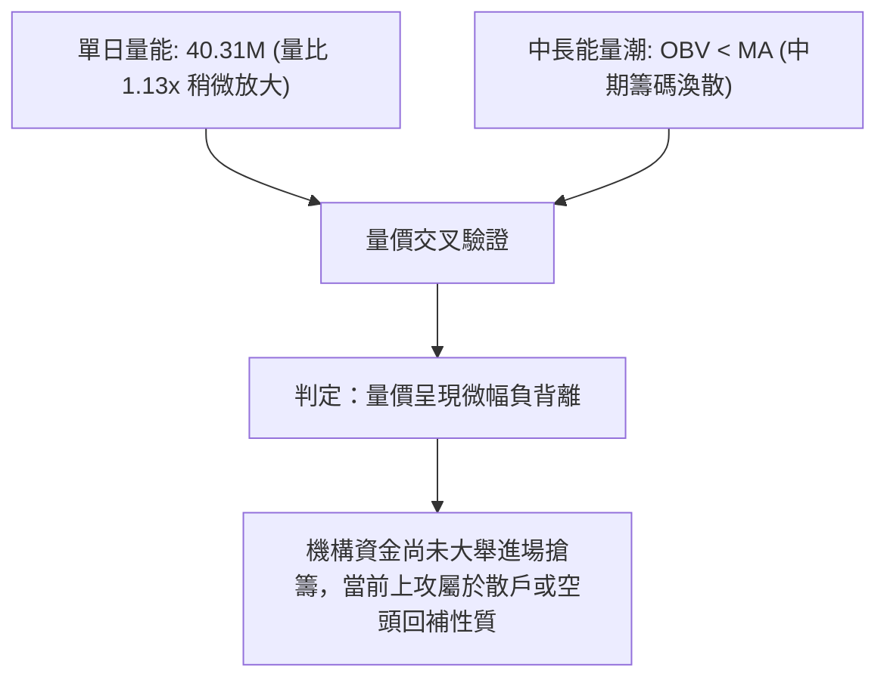

雖然今日單日成交量突破了 20 日與 50 日均量線，但 OBV 依然運行於其均線下方，這代表過去幾個月從 $271.58 回落的過程中，籌碼流出大於流入，當前的反彈缺乏機構級的持續放量背書。

---

## 6. 動能與波動率

### ⚡ 動能評估四象限

結合動能指標（RSI 54.39、MACD +0.129）與波動率維度（ATR 2.36%、ADX 13.26、布林帶寬 7.56%），將 AMZN 定位於技術四象限中：

| 象限 | 動能強度 | 波動率水準 | 當前對應特徵 | 交易策略指導 | AMZN 狀態標記 |
|------|----------|------------|--------------|--------------|:-------------:|
| **Q1 (突破機會)** | 強 (RSI>60, MACD強多) | 低 (ATR收斂, ADX<20) | 暴風雨前的寧靜，即將爆發大單邊 | 提早佈局突破單，順勢跟進 | ❌ |
| **Q2 (震盪整固)** | 弱 (RSI 45-55, 底背離) | 低 (ATR 2.36%, ADX 13.26) | 典型的箱型整理與蓄勢結構 | 高拋低吸，嚴守支撐阻力通道 | **✓ (當前所處位置)** |
| **Q3 (主升主跌)** | 強 (趨勢爆發, ADX>30) | 高 (ATR大幅飆升) | 單邊主升浪或恐慌性拋售 | 順勢加碼，拉開移動止損 | ❌ |
| **Q4 (寬幅震盪)** | 弱 (多空拉鋸無方向) | 高 (劇烈洗盤震盪) | 無序假突破，反覆洗劫兩端流動性 | 空倉觀望或大幅縮減部位 | ❌ |

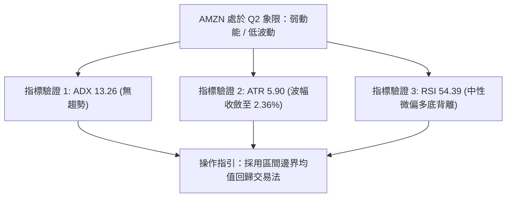

### 📊 ATR 波動率分析

- **ATR(14)**：**$5.90**
- **ATR 佔比 (ATR/Price)**：**2.36%**

在風險控制中，ATR 是設置科學止損距離的核心工具：
- **常規日內波動半徑**：1.0 × ATR = **$5.90**
- **寬鬆波段止損距離 (防雜訊洗盤)**：1.5 × ATR = 1.5 × 5.90 = **$8.85**
- **保守止損距離 (極度防守)**：2.0 × ATR = 2.0 × 5.90 = **$11.80**

若以當前價格 $250.00 進場，在無結構位干擾下，純波動率止損點應設於：
- $250.00 - $8.85 = **$241.15**（此數值恰好與 50% 斐波那契回調位 $241.60 及 MA200 $242.73 高度共振，證明該防守位置極為紮實）。

### 📐 Beta 與市場相關性

- **Beta 係數**：**1.456**
- **解讀**：AMZN 的 Beta 為 1.456，屬於**高彈性成長型個股**。當標普 500 指數 (S&P 500) 或那斯達克 (Nasdaq 100) 出現 1% 的單邊波動時，理論上 AMZN 將放大波動約 1.46%。
- **空頭部位警示**：目前空頭部位佔流通股比例僅為 **0.9%**（Short Ratio: 2.49 天），顯示市場並不存在極端的放空投機情緒，下檔賣壓主要源於機構獲利盤的緩慢調倉，而非大規模惡意做空，發生放空擠壓 (Short Squeeze) 的機率偏低。

---

## 7. 多時框架總結

### 📋 時框架評分表

| 時框架 | 趨勢方向 | 動能狀態 | 均線排列 | 圖表形態 | 綜合評分 | 戰術建議 |
|--------|----------|----------|----------|----------|:--------:|----------|
| **月線 (長線)** | 🟢 向上偏多 | 🟡 中性整理 (自高檔回撤) | 🟢 位於 MA240 ($241.03) 之上 | 大週期圓弧底後的平臺消化 | **75/100** | 核心長線部位繼續持有，拉回年線加碼 |
| **週線 (中線)** | 🟡 橫向箱型 | 🟢 MACD 翻正，底背離修復 | 🟡 均線糾纏 | $232 - $274 寬幅箱型 | **55/100** | 區間思維操作，接近箱底佈局多單 |
| **日線 (短線)** | 🔴 弱勢承壓 | 🟡 RSI 54.39 / MACD 弱金叉 | 🔴 承壓於 MA20/MA50 | 縮口布林通道，受制中軌 | **45/100** | 不宜在 $250-253 追高，等待拉回下軌或突破 |

### 🔲 綜合訊號矩陣

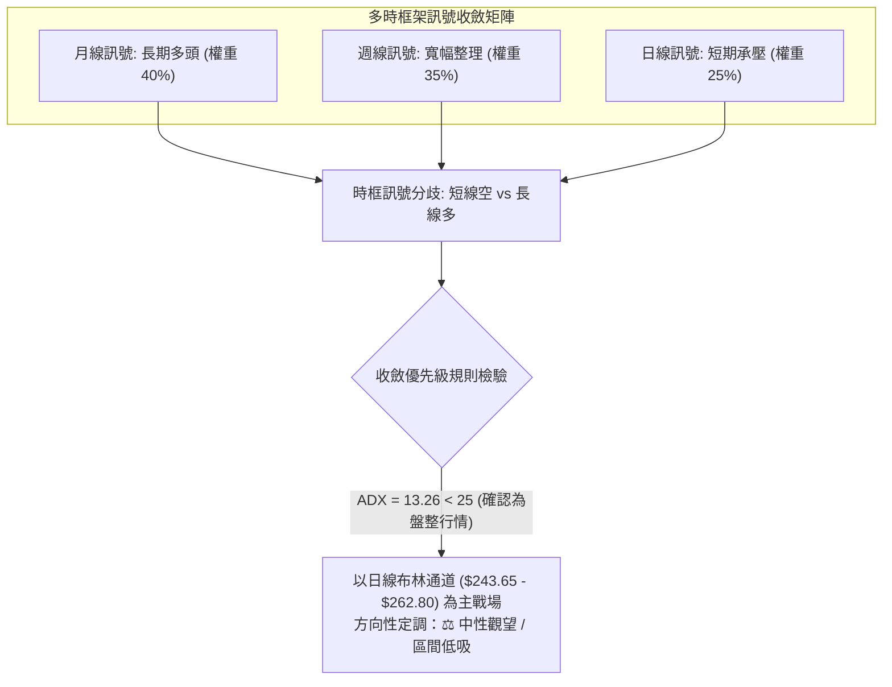

### ⚖️ 多時框收斂結論

嚴格遵循本報告之「多時框收斂規則（規則 14）」：
1. **行情性質判定**：當前日線 ADX(14) 讀數為 **13.26**，遠低於臨界值 25，明確判定當前市場處於**盤整行情 (Range-bound Market)**。
2. **主導維度選擇**：依規則，盤整行情中應**以日線布林通道上下軌 ($243.65 - $262.80) 作為核心交易區間**，忽略單邊順勢突破訊號，採取均值回歸思維。
3. **最終收斂結論**：**中性觀望，偏向區間下軌低吸 (Neutral with Bullish Bias at Support)**。
   - 儘管日線受制於 MA20 ($253.23) 與 MA50 ($257.08)，但週線與月線的 MA200 ($242.73) 與 S1 ($244.51) 提供了強大的長週期安全墊。因此，空頭向下空間已被鎖死在 $243 附近，交易重心應鎖定在「下軌接刀、中上軌平倉」，不進行單邊做空追擊。

---

## 8. 交易策略建議

### 🗺️ 策略決策流程圖

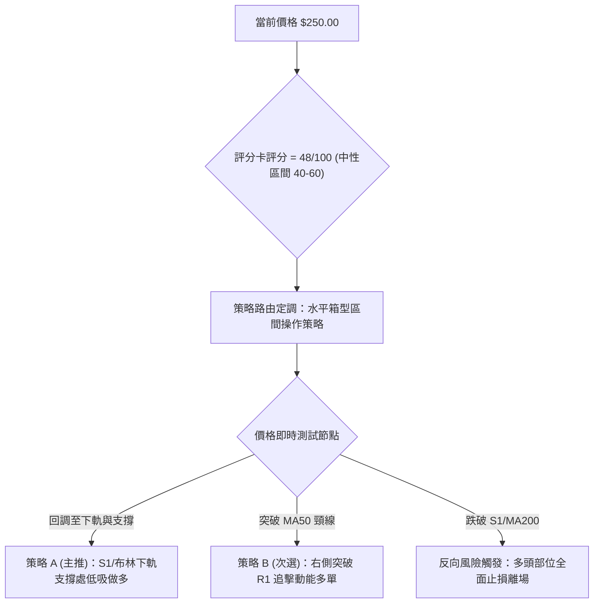

### 🧭 策略路由（依評分卡分流）

> **當前主策略方向 = 【中性區間操作，偏向支撐位低吸】（依綜合評分 48/100 定調）**

依據評分卡 48/100（落於 40–60 之中性區間），市場不具備單邊趨勢條件，禁止過度激進之單邊槓桿操作。策略主軸聚焦於**「依託布林下軌 $243.65 與支撐位 S1 $244.51 佈局勝率較高的均值回歸多單」**；空頭策略僅作為下行破位時的風險對沖防護。

### 🎯 價格情境階梯（Price Scenarios）

所有價位均嚴格引用第 4 章由 OHLCV 聚類計算之數值：

| 觸發條件 | 下一目標 | 後續延伸 | 情境含義 | 操作應對方針 |
|----------|----------|----------|----------|--------------|
| **強勢突破 R1 ($258.72)** | **R2 ($267.56)** | **R3 ($276.65)** | 短線轉強，突破日線均線壓制帶 | 啟動右側加碼，目標直指箱頂與 23.6% 斐波位 |
| **站穩現價區間 ($250.00)** | **中軌 ($253.23)** | **R1 ($258.72)** | 延續低位微幅震盪，底背離修復 | 小倉位逢低吸納，不追高 |
| **有效跌破 S1 ($244.51)** | **S2 ($225.82)** | **S3 ($220.99)** | 中期轉弱，跌破 MA200 生命線 | 多單全數止損離場，空頭目標下看天量換手區 |

### 📊 情境機率分佈


| 情境類別 | 機率預估 | 主要技術指標依據 |
|----------|:--------:|------------------|
| **區間震盪 (箱型拉鋸)** | **55%** | ADX 僅 13.26 極端鈍化；布林通道帶寬收窄至 7.56%；OBV 缺乏放量配合。現價將持續於 $244.51 - $258.72 內拉鋸。 |
| **回踩反彈 (測試向上)** | **30%** | 日線 RSI 底背離確立；MACD 柱狀圖翻紅 (+0.129)；MA200 ($242.73) 具備強大逢低托底買盤。 |
| **回落破位 (二度探底)** | **15%** | -DI (20.72) 仍高於 +DI；現價受制於 MA20/MA50。若宏觀流動性收縮，跌破 S1 將誘發恐慌賣壓。 |

### 🟢 主策略詳情（方向：區間操作 / 支撐低吸）

本處提供兩套精確數值策略，所有止損、進場與目標價**完全引用關鍵價位與通道邊界**：

| 策略要素 | 策略 A：布林下軌/S1 支撐回踩吸籌（左側偏多） | 策略 B：右側突破 MA50/R1 追擊動能（右側順勢） |
|----------|---------------------------------------------|-----------------------------------------------|
| **進場條件** | 價格回踩 S1 與布林下軌附近，出現 1-4 小時縮量止跌 K 線 | 日線實體收盤價突破關鍵阻力位 R1，且單日量比 > 1.3x |
| **進場價格** | **$245.00**（掛單於 S1 $244.51 上方） | **$259.00**（突破 R1 $258.72 後確認進場） |
| **目標價 T1** | **$253.23**（布林中軌 / MA20，第一阻力） | **$267.56**（阻力位 R2，波段高點） |
| **目標價 T2** | **$258.72**（阻力位 R1，箱頂壓力區） | **$276.65**（阻力位 R3，年內高位區） |
| **止損價格** | **$241.00**（跌破 MA200 $242.73 及 50% 斐波位 $241.60） | **$253.23**（跌回原突破點 MA20 中軌下方） |
| **風險額度** | 虧損空間：$245.00 - $241.00 = **$4.00** | 虧損空間：$259.00 - $253.23 = **$5.77** |
| **獲利空間** | T2 空間：$258.72 - $245.00 = **$13.72** | T2 空間：$276.65 - $259.00 = **$17.65** |
| **風險報酬比** | **1 : 3.43** (極佳盈虧比) | **1 : 3.06** (標準突破盈虧比) |
| **勝率估計** | **65%** | **50%** |
| **建議倉位** | **總資金之 10% - 15%** | **總資金之 8% - 10%** |

### 🔴 反向風險觸發點（對沖提示）

- **關鍵多頭失效點**：若日線收盤價跌破 **$241.60**（50% 斐波那契回調位）且摜破 **MA200 ($242.73)**，本報告之「中性偏多/區間操作」邏輯**全數作廢**。
- **對沖應對指引**：若此現象發生，持有多單應立即無條件止損，激進型投資者可反手建立小額空頭對沖部位，目標下看支撐位 **S2 ($225.82)**，反彈至 $244.51 則空單平倉止損。

### ⭐ 整體訊號強度評星

```
做多訊號強度：★★★☆☆  (3.0/5星 — 底背離修復，MA200支撐強勁，但量能不足)
做空訊號強度：★★☆☆☆  (2.0/5星 — 均線短空，但下方空間有限，盈虧比極差)
整體可信度：  ★★★★☆  (4.0/5星 — 箱型邊界明確，ADX低值確認盤整屬性)
```

---

## 9. 風險提示與監控

### ✅ 關鍵監控指標 Checklist

```
╔══════════════════════════════════════════════════════════════════╗
║               AMZN 每日交易關鍵監控清單 (Checklist)             ║
╠══════════════════════════════════════════════════════════════════╣
║ [ ] 監控項 1：價格是否守住 S1 支撐位 $244.51？                    ║
║     └─ 若跌破，立即警惕 MA200 ($242.73) 的防守有效性            ║
║ [ ] 監控項 2：日線能否放量收復 MA20 ($253.23) 與 38.2% ($252.36)？║
║     └─ 站穩中軌是向 R1 ($258.72) 發起衝擊的前提條件             ║
║ [ ] 監控項 3：ADX(14) 是否由 13.26 向上翹頭升破 20？             ║
║     └─ 若 ADX > 20 伴隨 +DI > -DI，代表單邊向上趨勢正式啟動       ║
║ [ ] 監控項 4：成交量是否突破 50日均量 (34.10M 股)？              ║
║     └─ OBV 必須形成向上交叉，方可確認為機構實質買盤進場         ║
║ [ ] 監控項 5：MACD 柱狀圖是否持續維持在正值區間 (> 0)？          ║
║     └─ 若由 +0.129 轉為負值，底背離動能即告衰竭                 ║
╚══════════════════════════════════════════════════════════════════╝
```

### ⚠️ 風險場景分析

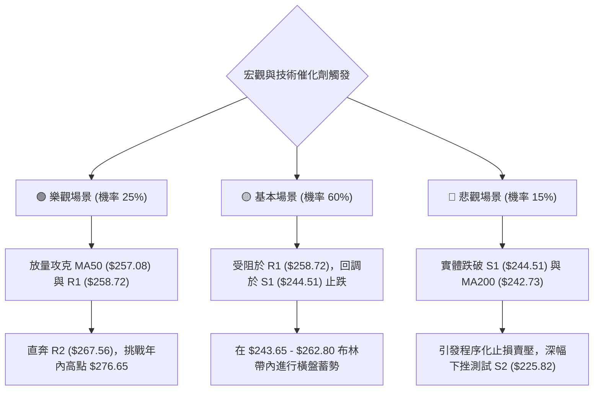

### 🛡️ 風險管理重要提醒

1. **防範假突破風險**：由於 ADX 僅為 13.26，盤整市場中最常見的特徵即為「假突破與假跌破」。在價格短暫突破 $258.72 或跌破 $244.51 時，必須以**日線收盤價**作為確認依據，盤中避免盲目追價。
2. **Beta 槓桿管理**：AMZN 的 Beta 為 1.456，波動大於大盤。在科技股財報季或總經議息會議前後，需將部位規模下調 30%-50%，防止隔夜跳空風險直接穿透止損。
3. **資金管理紀律**：單筆交易的最大虧損金額務必控制在總投資本金的 **1.0% - 1.5%** 之內。若以策略 A 為例，停損距離為 $4.00，則每 10 萬美元本金最多僅能操作 250 至 375 股，嚴禁重倉孤注一擲。

---

## 📋 報告總結

```
╔══════════════════════════════════════════════════════════════════╗
║                   AMZN 技術分析報告總結                          ║
╠══════════════════════════════════════════════════════════════════╣
║ 報告日期：2026-10-18                                             ║
║ 當前價格：$250.00                                                ║
║ 分析評級：⚖️ 中性觀望 / 區間震盪 (Neutral-Rangebound)           ║
║ 技術評分：48 / 100 (無顯著單邊趨勢，回歸通道交易)                 ║
╠══════════════════════════════════════════════════════════════════╣
║ 關鍵結論：                                                       ║
║ ├─ 長期趨勢：🟢 多頭托底 (MA200 $242.73 與 MA240 $241.03 穩步上行)║
║ ├─ 中期趨勢：🟡 寬幅箱型 ($232.11 - $274.48，目前處於箱體中下部) ║
║ ├─ 短期趨勢：🔴 偏弱整理 (受制於 MA20 $253.23 與 MA50 $257.08)  ║
║ ├─ 關鍵支撐：S1: $244.51 │ S2: $225.82 │ 斐波50%: $241.60       ║
║ ├─ 關鍵阻力：R1: $258.72 │ R2: $267.56 │ 斐波38.2%: $252.36     ║
║ └─ 機構共識：Strong Buy │ 平均目標價: $331.46 (58位分析師)        ║
╠══════════════════════════════════════════════════════════════════╣
║ 最優策略組合：                                                   ║
║ 1. 🥇 最佳機會：等待回踩 S1 ($244.51) 與布林下軌處佈局做多 (策略A) ║
║ 2. 🥈 次選機會：突破 MA50 阻力 R1 ($258.72) 後右側順勢追多 (策略B) ║
║ 3. 🥉 保守選擇：空倉觀望，等待 ADX 升破 20 趨勢明朗化後再行介入   ║
╚══════════════════════════════════════════════════════════════════╝
```

---

> ⚠️ **免責聲明**：本報告為 AI 自動生成之技術分析，所有數據及估算均基於提供的歷史價格資訊。本報告**僅供研究與學術參考**，**不構成任何投資建議**。投資有風險，入市需謹慎。

---

*報告生成時間：2026-10-18 ｜ 數據來源：Yahoo Finance ｜ 分析框架：多時框技術分析*