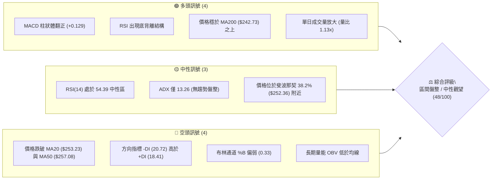
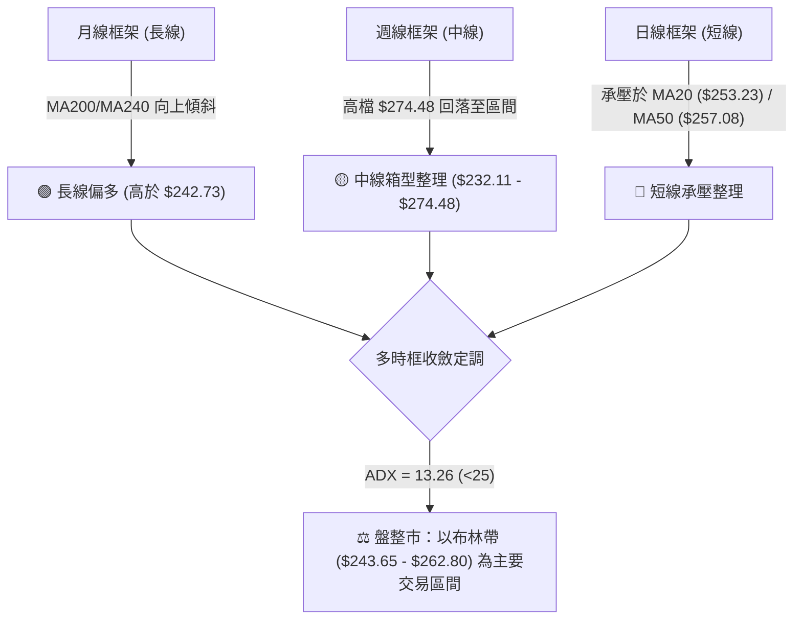
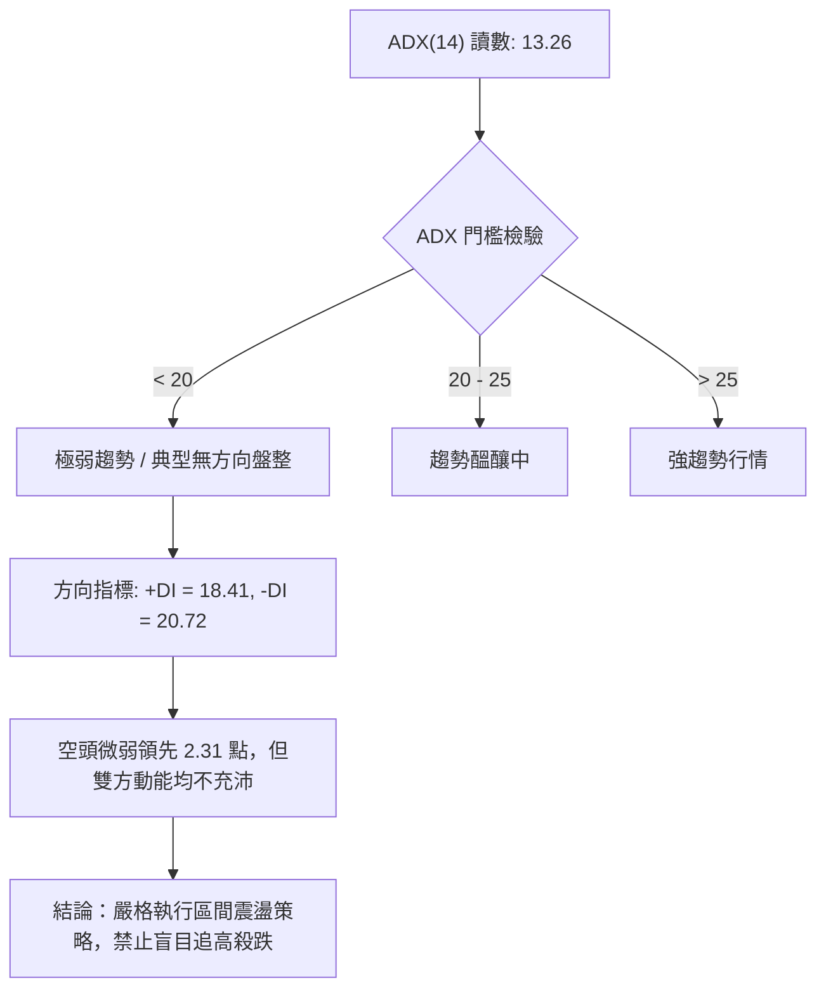
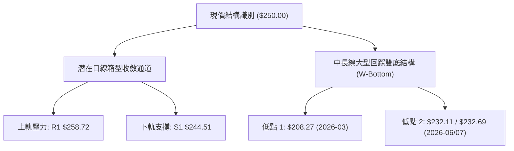
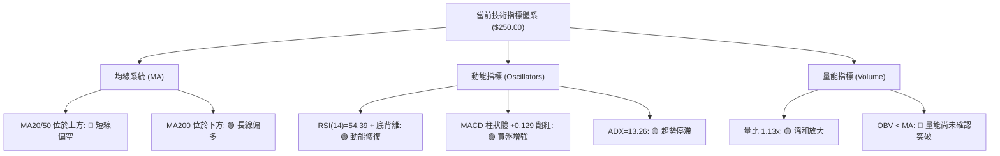
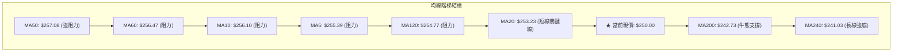
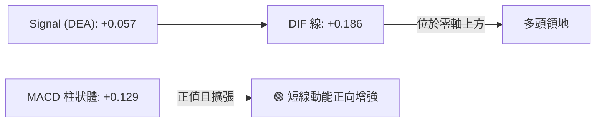
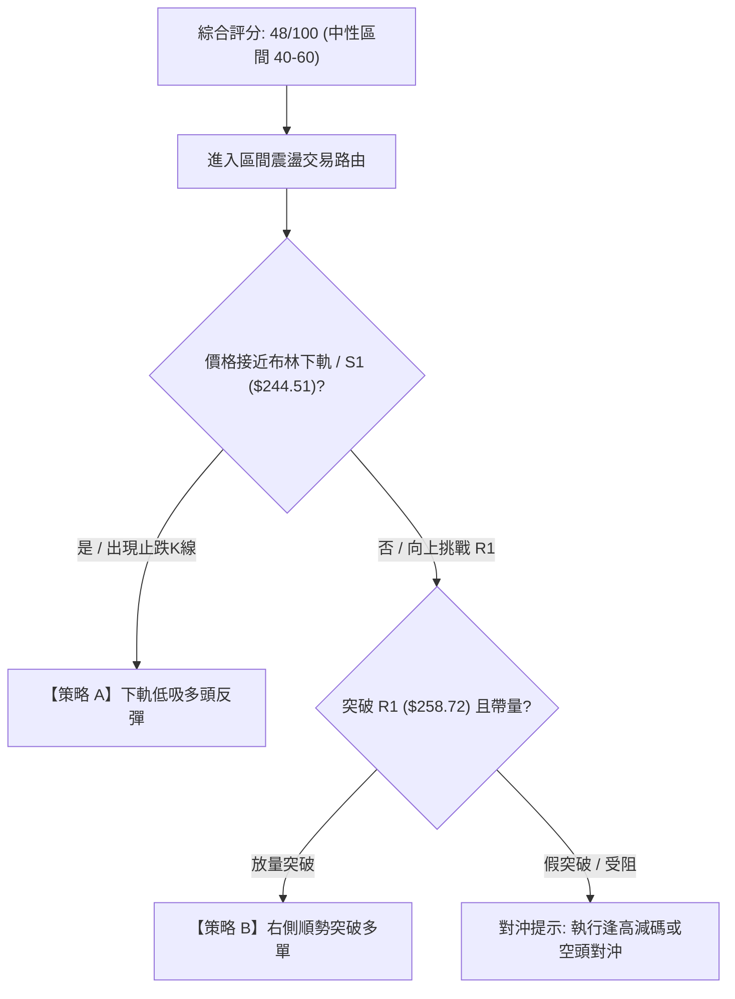
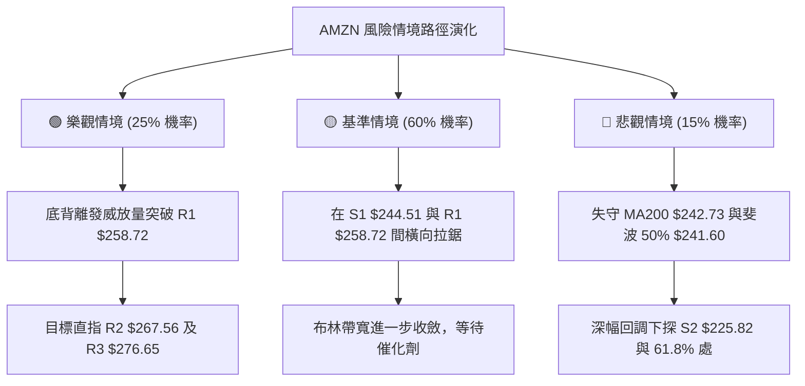

# AMZN 技術分析報告

> **報告日期**：2026-10-19 ｜ **語言**：繁體中文 ｜ **數據來源**：Yahoo Finance ｜ **當前價格**：$250.00

---

## 目錄

| 章節 | 內容 |
|------|------|
| [1. 技術面概覽](#1-技術面概覽) | 訊號儀表板、核心指標、評分卡 |
| [2. 趨勢分析](#2-趨勢分析) | 多時框趨勢、長中短期走勢 |
| [3. 圖表形態分析](#3-圖表形態分析) | 形態識別、K線組合、目標價 |
| [4. 支撐與阻力](#4-支撐與阻力) | 關鍵價位、斐波那契回調 |
| [5. 技術指標深度解讀](#5-技術指標深度解讀) | MA/RSI/MACD/布林/成交量 |
| [6. 動能與波動率](#6-動能與波動率) | 動能評估、ATR、Beta |
| [7. 多時框架總結](#7-多時框架總結) | 時框架評分矩陣 |
| [8. 交易策略建議](#8-交易策略建議) | 多空策略、風險報酬比 |
| [9. 風險提示與監控](#9-風險提示與監控) | 監控指標、風險場景 |

---

## 1. 技術面概覽

### 🎯 技術訊號儀表板



### 📊 核心指標速覽表

| 指標類別 | 指標名稱 | 當前數值 | 訊號 | 解讀 |
|----------|----------|----------|------|------|
| **價格** | 當前收盤價 | $250.00 | 🟡 | 位於52週高低區間（$196.00–$287.20）的 59.2% 位置，處於區間中軸 |
| **均線** | 短期 MA20 | $253.23 | 🔴 | 現價低於 MA20（-1.27%），短期均線形成上方第一道動態阻力 |
| **均線** | 中期 MA50 | $257.08 | 🔴 | 現價低於 MA50（-2.75%），中期多頭上攻結構暫受壓制 |
| **均線** | 長期 MA200| $242.73 | 🟢 | 現價高於 MA200（+2.99%），長期牛熊分界線維持多頭保護結構 |
| **動能** | RSI(14) | 54.39 | 🟡 | 位於 30–70 中性區間，且日線級別呈現潛在底背離（Bullish Divergence） |
| **動能** | MACD (12,26,9) | 0.186 / 0.057 | 🟢 | DIF 線位於訊號線上方，Histogram 為 +0.129，動能微幅轉正 |
| **震盪** | Stoch %K / %D | 26.19 / 42.78 | 🟡 | 位於超賣邊緣向中性過渡區，%K 尚未顯著金叉 %D |
| **趨勢** | ADX(14) | 13.26 | 🟡 | ADX 遠低於 25，明確確認當前非趨勢行情，屬於典型無趨勢震盪市 |
| **通道** | 布林通道 | $243.65–$262.80 | 🟡 | %B 為 0.33，位於通道中軌（$253.23）與下軌之間，壓縮蓄勢中 |
| **成交量**| 成交量 / 20日均量 | 40.31M / 35.80M | 🟡 | 當日量比 1.13x，但 OBV 仍低於均量線，中長期買盤能量尚未持續爆發 |
| **波動** | ATR(14) | $5.90 | 🟡 | 每日平均波幅佔股價 2.36%，短線處於波動度收縮後的蓄勢階段 |

### 🏆 技術評分卡

```
╔══════════════════════════════════════════════════════════════╗
║              技術評分卡 — AMZN (2026-10-19)                  ║
╠══════════════════════════════════════════════════════════════╣
║ 趨勢強度 (Trend)     ████░░░░░░░░░░░░░░░░  25/100  🔴 極弱   ║
║ 動能指標 (Momentum)  ███████████░░░░░░░░░  55/100  🟡 中性偏多║
║ 支撐穩定度 (Support) ██████████████░░░░░░  70/100  🟢 良好   ║
║ 成交量配合 (Volume)  ████████░░░░░░░░░░░░  40/100  🔴 偏弱   ║
║ 形態完整度 (Pattern) ██████████░░░░░░░░░░  50/100  🟡 待確認 ║
║ 均線排列 (Moving Avg)█████████░░░░░░░░░░░  45/100  🟡 糾纏   ║
╠══════════════════════════════════════════════════════════════╣
║ 綜合評分             █████████░░░░░░░░░░░  48/100  中性觀望  ║
╚══════════════════════════════════════════════════════════════╝
```

---

## 2. 趨勢分析

### 🌐 多時框趨勢分析



### 📈 長期趨勢 — 12個月走勢圖（Unicode）

以下為 AMZN 自 2025 年 11 月至 2026 年 10 月之月線收盤走勢及波段高低點標註：

```
AMZN 月線收盤走勢圖（過去12個月：2025-11 至 2026-10）
價格軸 ($)
$275 ┤                               ● $271.58(07月)
$270 ┤                   ● $270.64(05月)
$265 ┤             ● $265.06(04月)     ● $259.77(08月)
$260 ┤                                       ● $250.00(10月現價)
$250 ┤                                             ● $249.15(09月)
$240 ┤       ● $239.30(01月)     ● $238.34(06月)
$230 ┤ ● $233.22(11月)
$230 ┤    ● $230.82(12月)
$220 ┤
$210 ┤          ● $210.00(02月)
$205 ┤             ● $208.27(03月波段低點)
     └────────────────────────────────────────────────────────
       11   12   01   02   03   04   05   06   07   08   09   10  (月份)
```

#### 走勢特徵分析表格

| 階段區間 | 時間跨度 | 起訖價位 | 漲跌幅 | 結構特徵與量價行為 |
|----------|----------|----------|--------|--------------------|
| 第一階段：回調築底 | 2025-11 ～ 2026-03 | $233.22 → $208.27 | -10.70% | 於 $208.27–$210.00 連續兩月打底，獲年線與波段支撐保護 |
| 第二階段：強勁主升 | 2026-03 ～ 2026-05 | $208.27 → $270.64 | +29.95% | 突破 2026 年初整理平台，單月大漲噴出，確立中期底部成立 |
| 第三階段：高檔震盪 | 2026-05 ～ 2026-07 | $270.64 → $271.58 | +0.35% | 6月深度洗盤至 $238.34 後迅速拉升至 $271.58，形成寬幅拉扯 |
| 第四階段：回踩收斂 | 2026-07 ～ 2026-10 | $271.58 → $250.00 | -7.95% | 高檔獲利回吐，逐步回踩至 38.2% 斐波那契回調位 $252.36 附近蓄勢 |

### 📊 中期趨勢（週線分析）

中期走勢近 20 週呈現典型的「雙波推升後的中樞震盪」。2026-06-28 當週爆出 5.25 億股鉅量洗盤打出 $232.69 低點，隨後在 2026-08-09 推升至 $274.48 波段高點。隨後週線成交量自 3.55 億股逐步萎縮至 1.61 億股，呈現價跌量縮、量能沉澱的三角形收斂格局。

```
近期週線壓力與支撐示意圖：
  $276.65 ───────────────────────────── [R3 強阻力聚類]
  $274.48 ─── 上波段高點 (2026-08-09)
  $267.56 ───────────────────────────── [R2 中期反彈阻力]
  $258.72 ───────────────────────────── [R1 密集套牢壓力]
  $250.00 ───────────── [★ 當前現價] ─── (落於斐波 38.2% $252.36 下方)
  $244.51 ───────────────────────────── [S1 近期波段關鍵支撐]
  $242.73 ─── MA200 關鍵牛熊線
  $232.11 ─── 07月拉升前起漲低點
  $225.82 ───────────────────────────── [S2 強支撐聚類]
```

### ⚡ 趨勢強度評估（ADX 解讀）



#### ADX 強度對照表

| 指標名稱 | 當前數值 | 門檻標準 | 狀態評估 | 交易意涵 |
|----------|----------|----------|----------|----------|
| **ADX(14)** | 13.26 | < 20 (極弱) | ░░░░░░░ 13.26% | 趨勢動能徹底渙散，走勢陷入無方向橫盤，突破型策略極易假突破 |
| **+DI(14)** | 18.41 | 參考中軸 20 | ░░░░░░░░ 18.41% | 多頭推升意願低迷，追價買盤力道不足 |
| **-DI(14)** | 20.72 | 參考中軸 20 | ░░░░░░░░░ 20.72% | 空方雖佔據上風，但未發動實質下殺攻擊，無單邊下行風險 |

---

## 3. 圖表形態分析

### 🔍 形態識別系統



#### 形態識別與信心度評估表

| 形態名稱 | 信心度 | 判斷依據（引用數據） | 完成度 | 目標價（附計算式） |
|----------|--------|----------------------|--------|--------------------|
| **大型回踩雙底 (W底)** | 65% | 第一低點 $208.27（2026-03 月線），第二低點為 2026-06-28 與 07-26 週線低點聚類（$232.11–$232.69），高點頸線為 2026-05 峰值 $270.64 | 75% | 頸線 $270.64 + 形態高度（$270.64 - $232.11 = $38.53）= **$309.17**（數據中未突破頸線，僅屬形態潛在推算） |
| **矩形箱型整理** | 80% | 價格受困於日線布林下軌支撐 S1 $244.51 與 MA50 / R1 $258.72 之間，ADX=13.26 確認橫盤 | 85% | 區間上沿 R1: **$258.72**；若有效突破，依箱高（$258.72 - $244.51 = $14.21）等幅推算為 **$272.93** |
| **頭肩頂形態** | 20% | 數據中未偵測到對稱右肩，成交量無典型頭肩萎縮分佈，此形態不成立 | 0% | 訊號不足，不予計算目標價 |

### 🕯️ 重要K線形態分析

| 週期/時間 | 收盤價 | K線形態 | 解讀 | 訊號 |
|-----------|--------|---------|------|------|
| **2026-07-26 當週** | $232.11 | 長下影探底錘頭形 | 週量 1.77 億股縮量觸底，打出次級支撐，隨後次週暴漲 +17% | 🟢 極強支撐訊號 |
| **2026-08-09 當週** | $274.48 | 高檔長上影射擊之星 | 衝高 $274.48 後獲利回吐，量能放大至 2.70 億股，確立波段高點 | 🔴 強烈回調訊號 |
| **2026-10-11 當週** | $262.43 | 中陽線反彈受阻於 R1 | 向上挑戰布林上軌與阻力未果，留下長上影線 | 🟡 假突破阻力 |
| **2026-10-18 當週** | $250.00 | 窄幅實體收斂線 | 週成交量萎縮至 1.61 億股，跌勢趨緩，多空在 38.2% 斐波處觀望 | 🟡 動能平衡中性 |

### 📉 ASCII 走勢形態示意圖

```
AMZN 近期日線級別箱型收斂與關鍵價格形態
─────────────────────────────────────────────────────────────────
$274.48 ┬───● 08月波段高點
        │    ＼
$267.56 ┼─────＼────────────── [R2 阻力]
        │       ＼   ● 10-11 反彈高點 ($262.43)
$258.72 ┼─────────＼─┼──────── [R1 密集阻力 / MA50 $257.08]
        │           ＼   ┌───┐
$250.00 ┼─────────────●─┤現價├─── 斐波那契 38.2% ($252.36)
        │                └───┘
$244.51 ┼───────────────────── [S1 支撐 / BB下軌 $243.65 / MA200 $242.73]
        │        ● 07月低點 ($232.11)
$225.82 ┴────────┴──────────── [S2 強支撐]
─────────────────────────────────────────────────────────────────
```

### 🎯 形態目標價計算

根據日線布林通道與收斂箱型測算：
1. **箱體下沿基礎支撐**：$244.51（對應 S1 關鍵支撐）
2. **箱體上沿突破頸線**：$258.72（對應 R1 關鍵阻力）
3. **箱體高度 (H)**：$258.72 - $244.51 = **$14.21**
4. **向上突破理論目標 (T1)**：$258.72 + $14.21 = **$272.93**（接近 08 月高點聚類）
5. **向下破位量度跌幅 (D1)**：$244.51 - $14.21 = **$230.30**（高度吻合 61.8% 斐波那契回調位 $230.84 與 S2 $225.82 防守帶）

---

## 4. 支撐與阻力

### 🗺️ 關鍵價位分布圖（Unicode）

```
AMZN 價位結構分布圖（OHLCV 實際計算）
═════════════════════════════════════════════════════════════════
$287.20 ║██████████████████████████████║ 52週歷史高點 / 0.0% 斐波那契
$276.65 ║████████████████████████      ║ 強阻力 R3 (+10.66%)
$267.56 ║██████████████████            ║ 阻力 R2 (+7.02%)
$258.72 ║████████████████████████      ║ 關鍵阻力 R1 (+3.49%) / MA50
$252.36 ╟┈┈┈┈┈┈┈┈┈┈┈┈┈┈┈┈┈┈┈┈┈┈┈┈┈┈┈┈┈┈╢ 斐波那契 38.2% 回調分水嶺
$250.00 ╠══════════════════════════════╣ ◄ 當前市價 ($250.00)
$244.51 ║▓▓▓▓▓▓▓▓▓▓▓▓▓▓▓▓▓▓▓▓▓▓▓▓      ║ 近期關鍵支撐 S1 (-2.19%) / BB下軌
$242.73 ╟┈┈┈┈┈┈┈┈┈┈┈┈┈┈┈┈┈┈┈┈┈┈┈┈┈┈┈┈┈┈╢ 牛熊界線 MA200 (-2.99%)
$225.82 ║██████████████████████        ║ 強支撐 S2 (-9.67%)
$220.99 ║████████████████              ║ 深度防守 S3 (-11.60%)
$196.00 ║██████████████████████████████║ 52週歷史低點 / 100.0% 斐波那契
═════════════════════════════════════════════════════════════════
```

### 🚧 阻力位分析表

所有阻力位數值嚴格引用近一年波段高點聚類計算成果：

| 阻力級別 | 價位 | 與現價差距 | 形成原因與籌碼結構 | 突破難度 | 重要性 |
|----------|------|------------|--------------------|----------|--------|
| **R1** | $258.72 | +3.49% | 近期波段高點密集區，且上方臨近 MA50 ($257.08) 與 MA60 ($256.47)，構成密集成交套牢區 | 🟡 中等 | ★★★★☆ |
| **R2** | $267.56 | +7.02% | 2026-04 月收盤價 ($265.06) 與斐波那契 23.6% ($265.68) 共振壓制區，次級反彈頂點 | 🔴 較高 | ★★★☆☆ |
| **R3** | $276.65 | +10.66% | 2026-08-09 週線衝高回落高點 ($274.48) 之聚類延伸區，逼近 52 週高點前的重度解套盤 | 🔴 極高 | ★★★★★ |

### 🛡️ 支撐位分析表

所有支撐位數值嚴格引用近一年波段低點聚類計算成果：

| 支撐級別 | 價位 | 與現價差距 | 形成原因與籌碼結構 | 守住機率 | 重要性 |
|----------|------|------------|--------------------|----------|--------|
| **S1** | $244.51 | -2.19% | 日線布林下軌 ($243.65) 與長期年線 MA200 ($242.73) 的黃金重合護盤帶，多頭防守底線 | 75% | ★★★★★ |
| **S2** | $225.82 | -9.67% | 2025-08/09/12 月之底部換手箱型上沿，也是長線機構建倉的成本中樞 | 85% | ★★★★☆ |
| **S3** | $220.99 | -11.60% | 2024-12 與 2025-06 之雙重波段低點聚類，極端空頭情境下的強防禦線 | 95% | ★★★☆☆ |

### 📐 斐波那契回調位分析

依據 52 週完整波段（低點 $196.00 至高點 $287.20，總波幅 $91.20）計算：

| 回調比率 | 精確價位 | 相對現價位置 | 技術意義與多空攻防解讀 |
|----------|----------|--------------|------------------------|
| **0.0% (高點)** | $287.20 | +14.88% | 52 週最高價，多頭極限目標 |
| **23.6%** | $265.68 | +6.27% | 強勢回調分界線，與阻力 R2 ($267.56) 重疊 |
| **38.2%** | $252.36 | +0.94% | **現價 ($250.00) 正緊貼此位下方**，為弱回調與深回調的分水嶺 |
| **50.0%** | $241.60 | -3.36% | 中軸平衡點，與 MA200 ($242.73) 及 S1 ($244.51) 構成三位一體的防守簇 |
| **61.8%** | $230.84 | -7.66% | 黃金分割強防守位，貼合 2025-12 收盤價 $230.82 |
| **78.6%** | $215.52 | -13.79% | 深幅回撤防線 |
| **100.0% (低點)**| $196.00 | -21.60% | 52 週基準起漲點 |

**解讀結論**：現價 $250.00 處於 38.2% 回調位 ($252.36) 與 50.0% 回調位 ($241.60) 之間。多頭若能在 $241.60–$244.51 區間守穩，整體中長期架構依然維持在強勢上升波段的健康修正範圍內。

---

## 5. 技術指標深度解讀

### 🎛️ 指標訊號總覽



### 📈 移動平均線排列分析



均線呈現**混合糾纏排列**：
- **上方阻力簇（$253.23 – $257.08）**：短期 MA5 ($255.39)、MA10 ($256.10)、MA20 ($253.23) 以及中期 MA50 ($257.08)、MA60 ($256.47) 密集壓縮在不到 4 美元的狹窄空間內。股價由下向上反彈將面臨層層解套均線的壓制。
- **下方支撐簇（$241.03 – $242.73）**：MA200 ($242.73) 與 MA240 ($241.03) 呈現多頭向上發散態勢，為下方提供堅固的技術防線。

### 📉 RSI(14) 分析

當前 RSI(14) 讀數為 **54.39**，位於標準的 30–70 中性區間。

```
RSI(14) 數值位置：
0        30                54.39       70       100
├────────┼───────────────────●─────────┼────────┤
  超賣區       中性偏弱         中性偏多     超買區
進度條： [██████████████████████████░░░░░░░░░░░░░] 54.39%
```

#### 背離深度解析
- **現狀**：技術數據明確揭示 **⚠️ 底背離 (Bullish Divergence)**。
- **特徵**：在日線走勢中，AMZN 價格回落測試 $249–$250 區間，但 RSI(14) 卻從先前超賣區抬升並穩居於 50 中軸上方（54.39），且近三週週線 RSI 自 36.2（09-20）→ 40.0（09-27）→ 47.5（10-04）→ 54.4（10-18）持續走高，價格創新低或止跌而指標率先向上拐頭，確認空頭下殺動能已耗盡，隨時具備技術性反彈動能。

### 📊 MACD (12, 26, 9) 訊號解讀



- **數值狀態**：DIF (0.186) > DEA (0.057)，柱狀體 (Histogram) 為 **+0.129**。
- **解讀**：MACD 在零軸附近形成**黃金交叉**，柱狀圖連續由負轉正，雖然絕對值較小顯示爆發力受限於 ADX 的盤整環境，但訊號方向明確支持多頭防守反擊。

### 📦 布林通道分析

當前布林通道（20日參數，2倍標準差）處於收斂後橫向走平狀態：

```
AMZN 布林通道相對位置示意圖：
$262.80 ┬────────────────────────────────────────── BB 上軌
        │
$253.23 ┼─────────────────── 中軌 (MA20) ───────────── 壓力位
        │
$250.00 ┼─────────● [現價位於中下軌之間, %B = 0.33]
        │
$243.65 ┴────────────────────────────────────────── BB 下軌
```

- **軌道數據**：上軌 **$262.80**，中軌 **$253.23**，下軌 **$243.65**，帶寬 (Bandwidth) 為 $19.15 (7.66%)。
- **%B 指標**：**0.33**。價格自中軌回落，逼近下軌支撐區。歷史經驗顯示，在 ADX < 20 的無趨勢盤整市中，布林通道下軌（$243.65）具備高機率的均值回歸買盤支撐。

### 💹 成交量分析（量價配合度）

```
成交量對比：
最新成交量: 40.31M  [██████████████████████████████] 113%
20日均量:   35.80M  [█████████████████████████░░░░░] 100%
50日均量:   34.11M  [███████████████████████░░░░░░] 95%
```

- **單日量比**：1.13x，高於 20 日與 50 日均量，顯示在 $250.00 整數關卡有承接盤主動護盤。
- **OBV 累積能量線**：數據顯示 `OBV < MA`。這意味著自 08 月高點回調以來，主力機構進行了部分籌碼派發，後續必須等待成交量連續突破 20 日均量且 OBV 上穿均線，方能確認新一輪攻擊浪開啟。

---

## 6. 動能與波動率

### ⚡ 動能評估四象限

```
              高動能 (Momentum)
                     │
         Q3          │          Q1
    高風險高收益     │       最佳進場點
                     │
─────────────────────┼─────────────────────
                     │
         Q4          │          Q2
      避免進場       │     ★ 當前位置 (謹慎觀望)
                     │       弱動能 / 低波動
                     │
              低動能 (Momentum)
  高波動 ──────────────────────── 低波動 (Volatility)
```

| 象限標籤 | 動能狀態 | 波動狀態 | AMZN 當前落點 | 操作策略解讀 |
|----------|----------|----------|:-------------:|--------------|
| **Q1 (最佳機會)** | 強動能 | 低波動 | — | 趨勢突破初期，最適宜加碼 |
| **Q2 (謹慎觀望)** | 弱動能 (ADX=13.26) | 低波動 (ATR 2.36%) | **✓ AMZN 位於此處** | **市場進入沉寂蓄勢期，應縮小部位，採取區間高拋低吸策略** |
| **Q3 (投機博弈)** | 強動能 | 高波動 | — | 主升浪或主跌浪末期，嚴控滑點 |
| **Q4 (避免進場)** | 弱動能 | 高波動 | — | 無方向混亂震盪，易遭雙巴 |

### 📊 ATR 波動率分析

- **ATR(14)**：精確值為 **$5.90**（佔股價比例為 2.36%）。
- **止損距離建議**：
  - *短線當沖 / 隔日沖*：1.0 × ATR = **$5.90**
  - *波段交易基準防守*：1.5 × ATR = **$8.85**（現價 $250.00 - $8.85 = $241.15，恰好保護於 MA200 $242.73 稍下方）
  - *寬鬆波段止損*：2.0 × ATR = **$11.80**（現價 $250.00 - $11.80 = $238.20）

### 📐 Beta 與市場相關性

- **Beta 係數**：**1.456**。
- **解讀**：AMZN 具備顯著的高彈性特徵，當標普 500 或那斯達克指數變動 1% 時，AMZN 理論波動約為 1.456%。在當前 ATR 收縮、ADX 盤整格局下，一旦大盤出現單邊方向選擇，AMZN 將快速放大波幅，需嚴密防範大盤外部衝擊引發的破位或突破。

---

## 7. 多時框架總結

### 📋 時框架評分表

| 時框架 | 趨勢方向 | 動能狀態 | 均線排列 | 形態結構 | 綜合評分 | 操作建議 |
|--------|----------|----------|----------|----------|:--------:|----------|
| **月線 (長期)** | 🟢 偏多 | 🟡 中性平穩 | 🟢 MA200/240 向上 | 回調於中樞之上 | **72/100** | 長線多單底倉續抱 |
| **週線 (中期)** | 🟡 震盪 | 🟢 底背離初現 | 🟡 均線糾纏收斂 | 大箱型區間整理 | **52/100** | 區間操作，低吸高拋 |
| **日線 (短期)** | 🔴 偏弱 | 🟡 反彈醞釀 | 🔴 承壓於 MA20/50 | 接近布林下軌支撐 | **42/100** | 不盲目追空，等待支撐訊號 |

### 🔲 綜合訊號矩陣

```
╔═══════════════════════════════════════════════════════════════╗
║                      綜合訊號交叉矩陣                         ║
╠═════════════════╦══════════╦══════════════╦═══════════════════╣
║ 維度            ║ 短期訊號 ║ 中長期訊號   ║ 一致性判定        ║
╠═════════════════╬══════════╬══════════════╬═══════════════════╣
║ 趨勢方向        ║ 🔴 承壓  ║ 🟢 偏多      ║ 衝突 (以盤整收斂) ║
║ 動能指標 (RSI)  ║ 🟢 底背離║ 🟡 中性      ║ 確認轉強醞釀中    ║
║ 均線系統        ║ 🔴 偏空  ║ 🟢 多頭防守  ║ 區間夾擊整理      ║
║ 波動狀態 (ADX)  ║ 🔴 無趨勢║ 🔴 弱動能    ║ 絕對共識：盤整市  ║
╚═════════════════╩══════════╩══════════════╩═══════════════════╝
```

### ⚖️ 多時框收斂結論

依據多時框收斂規則：
1. **行情模式判斷**：ADX(14) 讀數為 **13.26**，遠低於趨勢門檻 25，**100% 確立當前為「典型盤整行情」**。
2. **主導維度取捨**：依規則，盤整行情中中長期的趨勢動能鈍化，日線布林通道上下軌（**$243.65 – $262.80**）與關鍵波段高低點（**S1 $244.51 – R1 $258.72**）成為主導價格運動的核心邊界。
3. **唯一方向性結論**：**中性觀望偏區間下沿防守（Neutral Range-Bound）**。短線受制於均線壓制但獲得 MA200 與布林下軌強力托底，禁止以趨勢單進場，主策略鎖定「**支撐位逢低佈局反彈，阻力位果斷獲利了結**」。

---

## 8. 交易策略建議

### 🗺️ 策略決策流程圖



### 🧭 策略路由

**當前主策略方向 = 區間震盪操作（Range-Bound Trading），偏向於在下軌支撐區逢低吸納（依技術評分卡：48/100）。**
由於評分處於 40–60 之間且 ADX 僅 13.26，嚴禁採取趨勢單邊重倉，必須以布林帶上下軌及 S1/R1 作為交易邊界。

### 🎯 價格情境階梯（Price Scenarios）

所有價位均嚴格引用前述計算出的 S/R 與斐波那契點位：

| 觸發條件 | 第一目標 | 第二目標 | 情境技術含義 |
|----------|----------|----------|--------------|
| **強勢向上突破 R1 ($258.72)** | R2 ($267.56) | R3 ($276.65) | 突破 MA50 壓制，底背離動能全面釋放，挑戰 52 週高點前緣 |
| **維持於 S1 ($244.51) 至 R1 ($258.72) 震盪** | 布林中軌 ($253.23) | 箱體上沿 ($258.72) | 籌碼沉澱，量能萎縮，典型的指標修復期 |
| **有效跌破 S1 ($244.51) 與 MA200** | S2 ($225.82) | S3 ($220.99) | 長期均線失守，雙底結構破裂，轉向中度回調測試 61.8% 斐波處 |

### 📊 情境機率分佈

```
情境機率分佈圖：
區間震盪 (60%)   [██████████████████████████████░░░░░░░░░░]
向上反彈 (25%)   [█████████████░░░░░░░░░░░░░░░░░░░░░░░░░░]
下破回落 (15%)   [███████░░░░░░░░░░░░░░░░░░░░░░░░░░░░░░░░]
```

| 情境 | 機率 | 主要技術依據 |
|------|:----:|--------------|
| **區間震盪** | **60%** | ADX(14) 僅 13.26，成交量萎縮，布林通道走平收窄，市場缺乏單邊驅動催化劑 |
| **向上反彈** | **25%** | RSI 顯著底背離，MACD 柱狀體翻正 (+0.129)，MA200 提供長線強烈護盤支撐 |
| **回落探底** | **15%** | 現價跌破 MA20/MA50，OBV 線仍低於均線，若大盤重挫可能拉動高 Beta (1.456) 標的補跌 |

### 🟢 主策略詳情

#### 策略 A（左側低吸 — 推薦首選） vs 策略 B（右側突破）

| 策略要素 | 策略 A：下軌支撐逢低吸納（左側） | 策略 B：突破 MA50 順勢追擊（右側） |
|----------|---------------------------------|-----------------------------------|
| **進場條件** | 價格回踩 S1 / 布林下軌獲支撐收下影線 | 日線實體收盤有效站穩 R1，且單日量比 > 1.3x |
| **進場價格** | **$244.51**（允許 $244.50–$245.50 區間掛單）| **$258.72** |
| **目標價 T1** | **$253.23**（布林中軌 / MA20） | **$267.56**（阻力 R2） |
| **目標價 T2** | **$258.72**（箱體上沿 / 阻力 R1） | **$276.65**（阻力 R3） |
| **止損價格** | **$241.60**（跌破 50% 斐波那契及 MA200 下緣） | **$253.23**（跌回 MA20 之下即時止損） |
| **風險空間** | $244.51 - $241.60 = **$2.91** | $258.72 - $253.23 = **$5.49** |
| **報酬空間 (T2)**| $258.72 - $244.51 = **$14.21** | $276.65 - $258.72 = **$17.93** |
| **風險報酬比** | **1 : 4.88**（極度優異） | **1 : 3.27**（優良） |
| **勝率估計** | 65% | 55% |
| **建議倉位** | 10% – 15% 總資金倉位 | 10% 總資金倉位 |

### 🔴 反向風險觸發點（對沖提示）

若發生以下條件，必須即時推翻多頭思維，啟動空頭防守或全數離場：
1. **破位確認**：日線收盤價跌破 **$241.60**（50% 斐波那契位及 MA200 $242.73 的結構性防守線）。
2. **量能異動**：跌破時伴隨單日成交量放大至 5,000 萬股以上（量比 > 1.4x）。
3. **對沖手段**：一旦 $241.60 被摜破，前期低吸多單全數無條件止損，可考慮輕倉建立反向空頭對沖倉位，下看第一目標 **S2 $225.82**，終極目標 **S3 $220.99**。

### ⭐ 整體訊號強度評星

```
做多訊號強度：★★★☆☆  (3.0/5星 — 底背離支持，但受制於均線壓制)
做空訊號強度：★★☆☆☆  (2.0/5星 — 下方有 MA200 與布林下軌強力支撐)
整體可信度：  ★★★★☆  (4.0/5星 — 盤整特徵極其明確，價位界線分明)
```

---

## 9. 風險提示與監控

### ✅ 關鍵監控指標 Checklist

```
╔════════════════════════════════════════════════════════════════╗
║                   每日交易監控清單 (Checklist)                 ║
╠════════════════════════════════════════════════════════════════╣
║ [ ] 價格是否跌破下軌關鍵支撐 S1 ($244.51)                       ║
║ [ ] 牛熊生命線 MA200 ($242.73) 之得失狀態                      ║
║ [ ] 日線 RSI(14) 底背離是否延續並站穩 50 之上                   ║
║ [ ] MACD 柱狀體能否維持正值擴張 (當前 +0.129)                   ║
║ [ ] 日成交量是否顯著超越 20日均量 35.80M (確認主動買盤)        ║
║ [ ] ADX(14) 是否由 13.26 上升突破 20 (判定趨勢是否被激發)      ║
╚════════════════════════════════════════════════════════════════╝
```

### ⚠️ 風險場景分析



### 🛡️ 風險管理重要提醒

1. **高 Beta 波動防範**：AMZN Beta 為 1.456，美股整體大盤震盪時該標的波動劇烈。在 ADX 顯示無趨勢狀態下，單筆停損不可超過帳戶總資產的 1.5%。
2. **假突破與假破位風險**：在 ADX 低於 20 的盤整行情中，價格常會短暫下穿布林下軌或上穿阻力後迅速拉回。因此，進場必須等待「收盤確認」或配合 15 分鐘/1 小時級別的量能背馳訊號，切勿於盤中急躁追價。
3. **基本面催化劑風險**：雖然分析師共識維持 Strong Buy（58位分析師平均目標價達 $331.46），但技術面上短期均線空頭排列仍需時間消化，不可因中長線基本面良好而忽視嚴格的止損紀律。

---

## 📋 報告總結

```
╔════════════════════════════════════════════════════════════════╗
║                     AMZN 技術分析報告總結                      ║
╠════════════════════════════════════════════════════════════════╣
║ 報告日期：2026-10-19                                           ║
║ 當前價格：$250.00                                              ║
║ 分析評級：⚖️ 區間震盪 / 中性觀望 (技術評分 48/100)              ║
║                                                                ║
║ 關鍵結論：                                                     ║
║ ├─ 長期趨勢：🟢 偏多（穩居 MA200 $242.73 與牛熊線上）           ║
║ ├─ 中期趨勢：🟡 震盪（處於 $232.11 – $274.48 寬幅大箱體）       ║
║ ├─ 短期趨勢：🔴 承壓（受制於 MA20 $253.23 與 MA50 $257.08）     ║
║ ├─ 關鍵支撐：S1 $244.51 ｜ S2 $225.82                          ║
║ ├─ 關鍵阻力：R1 $258.72 ｜ R2 $267.56                          ║
║ └─ 分析師目標均價：$331.46                                     ║
║                                                                ║
║ 最優策略組合：                                                 ║
║ 1. 🥇 最佳機會：【策略 A】回踩 S1 $244.51 低吸，止損設 $241.60 ║
║ 2. 🥈 次選機會：【策略 B】放量突破 R1 $258.72 追買，看 $267.56 ║
║ 3. 🥉 保守選擇：在現價 $250 空倉觀望，靜待布林下軌或突破訊號   ║
╚════════════════════════════════════════════════════════════════╝
```

---

> ⚠️ **免責聲明**：本報告為 AI 自動生成之技術分析，所有數據及估算均基於提供的歷史價格資訊。本報告**僅供研究與學術參考**，**不構成任何投資建議**。投資有風險，入市需謹慎。

---

*報告生成時間：2026-10-19 ｜ 數據來源：Yahoo Finance ｜ 分析框架：多時框技術分析*