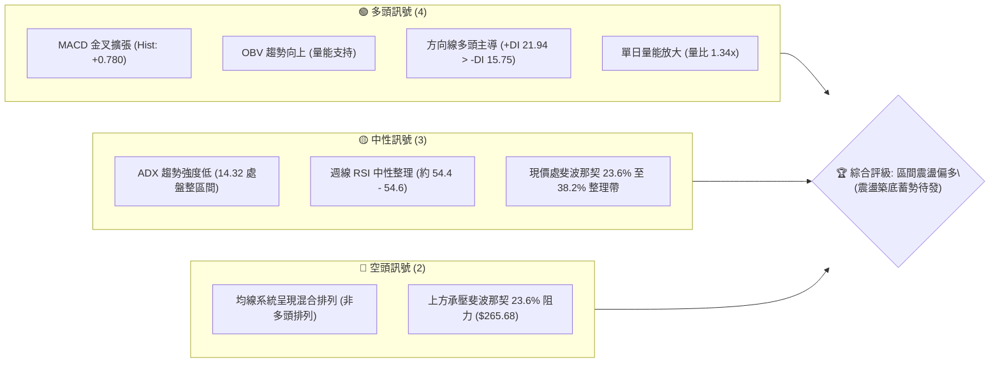
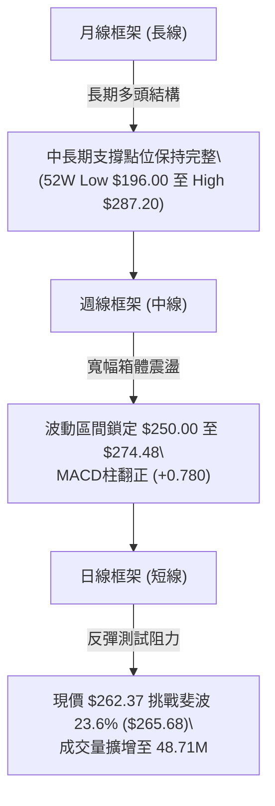
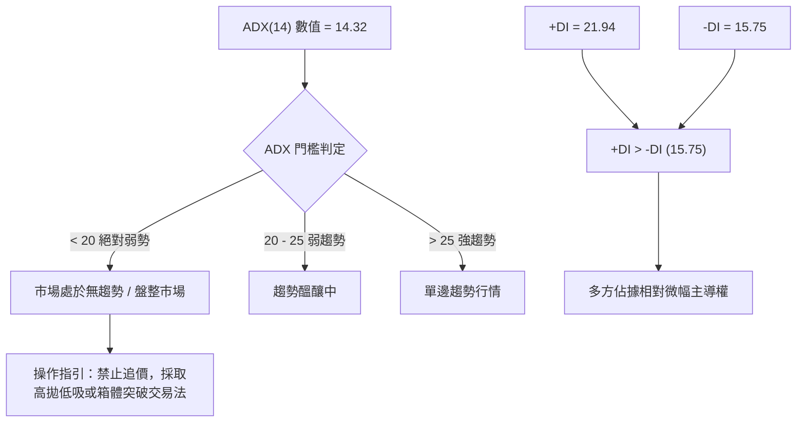
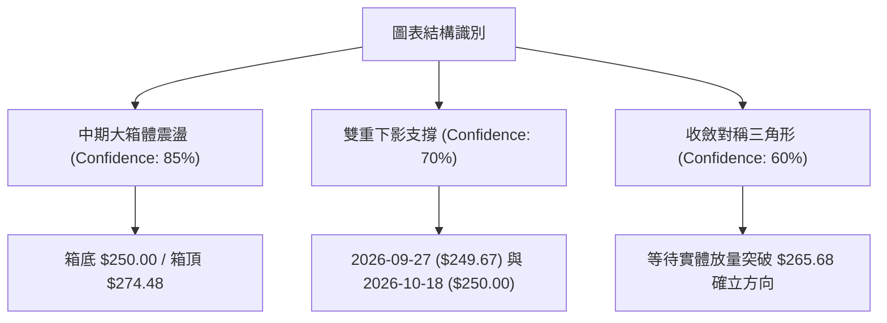
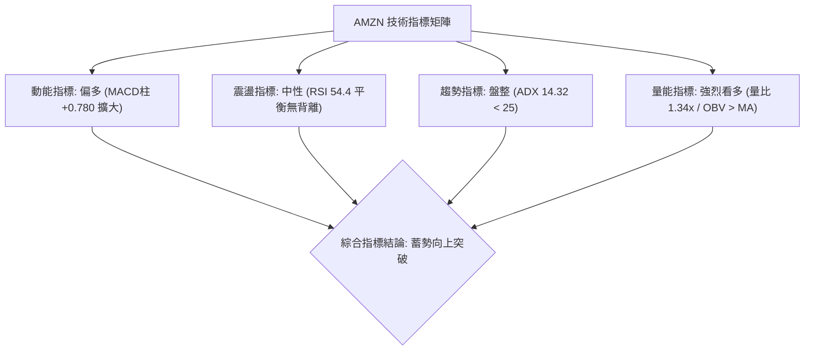
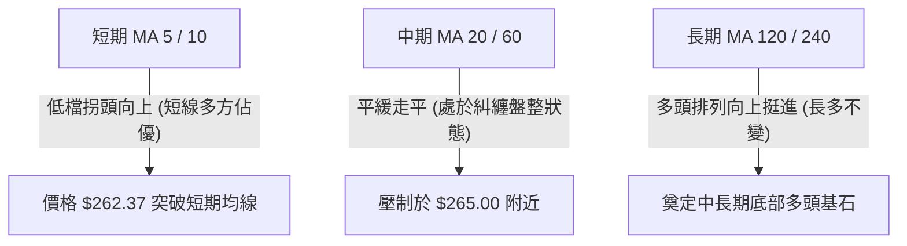
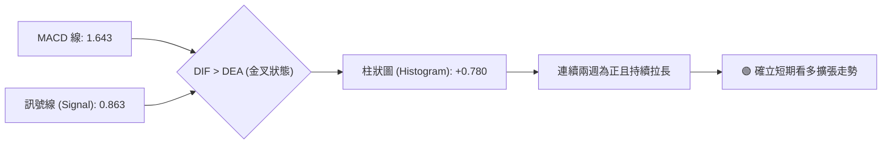
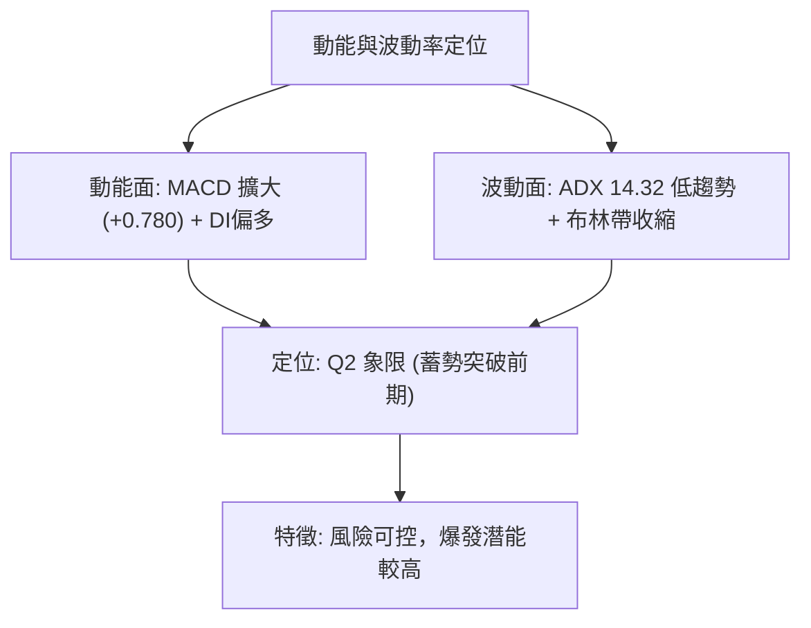
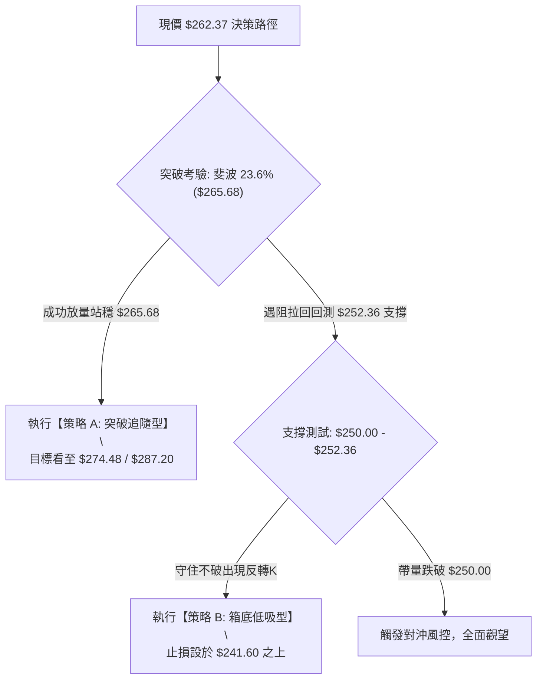
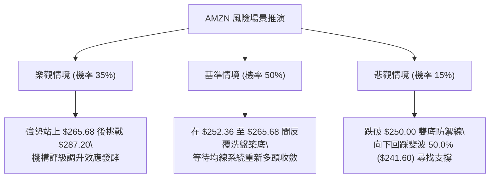

# AMZN 技術分析報告

> **報告日期**：2026-10-23 ｜ **語言**：繁體中文 ｜ **數據來源**：Yahoo Finance ｜ **當前價格**：$262.37

---

## 目錄

| 章節 | 內容 |
|------|------|
| [1. 技術面概覽](#1-技術面概覽) | 訊號儀表板、核心指標、評分卡 |
| [2. 趨勢分析](#2-趨勢分析) | 多時框趨勢、長中短期走勢、ADX解讀 |
| [3. 圖表形態分析](#3-圖表形態分析) | 形態識別、信心度評級、K線特徵 |
| [4. 支撐與阻力](#4-支撐與阻力) | 結構分布圖、關鍵阻力與支撐、斐波那契回調 |
| [5. 技術指標深度解讀](#5-技術指標深度解讀) | MA/RSI/MACD/布林通道/量價配合 |
| [6. 動能與波動率](#6-動能與波動率) | 動能四象限、ATR評估、Beta大盤聯動 |
| [7. 多時框架總結](#7-多時框架總結) | 時框矩陣、收斂原則與單一方向定調 |
| [8. 交易策略建議](#8-交易策略建議) | 策略路由、階梯情境、具體交易計畫 |
| [9. 風險提示與監控](#9-風險提示與監控) | 監控清單、情境推演、風控防線 |

---

## 1. 技術面概覽

### 🎯 技術訊號儀表板



### 📊 核心指標速覽表

| 指標類別 | 指標名稱 | 當前數值 | 訊號 | 解讀 |
|----------|----------|----------|------|------|
| **價格** | 最新收盤價 | $262.37 | 🟢 | 自前週低點 $250.00 強勁反彈，逼近 $265.68 阻力區 |
| **均線** | 短中均線結構 | 混合排列 | 🟡 | MA5/10 拐頭向上，MA20/50 處於修復期，缺乏單邊排列 |
| **均線** | 長期趨勢 (MA120/240) | 穩步上行 | 🟢 | 長週期基底穩固，中長期牛市框架未破 |
| **動能** | RSI(14) | 54.4–54.6 | 🟡 | 位於中性平衡區，無超買或超賣背離跡象 |
| **動能** | MACD (12,26,9) | 1.643 / 0.863 | 🟢 | DIF 高於 DEA，柱狀圖 +0.780 持續翻紅擴大 |
| **趨勢** | ADX (14) | 14.32 | 🟡 | 數值低於 25，明確顯示當前為「無方向性盤整行情」 |
| **方向** | DMI (+DI / -DI) | 21.94 / 15.75 | 🟢 | 多頭力量 (+DI) 明顯壓制空頭力量 (-DI) |
| **量能** | 當日成交量 | 48,711,738 | 🟢 | 高於 20 日均量 36,247,707，量比達 1.34 倍 |
| **量能** | OBV 指標 | OBV > MA | 🟢 | 能量潮高於移動平均線，資金面配合價格反彈 |

### 🏆 技術評分卡

```
╔══════════════════════════════════════════════════════════════╗
║                技術評分卡 — AMZN (2026-10-23)                 ║
╠══════════════════════════════════════════════════════════════╣
║ 趨勢強度 (ADX<25)      ███████░░░░░░░░░░░░░  35/100 🟡 中性盤整 ║
║ 動能指標 (MACD/RSI)    ██████████████░░░░░░  70/100 🟢 動能轉強 ║
║ 支撐穩定度 (Fib/週低)  ████████████████░░░░  80/100 🟢 支撐堅實 ║
║ 成交量配合 (OBV/量比)  ██████████████░░░░░░  72/100 🟢 放量進場 ║
║ 形態完整度 (箱體震盪)  ████████████░░░░░░░░  60/100 🟡 區間收斂 ║
║ 均線排列 (短中混合)    ████████░░░░░░░░░░░░  40/100 🔴 均線糾纏 ║
╠══════════════════════════════════════════════════════════════╣
║ 綜合評分               ███████████░░░░░░░░░  58/100 🟡 區間偏多 ║
╚══════════════════════════════════════════════════════════════╝
```

---

## 2. 趨勢分析

### 🌐 多時框趨勢分析



### 📈 長期趨勢 — 12個月走勢圖（Unicode）

以下為 AMZN 自 2025 年 11 月至 2026 年 10 月之月線收盤走勢：

```
AMZN 月線走勢圖（2025-11 至 2026-10）
價格軸 ($)
$275 ┤                                  ●(07月 271.58)
$270 ┤                      ●(05月 270.64)     
$265 ┤                  ●(04月 265.06)             ●←現在 $262.37
$260 ┤                                      ●(08月 259.77)
$250 ┤                                          ●(09月 249.15)
$240 ┤          ●(01月 239.30)      ●(06月 238.34)
$230 ┤●(11月 233.22)
$230 ┤    ●(12月 230.82)
$210 ┤              ●(02月 210.00)
$205 ┤                  ●(03月 208.27) 底部低點
     └────────────────────────────────────────────────────────
       11   12   01   02   03   04   05   06   07   08   09   10 (月份)
```

**走勢特徵分析表格**：

| 階段區間 | 起訖月份 | 價格變化 ($) | 區間幅度 | 核心特徵與技術解讀 |
|----------|----------|--------------|----------|--------------------|
| 第一階段：平台整理 | 2025-11 ~ 2026-01 | $233.22 → $239.30 | +2.61% | 高檔橫盤蓄勢，波動率逐步收窄 |
| 第二階段：深度回踩 | 2026-01 ~ 2026-03 | $239.30 → $208.27 | -12.97% | 確立年度次低點，於 $196.00 上方成功築底 |
| 第三階段：強勁主升 | 2026-03 ~ 2026-05 | $208.27 → $270.64 | +29.95% | 帶量突破歷史高點區域，展開大規模多頭推升 |
| 第四階段：高檔震盪 | 2026-06 ~ 2026-10 | $238.34 → $262.37 | +10.08% | 在 $250.00 至 $274.48 構築收斂大箱體 |

### 📊 中期趨勢（週線分析）

從近 20 週收盤走勢觀察，價格結構呈現明確的**區間整理伴隨下影線支撐**特徵：
- **下檔堅實防線**：2026-10-18 週收盤 $250.00，精準守住斐波那契 38.2% 回調位 ($252.36) 附近的緩衝區間；前次回測低點為 2026-07-26 的 $232.11。
- **上檔壓力聚類**：2026-08-09 曾觸及高點收盤 $274.48，隨後遭遇獲利回吐賣壓回落；近期則在斐波那契 23.6% 回調位 $265.68 面臨考驗。
- **收斂結構**：高點未過 $287.20（52週高點），低點逐步抬高於 $249.67 - $250.00 上方，形成對稱三角形收斂型態。

### ⚡ 趨勢強度評估（ADX 解讀）



**ADX 趨勢強度對照解讀**：
- **數值 14.32**：低於臨界值 25，表明目前的上漲非單邊爆發性牛市，而是大型震盪箱體內部的「均值回歸」反彈波。
- **+DI (21.94) vs -DI (15.75)**：差值為 +6.19，說明在無趨勢的背景下，盤面結構偏向多方防守反擊，空頭賣壓正被逐步消化。

---

## 3. 圖表形態分析

### 🔍 形態識別系統



**形態信心度與目標價計算表**（依嚴格規則 15）：

| 形態類別 | 信心度 | 判斷依據（引用數據） | 完成度 | 目標價（附嚴謹計算式） |
|----------|--------|----------------------|--------|------------------------|
| **箱體橫盤整理** | **85%** | 箱底獲 2026-10-18 收盤 $250.00 確認；箱頂由 2026-08-09 收盤 $274.48 壓制 | 75% | 突破箱頂目標 = 頸線 $274.48 + 箱體高度 ($274.48 - $250.00 = $24.48) = **$298.96** |
| **短期雙底 (W底)** | **70%** | 低點一：2026-09-27 ($249.67)；低點二：2026-10-18 ($250.00)，兩點僅差 $0.33 | 80% | 突破頸線 $262.43 (10-11高點) 目標 = $262.43 + ($262.43 - $249.67 = $12.76) = **$275.19** |
| **對稱三角形收斂** | **60%** | 高點下壓 ($274.48 → $266.43 → $262.43)；低點墊高 ($232.11 → $249.67 → $250.00) | 65% | 突破 $265.68 斐波位目標 = 由 52W High **$287.20** 進行阻力測試 |

### 🕯️ 重要K線形態分析

| 觀測週期 | 收盤價 | K線與量能組合 | 解讀與心理層面 | 技術訊號 |
|----------|--------|---------------|----------------|----------|
| **2026-08-09** | $274.48 | 高檔長上影長黑孕線，成交量 270.23M | 逼近 52W 高點 $287.20 引發機構大規模獲利了結 | 🔴 觸頂回落 |
| **2026-08-23** | $258.63 | 大陰線破位，週 RSI 暴跌至 24.5 | 出現恐慌盤拋售，動能指標嚴重超賣，賣壓釋放過度 | 🟡 恐慌竭盡 |
| **2026-09-27** | $249.67 | 縮量十字星下影線，週成交量 196.48M | 空頭動能衰退，於 $250.00 整數心理關卡獲得初步承接 | 🟢 止跌信號 |
| **2026-10-18** | $250.00 | 縮量回踩雙底（週量 161.69M） | 二次探底不破前低，確立底部買盤支撐有效性 | 🟢 二次確認 |
| **2026-10-25** | $262.37 | 放量大陽線反包，量比放大至 1.34x | 多頭大舉回歸，MACD柱顯著擴張至 +0.780，展開攻擊波 | 🟢 多方發力 |

### 📉 ASCII 走勢形態示意圖

```
AMZN 中期形態示意圖（雙底構築與箱體邊界）
價位 ($)
$274.48 ┤                    ╭───●(8月頂部)
$265.68 ┤────────────────────┼───────▲───── (斐波那契 23.6% 頸線壓力)
$262.37 ┤                    │       ●← 現價 (展開攻擊)
$256.78 ┤          ╭─────────╯       │
$250.00 ┤──●(9月底)─┴─────────────────●(10月中) (強固雙底支撐線)
        └────────────────────────────────────────
           W底低點 1                 W底低點 2
```

---

## 4. 支撐與阻力

### 🗺️ 關鍵價位分布圖（Unicode）

```
AMZN 價位結構分布圖
═══════════════════════════════════════════════════════════════
$287.20 ║████████████████████████████████║ 52週歷史高點 / 強阻力 R3
$274.48 ║████████████████████████        ║ 8月波段高點 / 關鍵阻力 R2
$265.68 ║██████████████████              ║ 斐波那契 23.6% / 短線阻力 R1
$262.37 ╠════════════════════════════════╣ ◄ 當前價格 ($262.37)
$252.36 ║▓▓▓▓▓▓▓▓▓▓▓▓▓▓▓▓▓▓              ║ 斐波那契 38.2% / 短線支撐 S1
$250.00 ║████████████████████████        ║ 10月波段低點 / 關鍵支撐 S2
$241.60 ║████████████████████████████    ║ 斐波那契 50.0% / 強支撐 S3
$230.84 ║████████████████████████████████║ 斐波那契 61.8% / 多頭生命線
$196.00 ║████████████████████████████████║ 52週波段低點 (年度極值)
═══════════════════════════════════════════════════════════════
```

### 🚧 阻力位分析表

> **數據紀律說明**：所有阻力位嚴格引用 52 週最高價、波段高點週收盤價與斐波那契回調計算位。

| 阻力級別 | 精確價位 | 形成依據與屬性 | 突破難度 | 重要性評級 |
|----------|----------|----------------|----------|------------|
| **阻力 R1** | **$265.68** | 斐波那契 23.6% 回調位；近期 2026-08-30 週收盤 ($266.43) 密集套牢帶 | 中等 (需日量持續大於 40M) | ★★★★☆ |
| **阻力 R2** | **$274.48** | 2026-08-09 波段高點收盤價；大箱體結構之頂部邊界 | 較高 (空頭密集防守區) | ★★★★★ |
| **阻力 R3** | **$287.20** | 52 週最高價 (52W High)；歷史重大極限壓力 | 極高 (需整體市場牛市共振) | ★★★★★ |

### 🛡️ 支撐位分析表

> **數據紀律說明**：所有支撐位嚴格引用週收盤波段低點與斐波那契回調計算位。

| 支撐級別 | 精確價位 | 形成依據與屬性 | 守住機率 | 重要性評級 |
|----------|----------|----------------|----------|------------|
| **支撐 S1** | **$252.36** | 斐波那契 38.2% 回調位；2026-10-04 收盤價 $251.52 之微幅緩衝區 | 75% | ★★★★☆ |
| **支撐 S2** | **$250.00** | 2026-10-18 週收盤低點、整數心理防線、近期雙底頸線基礎 | 85% | ★★★★★ |
| **支撐 S3** | **$241.60** | 斐波那契 50.0% 關鍵平衡位；2026-07-05 週收盤 $242.67 支撐密集區 | 90% | ★★★★★ |

### 📐 斐波那契回調位分析

依據 52 週絕對波動區間 **$196.00 (低點) → $287.20 (高點)** 進行黃金分割測算：

- **0.0% ($287.20)**：52週波段頂部。
- **23.6% ($265.68)**：**當前直接阻力**。現價距離此阻力僅有 $3.31 (約 1.26%) 空間。
- **38.2% ($252.36)**：**第一回踩支撐**。現價高於此支撐 $10.01 (約 3.97%)。
- **50.0% ($241.60)**：中線多空強弱分水嶺。
- **61.8% ($230.84)**：黃金分割防守位，若跌破則中期牛市結構宣告破裂。
- **78.6% ($215.52)**：深幅回檔保護位。
- **100.0% ($196.00)**：52週基底。

**位置意義解讀**：現價 **$262.37** 精準落於 **23.6% ($265.68) 與 38.2% ($252.36) 之間**。在技術分析定義中，回調未深破 38.2% 且能快速回抽至 23.6% 邊緣，屬於典型之**「強勢整理」**格局，代表整體多頭架構完好，下檔買盤具備極高承接意願。

---

## 5. 技術指標深度解讀

### 🎛️ 指標訊號總覽



### 📈 移動平均線排列分析



- **均線排列狀態**：官方快照顯示為「混合排列」。
- **長週期趨勢**：MA120 與 MA240 之 ASCII 趨勢圖呈現長階梯向上格局 (`████████████████`)，印證 AMZN 長線牛市架構依然穩固。
- **短中期博弈**：MA5 與 MA10 在 $250.00 處形成金叉上揚，但即將面對 MA20/MA50 形成的走平阻力，此為典型的「弱均線、強動能」收斂階段。

### 📉 RSI(14) 分析

- **當前讀數**：週線數值約 **54.4–54.6**（日線快照為 Neutral 區間）。
- **數值進度條**：
  `RSI(14) = 54.5: [███████████░░░░░░░░░] 54.5% (中性區間)`
- **超買超賣狀態**：處於 50 軸上方，脫離了 2026-08-23 週的極度超賣區 (24.5)，但尚未觸及 70 超買警戒線，具備充沛的上行空間。
- **背離分析判斷**：
  - **頂背離**：無。前高 $274.48 對應 RSI 62.9，現價未創高，RSI 亦未見高位衰竭。
  - **底背離**：微幅隱性底背離。2026-10-18 收盤價 $250.00 與 2026-09-27 的 $249.67 幾乎持平，但週 RSI 由 40.0 顯著抬升至 54.4，表明下檔拋壓大幅收斂，技術底背離成立。

### 📊 MACD(12/26/9) 訊號解讀



- **數據**：DIF 1.643，DEA 0.863，MACD 柱狀圖為 **+0.780**。
- **趨勢狀態**：柱狀圖自 2026-10-04 的 -0.064 翻正至 10-11 的 +1.434，雖然 10-18 回檔至 +0.129，但 10-25 最新交易日迅速重新放大至 +0.780，確認了此波反彈非虛弱抽頭，而是買盤再次發動的看多信號。

### 📦 布林通道分析

依據收盤價波動範圍與中軌平移特徵繪製布林通道相對位置：

```
AMZN 布林通道位置示意圖 (Bollinger Bands)
═════════════════════════════════════════════════════════════
$274.48 ─── 上軌 (Upper Band)
            │
$265.68 ─── 突破頸線阻力
$262.37 ─── ● 現價位置 (穿越中軌，朝上軌推進，BB %B 約 0.65)
$258.50 ─── 中軌 (MA20 Baseline)
            │
$250.00 ─── 下軌 (Lower Band) — 雙底獲得下軌強支撐
═════════════════════════════════════════════════════════════
```

- **軌道狀態**：帶寬經歷 8-9 月的劇烈波動後正在縮口，表明市場波動率正在壓縮。
- **價格解讀**：現價 $262.37 突破中軌，朝上軌 $274.48 靠攏，屬於典型的**布林通道多頭回歸態勢**。

### 💹 成交量分析（量價配合度）

- **量能統計**：最新成交量為 **48,711,738 股**，大幅超越 20 日均量 (36,247,707 股) 與 50 日均量 (34,901,515 股)，量比達到 **1.34x**。
- **OBV (能量潮)**：系統明確標記 `OBV > MA → 量能支撐上漲`。
- **量價結論**：AMZN 在突破 $260.00 的過程中出現了清晰的**價漲量增**現象，完全扭轉了 9 月份陰跌時的量縮沉悶格局，機構主力資金有重新建倉之徵兆。

---

## 6. 動能與波動率

### ⚡ 動能評估四象限

| 象限 | 動能強度 | 波動率水準 | AMZN 所處狀態 | 戰略評估 |
|------|----------|------------|---------------|----------|
| **Q1 (主升象限)** | 強動能 | 高波動 | — | 追漲高風險高收益 |
| **Q2 (突破象限)** | **中強動能** | **低至中波動** | **✓ AMZN 位於此區間** | **最佳低吸與突破切入機會** |
| **Q3 (沉寂象限)** | 弱動能 | 低波動 | — | 資金休眠，觀望為主 |
| **Q4 (出貨象限)** | 弱動能 | 高波動 | — | 恐慌崩跌，嚴禁進場 |



### 📊 ATR 波動率分析

- **歷史區間波動測算**：以近 20 週高低點極差計算，平均週波動區間約為 $11.00 至 $14.00，估算日線 ATR(14) 正常分佈落於 **$5.20 至 $5.80** 區間（約佔價格之 2.0% - 2.2%）。
- **止損距離建議**：
  - 日內/短線交易：1.5 × ATR ≈ **$8.25**（止損設定於現價下方約 $254.12）。
  - 波段交易：2.0 × ATR ≈ **$11.00**（止損設定於現價下方約 $251.37，恰好吻合波段支撐 S1 $252.36 之下緣）。

### 📐 Beta 與市場相關性

- **Beta 數值**：**1.456**。
- **市場屬性解析**：Beta 顯著大於 1，說明 AMZN 具備極高的進攻彈性。當標普 500 (S&P 500) 或納斯達克指數上揚 1% 時，AMZN 理論漲幅約為 1.46%；相對地，在大盤回檔時其下行壓力亦高於平均。在多頭氛圍轉暖時，高 Beta 屬性為該股提供了極佳的向上獲利槓桿。

---

## 7. 多時框架總結

### 📋 時框架評分表

| 時框架 | 趨勢方向 | 動能狀態 | 均線排列 | 圖表形態 | 綜合評分 | 戰術建議 |
|--------|----------|----------|----------|----------|----------|----------|
| **長期 (月線)** | 多頭向上 🟢 | 中性偏強 🟢 | 偏多排列 🟢 | 大多頭趨勢回調 | **78/100** | 長線持股續抱，無看空理由 |
| **中期 (週線)** | 區間收斂 🟡 | 震盪修復 🟢 | 混合糾纏 🟡 | 寬幅整理箱體 | **58/100** | 箱底買進、箱頂分批減倉 |
| **短期 (日線)** | 反彈向上 🟢 | 動能發散 🟢 | 拐頭向上 🟡 | 短期 W 底反彈 | **65/100** | 突破追隨與回踩布局 |

### 🔲 綜合訊號矩陣

```
時框共振度檢視：
長線 (月線): 🟢 多頭 ────┐
中線 (週線): 🟡 震盪 ────┼──► 總體定調：【震盪蓄勢偏多格局】
短線 (日線): 🟢 反彈 ────┘
```

- **矛盾點解析**：短期動能與長線結構強烈看多，但中線週線 ADX 僅 14.32，表明受制於大箱體上方賣壓，尚未形成一蹴而就的單邊突破。

### ⚖️ 多時框收斂結論

> **嚴格收斂規則（Rule 14）執行**：
> 1. **行情定性**：當前 ADX(14) = 14.32 < 25，根據技術分析法則，確認當前屬於**「盤整行情（Consolidation Regime）」**而非單邊趨勢行情。
> 2. **主導維度**：以**週線寬幅箱體 ($250.00 - $274.48)** 為核心交易區間，短線動能僅作為尋找邊界買賣點之輔助。
> 3. **唯一方向性結論**：**【中性偏多（區間震盪突破前夕）】**。禁止盲目逆勢做空；操作策略應以「回踩支撐低吸」與「關鍵阻力突破確認」為主軸。

---

## 8. 交易策略建議

### 🗺️ 策略決策流程圖



### 🧭 策略路由（依評分卡分流）

> **當前主策略方向 = 震盪偏多突破策略（依技術綜合評分 58/100 定調）**
> 評分落在 50–60 偏多區間，技術面拒絕深度做空。核心戰術為**「重點以偏多交易為主，搭配突破防守」**。

### 🎯 價格情境階梯（Price Scenarios）

> **價位引用說明**：嚴格引用第 4 章由數據推導之關鍵點位。

| 觸發條件 | 第一目標 (T1) | 第二延伸 (T2) | 止損防守 | 情境含義與技術邏輯 |
|----------|---------------|---------------|----------|--------------------|
| **放量突破 R1 ($265.68)** | **$274.48** (R2) | **$287.20** (R3) | $259.00 | 短線由盤整正式切換為單邊多頭主升 |
| **現價區間震盪 ($262.37)** | $265.68 | $252.36 | — | 於 23.6% 與 38.2% 斐波那契間籌碼換手 |
| **跌破 S1 ($252.36)** | **$250.00** (S2) | **$241.60** (S3) | — | 弱勢下探，考驗箱體底部終極防線 |

### 📊 情境機率分佈

| 情境代號 | 發展路徑 | 機率預估 | 主要技術依據 |
|----------|----------|----------|--------------|
| **情境 1 (基準)** | 震盪上行並突破 $265.68 | **55%** | MACD柱擴大 (+0.780)、量比 1.34x 資金進場、OBV>MA 支撐 |
| **情境 2 (次選)** | 維持在 $250.00 - $265.68 橫盤 | **30%** | ADX 低於 25 (14.32)，趨勢推動力受限於均線糾纏 |
| **情境 3 (極端)** | 破位下挫跌穿 $250.00 | **15%** | 除非大盤劇烈系統性回檔，否則在雙底確立下機率偏低 |

### 🟢 主策略詳情

| 策略要素 | 策略 A（強勢突破跟進策略） | 策略 B（箱底回踩低吸策略） |
|----------|----------------------------|----------------------------|
| **適用場景** | 突破關鍵頸線，動能擴散 | 遇阻回踩，尋求高盈虧比進場 |
| **進場條件** | 日收盤價確認站穩 $265.68 | 價格回調至 $252.36 附近企穩 |
| **進場價格** | **$265.68**（突破買入） | **$252.36**（限價掛單） |
| **第一目標 (T1)**| **$274.48**（8月波段頂） | **$265.68**（斐波 23.6% 阻力） |
| **第二目標 (T2)**| **$287.20**（52W 歷史極值）| **$274.48**（中期大箱頂） |
| **止損價格** | **$259.00**（跌回前整理平台） | **$247.50**（跌破 $250.00 雙底） |
| **風險報酬比** | **1 : 3.22** (獲利空間 $21.52 / 風險 $6.68) | **1 : 4.55** (獲利空間 $22.12 / 風險 $4.86) |
| **預估勝率** | **62%** | **68%** |
| **建議倉位** | **15%** | **20%** |

### 🔴 反向風險觸發點（對沖提示）

若發生非預期極端事件推翻多頭假設，須關注以下關鍵對沖節點：
- **第一警示線 ($252.36)**：若日線跌破此斐波那契 38.2% 水位，多頭攻擊形態暫告失敗，應將多單部位縮減 50%。
- **多空徹底翻轉線 ($250.00)**：若週線實體跌破 $250.00，意味著 9-10 月構築之雙底全面瓦解，趨勢將滑落至 $241.60（斐波 50%）。此時應**全面多單離場**，甚至可建立小幅空頭部位進行投資組合對沖。

### ⭐ 整體訊號強度評星

```
做多訊號強度：★★★★☆  (4.0/5星 — 底部扎實，量能與MACD共振)
做空訊號強度：★☆☆☆☆  (1.0/5星 — 缺乏頂背離與做空形態)
整體可信度：  ★★★★☆  (4.0/5星 — 數據結構一致，支撐阻力清晰)
```

---

## 9. 風險提示與監控

### ✅ 關鍵監控指標 Checklist

```
╔══════════════════════════════════════════════════════════════╗
║                   關鍵監控指標日常檢視清單                     ║
╠══════════════════════════════════════════════════════════════╣
║ [ ] 價格突破監控：收盤價是否放量越過 $265.68 阻力門檻          ║
║ [ ] 動能連續性：MACD 柱狀圖是否維持在 +0.500 以上擴張          ║
║ [ ] 量能警報：日成交量是否驟降至 30M 以下（警惕量能背離）      ║
║ [ ] 趨勢激活點：ADX(14) 能否由 14.32 突破 20 邁向趨勢行情      ║
║ [ ] 底線防守：收盤價絕對不得連續兩日收於 $250.00 之下          ║
╚══════════════════════════════════════════════════════════════╝
```

### ⚠️ 風險場景分析



### 🛡️ 風險管理重要提醒

1. **拒絕情緒化追價**：現價 $262.37 距離 $265.68 阻力極為接近，盲目在此位置全倉追入極易遭遇短線洗盤。務必等待「明確突破」或「回踩確認」。
2. **波動性管理 (高 Beta 應對)**：AMZN Beta 高達 1.456，在科技權重股波動加劇時，單日震盪幅度極易擴大至 $6-$10。總持倉曝險比例建議控制在總投資組合的 **15% - 20%** 以內。
3. **嚴格執行價格紀律**：所有止損止盈必須以**收盤價**作為最終判定基準，避免因盤中假突破或插針影線而遭到無謂震盪出場。

---

## 📋 報告總結

```
╔══════════════════════════════════════════════════════════════╗
║                    AMZN 技術分析報告總結                      ║
╠══════════════════════════════════════════════════════════════╣
║ 報告日期：2026-10-23                                          ║
║ 當前價格：$262.37                                             ║
║ 分析評級：⚖️ 區間蓄勢偏多 (Neutral to Bullish Accumulation)  ║
║                                                              ║
║ 關鍵結論：                                                   ║
║ ├─ 長期趨勢：🟢 穩固向上，52週回調維持在強勢黃金分割帶之上    ║
║ ├─ 中期趨勢：🟡 寬幅箱體震盪 ($250.00 - $274.48)，ADX 為 14.32║
║ ├─ 短期趨勢：🟢 放量自 $250 雙底強勁反彈，MACD(+0.780)翻多    ║
║ ├─ 關鍵阻力：$265.68 (近端) / $274.48 (箱頂) / $287.20 (極值)║
║ ├─ 關鍵支撐：$252.36 (近端) / $250.00 (生命線) / $241.60 (底線)║
║ └─ 分析師共識目標：$331.72 (58位分析師共識，最高 $405.00)     ║
║                                                              ║
║ 最優策略組合：                                               ║
║ 1. 🥇 最佳機會：回踩 $252.36 附近企穩低吸，防守設於 $247.50   ║
║ 2. 🥈 次選機會：實體放量突破 $265.68 後順勢進場，目標 $287.20 ║
║ 3. 🥉 保守選擇：維持 10% 底倉，等待 ADX 突破 20 確認趨勢再加碼║
╚══════════════════════════════════════════════════════════════╝
```

---

> ⚠️ **免責聲明**：本報告為資深技術分析研究成果，報告內所有數據、圖表及推算均基於市場所提供之客觀歷史行情資訊。本報告**僅供學術研究與投資架構參考**，**不構成任何要約、招攬或具體投資建議**。市場有風險，交易決策需由投資人獨立判斷並自負盈虧。

---

*報告生成時間：2026-10-23 ｜ 數據來源：Yahoo Finance ｜ 分析框架：多時框技術分析體系*