# AMZN 技術分析報告

> **報告日期**：2026-10-24 ｜ **語言**：繁體中文 ｜ **數據來源**：Yahoo Finance ｜ **當前價格**：$248.00

---

## 目錄

| 章節 | 內容 |
|------|------|
| [1. 技術面概覽](#1-技術面概覽) | 訊號儀表板、核心指標、評分卡 |
| [2. 趨勢分析](#2-趨勢分析) | 多時框趨勢、長中短期走勢 |
| [3. 圖表形態分析](#3-圖表形態分析) | 形態識別、K線組合、目標價 |
| [4. 支撐與阻力](#4-支撐與阻力) | 關鍵價位、斐波那契回調 |
| [5. 技術指標深度解讀](#5-技術指標深度解讀) | MA/RSI/MACD/布林/成交量 |
| [6. 動能與波動率](#6-動能與波動率) | 動能評估、ATR、Beta |
| [7. 多時框架總結](#7-多時框架總結) | 時框架評分矩陣 |
| [8. 交易策略建議](#8-交易策略建議) | 多空策略、風險報酬比 |
| [9. 風險提示與監控](#9-風險提示與監控) | 監控指標、風險場景 |

---

## 1. 技術面概覽

### 🎯 技術訊號儀表板

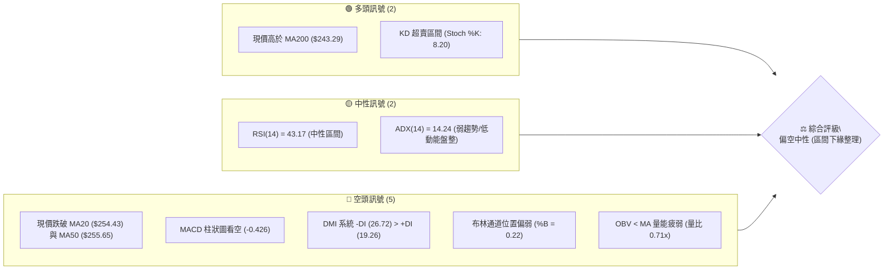

### 📊 核心指標速覽表

| 指標類別 | 指標名稱 | 當前數值 | 訊號 | 解讀 |
|----------|----------|----------|------|------|
| **價格** | 當前價格 | $248.00 | 🟡 | 位於52週區間57.0%處，短線承壓於均線群下方 |
| **均線** | MA20 | $254.43 | 🔴 | 現價位於MA20下方（-2.53%），短線空頭主導 |
| **均線** | MA50 | $255.65 | 🔴 | 現價位於MA50下方（-2.99%），中期生命線失守 |
| **均線** | MA200 | $243.29 | 🟢 | 現價高於MA200（+1.94%），長期牛熊線仍具多頭保護 |
| **動能** | RSI(14) | 43.17 | 🟡 | 位於40–50中性偏弱區，無頂底背離，賣壓漸緩 |
| **動能** | MACD | 柱狀圖 -0.426 | 🔴 | MACD (0.190) < Signal (0.616)，負向擴散，空方控盤 |
| **波動** | ATR(14) | $6.66 | 🟡 | 佔現價2.69%，波動率中等偏低，利於區間盤整沉澱 |

### 🏆 技術評分卡

```
╔══════════════════════════════════════════════════════════════════╗
║                 技術評分卡 — AMZN (2026-10-24)                 ║
╠══════════════════════════════════════════════════════════════════╣
║ 趨勢強度      ██████░░░░░░░░░░░░░░  30/100  🔴 空頭壓制/ADX低 ║
║ 動能指標      ████████░░░░░░░░░░░░  40/100  🔴 MACD弱/KD超賣 ║
║ 支撐穩定度    ████████████░░░░░░░░  60/100  🟢 S1與MA200具支撐║
║ 成交量配合    ██████░░░░░░░░░░░░░░  30/100  🔴 量比0.71x/OBV疲弱║
║ 形態完整度    ██████████░░░░░░░░░░  50/100  🟡 矩形箱型未破頸線║
║ 均線排列      ████████░░░░░░░░░░░░  40/100  🔴 混合排列/短中期壓║
╠══════════════════════════════════════════════════════════════════╣
║ 綜合評分      ████████░░░░░░░░░░░░  42/100  🟡 中性偏空（區間操作）║
╚══════════════════════════════════════════════════════════════════╝
```
*(註：綜合評分 = (30 + 40 + 60 + 30 + 50 + 40) ÷ 6 = 41.67，四捨五入為 42/100。)*

---

## 2. 趨勢分析

### 🌐 多時框趨勢分析

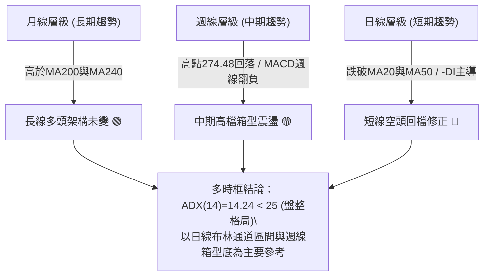

### 📈 長期趨勢 — 12個月走勢圖（Unicode）

```
AMZN 月線走勢圖（2025-11 至 2026-10 過去12個月）
價格軸 ($)
$275 ┤                                  ● $271.58 (07月)
$270 ┤                            ● $270.64 (05月)
$265 ┤                      ● $265.06 (04月)  ● $259.77 (08月)
$250 ┤                                              ● $249.15 (09月)
$245 ┤                                                  ● $248.00 (10月現價)
$240 ┤                ● $239.30 (01月)      ● $238.34 (06月)
$235 ┤  ● $233.22 (11月)
$230 ┤      ● $230.82 (12月)
$210 ┤            ● $210.00 (02月)
$205 ┤                ● $208.27 (03月波段低點)
     └─────────────────────────────────────────────────────────
        11   12   01    02    03    04    05    06    07    08    09    10 (月份)
```

#### 走勢特徵分析表格

| 階段區間 | 起止月份 | 價格變化 ($) | 漲跌幅 (%) | 走勢特徵與技術含義 |
|----------|----------|--------------|------------|--------------------|
| 第一階段 | 2025-11 → 2026-03 | $233.22 → $208.27 | -10.70% | 震盪探底階段，於2026-03見底（逼近52W低點$196.00上游） |
| 第二階段 | 2026-03 → 2026-05 | $208.27 → $270.64 | +29.95% | 強勢主升浪突破，呈現大實體月陽線連拔 |
| 第三階段 | 2026-05 → 2026-07 | $270.64 → $271.58 | +0.35% | 高位巨幅洗盤，06月回測$238.34後07月強勢反包雙頂試探 |
| 第四階段 | 2026-07 → 2026-10 | $271.58 → $248.00 | -8.68% | 階梯式陰跌整理，回測中長期均線密集群 |

### 📊 中期趨勢（週線分析）

從近20週數據觀察，價格於2026-08-07見高點$274.48後逐漸形成下降高點（Lower Highs: $274.48 → $266.43 → $262.43），同時週線MACD柱自+4.090持續收斂並轉負至-0.426。然而，下方買盤在$244.30–$246.45區間具備多次下影線承接動能。

```
中期壓力與支撐示意圖 (週線層次)
阻力帶  $265.34 - $267.56  ══════════════════ (R3 / 近8週反彈阻力密集區)
                      │
中期樞紐 $254.43 - $258.72  - - - - - - - - -  (MA20 / MA50 / R2)
                      │
現  價  $248.00          ▲ (測試中軸與支撐過渡帶)
                      │
支撐帶  $244.30 - $244.51  ══════════════════ (S1 / 近8週多次回測低點聚類)
```

### ⚡ 趨勢強度評估（ADX 解讀）

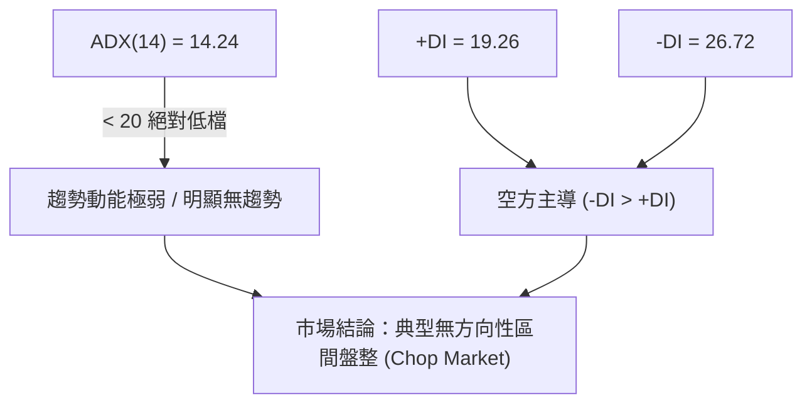

#### ADX 趨勢強度對照表

| 指標變數 | 當前數值 | 臨界標準值 | 狀態判定 | 技術涵義與交易指引 |
|----------|----------|------------|----------|--------------------|
| **ADX(14)** | 14.24 | < 20 極弱 / < 25 弱趨勢 | 弱趨勢 / 盤整行情 | 順勢突破策略失效機率極高，嚴禁追價；需轉化為區間高拋低吸思維 |
| **+DI** | 19.26 | 參考指標 | 買方動能疲弱 | 多頭上攻能量匱乏，未能形成實質推動力 |
| **-DI** | 26.72 | 參考指標 | 賣方相對佔優 | 空頭掌控短線盤面，但未達強勁單邊趨勢強度（因ADX低於25） |

---

## 3. 圖表形態分析

### 🔍 形態識別系統

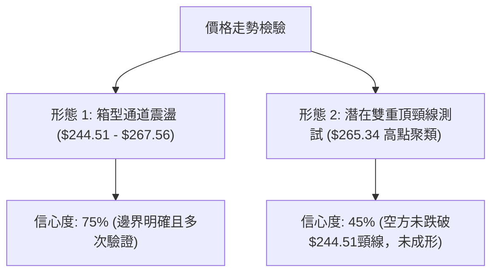

#### 圖表形態信心度分析表

| 形態 | 信心度 | 判斷依據（引用數據） | 完成度 | 目標價（附計算式） |
|------|--------|----------------------|--------|--------------------|
| **矩形箱型盤整** | 75% | 頂部受制於 R3 $267.56 及週高 $265.34，底部多次於 S1 $244.51 及日K低點 $246.45 獲得支撐 | 85% | 區間震盪無方向突破；若跌破S1，向下投射量度目標：由箱型高度推算 = $244.51 − ($267.56 − $244.51) = $221.46（接近 S3 $220.99） |
| **短期雙頂雛形** | 45% | 10-09週高 $262.80 與 10-20日高 $265.34 形成雙峰，但頸線尚未確認實體跌破 | 50% | 訊號不足，僅做指標型解讀（頸線未破前不具備有效空頭形態觸發要件） |

### 🕯️ 重要K線形態分析

依據提供的近10根日K與近8根週K數據，篩選關鍵反轉與確認形態：

| 日期（週期） | 開盤價 ($) | 最高價 ($) | 最低價 ($) | 收盤價 ($) | K線形態 | 解讀 | 訊號 |
|--------------|------------|------------|------------|------------|---------|------|------|
| 2026-10-19 (日K) | 255.25 | 263.72 | 255.22 | 262.45 | 大陽線 (長實體長紅) | 成交量放大至5,618萬股，自低位強勢反彈，突破短期壓制 | 🟢 |
| 2026-10-20 (日K) | 264.08 | 265.34 | 260.42 | 262.63 | 衝高回落十字陰星 | 開高於264.08逼近R3後迅速承壓，高檔出現獲利了結賣壓 | 🟡 |
| 2026-10-22 (日K) | 258.18 | 258.41 | 248.00 | 250.38 | 光頭大陰線 (大實體長黑) | 成交量達4,881萬股放量下殺，單日重挫吞噬前三日整理區間 | 🔴 |
| 2026-10-23 (日K) | 248.55 | 250.01 | 246.45 | 248.00 | 低位紡錘陰線 (縮量整理) | 成交量萎縮至2,547萬股，於S1上方收出下影線，暫時止跌 | 🟡 |
| 2026-10-23 (週K) | 255.25 | 265.34 | 246.45 | 248.00 | 倒錘頭長上影大陰週K | 週線受阻於$265.34後遭逢重擊，收盤跌破開盤達7.25點，週線動能轉弱 | 🔴 |

### 📉 ASCII 走勢形態示意圖

```
AMZN 日K近五日關鍵形態走勢 (箱頂受阻回落圖示)
價格 ($)
$266 ┤       ┌─┐ (10-20 高點 $265.34 衝高受阻)
$264 ┤   ┌─┐ │ │ ┌─┐
$262 ┤   │ │ │ │ │ │
$260 ┤   │ │ └─┘ │ │
$258 ┤   │ │     └─┘ ┌─┐ (10-22 開盤 $258.18 跳水)
$256 ┤   │ │         │ │
$254 ┤   │ │         │ │
$252 ┤   │ │         │ │
$250 ┤   └─┘         └─┘ ┌─┐
$248 ┤                   │ │ ◄ (10-23 收盤 $248.00，下影探 $246.45 逼近 S1)
$246 ┤                   └┬┘
     └───────────────────────────
        10-19 10-20 10-21 10-22 10-23
```

### 🎯 形態目標價計算

根據日線及週線確立的箱型整理形態（矩形區間）：
- **箱體頂部（頸線阻力）**：$267.56（參考阻力位 R3）
- **箱體底部（支撐邊界）**：$244.51（參考支撐位 S1）
- **箱體高度**：$267.56 − $244.51 = $23.05
- **破位向下量度目標價**：
  $$\text{目標價} = \text{箱體底部 } \$244.51 - \text{箱體高度 } \$23.05 = \$221.46$$
  *(註：此推算值 $221.46 與系統聚類支撐位 S3 $220.99 形成高度共振)*
- **突破向上量度目標價**：
  $$\text{目標價} = \text{箱體頂部 } \$267.56 + \text{箱體高度 } \$23.05 = \$290.61$$
  *(註：由於當前 ADX 為 14.24，箱體未確認突破前，維持區間震盪看待)*

---

## 4. 支撐與阻力

### 🗺️ 關鍵價位分布圖（Unicode）

```
AMZN 價位結構分布圖
═══════════════════════════════════════════════════════════════
$287.20 ║████████████████████████████████║ 52W 最高點 / 斐波 0.0%
$267.56 ║████████████████████████        ║ 強阻力 R3 (斐波 23.6% 於 $265.68 附近)
$258.72 ║████████████████                ║ 阻力 R2 (MA60 $258.63 / 波段密集區)
$248.81 ║████████                        ║ 關鍵即時阻力 R1 (前日反彈高點附近)
$248.00 ╠════════════════════════════════╣ ◄ 現價 ($248.00)
$244.51 ║▓▓▓▓▓▓▓▓▓▓▓▓▓▓▓▓                ║ 近期關鍵支撐 S1 (MA200 $243.29 防線)
$225.82 ║████████████████                ║ 中期波段支撐 S2 (斐波 61.8% 於 $230.84)
$220.99 ║████████████████████████        ║ 強力支撐 S3 (箱型下破對稱延伸位)
═══════════════════════════════════════════════════════════════
```

### 🚧 阻力位分析表

| 阻力級別 | 價位 ($) | 形成原因 | 突破難度 | 重要性 |
|----------|----------|----------|----------|--------|
| **R1** | 248.81 | 近一年波段高點聚類，與現價差距僅+0.33%，為短線多空分水嶺 | 🟢 低 | 短線反彈必須越過的即時點位 |
| **R2** | 258.72 | 密集中期均線區（MA60 $258.63、MA50 $255.65、MA20 $254.43 交匯密集區） | 🔴 高 | 中期強弱轉折點，需伴隨顯著放大成交量 |
| **R3** | 267.56 | 近一年強阻力峰值聚類，鄰近斐波那契23.6%回調位（$265.68）與箱體頂部 | 🔴 極高 | 決定能否重啟波段挑戰52W高點的牛市防線 |

### 🛡️ 支撐位分析表

| 支撐級別 | 價位 ($) | 形成原因 | 守住機率 | 重要性 |
|----------|----------|----------|----------|--------|
| **S1** | 244.51 | 近一年波段低點聚類，下方緊鄰 MA200 ($243.29) 及斐波那契50%位 ($241.60) | 70% | 核心生命線，守穩則維持寬幅震盪，失守則引發量化止損 |
| **S2** | 225.82 | 近一年次級波段低點聚類，接近黃金分割61.8%支撐位（$230.84） | 85% | 中期強力緩衝墊，多頭中期最後防禦陣地 |
| **S3** | 220.99 | 結構性波段深層低點聚類，量度跌幅極限回踩區 | 95% | 長期強支撐底線，跌破機率極低 |

### 📐 斐波那契回調位分析

依據52週極端區間（$196.00 → $287.20，總垂直振幅 $91.20）計算：

| 斐波那契回調比率 | 對應價位 ($) | 結構技術意義 | 當前相對位置判定 |
|------------------|--------------|--------------|------------------|
| **0.0% (52W High)** | 287.20 | 歷史牛市攻擊波段頂部 | 阻力極遠端 |
| **23.6%** | 265.68 | 第一弱勢回撤位，與 R3 ($267.56) 重疊 | 關鍵中期反壓 |
| **38.2%** | 252.36 | 強勢回撤分水嶺，位於 MA20 ($254.43) 下方 | 短線轉強阻力位 |
| **50.0%** | 241.60 | 心理多空平衡軸心點，緊貼 MA200 ($243.29) | 長線多頭防禦帶 |
| **61.8%** | 230.84 | 黃金分割強防守位，回撤有效性極限 | 中期價值買盤區 |
| **78.6%** | 215.52 | 深幅洗盤位 | 空頭極端延伸 |
| **100.0% (52W Low)**| 196.00 | 52週絕對底部 | 基準底線 |

**現價位置解讀**：現價 $248.00 處於 **38.2% ($252.36)** 與 **50.0% ($241.60)** 之間。技術上，此區間代表上升趨勢中的中度回調。只要 $241.60（50.0%位）與 S1 ($244.51) 不被實體陰線跌破，中長期上行結構仍未被破壞，此處屬於健康調整範疇。

---

## 5. 技術指標深度解讀

### 🎛️ 指標訊號總覽

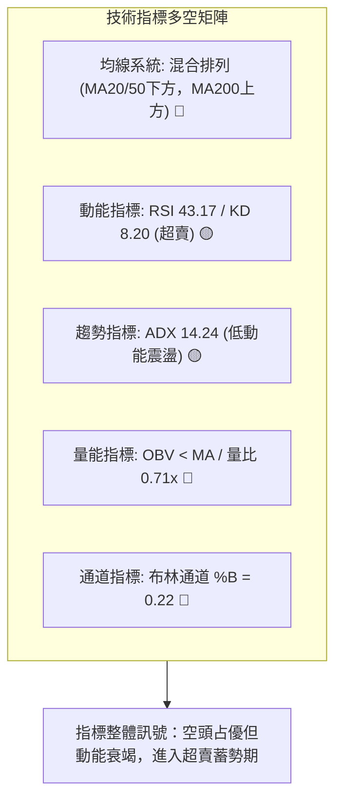

### 📈 移動平均線排列分析

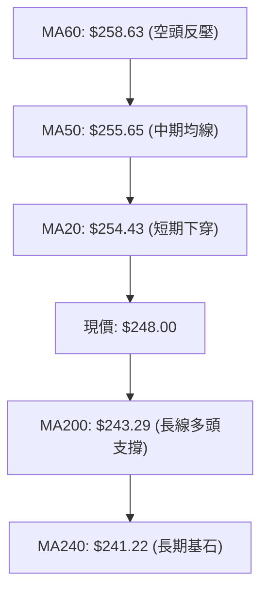

#### 均線系統詳細體系表

| 均線名稱 | 數值 ($) | 價格相對位置 | 當前乖離率 (%) | 均線斜率/形態 | 多空訊號 |
|----------|----------|--------------|----------------|---------------|----------|
| **MA5** | 257.17 | 現價位於下方 | -3.56% | 短期加速向下俯衝 | 🔴 空頭 |
| **MA10** | 256.28 | 現價位於下方 | -3.23% | 下行發散 | 🔴 空頭 |
| **MA20** | 254.43 | 現價位於下方 | -2.53% | 下彎壓制，形成布林中軌 | 🔴 空頭 |
| **MA50** | 255.65 | 現價位於下方 | -2.99% | 走平略向下彎 | 🔴 空頭 |
| **MA60** | 258.63 | 現價位於下方 | -4.11% | 位於上方形成較大反壓 | 🔴 空頭 |
| **MA120** | 254.42 | 現價位於下方 | -2.52% | 走平糾纏 | 🟡 中性 |
| **MA200** | 243.29 | 現價位於上方 | +1.94% | 向上傾斜，長期走牛保護 | 🟢 多頭 |
| **MA240** | 241.22 | 現價位於上方 | +2.81% | 穩步上行，堅實底部支撐 | 🟢 多頭 |

**綜合均線型態結論**：短中期均線（5/10/20/50/60）呈現完全空頭排列，對現價形成層層壓制；但長期均線（200/240）保持完大多頭斜率。該狀態為典型的**「長多短空、深幅回洗」**形態。

### 📉 RSI(14) 分析

- **RSI 當前數值**：43.17 (Wilder 計算)
- **數值進度條**：
  ```
  [0] ─────────── [30] ─────●───── [70] ─────────── [100]
  超賣區            43.17 (中性偏空)          超買區
  進度條：█████████████████░░░░░░░░░░░░░  43.17%
  ```
- **背離判斷結論**：
  比對近20根K棒首尾（價格自高點震盪回落，RSI同步由59附近下修至43.17），價格高點向下對應指標高點向下，**「無明顯背離」**。指標並未出現頂背離或底背離，走勢純粹為弱勢動能釋放。
- **超買超賣綜合解讀**：日線 RSI(14) 處於 43.17，尚未進入極度超賣區（<30）；但 **Stochastic %K 數值已達 8.20**，大幅落入極度超賣區（<20），兩者產生短期指標超賣收斂預期。

### 📊 MACD(12/26/9) 訊號解讀

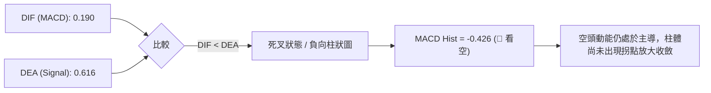

- **MACD 線**：0.190
- **信號線 (Signal Line)**：0.616
- **柱狀圖 (Histogram)**：-0.426
- **背離分析**：MACD 線隨價格回落自高檔向下切穿信號線，數值與價格趨勢完全同向，**無頂背離或底背離**。當前柱狀體呈現負值擴散，空方處於進攻主動地位，但因靠近零軸，屬於震盪盤中的空頭釋放而非雪崩式主跌。

### 📦 布林通道分析

```
AMZN 日線布林通道 (20, 2) 結構示意圖
價格 ($)
$265.91 ┤ ═════════════════════════════════  BB 上軌
         │
$254.43 ┤ ---------------------------------  BB 中軌 (MA20)
         │
$248.00 ┤              ▲ [現價: $248.00，位於下半通道]
$242.95 ┤ ═════════════════════════════════  BB 下軌
```

- **BB 上軌**：$265.91
- **BB 中軌**：$254.43 (MA20)
- **BB 下軌**：$242.95
- **BB %B**：0.22（0 代表下軌，0.5 代表中軌，1 代表上軌）
- **通道形態分析**：現價落於下半區，%B 達到 0.22，顯示空方將價格緊壓在下軌附近運行。下軌價位 $242.95 與 MA200 ($243.29) 高度共振重疊。布林帶寬未呈現喇叭口暴開，而是呈現平行收窄後走平，印證低 ADX 環境下的典型布林區間包絡狀態。

### 💹 成交量分析（量價配合度）

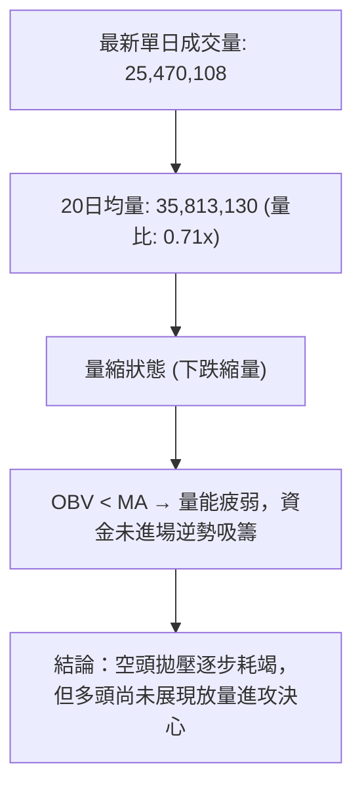

- **最新成交量**：25,470,108 股
- **20日均量**：35,813,130 股（量比：0.71x）
- **50日均量**：34,769,558 股
- **OBV 趨勢**：OBV < MA（能量潮位於均線下方），確認量能疲弱。
- **量價行為解讀**：10-22 下跌時成交量放大至 4,881 萬股（放量下跌），但 10-23 隨即劇烈萎縮至 2,547 萬股（縮量整理）。空頭缺乏持續性追殺盤，這表明市場賣壓在接近支撐位 S1 時已見鈍化。

---

## 6. 動能與波動率

### ⚡ 動能評估四象限

| 象限 | 動能強度 | 波動率水準 | 當前歸屬 | 象限特徵與策略對策 |
|------|----------|------------|----------|--------------------|
| **Q1** | 強 (ADX>25, RSI>50) | 低 (ATR小) | ─ | 最佳單邊順勢推進機會 |
| **Q2 (當前)** | **弱 (ADX=14.24, RSI=43.17)** | **低 (ATR佔比2.69%)** | **✓ AMZN** | **防禦性謹慎觀望，避免突破交易，以邊界低吸為主** |
| **Q3** | 強 (動能極大) | 高 (極端震盪) | ─ | 高風險高收益，情緒追漲殺跌 |
| **Q4** | 弱 (趨勢疲弱) | 高 (寬幅拉鋸) | ─ | 容易頻繁觸發止損，應堅決避免操作 |

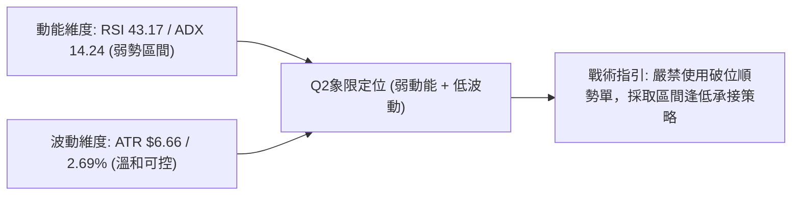

### 📊 ATR 波動率分析

- **ATR(14) 絕對值**：$6.66
- **ATR 相對百分比**：2.69% of price（屬於大型科技股中等偏低波動區間）
- **技術止損與波動距離指引**：
  - **保守型止損距離 (1.5 × ATR)**：$1.5 \times \$6.66 = \$9.99$
  - **激進/窄幅止損距離 (1.0 × ATR)**：$1.0 \times \$6.66 = \$6.66$
  - **進場安全緩衝區 (0.5 × ATR)**：$0.5 \times \$6.66 = \$3.33$

### 📐 Beta 與市場相關性

- **Beta 數值**：1.456
- **市場特徵分析**：AMZN Beta 為 1.456，表示其價格彈性顯著高於標普500大盤（高出約45.6%）。在市場處於弱勢整理時，該股容易出現放大式震盪；但在低波動盤整（ATR 2.69%）階段，高 Beta 意味著一旦市場大盤出現明確方向，AMZN 具備極快速的爆發彈性。

---

## 7. 多時框架總結

### 📋 時框架評分表

| 時框架 | 趨勢方向 | 動能狀態 | 均線排列 | 形態結構 | 綜合評分 | 建議指引 |
|--------|----------|----------|----------|----------|----------|----------|
| **長期 (月線)** | 偏多 🟢 | 中性 🟡 | 多頭發散 (高於MA200/240) | 長線箱型上升階梯 | 68/100 | 長線持股底倉續抱 |
| **中期 (週線)** | 震盪 🟡 | 弱偏空 🔴 | 均線糾纏 | 箱體中樞整理 | 46/100 | 高拋低吸，區間應對 |
| **短期 (日線)** | 偏空 🔴 | 超賣反彈蓄勢 🟡 | 空頭排列 (承壓MA20) | 支撐邊界下影線 | 38/100 | 嚴控回踩低吸點位 |

### 🔲 綜合訊號矩陣

```
時框架訊號矩陣收斂圖
┌────────────────┬──────────┬──────────┬──────────┬──────────┐
│ 指標系統 / 週期│ 長期月線 │ 中期週線 │ 短期日線 │ 矩陣狀態 │
├────────────────┼──────────┼──────────┼──────────┼──────────┤
│ 主均線方向     │  🟢 多頭 │  🟡 震盪 │  🔴 空頭 │ 訊號發散 │
│ 動能震盪指標   │  🟢 偏多 │  🔴 翻空 │  🟡 超賣 │ 多空互抵 │
│ 突破動能 (ADX) │  ──      │  🟡 盤整 │  🔴 低動能│ 盤整主導 │
│ 量能架構 (OBV) │  🟢 良好 │  🔴 疲弱 │  🔴 縮量 │ 量能退潮 │
└────────────────┴──────────┴──────────┴──────────┴──────────┘
```

### ⚖️ 多時框收斂結論

> **收斂規則執行判定（規則 14）**：
> 1. 當前日線 ADX(14) 數值為 **14.24**，嚴格小於 25 臨界值，確認當前市場處於**「盤整行情」**而非單邊趨勢行情。
> 2. 依規則，盤整行情應以**日線布林通道上下軌（$242.95–$265.91）**及**波段箱體支撐阻力（S1 $244.51 / R3 $267.56）**為核心交易框架。
> 3. 多時框衝突取捨：長期月線處於多頭通道，日線處於超賣超跌段，中期週線處於箱體回撤下軌。綜合評分為 **42/100（中性偏空區間震盪）**。
> 4. **唯一方向性結論**：**中性偏空，區間下緣築底觀望（以布林下軌及 S1 守穩為前置條件之防守型區間操作）**。

---

## 8. 交易策略建議

### 🗺️ 策略決策流程圖

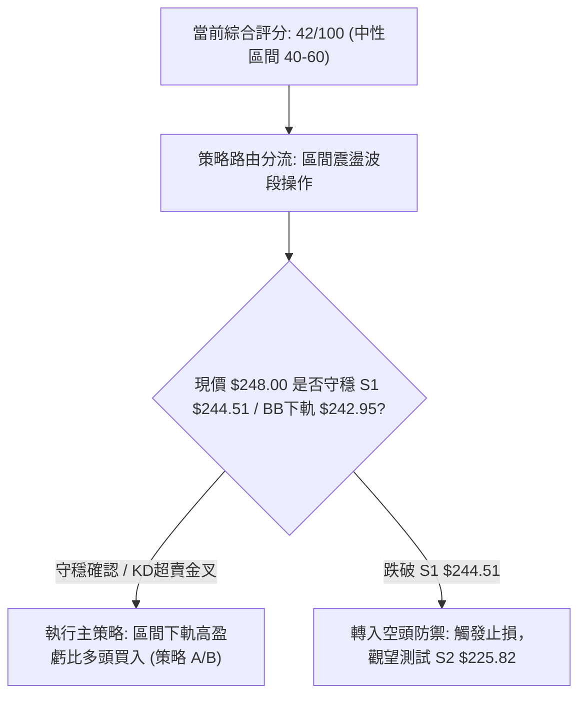

### 🧭 策略路由

**當前主策略方向 = 中性偏多區間反彈操作（依評分 42/100 屬於 40–60 區間震盪，以布林下軌與支撐邊界為主）**
- 理由：日線處於極度超賣區（Stoch %K: 8.20），且價格緊貼 S1 ($244.51) 與 MA200 ($243.29) 及布林下軌 ($242.95) 的強共振支撐區。雖然均線偏空，但在低 ADX (14.24) 環境下，下軌具備極高防守性反彈勝率。

### 🎯 價格情境階梯（Price Scenarios）

| 觸發條件 | 下一目標 | 後續延伸 | 情境含義 |
|----------|----------|----------|----------|
| **突破 R1 $248.81** | R2 $258.72 | R3 $267.56 | 短線反彈轉強，測試 MA50 壓力位 |
| **守穩現價至 S1 區間 ($244.51–$248.00)** | R1 $248.81 | R2 $258.72 | 箱體下緣構築雙底，維持區間低位橫盤整理 |
| **跌破 S1 $244.51 / MA200** | S2 $225.82 | S3 $220.99 | 中期結構實質破位，長多格局面臨終端測試 |

### 📊 情境機率分佈

| 情境 | 機率 | 主要依據 |
|------|------|----------|
| **區間震盪 / 築底反彈** | 55% | ADX 僅 14.24 代表無延續暴跌動能；KD 處於 8.20 極度超賣；S1 ($244.51) 與 MA200 重合形成強支撐 |
| **直接延續回落 / 再探底** | 35% | MACD 柱狀圖仍然為負 (-0.426)；OBV 處於均線下方顯示主力買盤尚未介入 |
| **強勢突破向上 (V轉)** | 10% | 短中期均線層層反壓（MA20/50），成交量比僅 0.71x，量能嚴重不足以支持單邊大漲 |

### 🟢 主策略詳情（區間高拋低吸策略）

所有價位均直接取自系統計算數值與關鍵價位區塊：

| 策略要素 | 策略 A（現價即時低吸策略） | 策略 B（回踩 S1 / MA200 極限確認進場） |
|----------|----------------------------|-----------------------------------------|
| **進場條件** | 週一開盤守穩 $248.00 且突破 R1 | 回踩 S1 $244.51 獲得下影線支撐確認 |
| **進場價格** | $248.00 | $244.51 |
| **目標價 T1** | $258.72 (R2 阻力位) | $258.72 (R2 阻力位) |
| **目標價 T2** | $267.56 (R3 強阻力位) | $267.56 (R3 強阻力位) |
| **止損價格** | $243.29 (跌破 MA200 關鍵防線) | $241.60 (跌破斐波那契 50.0% 位) |
| **風險報酬比** | **1 : 2.28（以 T1 計）** *(算式見註1)* | **1 : 4.88（以 T1 計）** *(算式見註2)* |
| **成功機率** | 52% | 60% |
| **建議倉位** | 10% 基礎防守倉 | 15% 波段操作倉 |

*(註1：策略 A 風險報酬比 = ($258.72 − $248.00) ÷ ($248.00 − $243.29) = $10.72 ÷ $4.71 = 2.276，即 1 : 2.28（以 T1 計）；若以 T2 計則為 ($267.56 − $248.00) ÷ $4.71 = 1 : 4.15（以 T2 計）)*  
*(註2：策略 B 風險報酬比 = ($258.72 − $244.51) ÷ ($244.51 − $241.60) = $14.21 ÷ $2.91 = 4.883，即 1 : 4.88（以 T1 計）；若以 T2 計則為 ($267.56 − $244.51) ÷ $2.91 = 1 : 7.92（以 T2 計）)*

### 🔴 反向風險觸發點（對沖提示）

- **做多邏輯推翻點**：若日K線實體跌破 **$243.29 (MA200)** 且收盤確認失守 **$241.60 (斐波那契 50.0%)**。
- **對沖應對指引**：一旦跌破上述共振防線，意味著低 ADX 震盪向下破位，價格將直奔 **S2 $225.82**。多頭應全數無條件止損，激進型交易者可反手建立空頭對沖倉位，下看 S2 $225.82。

### ⭐ 整體訊號強度評星

```
做多訊號強度：★★☆☆☆  (2.5/5星 - 均線受阻，僅具備超賣反彈機會)
做空訊號強度：★★★☆☆  (3.0/5星 - 空頭動能占優，但受制於下方強支撐)
整體可信度：  ★★★★☆  (4.0/5星 - 盤整區間邊界明確，量化點位高度收斂)
```

---

## 9. 風險提示與監控

### ✅ 關鍵監控指標 Checklist

```
╔══════════════════════════════════════════════════════════════════╗
║                   關鍵技術監控指標 CHECKLIST                     ║
╠══════════════════════════════════════════════════════════════════╣
║ [ ] 價格突破 R1 $248.81：短線轉強訊號，確認低點成形              ║
║ [ ] 價格跌穿 S1 $244.51：發出破位警訊，需關注 MA200 防守力道      ║
║ [ ] RSI(14) 穿回 50 以上：多頭重奪動能主導權                    ║
║ [ ] 成交量回升至 3,500 萬股以上：量能配合確認真突破              ║
║ [ ] MACD 柱狀圖翻紅（> 0）：中期修正波段告一段落                 ║
║ [ ] ADX(14) 突破 25：震盪盤結束，單邊趨勢開啟                    ║
╚══════════════════════════════════════════════════════════════════╝
```

### ⚠️ 風險場景分析

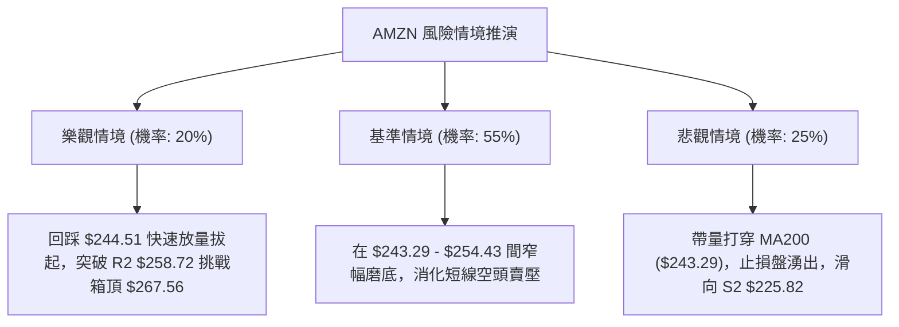

### 🛡️ 風險管理重要提醒

1. **單筆風險敞口控制**：嚴格限定單筆交易虧損不得超過總投資組合淨值的 **1.0%–1.5%**。以策略 A 止損幅度 $4.71 計，每 100 股風險為 $471。
2. **防範假突破/假跌破風險**：由於 ADX 僅 14.24，盤中常有穿透 S1 或 R1 的虛假毛刺。建議採用**日K線收盤價（Close）**作為實質突破或止損的唯一觸發條件，盤中跌破未收盤可暫時觀察。
3. **波動性管理**：當前 ATR 為 $6.66，日內震盪幅度約為現價的 2.69%，進場委託單避免市價追單，應使用限價單於支撐位前分批掛單承接。

---

## 📋 報告總結

```
╔══════════════════════════════════════════════════════════════════╗
║                    AMZN 技術分析報告總結                         ║
╠══════════════════════════════════════════════════════════════════╣
║ 報告日期：2026-10-24                                             ║
║ 當前價格：$248.00                                                ║
║ 分析評級：⚖️ 中性偏空（區間箱型下軌防守）                        ║
╠══════════════════════════════════════════════════════════════════╣
║ 關鍵結論：                                                       ║
║ ├─ 長期趨勢：🟢 偏多（MA200 $243.29 完好，長線走牛結構仍在）     ║
║ ├─ 中期趨勢：🟡 震盪（處於 $244.51 - $267.56 寬幅大箱體內）      ║
║ ├─ 短期趨勢：🔴 偏空（承壓於短期均線之下，但 KD=8.20 步入超賣）   ║
║ ├─ 關鍵支撐：S1 $244.51 / MA200 $243.29 / S2 $225.82             ║
║ ├─ 關鍵阻力：R1 $248.81 / R2 $258.72 / R3 $267.56             ║
║ └─ 分析師目標：均價 $331.72（最高 $405.00，最低 $230.00）        ║
╠══════════════════════════════════════════════════════════════════╣
║ 最優策略組合：                                                   ║
║ 1. 🥇 最佳機會：回踩 S1 $244.51 輕倉做多（風報比 1:4.88，直指R2）║
║ 2. 🥈 次選機會：突破 R1 $248.81 順勢進場（風報比 1:2.28）        ║
║ 3. 🥉 保守選擇：空倉觀望，等待日線 MACD 出現拐點或 ADX 突破 25   ║
╚══════════════════════════════════════════════════════════════════╝
```

---

> ⚠️ **免責聲明**：本報告為 AI 自動生成之技術分析，所有數據及估算均基於提供的歷史價格資訊。本報告**僅供研究與學術參考**，**不構成任何投資建議**。投資有風險，入市需謹慎。

---

*報告生成時間：2026-10-24 ｜ 數據來源：Yahoo Finance ｜ 分析框架：多時框技術分析*