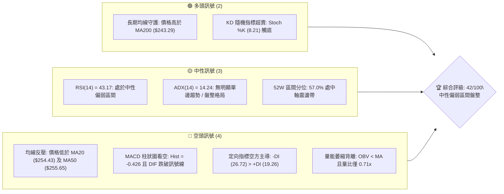
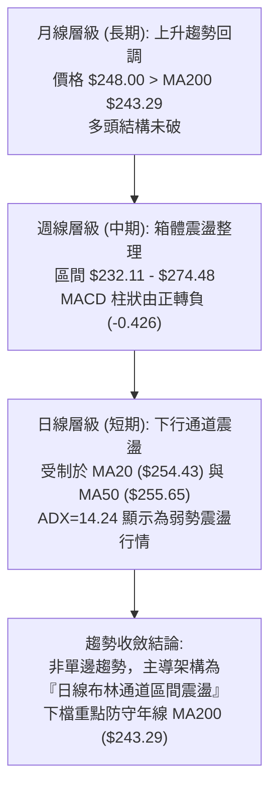
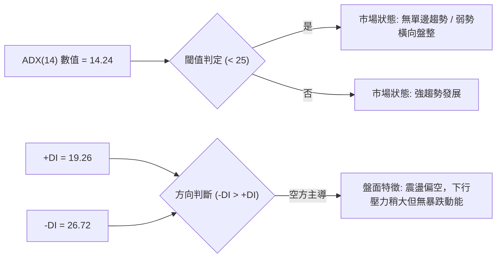
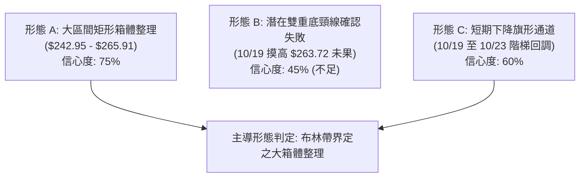
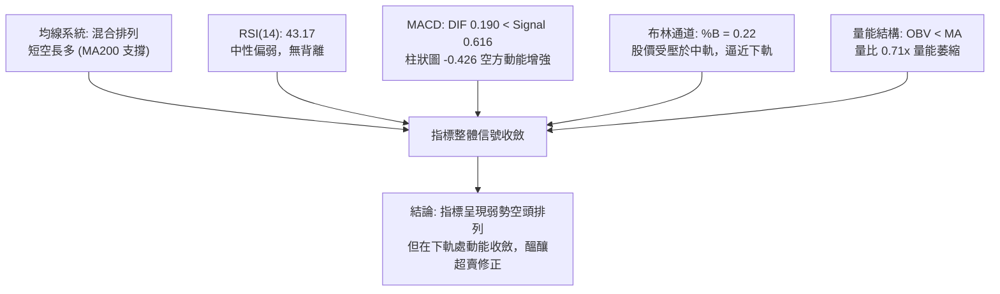
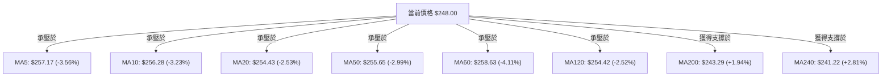
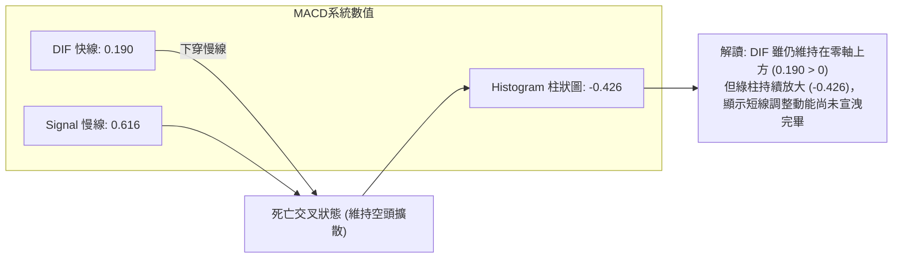
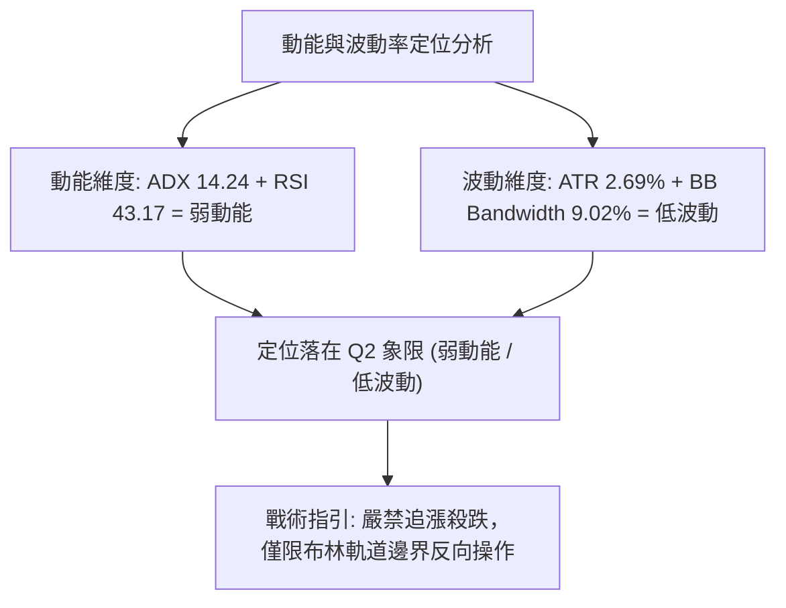
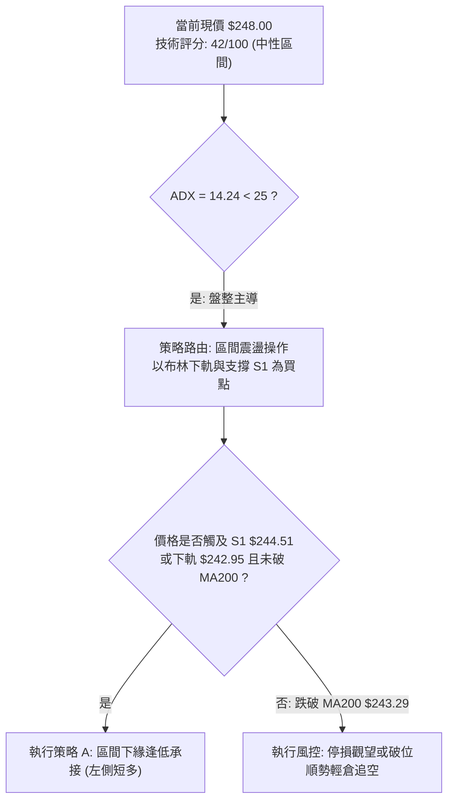
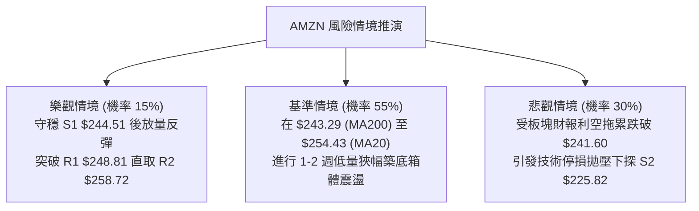

# AMZN 技術分析報告

> **報告日期**：2026-10-25 ｜ **語言**：繁體中文 ｜ **數據來源**：Yahoo Finance ｜ **當前價格**：$248.00

---

## 目錄

| 章節 | 內容 |
|------|------|
| [1. 技術面概覽](#1-技術面概覽) | 訊號儀表板、核心指標、評分卡 |
| [2. 趨勢分析](#2-趨勢分析) | 多時框趨勢、長中短期走勢 |
| [3. 圖表形態分析](#3-圖表形態分析) | 形態識別、K線組合、目標價 |
| [4. 支撐與阻力](#4-支撐與阻力) | 關鍵價位、斐波那契回調 |
| [5. 技術指標深度解讀](#5-技術指標深度解讀) | MA/RSI/MACD/布林/成交量 |
| [6. 動能與波動率](#6-動能與波動率) | 動能評估、ATR、Beta |
| [7. 多時框架總結](#7-多時框架總結) | 時框架評分矩陣 |
| [8. 交易策略建議](#8-交易策略建議) | 多空策略、風險報酬比 |
| [9. 風險提示與監控](#9-風險提示與監控) | 監控指標、風險場景 |

---

## 1. 技術面概覽

### 🎯 技術訊號儀表板



### 📊 核心指標速覽表

| 指標類別 | 指標名稱 | 當前數值 | 訊號 | 解讀 |
|:---|:---|:---|:---:|:---|
| **價格** | 當前收盤價 | $248.00 | 🟡 | 位於52週區間57.0%，短線受制於均線密集區 |
| **均線** | MA20 | $254.43 | 🔴 | 價格低於MA20達 -2.53%，短線下行反壓明確 |
| **均線** | MA50 | $255.65 | 🔴 | 價格位於中期生命線下方，空頭動能壓制 |
| **均線** | MA200 | $243.29 | 🟢 | 價格高於牛熊分界線 +1.94%，長線基底尚未破壞 |
| **動能** | RSI(14) | 43.17 | 🟡 | 位於中性偏空區間（30-70中偏下），尚未超賣 |
| **動能** | MACD(12,26,9) | Hist -0.426 | 🔴 | DIF (0.190) 低於 Signal (0.616)，空方主導推進 |
| **動能** | Stoch %K/%D | 8.21 / 34.73 | 🟢 | %K 進入極度超賣區（<20），短線具備技術反彈條件 |
| **趨勢** | ADX(14) | 14.24 | 🟡 | ADX < 25 表明趨勢動能微弱，當前處於無趨勢盤整市 |
| **通道** | 布林帶 %B | 0.22 | 🟡 | 逼近布林下軌（$242.95），處於通道下半區間 |
| **波動** | ATR(14) | $6.66 | 🟡 | 佔現價 2.69%，每日波動正常收斂，未見恐慌拋售 |
| **量能** | 20日成交量比 | 0.71x | 🔴 | 成交量 25.52M 低於均量 35.82M，買盤承接力道薄弱 |

### 🏆 技術評分卡

```
╔══════════════════════════════════════════════════════════════╗
║                技術評分卡 — AMZN (2026-10-25)                ║
╠══════════════════════════════════════════════════════════════╣
║  趨勢強度      ███████░░░░░░░░░░░░░  35/100  🔴 空頭壓制     ║
║  動能指標      ████████░░░░░░░░░░░░  38/100  🔴 負向擴散     ║
║  支撐穩定度    ████████████░░░░░░░░  58/100  🟡 年線支撐     ║
║  成交量配合    ██████░░░░░░░░░░░░░░  32/100  🔴 量能萎縮     ║
║  形態完整度    ████████░░░░░░░░░░░░  42/100  🟡 箱體整理     ║
║  均線排列      █████████░░░░░░░░░░░  47/100  🟡 混合排列     ║
╠══════════════════════════════════════════════════════════════╣
║  綜合評分      ████████░░░░░░░░░░░░  42/100  中性偏弱(區間)   ║
╚══════════════════════════════════════════════════════════════╝
```

*註：綜合評分 = (35 + 38 + 58 + 32 + 42 + 47) ÷ 6 = 42.0（依規則 18 算術平均四捨五入）。*

---

## 2. 趨勢分析

### 🌐 多時框趨勢分析



### 📈 長期趨勢 — 12個月走勢圖（Unicode）

依據 2025 年 11 月至 2026 年 10 月實際月線收盤數據繪製：

```
AMZN 月線收盤走勢圖（過去12個月：2025-11 至 2026-10）
價格軸 ($)
$275 ┤                                  ● 270.64      ● 271.58
$265 ┤                            ● 265.06          │     ● 259.77
$255 ┤                            │                 │     │     ● 249.15
$245 ┤                            │           ● 238.34    │     │     ● 248.00 (現價)
$235 ┤● 233.22        ● 239.30    │                 │     │     │     │
$225 ┤      ● 230.82  │           │                 │     │     │     │
$215 ┤                │     ● 210.00                │     │     │     │
$205 ┤                │           ● 208.27 (低點)   │     │     │     │
     └──────┬─────┬─────┬─────┬─────┬─────┬─────┬─────┬─────┬─────┬─────┬─────
          11月  12月  01月  02月  03月  04月  05月  06月  07月  08月  09月  10月
          2025  2025  2026  2026  2026  2026  2026  2026  2026  2026  2026  2026
```

**12個月走勢特徵分析表格**：

| 階段區間 | 起訖月份 | 收盤區間 ($) | 漲跌幅 | 結構形態特徵 |
|:---|:---|:---|:---:|:---|
| **第一階段：高檔沉澱** | 2025-11 → 2025-12 | 233.22 → 230.82 | -1.03% | 狹幅橫盤整固，多空力量暫時平衡 |
| **第二階段：春季回洗** | 2026-01 → 2026-03 | 239.30 → 208.27 | -12.97% | 連續三個月下行，於 3 月觸及波段低點 $208.27 |
| **第三階段：強勁主升** | 2026-03 → 2026-05 | 208.27 → 270.64 | +29.95% | V型報復性反彈，創下上半年高點 $270.64 |
| **第四階段：雙頂拉鋸** | 2026-06 → 2026-07 | 238.34 → 271.58 | +13.95% | 劇烈洗盤後於 7 月再拉高至 $271.58 完成二次摸頂 |
| **第五階段：震盪陰跌** | 2026-08 → 2026-10 | 259.77 → 248.00 | -4.53% | 8月起連續三個月收黑，動能逐步耗盡，回歸年線尋求支撐 |

### 📊 中期趨勢（週線分析）

中期走勢呈現「高檔喇叭形震盪收斂」。近8週收盤價由 2026-09-04 的 $258.51 緩步滑落至 2026-10-23 的 $248.00。

```
週線級別價格壓力與支撐結構示意圖
────────────────────────────────────────────────────────────────
$267.56 ══════════════════════════════ [R3 近一年波段高點聚類強壓]
                  ▲ 2026-10-23 週高 $265.34 (受阻回落)
$258.72 ------------------------------ [R2 波段次高 / MA60 $258.63]
$248.81 ------------------------------ [R1 關鍵阻力 / 2026-10-23 開盤附近]
$248.00  ◄─── 當前現價位置 (收在週K下影線區間)
$244.51 ══════════════════════════════ [S1 近一年波段低點聚類支撐]
$243.29 ------------------------------ [MA200 長期牛熊分界線]
$225.82 ══════════════════════════════ [S2 強支撐區域]
────────────────────────────────────────────────────────────────
```

### ⚡ 趨勢強度評估（ADX 解讀）



**ADX 趨勢強度指標對照解讀表**：

| 指標名稱 | 實際數值 | 參考標準區間 | 技術含義解讀 |
|:---|:---:|:---:|:---|
| **ADX(14)** | **14.24** | < 20 (極弱趨勢 / 典型泥沼區間) | 股價無單邊推進力，均線系統糾結，突破訊號極易引發假突破 |
| **+DI** | **19.26** | 0 – 100 | 多頭向上進攻意願低迷，追價買盤匱乏 |
| **-DI** | **26.72** | 0 – 100 | 空方壓制力道高於多方 7.46 個單位，市場賣壓具持續性 |
| **趨勢定性** | **弱勢盤整** | ADX < 25 | **依規則 14：盤整行情優先採用日線布林通道 ($242.95–$265.91) 為交易邊界** |

---

## 3. 圖表形態分析

### 🔍 形態識別系統



**圖表形態信心度評估表**：

| 形態名稱 | 信心度 | 判斷依據（引用數據） | 完成度 | 目標價（附精確計算式） |
|:---|:---:|:---|:---:|:---|
| **大區間矩形箱體** | **75%** | 上軌近布林帶 $265.91 及 R3 $267.56，下軌近布林下軌 $242.95 及 S1 $244.51 | 85% | 區間震盪無方向突破，中軸目標價為 MA20 ($254.43) |
| **短期下行小通道** | **60%** | 自 10/20 高點 $265.34 連續回落至 10/23 低點 $246.45，形成短線回調節奏 | 70% | 滿足點測算：若跌破 S1 ($244.51)，測量目標為年線 MA200 ($243.29) |
| **大型雙底結構** | **45%** | 兩次低點雖分別於 6 月 ($232.69) 與 7 月 ($232.11)，但當前已大幅脫離底形且回落 | 25% | **訊號不足，僅做指標型解讀（信心度 < 50% 不予推算幾何目標）** |

### 🕯️ 重要 K 線形態分析

依據近 10 根日 K 與近 8 根週 K 之實際 OHLCV 數據進行專業識別：

| 日期（週期） | 開盤價 | 最高價 | 最低價 | 收盤價 | 成交量 | K線形態名稱 | 專業技術解讀與訊號驗證 | 訊號 |
|:---|:---:|:---:|:---:|:---:|:---:|:---|:---|:---:|
| **2026-10-16 (日)** | 255.10 | 255.54 | 248.60 | 250.00 | 40,427,300 | 光頭中陰線 | 開盤即最高，實體下殺近 5 元，帶量下破整數關卡，賣壓沉重 | 🔴 |
| **2026-10-19 (日)** | 255.25 | 263.72 | 255.22 | 262.45 | 56,188,800 | 突破大陽線 | 放量大漲 4.98%，長實體吞噬前三日失地，為近期最強多頭反撲 | 🟢 |
| **2026-10-20 (日)** | 264.08 | 265.34 | 260.42 | 262.63 | 34,927,200 | 衝高小陰星 | 開高走低，上影線觸碰布林上軌 $265.91 受阻，多頭動能衰竭 | 🟡 |
| **2026-10-21 (日)** | 262.71 | 264.36 | 259.29 | 262.37 | 31,214,700 | 橫盤十字星 | 高檔猶豫不決，多空雙方在 $262 上方陷入膠著，量能逐步退潮 | 🟡 |
| **2026-10-22 (日)** | 258.18 | 258.41 | 248.00 | 250.38 | 48,814,000 | 穿頭破腳大陰棒 | 跳空低開並帶量下挫 -4.57%，一口氣跌穿多根均線，破壞反彈節奏 | 🔴 |
| **2026-10-23 (日)** | 248.85 | 250.01 | 246.45 | 248.00 | 25,518,200 | 低檔紡錘小陰線 | 縮量橫盤，低點 $246.45 測試 S1 支撐帶，多方抵抗微弱但未深跌 | 🟡 |
| **2026-10-16 (週)** | 262.50 | 263.70 | 248.60 | 250.00 | 161,689,900 | 週級別長陰線 | 週跌幅 -4.74%，實體大陰線完全吐回前一週漲幅，中線轉弱 | 🔴 |
| **2026-10-23 (週)** | 255.25 | 265.34 | 246.45 | 248.00 | 196,662,900 | 長上影倒狀錘星 | 衝高 $265.34 後遭空方迎頭痛擊，留下長達 17.34 元上影線，空方完勝 | 🔴 |

### 📉 ASCII 走勢形態示意圖

```
近 10 個交易日走勢形態與箱體軌道示意圖
────────────────────────────────────────────────────────────────────────
$266.00 ┤              ● 10/20 高 $265.34 (觸碰 BB 上軌 $265.91)
$262.00 ┤        ●───● 10/19-21 高檔構築小雙頂
$258.00 ┤  ● 10/12-13
$254.00 ┤    ● 10/14-15
$250.00 ┤      ● 10/16 破位         ● 10/22 大陰下殺 $250.38
$246.00 ┤                           └──● 10/23 守 S1 區間低點 $246.45
$242.00 ┤═════════════════════════════════════════ BB下軌 $242.95 / MA200 $243.29
        └───────────────────────────────────────────────────────────────
         10/12 10/14 10/16 10/19 10/20 10/21 10/22 10/23 (交易日)
```

### 🎯 形態目標價計算

以近期日線級別「10/19 - 10/23 衝高回落小箱體」為基準：
1. **箱體頂部壓力（頸線）**：取 10/20 高點 $265.34（緊鄰 BB 上軌 $265.91 與 R3 $267.56）。
2. **箱體下邊界（防守）**：取 10/23 最低點 $246.45（緊鄰 S1 支撐 $244.51）。
3. **箱體垂直高度**：$265.34 − $246.45 = **$18.89**。
4. **測算目標價（雙向）**：
   - **向上破位上測目標（需有效站上頸線 $265.34）**：$265.34 + $18.89 = **$284.23**（貼近 52W 高點 $287.20）。
   - **向下破位測量目標（若跌破下界 $246.45）**：$246.45 − $18.89 = **$227.56**（緊鄰強支撐 S2 $225.82）。

---

## 4. 支撐與阻力

### 🗺️ 關鍵價位分布圖（Unicode）

```
AMZN 價位結構分布圖（OHLCV 實際計算值）
══════════════════════════════════════════════════════════════════════════
$287.20 ║████████████████████████████████████████║ 52W 最高點 (Fib 0.0%)
$267.56 ║████████████████████████████            ║ 強阻力 R3 / 波段頂部聚類
$265.68 ║████████████████████████                ║ Fib 23.6% 回調位
$258.72 ║████████████████████                    ║ 阻力 R2 / MA60 ($258.63)
$252.36 ║██████████████                          ║ Fib 38.2% 回調位
$248.81 ║████████████████████████████            ║ 關鍵短期阻力 R1
$248.00 ╠════════════════════════════════════════╣ ◄─── 當前現價收盤 ($248.00)
$244.51 ║▓▓▓▓▓▓▓▓▓▓▓▓▓▓▓▓▓▓                      ║ 近期關鍵支撐 S1 (波段低點聚類)
$243.29 ║▓▓▓▓▓▓▓▓▓▓▓▓▓▓▓▓▓▓▓▓▓▓▓▓▓▓              ║ 長期生命線 MA200 支撐
$241.60 ║▓▓▓▓▓▓▓▓▓▓▓▓▓▓▓▓▓▓▓▓▓▓                  ║ Fib 50.0% 關鍵平衡分水嶺
$230.84 ║▓▓▓▓▓▓▓▓▓▓▓▓▓▓                          ║ Fib 61.8% 黃金分割強防守
$225.82 ║████████████████████████████████        ║ 強支撐 S2 (年度低檔密集成交)
$220.99 ║████████████████████████████████████    ║ 終極防守 S3 (極端支撐帶)
══════════════════════════════════════════════════════════════════════════
```

### 🚧 阻力位分析表

所有價位均嚴格引用 OHLCV 聚類計算數據：

| 阻力級別 | 精確價位 | 距現價幅標 | 形成原因與技術共振 | 突破難度 | 重要性權重 |
|:---|:---:|:---:|:---|:---:|:---:|
| **R1** | **$248.81** | +0.33% | 近一年波段高點聚類下緣，同時重合 10/23 日 K 開盤價 $248.85 | 🟡 中等 | ★★★☆☆ |
| **R2** | **$258.72** | +4.32% | 近一年波段次高密集區，與 60日均線 MA60 ($258.63) 形成強力重合共振 | 🔴 極高 | ★★★★☆ |
| **R3** | **$267.56** | +7.89% | 近一年波段高點聚類頂部，貼近布林上軌 ($265.91) 與 10/20 高點 ($265.34) | 🔴 極險 | ★★★★★ |

### 🛡️ 支撐位分析表

所有價位均嚴格引用 OHLCV 聚類計算數據：

| 支撐級別 | 精確價位 | 距現價幅標 | 形成原因與技術共振 | 守住機率 | 重要性權重 |
|:---|:---:|:---:|:---|:---:|:---:|
| **S1** | **$244.51** | -1.41% | 近一年波段低點聚類，與 10/23 低點 ($246.45) 構成即時防線 | 🟢 65% | ★★★★☆ |
| **S2** | **$225.82** | -8.94% | 近一年波段深層低點聚類，接近 2025 年底整理平台，中長線買盤聚集地 | 🟢 85% | ★★★★★ |
| **S3** | **$220.99** | -10.89% | 極端年度多頭防守底線，若觸及將引發機構長線價值資金無條件回補 | 🟢 95% | ★★★☆☆ |

### 📐 斐波那契回調位分析

依據 52 週完整波動區間（低點 $196.00 → 高點 $287.20，總垂直波幅 $91.20）計算：

| 斐波那契回調分位 | 精確價位 | 技術解讀與當前位置標注 |
|:---|:---:|:---|
| **0.0% (52W High)** | **$287.20** | 年度最高峰值，長期牛市極限壓力位 |
| **23.6%** | **$265.68** | 強勢回調分界線，與布林上軌 ($265.91) 高度重合，10/20 衝高失敗處 |
| **38.2%** | **$252.36** | 弱勢反彈阻力位，位於當前現價上方，為多頭反攻首要必須攻克的陣地 |
| **當前現價位置** | **$248.00** | **落於 Fib 38.2% ($252.36) 與 Fib 50.0% ($241.60) 之間，偏向中性區間整理** |
| **50.0%** | **$241.60** | **多空牛熊半數分水嶺**，與 MA200 ($243.29) 及布林下軌 ($242.95) 形成三重支撐共振帶 |
| **61.8%** | **$230.84** | 黃金分割強回調位，守穩此位代表上升大浪潮結構未被實質破壞 |
| **78.6%** | **$215.52** | 深度洗盤回撤位，跌破此位則確立中期轉入熊市週期 |
| **100.0% (52W Low)**| **$196.00** | 52週絕對底部 |

---

## 5. 技術指標深度解讀

### 🎛️ 指標訊號總覽



### 📈 移動平均線排列分析



**均線狀態深度解讀**：
當前短期均線系統（MA5、MA10、MA20）呈現典型的**空頭排列**，且 MA50（$255.65）與 MA20（$254.43）在現價上方形成堅固的雙重天花板。然而，長期均線 MA200（$243.29）與 MA240（$241.22）持續向上運行，與現價形成 +1.94% 與 +2.81% 的正向乖離。此現象定義為「**中短期空頭修正，長期多頭格局未死**」的混合震盪排列。

### 📉 RSI(14) 分析

```
RSI(14) 動能刻度表：當前數值 43.17 (Wilder 計算)
0        20       30               50               70       80      100
├────────┼────────┼────────────────┼────────────────┼────────┼────────┤
│ 極度超賣│  超賣  │    弱勢盤整    │    強勢多頭    │  超買  │極度超買│
└────────┴────────┴────────────────┴────────────────┴────────┴────────┘
                          ▲
                   RSI = 43.17 (中性偏空)
進度條展示: ████████████████░░░░░░░░░░░░ 43.17%
```

- **區間評估**：43.17 處於 30 至 50 弱勢盤整帶，尚未觸及 30 以下之超賣區，代表短線雖由空方掌控節奏，但尚未引發拋售盤恐慌。
- **背離判斷**：比對近 20 根 K 棒走勢，價格自 10/20 高點 $265.34 下跌至 10/23 低點 $246.45，RSI 亦同步自高檔滑落，**數據確認：無頂背離，亦無底背離**。指標與價格運行趨勢完全一致。

### 📊 MACD(12,26,9) 訊號解讀



### 📦 布林通道分析

```
ASCII 布林通道空間結構圖 (週期 20, 偏差 2.0)
────────────────────────────────────────────────────────────────────────
$265.91 ═════════════════════════════════════════════════════ BB 上軌 (+2.0σ)
                  ▲ 10/20 觸碰上軌高點 $265.34 後承壓回落
$254.43 ----------------------------------------------------- BB 中軌 (MA20)
$248.00 ◄─── 現價位置 (%B = 0.22，落於通道下軌上方，偏下軌運行)
$242.95 ═════════════════════════════════════════════════════ BB 下軌 (-2.0σ)
                  ▼ 下方強支撐防線 (與 MA200 $243.29 構成護城河)
────────────────────────────────────────────────────────────────────────
```

- **通道帶寬與形態**：通道帶寬（Bandwidth）= ($265.91 − $242.95) ÷ $254.43 = **9.02%**，呈現收口後橫向水平延伸，並無喇叭口放大跡象，確認為**標準的無趨勢箱體走勢**。
- **%B 指標分析**：%B 為 **0.22**，顯示股價已來到通道空間下緣 22% 處，距離下軌支撐僅餘 $5.05 空間，向下殺跌動能將在接觸下軌時面臨物理反彈壓制。

### 💹 成交量分析（量價配合度）

```
量能指標比對圖
最新成交量: 25,518,200  █████████████░░░░░░░ (0.71x)
20日均成交量: 35,815,535  ████████████████████ (基準 1.00x)
50日均成交量: 34,770,520  ███████████████████░ (0.97x)
```

- **量比萎縮**：最新成交量為 25.52M，僅為 20 日均量的 **0.71 倍**。10/22 大跌時成交量放大至 48.81M，而 10/23 續跌時成交量迅速萎縮至 25.52M，呈現「**跌勢縮量**」特徵，反映下方殺跌拋盤已不願在現價賤賣。
- **OBV 趨勢解讀**：數據明確顯示「**OBV < MA → 量能疲弱**」。能量潮指標低於其移動平均線，反映近一年累計資金並未積極介入，中長線買盤多處於觀望防守態勢。

---

## 6. 動能與波動率

### ⚡ 動能評估四象限

| 象限 | 動能狀態 | 波動率狀態 | AMZN 當前定位 | 交易策略指導 |
|:---:|:---:|:---:|:---:|:---|
| **Q1** | 強動能 (Trend) | 低波動 (Low Vol) | — | 趨勢穩健推進，最適合突破加碼 |
| **Q2** | **弱動能 (Weak)** | **低波動 (Low Vol)**| **✔ 當前定位 (Q2)** | **ADX=14.24, ATR=2.69%，橫盤打底，宜高拋低吸** |
| **Q3** | 強動能 (Trend) | 高波動 (High Vol) | — | 暴衝行情，高風險高收益 |
| **Q4** | 弱動能 (Weak) | 高波動 (High Vol) | — | 恐慌震盪，假突破頻繁，嚴格空倉觀望 |



### 📊 ATR 波動率分析

- **ATR(14) 實際數值**：**$6.66**（佔當前股價 $248.00 的 **2.69%**，Wilder 演算法）。
- **日內波動區間推算**：在常規單日內，價格合理波動極限為現價 ±1.0 × ATR，即 **$241.34 至 $254.66**（此區間完美涵蓋布林下軌 $242.95 與布林中軌 $254.43）。
- **止損距離建議**：
  - **極短線交易（保守防守）**：設定 1.0 × ATR = **$6.66**。
  - **波段擺盪交易（抗躁動）**：設定 1.5 × ATR = 1.5 × $6.66 = **$9.99**（約 $10.00）。

### 📐 Beta 與市場相關性

- **Beta 數值**：**1.456**。
- **解讀**：AMZN 具備顯著高於大盤（S&P 500 = 1.0）的高彈性特質。當納斯達克或大盤波動 1% 時，AMZN 理論波動約為 1.46%。在目前大盤科技板塊財報季來臨之際，高 Beta 意味著一旦下檔支撐 S1 或 MA200 引發反彈，其反彈彈性將相當可觀；反之若大盤破位，下殺衝擊亦將放大。

---

## 7. 多時框架總結

### 📋 時框架評分表

| 時框架 | 趨勢方向 | 動能狀態 | 均線排列狀態 | 主導圖表形態 | 綜合評分 | 操作戰術建議 |
|:---|:---:|:---:|:---:|:---:|:---:|:---|
| **月線 (長期)** | 🟢 偏多上升 | 🟡 中性平緩 | 均線多頭散開，遠高於 MA200 | 長期上升通道回撤 | **68/100** | 核心長線部位續抱，耐心等待回調完畢 |
| **週線 (中期)** | 🟡 箱體震盪 | 🔴 柱狀圖翻黑 | 均線走平膠著，MA20走平 | 大箱體 $232–$274 震盪 | **46/100** | 區間高拋低吸，未突破箱體前不押單邊 |
| **日線 (短期)** | 🔴 弱勢震盪 | 🔴 空方控盤 | 混合排列，承壓於 MA20/MA50 | 階梯式陰跌逼近下軌 | **35/100** | 嚴禁右側追多，僅可在超賣下軌處低吸 |

### 🔲 綜合訊號矩陣

```
綜合訊號矩陣熱力圖
══════════════════════════════════════════════════════════════════
時框層級       趨勢維度    均線維度    動能維度    量能維度    矩陣合力
──────────────────────────────────────────────────────────────────
短期 (日線)      🔴 空      🔴 空      🟡 中      🔴 空      🔴 弱勢空方
中期 (週線)      🟡 震      🟡 震      🔴 空      🟡 震      🟡 震盪整理
長期 (月線)      🟢 多      🟢 多      🟡 中      🟢 多      🟢 多頭防守
══════════════════════════════════════════════════════════════════
綜合收斂權重: 依 ADX < 25 判定，中期與短期完全被【箱體盤整】所收斂
```

### ⚖️ 多時框收斂結論

依據「**嚴格要求 14：多時框收斂規則**」嚴格執行判斷：
1. **趨勢/盤整判定**：當前日線 ADX(14) 數值為 **14.24**，遠低於 25 的趨勢分水嶺，技術面確立為典型的「**低波動無趨勢盤整行情**」。
2. **主導時框與交易邊界**：規則確立在盤整行情中，**以日線布林通道上下軌（$242.95 – $265.91）為核心交易邊界**，均線趨勢策略失效。
3. **收斂方向唯一結論**：**中性偏弱觀望，區間下緣博弈反彈**。日線雖受制於短期均線反壓，但下檔緊鄰日線布林下軌（$242.95）、MA200（$243.29）以及斐波那契 50%（$241.60），空頭向下空間已被技術共振支撐嚴密鎖死，嚴禁在 $248.00 現價盲目做空。

---

## 8. 交易策略建議

### 🗺️ 策略決策流程圖



### 🧭 策略路由（依評分卡分流）

**當前主策略方向 = 區間震盪操作，耐心等待區間下緣支撐確認（依評分 42/100，落於 40–60 中性區間，以布林上下軌與關鍵支撐阻力為操作界限，嚴禁單邊追單，等待突破確認）。**

### 🎯 價格情境階梯（Price Scenarios）

價位嚴格引用第 4 章關鍵價位與斐波那契計算值：

| 觸發條件 | 下一目標價 | 後續延伸目標 | 情境技術含義 |
|:---|:---:|:---:|:---|
| **強勢突破 R1 ($248.81)** | R2 ($258.72) | R3 ($267.56) | 擺脫短線均線糾結，向布林上軌與近一年波段高點推進 |
| **守穩現價 ($248.00) 震盪** | BB中軌 ($254.43)| Fib 38.2% ($252.36) | 維持中性盤整，消化上方套牢籌碼 |
| **向下回測 S1 ($244.51)** | MA200 ($243.29)| Fib 50.0% ($241.60) | 測試年線多頭底線，為最佳反彈博弈防守帶 |
| **放量跌破 Fib 50% ($241.60)**| S2 ($225.82) | S3 ($220.99) | 長期均線失守，中級上升結構瓦解，轉入空頭尋底 |

### 📊 情境機率分佈

| 情境劃分 | 發生機率 | 主要技術依據 |
|:---|:---:|:---|
| **情境一：區間下緣震盪築底反彈** | **55%** | ADX=14.24 顯示無單邊大跌動能；Stoch %K (8.21) 極度超賣；下檔 MA200 ($243.29) 與 S1 ($244.51) 支撐強勁 |
| **情境二：跌破年線深踩回調** | **30%** | MACD 柱狀圖負向放大 (-0.426)；OBV 指標持續低迷；成交量萎縮反映主動買盤不足 |
| **情境三：直接拔高連續突破** | **15%** | 短期均線 MA5/10/20 呈現空頭反壓；上方 R1 ($248.81) 與 R2 ($258.72) 套牢籌碼密集，缺乏爆發量能 |

### 🟢 主策略詳情（區間下緣低吸與中軌波段操作）

所有數值嚴格基於第 4 章價位計算，符合規則 17 之風險報酬比定義：

| 策略要素 | 策略 A（區間下軌防守型低吸 - 主推薦） | 策略 B（突破確認右側跟進 - 次選） |
|:---|:---|:---|
| **交易邏輯** | 於 S1 支撐與年線上方掛單承接，博弈超賣反彈 | 帶量突破 R1 且收復短期均線反壓後順勢短多 |
| **進場價格** | **$244.51**（S1 關鍵支撐位） | **$248.81**（突破 R1 阻力位時進場） |
| **目標價 T1** | **$252.36**（斐波那契 38.2% 回調位） | **$258.72**（阻力位 R2 / MA60 重合處） |
| **目標價 T2** | **$258.72**（阻力位 R2 密集區） | **$267.56**（強阻力位 R3 / 布林上軌） |
| **止損價格** | **$241.60**（斐波那契 50.0% 關鍵分水嶺） | **$244.51**（S1 支撐位） |
| **風險報酬比** | **1 : 2.70（以 T1 計）**<br>*(252.36 − 244.51) ÷ (244.51 − 241.60) = 7.85 ÷ 2.91*<br>*(以 T2 計則為 1 : 4.88)* | **1 : 2.30（以 T1 計）**<br>*(258.72 − 248.81) ÷ (248.81 − 244.51) = 9.91 ÷ 4.30*<br>*(以 T2 計則為 1 : 4.36)* |
| **成功機率** | **65%** | **50%** |
| **建議倉位** | **15%**（分批掛單） | **10%**（底倉突破買入） |

### 🔴 反向風險觸發點（對沖提示）

若市場出現以下極端異動，必須立即推翻上述多頭低吸策略，啟動避險：
- **觸發價位**：收盤價**實體跌破 $241.60**（斐波那契 50.0% 與年線 MA200 容忍極限）。
- **確認訊號**：日成交量暴增至 50,000,000 股以上，且 MACD DIF 跌破零軸。
- **對沖應對**：多頭部位無條件停損出場；積極型交易者可反手建立空頭對沖，下檔第一測量目標直指 **S2 ($225.82)**。

### ⭐ 整體訊號強度評星

```
做多訊號強度：★★☆☆☆  (2/5 星 - 僅限支撐位左側防守，非強勢單邊多頭)
做空訊號強度：★★★☆☆  (3/5 星 - 短期指標偏空，但下檔空間受年線壓縮)
整體可信度：  ★★★☆☆  (3/5 星 - ADX處於低位，假訊號偏多，重在防守)
```

---

## 9. 風險提示與監控

### ✅ 關鍵監控指標 Checklist

```
╔══════════════════════════════════════════════════════════════╗
║               AMZN 交易風控監控清單 (Checklist)               ║
╠══════════════════════════════════════════════════════════════╣
║ [ ] 監控項 1: 價格是否回測 S1 ($244.51) 並形成下影線守穩     ║
║ [ ] 監控項 2: 年線 MA200 ($243.29) 絕對不可在日線收盤失守    ║
║ [ ] 監控項 3: RSI(14) 能否在 40 附近打底回升並重新站上 50    ║
║ [ ] 監控項 4: 成交量能否在反彈時突破 20日均量 (35.81M)       ║
║ [ ] 監控項 5: Stoch %K (8.21) 何時形成低檔金叉向上貫穿 %D     ║
║ [ ] 監控項 6: 盤面是否出現向上跳空突破 R1 ($248.81) 之強勢K線 ║
╚══════════════════════════════════════════════════════════════╝
```

### ⚠️ 風險場景分析



### 🛡️ 風險管理重要提醒

1. **財報季與事件驅動風險**：當前新聞顯示大型科技股財報正處於高敏感情境，且微軟、谷歌即將引領財報檢驗，AWS 相關電力供應及 CapEx 支出（TTM 資本支出達 $151.00B，大於營運現金流 $148.53B 導致 FCF 轉為 -$2.47B）受到市場嚴格審視。高 Beta (1.456) 將放大個股對財報消息的劇烈反應。
2. **資金控管守則**：由於當前 ADX(14) 僅 14.24，處於盤整磨損期，任何單筆策略之資金曝險**絕對不得超過總資產之 15%**。
3. **紀律止損執行**：嚴格以收盤價跌破 $241.60 作為硬性止損防線，切忌抱持「長線投資」心態對短線破位交易進行拗單。

---

## 📋 報告總結

```
╔════════════════════════════════════════════════════════════════╗
║                   AMZN 技術分析報告總結                        ║
╠════════════════════════════════════════════════════════════════╣
║ 報告日期：2026-10-25                                           ║
║ 當前價格：$248.00                                              ║
║ 分析評級：⚖️ 中性偏弱觀望 (技術評分: 42/100，無趨勢箱體盤整)   ║
║                                                                ║
║ 關鍵結構解讀：                                                 ║
║ ├─ 長期趨勢：🟢 偏多守護 (價格仍高於 200日均線 MA200 $243.29)  ║
║ ├─ 中期趨勢：🟡 箱體整理 (大區間維持在 $232 - $274 之間震盪)  ║
║ ├─ 短期趨勢：🔴 弱勢承壓 (受制於 MA20 $254.43 與 MA50 $255.65)║
║ ├─ 關鍵支撐：S1 $244.51 ｜ 年線 $243.29 ｜ Fib 50% $241.60    ║
║ ├─ 關鍵阻力：R1 $248.81 ｜ R2 $258.72 ｜ R3 $267.56            ║
║ └─ 華爾街共識目標價：$331.72 (58位分析師，強烈買入評級)        ║
║                                                                ║
║ 最優交易策略推薦：                                             ║
║ 1. 🥇 最佳機會：於 S1 $244.51 掛單低吸，停損 $241.60，         ║
║                首要目標看 Fib 38.2% $252.36 (風報比 1:2.70)   ║
║ 2. 🥈 次選機會：靜待突破 R1 $248.81 後追買，目標 R2 $258.72   ║
║ 3. 🥉 保守選擇：完全空倉觀望，等待日線 ADX 升破 25 確立新趨勢 ║
╚════════════════════════════════════════════════════════════════╝
```

---

> ⚠️ **免責聲明**：本報告為技術分析研究，所有數據計算均基於歷史價格與成交量資訊。報告內容**僅供學術研究與參考**，**不構成任何要約、招攬或投資買賣建議**。金融市場瞬息萬變，投資人應獨立思考並自負盈虧風險。

---

*報告生成時間：2026-10-25 ｜ 數據來源：Yahoo Finance ｜ 分析框架：多時框技術分析體系*