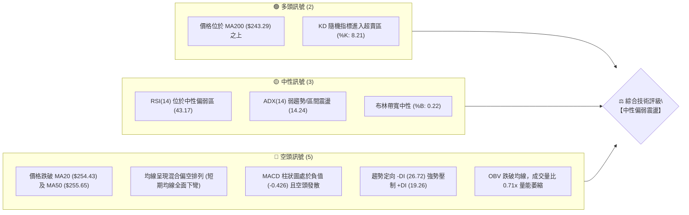
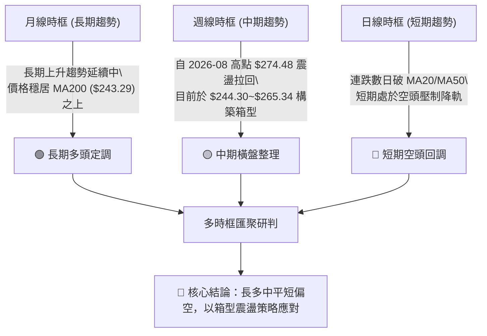
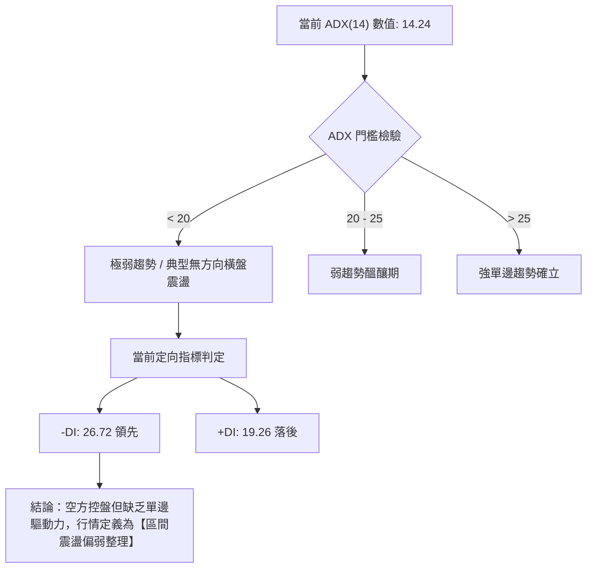
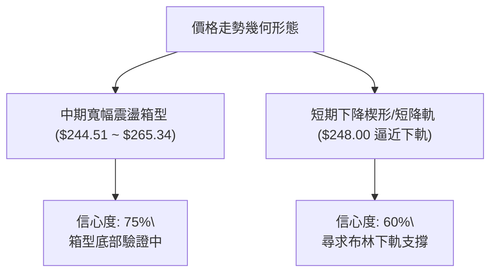
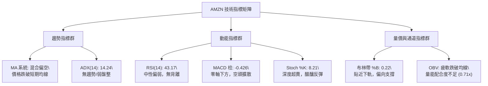
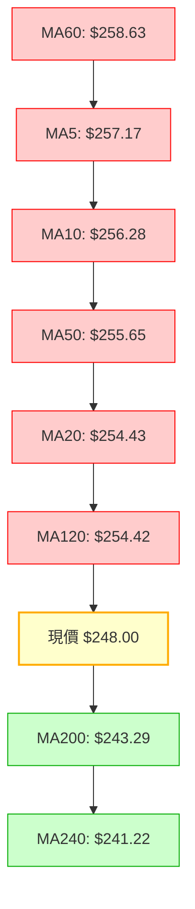
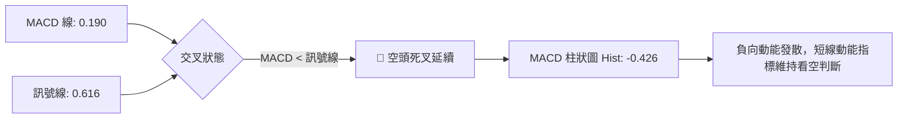
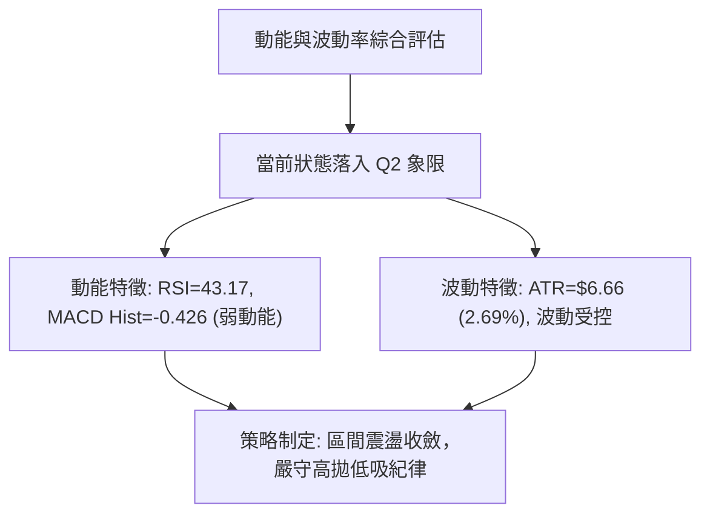
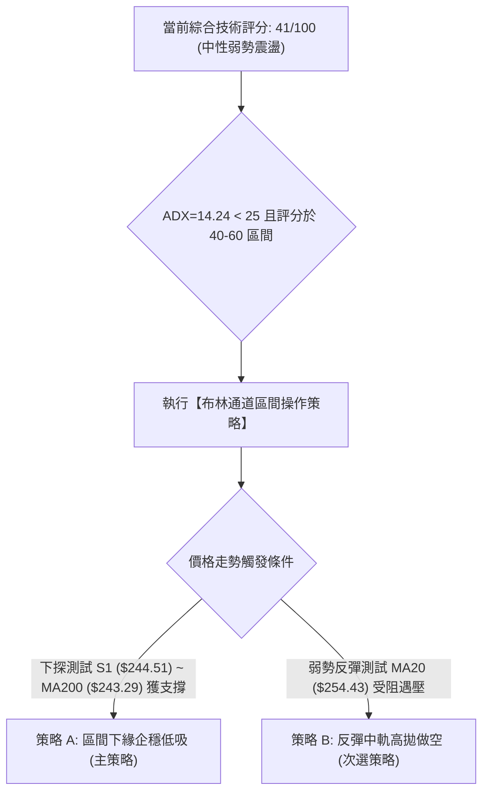
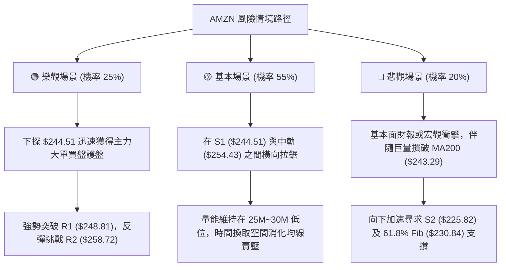

# AMZN 技術分析報告

> **報告日期**：2026-10-26 ｜ **語言**：繁體中文 ｜ **數據來源**：Yahoo Finance ｜ **當前價格**：$248.00 USD

---

## 目錄

| 章節 | 內容 |
|------|------|
| [1. 技術面概覽](#1-技術面概覽) | 訊號儀表板、核心指標、評分卡 |
| [2. 趨勢分析](#2-趨勢分析) | 多時框趨勢、長中短期走勢、ADX 結構 |
| [3. 圖表形態分析](#3-圖表形態分析) | 形態識別、K線組合、目標價推算 |
| [4. 支撐與阻力](#4-支撐與阻力) | 關鍵價位、斐波那契回調位分布 |
| [5. 技術指標深度解讀](#5-技術指標深度解讀) | MA/RSI/MACD/布林/成交量全面拆解 |
| [6. 動能與波動率](#6-動能與波動率) | 動能四象限、ATR 止損距離、Beta 敏感度 |
| [7. 多時框架總結](#7-多時框架總結) | 時框架矩陣、多時框收斂與裁決 |
| [8. 交易策略建議](#8-交易策略建議) | 策略路由、主策略詳情、精確風報比 |
| [9. 風險提示與監控](#9-風險提示與監控) | 監控 Checklist、三套情境與風控 |

---

## 1. 技術面概覽

### 🎯 技術訊號儀表板



### 📊 核心指標速覽表

| 指標類別 | 指標名稱 | 當前數值 | 訊號 | 解讀 |
|----------|----------|----------|:---:|------|
| **價格** | 當前收盤價 | $248.00 | 🟡 | 位於52週區間57.0%分位，短期自波段高點拉回測試支撐 |
| **均線** | MA20 | $254.43 | 🔴 | 現價位於MA20下方 -2.53%，短期均線呈現向下蓋頭反壓 |
| **均線** | MA50 | $255.65 | 🔴 | 現價跌破中期生命線，且MA20下穿MA50形成弱勢交叉 |
| **均線** | MA200 | $243.29 | 🟢 | 現價高於長期牛熊分界線 +1.94%，長期結構多頭底線尚未破壞 |
| **動能** | RSI(14) | 43.17 | 🟡 | 位於中性區間偏下緣，未見超賣極值，空方略佔上風 |
| **動能** | MACD(12,26,9) | Hist -0.426 | 🔴 | MACD線(0.190)低於訊號線(0.616)，負向擴散，動能走弱 |
| **超買超賣** | Stoch %K / %D | 8.21 / 34.73 | 🟢 | %K 深度超賣，短線存在技術性反抽或跌勢趨緩契機 |
| **趨勢** | ADX(14) | 14.24 | 🟡 | ADX < 25 表明市場處於無明確單邊趨勢之箱型橫盤整理 |
| **波動** | ATR(14) | $6.66 | 🟡 | 波動率佔價格 2.69%，單日震盪幅度可控，無異常極端波動 |
| **通道** | 布林帶 %B | 0.22 | 🟡 | 貼近布林下軌（$242.95），反映下檔逢低有一定承接預期 |
| **量能** | 量比 (vs 20MA) | 0.71x | 🔴 | 成交量 25.52M 顯著低於均量，OBV 趨勢疲軟，買盤意願低迷 |

### 🏆 技術評分卡

```
技術評分卡 — AMZN (2026-10-26)
════════════════════════════════════════════════════
趨勢強度      ███████░░░░░░░░░░░░░  35/100  🔴 空頭佔優
動能指標      ████████░░░░░░░░░░░░  40/100  🔴 動能趨弱
支撐穩定度    ███████████░░░░░░░░░  55/100  🟡 考驗 MA200
成交量配合    ███████░░░░░░░░░░░░░  35/100  🔴 量能萎縮
形態完整度    █████████░░░░░░░░░░░  45/100  🟡 箱型下緣
均線排列      ███████░░░░░░░░░░░░░  36/100  🔴 蓋頭排列
════════════════════════════════════════════════════
綜合評分      ████████░░░░░░░░░░░░  41/100  🟡 弱勢盤整 (算術平均: 41)
════════════════════════════════════════════════════
```

---

## 2. 趨勢分析

### 🌐 多時框趨勢分析



### 📈 長期趨勢 — 12個月走勢圖（Unicode）

```
AMZN 月線走勢圖（過去12個月：2025-11 至 2026-10）
價格軸 ($)
$275 ┤                                  ●(07月 271.58)
$270 ┤                            ●(05月 270.64)
$265 ┤                      ●(04月 265.06)
$260 ┤                                        ●(08月 259.77)
$255 ┤
$250 ┤                                              ●(09月 249.15)
$245 ┤                                                    ●(10月現價 248.00)
$240 ┤                ●(01月 239.30)
$235 ┤●(11月 233.22)
$230 ┤      ●(12月 230.82)
$220 ┤
$210 ┤          ●(02月 210.00)
$205 ┤                ●(03月 208.27 低點)
     └────────────────────────────────────────────────────────────
      11月  12月  01月  02月  03月  04月  05月  06月  07月  08月  09月  10月
```

#### 走勢特徵分析表格

| 階段區間 | 起止價格 | 漲跌幅 | 走勢特徵與結構分析 |
|----------|----------|:------:|-------------------|
| **2025-11 ~ 2026-03** | $233.22 → $208.27 | -10.70% | 構築上半年雙重打底架構，於 $208 附近築底成功確立堅實買盤 |
| **2026-03 ~ 2026-05** | $208.27 → $270.64 | +29.95% | 強勢主升浪突破，帶量連續噴出，奠定長期向上通道 |
| **2026-05 ~ 2026-07** | $270.64 → $271.58 | +0.35% | 高檔劇烈換手洗盤（6月曾急殺至 $238.34 後迅速收復），高檔多空分歧加劇 |
| **2026-07 ~ 2026-10** | $271.58 → $248.00 | -8.68% | 高檔動能衰竭轉為階梯式震盪回調，目前逼近長期核心均線 MA200 尋求防守 |

### 📊 中期趨勢（週線分析）

從近20週數據觀察，AMZN 在 2026-08-07 創下週收盤高點 $274.48 後，動能顯著降溫。MACD 柱狀圖由當時的 +4.090 迅速滑落至近期的 -0.426，週線 RSI 亦從 64.2 回落至 43.2。

```
中期壓力與支撐示意圖（週線結構）
───────────────────────────────────────────────────────────────
[高檔壓力帶]   $265.34 ~ $267.56  ██████████████████ (週K波段上影線反壓區)
                                      ↑
[當前震盪中樞] $254.43            ─────────── (週線與日線 MA20 重合位)
                                      ↓
[現價位置]     $248.00            ● (收盤價)
                                      ↓
[核心支撐帶]   $244.30 ~ $244.51  ▓▓▓▓▓▓▓▓▓▓▓▓▓▓▓▓▓▓ (近數週低點聚類與 S1)
[多頭防守底線] $241.60 ~ $243.29  ══════════════════ (50% 斐波那契 & MA200)
───────────────────────────────────────────────────────────────
```

### ⚡ 趨勢強度評估（ADX 解讀）



#### ADX 強度對照與解讀

| 指標變數 | 當前數值 | 狀態定性 | 戰略指導意義 |
|----------|:--------:|:--------:|--------------|
| **ADX(14)** | 14.24 | 弱趨勢/無趨勢 (<25) | 禁止採取單邊突破追價策略；嚴格以震盪邊界進行高拋低吸 |
| **+DI** | 19.26 | 多方動能偏低 | 多頭反彈無力，向上空間受限於均線與阻力位 |
| **-DI** | 26.72 | 空方佔據主導 | 空方維持壓制態勢，但因 ADX 極低，空方不具備崩跌發散動能 |

---

## 3. 圖表形態分析

### 🔍 形態識別系統



#### 形態識別與信心度評估表

| 形態名稱 | 信心度 | 判斷依據（引用數據） | 完成度 | 目標價（附計算式） |
|----------|:------:|----------------------|:------:|--------------------|
| **矩形箱型震盪** | 75% | 價格多次受阻於近高 R2 ($258.72) 與週高 $265.34，並於 S1 ($244.51) 與 09-18 低點 $244.30 獲支撐 | 85% | 向上突破目標：箱頂 $265.34 + 高度 ($265.34 - $244.30 = $21.04) = $286.38；向下跌破目標：$244.30 - $21.04 = $223.26 |
| **短期布林軌道壓制** | 80% | 價格自 10-20 觸碰上軌邊緣後連續回落，當前貼近下軌 $242.95 | 90% | 下軌支撐目標：$242.95（若確認反彈，回測中軌目標為 $254.43） |
| **頭肩頂形態** | 35% | 數據不足以確認頸線有效跌破，左肩與頭部不對稱 | 30% | 訊號不足，僅做指標型解讀，不預設延伸目標 |

### 🕯️ 重要 K 線形態分析

嚴格依據提供的「近10根日K」與「近8根週K」開高低收進行形態判讀：

#### 近10根日K形態拆解

| 日期（日K） | 開 | 高 | 低 | 收 | K線形態 | 解讀 | 訊號 |
|:----------:|:------:|:------:|:------:|:------:|:-------:|------|:----:|
| **2026-10-12** | 262.50 | 263.70 | 259.27 | 259.53 | 中黑實體 | 開高走低，上檔 $263 遭遇強大阻力 | 🔴 |
| **2026-10-13** | 259.44 | 262.84 | 258.42 | 258.58 | 小陰線 | 延續疲弱走勢，受制於 5 日線之下 | 🔴 |
| **2026-10-14** | 258.01 | 259.65 | 252.66 | 254.08 | 長黑破線 | 摜破 MA20，下探 $252.66 斐波那契 38.2% 位 | 🔴 |
| **2026-10-15** | 250.89 | 255.60 | 248.65 | 254.76 | 下影中陽 | 低檔出現低吸買盤，收盤重回 $254 上方 | 🟢 |
| **2026-10-16** | 255.10 | 255.54 | 248.60 | 250.00 | 實體陰線 | 反彈遇阻再次回吐，多空於 $250 關卡爭奪 | 🔴 |
| **2026-10-19** | 255.25 | 263.72 | 255.22 | 262.45 | 大陽吞噬 | 帶 56.18M 巨量強彈，單日大漲吞噬前三日跌幅 | 🟢 |
| **2026-10-20** | 264.08 | 265.34 | 260.42 | 262.63 | 假突破星線 | 衝高至 $265.34 後留上影線收黑，量能降至 34.92M | 🟡 |
| **2026-10-21** | 262.71 | 264.36 | 259.29 | 262.37 | 窄幅十字星 | 多空在高位陷入僵持，動能停滯，預示變盤 | 🟡 |
| **2026-10-22** | 258.18 | 258.41 | 248.00 | 250.38 | 長陰下殺 | 帶 48.81M 大量跳空長陰破位，完全回吐 10-19 陽線 | 🔴 |
| **2026-10-23** | 248.85 | 250.01 | 246.45 | 248.00 | 低位小陰線 | 縮量至 25.52M 弱勢盤整，收盤守在 $248.00 | 🟡 |

#### 近8根週K形態拆解

| 日期（週K） | 開 | 高 | 低 | 收 | K線形態 | 解讀 | 訊號 |
|:----------:|:------:|:------:|:------:|:------:|:-------:|------|:----:|
| **2026-09-04** | 263.83 | 264.36 | 251.93 | 258.51 | 長下影黑K | 探底後獲得下檔買盤支撐，防守 $251 關卡 | 🟡 |
| **2026-09-11** | 256.68 | 257.99 | 249.58 | 256.78 | 縮量十字星 | 交易量驟降至 114.66M，市場觀望氣氛極濃 | 🟡 |
| **2026-09-18** | 253.15 | 255.95 | 244.30 | 253.71 | 長下影垂頭 | 創下波段低點 $244.30 後強烈收腳，形成關鍵支撐底 | 🟢 |
| **2026-09-25** | 256.40 | 259.49 | 245.60 | 249.67 | 連續破底黑K | 多頭反撲未果，二度測試下檔低點 | 🔴 |
| **2026-10-02** | 246.63 | 253.56 | 244.73 | 251.52 | 雙底打底陽K | 再次守住 $244.73，形成堅實的週線雙重底防守結構 | 🟢 |
| **2026-10-09** | 250.19 | 262.80 | 250.18 | 262.43 | 光頭大陽線 | 週線帶量拉長紅，確立短波段反彈展開 | 🟢 |
| **2026-10-16** | 262.50 | 263.70 | 248.60 | 250.00 | 倒V長黑反轉 | 開高走低全週重挫，形成高檔吞噬烏雲蓋頂 | 🔴 |
| **2026-10-23** | 255.25 | 265.34 | 246.45 | 248.00 | 衝高回落長陰 | 衝高 $265.34 未能站穩，收盤跌破開盤，量能放大 | 🔴 |

### 📉 ASCII 走勢形態示意圖

```
AMZN 近期日K線形態走向（2026-10-12 至 2026-10-23）
價格 ($)
$266 ┤                      ┬ (10-20 高點 265.34)
$264 ┤                ┌─┐   │   ┌─┐
$262 ┤ ┌─┐            │ │   │   │ │
$260 ┤ │ │   ┌─┐      │ │   ┴   │ │
$258 ┤ │ │   │ │      │ │       └─┘
$256 ┤ └─┘   └─┘      │ │
$254 ┤       ┌─┐  ┌─┐ │ │            ┌─┐
$252 ┤       │ │  │ │ │ │            │ │
$250 ┤       └─┘  └─┘ └─┘            │ │   ┌─┐
$248 ┤            ┴   ┴              └─┘   │ │ (10-23 收盤 248.00)
$246 ┤                                     ┴   (10-23 低點 246.45)
     └──────────────────────────────────────────────────────────
       10-12 10-13 10-14 10-15 10-16 10-19 10-20 10-21 10-22 10-23
```

---

## 4. 支撐與阻力

### 🗺️ 關鍵價位分布圖（Unicode）

```
AMZN 價位結構分布圖（嚴格依據 OHLCV 聚類與數據）
═════════════════════════════════════════════════════════════════════
$287.20 ║████████████████████████████████████║ 52週歷史高點 (0.0% Fib)
$267.56 ║████████████████████████            ║ 強阻力 R3 (+7.89%)
$265.68 ║▓▓▓▓▓▓▓▓▓▓▓▓▓▓▓▓▓▓▓▓                ║ 斐波那契 23.6% 回調位
$258.72 ║████████████████                    ║ 關鍵波段阻力 R2 (+4.32%)
$254.43 ║────────────────────────────────────║ 布林中軌 / MA20 短期生命線
$252.36 ║▓▓▓▓▓▓▓▓▓▓▓▓                        ║ 斐波那契 38.2% 回調位
$248.81 ║████████                            ║ 近期直接阻力 R1 (+0.33%)
$248.00 ╠════════════════════════════════════╣ ◄ 當前收盤價 ($248.00)
$244.51 ║▓▓▓▓▓▓▓▓▓▓▓▓▓▓▓▓                    ║ 近期關鍵支撐 S1 (-1.41%)
$243.29 ║====================================║ 200日移動平均線 (牛熊防線)
$242.95 ║┄┄┄┄┄┄┄┄┄┄┄┄┄┄┄┄┄┄┄┄┄┄┄┄┄┄┄┄┄┄┄┄║ 布林通道下軌
$241.60 ║▓▓▓▓▓▓▓▓▓▓▓▓▓▓▓▓▓▓▓▓                ║ 斐波那契 50.0% 核心折返位
$230.84 ║▓▓▓▓▓▓▓▓▓▓▓▓▓▓▓▓▓▓▓▓▓▓▓▓            ║ 斐波那契 61.8% 黃金分割位
$225.82 ║████████████████████████            ║ 強支撐 S2 (-8.94%)
$220.99 ║████████████████████████████        ║ 極限防守支撐 S3 (-10.89%)
$196.00 ║████████████████████████████████████║ 52週歷史低點 (100.0% Fib)
═════════════════════════════════════════════════════════════════════
```

### 🚧 阻力位分析表

所有價位均嚴格引用 OHLCV 計算之關鍵價位：

| 阻力級別 | 價位 | 形成原因 | 突破難度 | 重要性 |
|:--------:|:----:|----------|:--------:|:------:|
| **R1** | $248.81 | 近期波段直接反壓，緊鄰當前價格僅 +0.33%，為 10-23 開盤價 ($248.85) 重疊帶 | 🟡 中等 | 短線多空強弱分水嶺 |
| **R2** | $258.72 | 近一年波段高點聚類，與 60 日均線 ($258.63) 及 10-22 開盤高點形成強烈共振 | 🔴 較高 | 中期反彈能否延續之關鍵考驗 |
| **R3** | $267.56 | 密集波段高點聚類，接近布林上軌 ($265.91) 與斐波那契 23.6% ($265.68) | 🔴 極高 | 波段牛熊轉換與多頭全面反撲之終極天花板 |

### 🛡️ 支撐位分析表

所有價位均嚴格引用 OHLCV 計算之關鍵價位：

| 支撐級別 | 價位 | 形成原因 | 守住機率 | 重要性 |
|:--------:|:----:|----------|:--------:|:------:|
| **S1** | $244.51 | 近一年波段低點聚類，與 09-18 週低點 $244.30、10-02 週低點 $244.73 形成三重底座 | 🟢 70% | 短線多頭退守之第一道核心防線 |
| **S2** | $225.82 | 近一年重大波段低點聚類，位於 61.8% 斐波那契 ($230.84) 下方之密集成交區 | 🟢 85% | 中期結構性強支撐，跌破將引發籌碼鬆動 |
| **S3** | $220.99 | 長期底部型態起漲區聚類，2024年底至2025初平台密集成交帶 | 🟢 95% | 戰略性長期牛市最後底線 |

### 📐 斐波那契回調位分析

依據 52 週高低點（$196.00 → $287.20，總垂直振幅 $91.20）嚴格計算之回調位分布如下：

| 回調比例 | 價位 | 當前價位相對位置與意義解讀 |
|:--------:|:----:|----------------------------|
| **0.0% (52W High)** | $287.20 | 歷史極值高點，長期上升通道頂軌 |
| **23.6%** | $265.68 | 強勢多頭防守位，本波衝高至 $265.34 恰於此處受阻回落 |
| **38.2%** | $252.36 | 多空平衡強弱線，現價已跌破，轉化為上方實質阻力 |
| **50.0%** | $241.60 | **重要折返中樞**：現價落於 38.2% ($252.36) 與 50.0% ($241.60) 之間 |
| **61.8%** | $230.84 | 黃金分割強防守位，若跌破 50% 則此處為回調終極目標 |
| **78.6%** | $215.52 | 深度回調警戒線，觸及代表牛市結構遭受嚴重破壞 |
| **100.0% (52W Low)**| $196.00 | 52週循環起點 |

**解讀**：現價 $248.00 位於 38.2% ($252.36) 與 50.0% ($241.60) 區間內。50.0% 折返位 $241.60 與 MA200 ($243.29)、布林下軌 ($242.95) 高度重疊，構成一個密集的**「三重技術匯聚支撐帶」**（$241.60 ~ $243.29），此區間預計具備強大支撐韌性。

---

## 5. 技術指標深度解讀

### 🎛️ 指標訊號總覽



### 📈 移動平均線排列分析



#### 均線數據深度解析

| 均線名稱 | 數值 | 現價差距 | 乖離率 | 排列狀態與趨勢解讀 |
|:--------:|:----:|:--------:|:------:|--------------------|
| **MA5** | $257.17 | -$9.17 | -3.56% | 短線急速下彎，5日成本全線套牢，構成短沖首要壓力 |
| **MA10** | $256.28 | -$8.28 | -3.23% | 下行斜率陡峭，加劇短線追高者的停損壓力 |
| **MA20** | $254.43 | -$6.43 | -2.53% | 月線下穿 MA50，形成死亡交叉，短期正式轉弱 |
| **MA50** | $255.65 | -$7.65 | -2.99% | 中期季線由走平轉下彎，波段多頭生命線失守 |
| **MA60** | $258.63 | -$10.63 | -4.11% | 與 R2 ($258.72) 重合，構成極為沉重之中期套牢蓋頭峰 |
| **MA120** | $254.42 | -$6.42 | -2.52% | 半年線走平，與 MA20 形成密集糾結阻力區 |
| **MA200** | $243.29 | +$4.71 | +1.94% | 長期年線穩步上行，提供強有力之長期戰略買盤保護 |
| **MA240** | $241.22 | +$6.78 | +2.81% | 與 50% 斐波那契 ($241.60) 共振，構築多頭終極堡壘 |

**綜合結論**：當前均線系統呈現「短期均線全面蓋頭、長期均線底部支撐」的**混合震盪排列**。短期內價格受困於上方 MA20/MA50 壓制，但下方有 MA200 的堅定依託，未形成單邊發散空頭排列。

### 📉 RSI(14) 分析

- **當前數值**：43.17（Wilder 計算方法）
- **區間評估**：處於 30 至 70 之「中性弱勢區間」
- **強度指示**：
  ```
  RSI(14) 當前強度: 43.17
  [超賣 0] ──────── 30 ───────●────── 70 ──────── [超買 100]
  進度條: ▓▓▓▓▓▓▓▓▓▓▓▓▓▓▓▓▓░░░░░░░░░░░░ 43.2%
  ```
- **背離判斷**：數據明確提示「近20根K棒首尾價格與 RSI 方向一致，**無明顯背離**」。價格自高點回落，RSI 同步走低，動能釋放符合常態回調特徵，並未出現動能衰竭之底背離，亦無空頭力竭跡象。

### 📊 MACD(12,26,9) 訊號解讀



**解讀**：MACD 線雖仍維持在零軸之上（0.190），但已被訊號線（0.616）壓制，且雙線持續向零軸收斂；柱狀圖為 -0.426，顯示空頭拋壓在近數個交易日內處於擴散週期，多頭尚未組織起有效的量能反攻。

### 📦 布林通道分析

- **布林參數**：20 日週期，2 倍標準差
- **上軌**：$265.91
- **中軌 (MA20)**：$254.43
- **下軌**：$242.95
- **帶寬指標 %B**：0.22（0 代表下軌，$242.95；0.5 代表中軌，$254.43；1 代表上軌，$265.91）

```
布林通道現前相對位置示意圖
───────────────────────────────────────────────────────────────
上軌  $265.91  ════════════════════════════════════════════════
               ▲
               │ (帶寬振幅: $22.96, 約 9.2%)
               ▼
中軌  $254.43  ────────────────────────────────────────────────
               ▲
               │ 現價跌破中軌，向通道下半部運作
               ▼
現價  $248.00  ● (%B = 0.22, 距離下軌約 $5.05)
               ▲
               │ 下檔即將觸及通道防守邊界
               ▼
下軌  $242.95  ════════════════════════════════════════════════
───────────────────────────────────────────────────────────────
```

**解讀**：%B 數值為 0.22，顯示股價已經進入下半軌的弱勢區間，但正逐漸逼近下軌 $242.95。搭配隨機指標 Stoch %K (8.21) 深度超賣，股價在下軌與 MA200 ($243.29) 疊加區域具備強烈止跌反彈潛力。

### 💹 成交量分析（量價配合度）

- **最新日成交量**：25,518,200 股
- **20日均量**：35,815,535 股（量比：0.71x）
- **50日均量**：34,770,520 股
- **量價特徵**：最新交易日成交量僅為 20 日均量的 71%，呈現顯著「量縮回檔」格局。
- **OBV 分析**：技術數據明確指出「OBV < MA → 量能疲弱」。OBV 處於其均線下方，反映自 2026-08 創高以來資金呈現淨流出狀態，反彈時未見增量資金進場追價，印證當前行情缺乏向上攻擊動能，以弱勢整理為主。

---

## 6. 動能與波動率

### ⚡ 動能評估四象限

| 象限 | 動能強度 | 波動率狀態 | AMZN 當前落點 | 操作策略評估 |
|:---:|:---:|:---:|:---:|:---|
| **Q1 (最佳擴張)** | 強動能 (ADX>25, RSI>60) | 低波動 (ATR<2%) | — | 順勢加碼，趨勢爆發段 |
| **Q2 (盤整醞釀)** | 弱動能 (ADX<25, RSI:40-60) | 低/正常波動 (ATR:2.69%) | **✓ Q2 象限** | **謹慎觀望，區間低吸高拋，避免追價** |
| **Q3 (極端博弈)** | 強動能 (單邊暴漲暴跌) | 高波動 (ATR>4%) | — | 擴大止損，高風險高回報 |
| **Q4 (退場觀望)** | 弱動能 (動能渙散) | 高波動 (無序洗盤) | — | 嚴格防守，空倉觀望 |



### 📊 ATR 波動率分析

- **ATR(14) 數值**：$6.66 USD（佔現價 2.69%，採 Wilder 平滑計算）
- **波動率含義**：在 68% 的單日交易區間內，AMZN 的正常波動範圍約為 ±$6.66。
- **動態止損建議**：
  - **保守型交易（1.5 倍 ATR）**：$6.66 × 1.5 = $9.99。以現價 $248.00 計，多頭保守止損需設在 $238.01。
  - **進取型波段（1.0 倍 ATR）**：$6.66 × 1.0 = $6.66。緊湊止損距離為 $6.66。
  - **結構性結合**：結合下方 S1 ($244.51) 與 50% 斐波那契 ($241.60)，止損設定在 $241.60（現價 -$6.40，約 0.96 倍 ATR），非常符合技術點位與 ATR 波動之雙重標準。

### 📐 Beta 與市場相關性

- **Beta 係數**：1.456
- **解讀**：AMZN 的系統性風險顯著高於大盤標普500指數。當市場基準指數變動 1.0% 時，AMZN 理論波動將達到 1.456%。
- **當前影響**：在最新新聞提及「Dow Jones Futures 變動、Fed Decision 及科技巨頭即將發布財報」之總經背景下，1.456 的高 Beta 意味著任何宏觀或財報訊息的邊際變化，均會被 AMZN 放大。若面臨市場拋售，下檔 S1/MA200 測試速度將極快；反之，一旦大盤企穩，其超賣回彈爆發力亦不容忽視。

---

## 7. 多時框架總結

### 📋 時框架評分表

| 時框架 | 趨勢方向 | 動能表現 | 均線排列狀態 | 形態特徵 | 綜合評分 | 操作指導建議 |
|:------:|:--------:|:--------:|:------------:|:--------:|:--------:|:-------------|
| **月線 (長期)** | 🟢 多頭向上 | 🟡 動能鈍化 | MA200/240 向上發散 | 長期上升通道內高檔整理 | 72/100 | 長期投資者持股續抱，下檔 MA200 為防線 |
| **週線 (中期)** | 🟡 橫盤整理 | 🔴 動能走弱 | 跌破短期均線，守住 MA50 | $244.30~$265.34 寬幅箱型 | 48/100 | 區間交易者等待箱型邊界訊號，不追突破 |
| **日線 (短期)** | 🔴 震盪回調 | 🔴 空頭壓制 | 短期均線呈蓋頭反壓 | 連續陰線拉回，貼近下軌 | 38/100 | 短線交易者逢反彈減碼，或於下軌輕倉試多 |

### 🔲 綜合訊號矩陣

```
時框架訊號交叉驗證矩陣
┌──────────────┬──────────────┬──────────────┬──────────────┐
│ 分析維度     │ 短期 (日線)  │ 中期 (週線)  │ 長期 (月線)  │
├──────────────┼──────────────┼──────────────┼──────────────┤
│ 趨勢方向     │ 🔴 空頭壓制  │ 🟡 橫盤整理  │ 🟢 多頭完好  │
│ 動能狀態     │ 🔴 柱狀負向  │ 🔴 RSI 下滑  │ 🟡 高檔整理  │
│ 均線系統     │ 🔴 跌破MA20  │ 🟡 測試MA20  │ 🟢 遠高於MA200│
│ 量能配合     │ 🔴 量縮疲弱  │ 🔴 週量遞減  │ 🟡 長期平穩  │
│ 關鍵位置     │ 🟡 逼近下軌  │ 🟢 雙底支撐帶│ 🟢 上升通道  │
└──────────────┴──────────────┴──────────────┴──────────────┘
```

### ⚖️ 多時框收斂結論

依據多時框收斂規則（規則 14）：
1. **當前趨勢強度**：ADX(14) 數值為 **14.24**，明確小於 25，判定市場處於**【盤整行情（Consolidation）】**，而非單邊趨勢行情。
2. **主導維度**：在盤整行情下，單邊趨勢指標失效，交易優先級以**「日線布林通道上下軌（$242.95 ~ $265.91）及關鍵水平支撐阻力 S1/R1」**為主要決策依據。
3. **最終裁決**：日線雖然呈現短期弱勢空頭壓制，但週線與月線之長期重要支撐（MA200 $243.29、S1 $244.51、布林下軌 $242.95）即在眼前，且 Stoch 深度超賣（8.21），向下空間受限。因此給出唯一明確方向結論：
   
   👉 **【中性偏弱震盪觀望，以布林區間下緣低吸、中軌高拋為主】**。此結論完全收斂第 2 章與第 5 章的指標特徵，並作為第 8 章策略制定之唯一基石。

---

## 8. 交易策略建議

### 🗺️ 策略決策流程圖



### 🧭 策略路由（依評分卡分流）

> **當前主策略方向 = 中性區間震盪操作（依綜合評分 41/100，落於 40–60 區間）**
> 
> 因評分接近 40 分邊界，市場雖受均線空頭壓制，但由於 ADX 極低 (14.24) 且貼近布林下軌 ($242.95)，不宜在破位前直接追空。主策略以**「區間下緣關鍵支撐企穩之多頭博弈」**為主，次選策略以**「反彈測試中軌壓力之順勢防守空單」**為輔。

### 🎯 價格情境階梯（Price Scenarios）

價位嚴格引用第 4 章及關鍵價位數據，無任何臆造：

| 觸發條件 | 下一目標 | 後續延伸 | 情境含義與技術解讀 |
|----------|:--------:|:--------:|--------------------|
| **強勢突破 R1 ($248.81)** | R2 ($258.72) | R3 ($267.56) | 短線迅速轉強，擺脫日線空頭壓制，回補上方跳空缺口 |
| **守住現價至 S1 ($244.51)**| MA20 ($254.43)| R2 ($258.72) | 確立日線雙底或箱型下緣支撐，展開布林通道內反彈行情 |
| **跌破 S1 ($244.51)** | S2 ($225.82) | S3 ($220.99) | 跌破 MA200 與 50% 斐波那契，長期趨勢轉弱，進入深度洗盤 |

### 📊 情境機率分佈

| 情境劃分 | 機率 | 主要技術依據 |
|----------|:----:|--------------|
| **情境一：區間下緣企穩反彈** | **55%** | Stoch %K (8.21) 深度超賣；現價 $248.00 距 S1 ($244.51)、布林下軌 ($242.95)、MA200 ($243.29) 極近，共振支撐強大；成交量縮顯示殺跌動能衰竭。 |
| **情境二：窄幅橫盤拉鋸** | **30%** | ADX 僅 14.24，市場缺乏主動性方向力量；量比 0.71x 追價意願薄弱，價格極易在 $244.51 ~ $252.36 之間窄幅膠著。 |
| **情境三：摜破支撐再探底** | **15%** | MACD 柱狀圖維持 -0.426 負向擴散；-DI (26.72) 壓制 +DI (19.26)；若伴隨基本面利空放量摜破 $241.60，將下探 S2。 |

### 🟢 主策略詳情（方向依上方路由）

所有目標價、止損價、風險報酬比嚴格按規則 17 驗證計算：
- 做多風報比 = (目標價 T1 − 進場價) ÷ (進場價 − 止損價)
- 做空風報比 = (進場價 − 目標價 T1) ÷ (止損價 − 進場價)

| 策略要素 | 策略 A：區間下緣低吸（多頭） | 策略 B：反彈遇阻高拋（空頭） |
|----------|------------------------------|------------------------------|
| **策略定位** | 依據布林下軌與 S1 支撐之反彈策略 | 依據 MA20 中軌蓋頭壓制之順勢波段策略 |
| **進場條件** | 價格回測 S1 獲支撐且出現日K收腳陽線 | 價格反彈至布林中軌受阻且出現長上影線 |
| **進場價格** | **$244.51**（S1 關鍵支撐位） | **$254.43**（MA20 / 布林中軌） |
| **目標價 T1** | **$254.43**（布林中軌 / MA20） | **$244.51**（S1 關鍵支撐位） |
| **目標價 T2** | **$258.72**（R2 關鍵阻力位） | **$241.60**（50.0% 斐波那契回調位） |
| **止損價格** | **$241.60**（跌破 50% 斐波那契與 MA200）| **$258.72**（有效突破 R2 關鍵阻力位） |
| **風險報酬比** | **1 : 3.41（以 T1 計）**<br>*(計算式: (254.43-244.51)/(244.51-241.60) = 9.92/2.91 = 3.4089)* | **1 : 2.31（以 T1 計）**<br>*(計算式: (254.43-244.51)/(258.72-254.43) = 9.92/4.29 = 2.3123)* |
| **延伸風報比** | **1 : 4.88（以 T2 計）**<br>*(計算式: (258.72-244.51)/2.91 = 14.21/2.91 = 4.8831)* | **1 : 2.99（以 T2 計）**<br>*(計算式: (254.43-241.60)/4.29 = 12.83/4.29 = 2.9906)* |
| **成功機率** | 55% | 45% |
| **建議倉位** | 10% ~ 15%（輕倉防守試單） | 10%（短線波段防禦單） |

### 🔴 反向風險觸發點（對沖提示）

- **推翻多頭主策略之關鍵訊號**：若收盤價帶量（日成交量超過 50D 均量 34.77M）實質跌破 **$241.60**（50% 斐波那契位）與 **$243.29**（MA200），即宣告長期上升防線失守，此時所有多頭試單必須無條件停損，並應建立反向空頭對沖部位，下看 S2 ($225.82)。
- **推翻空頭輔助策略之關鍵訊號**：若日K以大實體紅K突破並站穩 **$258.72**（R2），且成交量放大，意味著均線壓力全數消化完畢，空單應即刻撤出，避免遭受逼空行情軋空。

### ⭐ 整體訊號強度評星

```
做多訊號強度：★★☆☆☆  (2/5星 - 長多支撐在眼前，但短期動能尚未翻正)
做空訊號強度：★★★☆☆  (3/5星 - 短期均線壓制明顯，但向下空間遭 MA200 封鎖)
整體可信度：  ★★★☆☆  (3/5星 - 盤整行情，指標衝突度高，需嚴守邊界紀律)
```

---

## 9. 風險提示與監控

### ✅ 關鍵監控指標 Checklist

```
╔════════════════════════════════════════════════════════════════════╗
║                   AMZN 每日技術面風控監控清單                      ║
╠════════════════════════════════════════════════════════════════════╣
║ [ ] 價位防守點：收盤價是否跌破 MA200 ($243.29) 或 50% Fib ($241.60)║
║ [ ] 均線動態：現價能否帶量重新收復 MA20 ($254.43) 生命線           ║
║ [ ] 動能翻轉：MACD 柱狀圖（當前 -0.426）是否由擴散轉為收斂翻紅      ║
║ [ ] 超賣修復：Stoch %K (8.21) 是否在超賣區形成金叉向上上穿 %D (34.73)║
║ [ ] 量能異動：單日成交量是否突破 20 日均量 (35.81M) 達 1.2 倍以上 ║
║ [ ] 外部宏觀：關注美聯儲利率決策（Fed Decision）與科技巨頭財報動向 ║
╚════════════════════════════════════════════════════════════════════╝
```

### ⚠️ 風險場景分析



### 🛡️ 風險管理重要提醒

1. **嚴禁單邊追價**：當前 ADX 為 14.24，屬於典型的低流暢度盤整結構。若在 $255~$258 追多容易遭逢均線反壓套牢，在 $245 附近殺跌則易割在布林下軌與 MA200 的鐵底反彈處。
2. **波動率倉位控制**：ATR 為 $6.66（2.69%），結合 Beta 高達 1.456，個股單日波動幅度可輕易達到 3%~5%。單筆交易承擔之資金風險不得超過總資產的 1.0%~1.5%。
3. **財報與事件風險對沖**：新聞顯示大型科技股財報與聯準會決議即將發布，技術面在重磅基本面事件前夕可能出現短暫失效。若持有多頭試單，建議搭配買入外圍價平 Put 或減少淨曝險至 10% 以下度過事件期。

---

## 📋 報告總結

```
AMZN 技術分析報告總結
════════════════════════════════════════════════════════
報告日期：2026-10-26
當前價格：$248.00 USD
分析評級：⚖️ 綜合技術評級：41/100（弱勢盤整 / 區間震盪）

關鍵結論：
├─ 長期趨勢：🟢 多頭結構完好（穩居 MA200 $243.29 與月線通道之上）
├─ 中期趨勢：🟡 寬幅箱型震盪（受困於 $244.30 至 $265.34 區間）
├─ 短期趨勢：🔴 弱勢空頭壓制（價格跌破短期 MA20/MA50 均線）
├─ 關鍵支撐：S1 $244.51 ｜ 50% 斐波那契 $241.60 ｜ MA200 $243.29
├─ 關鍵阻力：R1 $248.81 ｜ MA20 $254.43 ｜ R2 $258.72
└─ 分析師目標：均價 $331.72（共識評級：Strong Buy，58 位分析師）

最優策略組合：
1. 🥇 最佳機會：等待價格回測 S1 ($244.51) 確認企穩，執行策略 A 區間
   低吸做多，嚴守止損 $241.60，第一目標看至 MA20 ($254.43)，風報比達 1:3.41。
2. 🥈 次選機會：若價格未破 S1 直接反彈，於測試 MA20 ($254.43) 受阻
   時執行策略 B 輕倉試空，止損設於 R2 ($258.72)，風報比達 1:2.31。
3. 🥉 保守選擇：在 ADX 升破 20 且現價站穩 MA20 之前，維持現金觀望，
   靜待科技股財報事件明朗與量能放大後再順勢進場。
════════════════════════════════════════════════════════
```

---

> ⚠️ **免責聲明**：本報告為技術分析研究，所有數據、圖表及價位推算均嚴格基於所提供的歷史 OHLCV 價格資訊。本報告**僅供研究與學術參考**，**不構成任何形式的投資建議、要約或承諾**。金融市場投資具有極高風險，價格可升亦可跌，投資者應根據個人財務狀況獨立判斷並自負盈虧。

---

*報告生成時間：2026-10-26 ｜ 數據來源：Yahoo Finance ｜ 分析框架：多時框技術分析模型*