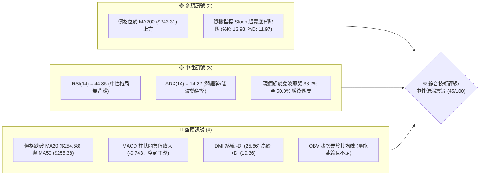
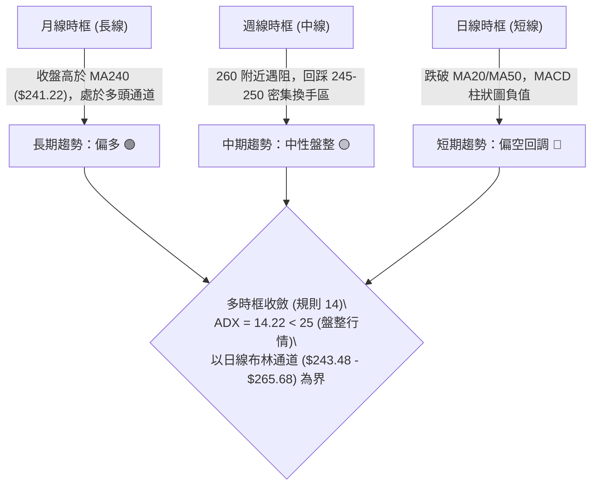
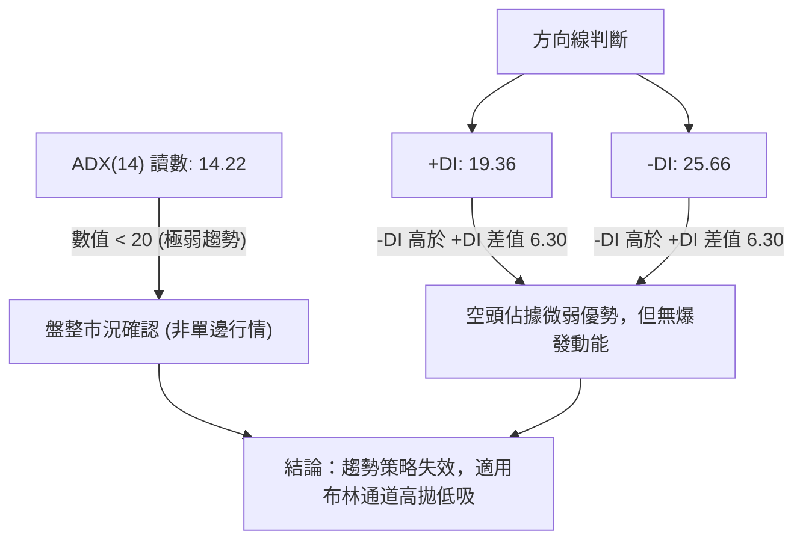
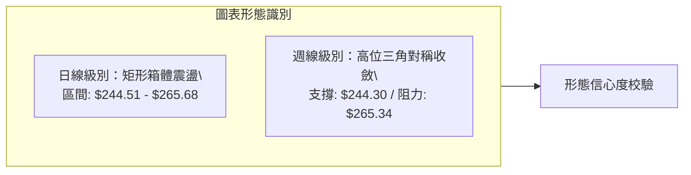
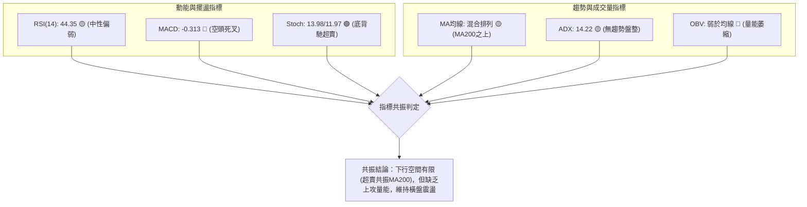
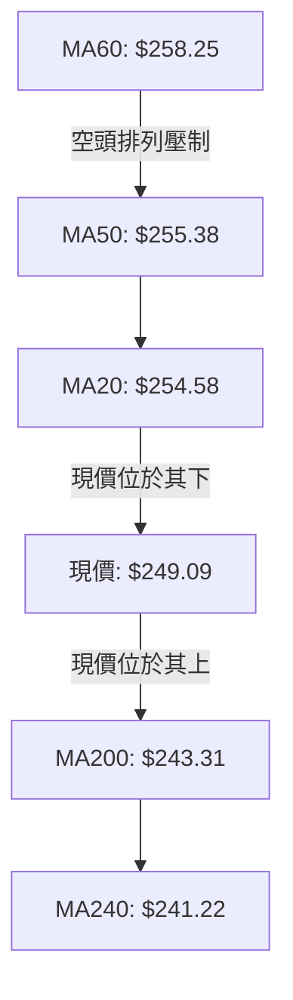
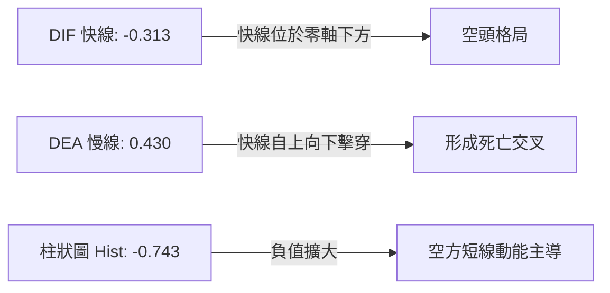
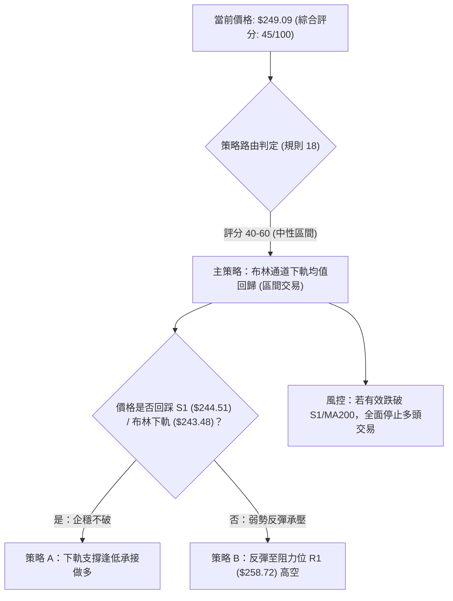
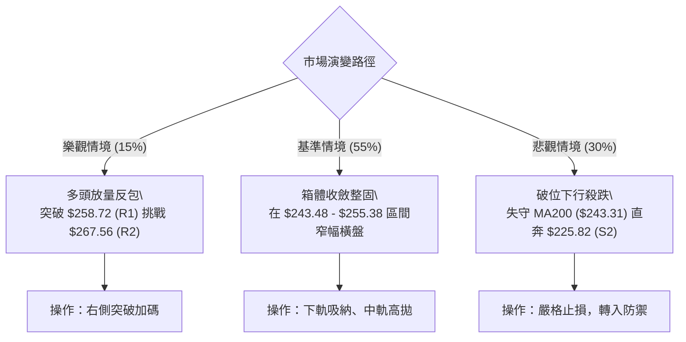

# AMZN 技術分析報告

> **報告日期**：2026-10-27 ｜ **語言**：繁體中文 ｜ **數據來源**：Yahoo Finance ｜ **當前價格**：$249.09

---

## 目錄

| 章節 | 內容 |
|------|------|
| [1. 技術面概覽](#1-技術面概覽) | 訊號儀表板、核心指標、評分卡 |
| [2. 趨勢分析](#2-趨勢分析) | 多時框趨勢、長中短期走勢、ADX 解讀 |
| [3. 圖表形態分析](#3-圖表形態分析) | 形態識別、K線組合、目標價計算 |
| [4. 支撐與阻力](#4-支撐與阻力) | 關鍵價位、斐波那契回調結構 |
| [5. 技術指標深度解讀](#5-技術指標深度解讀) | 均線系統、RSI、MACD、布林通道、成交量 |
| [6. 動能與波動率](#6-動能與波動率) | 動能評估象限、ATR 波動率、Beta 分析 |
| [7. 多時框架總結](#7-多時框架總結) | 時框架矩陣、多時框收斂結論 |
| [8. 交易策略建議](#8-交易策略建議) | 策略路由、價格情境、主策略詳情、風控點 |
| [9. 風險提示與監控](#9-風險提示與監控) | 監控清單、風險場景樹、倉位管理 |

---

## 1. 技術面概覽

### 🎯 技術訊號儀表板



### 📊 核心指標速覽表

| 指標類別 | 指標名稱 | 當前數值 | 訊號 | 專業解讀 |
|:---|:---|:---|:---:|:---|
| **價格** | 當前收盤價 | $249.09 | 🟡 | 位於52週區間58.2%，處於短期回調但中長期防守位之上 |
| **均線** | 短期 MA20 | $254.58 | 🔴 | 現價低於 MA20 (-2.16%)，短線承壓，中軌構成動態阻力 |
| **均線** | 中期 MA50 | $255.38 | 🔴 | 現價低於 MA50，MA20 下穿 MA50 形成死叉雛形 |
| **均線** | 長期 MA200 | $243.31 | 🟢 | 現價高於 MA200 (+2.38%)，牛熊分界線提供強固長期底層支撐 |
| **動能** | RSI(14) | 44.35 | 🟡 | Wilder 平滑法數值處於 40–50 震盪中軸，無極端超買超賣 |
| **動能** | MACD (12,26,9) | -0.313 / 0.430 | 🔴 | MACD 快線低於訊號線，Hist 柱為 -0.743，空方動能佔優 |
| **動能** | Stoch %K / %D | 13.98 / 11.97 | 🟢 | 深度進入超賣區 (<20)，短線下行動能衰竭，具備反彈契機 |
| **趨勢** | ADX(14) / DMI | 14.22 | 🟡 | ADX < 25 表明無單邊趨勢，-DI(25.66) > +DI(19.36) 空方微弱控盤 |
| **通道** | 布林通道 %B | 0.25 | 🟡 | 位於下軌 ($243.48) 與中軌之間，正逼近下軌支撐帶 |
| **量能** | 成交量 / 20日均量 | 32,613,300 / 0.91x | 🔴 | 量比不足 1.0x，量能萎縮且 OBV 低於均線，缺乏多頭進攻量 |
| **波動** | ATR(14) | $6.44 (2.59%) | 🟡 | 波動率適中偏低，日內標準震盪幅度約 $6.44 |

### 🏆 技術評分卡

```
╔══════════════════════════════════════════════════════════════════╗
║               AMZN 技術評分卡 (2026-10-27)                       ║
╠══════════════════════════════════════════════════════════════════╣
║ 趨勢強度 (Trend)     ████████░░░░░░░░░░░░  40/100  🔴 空頭佔優   ║
║ 動能指標 (Momentum)  ████████░░░░░░░░░░░░  42/100  🔴 動能偏弱   ║
║ 支撐穩定度 (Support) ████████████░░░░░░░░  58/100  🟡 支撐穩固   ║
║ 成交量配合 (Volume)  ███████░░░░░░░░░░░░░  38/100  🔴 量能疲弱   ║
║ 形態完整度 (Pattern) █████████░░░░░░░░░░░  45/100  🟡 區間收斂   ║
║ 均線排列 (MA System) █████████░░░░░░░░░░░  45/100  🟡 混合排列   ║
╠══════════════════════════════════════════════════════════════════╣
║ 綜合評分 (Overall)   █████████░░░░░░░░░░░  45/100  ⚖️ 區間震盪   ║
╚══════════════════════════════════════════════════════════════════╝
```
*註：綜合評分 = (40 + 42 + 58 + 38 + 45 + 45) ÷ 6 = 44.67，四捨五入為 45/100（依規則 18 嚴格計算）。*

---

## 2. 趨勢分析

### 🌐 多時框趨勢分析



### 📈 長期趨勢 — 12個月走勢圖（Unicode）

以下為 AMZN 過去 12 個月（2025-11 至 2026-10）收盤價歷史走勢與關鍵轉折標註：

```
AMZN 月線走勢圖（過去12個月：2025-11 至 2026-10）
價格軸 ($)
$275 ┤                                  ●(07月 $271.58)
$270 ┤                          ●(05月 $270.64)
$265 ┤                      ●(04月 $265.06)
$260 ┤                                              ●(08月 $259.77)
$255 ┤
$250 ┤                                                  ●(09月 $249.15)
$245 ┤                                                      ●←現價 $249.09 (10月)
$240 ┤              ●(01月 $239.30)     ●(06月 $238.34)
$235 ┤  ●(11月 $233.22)
$230 ┤      ●(12月 $230.82)
$220 ┤
$210 ┤          ●(02月 $210.00)
$205 ┤              ●(03月 $208.27: 低點)
     └─────────────────────────────────────────────────────────────
       11   12   01   02   03   04   05   06   07   08   09   10  (月份)
```

#### 走勢特徵分析表格

| 階段 | 期間 | 價格區間 | 累積漲跌 | 特徵解讀 |
|:---|:---|:---|:---:|:---|
| **箱體回踩** | 2025/11 - 2026/03 | $233.22 → $208.27 | -10.70% | 構築中期底部，2026-03 探底 $208.27 獲得支撐 |
| **強勢主升** | 2026/03 - 2026/07 | $208.27 → $271.58 | +30.40% | 突破所有均線，7月創下階段收盤新高 $271.58 |
| **高位收斂** | 2026/08 - 2026/10 | $271.58 → $249.09 | -8.28% | 衝高 52W 高點 $287.20 後受阻，回踩 MA200/斐波那契 50% 支撐帶 |

### 📊 中期趨勢（週線分析）

從近 20 週收盤走勢可見，價格在 2026-08-07 見週收盤高點 $274.48 後，動能逐步放緩。近 8 週價格在 $244.30 至 $265.34 之間震盪。

```
週線關鍵攻防結構圖
$274.48 ─────── 週線頂部波段高點（8月阻力）
   │
$265.34 ─────── 10月中旬反彈阻力位（近8週高點）
   │
$254.58 ─────── MA20 中軌動態阻力線
   ▲
$249.09 ─────── 當前收盤價位（回測頸線與整數關卡）
   ▼
$244.30 ─────── 近8週波段低點連線（9/18 低點 $244.30、10/2 低點 $244.73）
   │
$243.31 ─────── MA200 長期多空分水嶺
```

### ⚡ 趨勢強度評估（ADX 解讀）



| 指標名稱 | 數值 | 臨界值標準 | 市場狀態 | 操作指引 |
|:---|:---:|:---:|:---:|:---|
| **ADX(14)** | 14.22 | < 20 極弱 / < 25 弱 | 無趨勢（盤整） | 嚴禁追漲殺跌，避免順勢突破策略 |
| **+DI(14)** | 19.36 | — | 多方力量偏弱 | 多頭尚未發動有效進攻 |
| **-DI(14)** | 25.66 | > +DI (19.36) | 空方微幅主導 | 壓制反彈空間，下檔尋求支撐 |

---

## 3. 圖表形態分析

### 🔍 形態識別系統

依據規則 15，僅依據已知 OHLCV 價格幾何結構評定形態，絕不主觀臆造。



| 形態名稱 | 信心度 | 判斷依據（引用數據） | 完成度 | 目標價（附精確計算式） |
|:---|:---:|:---|:---:|:---|
| **日線矩形箱體震盪** | 75% | 下邊界為 S1 $244.51（9/18低點$244.30、10/2低點$244.73、10/23低點$246.45）；上邊界為布林上軌與斐波那契23.6% $265.68 | 85% | 向上突破：頸線 $265.68 + 箱高 ($265.68 - $244.51 = $21.17) = **$286.85**（接近52W高點$287.20）<br>向下跌破：頸線 $244.51 - 箱高 $21.17 = **$223.34**（接近S2 $225.82） |
| **日線潛在雙重底雛形** | 45% | 低點1：10/16最低 $248.60；低點2：10/23最低 $246.45。因跌破10/20反彈高點頸線，形態未確認 | 35% | *訊號不足（信心度 < 50%），依規則 15 僅作指標型參考，不設定形態目標價* |

### 🕯️ 重要K線形態分析

嚴格依據數據中提供的「近10根日K」與「近8根週K」四價進行形態解讀：

| 日期（時框） | 開盤價 | 最高價 | 最低價 | 收盤價 | K線形態名稱 | 技術解讀 | 訊號 |
|:---|:---:|:---:|:---:|:---:|:---|:---|:---:|
| **2026-10-19 (日K)** | 255.25 | 263.72 | 255.22 | 262.45 | 長紅實體帶量突破 | 巨量（56.18M）拉升，一舉突破 MA20，為短線強多訊號 | 🟢 |
| **2026-10-20 (日K)** | 264.08 | 265.34 | 260.42 | 262.63 | 高位十字星/流星孕線 | 衝高觸及 $265.34 遭遇顯著拋壓，收盤低於開盤，多頭力竭 | 🔴 |
| **2026-10-22 (日K)** | 258.18 | 258.41 | 248.00 | 250.38 | 大陰線破位向下吞噬 | 帶量（48.81M）跌破 MA20 與 MA50，空方完全回補前三日漲幅 | 🔴 |
| **2026-10-23 (日K)** | 248.85 | 250.01 | 246.45 | 248.00 | 下影小陰線（縮量） | 量能驟降至 25.56M，下探 $246.45 見買盤承接，跌勢趨緩 | 🟡 |
| **2026-10-26 (日K)** | 249.47 | 250.79 | 247.23 | 249.09 | 窄幅星線十字星 | 波動區間收縮至 $3.56，多空在 $249.00 關卡形成短線平衡 | 🟡 |
| **2026-10-16 (週K)** | 262.50 | 263.70 | 248.60 | 250.00 | 長黑實體倒轉吞噬 | 週線大幅回調，高低振幅達 $15.10，確認上方 $265 阻力強勁 | 🔴 |
| **2026-10-23 (週K)** | 255.25 | 265.34 | 246.45 | 248.00 | 長上影紡錘黑K | 衝高 $265.34 後遭空頭痛擊，長上影線達 $10.09，賣壓沉重 | 🔴 |

### 📉 ASCII 走勢形態示意圖

```
日線箱體震盪結構（2026-10-13 至 2026-10-26）
$265.68 ┬─────── 10/20 高點 $265.34 (箱體上軌 / 斐波那契 23.6%) ───────
        │            ▲
        │           ╱ ╲ 10/20 流星星線
        │   10/19  ╱   ╲
$258.72 ┼── 長紅 ╱─────╲── 10/22 大陰摜破 (阻力 R1) ─────────────────
        │       ╱         ╲
$254.58 ┼──────╱───────────╲── MA20 中軌阻力線 ─────────────────────────
        │     ╱             ▼
$249.09 ┼────┼───────────────●── 當前收盤價 $249.09 (縮量收斂星線)
        │    │               │
$244.51 ┴───┴───────┴───────┴── 支撐 S1 (10/23 低點 $246.45 測試區) ───────
```

### 🎯 形態目標價計算

依據日線矩形箱體之量測幅度法則：
1. **箱體上限（頸線）**：$265.68（布林上軌及波段高點）
2. **箱體下限（支撐）**：$244.51（波段低點聚類 S1）
3. **箱體垂直高度**：$H = 265.68 - 244.51 = \$21.17$
4. **多頭向上突破目標價**：
   $$\text{Target}_{\text{Bull}} = 265.68 + 21.17 = \$286.85$$
   *(該計算價位精確對應 52W 高點 $287.20)*
5. **空頭向下跌破目標價**：
   $$\text{Target}_{\text{Bear}} = 244.51 - 21.17 = \$223.34$$
   *(該計算價位精確介於 S2 $225.82 與 S3 $220.99 之間)*

---

## 4. 支撐與阻力

### 🗺️ 關鍵價位分布圖（Unicode）

```
AMZN 價位結構分布圖 (由 OHLCV 聚類計算)
═══════════════════════════════════════════════════════════════════
$287.20 ║████████████████████████║ 52週歷史高點 / 斐波那契 0.0%
$276.65 ║████████████████████    ║ 強阻力 R3 (+11.07%)
$267.56 ║██████████████████████  ║ 次級阻力 R2 (+7.41%)
$265.68 ║████████████████████████║ 布林上軌 / 斐波那契 23.6%
$258.72 ║████████████████████████║ 關鍵阻力 R1 (+3.87%) / MA60 ($258.25)
$254.58 ║▓▓▓▓▓▓▓▓▓▓▓▓▓▓▓▓▓▓▓▓    ║ 動態阻力 MA20 / MA50 ($255.38)
$252.36 ║▓▓▓▓▓▓▓▓▓▓▓▓▓▓▓▓        ║ 斐波那契 38.2% 回調位
────────╫────────────────────────╫──────────────────────────────────
$249.09 ╠════════════════════════╣ ◄ 當前收盤價 (Last Close)
────────╫────────────────────────╫──────────────────────────────────
$244.51 ║▓▓▓▓▓▓▓▓▓▓▓▓▓▓▓▓▓▓▓▓    ║ 近期關鍵支撐 S1 (-1.84%)
$243.48 ║██████████████████████  ║ 布林下軌支撐位
$243.31 ║████████████████████████║ 牛熊生命線 MA200
$241.60 ║████████████████████████║ 斐波那契 50.0% 關鍵回調位
$230.84 ║████████████████████    ║ 斐波那契 61.8% 黃金分割位
$225.82 ║████████████████████████║ 強支撐 S2 (-9.34%)
$220.99 ║████████████████████████║ 強支撐 S3 (-11.28%)
$196.00 ║████████████████████████║ 52週最低點 / 斐波那契 100.0%
═══════════════════════════════════════════════════════════════════
```

### 🚧 阻力位分析表

阻力位嚴格引用 OHLCV 聚類計算數值：

| 阻力級別 | 價位 | 距現價幅幅 | 形成原因與技術共振 | 突破難度 | 重要性 |
|:---|:---:|:---:|:---|:---:|:---:|
| **R1** | $258.72 | +3.87% | 近一年波段高點聚類，與 MA60 ($258.25) 及 10/13 開盤價重疊 | 中等 🟡 | ★★★★☆ |
| **R2** | $267.56 | +7.41% | 接近斐波那契 23.6% ($265.68) 及 10/20 高點 ($265.34) 密集套牢區 | 極高 🔴 | ★★★★★ |
| **R3** | $276.65 | +11.07% | 2026-08 週線高點 ($274.48) 延伸之波段頂部聚類阻力 | 極高 🔴 | ★★★★☆ |

### 🛡️ 支撐位分析表

支撐位嚴格引用 OHLCV 聚類計算數值：

| 支撐級別 | 價位 | 距現價幅幅 | 形成原因與技術共振 | 守住機率 | 重要性 |
|:---|:---:|:---:|:---|:---:|:---:|
| **S1** | $244.51 | -1.84% | 近一年波段低點聚類，共振布林下軌 ($243.48) 與 MA200 ($243.31) | 70% 🟢 | ★★★★★ |
| **S2** | $225.82 | -9.34% | 2025年夏季與秋季波段密集成交低點聚類，位於 61.8% 之下 | 85% 🟢 | ★★★★☆ |
| **S3** | $220.99 | -11.28% | 2025年9月回調低點聚類，長期多頭極限防守線 | 90% 🟢 | ★★★☆☆ |

### 📐 斐波那契回調位分析

依據 52 週完整波動區間（低點 $196.00 → 高點 $287.20，總垂直振幅 $91.20）計算：

```
斐波那契回調層級位階
$287.20 ├─ 0.0%  (52W High)
$265.68 ├─ 23.6% (阻力位，對應布林上軌)
$252.36 ├─ 38.2% (短期反彈第一阻力)
────────┼─ [現價 $249.09 處於 38.2% 至 50.0% 之間]
$241.60 ├─ 50.0% (中期關鍵防守位，共振 MA200 $243.31)
$230.84 ├─ 61.8% (黃金分割位，波段強弱分界)
$215.52 ├─ 78.6% (深度回調支撐)
$196.00 └─ 100.0% (52W Low)
```

**斐波那契結構解讀**：
- 現價 **$249.09** 正位於 38.2% 回調位 ($252.36) 與 50.0% 回調位 ($241.60) 之間。
- 38.2% 回調位 ($252.36) 向上被跌破後，已由支撐轉為反彈即時阻力；
- 50.0% 回調位 ($241.60) 與長期牛熊線 MA200 ($243.31)、布林下軌 ($243.48) 及波段支撐 S1 ($244.51) 形成極為罕見的**四重共振支撐帶**（$241.60 - $244.51），提供了極高強度的緩衝墊。

---

## 5. 技術指標深度解讀

### 🎛️ 指標訊號總覽



### 📈 移動平均線排列分析



| 均線名稱 | 數值 | 距現價幅幅 | 走勢斜率 | 技術意涵 |
|:---|:---:|:---:|:---:|:---|
| **MA 5** | $254.49 | -2.12% | ▼ 下行 | 極短線空方壓制線，5日均線下彎 |
| **MA 10** | $255.23 | -2.41% | ▼ 下行 | 10日線下壓，壓制反彈節奏 |
| **MA 20** | $254.58 | -2.16% | ▼ 下行 | 月線層級反壓，日線布林帶中軌 |
| **MA 50** | $255.38 | -2.46% | ▼ 下行 | 季線下行，MA20/MA50 出現黏合下穿風險 |
| **MA 60** | $258.25 | -3.55% | ▼ 下行 | 中期波段強阻力位 |
| **MA 120** | $254.22 | -2.02% | ▼ 下行 | 半年線走平微跌，與 MA20 形成密集阻力帶 |
| **MA 200** | $243.31 | +2.38% | ▲ 上行 | 年線持續向上，多頭根本底線，支撐強勁 |
| **MA 240** | $241.22 | +3.26% | ▲ 上行 | 兩年線向上，確認長期多頭架構完好 |

**均線結構綜合解讀**：
當前呈現典型的「短中期均線空頭壓制（MA5–MA60 均高於現價且下行），長期均線多頭防守（MA200、MA240 均低於現價且上行）」的**混合收斂排列**。價格被夾在 $243.31（MA200）與 $254.58（MA20）之間，波幅面臨劇烈收縮。

### 📉 RSI(14) 分析

```
RSI(14) 當前數值: 44.35
0 ────────── 30 ──────────────── 50 ──────────────── 70 ────────── 100
[  超賣區    ]  [   當前 44.35 🟡    ] [    強勢區       ]  [   超買區   ]
▓▓▓▓▓▓▓▓▓▓▓▓▓▓▓▓▓▓▓▓░░░░░░░░░░░░░░░░░░░░░░░░░░░░░░░░░░░ (44.35%)
```

- **區間評估**：RSI 處於 40–50 之弱勢中性區，既未進入 <30 的恐慌超賣區，亦遠離 >70 的過熱區，反映市場處於回調後的低動能整固期。
- **背離分析**：
  - 根據系統比較近 20 根 K 棒首尾之價格與 RSI 方向，**無明顯背離**現象。
  - 價格自 10/20 高點 $265.34 回調至 $249.09，RSI 亦同步自 59.0 回落至 44.35，指標忠實反映價格修正，未見頂背離或底背離。

### 📊 MACD(12/26/9) 訊號解讀



- **數值關係**：DIF (-0.313) 低於零軸且低於 DEA (0.430)，訊號線仍處正值，但 MACD Hist 柱狀圖為 **-0.743**，呈紅色空頭訊號。
- **動能演變**：回溯週線 MACD，10/09 為 +1.434，10/16 縮小至 +0.129，10/23 轉為 -0.426，日線層級空方柱放大，顯示自 10/20 觸頂以來的下修能量仍在釋放，但尚未達到極端負值峰值。

### 📦 布林通道分析

```
AMZN 日線布林通道 (20, 2) 結構圖
$265.68 ┬──────────────────────────────────────── 布林上軌 (阻力強勁)
        │
        │
$254.58 ┼──────────────────────────────────────── 布林中軌 (MA20 阻力)
        │          
$249.09 ┼───────────● 現價 (BB %B = 0.25)
        │
$243.48 ┴──────────────────────────────────────── 布林下軌 (支撐防線)
```

- **帶寬與位置**：通道帶寬 $BW = 265.68 - 243.48 = \$22.20$。%B 指標為 **0.25**，代表現價距離下軌僅剩 25% 的通道寬度，正處於下軌支撐作用區。
- **收斂特徵**：通道並未出現開口發散（Walking the Bands）形態，而是保持水平收縮，印證當前為區間震盪特質，下軌 $243.48 具備顯著均值回歸吸附力。

### 💹 成交量分析（量價配合度）

- **最新量能狀況**：2026-10-26 最新成交量為 32,613,300 股，較 20 日均量 (35,818,905 股) 的量比為 **0.91x**，量能小幅萎縮。
- **量價背離檢視**：
  - 10/19 帶量大漲 56.18M 股，收 $262.45（放量上攻）；
  - 10/20 衝高 $265.34 量能減至 34.92M 股（價漲量縮，高位量價背離）；
  - 10/22 大跌出量 48.81M 股（放量下殺）；
  - 10/23 與 10/26 止跌時量能分別萎縮至 25.56M 與 32.61M（價跌量縮，空方動能減弱）。
- **OBV 能量潮判斷**：數據明確提示 **OBV < MA**，能量潮趨勢疲弱，顯示機構資金在現階段並未積極回補，以被動掛單防守為主。

---

## 6. 動能與波動率

### ⚡ 動能評估四象限

```
AMZN 動能與波動率定位矩陣
  高動能 ↑
         │     Q3: 高動能 / 高波動        │     Q1: 高動能 / 低波動
         │     (強勢突破單邊市)           │     (穩健單邊趨勢市)
         │                                │
  ───────┼────────────────────────────────┼────────────────────────────────
         │     Q4: 弱動能 / 高波動        │     Q2: 弱動能 / 低波動
         │     (劇烈震盪洗盤)             │     (區間整固收斂) ◄── [AMZN 當前位置]
         │                                │     (ADX: 14.22, ATR: 2.59%)
  低動能 └────────────────────────────────┴────────────────────────────────→
         低波動                                                          高波動
```

| 象限 | 動能維度 | 波動維度 | 當前狀態 | 評估與因應策略 |
|:---:|:---:|:---:|:---:|:---|
| **Q1** | 強 | 低 | — | 最佳趨勢加碼點（未處於此狀態） |
| **Q2** | **弱** | **低** | **✓ (AMZN 所在)** | **謹慎觀望：ADX=14.22 處於休眠狀態，ATR 佔比僅 2.59%，以低吸高拋為宜** |
| **Q3** | 強 | 高 | — | 高風險突破追價（未處於此狀態） |
| **Q4** | 弱 | 高 | — | 避免進場，容易頻繁雙向侵蝕本金（未處於此狀態） |

### 📊 ATR 波動率分析

- **ATR(14) 數值**：**$6.44**（佔現價比率為 **2.59%**，採 Wilder 平滑算法）。
- **日內波動區間推算**：
  - 理論日內阻力高點：$249.09 + 6.44 = **$255.53**（與 MA50 $255.38 高度重合）。
  - 理論日內支撐低點：$249.09 - 6.44 = **$242.65**（與 MA200 $243.31 及斐波那契 50% $241.60 高度重合）。
- **風控止損距離建議**：
  - 短線區間交易止損設置標準：$1.0 \times \text{ATR} = \$6.44$。
  - 波段防守止損設置標準：$1.5 \times \text{ATR} = 1.5 \times \$6.44 = \$9.66$。

### 📐 Beta 與市場相關性

- **Beta 係數**：**1.456**。
- **市場敏感度評估**：
  - AMZN 具備顯著的高貝塔特性（Beta > 1.4），當標普 500 指數或納斯達克 100 指數波動 1% 時，AMZN 理論波動約 1.456%。
  - 在大盤即將迎來大型科技股財報週（Alphabet, Microsoft 等）的宏觀背景下，高 Beta 將放大個股在支撐位與阻力位之間的擺盪幅度。

---

## 7. 多時框架總結

### 📋 時框架評分表

| 時框架 | 趨勢方向 | 動能狀態 | 均線排列 | 圖表形態 | 綜合評分 | 操作建議 |
|:---|:---:|:---:|:---:|:---:|:---:|:---|
| **月線 (長期)** | 偏多 🟢 | 中性 🟡 | 多頭排列 (在MA240上) | 長期上升通道整固 | 70/100 | 長期投資者逢低布局持有 |
| **週線 (中期)** | 盤整 🟡 | 轉弱 🔴 | 均線高位糾結 | 頂部高點回落收斂 | 48/100 | 區間操作，嚴控持倉部位 |
| **日線 (短期)** | 偏空 🔴 | 超賣 🟢 | 短均線空頭排列 | 矩形箱體下緣整固 | 42/100 | 短線等待回踩下軌確認點 |

### 🔲 綜合訊號矩陣

```
時框維度共振檢驗：
┌───────────┬─────────────┬─────────────┬─────────────┬─────────────┐
│ 時框 / 維度│ 趨勢 (Trend)│ 動能 (Mom)  │ 支撐 (Supp) │ 量能 (Vol)  │
├───────────┼─────────────┼─────────────┼─────────────┼─────────────┤
│ 長期 (月線)│ 🟢 多頭延續 │ 🟡 中性整固 │ 🟢 遠高於底 │ 🟡 換手充分 │
│ 中期 (週線)│ 🟡 箱體震盪 │ 🔴 死叉釋放 │ 🟢 S1共振強 │ 🔴 縮量整理 │
│ 短期 (日線)│ 🔴 空頭承壓 │ 🟢 隨機超賣 │ 🟢 逼近下軌 │ 🔴 OBV疲軟  │
└───────────┴─────────────┴─────────────┴─────────────┴─────────────┘
```

### ⚖️ 多時框收斂結論

依據本報告**嚴格要求第 14 條（多時框收斂規則）**進行最終裁決：
1. **行情性質判定**：當前 ADX(14) 讀數為 **14.22**，遠低於 25 的趨勢行情閥值，確認市場處於典型的**「盤整行情」**。
2. **主導維度取捨**：在盤整行情中，趨勢型突破失效，以**日線布林通道上下軌（$243.48 - $265.68）**為主要交易區間；日線級別短均線雖成空頭壓制，但已觸及超賣且面臨週線級別強支撐共振帶。
3. **唯一方向性結論**：**【中性觀望，區間低吸震盪對待】**。綜合評分為 **45/100**，不具備發動順勢空頭的單邊環境，亦無多頭進攻條件，策略重心鎖定於通道下軌共振區的均值回歸。

---

## 8. 交易策略建議

### 🗺️ 策略決策流程圖



### 🧭 策略路由

> **當前主策略方向 = 【中性區間震盪操作】（依技術評分 45/100，介於 40–60 之間）**
> *依規則：不預測單邊突破，主推以日線布林通道與 S1/R1 關鍵位之間的「區間均值回歸交易」，並嚴格防範破位風險。*

### 🎯 價格情境階梯（Price Scenarios）

價位嚴格引用關鍵價位 OHLCV 聚類及斐波那契數值：

| 觸發條件 | 第一目標 (T1) | 第二目標 (T2) | 後續延伸 (T3) | 情境技術含義 |
|:---|:---:|:---:|:---:|:---|
| **強勢突破 R1 ($258.72)** | R2 $267.56 | R3 $276.65 | 52W高點 $287.20 | 短線擺脫均線壓制，重啟中線上攻 |
| **守穩 S1–布林下軌區間** | BB中軌 $254.58 | R1 $258.72 | R2 $267.56 | 通道內健康震盪，均值回歸走勢 |
| **有效跌破 S1 ($244.51)** | MA200 $243.31 | Fib 50% $241.60 | S2 $225.82 | 日線箱體破位，中期技術面全面轉弱 |

### 📊 情境機率分佈

| 情境類別 | 發生機率 | 主要技術依據 |
|:---|:---:|:---|
| **區間震盪（維持在 $243.48 - $258.72）** | **55%** | ADX=14.22 處於弱趨勢；布林帶水平收縮；多空力量在零軸附近均衡 |
| **下探尋底（測試 S1 後反彈或破位）** | **30%** | MACD 柱狀圖負值 (-0.743)；-DI > +DI；OBV < MA 顯示量能缺乏支持 |
| **強勢反轉（直接放量突破 R1）** | **15%** | 均線系統上方空頭排列密集；成交量持續低於 20 日均線，爆發力不足 |

### 🟢 主策略詳情

依據規則 17，所有風險報酬比公式為：$\text{RRR} = (T1 - \text{進場價}) \div (\text{進場價} - \text{止損價})$。

| 策略要素 | 策略 A（下軌支撐回歸 — 逢低做多） | 策略 B（反彈中軌受阻 — 逢高放空） |
|:---|:---|:---|
| **交易邏輯** | 測試 S1 支撐與布林下軌，結合 Stoch 超賣底背馳 | 弱勢反彈遇 MA20/MA60 與阻力 R1 受阻回落 |
| **進場條件** | 價格回踩 $244.51–$245.50 區間且收出下影線 | 反彈至 $258.00–$258.72 承壓出現滯漲陰線 |
| **進場價格** | **$245.00**（區間中點） | **$258.36**（區間中點） |
| **第一目標 (T1)** | **$254.58**（MA20 中軌） | **$249.09**（當前現價 / 支撐中繼） |
| **第二目標 (T2)** | **$258.72**（阻力位 R1） | **$244.51**（波段支撐 S1） |
| **止損價格** | **$241.00**（跌破 Fib 50% $241.60 防守點） | **$262.50**（突破 10/19 長紅中位與阻力） |
| **風險報酬比** | **1 : 2.40（以 T1 計）**<br>*(計算: (254.58 - 245.00) / (245.00 - 241.00) = 9.58 / 4.00)*<br>*(以 T2 計: 1 : 3.43)* | **1 : 2.24（以 T1 計）**<br>*(計算: (258.36 - 249.09) / (262.50 - 258.36) = 9.27 / 4.14)*<br>*(以 T2 計: 1 : 3.35)* |
| **預估勝率** | 60% | 50% |
| **建議倉位** | **15%**（輕倉試探） | **10%**（輔助避險） |

### 🔴 反向風險觸發點（對沖提示）

- **多頭全面止損點**：若日 K 收盤價實質**跌破 $241.60**（斐波那契 50.0% 與 MA200 關鍵防線），宣告大級別破位，應無條件平倉多頭並可反手做空對沖，下看 S2 **$225.82**。
- **空頭全面認賠點**：若價格帶量放量突破 **$265.68**（布林上軌與斐波那契 23.6%），箱體向上破局，空頭必須立即止損離場，防止被軋空至 R3 **$276.65** 或新高。

### ⭐ 整體訊號強度評星

```
做多訊號強度：★★☆☆☆  (2.5/5星 — 超賣有反彈需求，但受制於下行均線)
做空訊號強度：★★☆☆☆  (2.5/5星 — 短線受阻，但下檔重重共振支撐限制跌幅)
整體可信度：  ★★★☆☆  (3.5/5星 — 盤整震盪指標鈍化，需等待邊界確認)
```

---

## 9. 風險提示與監控

### ✅ 關鍵監控指標 Checklist

```
╔══════════════════════════════════════════════════════════════════╗
║               AMZN 交易前技術監控清單 (Checklist)               ║
╠══════════════════════════════════════════════════════════════════╣
║ [ ] 價格能否守穩波段支撐 S1 ($244.51) 與 MA200 ($243.31)         ║
║ [ ] RSI(14) 能否在 40 軸形成底背離或重新站上 50 中軸線           ║
║ [ ] 日線成交量是否放大至 35.8M (20日均量) 之上，確認機構回歸     ║
║ [ ] MACD 柱狀圖負值是否開始收斂 (高於 -0.743)                    ║
║ [ ] 日線收盤是否重新收復 MA20 ($254.58)，解除短線空頭警報        ║
║ [ ] 外部風險：關注大盤雲計算/電商同業財報引發的高 Beta 連帶波動   ║
╚══════════════════════════════════════════════════════════════════╝
```

### ⚠️ 風險場景分析



### 🛡️ 風險管理重要提醒

1. **財報前波動溢價風險**：新聞顯示大型科技股（Amazon, Alphabet, Microsoft）財報臨近。高 Beta 特性 (1.456) 易引發跳空缺口，跳空可能越過止損位，建議單筆持倉風險嚴格控制在總資金的 **1.5%** 以內。
2. **均線黏合變盤風險**：MA20 ($254.58) 與 MA50 ($255.38) 即將交叉，ADX(14) 低至 14.22，代表波動率即將進入爆發臨界點（Volatility Squeeze），切勿在通道中軸區域過度重倉。

---

## 📋 報告總結

```
╔══════════════════════════════════════════════════════════════════╗
║                    AMZN 技術分析報告總結                         ║
╠══════════════════════════════════════════════════════════════════╣
║ 報告日期：2026-10-27                                             ║
║ 當前價格：$249.09                                                ║
║ 分析評級：⚖️ 中性震盪整固 (綜合技術評分: 45 / 100)               ║
╠══════════════════════════════════════════════════════════════════╣
║ 關鍵結論：                                                       ║
║ ├─ 長期趨勢：🟢 偏多格局 (站穩 MA200 $243.31 與 MA240 之上)     ║
║ ├─ 中期趨勢：🟡 矩形整理 (受阻於 $265.68，回踩波段密集換手區)   ║
║ ├─ 短期趨勢：🔴 偏弱承壓 (跌破 MA20/MA50，MACD 柱為負值)        ║
║ ├─ 關鍵支撐：S1: $244.51 ｜ 共振帶: $241.60 - $243.48            ║
║ ├─ 關鍵阻力：R1: $258.72 ｜ R2: $267.56 ｜ 上軌: $265.68        ║
║ └─ 分析師目標：均價 $332.24 (共58位分析師，強烈買入評級)         ║
╠══════════════════════════════════════════════════════════════════╣
║ 最優策略組合：                                                   ║
║ 1. 🥇 最佳機會：回踩 S1 ($244.51)/布林下軌低吸，博弈均值回歸 (RRR 1:2.4) ║
║ 2. 🥈 次選機會：反彈至阻力位 R1 ($258.72) 承壓時輕倉短空 (RRR 1:2.24)    ║
║ 3. 🥉 保守選擇：空倉觀望，等待日線有效突破 $258.72 或跌破 $241.60 確立方向║
╚══════════════════════════════════════════════════════════════════╝
```

---

> ⚠️ **免責聲明**：本報告為技術分析研究，所有數據、圖表及價位推算均嚴格基於歷史交易數據與客觀數學模型。本報告**僅供研究與學術參考**，**不構成任何要約、招攬或投資建議**。市場有風險，交易需設定嚴格停損。

---

*報告生成時間：2026-10-27 ｜ 數據來源：Yahoo Finance ｜ 分析框架：多時框技術分析模型*