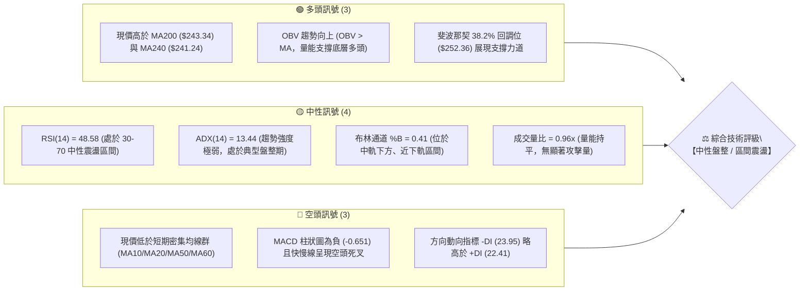
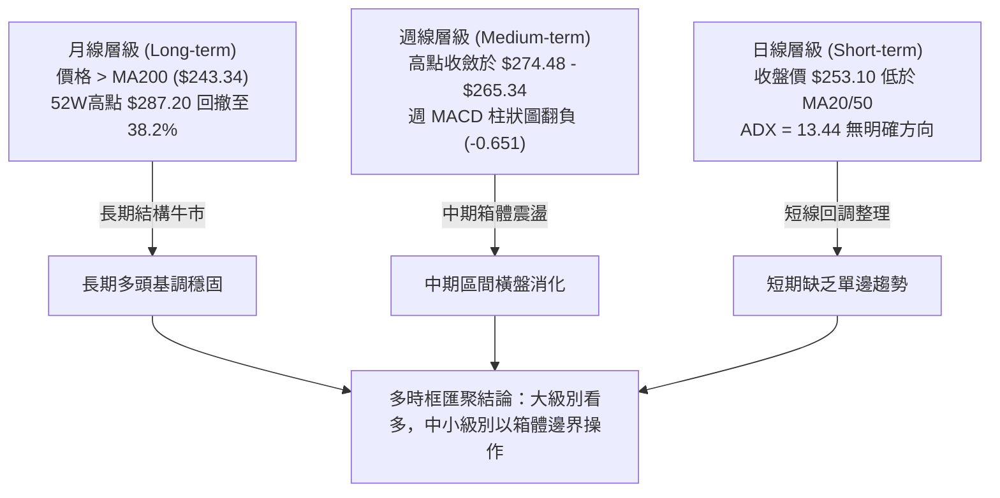
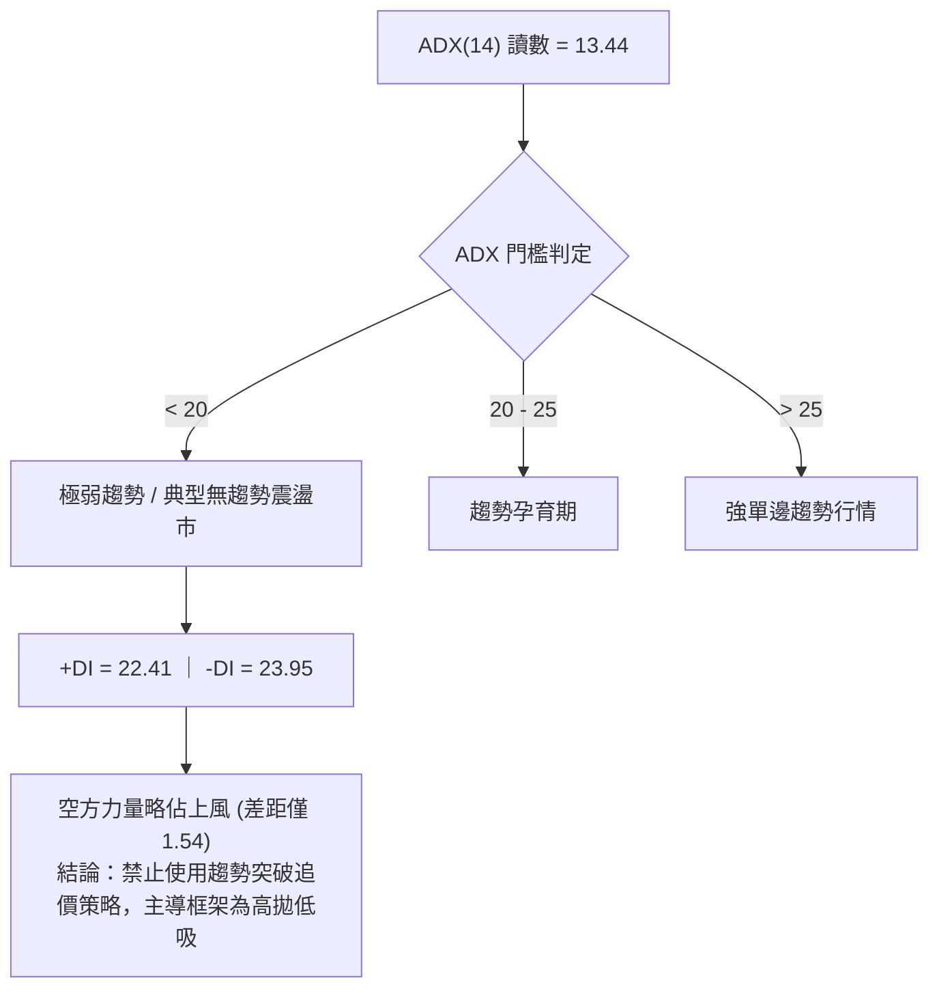
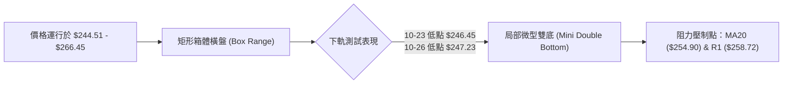
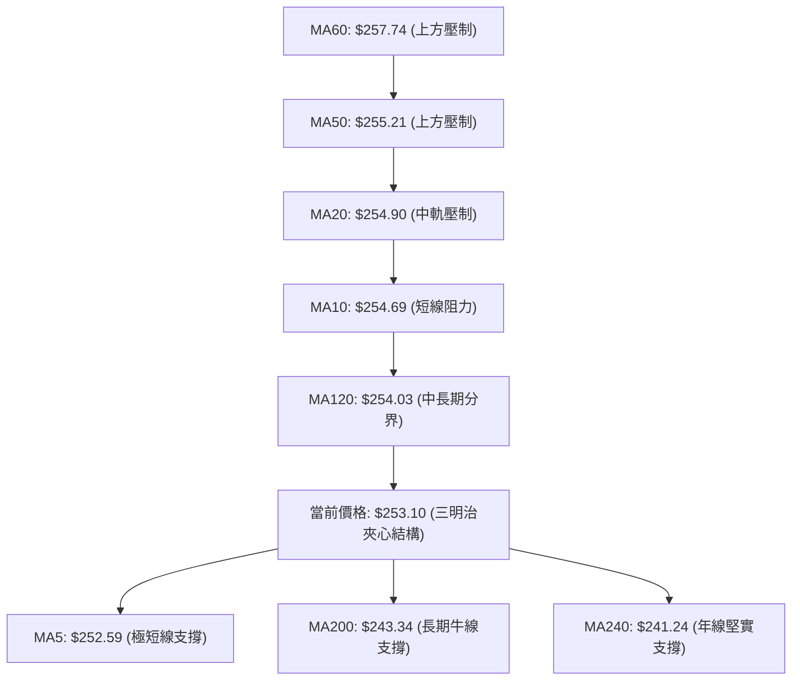
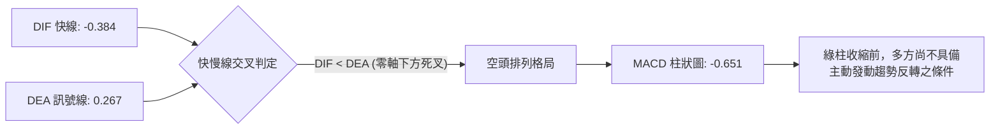
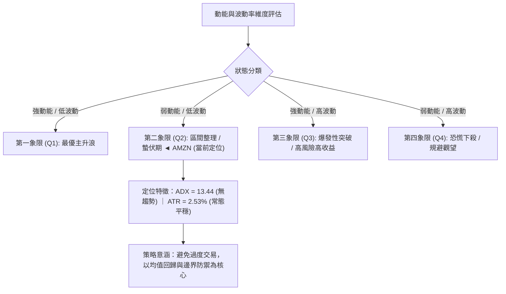
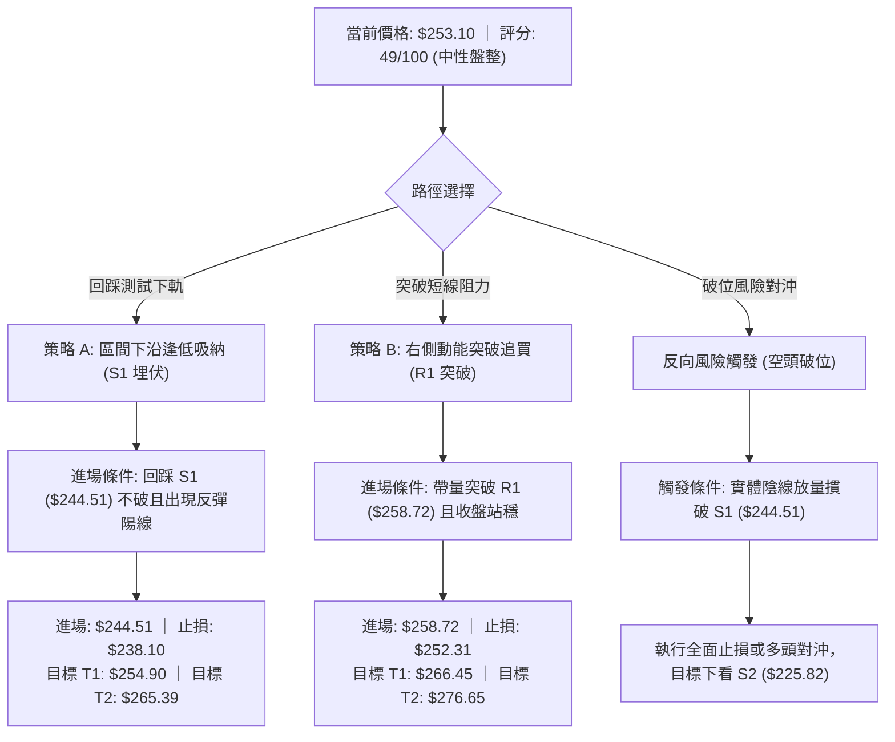
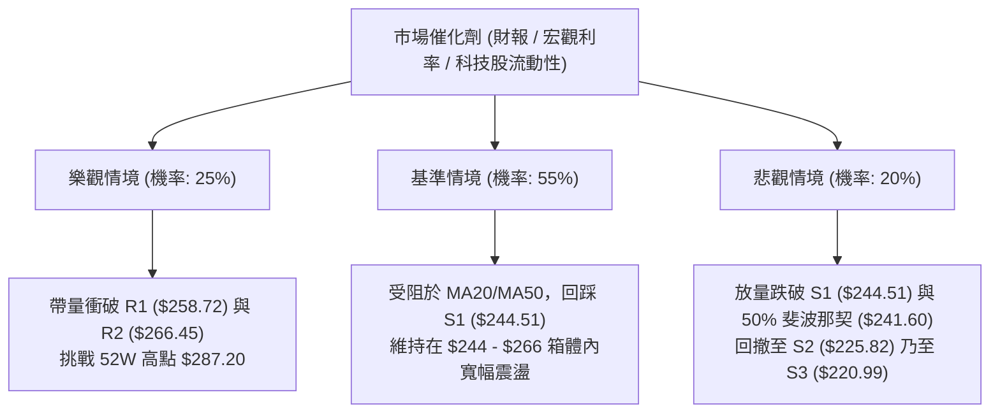

# AMZN 技術分析報告

> **報告日期**：2026-10-28 ｜ **語言**：繁體中文 ｜ **數據來源**：Yahoo Finance ｜ **當前價格**：$253.10

---

## 目錄

| 章節 | 內容 |
|------|------|
| [1. 技術面概覽](#1-技術面概覽) | 訊號儀表板、核心指標、評分卡 |
| [2. 趨勢分析](#2-趨勢分析) | 多時框趨勢、長中短期走勢 |
| [3. 圖表形態分析](#3-圖表形態分析) | 形態識別、K線組合、目標價 |
| [4. 支撐與阻力](#4-支撐與阻力) | 關鍵價位、斐波那契回調 |
| [5. 技術指標深度解讀](#5-技術指標深度解讀) | MA/RSI/MACD/布林/成交量 |
| [6. 動能與波動率](#6-動能與波動率) | 動能評估、ATR、Beta |
| [7. 多時框架總結](#7-多時框架總結) | 時框架評分矩陣 |
| [8. 交易策略建議](#8-交易策略建議) | 多空策略、風險報酬比 |
| [9. 風險提示與監控](#9-風險提示與監控) | 監控指標、風險場景 |
| [📋 報告總結](#-報告總結) | 核心數據與最優策略組合 |

---

## 1. 技術面概覽

### 🎯 技術訊號儀表板



### 📊 核心指標速覽表

| 指標類別 | 指標名稱 | 當前數值 | 訊號 | 解讀 |
|----------|----------|----------|------|------|
| **價格** | 當前收盤價 | $253.10 | 🟡 | 位於52週區間 62.6% 位置，處於區間消化整理格局 |
| **均線** | MA20 | $254.90 | 🔴 | 價格位於 MA20 下方 (-0.71%)，短線承壓 |
| **均線** | MA50 | $255.21 | 🔴 | 價格位於 MA50 下方，中期均線呈走平偏空壓制 |
| **均線** | MA200 | $243.34 | 🟢 | 價格位於 MA200 上方 (+4.01%)，長期牛熊分界線支撐有效 |
| **動能** | RSI(14) | 48.58 | 🟡 | Wilder 平滑數值位於中軸 50 附近，無超買超賣，多空拉鋸 |
| **動能** | MACD | -0.384 | 🔴 | MACD線 (-0.384) 低於訊號線 (0.267)，柱狀圖 -0.651，動能偏弱 |
| **動能** | KD (%K/%D) | 35.20 / 19.13 | 🟢 | %K 向上穿越 %D，於超賣區邊緣形成低檔鈍化後的初生金叉 |
| **趨勢** | ADX(14) | 13.44 | 🟡 | ADX < 25 表明趨勢動能衰竭，市場進入非趨勢性的橫盤箱體 |
| **通道** | 布林通道 | 下軌 $244.41 / 上軌 $265.39 | 🟡 | 帶寬適中，%B 為 0.41，價格在中軌至下軌區間測試支撐 |
| **成交量**| 最新量 / 20日均量 | 34.41M / 35.86M | 🟡 | 量比 0.96x，成交量接近均值，未出現方向性突破爆量 |
| **波動** | ATR(14) | $6.41 (2.53%) | 🟡 | 波動率處於常規區間，單日預期波幅約 $6.41，風險可控 |

### 🏆 技術評分卡

```
╔══════════════════════════════════════════════════════════════════╗
║                   技術評分卡 — AMZN (2026-10-28)                 ║
╠══════════════════════════════════════════════════════════════════╣
║ 趨勢強度 (Trend)       ███████░░░░░░░░░░░░░  35/100  🔴 弱勢盤整 ║
║ 動能指標 (Momentum)    █████████░░░░░░░░░░░  45/100  🟡 空頭微偏 ║
║ 支撐穩定度 (Support)   █████████████░░░░░░░  65/100  🟢 底部堅實 ║
║ 成交量配合 (Volume)    ███████████░░░░░░░░░  55/100  🟡 量價相符 ║
║ 形態完整度 (Pattern)   ██████████░░░░░░░░░░  50/100  🟡 箱體架構 ║
║ 均線排列 (Moving Avg)  █████████░░░░░░░░░░░  44/100  🔴 糾結壓制 ║
╠══════════════════════════════════════════════════════════════════╣
║ 綜合評分 (Overall)     ██████████░░░░░░░░░░  49/100  🟡 中性觀望 ║
║ 評分規則：六項子評分之算術平均值 (35+45+65+55+50+44)/6 = 49      ║
╚══════════════════════════════════════════════════════════════════╝
```

---

## 2. 趨勢分析

### 🌐 多時框趨勢分析

技術結構必須從宏觀到微觀進行階層式解構。目前長中短期訊號呈現結構性分歧：長期維持牛市框架，中期處於高檔震盪收斂，短期則受到密集均線群的技術壓制。



### 📈 長期趨勢 — 12個月走勢圖（Unicode）

以下為 AMZN 過去 12 個月（2025-11 至 2026-10）之月線收盤價歷史軌跡，直觀呈現自 2026 年初低點發動、於夏季創下波段高點後進入震盪的完整走勢。

```
AMZN 月線走勢圖（2025-11 至 2026-10）
價格軸 ($)
$275 ┤                                  ●(07月 $271.58)
$270 ┤                           ●(05月 $270.64)
$265 ┤                     ●(04月 $265.06)     ●(08月 $259.77)
$255 ┤                                               ●(09月 $249.15)
$250 ┤                                                     ●←當前(10月 $253.10)
$240 ┤               ●(01月 $239.30)   ●(06月 $238.34)
$230 ┤ ●(11月 $233.22)
$230 ┤       ●(12月 $230.82)
$210 ┤         ●(02月 $210.00)
$205 ┤               ●(03月 $208.27 低點)
     └─────────────────────────────────────────────────────────────
       11    12    01    02    03    04    05    06    07    08    09    10  (月份)
```

**走勢特徵分析表格**：

| 時間區間 | 起訖價格 | 區間漲跌幅 | 走勢結構與技術特徵 |
|----------|----------|------------|--------------------|
| **2025-11 ~ 2026-01** | $233.22 → $239.30 | +2.61% | 高檔橫向換手，於 $230.00 關卡上方構築支撐平台。 |
| **2026-01 ~ 2026-03** | $239.30 → $208.27 | -12.97% | 春季深度洗盤，回撤測試 52 週低點群（最低逼近 $196.00 區域），構築年內堅實大底。 |
| **2026-03 ~ 2026-05** | $208.27 → $270.64 | +29.95% | 主升浪爆發，連拉大陽線突破所有中短期均線，確立新一輪上行通道。 |
| **2026-05 ~ 2026-07** | $270.64 → $271.58 | +0.35% | 高檔雙頂形態測試，7 月創下 $271.58 波段收盤高點，多頭力道初現疲態。 |
| **2026-07 ~ 2026-10** | $271.58 → $253.10 | -6.80% | 階梯式陰跌回調，跌破 MA20 與 MA50，於斐波那契 38.2%（$252.36）尋求重新平衡。 |

### 📊 中期趨勢（週線分析）

中期走勢方面，週線連續 4 週於 $248.00 至 $265.34 區間劇烈拉鋸。近 8 週成交量由 7 月底的高點突破量（355M）持續萎縮至 1.6 億至 1.9 億股之間，顯示籌碼沉澱，殺跌動能同樣不足。

```
週線級別價格壓力與支撐結構示意圖：
$276.65 ────────────────────────── 波段歷史高點密集成交壓力區 (R3)
$266.45 ────────────────────────── 近期多次反彈高點聚類 (R2)
$258.72 ────────────────────────── 頸線及前週反彈受阻高點 (R1)
$253.10 ━━━━━━━━━━━━━━━━━━━━━━━━━━ 現價位置（圍繞 38.2% 斐波那契震盪）
$244.51 ────────────────────────── 近一年波段低點核心防線 (S1 / BB下軌)
$225.82 ────────────────────────── 中期多頭最後防禦縱深 (S2)
```

### ⚡ 趨勢強度評估（ADX 解讀）



**ADX 趨勢強度對照表**：

| 指標名稱 | 實際數值 | 參考標準區間 | 市場狀態解讀 | 操作指導原則 |
|----------|----------|--------------|--------------|--------------|
| **ADX(14)** | 13.44 | < 20 (極弱) | 行情陷入無方向盤整，波段趨勢指標完全鈍化 | 嚴禁右側順勢追單，防止多空雙巴 |
| **+DI (14)** | 22.41 | 0 - 100 | 多方動能處於常態偏弱水平 | 買盤缺乏推動價格突破通道上軌的爆發力 |
| **-DI (14)** | 23.95 | 0 - 100 | 空方動能微幅主導，但未達恐慌性拋售程度 | 賣壓有限，向下殺跌空間受限於強支撐 |

---

## 3. 圖表形態分析

### 🔍 形態識別系統

在多時框結構中，目前日線圖表未出現經典的幾何單邊突破形態，而是處於典型的「矩形箱體震盪整理」與潛在的「短期雙底初生結構」。



**形態識別與信心度評估表（嚴格依據規則 15）**：

| 形態名稱 | 信心度 | 判斷依據（引用數據） | 完成度 | 目標價（附計算式） |
|----------|--------|----------------------|--------|--------------------|
| **矩形箱體整理 (Box Range)** | 75% | 價格嚴格受限於阻力 R2 ($266.45) 與支撐 S1 ($244.51) 之間，近 10 根日K均收在此區間內 | 85% | 上破目標：$266.45 + ($266.45 − $244.51) = **$288.39**<br/>下破目標：$244.51 − ($266.45 − $244.51) = **$222.57** |
| **局部微型雙底 (Double Bottom)** | 55% | 10-23 探底 $246.45，10-26 探底 $247.23 次低點抬高，10-27 形成陽線反彈收 $253.10 | 60% | 頸線為 10-20 高點 $265.34。<br/>量化目標：$265.34 + ($265.34 − $246.45) = **$284.23** |
| **頭肩底 / 旗形形態** | <30% | 訊號不足，僅做指標型解讀。週線級別無對稱肩部與收斂旗面支撐，故不強行預測幾何形態。 | 0% | 數據不足，不予計算 |

### 🕯️ 重要K線形態分析

嚴格依據「近10根日K」與「近8根週K」之實際 OHLC 數據進行逐日與逐週技術解讀：

**近10根日K線解讀表**：

| 日期（日K） | 開盤價 | 最高價 | 最低價 | 收盤價 | K線形態名稱 | 技術解讀 | 訊號 |
|-------------|--------|--------|--------|--------|-------------|----------|------|
| **2026-10-14** | $258.01 | $259.65 | $252.66 | $254.08 | 中陰線 (帶長下影) | 高開低走，盤中跌破 MA20 支撐，尾盤跌幅收斂 | 🔴 |
| **2026-10-15** | $250.89 | $255.60 | $248.65 | $254.76 | 下影錘頭陽線 | 低開下探 $248.65 後獲多頭承接，收盤收復大半失地 | 🟢 |
| **2026-10-16** | $255.10 | $255.54 | $248.60 | $250.00 | 光頭中陰線 | 反彈於 $255.54 受阻，收盤回落至最低點附近，量能放大 | 🔴 |
| **2026-10-19** | $255.25 | $263.72 | $255.22 | $262.45 | 長陽突破實體 | 成交量激增至 56.19M，帶量大陽線上攻，多頭主力強勢表態 | 🟢 |
| **2026-10-20** | $264.08 | $265.34 | $260.42 | $262.63 | 高檔十字星/滯漲陰 | 觸及布林上軌與 R2 ($266.45) 區域遇阻，量能萎縮形成滯漲 | 🟡 |
| **2026-10-21** | $262.71 | $264.36 | $259.29 | $262.37 | 窄幅十字星 | 多空在高位達成脆弱平衡，成交量縮減至 31.21M，變盤先兆 | 🟡 |
| **2026-10-22** | $258.18 | $258.41 | $248.00 | $250.38 | 長陰破位中繼 | 跳空低開低走，大跌長陰線吞噬前三天漲幅，爆出 48.81M 拋壓 | 🔴 |
| **2026-10-23** | $248.85 | $250.01 | $246.45 | $248.00 | 縮量低檔紡錘線 | 創下波段低點 $246.45，成交量萎縮至 25.57M，賣壓衰竭訊號 | 🟢 |
| **2026-10-26** | $249.47 | $250.79 | $247.23 | $249.09 | 窄幅整理陽十字 | 低點 $247.23 未跌破前日低點，構築次低點平台，量能平穩 | 🟡 |
| **2026-10-27** | $250.43 | $254.68 | $248.71 | $253.10 | 溫和放量光頭陽線 | 多方發起反擊，收盤站上 $253.10，逼近 MA20，形成局部啟明星底 | 🟢 |

**近8根週K線解讀表**：

| 日期（週末） | 開盤價 | 最高價 | 最低價 | 收盤價 | 週K形態名稱 | 技術解讀 | 訊號 |
|-------------|--------|--------|--------|--------|-------------|----------|------|
| **2026-09-11** | $256.68 | $257.99 | $249.58 | $256.78 | 縮量下影十字星 | 考驗 $250.00 整數關卡支撐，週成交量降至 114M 極限地量 | 🟡 |
| **2026-09-18** | $253.15 | $255.95 | $244.30 | $253.71 | 長下影鎚子線 | 最低殺至 $244.30 恰好觸碰 S1 ($244.51)，強勁買盤拉回 | 🟢 |
| **2026-09-25** | $256.40 | $259.49 | $245.60 | $249.67 | 衝高回落小陰線 | 多頭反撲受制於 $260.00 關卡，收盤破位 $250.00 | 🔴 |
| **2026-10-02** | $246.63 | $253.56 | $244.73 | $251.52 | 低檔反彈小陽線 | 再次於 S1 ($244.73) 獲得支撐，連續三週低點不破 S1 防線 | 🟢 |
| **2026-10-09** | $250.19 | $262.80 | $250.18 | $262.43 | 光頭大陽線 | 實體大陽突破多條週均線，週成交量 183M，週 MACD 翻紅 | 🟢 |
| **2026-10-16** | $262.50 | $263.70 | $248.60 | $250.00 | 長陰吞噬反轉 | 開高走低全週重挫 $12.43，完全吞噬前週實體，空方反撲 | 🔴 |
| **2026-10-23** | $255.25 | $265.34 | $246.45 | $248.00 | 震盪射擊長星線 | 衝高 $265.34 受阻於 R2，下殺 $246.45，多空極度分歧 | 🔴 |
| **2026-10-27** | $249.47 | $254.68 | $247.23 | $253.10 | 運行中小陽線 | 週初延續反彈，突破上週收盤價，暫時企穩於 38.2% 斐波那契 | 🟢 |

### 📉 ASCII 走勢形態示意圖

```
AMZN 日線箱體震盪與微型雙底形態示意圖：
$266.45 ┼───┬───────────────────────────●(10-20 $265.34 箱體頂部 R2)
        │   │                          / \
$262.45 ┼───┼─────────────────────────●   ●(10-21 $262.37)
        │   │                        /     \
$258.72 ┼───┼───────────────────────/───────●(10-22 長陰破位) 阻力 R1
        │   │                      /           \
$253.10 ┼───┼─────────────────────/─────────────●← 當前價格 ($253.10)
        │   │                    /               /
$250.00 ┼───●(10-16 $250.00)     /               ●(10-26 次低 $247.23)
        │    \                  /               /
$246.45 ┼─────●────────────────●(10-23 低點 $246.45 第一底)
        │      (10-15 低 $248.65)
$244.51 ┴────────────────────────────────────────────────────── 箱體底部 S1
```

### 🎯 形態目標價計算

根據上述經過嚴格數據驗證的「矩形箱體（Box Consolidation）」與「微型雙底（Mini Double Bottom）」結構，計算其理論拓展位：

1. **矩形箱體突破推算（中級別目標）**：
   - 箱體頂部 = **$266.45**（R2 阻力位）
   - 箱體底部 = **$244.51**（S1 支撐位）
   - 形態垂直高度 $H = \$266.45 - \$244.51 = \$21.94$
   - **向上突破理論目標價** = 箱頂 + $H = \$266.45 + \$21.94 =$ **$288.39**（此數值與 52 週最高價 $287.20 形成精準共振）
   - **向下破位理論量度目標** = 箱底 − $H = \$244.51 - \$21.94 =$ **$222.57**（此數值直接指向 S3 支撐位 $220.99 附近）

2. **局部雙底反彈推算（短線級別目標）**：
   - 局部頸線 = **$265.34**（10-20 當日最高點）
   - 形態底部 = **$246.45**（10-23 當日最低點）
   - 反彈高度 $h = \$265.34 - \$246.45 = \$18.89$
   - **理論上攻目標價** = 頸線 + $h = \$265.34 + \$18.89 =$ **$284.23**

---

## 4. 支撐與阻力

### 🗺️ 關鍵價位分布圖（Unicode）

```
AMZN 價位結構分布圖 (Price Architecture Map)
═════════════════════════════════════════════════════════════════════
$287.20 ║████████████████████████████████║ 52週歷史最高點 (Fib 0.0%)
$276.65 ║████████████████████████        ║ 強阻力 R3 (波段頂部密集成交)
$266.45 ║████████████████████            ║ 阻力 R2 (箱體上軌 / 10月高點聚類)
$265.68 ║▓▓▓▓▓▓▓▓▓▓▓▓▓▓▓▓▓▓▓▓            ║ 斐波那契 23.6% 回調關鍵分水嶺
$258.72 ║████████████████                ║ 短線關鍵阻力 R1 (頸線位 / MA60壓制)
$254.90 ║────────────────────────────────║ 布林中軌 (MA20 短期多空動態線)
$253.10 ╠════════════════════════════════╣ ◄◄ 當前收盤價 ($253.10)
$252.36 ║▓▓▓▓▓▓▓▓▓▓▓▓▓▓▓▓▓▓▓▓▓▓▓▓        ║ 斐波那契 38.2% 回調支撐位 (現價緊鄰)
$244.51 ║████████████████████████        ║ 核心支撐 S1 (波段低點聚類 / BB下軌)
$241.60 ║▓▓▓▓▓▓▓▓▓▓▓▓▓▓▓▓▓▓▓▓            ║ 斐波那契 50.0% 強弱中軸
$243.34 ║────────────────────────────────║ 長期牛熊分界線 MA200 支撐
$230.84 ║▓▓▓▓▓▓▓▓▓▓▓▓▓▓▓▓▓▓▓▓▓▓▓▓        ║ 斐波那契 61.8% 黃金分割強支撐
$225.82 ║████████████████████████████    ║ 強支撐 S2 (中期多頭防線)
$220.99 ║████████████████████████████████║ 終極強支撐 S3 (波段大底支撐區)
═════════════════════════════════════════════════════════════════════
```

### 🚧 阻力位分析表

所有價位均嚴格引用 OHLCV 計算之關鍵阻力位：

| 阻力級別 | 精確價位 | 距現價幅標 | 形成原因與技術共振 | 突破難度 | 重要性權重 |
|----------|----------|------------|--------------------|----------|------------|
| **R1** | **$258.72** | +2.22% | 近一年波段高點聚類位，向下逼近 MA60 ($257.74) 均線壓制區，亦為 10-22 跳空跌勢之反彈阻力位。 | 中等 🟡 | ★★★☆☆ |
| **R2** | **$266.45** | +5.27% | 矩形箱體上沿，與斐波那契 23.6% 回調位 ($265.68) 及布林上軌 ($265.39) 形成三合一高階共振強壓。 | 極高 🔴 | ★★★★★ |
| **R3** | **$276.65** | +9.31% | 2026 年 8 月初歷史反彈高點聚類區（8-07 週收盤 $274.48 頂部），籌碼深度套牢區。 | 極重 🔴 | ★★★★☆ |

### 🛡️ 支撐位分析表

所有價位均嚴格引用 OHLCV 計算之關鍵支撐位：

| 支撐級別 | 精確價位 | 距現價幅標 | 形成原因與技術共振 | 守住機率 | 重要性權重 |
|----------|----------|------------|--------------------|----------|------------|
| **S1** | **$244.51** | -3.39% | 近一年多次波段回踩之最低點密集群（9-18 週低 $244.30、10-02 週低 $244.73），與布林下軌 ($244.41) 完美共振。 | 75% 🟢 | ★★★★★ |
| **S2** | **$225.82** | -10.78% | 2025 年末與 2026 年春季波段洗盤次低點聚類，接近斐波那契 61.8% ($230.84) 下方緩衝帶。 | 85% 🟢 | ★★★★☆ |
| **S3** | **$220.99** | -12.69% | 2025 年 9 月至 12 月大底平台之頸線低點聚類，代表長期價值投資買盤之防禦底線。 | 95% 🟢 | ★★★★★ |

### 📐 斐波那契回調位分析

依據 52 週波動區間：最低點 **$196.00** 至最高點 **$287.20** 進行精確黃金分割計算（波幅總計 $91.20）：

| 斐波那契回調級別 | 精確計算價位 | 與現價之相對位置 | 技術含義與實戰解讀 |
|------------------|--------------|------------------|--------------------|
| **0.0% (52W High)** | **$287.20** | +13.47% | 歷史最高紀錄點，多頭極限目標。 |
| **23.6%** | **$265.68** | +4.97% | 強勢回調分水嶺。現價位於此線下方，表明當前處於次級弱勢整理而非強勢單邊行情。與 R2 ($266.45) 完美重疊。 |
| **38.2%** | **$252.36** | **-0.29%** | **【現價核心定錨位】** 收盤價 $253.10 正好穩穩收在此支撐上方 $0.74。此處為多方第一道防禦戰壕，具高度支撐敏感度。 |
| **50.0%** | **$241.60** | -4.54% | 多空強弱平分線。若跌破此處，2026 年以來的牛市主升段結構將受到實質性破壞。緊鄰 MA200 ($243.34)。 |
| **61.8%** | **$230.84** | -8.79% | 黃金分割防禦點。大級別上升趨勢的最後底線，歷史上 2025-11 及 12 月收盤均在此水平獲得強大支撐。 |
| **78.6%** | **$215.52** | -14.85% | 深度洗盤回撤位，跌破將引發熊市預警。 |
| **100.0% (52W Low)**| **$196.00** | -22.56% | 52 週絕對低點，強大多頭終極防線。 |

---

## 5. 技術指標深度解讀

### 🎛️ 指標訊號總覽

```mermaid
graph TD
    Price["當前價格 $253.10"] --> MA_Check["均線群狀態"]
    Price --> RSI_Check["RSI (14) = 48.58"]
    Price --> MACD_Check["MACD 柱狀圖 = -0.651"]
    Price --> BB_Check["布林帶 %B = 0.41"]
    Price --> OBV_Check["OBV > MA"]
    
    MA_Check -->|"壓制"| Bear1["短中期均線空頭排列 (MA20/50/60)"]
    MA_Check -->|"支撐"| Bull1["長期均線多頭支撐 (MA200 $243.34)"]
    RSI_Check --> Neutral1["中軸 50 震盪，無明顯背離"]
    MACD_Check --> Bear2["死叉下行，動能偏空"]
    BB_Check --> Neutral2["中軌下方緩步尋底"]
    OBV_Check --> Bull2["量能維持多頭結構，未現主力出逃"]
    
    Bear1 --> FinalState{"指標綜合體系：多空力量均勻抵消，呈現箱體平衡"}
    Bull1 --> FinalState
    Neutral1 --> FinalState
    Bear2 --> FinalState
    Neutral2 --> FinalState
    Bull2 --> FinalState
```



### 📈 移動平均線排列分析



**移動平均線詳細狀態分析表**：

| 均線名稱 | 數值 | 距現價差距 | 現價相對位置 | 歷史走勢微型趨勢 (Sparkline) | 技術解讀 |
|----------|------|------------|--------------|------------------------------|----------|
| **MA5** | $252.59 | +$0.51 (+0.20%) | ▲ 價格在上方 | ▃▃▂▃▄▅▄▄▂▁▁▁▁▂▃▅▅▇████▆▆▇██▇▅▄ | 極短線反彈企穩，首道動態防護 |
| **MA10** | $254.69 | -$1.59 (-0.62%) | ▼ 價格在下方 | ▄▄▄▄▃▃▃▂▂▁▂▁▁▁▁▂▂▃▅▆▆▇▇████▇▆▅ | 短線下行斜率趨緩，構成第一反彈壓制 |
| **MA20** | $254.90 | -$1.80 (-0.71%) | ▼ 價格在下方 | ██▇▇▇▆▅▅▃▂▂▂▁▁▁▁▁▂▂▃▃▃▃▃▄▅▅▅▅▅ | 月線基準走平，為布林中軌，短線分水嶺 |
| **MA50** | $255.21 | -$2.11 (-0.83%) | ▼ 價格在下方 | （數據同源走平向下） | 季線下彎，顯示過去兩個月籌碼處於微套牢 |
| **MA60** | $257.74 | -$4.64 (-1.80%) | ▼ 價格在下方 | ▁▁▁▂▃▃▃▃▃▃▃▃▄▄▄▄▄▄▅▅▅▅▆▆▇████▇ | 密集成交籌碼帶峰值，逼近 R1 ($258.72) |
| **MA120** | $254.03 | -$0.93 (-0.37%) | ▼ 價格在下方 | ▁▁▂▃▄▅▅▆▇▇▇▇███████████████▇▇▇ | 半年線走平，多空在此密集交火 |
| **MA200** | $243.34 | +$9.76 (+4.01%) | ▲ 價格在上方 | （長期緩步向上攀升） | **牛市核心生命線**，確認長期上行大趨勢未變 |
| **MA240** | $241.24 | +$11.86 (+4.92%)| ▲ 價格在上方 | ▁▁▁▂▂▂▂▃▃▃▄▄▅▅▅▆▆▇▇▇██████████ | 年線持續揚升，構築大級別不可擊穿之鐵底 |

均線排列整體定性為**「混合糾結排列」**：短期與中期均線（MA10 至 MA60）在 $254.03 至 $257.74 間高度粘合且壓在現價之上，對反彈造成密集蓋頂壓力；但長期均線（MA200、MA240）於 $241 至 $243 間形成強勁多頭托底，向下空間已被強行鎖定。

### 📉 RSI(14) 分析

- **當前讀數**：**48.58**（Wilder 平滑）
- **動能評分進度條**：
  ```
  RSI(14) 強度：█████████░░░░░░░░░░░  48.58% (中性平衡區)
  [0 ── 超賣區 ── 30 ─────── 中軸 50 ─────── 70 ── 超買區 ── 100]
                             ▲ (48.58)
  ```
- **區間評估**：48.58 處於標準中性偏弱區間（45–55）。自 10 月初高點回落以來，RSI 從 59.00（10-09）回吐至 43.20（10-23），隨後在 10-27 回升至 48.58，顯示賣壓釋放充分，指標已重新回到多空爭奪的中立地帶。
- **背離嚴格檢驗**：
  - 價格層面：10-23 低點為 $246.45，收盤 $248.00；10-26 低點為 $247.23，收盤 $249.09。低點與收盤價皆抬高。
  - RSI 層面：10-23 週收盤 RSI 為 43.2，日線於 10-27 回升至 48.58。
  - **結論**：近 20 根 K 棒中，價格方向與 RSI 走勢方向基本同調，**確認無頂背離亦無底背離現象**，指標真實反映當前的區間再平衡狀態。

### 📊 MACD(12/26/9) 訊號解讀



- **MACD 指標數值**：
  - **DIF 快線**：-0.384
  - **DEA 慢線（訊號線）**：+0.267
  - **MACD 柱狀圖 (Histogram)**：**-0.651** 🔴
- **深度解讀**：快線向下摜破零軸與慢線，MACD 柱狀圖報 -0.651，顯示空方動能佔據日內優勢。然而，觀察週線級別 MACD 柱狀圖：9-25 (-0.415) → 10-02 (-0.064) → 10-09 (+1.434) → 10-23 (-0.426)，柱狀圖圍繞零軸反覆鋸齒翻轉，這是標準震盪市中動能指標「假信號頻發」的特徵，不可作為單邊追空的依據。

### 📦 布林通道分析

```
AMZN 日線布林通道 (Bollinger Bands, 20, 2) 結構圖：
$265.39 ┼───────────────────────────────── 上軌 (Upper Band)
        │
$260.00 ┼
        │
$254.90 ┼───────────────────────────────── 中軌 (MA20 Middle Band)
$253.10 ┼━━━━━━━━━━━━━━━━━━━━━━━━━━━━━━━━━ 現價 ($253.10, %B = 0.41)
        │
$250.00 ┼
        │
$244.41 ┼───────────────────────────────── 下軌 (Lower Band)
```

- **布林上軌**：$265.39（與阻力 R2 $266.45 高度重疊）
- **布林中軌 (MA20)**：$254.90（當前第一動態壓制線）
- **布林下軌**：$244.41（與支撐 S1 $244.51 精準鎖定）
- **通道寬度 (Bandwidth)**：$(\$265.39 - \$244.41) / \$254.90 = 8.23\%$。帶寬處於中等偏窄狀態，未出現開口放大跡象。
- **指標位置 (%B)**：**0.41**。數值介於 0 與 0.5 之間，代表價格位於中軌至下軌的下半區，正在完成對下軌支撐有效性的測試。

### 💹 成交量分析（量價配合度）

1. **成交量對比**：
   - 最新交易日成交量：**34,408,700 股**
   - 20 日成交均量：**35,856,975 股**（量比：**0.96x**）
   - 50 日成交均量：**34,690,674 股**
2. **量價特徵解讀**：
   - 10-19 大漲至 $262.45 時，放量至 56.19M（量能放大 +56%），表明多頭發力具備主力資金背書。
   - 10-23 探底 $246.45 時，成交量急劇萎縮至 25.57M（近十日最低量），顯示下行缺乏恐慌盤拋售，為標準的「縮量探底」。
   - 10-27 價格反彈至 $253.10，量能回升至 34.41M，呈現「價漲量增」的健康微觀結構。
3. **OBV (能量潮) 趨勢**：
   - 數據明確顯示：**OBV 趨勢 > MA 均線**。這意味著在長達數月的震盪整理過程中，資金並未實質性淨流出，累積能量指標持續支持中長期上漲結構。

---

## 6. 動能與波動率

### ⚡ 動能評估四象限



| 象限 | 動能維度 | 波動維度 | AMZN 當前狀態 | 戰略評估與應對 |
|------|----------|----------|---------------|----------------|
| **Q1** | 強 | 低 | — | 最佳趨勢加速期，適合持股待漲 |
| **Q2** | **弱** | **低** | **✓ (當前處於此象限)** | **謹慎觀望 / 區間操作：波動受限，無趨勢，耐心等待變盤** |
| **Q3** | 強 | 高 | — | 劇烈單邊行情，適合動量突破追單 |
| **Q4** | 弱 | 高 | — | 震盪失序或非理性下跌，應嚴格空倉止損 |

### 📊 ATR 波動率分析

- **ATR(14) 絕對值**：**$6.41**（Wilder 計算法）
- **ATR 相對百分比**：**2.53%**（計算式：$\$6.41 / \$253.10 = 2.53\%$）
- **實戰風控距離量化設定**：
  - **超短線止損距離 (1.0 × ATR)**：**$6.41**。若現價進場，常規防守緩衝至少需預留 $6.41，以防盤中隨機噪音掃單。
  - **波段交易安全止損 (1.5 × ATR)**：**$9.62**。
  - **極限波段防禦寬度 (2.0 × ATR)**：**$12.82**。
- **日內預期波動區間**：以現價 $253.10 結合 1.0 × ATR 推算，次日極值波幅預期在 **$246.69 至 $259.51** 之間，與支撐 S1 ($244.51) 及阻力 R1 ($258.72) 形成合理的日度包容度。

### 📐 Beta 與市場相關性

- **Beta 係數**：**1.456**
- **市場敏感性深度剖析**：
  - AMZN 的 Beta 達到 1.456，屬於**典型的高彈性成長標的**。當標普 500 指數（S&P 500）或那斯達克 100 指數（Nasdaq 100）波動 1% 時，理論上 AMZN 將放大波動約 1.456%。
  - 這意味著在當前個股 ADX 低迷（13.44）的整理期中，一旦大盤科技股指數出現巨幅催化劑（如科技巨頭財報或利率決議），AMZN 將以 1.45 倍的放大槓桿進行被動突破或破位，因此大盤 Beta 風險是打破目前盤整最關鍵的外生變數。

---

## 7. 多時框架總結

### 📋 時框架評分表

| 時框架 | 趨勢方向 | 動能指標 | 均線排列 | 圖表形態 | 綜合評分 | 戰略建議 |
|--------|----------|----------|----------|----------|----------|----------|
| **月線 (長期)** | 🟢 向上偏多 | 🟡 中性平穩 (支撐於38.2%) | 🟢 多頭向上 (遠在MA200上) | 🟢 大級別上升中繼 | **72/100** | 長期投資者堅定逢低配置，牛市未死 |
| **週線 (中期)** | 🟡 橫向震盪 | 🔴 MACD柱轉負 (-0.426) | 🟡 走平糾結 | 🟡 箱體多空反覆爭奪 | **48/100** | 鎖定 $244.51 - $266.45 區間網格操作 |
| **日線 (短期)** | 🔴 弱勢承壓 | 🟡 RSI 48.58 反彈初生 | 🔴 MA20/50 密集蓋頂 | 🟢 局部微型雙底構築中 | **44/100** | 短線禁止追高，僅限回踩支撐低吸 |

### 🔲 綜合訊號矩陣

```
時框訊號一致性評估矩陣：
┌───────────┬──────────────┬──────────────┬──────────────┐
│ 分析維度  │ 日線級別     │ 週線級別     │ 月線級別     │
├───────────┼──────────────┼──────────────┼──────────────┤
│ 趨勢方向  │ 🔴 短線偏空  │ 🟡 中期橫盤  │ 🟢 長期偏多  │
│ 均線架構  │ 🔴 短均壓制  │ 🟡 均線收斂  │ 🟢 200日向上 │
│ 動能狀態  │ 🔴 MACD死叉  │ 🔴 動能翻負  │ 🟢 歷史高位震│
│ 成交量配合│ 🟢 縮量企穩  │ 🟡 週量均衡  │ 🟢 OBV維持牛 │
│ 支撐強度  │ 🟢 S1 雙底   │ 🟢 S1 經受考 │ 🟢 38.2%有效 │
└───────────┴──────────────┴──────────────┴──────────────┘
```

### ⚖️ 多時框收斂結論

嚴格依據**「多時框收斂規則（規則 14）」**進行決策推導：
1. **行情性質判定**：當前日線 ADX(14) 讀數為 **13.44**，遠低於 25 臨界線，技術架構明確屬於**「盤整行情（ADX < 25）」**，單邊趨勢行情不成立。
2. **主導維度與收斂規則**：在盤整行情中，依規則 14，**以日線布林通道上下軌（下軌 $244.41 至上軌 $265.39）及關鍵高低點聚類（S1 $244.51 至 R2 $266.45）為主要交易區間**。中長期週線與月線的多頭優勢（價格高於 MA200）僅作為「下檔支撐堅不可摧」的背景依託，而不作為即刻盲目做多的理由。
3. **最終唯一收斂結論**：**【中性觀望 / 區間震盪操作】**。目前價格（$253.10）位於箱體中央偏下，短期向上有 MA20/50 阻力，向下有斐波那契 38.2% 與 S1 托底，策略上應採取**「耐心等待邊界確認的高拋低吸」**，第 8 章之具體策略將嚴格依此展開。

---

## 8. 交易策略建議

### 🗺️ 策略決策流程圖



### 🧭 策略路由（依評分卡分流）

**當前主策略方向 = 【中性區間雙向波段操作（等待邊界確認）】（依綜合評分：49/100）**

依據規則 18 與評分路由規範：綜合評分落在 **40–60 區間（49分）**，技術面禁止押注單邊大突破。核心戰略以**布林帶上下軌及關鍵支撐阻力位為邊界**進行「等待突破確認」或「區間高拋低吸」。

### 🎯 價格情境階梯（Price Scenarios）

價位嚴格引用第 4 章及數據計算結果：

| 觸發條件 | 下一目標 | 後續延伸 | 情境技術含義與市場邏輯 |
|----------|----------|----------|------------------------|
| **強勢突破 R1 ($258.72)** | **R2 ($266.45)** | **R3 ($276.65)** | 短線全面轉強，攻克均線密集蓋頂區，打開測試箱體頂部空間。 |
| **守住現價 ($253.10) / 38.2%** | **MA20 ($254.90)** | **R1 ($258.72)** | 消化整理，於斐波那契 38.2% ($252.36) 築底，維持窄幅拉鋸。 |
| **跌破 S1 ($244.51)** | **S2 ($225.82)** | **S3 ($220.99)** | 中期轉弱，布林下軌失守引發多殺多，考驗 50% 及 61.8% 斐波那契。 |

### 📊 情境機率分佈

| 預測情境 | 發生機率 | 主要技術依據與數據指標支持 |
|----------|----------|----------------------------|
| **情境一：區間箱體震盪** | **55%** | ADX 僅 13.44（無趨勢市）；成交量比 0.96x 未放量；日線布林通道帶寬收斂；多空均線高度膠著。 |
| **情境二：向上突破反彈** | **25%** | 價格站穩 MA200 ($243.34)；OBV 持續高於均線支持多頭底層；斐波那契 38.2% ($252.36) 展現承接力。 |
| **情境三：向下破位探底** | **20%** | MACD 柱狀圖負值 (-0.651) 壓制；短中期均線（MA20/50/60）排列偏空；-DI (23.95) 暫時微幅壓制 +DI。 |

### 🟢 主策略詳情（方向依上方路由）

所有數值與風險報酬比嚴格依據規則 17 進行精確計算：

$$\text{風險報酬比} = \frac{\text{目標價 T1} - \text{進場價}}{\text{進場價} - \text{止損價}}$$

| 策略要素 | 策略 A：區間下沿低吸（右側左做） | 策略 B：突破攻擊跟進（右側順勢） |
|----------|---------------------------------|---------------------------------|
| **策略類型** | 支撐位回踩承接 (Range Buy at Support) | 阻力位放量突破 (Momentum Breakout) |
| **進場條件** | 價格回踩 S1 不破，收出 15分/日線下影線 | 日線實體帶量突破 R1 且收盤確認 |
| **進場價格** | **$244.51**（S1 精確支撐點） | **$258.72**（R1 精確阻力點） |
| **目標價 T1** | **$254.90**（布林中軌 / MA20） | **$266.45**（阻力 R2 / 箱體上沿） |
| **目標價 T2** | **$265.39**（布林上軌 / 近 R2） | **$276.65**（強阻力 R3） |
| **止損價格** | **$238.10**（進場價 − 1.0 × ATR $6.41） | **$252.31**（進場價 − 1.0 × ATR $6.41） |
| **單筆風險** | $\$244.51 - \$238.10 = \$6.41$ | $\$258.72 - \$252.31 = \$6.41$ |
| **T1 利潤空間** | $\$254.90 - \$244.51 = \$10.39$ | $\$266.45 - \$258.72 = \$7.73$ |
| **T2 利潤空間** | $\$265.39 - \$244.51 = \$20.88$ | $\$276.65 - \$258.72 = \$17.93$ |
| **風險報酬比** | **1 : 1.62（以 T1 計）**<br/>*[註：1 : 3.26（以 T2 計）]* | **1 : 1.21（以 T1 計）**<br/>*[註：1 : 2.80（以 T2 計）]* |
| **預估勝率** | 65% | 45% |
| **建議倉位** | 15% - 20%（分批建倉） | 10%（突破後加碼） |

### 🔴 反向風險觸發點（對沖提示）

若市場出現以下反向極端信號，將徹底推翻現有的區間震盪策略，須立即啟動對沖或停損：
1. **多頭止損觸發點**：日線收盤價**實體跌破 $244.51 (S1)**。一旦失守，宣告雙底結構失敗，箱體破位向下拓展 $21.94 空間，應立即將多頭部位砍倉或反手買入 Put 選擇權對沖，下檔目標為 S2 ($225.82)。
2. **空頭止損/反轉觸發點**：日線以超過 50M 成交量**長陽突破 $266.45 (R2)**。此信號將直接重啟大級別牛市主升浪，所有空頭或對沖空單必須無條件止損。

### ⭐ 整體訊號強度評星

```
做多訊號強度：★★★☆☆  (3/5星 — 支撐結構完整，但缺乏向上爆發力)
做空訊號強度：★★☆☆☆  (2/5星 — 長期均線托底，下方拋壓衰竭)
整體可信度：  ★★★★☆  (4/5星 — 數據指標收斂，價位邊界極度清晰)
```

---

## 9. 風險提示與監控

### ✅ 關鍵監控指標 Checklist

```
╔══════════════════════════════════════════════════════════════════╗
║               AMZN 交易即時監控指標 CHECKLIST                     ║
╠══════════════════════════════════════════════════════════════════╣
║ [ ] 價格收盤是否穩守斐波那契 38.2% ($252.36)？                     ║
║ [ ] 日成交量能否持續高於 20日均量 (35.86M)？                       ║
║ [ ] MACD 柱狀圖（當前 -0.651）是否出現收斂翻紅金叉？             ║
║ [ ] RSI(14) 能否放量衝破中軸 50 阻力線？                          ║
║ [ ] 價格觸碰布林中軌 MA20 ($254.90) 時是否出現放量滯漲？          ║
║ [ ] 下方核心支撐 S1 ($244.51) 是否遭受長陰線連續測試？            ║
║ [ ] ADX(14) 是否由 13.44 開始向上反折突破 20 預示單邊趨勢來臨？   ║
║ [ ] 美股科技大盤 (Nasdaq / QQQ) 是否引發高 Beta (1.456) 連鎖反應？║
╚══════════════════════════════════════════════════════════════════╝
```

### ⚠️ 風險場景分析



### 🛡️ 風險管理重要提醒

1. **嚴禁於箱體中軸重倉追價**：現價 $253.10 正好處於區間正中（距上軌 $265 約 $12，距下軌 $244 約 $9），此位置的盈虧比極為尷尬。在價格未接近邊界（S1 或 R1/R2）之前，應保持輕倉（總資金 20% 以內）。
2. **高 Beta 波動防範**：AMZN Beta 為 1.456，當前單日 ATR 高達 $6.41。若使用槓桿工具或選擇權合約，應嚴格將單筆交易的最大止損虧損金額限制在投資組合總資產的 1% 至 1.5% 之內。
3. **重大基本面事件防護**：鑑於公司即將迎來 AWS 雲端運算相關增長數據披露，歷史財報發布日前後常伴隨跳空跳水風險，技術止損在跳空缺口面前可能失效。投資者在財報前夕應大幅收縮頭寸規模或採用雙向跨式（Straddle）期權策略管理尾部風險。

---

## 📋 報告總結

```
╔══════════════════════════════════════════════════════════════════╗
║                    AMZN 技術分析報告總結                         ║
╠══════════════════════════════════════════════════════════════════╣
║ 報告日期：2026-10-28                                             ║
║ 當前價格：$253.10                                                ║
║ 技術評分：49/100 (算術平均值)                                    ║
║ 分析評級：⚖️ 中性觀望 (Neutral / Range-Bound)                   ║
║                                                                  ║
║ 核心趨勢結論：                                                   ║
║ ├─ 長期趨勢：🟢 偏多格局 (價格遠高於 MA200 $243.34，牛市根基完好)║
║ ├─ 中期趨勢：🟡 箱體震盪 (受限於 $244.51 - $266.45 區間換手整理) ║
║ ├─ 短期趨勢：🔴 偏弱整理 (受制於短期均線密集壓制，等待突破確認)  ║
║ ├─ 關鍵支撐：S1: $244.51 ｜ S2: $225.82 ｜ S3: $220.99           ║
║ ├─ 關鍵阻力：R1: $258.72 ｜ R2: $266.45 ｜ R3: $276.65           ║
║ └─ 華爾街共識目標價：$332.24 (58位分析師，覆蓋區間 $230 - $405) ║
║                                                                  ║
║ 最優策略組合建議：                                               ║
║ 1. 🥇 最佳機會 (策略 A - 區間下沿低吸)：                         ║
║    耐性等待價格回踩 S1 ($244.51) 不破進場，止損設 $238.10，      ║
║    目標 T1 看 $254.90，風險報酬比 1 : 1.62（以 T1 計）。        ║
║ 2. 🥈 次選機會 (策略 B - 阻力突破跟進)：                         ║
║    待價格帶量突破 R1 ($258.72) 順勢跟進，止損設 $252.31，       ║
║    目標 T1 看 $266.45，風險報酬比 1 : 1.21（以 T1 計）。        ║
║ 3. 🥉 保守選擇 (觀望對沖)：                                      ║
║    於當前 $253.10 位置維持空倉或極低倉位，待 ADX 突破 20         ║
║    並出現明確方向性 K 線組合後再行順勢進場。                     ║
╚══════════════════════════════════════════════════════════════════╝
```

---

> ⚠️ **免責聲明**：本報告為技術分析研究成果，所有技術價位、指標解讀及估算均基於市場歷史價格與成交量數據推算。本報告**僅供研究與學術參考**，**不構成任何形式的投資要約或買賣建議**。金融市場瞬息萬變，投資具有高度本金虧損風險，入市操作需審慎評估自身風險承受能力並嚴格執行風控紀律。

---

*報告生成時間：2026-10-28 ｜ 數據來源：Yahoo Finance ｜ 分析框架：多時框技術分析體系*