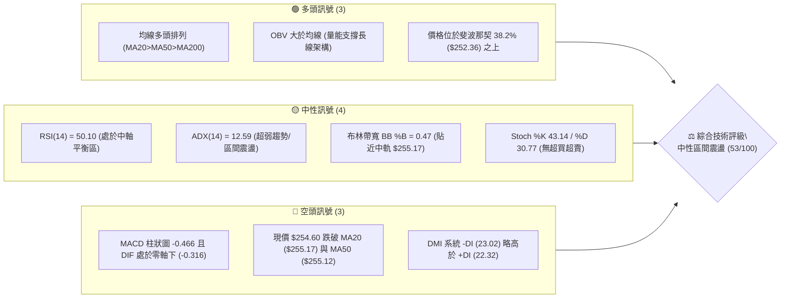
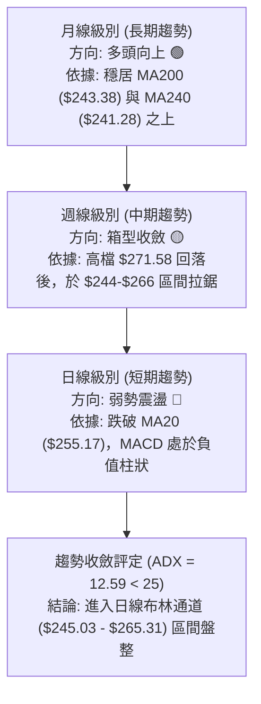
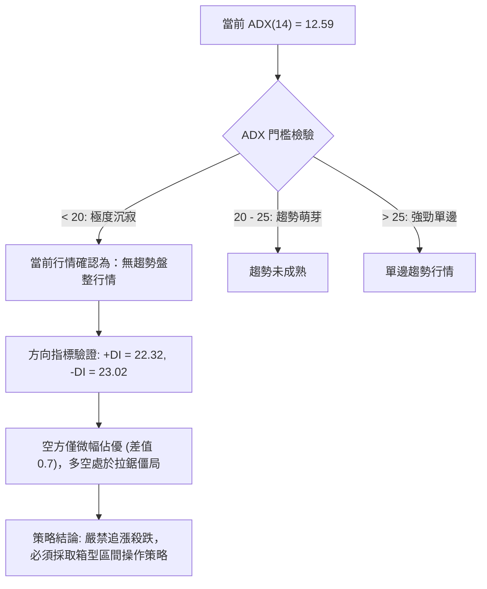
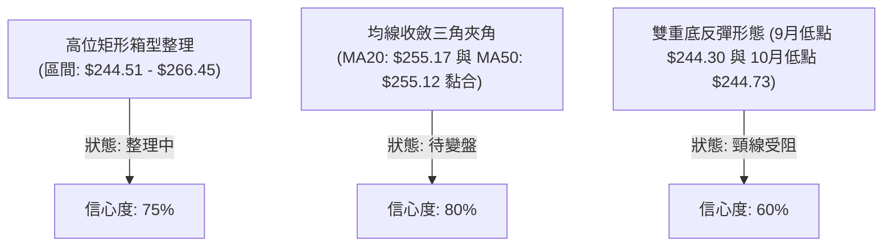
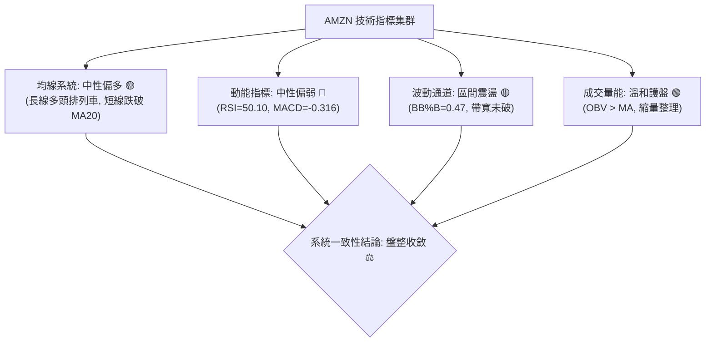
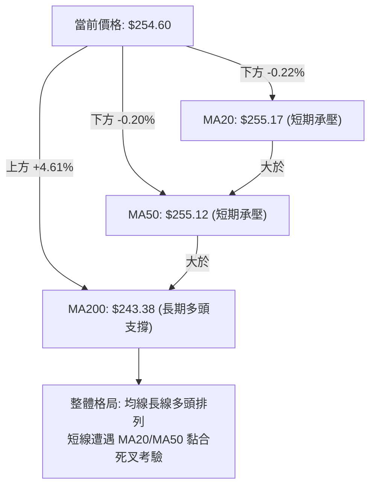
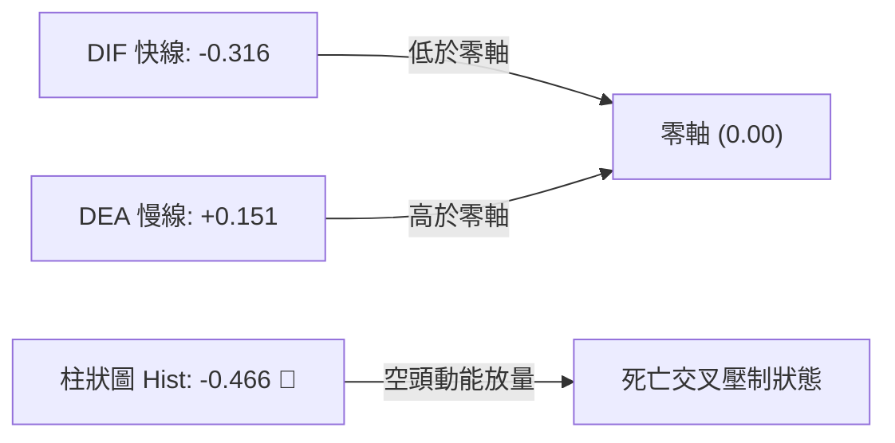
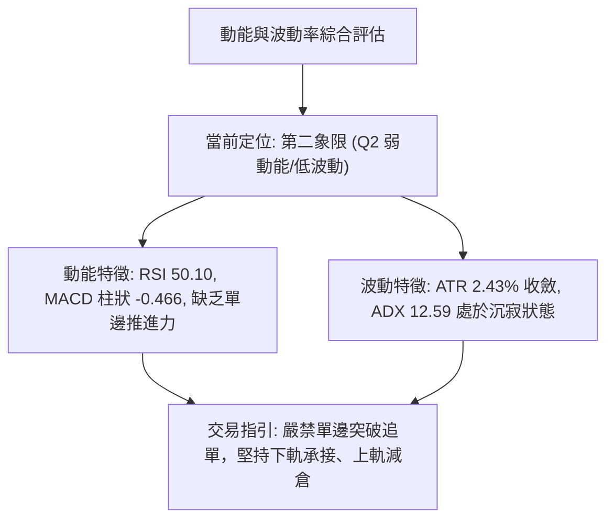
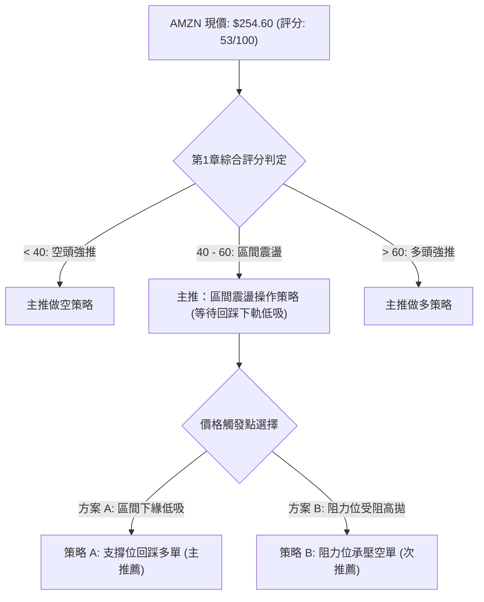
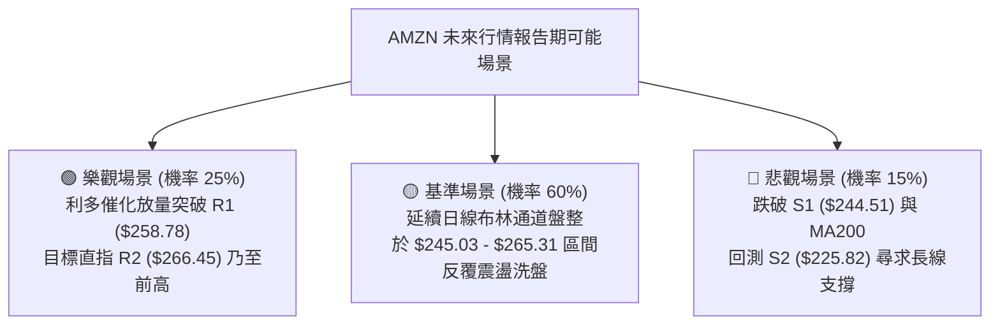

# AMZN 技術分析報告

> **報告日期**：2026-10-29 ｜ **語言**：繁體中文 ｜ **數據來源**：Yahoo Finance ｜ **當前價格**：$254.60

---

## 目錄

| 章節 | 內容 |
|------|------|
| [1. 技術面概覽](#1-技術面概覽) | 訊號儀表板、核心指標、評分卡 |
| [2. 趨勢分析](#2-趨勢分析) | 多時框趨勢、長中短期走勢、ADX 解讀 |
| [3. 圖表形態分析](#3-圖表形態分析) | 形態識別、K線組合、目標價推算 |
| [4. 支撐與阻力](#4-支撐與阻力) | 關鍵價位、斐波那契回調結構 |
| [5. 技術指標深度解讀](#5-技術指標深度解讀) | MA/RSI/MACD/布林/成交量全面剖析 |
| [6. 動能與波動率](#6-動能與波動率) | 動能四象限、ATR、Beta 與市場相關性 |
| [7. 多時框架總結](#7-多時框架總結) | 時框架評分矩陣與多時框收斂 |
| [8. 交易策略建議](#8-交易策略建議) | 策略路由、主策略規劃、風險報酬比 |
| [9. 風險提示與監控](#9-風險提示與監控) | 監控指標清單、極端情境與風控方針 |
| [📋 報告總結](#-報告總結) | 核心結論與策略總表 |

---

## 1. 技術面概覽

### 🎯 技術訊號儀表板



### 📊 核心指標速覽表

| 指標類別 | 指標名稱 | 當前數值 | 訊號 | 解讀 |
|----------|----------|----------|------|------|
| **價格** | 當前收盤價 | $254.60 | 🟡 | 位於52週區間 64.3% 位置，處於中高檔震盪整理 |
| **均線** | MA20 (短期) | $255.17 | 🔴 | 現價位於 MA20 下方 -0.22%，短期動能趨緩 |
| **均線** | MA50 (中期) | $255.12 | 🔴 | 現價跌破 MA50，短中期均線呈粘合糾結狀態 |
| **均線** | MA200 (長期)| $243.38 | 🟢 | 現價高於 MA200 +4.61%，長線多頭基底穩固 |
| **動能** | RSI(14) | 50.10 | 🟡 | 位於 50 基準線附近，多空力量完全均勢 |
| **動能** | MACD | -0.316 / 柱 -0.466 | 🔴 | 雙線死亡交叉且柱狀圖收負，短線動能偏空 |
| **趨勢** | ADX(14) | 12.59 | 🟡 | 數值遠低於 25，市場處於典型的無趨勢盤整期 |
| **通道** | 布林通道 | 中軌 $255.17 / %B 0.47 | 🟡 | 位於帶寬中軌下方，通道未顯著擴張 |
| **量能** | 20日成交量比 | 0.97x (34.59M vs 35.49M) | 🟡 | 成交量溫和收縮，呈現標準的盤整縮量特徵 |
| **波動** | ATR(14) | $6.19 (2.43%) | 🟡 | 每日平均波動幅度適中，盤整期波動收斂 |

### 🏆 技術評分卡

```
╔══════════════════════════════════════════════════════════════════╗
║                技術評分卡 — AMZN (2026-10-29)                    ║
╠══════════════════════════════════════════════════════════════════╣
║ 趨勢強度 (Trend)     █████████░░░░░░░░░░░  45/100  🟡 弱趨勢盤整 ║
║ 動能指標 (Momentum)  █████████░░░░░░░░░░░  46/100  🟡 短線微偏弱 ║
║ 支撐穩定度 (Support) █████████████░░░░░░░  65/100  🟢 買盤防禦強 ║
║ 成交量配合 (Volume)  ████████████░░░░░░░░  58/100  🟡 量能支撐中 ║
║ 形態完整度 (Pattern) ██████████░░░░░░░░░░  48/100  🟡 箱型未突破 ║
║ 均線排列 (Moving Avg)███████████░░░░░░░░░  56/100  🟡 長多短糾結 ║
╠══════════════════════════════════════════════════════════════════╣
║ 綜合評分             ███████████░░░░░░░░░  53/100  ⚖️ 區間觀望   ║
╚══════════════════════════════════════════════════════════════════╝
```
*(註：依規則 18，綜合評分 = (45 + 46 + 65 + 58 + 48 + 56) ÷ 6 = 53 分)*

---

## 2. 趨勢分析

### 🌐 多時框趨勢分析



### 📈 長期趨勢 — 12個月走勢圖（Unicode）

以下為 AMZN 過去 12 個月（2025-11 至 2026-10）收盤價走勢軌跡，清晰展現其自 2026 年初低檔強勢拉升至年中高檔後，於秋季轉入平台整理的整體架構：

```
AMZN 月線走勢圖（過去12個月：2025-11 至 2026-10）
價格軸 ($)
$275 ┤                                    ●(07月 $271.58)
$270 ┤                            ●(05月 $270.64)
$265 ┤                        ●(04月 $265.06)      ●(08月 $259.77)
$255 ┤                                                 ●(09月 $249.15)
$250 ┤                                                     ●(10月 $254.60)←現價
$240 ┤                    ●(01月 $239.30)  ●(06月 $238.34)
$230 ┤●(11月 $233.22)●(12月 $230.82)
$210 ┤            ●(02月 $210.00)
$205 ┤                ●(03月 $208.27 階段低點)
     └────────────────────────────────────────────────────────────
       11  12  01  02  03  04  05  06  07  08  09  10  (月份)
```

**過去 12 個月走勢特徵分析表格**：

| 時間階段 | 月份區間 | 價格變動區間 | 走勢特徵與結構解析 |
|----------|----------|--------------|--------------------|
| **築底蓄勢期** | 2025-11 ～ 2026-03 | $233.22 → $208.27 | 股價受壓回檔，於 2026-03 探至波段低點 $208.27，構築堅實的中期底部支撐帶 |
| **主升驅動期** | 2026-04 ～ 2026-07 | $265.06 → $271.58 | 展開爆發性主升浪，04 月單月大漲，07 月刷出波段歷史收盤新高 $271.58 |
| **箱型整理期** | 2026-08 ～ 2026-10 | $259.77 → $254.60 | 遭遇 52 週高點 $287.20 反壓，回調至 $249-$254 帶狀區間，目前進入均線收斂整理 |

### 📊 中期趨勢（週線分析）

中期技術面目前受制於上檔阻力 R1 ($258.78) 與 R2 ($266.45)，下方則受到 S1 ($244.51) 與斐波那契 38.2% ($252.36) 的多重託底：

```
中期週線空間結構示意圖：
$276.65 ─── [強阻力 R3] ───────────────────────────────────────── (中期牛市目標)
$266.45 ─── [阻力位 R2] ───────────────────────────────────────── (8月反彈次高點)
$258.78 ─── [阻力位 R1] ───────────────────────────────────────── (近一週多次受阻線)
$255.17 ─── [布林中軌 / MA20] ────────────────────────────────────
$254.60 ─── 【當前收盤價】 ◄── 處於 MA20 略下，正回踩 Fib 38.2%
$252.36 ─── [斐波那契 38.2% 回調位] ──────────────────────────── (核心動能支撐線)
$244.51 ─── [關鍵支撐 S1] ──────────────────────────────────────── (近一年密集低點聚類)
$225.82 ─── [強支撐 S2] ───────────────────────────────────────── (波段深幅防線)
```

### ⚡ 趨勢強度評估（ADX 解讀）



**ADX 趨勢強度對照表**：

| 指標變數 | 當前讀數 | 門檻區間 | 狀態評定 | 交易涵義與指引 |
|----------|----------|----------|----------|----------------|
| **ADX(14)** | **12.59** | 0 ～ 20 | 弱勢/無方向盤整 🟡 | 均線系統失去單邊助漲助跌能力，動態指標震盪頻繁 |
| **+DI** | **22.32** | 基準對照 | 多頭動能中性 🟡 | 多方進攻力度不足，無法發動有效向上突破 |
| **-DI** | **23.02** | 基準對照 | 空頭略微領先 🔴 | 空方微幅壓制，但未造成恐慌性拋售 |
| **綜合判定** | **盤整市** | ADX < 25 | 震盪優先 ⚖️ | 嚴格依據日線布林通道上下軌 ($245.03 - $265.31) 進行波段高拋低吸 |

---

## 3. 圖表形態分析

### 🔍 形態識別系統



**形態信心度與推算表格**（依規則 13、15 嚴格推導）：

| 形態名稱 | 信心度 | 判斷依據（引用數據） | 完成度 | 形態目標價（附計算式） |
|----------|--------|----------------------|--------|------------------------|
| **高位箱型整理** | **75%** | 箱底獲支撐 S1 **$244.51** 支撐，箱頂受制於阻力 R2 **$266.45**，價格於兩者間收斂 | 85% | 箱頂突破目標 = $266.45 + ($266.45 − $244.51) = **$288.39**<br/>箱底跌破目標 = $244.51 − ($266.45 − $244.51) = **$222.57** |
| **均線極度黏合收斂**| **80%** | MA20 ($255.17) 與 MA50 ($255.12) 差距僅 $0.05，MA60 ($257.36) 壓制其上 | 90% | 向上突破 MA60 則上看 R1 **$258.78**<br/>跌破 MA120 ($253.90) 則下看 S1 **$244.51** |
| **潛在雙重底結構** | **60%** | 兩次週K低點：2026-09-18 低點 **$244.30** 與 2026-10-02 低點 **$244.73**，均在 S1 **$244.51** 獲得買盤 | 65% | 頸線為 10-09 週高點 **$262.80**，底深 = $262.80 − $244.30 = $18.50<br/>理論目標 = $262.80 + $18.50 = **$281.30** |

### 🕯️ 重要K線形態分析

依據規則 19，以下嚴格挑選數據中「近 10 根日 K」與「近 8 根週 K」之實際 OHLC 數據進行蠟燭線解讀：

| 日期（週期） | 開盤價 | 最高價 | 最低價 | 收盤價 | K線形態名稱 | 技術解讀 | 訊號 |
|--------------|--------|--------|--------|--------|-------------|----------|------|
| **2026-10-19 (日K)** | $255.25 | $263.72 | $255.22 | $262.45 | **光腳大陽線** | 實體高達 $7.20，成交量激增至 56.18M，展現強勁上攻動能 | 🟢 |
| **2026-10-20 (日K)** | $264.08 | $265.34 | $260.42 | $262.63 | **高檔十字孕線** | 高點逼近布林上軌 ($265.31) 後承壓收平，多頭動能初現猶豫 | 🟡 |
| **2026-10-22 (日K)** | $258.18 | $258.41 | $248.00 | $250.38 | **長陰反噬線** | 帶量 48.81M 摜破短均，單日重挫近 $8，回吐先前漲幅 | 🔴 |
| **2026-10-23 (日K)** | $248.85 | $250.01 | $246.45 | $248.00 | **縮量下影線** | 測試 S1 前緣 $246.45 後買盤介入，成交量萎縮至 25.56M，殺跌動能枯竭 | 🟢 |
| **2026-10-28 (日K)** | $253.00 | $255.36 | $251.98 | $254.60 | **回升小陽線** | 低點穩於 $251.98（高於 Fib 38.2% $252.36），收盤挑戰 MA20/50 糾結帶 | 🟢 |
| **2026-10-09 (週K)** | $250.19 | $262.80 | $250.18 | $262.43 | **週線中長陽** | 自底部拉升逾 $12，週量 183.04M，MACD 柱轉正至 +1.434 | 🟢 |
| **2026-10-16 (週K)** | $262.50 | $263.70 | $248.60 | $250.00 | **週線長陰倒垂** | 週高點 $263.70 遭遇 R2 $266.45 壓制後深幅回檔，長黑吞噬 | 🔴 |
| **2026-10-28 (週K)** | $249.47 | $255.36 | $247.23 | $254.60 | **週線下影陽錘** | 週低 $247.23 守穩，實體收於上半部，顯示低檔承接意願濃厚 | 🟢 |

### 📉 ASCII 走勢形態示意圖

```
AMZN 近期日線箱型收斂走勢圖（2026-10-15 至 2026-10-28）：
價格軸 ($)
$266.45 ┼───────────────────────────────────────────── [阻力 R2]
$265.34 ┤          ▲(10-20 高點)
$263.72 ┤       ▲ /  \
$262.45 ┤      ●●     ●(10-21)
$258.78 ┼──────/────────\───────────────────────────── [阻力 R1]
$255.36 ┤     /          \               ▲(10-28 高點)
$254.60 ┤  ▲ /            \           ┌──●◄─── [現價 $254.60 / MA20 $255.17]
$252.36 ┼─/────────────────\──────────┼─────────────── [Fib 38.2% 回調位]
$250.38 ┤/                  ●(10-22)  │
$248.00 ┤                    \      ▲│(10-27)
$246.45 ┤                     ●────●┘ (10-23/26 築底小雙底)
$244.51 ┼───────────────────────────────────────────── [支撐 S1]
        └─────────────────────────────────────────────
         10-15 10-19 10-20 10-22 10-23 10-27 10-28 (交易日)
```

### 🎯 形態目標價計算

1. **箱型突破目標計算式**：
   * 形態上限（頸線/箱頂）：阻力位 R2 = **$266.45**
   * 形態下限（箱底）：支撐位 S1 = **$244.51**
   * 形態垂直高度 $H$ = $266.45 − $244.51 = **$21.94**
   * **向上突破目標** = 箱頂 + $H$ = $266.45 + $21.94 = **$288.39**（高度貼合 52 週最高價 $287.20）
   * **向下破位目標** = 箱底 − $H$ = $244.51 − $21.94 = **$222.57**（貼近強支撐 S3 $220.99）

---

## 4. 支撐與阻力

### 🗺️ 關鍵價位分布圖（Unicode）

```
╔══════════════════════════════════════════════════════════════════╗
║                   AMZN 價位結構分佈圖 (USD)                      ║
╠══════════════════════════════════════════════════════════════════╣
║ $287.20 ║██████████████████████████████║ 52週歷史高點 (0.0% Fib)║
║ $276.65 ║████████████████████████      ║ 強阻力位 R3           ║
║ $266.45 ║████████████████████          ║ 關鍵阻力 R2 (箱體上緣)║
║ $265.68 ║▓▓▓▓▓▓▓▓▓▓▓▓▓▓▓▓▓▓▓▓          ║ 斐波那契 23.6% 回調位 ║
║ $258.78 ║████████████████              ║ 短線阻力 R1 (波段阻力)║
║ $255.17 ║───────────────               ║ 布林中軌 / MA20 基準線║
║ $254.60 ╠══════════════════════════════╣ ◄──【當前收盤價】     ║
║ $252.36 ║▓▓▓▓▓▓▓▓▓▓▓▓▓▓▓▓              ║ 斐波那契 38.2% 回調位 ║
║ $245.03 ║───────────────               ║ 布林通道下軌          ║
║ $244.51 ║████████████████████          ║ 關鍵支撐 S1 (箱體下緣)║
║ $241.60 ║▓▓▓▓▓▓▓▓▓▓▓▓▓▓▓▓▓▓            ║ 斐波那契 50.0% 回調位 ║
║ $225.82 ║████████████████████████      ║ 強支撐 S2             ║
║ $220.99 ║██████████████████████████    ║ 核心防守底線 S3       ║
╚══════════════════════════════════════════════════════════════════╝
```

### 🚧 阻力位分析表

*(註：依規則 13，精確引用波段高點聚類數值)*

| 阻力級別 | 價位 | 與現價距離 | 形成原因與籌碼聚類 | 突破難度 | 重要性評級 |
|----------|------|------------|--------------------|----------|------------|
| **R1** | **$258.78** | +1.64% | 近一年波段高點聚類，且與下降的 MA60 ($257.36) 形成雙重反壓帶 | 中等 🟡 | ★★★☆☆ (短線多空分水嶺) |
| **R2** | **$266.45** | +4.65% | 8月反彈頂點、日線箱體上緣，緊鄰布林上軌 ($265.31) 與 Fib 23.6% ($265.68) | 極高 🔴 | ★★★★☆ (中期牛熊轉換關卡) |
| **R3** | **$276.65** | +8.66% | 7月波段天花板聚類高點，歷史獲利盤與解套盤重度堆積區 | 極高 🔴 | ★★★★★ (歷史級強阻力) |

### 🛡️ 支撐位分析表

*(註：依規則 13，精確引用波段低點聚類數值)*

| 支撐級別 | 價位 | 與現價距離 | 形成原因與籌碼防守 | 守住機率 | 重要性評級 |
|----------|------|------------|--------------------|----------|------------|
| **S1** | **$244.51** | -3.96% | 近一年波段低點密集聚類，布林下軌 ($245.03) 及 MA200 ($243.38) 匯聚於此 | 75% 🟢 | ★★★★☆ (箱體生命線) |
| **S2** | **$225.82** | -11.30% | 2025年夏季築底平台高點與回檔深幅聚類支撐 | 85% 🟢 | ★★★★☆ (中期結構強防線) |
| **S3** | **$220.99** | -13.20% | 近一年極端深跌回升結構支撐位，機構長線核心建倉成本帶 | 90% 🟢 | ★★★★★ (多頭最終防線) |

### 📐 斐波那契回調位分析

依據 52 週極端區間（低點 **$196.00** → 高點 **$287.20**，垂直波動空間達 **$91.20**）嚴格對照：

| 回調比例 | 精確價位 | 相對現價位置 | 技術意義與互動解讀 |
|----------|----------|--------------|--------------------|
| **0.0% (52W High)** | **$287.20** | +12.80% | 52 週最高極限壓力，多頭終極目標 |
| **23.6%** | **$265.68** | +4.35% | 與阻力位 R2 ($266.45) 完美重疊，為極強上檔阻力屏障 |
| **38.2%** | **$252.36** | **-0.88%** | **【現價落點守護位】**：現價 $254.60 穩居其上，表明自高檔回撤仍處於強勢回調範疇 |
| **50.0%** | **$241.60** | -5.11% | 多空中間分水嶺，位於 MA200 ($243.38) 附近，破位則趨勢轉弱 |
| **61.8%** | **$230.84** | -9.33% | 黃金分割防守位，2025 年底整理平台重要樞紐 |
| **78.6%** | **$215.52** | -15.35% | 深度回調極限位，跌破將面臨下測前低風險 |
| **100.0% (52W Low)**| **$196.00** | -23.02% | 52 週週期起漲底部 |

> **回調位結構總評**：當前收盤價 **$254.60** 嚴格運行於 **38.2% ($252.36)** 與 **23.6% ($265.68)** 之間。38.2% 歷來為強勢整理的關鍵防線，只要收盤未實質跌破 $252.36，中長期上行結構即未遭受破壞。

---

## 5. 技術指標深度解讀

### 🎛️ 指標訊號總覽



### 📈 移動平均線排列分析



**移動平均線狀態詳解表**：

| 週期均線 | 當前價格 | 與現價偏差 | 趨勢形態與斜率解讀 |
|----------|----------|------------|--------------------|
| **MA5** | $251.03 | +1.42% 🟢 | 現價站上 MA5，短線止跌回穩，斜率向上勾頭 |
| **MA10** | $254.74 | -0.05% 🔴 | 略低於 MA10，短線面臨微型反壓 |
| **MA20** | $255.17 | -0.22% 🔴 | 20日基準線輕微下彎，價格受制於此 |
| **MA50** | $255.12 | -0.20% 🔴 | 50日季線走平，與 MA20 形成極度黏合點 |
| **MA60** | $257.36 | -1.07% 🔴 | 60日生命線反壓，為短線回彈之重要阻力阻礙 |
| **MA120**| $253.90 | +0.28% 🟢 | 半年線持續上行，於現價下方提供微型支撐 |
| **MA200**| $243.38 | +5.52% 🟢 | 牛熊分界線穩定上行，為多頭最強防守堡壘 |

### 📉 RSI(14) 分析

* **當前數值**：**50.10**
* **區間進度條**：
  ```
  超賣 (0) ─────── 30 ─────── 中性 (50) ─────── 70 ─────── (100) 超買
  [ ▓▓▓▓▓▓▓▓▓▓▓▓▓▓▓▓▓▓▓▓▓▓▓▓▓░░░░░░░░░░░░░░░░░░░░░░░░░ ] 50.10%
  ```
* **背離狀態檢驗**：數據明確提示「**無明顯背離**（僅比較近20根K棒首尾的價格與RSI方向）」。價格自高檔 $265.34 回調至 $248.00 後回升至 $254.60，RSI 自 60 水平相應回撤至 50.10，量價與動能步調一致，未構成頂背離或底背離。
* **交易涵義**：RSI 停留在 50 中性平衡點，說明市場目前完全處於多空均勢狀態，無任何單邊超買或超賣風險。

### 📊 MACD(12/26/9) 訊號解讀



* **數據狀態**：DIF (-0.316) 下穿 DEA (0.151)，柱狀圖讀數為 **-0.466**，呈現典型空頭發散。
* **指標共振分析**：雖然長線 MA 體系偏多，但 MACD 處於零軸下方死亡交叉，顯示自 10 月中旬 $265.34 以來的回調動能尚未完全出清，短期內多頭若要發動逆襲，必須等待柱狀圖縮腳翻紅並重返零軸之上。

### 📦 布林通道分析

```
AMZN 日線布林通道位置示意圖 (通道寬度: $20.28)
$265.31 ┼────────────────────────────────────── 上軌 (Upper Band)
        │
$260.00 ┤
        │
$255.17 ┼────────────────────────────────────── 中軌 (MA20: $255.17)
$254.60 ┤  ●◄─── 當前價格: $254.60 (%B = 0.47)
$250.00 ┤
        │
$245.03 ┼────────────────────────────────────── 下軌 (Lower Band)
```

* **通道參數**：上軌 **$265.31**、中軌 **$255.17**、下軌 **$245.03**。
* **%B 數值**：**0.47**（剛好處於中軌 0.50 稍下方）。
* **結構涵義**：布林帶寬呈現水平收斂走勢，%B 落在 0.47 顯示股價既未超買也未超賣，完全貼合中軌震盪。依據經典通道法則，在 ADX < 25 且通道未張口的情況下，布林通道上下軌 ($245.03 ～ $265.31) 是最有效的短線高拋低吸邊界。

### 💹 成交量分析（量價配合度）

* **量能指標詳情**：
  * 最新成交量：**34,594,500** 股
  * 20日平均量：**35,494,500** 股（量比：**0.97x**）
  * 50日平均量：**34,720,520** 股
* **OBV（能量潮）分析**：數據顯示 **OBV > MA（量能支撐上漲）**。這是一個極為關鍵的中長線健康訊號——儘管日線出現短線回調與震盪，但資金並未大規模出逃，長期資金沉澱深厚，量能結構支持大級別的多頭上漲格局。
* **短線量價配合度**：在 10-23 回檔至 $248.00 時成交量驟降至 25.56M，而 10-27 與 10-28 止跌回升時成交量回升至 34.5M 均量水平，呈現經典的「**縮量回調、溫和放量反彈**」，籌碼鎖定良好。

---

## 6. 動能與波動率

### ⚡ 動能評估四象限

評估 AMZN 當前在「動能強度」與「波動率」維度中的市場定位：

| 象限 | 動能維度 | 波動率維度 | 當前狀態標註 | 狀態特徵與市場行為評估 |
|------|----------|------------|--------------|------------------------|
| **第一象限 (Q1)** | 強動能 (趨勢向上) | 低/中波動 | ── | 穩健單邊推升期，最佳順勢加碼階段 |
| **第二象限 (Q2)** | **弱動能 (多空平衡)** | **低/中波動 (收斂)** | **✓ (當前定位)** | **動能指標中性 (RSI 50.10, ADX 12.59)，波動率壓縮，適合區間交易或耐心觀望** |
| **第三象限 (Q3)** | 強動能 (突破行情) | 高波動 (急劇擴大)| ── | 爆發性行情，高收益但伴隨高滑點與跳空風險 |
| **第四象限 (Q4)** | 弱動能 (失速破位) | 高波動 (恐慌拋售)| ── | 破位急跌期，下行風險極高，嚴禁盲目進場 |



### 📊 ATR 波動率分析

* **ATR(14) 讀數**：**$6.19**（佔現價比率為 **2.43%**，Wilder 平滑法）。
* **波動率評定**：屬於大型科技股中等偏低的健康波動區間，未出現異常失真放大。
* **止損與風控量化指引**：
  * **超短線/日內雜訊過濾距離**：$1.0 \times \text{ATR} = \mathbf{\$6.19}$
  * **波段交易標準保護止損距離**：$1.5 \times \text{ATR} = 1.5 \times \$6.19 = \mathbf{\$9.29}$
  * **寬鬆波段/防洗盤止損距離**：$2.0 \times \text{ATR} = 2.0 \times \$6.19 = \mathbf{\$12.38}$

### 📐 Beta 與市場相關性

* **Beta 係數**：**1.456**
* **解讀與聯動**：
  * AMZN 展現高於標普500大盤 45.6% 的波動敏感度，屬於高彈性進攻型品種。
  * 在當前個股 ADX = 12.59 呈現無方向震盪的背景下，高 Beta 意味著股價極易受到美股大盤指數（如 QQQ、SPY）及總體經濟數據（如 FOMC 決議、財報季表現）的帶動而產生被動型脈衝行情。若大盤出現顯著單邊波動，AMZN 將快速脫離當前盤整帶。

---

## 7. 多時框架總結

### 📋 時框架評分表

| 時框架 | 趨勢方向 | 動能狀態 | 均線排列狀況 | 形態特徵 | 綜合評分 | 操作建議方向 |
|--------|----------|----------|--------------|----------|----------|--------------|
| **月線級別 (長期)** | 偏多 🟢 | 中性偏強 (RSI ~55) | 均線多頭發散，穩居 MA200 之上 | 52週高檔平台整理 | **75/100** | 長線多單堅定續抱 |
| **週線級別 (中期)** | 區間震盪 🟡 | 中性 (週RSI 50.1, MACD柱 -0.466) | 均線黏合，MA20/50糾結 | 大級別箱型 ($244-$266) | **54/100** | 箱型區間波段操作 |
| **日線級別 (短期)** | 微偏空 🔴 | 偏弱 (MACD死叉, -DI>+DI) | 現價微幅跌破 MA20/50 | 觸底反彈後受阻 MA60 | **45/100** | 逢阻力減碼或逢低吸納 |

### 🔲 綜合訊號矩陣

```
╔══════════════════════════════════════════════════════════════════╗
║               AMZN 多時框技術指標共振矩陣                       ║
╠═════════════════╦══════════════╦══════════════╦══════════════════╣
║ 指標維度        ║ 日線 (短期)  ║ 週線 (中期)  ║ 月線 (長期)      ║
╠═════════════════╬══════════════╬══════════════╬══════════════════╣
║ 趨勢方向        ║ 🔴 短線偏弱  ║ 🟡 橫向盤整  ║ 🟢 長期走多      ║
║ 均線排列 (MA)   ║ 🔴 跌破短均  ║ 🟡 均線糾結  ║ 🟢 多頭排列      ║
║ 動能指標 (RSI)  ║ 🟡 50.10平衡 ║ 🟡 50.10平衡 ║ 🟢 處於強勢區    ║
║ 趨勢強度 (ADX)  ║ 🟡 12.59沉寂 ║ 🟡 缺乏單邊  ║ 🟢 趨勢延續中    ║
║ 成交量能 (OBV)  ║ 🟡 縮量整理  ║ 🟢 均量支撐  ║ 🟢 OBV長期走揚   ║
║ 布林軌道 (BB)   ║ 🟡 處中軌下  ║ 🟡 通道收縮  ║ 🟢 開口向上發散  ║
╚═════════════════╩══════════════╩══════════════╩══════════════════╝
```

### ⚖️ 多時框收斂結論

依據本報告設定之「**多時框收斂規則（規則 14）**」：
1. **當前趨勢強度判定**：當前日線 ADX(14) 讀數為 **12.59**（遠低於 25 的趨勢門檻值），系統強制判定當前市場為**典型的盤整行情**。
2. **主導維度依歸**：在盤整行情中，依規則應**以日線布林通道上下軌 ($245.03 - $265.31) 及關鍵支撐阻力 S1/R1 為主要交易區間**。中長期的均線多頭支撐（MA200 $243.38）為下檔提供了極強的防禦屏障，而日線的短期走弱（MACD 死叉、跌破短均）則壓制了上攻空間。
3. **最終唯一方向性結論**：**中性偏多觀望 / 區間震盪整理（評分 53/100）**。
   * 絕不可在中軌糾結位置過度追價，操作主軸應當錨定在「**等待下探支撐低吸、接近阻力高拋**」的區間震盪策略，該結論嚴格與第 8 章之策略路由保持絕對一致。

---

## 8. 交易策略建議

### 🗺️ 策略決策流程圖



### 🧭 策略路由（依評分卡分流，不得兩頭下注）

> **當前主策略方向 = 區間震盪操作策略（依評分 53/100，處於 40–60 中性震盪區間，以日線布林通道與關鍵支撐阻力進行高拋低吸，嚴格等待邊界確認）**

### 🎯 價格情境階梯（Price Scenarios）

*(註：價位嚴格引用第 4 章及數據計算數值)*

| 觸發條件 | 下一目標 | 後續延伸 | 情境技術含義 |
|----------|----------|----------|--------------|
| **強勢突破 R1 $258.78** | **R2 $266.45** | **R3 $276.65** | 克服 MA60 與短線壓制，重啟中期多頭上攻挑戰高點 |
| **站穩現價 $254.60 區間** | **$255.17 (MA20)** | **$258.78 (R1)** | 均線反覆拉鋸糾結，維持布林通道內收斂震盪 |
| **跌破 S1 $244.51 (下軌)** | **S2 $225.82** | **S3 $220.99** | 破位跌穿日線箱底及 MA200 防線，中期趨勢實質轉弱 |

### 📊 情境機率分佈

| 情境類別 | 機率預估 | 主要技術依據與指標支撐 |
|----------|----------|------------------------|
| **情境一：區間震盪整理** | **55%** | **ADX=12.59 極度沉寂**、布林通道走平收縮、RSI=50.10 處於多空平衡軸心 |
| **情境二：回測支撐後上彈** | **30%** | **OBV > MA 長期資金沉澱**、MA200 ($243.38) 上行托底、Fib 38.2% ($252.36) 買盤頑強 |
| **情境三：跌破防線深幅回調**| **15%** | **MACD 柱狀圖 -0.466 走負**、-DI 略高於 +DI，若失守 S1 ($244.51) 恐引發停損賣壓 |

### 🟢 主策略詳情（方向依上方路由）

*(註：進場價以區間中點或精確價位計算，嚴格遵循規則 17 計算風險報酬比)*

| 策略要素 | 策略 A（區間下緣逢低吸納 — 主推） | 策略 B（區間上緣受阻放空 — 次選） |
|----------|-----------------------------------|-----------------------------------|
| **策略類型** | 順大勢逆小勢（回測下軌支撐做多） | 逆大勢順小勢（阻力位承壓高拋放空） |
| **進場條件** | 股價回踩 S1 上方獲支撐，或現價小幅回測企穩 | 股價反彈至阻力位 R1 附近且日K留長上影線 |
| **進場價格** | **$246.00**（回測 S1 $244.51 與下軌 $245.03 之緩衝區間） | **$258.78**（精確於阻力位 R1 進場） |
| **目標價 T1** | **$258.78**（阻力位 R1） | **$252.36**（斐波那契 38.2% 回調位） |
| **目標價 T2** | **$266.45**（阻力位 R2 / 布林上軌） | **$244.51**（關鍵支撐位 S1） |
| **止損價格** | **$242.00**（實質跌破 S1 $244.51 及 MA200 $243.38） | **$261.00**（實質突破 R1 並站穩 MA60 之上） |
| **風險報酬比** | **1 : 3.20（以 T1 計）**<br/>*(計算式：($258.78 − $246.00) ÷ ($246.00 − $242.00) = $12.78 ÷ $4.00 = 3.195 ≈ 3.20)*<br/>*另列：1 : 5.11（以 T2 計，($266.45 − $246.00) ÷ $4.00 = $20.45 ÷ $4.00 = 5.11)* | **1 : 2.89（以 T1 計）**<br/>*(計算式：($258.78 − $252.36) ÷ ($261.00 − $258.78) = $6.42 ÷ $2.22 = 2.891 ≈ 2.89)*<br/>*另列：1 : 6.43（以 T2 計，($258.78 − $244.51) ÷ $2.22 = $14.27 ÷ $2.22 = 6.427 ≈ 6.43)* |
| **成功機率** | **65%** | **45%** |
| **建議倉位** | **15% ～ 20%**（底倉分批介入） | **5% ～ 10%**（短線輕倉嚴格風控） |

### 🔴 反向風險觸發點（對沖提示）

為防止震盪盤突發單邊破位，特設定以下反轉風控臨界點供對沖參考：
1. **多頭策略失效觸發點**：若日線收盤價跌破 **$243.38 (MA200)** 且成交量放大至 4,500 萬股以上，代表長達兩年的均線多頭結構破壞，必須無條件終止一切逢低做多策略，多單全數停損，並可反手配置空頭衍生品進行避險。
2. **空頭策略失效觸發點**：若價格強勢帶量突破 **$258.78 (R1)** 並站穩收盤，且 MACD 柱狀圖翻正，代表短線盤整結束、主升推動浪重啟，任何試探性空單必須立即砍倉出場。

### ⭐ 整體訊號強度評星

```
做多訊號強度：★★★☆☆  (3.0/5星 — 長線趨勢保護，但短線動能不足)
做空訊號強度：★★☆☆☆  (2.0/5星 — 短線受阻，但下檔買盤支撐密集)
整體可信度：  ★★★★☆  (4.0/5星 — 箱型邊界與斐波那契回調極度清晰)
```

---

## 9. 風險提示與監控

### ✅ 關鍵監控指標 Checklist

```
╔══════════════════════════════════════════════════════════════════╗
║               AMZN 每日交易關鍵技術監控清單                      ║
╠══════════════════════════════════════════════════════════════════╣
║ [ ] 價格是否有效重返 MA20 ($255.17) 與 MA50 ($255.12) 之上       ║
║ [ ] RSI(14) 能否突破 55 強弱分界嶺，抑或跌破 45 走弱            ║
║ [ ] MACD 柱狀圖（當前 -0.466）是否開始縮腳翻紅並向上穿越零軸     ║
║ [ ] 成交量是否低於 2,800 萬股（極度窒息量）或大於 5,000 萬股    ║
║ [ ] 斐波那契 38.2% ($252.36) 每日收盤防守完整性                 ║
║ [ ] ADX(14) 讀數是否由 12.59 抬升至 20 以上（確認趨勢啟動信號） ║
║ [ ] 關鍵支撐 S1 ($244.51) 與布林下軌 ($245.03) 是否遭受實質測試 ║
╚══════════════════════════════════════════════════════════════════╝
```

### ⚠️ 風險場景分析



### 🛡️ 風險管理重要提醒

1. **ATR 浮動停損保護**：當前 ATR(14) 為 **$6.19**。在區間整理市況下，盤中價格易出現隨機雜訊穿刺，波段部位的停損緩衝空間切勿設定小於 1.5 倍 ATR（即 **$9.29**），避免遭日內洗盤震盪出局。
2. **高 Beta 倉位降槓桿**：AMZN Beta 高達 **1.456**，波動劇烈程度高於大盤。在 ADX 讀數僅有 12.59 的低能見度盤整行情中，整體持倉部位建議控制在總投資組合資金的 **15% - 20% 以內**，嚴禁使用高倍數槓桿融資過夜。
3. **財報與總經事件風險**：近期科技股巨頭普遍面臨 AI 資本支出（Capex）暴增而自由現金流（FCF）承壓的考驗（AMZN 當前 TTM FCF 為 -$2.47B），重大事件前後隱含波動率驟升，部位應提前做好防禦性期權對沖或主動降倉觀望。

---

## 📋 報告總結

```
╔══════════════════════════════════════════════════════════════════╗
║                     AMZN 技術分析報告總結                        ║
╠══════════════════════════════════════════════════════════════════╣
║ 報告日期：2026-10-29                                             ║
║ 當前價格：$254.60                                                ║
║ 分析評級：⚖️ 區間震盪整理 / 中性觀望 (技術評分: 53/100)          ║
║                                                                  ║
║ 關鍵技術維度結論：                                               ║
║ ├─ 長期趨勢：🟢 多頭穩固 (價格穩居 MA200 $243.38 之上，OBV走強)  ║
║ ├─ 中期趨勢：🟡 箱型整理 (受制於 $244.51 - $266.45 區間收斂)     ║
║ ├─ 短期趨勢：🔴 偏弱糾結 (承壓於 MA20 $255.17，MACD 柱狀走負)    ║
║ ├─ 趨勢強度：🟡 ADX 12.59 (典型無趨勢行情，嚴禁盲目追單)         ║
║ ├─ 關鍵支撐：S1 $244.51 (箱底) ｜ S2 $225.82 ｜ S3 $220.99       ║
║ ├─ 關鍵阻力：R1 $258.78 (短壓) ｜ R2 $266.45 ｜ R3 $276.65       ║
║ └─ 華爾街共識目標價：$332.41 (58 位分析師評級：強力買入)         ║
║                                                                  ║
║ 最優策略組合建議：                                               ║
║ 1. 🥇 最佳機會（策略 A）：回踩下軌 S1 附近 $246.00 低吸建立多單   ║
║    止損: $242.00 ｜ 目標 T1: $258.78 ｜ 風險報酬比 1 : 3.20      ║
║ 2. 🥈 次選機會（策略 B）：反彈至阻力 R1 $258.78 受阻輕倉做空     ║
║    止損: $261.00 ｜ 目標 T1: $252.36 ｜ 風險報酬比 1 : 2.89      ║
║ 3. 🥉 保守選擇：保持場外觀望，靜待日線收盤突破 $258.78 或放量   ║
║    跌破 $244.51 確認單邊趨勢後，再行順勢跟進。                   ║
╚══════════════════════════════════════════════════════════════════╝
```

---

> ⚠️ **免責聲明**：本報告為依據客觀量化技術指標與歷史走勢數據所撰寫之專業技術分析，所有數據及估算均基於所提供之歷史價格與指標資訊。本報告**僅供學術研究與投資策略交流參考**，**不構成任何要約、推薦或實質投資建議**。市場具有高度不確定性與風險，投資人應獨立思考、審慎評估，並自行承擔所有交易風險與損益。

---

*報告生成時間：2026-10-29 ｜ 數據來源：Yahoo Finance ｜ 分析框架：多時框技術分析系統*