# AMZN 技術分析報告

> **報告日期**：2026-10-30 ｜ **語言**：繁體中文 ｜ **數據來源**：Yahoo Finance ｜ **當前價格**：$243.79

---

## 目錄

| 章節 | 內容 |
|------|------|
| [1. 技術面概覽](#1-技術面概覽) | 訊號儀表板、核心指標、評分卡 |
| [2. 趨勢分析](#2-趨勢分析) | 多時框趨勢、長中短期走勢、ADX解讀 |
| [3. 圖表形態分析](#3-圖表形態分析) | 形態識別、近10日/8週K線組合、目標價推算 |
| [4. 支撐與阻力](#4-支撐與阻力) | 關鍵價位結構、阻力/支撐分析表、斐波那契回調 |
| [5. 技術指標深度解讀](#5-技術指標深度解讀) | MA系統、RSI、MACD、布林通道、量價配合度 |
| [6. 動能與波動率](#6-動能與波動率) | 動能評估、ATR(14)分析、Beta市場敏感度 |
| [7. 多時框架總結](#7-多時框架總結) | 時框架矩陣、多時框優先級收斂結論 |
| [8. 交易策略建議](#8-交易策略建議) | 策略路由、價格階梯、主策略明細、對沖提示 |
| [9. 風險提示與監控](#9-風險提示與監控) | 監控清單、風險場景樹狀圖、風控規則 |
| [📋 報告總結](#-報告總結) | 儀表板總結、最優交易機會組合 |

---

## 1. 技術面概覽

### 🎯 技術訊號儀表板

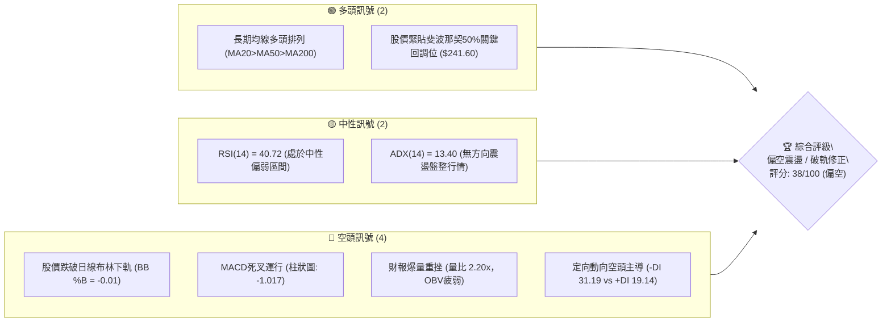

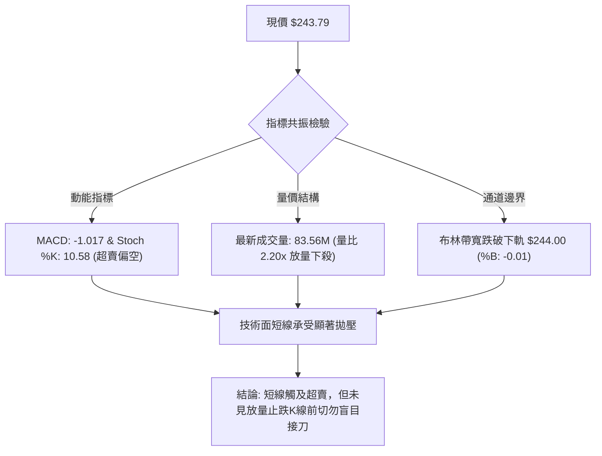

### 📊 核心指標速覽表

| 指標類別 | 指標名稱 | 當前數值 | 訊號 | 解讀 |
|:---|:---|:---:|:---:|:---|
| **價格** | 當前價格 (收盤) | $243.79 | 🔴 | 跌破短期所有均線，處於近三個月相對低位 |
| **均線** | MA20 (短期趨勢) | $254.95 | 🔴 | 現價低於 MA20 達 -4.38%，短線下行趨勢成型 |
| **均線** | MA50 (中期趨勢) | $254.67 | 🔴 | 現價跌破 MA50，中期多頭格局受挫，轉為弱勢 |
| **均線** | MA200 (長期趨勢) | $243.38 | 🟢 | 現價緊貼 MA200 上方 (+0.17%)，長線牛熊分水嶺面臨保衛戰 |
| **均線** | 均線系統排列 | MA20>MA50>MA200 | 🟢 | 原始架構維持多頭排列，但短均線已向下彎頭 |
| **動能** | RSI(14, Wilder) | 40.72 | 🟡 | 進入中性偏弱偏空區間，尚未進入嚴重超賣 (<30) |
| **動能** | MACD (12, 26, 9) | 柱狀圖 -1.017 | 🔴 | MACD (-1.121) 低於訊號線 (-0.104)，綠柱放大看空 |
| **擺動** | KD隨機指標 | %K: 10.58 / %D: 29.64 | 🔴 | 進入深度超賣區，存在技術性抽頭反彈動能 |
| **趨勢強度** | ADX(14) | 13.40 | 🟡 | 數值遠低於 25，屬於弱趨勢／無方向盤整行情 |
| **方向動向** | +DI / -DI | +DI: 19.14 / -DI: 31.19 | 🔴 | -DI 大幅凌駕於 +DI 之上，空方力量完全主導短線 |
| **通道通道** | 布林通道 (BB) | 上 $265.89 / 下 $244.00 | 🔴 | 現價收於下軌之外 (%B: -0.01)，極端破軌形態 |
| **成交量** | 最新量 / 20日均量 | 83.56M / 38.03M | 🔴 | 成交量比達 2.20x，財報利空引發機構放量拋售 |
| **量能累計** | 能量潮 OBV | OBV < MA | 🔴 | 資金持續淨流出，量能未能確認價格支撐 |
| **波動性** | ATR(14, Wilder) | $6.70 (2.75%) | 🟡 | 波動率處於中等水平，每日振幅空間約 $6.70 美元 |

### 🏆 技術評分卡

```
╔══════════════════════════════════════════════════════════════════════════════╗
║                    技術評分卡 — AMZN (2026-10-30)                            ║
╠══════════════════════════════════════════════════════════════════════════════╣
║ 評分維度        評分進度條                         得分      訊號   權重依據  ║
╠══════════════════════════════════════════════════════════════════════════════╣
║ 趨勢強度        ████░░░░░░░░░░░░░░░░░░░░           20/100    🔴     ADX 13.40 ║
║ 動能指標        ██████░░░░░░░░░░░░░░░░░░           30/100    🔴     MACD死叉  ║
║ 支撐穩定度      ██████████░░░░░░░░░░░░░░           50/100    🟡     逼近MA200 ║
║ 成交量配合      ████░░░░░░░░░░░░░░░░░░░░           20/100    🔴     放量破位  ║
║ 形態完整度      ██████████░░░░░░░░░░░░░░           50/100    🟡     無明確形態║
║ 均線排列        ████████████░░░░░░░░░░░░           60/100    🟢     均線架構殘║
╠══════════════════════════════════════════════════════════════════════════════╣
║ 綜合評分        ████████░░░░░░░░░░░░░░░░           38/100    🔴     技術面偏空║
║ 評分算術平均: (20 + 30 + 50 + 20 + 50 + 60) ÷ 6 = 38.33 → 四捨五入為 38/100 ║
╚══════════════════════════════════════════════════════════════════════════════╝
```

---

## 2. 趨勢分析

### 🌐 多時框趨勢分析

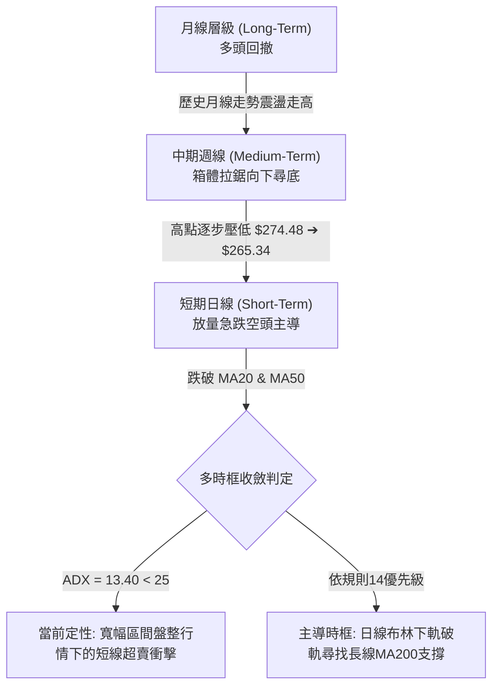

### 📈 長期趨勢 — 12個月走勢圖（Unicode）

依據 24 個月價格歷史之近 12 個月收盤數據（2025-11 至 2026-10）：
高點出現在 2026-07 ($271.58)，低點出現在 2026-03 ($208.27)，最新收盤價為 2026-10 ($243.79)。

```
AMZN 月線走勢圖（過去12個月: 2025-11 至 2026-10）
價格軸 ($)
$275 ┤                                     ● $271.58
$270 ┤                             ● $270.64       
$265 ┤                         ● $265.06   
$260 ┤                                         ● $259.77
$250 ┤                                             ● $249.15
$245 ┤                                                 ● $243.79 (現價)
$240 ┤                 ● $239.30       ● $238.34
$235 ┤ ● $233.22
$230 ┤     ● $230.82
$210 ┤             ● $210.00
$205 ┤                 ● $208.27 (低點)
     └────────────────────────────────────────────────────────
       11  12  01  02  03  04  05  06  07  08  09  10 (月份)
```

**近 12 個月月線走勢特徵分析表**：

| 時間區間 | 起訖價格 ($) | 漲跌幅 (%) | 趨勢特徵與結構剖析 |
|:---|:---:|:---:|:---|
| 2025-11 ~ 2026-01 | $233.22 → $239.30 | +2.61% | 高位平底震盪整理，多空拉鋸均勻 |
| 2026-01 ~ 2026-03 | $239.30 → $208.27 | -12.97% | 中期快速回踩，打出近一年波段次低點 $208.27 |
| 2026-03 ~ 2026-05 | $208.27 → $270.64 | +29.95% | 強勢V型反轉爆發，連續推升攻克歷史高位區間 |
| 2026-05 ~ 2026-07 | $270.64 → $271.58 | +0.35% | 衝高 $271.58 受阻，期間一度回撤至 $238.34 構築震盪平台 |
| 2026-07 ~ 2026-10 | $271.58 → $243.79 | -10.23% | 伴隨 AI 資本開支過大疑慮，月線呈現三連陰回檔整理 |

### 📊 中期趨勢（週線分析）

```
週線級別價格壓力與支撐階梯分布示意
┌────────────────────────────────────────────────────────┐
│  $266.45 ── 週線波段反彈阻力密集區 (R3)                │
│       ▲                                                │
│  $258.78 ── 週線震盪中樞頸線壓力 (R2)                  │
│       ▲                                                │
│  $248.81 ── 週線近三週收盤阻力聚類 (R1)                │
│ ══════════════════════════════════════════════════════ │
│  $243.79 ── 當前週線收盤位置 (逼近 52週 50% 斐波那契)  │
│ ══════════════════════════════════════════════════════ │
│       ▼                                                │
│  $225.82 ── 週線強支撐第一道防線 (S1)                  │
│       ▼                                                │
│  $220.99 ── 週線深層低點防禦區 (S2)                    │
└────────────────────────────────────────────────────────┘
```

週線指標動態解析：
近 20 週數據顯示，AMZN 於 2026-08-07 達到週線最高收盤價 $274.48，MACD 柱狀圖高達 +4.090，隨後展開週線級別修正。最新 2026-10-29 週 K 線收在 $243.79，週 RSI 跌至 40.7，週 MACD 柱狀圖由正轉負擴大至 -1.017。近四週成交量維持在 1.6 億至 1.9 億股水平，反映中期多頭籌碼出現鬆動，正在向下方尋找長期均線支撐。

### ⚡ 趨勢強度評估（ADX 解讀）

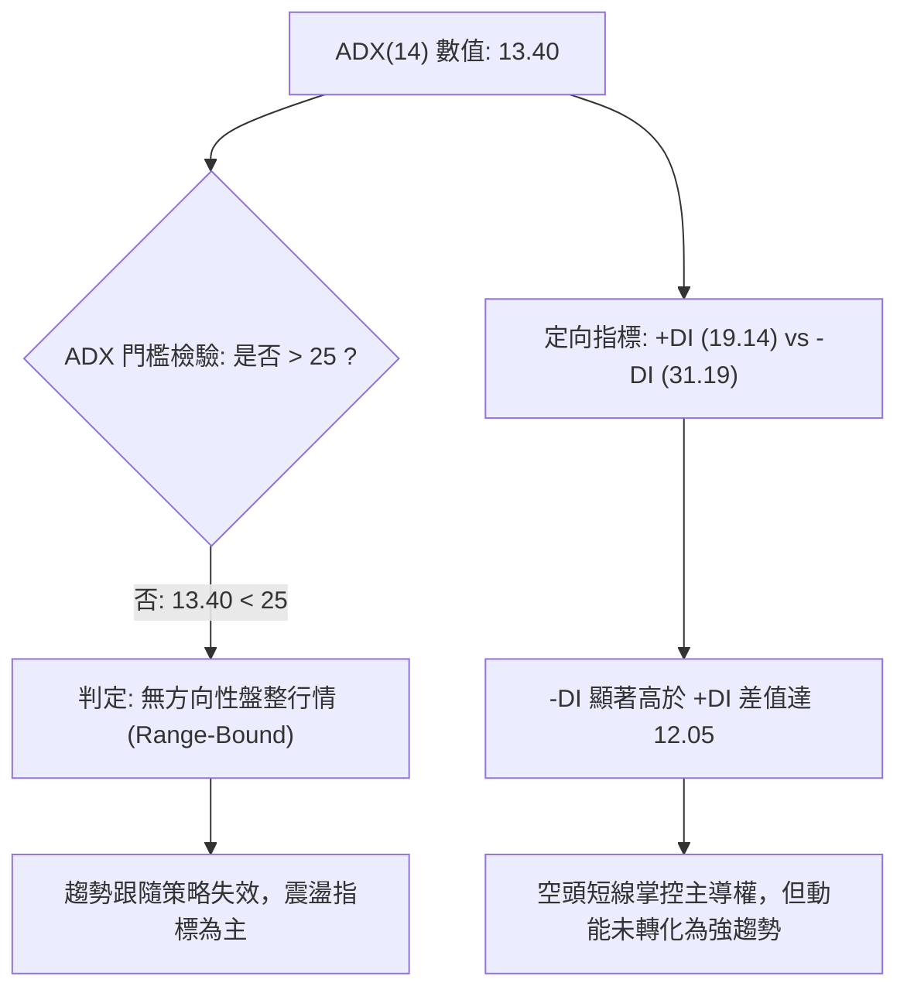

**ADX 趨勢強度量化對照表**：

| 指標變數 | 當前讀數 | 臨界區間 | 趨勢屬性判定 | 交易決策指引 |
|:---|:---:|:---:|:---|:---|
| **ADX(14)** | **13.40** | 0 ~ 20 (極弱趨勢/震盪) | 處於標準無趨勢盤整市 | 嚴禁追漲殺跌，應採用通道區間邊緣操作 |
| **+DI(14)** | **19.14** | 多方攻擊動能 | 多頭攻擊動量不足 | 不具備單邊向上推升能力 |
| **-DI(14)** | **31.19** | 空方打壓動能 | 空方短線佔據優勢 | 短期下行慣性存在，易出現急跌洗盤 |
| **DI 交叉狀態** | -DI 壓制 +DI | 差值擴大至 12.05 | 短空主導的箱體尋底 | 謹防跌破支撐後的虛假突破或超賣反抽 |

---

## 3. 圖表形態分析

### 🔍 形態識別系統

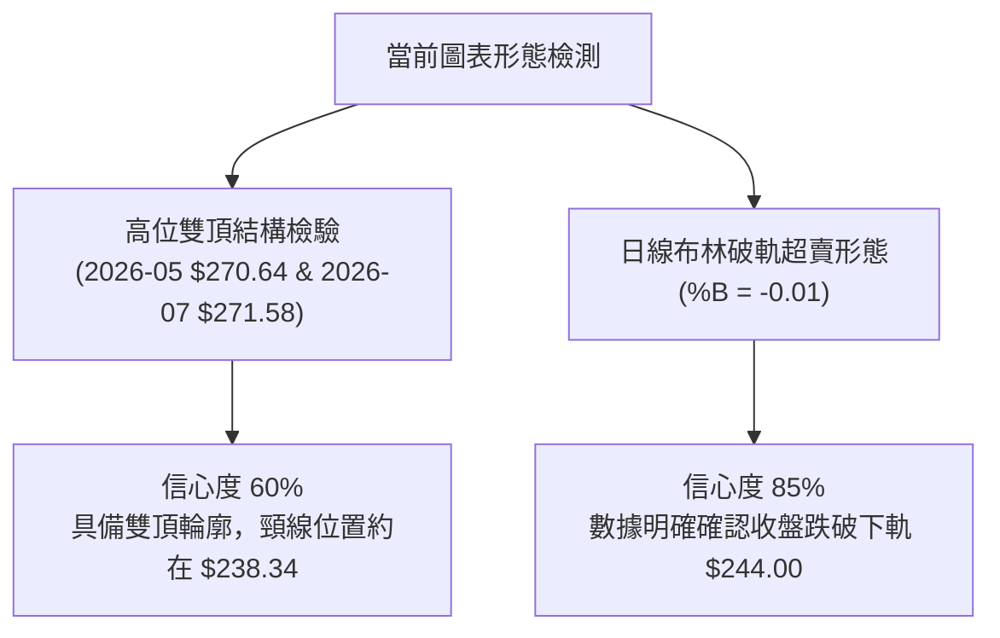

**形態確認與信心度評估表**：

| 形態名稱 | 信心度 | 判斷依據（嚴格引用數據） | 完成度 | 目標價（附嚴謹計算式） |
|:---|:---:|:---|:---:|:---|
| **雙重頂形態** (M-Top) | 60% | 2026年5月收盤 $270.64 與7月收盤 $271.58 形成雙頂高點聚類；中間波段低點為6月收盤 $238.34（頸線） | 70% | 由形態高度推算：頸線 $238.34 − (頂部均值 $271.11 − 頸線 $238.34) = **$205.57**（下方強支撐區外） |
| **布林下軌破軌超賣** | 85% | 2026-10-29 最新收盤 $243.79 低於布林下軌 $244.00，BB %B 為 -0.01，KD 出現超賣 (%K 10.58) | 100% | 由均值回歸理論推算：回抽布林中軌（MA20）= **$254.95** |
| **頭肩頂形態** | 30% | 歷史數據高點分散，無標準左肩與右肩對稱成交量架構 | 0% | 訊號不足，僅做指標型解讀，不預設形態目標價 |

### 🕯️ 重要K線形態分析

嚴格依據提供的「近10根日K」與「近8根週K」實際開高低收數據進行客觀解讀：

| 日期（週期） | 開盤價 | 最高價 | 最低價 | 收盤價 | K線形態名稱 | 形態專業解讀 | 多空訊號 |
|:---|:---:|:---:|:---:|:---:|:---:|:---|:---:|
| **2026-10-19** (日K) | $255.25 | $263.72 | $255.22 | $262.45 | 光腳長陽線 | 開盤即為最低，強勢突破向上，成交量放大至 56.19M | 🟢 強多 |
| **2026-10-20** (日K) | $264.08 | $265.34 | $260.42 | $262.63 | 高位十字小陰星 | 衝高至 $265.34 後動能停滯，呈現高位獲利了結壓制 | 🟡 中性轉空 |
| **2026-10-22** (日K) | $258.18 | $258.41 | $248.00 | $250.38 | 中實體大陰線 | 跳空低開低走，長實體貫穿多條短期均線，空方強烈反撲 | 🔴 強空 |
| **2026-10-23** (日K) | $248.85 | $250.01 | $246.45 | $248.00 | 縮量探底小陰線 | 量能驟降至 25.57M，多空處於觀望狀態 | 🟡 中性偏弱 |
| **2026-10-27** (日K) | $250.43 | $254.68 | $248.71 | $253.10 | 溫和放量小陽線 | 盤中反彈測試上方壓力，但受制於短期均線壓制 | 🟡 弱多反彈 |
| **2026-10-28** (日K) | $253.00 | $255.36 | $251.98 | $254.60 | 衝高小陽線 | 連續第二日弱勢反彈，高點 $255.36 觸及阻力位未果 | 🟡 誘多轉折 |
| **2026-10-29** (日K) | $246.95 | $249.14 | $241.24 | $243.79 | 放量破位長陰線 | 跳空低開，盤中重挫至 $241.24，爆出 83.56M 巨量，收盤擊穿布林下軌 | 🔴 極度看空 |
| **2026-10-09** (週K) | $250.19 | $262.80 | $250.18 | $262.43 | 光腳長週陽棒 | 單週大漲 +4.34%，一度扭轉短期跌勢 | 🟢 強多 |
| **2026-10-16** (週K) | $262.50 | $263.70 | $248.60 | $250.00 | 高開低走大週陰棒 | 高位遭遇重挫，吞噬前週實體漲幅，構成週線看跌吞噬 | 🔴 強空 |
| **2026-10-29** (週K) | $249.47 | $255.36 | $241.24 | $243.79 | 下破破位中週陰棒 | 創下近14週以來最低收盤價，週線級別弱勢未除 | 🔴 看空 |

### 📉 ASCII 走勢形態示意圖

```
近10個交易日走勢結構與破位形態示意圖
價格 ($)
$266 ┤       ╭● $265.34 (10/20 高點)
$262 ┤     ╭─╯  ╰─● $262.37 (10/21)
$258 ┤    ╭╯        ╰╮
$254 ┤   ╭╯          ╰╮         ╭● $254.60 (10/28)
$250 ┤──╭╯────────────╰● $250.38──╯───╰╮
$246 ┤  │ (10/19 突破)   (10/22 跳空)   ╰╮
$242 ┤  │                                ╰● $243.79 (10/29 破軌跌破)
$238 ┤  │                                   │ 盤中低點 $241.24
     └──┴───────────────────────────────────┴──────────
       10/16 10/19 10/20 10/21 10/22 10/23 10/26 10/27 10/28 10/29
```

### 🎯 形態目標價計算

基於嚴格客觀數據，本報告僅計算具備幾何推算邏輯的雙頂形態目標價與布林均值回歸目標：

1. **雙重頂形態測算**：
   - 頂部第一峰（2026-05 收盤）：$270.64
   - 頂部第二峰（2026-07 收盤）：$271.58
   - 頂部均值：$(270.64 + 271.58) \div 2 = \$271.11$
   - 中間回撤低點頸線（2026-06 收盤）：$238.34
   - 形態高度：$\$271.11 - \$238.34 = \$32.77$
   - **理論極限做空目標價**：$\text{頸線 } \$238.34 - \text{形態高度 } \$32.77 = \mathbf{\$205.57}$
   - *實務評估*：該目標價位於 52 週最低點 $196.00 與 S3 支撐位 $215.18 之間，需先跌破 S1 ($225.82) 始能確認該走勢。

2. **布林下軌超賣均值回歸測算**：
   - 觸軌超賣位置：2026-10-29 收盤 $243.79 (%B = -0.01)
   - 回歸中樞（MA20 / 布林中軌）：**$254.95**
   - 潛在技術回抽高度：$\$254.95 - \$243.79 = +\$11.16$ (+4.58%)。

---

## 4. 支撐與阻力

### 🗺️ 關鍵價位分布圖（Unicode）

```
AMZN 價位結構分布圖（嚴格依據 OHLCV 計算之關鍵價位）
══════════════════════════════════════════════════════════════
$287.20 ║██████████████████████████████║ 52W 最高點 (0.0% Fib)
$266.45 ║████████████████████████      ║ 強阻力 R3 / 52W 23.6% Fib ($265.68)
$258.78 ║████████████████              ║ 阻力 R2 (近一年波段高點聚類)
$252.36 ║██████████                    ║ 52W 38.2% Fib 回調位
$248.81 ║██████                        ║ 近期阻力 R1 (短線波段高點聚類)
$243.79 ╠══════════════════════════════╣ ◄ 當前價格 ($243.79)
$241.60 ║▓▓▓▓▓▓▓▓▓▓▓▓▓▓▓▓▓▓▓▓▓▓▓▓▓▓▓▓  ║ 關鍵斐波那契 50.0% 回調位 / MA200 ($243.38)
$230.84 ║▓▓▓▓▓▓▓▓▓▓▓▓▓▓▓▓▓▓▓▓          ║ 52W 61.8% Fib 黃金分割位
$225.82 ║▓▓▓▓▓▓▓▓▓▓▓▓▓▓▓▓              ║ 近期強支撐 S1 (近一年波段低點聚類)
$220.99 ║▓▓▓▓▓▓▓▓                      ║ 強支撐 S2 (波段低點密集區)
$215.18 ║▓▓▓▓                          ║ 深層支撐 S3 / 52W 78.6% Fib ($215.52)
$196.00 ║══════════════════════════════║ 52W 最低點 (100.0% Fib)
══════════════════════════════════════════════════════════════
```

### 🚧 阻力位分析表

所有價位嚴格引用技術數據庫「關鍵價位」區塊之波段高點聚類計算數值：

| 阻力級別 | 價位 | 形成原因與籌碼結構 | 突破難度評估 | 戰略重要性 |
|:---|:---:|:---|:---:|:---:|
| **關鍵阻力 R1** | **$248.81** | 近一年波段高點聚類，且貼近日線 MA5 ($249.72) 與 10/23 反彈高點 $250.01 | 🟡 中等 (需填補跳空缺口) | 短線強弱分水嶺，站上此處方能緩解下殺慣性 |
| **重要阻力 R2** | **$258.78** | 近一年波段高點聚類，且與日線 MA60 ($256.87) 及布林中軌 MA20 ($254.95) 形成反壓共振帶 | 🔴 極高 (需巨量換手化解) | 中期多空轉折頸線，未能收復前中期格局維持偏弱 |
| **強阻力 R3** | **$266.45** | 波段高點聚類，高度重合 52週斐波那契 23.6% 回調位 ($265.68) 與布林上軌 ($265.89) | 🔴 極高 (強籌碼套牢峰) | 波段多頭最終防禦堡壘，多頭徹底翻轉的關鍵位 |

### 🛡️ 支撐位分析表

所有價位嚴格引用技術數據庫「關鍵價位」區塊之波段低點聚類計算數值：

| 支撐級別 | 價位 | 形成原因與籌碼結構 | 守住機率評估 | 戰略重要性 |
|:---|:---:|:---|:---:|:---:|
| **近期支撐 S1** | **$225.82** | 近一年波段低點聚類，位於 61.8% 斐波那契回調位 ($230.84) 下方約 2% 處 | 🟢 70% (跌破 MA200 後的主要接盤區) | 中期第一道關鍵緩衝墊，多頭不可退讓的防線 |
| **強支撐 S2** | **$220.99** | 近一年波段低點聚類，重疊 2025年6月及9月震盪平台收盤價 ($219.39 ~ $219.57) | 🟢 80% (具備強歷史密集成交量支撐) | 核心價值支撐帶，失守意味著長期上行格局遭到破壞 |
| **深層支撐 S3** | **$215.18** | 近一年波段極端低點聚類，精確重合 52週斐波那契 78.6% 回調位 ($215.52) | 🟢 90% (非系統性崩盤難以跌破) | 終極防線，若觸及將引發機構長線資金強力抄底 |

### 📐 斐波那契回調位分析

依據 52 週波動區間：低點 **$196.00** → 高點 **$287.20**，落差為 $91.20：

```
斐波那契回調階梯與現價定位分析
┌─────────┬──────────┬────────────────────────────────────────────────────────┐
│ 水平比率 │ 價格 ($) │ 當前價位關係與市場技術涵義                             │
├─────────┼──────────┼────────────────────────────────────────────────────────┤
│  0.0%    │ $287.20  │ 52週最高點，極端天花板阻力                             │
│ 23.6%    │ $265.68  │ 重疊 R3 ($266.45)，強勢回調極限位                      │
│ 38.2%    │ $252.36  │ 弱勢回調支撐轉阻力（現價下方反彈首要壓制區間）         │
│ 50.0%    │ $241.60  │ ◄ 當前價格 $243.79 正緊貼於此位置上方 (距離僅 +0.91%)  │
│ 61.8%    │ $230.84  │ 黃金分割回調位，多頭防守底線                           │
│ 78.6%    │ $215.52  │ 重疊 S3 ($215.18)，極端深幅回調防線                    │
│ 100.0%   │ $196.00  │ 52週最低點，牛市起點底座                               │
└─────────┴──────────┴────────────────────────────────────────────────────────┘
```

**斐波那契深度解讀**：
當前收盤價 **$243.79** 剛好落在 **38.2% 回調位 ($252.36)** 與 **50.0% 回調位 ($241.60)** 之間，且極度逼近 50.0% 平衡位置（當前僅溢價 $2.19）。
- **關鍵平衡點**：$241.60 不僅是 52 週整體波動的半數中軸，更與 200 日移動平均線 **MA200 ($243.38)** 形成極為罕見的「斐波那契 50% + 年線」雙重支撐共振帶。
- **盤面涵義**：若能守穩 $241.60 ~ $243.38 區間，此處將構成極佳的技術性超跌反彈基底；反之，一旦日線收盤實體跌破 $241.60，技術派資金停損將觸發骨牌效應，下一目標將直指 61.8% 黃金分割位 **$230.84**。

---

## 5. 技術指標深度解讀

### 🎛️ 指標訊號總覽

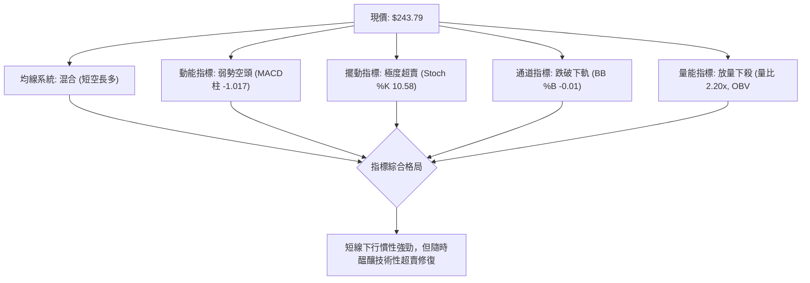

### 📈 移動平均線排列分析

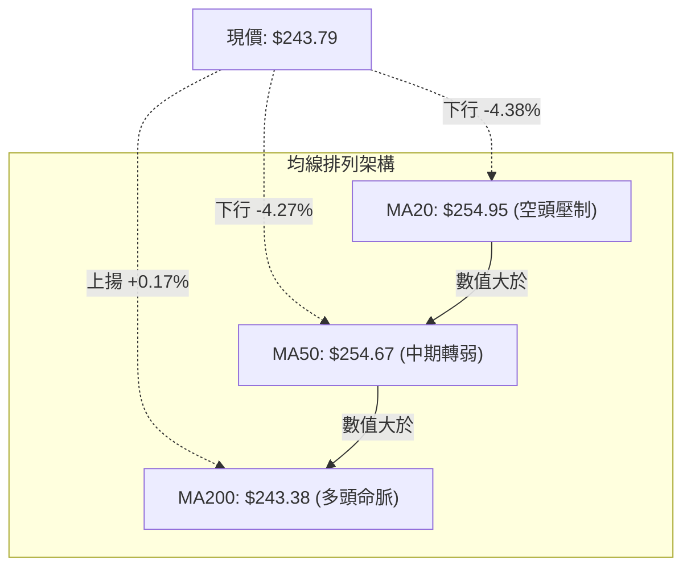

**移動平均線系統狀態詳解**：
- **MA 排列屬性**：數據顯示 MA20 ($254.95) > MA50 ($254.67) > MA200 ($243.38)，名義上均線系統仍保有「長週期多頭排列」骨架。
- **價格與均線偏離**：然而，現價 ($243.79) 已經跌破 MA5 ($249.72)、MA10 ($253.64)、MA20 ($254.95)、MA60 ($256.87) 及 MA120 ($253.65)，短中期均線全面扣高走低並向下形成反壓空頭蓋頂。
- **年線生死關頭**：目前價格與年線 MA200 ($243.38) 的正乖離率僅剩 **+0.17%**（點數差僅 $0.41），若年線失守，將正式觸發多頭趨勢瓦解警報。

### 📉 RSI(14) 分析

```
RSI(14, Wilder) 當前讀數：40.72
[0] ────────── [30] ─────────────── [50] ─────────────── [70] ────────── [100]
                │                   │                     │
                ├─────── 40.72 ─────┤                     │
                │    (當前中性偏弱)   │                     │
進度條：████████████████░░░░░░░░░░░░░░░░░░░░░░░░ 40.72%
```

- **區間評估**：RSI(14) 讀數為 40.72，位於 30 至 50 的中性偏空弱勢區，說明賣壓雖重，但尚未達到極端拋售竭盡區 (<30)。
- **背離分析判斷**：數據明確提示「RSI背離：無明顯背離（僅比較近20根K棒首尾的價格與RSI方向）」。價格從 10/20 的波段高點震盪回落，RSI 亦步亦趨走低，兩者斜率方向吻合，**當前不存在任何底背離或頂背離訊號**，價格下跌屬於正常動量宣洩。

### 📊 MACD(12/26/9) 訊號解讀

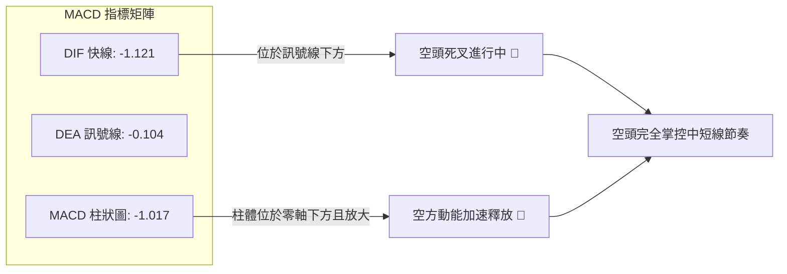

- **數值剖析**：DIF 線 (-1.121) 位於零軸下方且持續下穿 Signal 線 (-0.104)，負向柱狀圖讀數達 -1.017，表明空方力量正處於主升擴張期。
- **背離檢驗**：觀察週線 MACD，柱狀圖自 2026-08-07 的 +4.090 連續萎縮並轉為負值，目前並未出現柱狀圖收斂抬頭之背離徵兆，空頭修正波尚未走完。

### 📦 布林通道分析

```
ASCII 日線布林通道 (Bollinger Bands 20, 2) 結構圖
價格 ($)
$265.89 ┼──────────────────────────────────── 上軌 (Upper Band)
        │
$254.95 ┼ - - - - - - - - - - - - - - - - - - 中軌 (MA20)
        │
$244.00 ┼──────────────────────────────────── 下軌 (Lower Band)
$243.79 ┼ ◄ 現價 ($243.79 收在下軌下方，%B = -0.01)
```

- **通道寬度與極端位置**：當前布林上軌為 $265.89，中軌為 $254.95，下軌為 $244.00，通道總帶寬約 $21.89 (8.9%)。
- **%B 指標解讀**：%B 讀數為 **-0.01**（< 0），確認收盤價已實質性跌穿通道下軌。根據布林通道統計規律，當價格在無強趨勢狀態下（ADX 13.40 < 25）跌破下軌，通常代表極端超賣，價格極易在 1 至 3 個交易日內出現回抽通道內部的均值回歸行情。

### 💹 成交量分析（量價配合度）

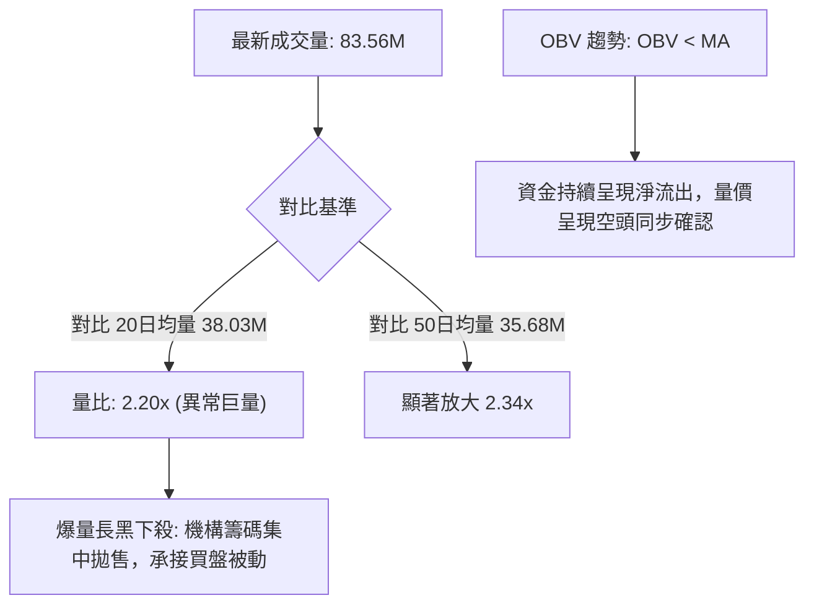

- **量價配合定性**：2026-10-29 出現 8,355.96 萬股的單日巨量（相比前一日 3,491.59 萬股暴增 139%），伴隨股價下跌 -2.37%，形成典型的「放量長黑破位」。
- **OBV 量能分析**：OBV 低於其移動平均線，表明籌碼由大戶流向散戶，並無主力機構逆勢鎖籌跡象，量能並未確認反轉信號。

---

## 6. 動能與波動率

### ⚡ 動能評估四象限

根據技術數據：動能強度處於低迷偏空區間（MACD 負向擴大、RSI 40.72、ADX 13.40）；波動率 ATR 為 $6.70 (2.75%) 處於中偏低波動區間，整體座落在「弱動能 / 低波動」向「弱動能 / 高波動」過渡之邊界。

| 象限代號 | 動能維度 | 波動維度 | 當前狀態標註 | 戰略操作指引 |
|:---:|:---:|:---:|:---:|:---|
| **Q1** | 強動能 (Bullish) | 低波動 (Low Vol) | — | 最佳波段順勢突破進場點 |
| **Q2** | **弱動能 (Bearish)** | **低波動 (Low Vol)** | **✓ [AMZN 當前所處位置]** | **謹慎觀望，防禦為主，耐心等待超賣企穩** |
| **Q3** | 強動能 (Bullish) | 高波動 (High Vol) | — | 高風險高收益，適合突破加碼 |
| **Q4** | 弱動能 (Bearish) | 高波動 (High Vol) | — | 恐慌崩跌區，嚴禁任何左側接刀 |

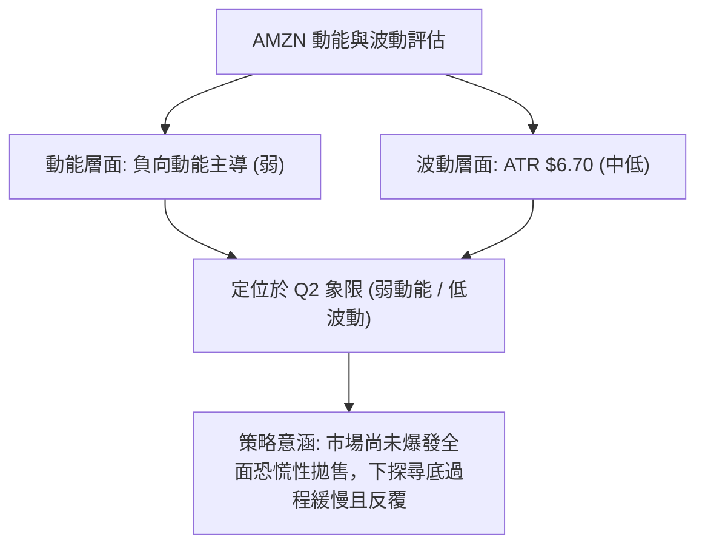

### 📊 ATR 波動率分析

- **ATR(14, Wilder) 當前數值**：**$6.70**（佔股價比例 **2.75%**）。
- **日內真實波動幅度**：代表近期 AMZN 平均單日自然價格波幅為 $6.70。
- **動態止損與倉位風控依據**：
  - *短線交易止損距離*：建議設定為 1.0 倍至 1.5 倍 ATR，即 **$6.70 至 $10.05**。
  - *波段交易止損距離*：建議設定為 2.0 倍 ATR，即 **$13.40**。
  - 當前價格距離 MA200 僅 $0.41，若以 1.0 ATR ($6.70) 作為下行緩衝，極限保護價位約在 $237.09。

### 📐 Beta 與市場相關性

- **Beta 係數**：**1.456**（高於美股大盤基準 1.0 達 45.6%）。
- **市場敏感度解讀**：
  - AMZN 具備典型高貝塔成長科技股特徵，在 Nasdaq 指數下跌時往往承受 1.45 倍的放大回撤。
  - 配合新聞面「Nasdaq 期貨受科技股財報拖累下挫 2%」，AMZN 當日下挫與高 Beta 特性完全吻合，凸顯大盤系統性風險對個股具有高度外溢效應。

---

## 7. 多時框架總結

### 📋 時框架評分表

| 時框架 | 趨勢方向 | 動能狀態 | 均線排列 | 圖表形態 | 綜合評分 | 操作建議 |
|:---|:---:|:---:|:---:|:---:|:---:|:---|
| **長期 (月線)** | 🟢 偏多向上 | 🟡 震盪回調 | 🟢 多頭完好 (收於年線上方) | 高位長箱體震盪 | 65/100 | 長期投資者持股續抱，暫不加碼 |
| **中期 (週線)** | 🟡 偏空拉鋸 | 🔴 柱狀擴大 | 🟡 均線收斂壓制 | 潛在雙頂回踩頸線 | 45/100 | 中線多單減倉觀望，防守 S1 |
| **短期 (日線)** | 🔴 明確看空 | 🔴 破軌加速 | 🔴 均線蓋頂下壓 | 布林破軌放量長黑 | 25/100 | 嚴格禁止追多，等待止跌訊號 |

### 🔲 綜合訊號矩陣

```
┌─────────────────┬────────────────────────────────────────────────────────────┐
│ 分析維度        │ 短期 (Daily)         中期 (Weekly)        長期 (Monthly)     │
├─────────────────┼────────────────────────────────────────────────────────────┤
│ 主導趨勢        │ 🔴 下行尋底          🟡 震盪整理          🟢 上升通道        │
│ 關鍵指標        │ MACD 死叉 (-1.017)   週 MACD 轉負 (-1.017) 月線守穩中樞        │
│ 均線狀態        │ 跌破 MA20 / MA50     回踩週線中軌         遠在 MA240 之上    │
│ 籌碼量能        │ 放量拋售 (2.20x)     均量萎縮             長線資金沉澱       │
│ 訊號一致性評級  │ 矛盾衝突（長多短空），短線空頭動能壓制中長線趨勢           │
└─────────────────┴────────────────────────────────────────────────────────────┘
```

### ⚖️ 多時框收斂結論

依據【嚴格要求 14：多時框收斂規則】進行最終技術定性：
1. **行情性質判定**：當前日線 ADX(14) 讀數為 **13.40**（遠低於 25），嚴格定義為**盤整震盪行情（Range-Bound）**，非單邊強趨勢行情。
2. **主導時框與優先級取捨**：在 ADX < 25 條件下，規則明確要求「**以日線布林通道上下軌為主要交易區間**」。雖然長期均線結構維持多頭，但短線價格已實質跌穿布林下軌 ($244.00)，空方具有壓倒性的短線定價權。
3. **唯一方向性結論**：**【偏空觀望 / 等待超賣修復】**（綜合評分 **38/100**，偏空格局）。
   - 結論完全收斂至：股價雖已嚴重超賣，但在未確認站回布林下軌 $244.00 及收復 R1 ($248.81) 之前，禁止預設立場逆勢做多，整體策略以防禦型逢高放空或等待低吸確認為主。

---

## 8. 交易策略建議

### 🗺️ 策略決策流程圖

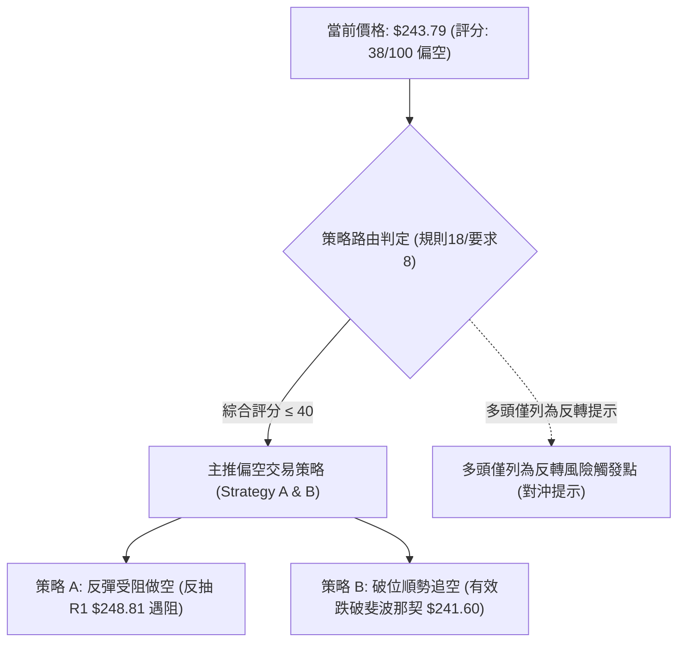

### 🧭 策略路由（依評分卡分流）

> **當前主策略方向 = 【空頭偏弱策略】（依據綜合評分 38/100 ≤ 40 嚴格觸發）**

### 🎯 價格情境階梯（Price Scenarios）

所有價位均嚴格引用技術數據庫「關鍵價位」區塊之客觀數值：

| 觸發條件 | 下一目標 | 後續延伸目標 | 情境技術涵義 |
|:---|:---:|:---:|:---|
| **向上反彈突破 R1 ($248.81)** | R2 ($258.78) | R3 ($266.45) | 短線超賣修復成功，回補缺口挑戰布林中軌 |
| **於現價至 $241.60 震盪** | — | — | 年線保衛戰，多空於斐波那契50%中樞反覆拉鋸 |
| **有效跌破年線與斐波那契 $241.60** | S1 ($225.82) | S2 ($220.99) | 破位加速下行，年線徹底失守，中期多頭架構瓦解 |

### 📊 情境機率分佈

| 預測情境 | 機率 | 主要技術指標依據 |
|:---|:---:|:---|
| **情境一：弱勢震盪後破位下探** | **55%** | MACD 柱狀圖放大至 -1.017、放量下殺量比 2.20x、OBV 疲弱且低於 MA |
| **情境二：區間超跌反抽震盪** | **35%** | ADX 13.40 (盤整無趨勢)、Stoch 超賣 (%K 10.58)、布林通道超賣 (%B -0.01) |
| **情境三：強勢V型強反彈** | **10%** | 目前無底背離形態支持，且上方均線密集蓋頂，機率極低 |

### 🟢 主策略詳情（方向：主推偏空策略）

所有價位及風險報酬比嚴格依據要求規則計算：
- 風險報酬比 = $(\text{進場價} - \text{目標價 T1}) \div (\text{止損價} - \text{進場價})$，以「1 : X.XX（以 T1 計）」格式呈現。

| 策略要素 | 策略 A（反彈受阻逢高放空） | 策略 B（破位順勢追空） |
|:---|:---:|:---:|
| **策略類型** | 逢反彈阻力位放空 | 關鍵支撐破位追空 |
| **進場條件** | 價格反抽 R1 阻力位附近滯漲，收出上影線確認 | 日線實體收盤跌破斐波那契50%關鍵位 $241.60 |
| **進場價格** | **$248.81** (精確取自 R1) | **$241.60** (精確取自 50.0% Fib) |
| **目標價 T1** | **$225.82** (精確取自 S1) | **$225.82** (精確取自 S1) |
| **目標價 T2** | **$220.99** (精確取自 S2) | **$215.18** (精確取自 S3) |
| **止損價格** | **$254.95** (精確取自 MA20 / 布林中軌) | **$248.81** (精確取自 R1 阻力位) |
| **風險報酬比** | **1 : 3.74（以 T1 計）**<br/>*(248.81-225.82) ÷ (254.95-248.81) = 22.99 ÷ 6.14 = 3.744* | **1 : 2.19（以 T1 計）**<br/>*(241.60-225.82) ÷ (248.81-241.60) = 15.78 ÷ 7.21 = 2.188* |
| **成功機率** | **65%** | **55%** |
| **建議倉位** | **10% ~ 15%** (輕倉試單) | **10%** (嚴控曝險) |

### 🔴 反向風險觸發點（對沖提示）

此處僅列出推翻上述空頭策略的風控觸發條件，非多頭操作建議：
- **觸發價位**：若日線實體陽線強勢突破並站穩 **$248.81 (R1)** 上方，且成交量縮減不再破底。
- **對沖訊號**：RSI 快速站回 50 以上，且日線布林通道重返軌道內部（%B 回升至 0.20 以上）。
- **應對處置**：所有空單必須立即無條件停損離場，空頭邏輯被多頭強行破壞。

### ⭐ 整體訊號強度評星

```
做多訊號強度：★★☆☆☆  (2/5星 — 僅有超賣指標與年線弱支撐，無反轉信號)
做空訊號強度：★★★★☆  (4/5星 — 放量破位、均線蓋頂、MACD全面轉空)
整體可信度：  ★★★☆☆  (3/5星 — ADX 13.40 提示行情處於盤整，謹防假摔)
```

---

## 9. 風險提示與監控

### ✅ 關鍵監控指標 Checklist

```
╔══════════════════════════════════════════════════════════════════════════════╗
║                   AMZN 盤面關鍵動態監控清單 (Checklist)                      ║
╠══════════════════════════════════════════════════════════════════════════════╣
║ [ ] 1. 年線 MA200 防守：每日收盤是否跌破 $243.38（當前距離僅 $0.41）        ║
║ [ ] 2. 斐波那契 50% 關卡：盤中是否刺穿 $241.60 且未見買盤拉回               ║
║ [ ] 3. 布林下軌重返檢驗：%B 是否從 -0.01 迅速回升至 0.00 以上（站回 $244）  ║
║ [ ] 4. 量能衰竭特徵：單日成交量是否回落至 38.03M (20日均量) 以下確認量縮   ║
║ [ ] 5. 動能死叉延續性：MACD 柱狀圖負值是否跌破 -1.500 進一步惡化            ║
║ [ ] 6. 逆轉信號監測：15分鐘/小時線是否出現底背離或錘頭線等企穩訊號          ║
╚══════════════════════════════════════════════════════════════════════════════╝
```

### ⚠️ 風險場景分析

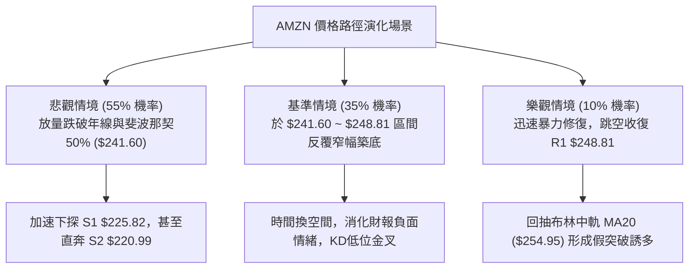

### 🛡️ 風險管理重要提醒

1. **財報與基本面利空外溢**：
   - 數據中近期新聞明確顯示：「Amazon burns cash... Bloated Capex Worries」、「Amazon Just Burned $42 Billion in Cash Chasing AI Growth」。市場對巨額資本支出損害自由現金流（FCF TTM 為 -$2.47B）極為敏感，基本面情緒惡化往往導致技術支撐在初次測試時失效。
2. **高 Beta 乘數風險**：
   - AMZN Beta 高達 1.456，若美股總體環境持續受科技股財報拖累下挫，任何試圖在 S1 ($225.82) 上方左側摸底的行為都面臨巨大的波動折損風險。
3. **嚴格倉位限制法則**：
   - 單筆策略最大止損風險嚴格控制在總投資組合資金的 1.0% 以內。
   - 在 ADX < 25 且股價收在布林下軌之外的異常期，整體總部位持倉比例不宜超過 25%，保留充足現金應對黑天鵝極端價位。

---

## 📋 報告總結

```
╔══════════════════════════════════════════════════════════════════════════════╗
║                       AMZN 技術分析報告總結                                  ║
╠══════════════════════════════════════════════════════════════════════════════╣
║ 報告日期：2026-10-30                                                         ║
║ 當前價格：$243.79                                                            ║
║ 綜合評分：38/100  (六項子評分算術平均四捨五入)                               ║
║ 分析評級：🔴 偏空震盪 / 破軌尋底                                            ║
╠══════════════════════════════════════════════════════════════════════════════╣
║ 關鍵結論：                                                                   ║
║ ├─ 長期趨勢：🟢 偏多向上（月線仍處於大型震盪上升通道，MA200 年線尚存）       ║
║ ├─ 中期趨勢：🟡 偏空拉鋸（週線高位回落，MACD 柱狀圖由正轉負 -1.017）        ║
║ ├─ 短期趨勢：🔴 放量重挫（收盤擊穿布林下軌 $244.00，成交量放大 2.20x）       ║
║ ├─ 關鍵支撐：S1 $225.82 ｜ 斐波那契50%防線 $241.60 ｜ 年線 $243.38           ║
║ ├─ 關鍵阻力：R1 $248.81 ｜ R2 $258.78 ｜ 布林中軌 $254.95                   ║
║ └─ 市場共識：58位分析師目標均價 $332.41 (最高 $405.00 / 最低 $230.00)       ║
╠══════════════════════════════════════════════════════════════════════════════╣
║ 最優策略組合：                                                               ║
║ 1. 🥇 最佳機會（主策略 A）：反彈受阻逢高放空                                  ║
║    進場 $248.81 ｜ 止損 $254.95 ｜ 目標 T1 $225.82 ｜ 風報比 1:3.74 (以T1計)  ║
║ 2. 🥈 次選機會（主策略 B）：跌破年線順勢追空                                  ║
║    進場 $241.60 ｜ 止損 $248.81 ｜ 目標 T1 $225.82 ｜ 風報比 1:2.19 (以T1計)  ║
║ 3. 🥉 保守選擇：空倉觀望，嚴格等待日線收出帶長下影線的止跌紅K再行評估        ║
╚══════════════════════════════════════════════════════════════════════════════╝
```

---

> ⚠️ **免責聲明**：本報告為技術分析研究，所有數據、指標及價位均基於 Yahoo Finance 歷史交易資訊進行數學與幾何推算。本報告**僅供研究與學術參考**，**不構成任何形式的投資買賣建議**。金融市場具有高度不確定性與虧損風險，投資人應自主審慎評估風險承受能力並自負盈虧。

---

*報告生成時間：2026-10-30 ｜ 數據來源：Yahoo Finance ｜ 分析框架：多時框技術分析模型*