# AMZN 技術分析報告

> **報告日期**：2026-10-31 ｜ **語言**：繁體中文 ｜ **數據來源**：Yahoo Finance ｜ **當前價格**：$240.35

---

## 目錄

| 章節 | 內容 |
|------|------|
| [1. 技術面概覽](#1-技術面概覽) | 訊號儀表板、核心指標、評分卡 |
| [2. 趨勢分析](#2-趨勢分析) | 多時框趨勢、長中短期走勢 |
| [3. 圖表形態分析](#3-圖表形態分析) | 形態識別、K線組合、目標價 |
| [4. 支撐與阻力](#4-支撐與阻力) | 關鍵價位、斐波那契回調 |
| [5. 技術指標深度解讀](#5-技術指標深度解讀) | MA/RSI/MACD/布林/成交量 |
| [6. 動能與波動率](#6-動能與波動率) | 動能評估、ATR、Beta |
| [7. 多時框架總結](#7-多時框架總結) | 時框架評分矩陣 |
| [8. 交易策略建議](#8-交易策略建議) | 多空策略、風險報酬比 |
| [9. 風險提示與監控](#9-風險提示與監控) | 監控指標、風險場景 |
| [10. 報告總結](#-報告總結) | 結論與策略矩陣 |

---

## 1. 技術面概覽

### 🎯 技術訊號儀表板

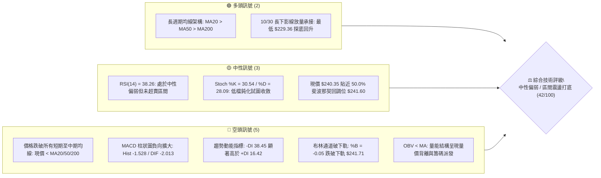

---

### 📊 核心指標速覽表

| 指標類別 | 指標名稱 | 當前數值 | 訊號 | 專業技術解讀 |
|:---|:---|:---|:---:|:---|
| **價格** | 當前收盤價 | $240.35 | 🔴 | 位於 52 週高低點區間 48.6%，單日重挫後收長下影線 |
| **均線** | 短期 MA20 | $254.39 | 🔴 | 價格低於 MA20 達 -5.52%，短線呈現空頭壓制結構 |
| **均線** | 中期 MA50 | $254.28 | 🔴 | 價格低於 MA50，且 MA20 與 MA50 即將形成死叉壓力 |
| **均線** | 長期 MA200 | $243.40 | 🔴 | 價格摜破長期牛熊分界線 MA200（-1.25%），長線面臨考驗 |
| **動能** | RSI(14) | 38.26 | 🟡 | 進入弱勢區間（30–40），接近超賣但未出現結構性背離 |
| **動能** | MACD (12,26,9) | -2.013 / -0.486 | 🔴 | DIF 低於 MACD Signal，Hist 擴大至 -1.528，空頭動能增強 |
| **動能** | KD (Stoch 14) | 30.54 / 28.09 | 🟡 | %K 自超賣區微幅拐頭向上穿過 %D，短線具備超跌反彈動能 |
| **趨勢** | ADX (14) | 15.31 | 🟡 | ADX < 25 表明市場處於無方向趨勢或盤整震盪行情 |
| **方向** | 方向指標 (+/-DI) | +16.42 / -38.45 | 🔴 | -DI 遠大於 +DI，空方力量在短週期內佔據絕對主導地位 |
| **通道** | 布林帶 %B | -0.05 | 🟡 | 價格跌破下軌 $241.71 後收於下軌邊緣，具均值回歸修復潛力 |
| **波動** | ATR(14) | $7.26 (3.02%) | 🟡 | 日內平均振幅達 7.26 美元，波動度顯著放大，應嚴格控管止損 |
| **籌碼** | 量比 (Volume Ratio) | 2.51x | 🔴 | 爆量 1.047 億股（20日均量 2.51 倍），財報利空引發恐慌拋售 |

---

### 🏆 技術評分卡

```
╔══════════════════════════════════════════════════════════════════╗
║              技術評分卡 — AMZN (2026-10-31)                     ║
╠══════════════════════════════════════════════════════════════════╣
║ 趨勢強度 (Trend)      ███████░░░░░░░░░░░░░  35/100  🔴 空頭壓制  ║
║ 動能指標 (Momentum)   ████████░░░░░░░░░░░░  38/100  🔴 動能疲弱  ║
║ 支撐穩定度 (Support)  ██████████░░░░░░░░░░  52/100  🟡 探底承接  ║
║ 成交量配合 (Volume)   ████████░░░░░░░░░░░░  42/100  🟡 爆量分歧  ║
║ 形態完整度 (Pattern)  ████████░░░░░░░░░░░░  40/100  🟡 箱體回測  ║
║ 均線排列 (Moving Avg) █████████░░░░░░░░░░░  45/100  🟡 長多短空  ║
╠══════════════════════════════════════════════════════════════════╣
║ 綜合評分 (Overall)    ████████░░░░░░░░░░░░  42/100  🟡 區間震盪  ║
║ 評級結論：中性偏弱（ADX 15.31 盤整行情，以布林通道與區間打底操作為主） ║
╚══════════════════════════════════════════════════════════════════╝
```

> **評分計算依據（規則 18）**：綜合評分為六項維度的算術平均：  
> `(35 + 38 + 52 + 42 + 40 + 45) ÷ 6 = 252 ÷ 6 = 42.0`（四捨五入為 **42/100**）。  
> 綜合評分座落於 40–60 分之中性區間，核心特徵為「短線超賣衝擊，長期結構回測」，應採區間防守與反彈應對策略。

---

## 2. 趨勢分析

### 🌐 多時框趨勢分析

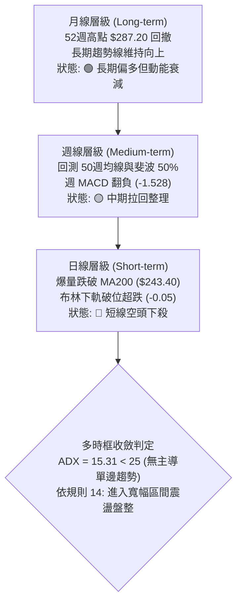

---

### 📈 長期趨勢 — 12個月走勢圖（Unicode）

以下為 AMZN 自 2025 年 11 月至 2026 年 10 月之月線收盤走勢，標注波段頂底與關鍵結構：

```
AMZN 月線走勢圖（過去12個月收盤價變化）
價格軸 ($)
$280 ┤                                           
$270 ┤                               ● $270.64       ● $271.58
$260 ┤                       ● $265.06   \           /   \
$250 ┤                                    \         /     ● $249.15
$240 ┤                   ● $239.30         \       /       \   ● $240.35 (現價)
$230 ┤ ● $233.22 ── ● $230.82               ● $238.34        ● $259.77 (8月)
$220 ┤                                           
$210 ┤          ● $210.00 ─ ● $208.27 (波段低點聚類)
$200 ┤                                           
     └──────┬──────┬──────┬──────┬──────┬──────┬──────┬──────┬──────┬──────┬──────┬──────
          25-11  25-12  26-01  26-02  26-03  26-04  26-05  26-06  26-07  26-08  26-09  26-10
```

#### 月線走勢特徵分析表格

| 階段區間 | 時間跨度 | 起訖收盤價 | 漲跌幅 | 走勢特徵與結構分析 |
|:---|:---:|:---:|:---:|:---|
| **第一階段：高檔震盪蓄勢** | 2025-11 ~ 2026-01 | $233.22 → $239.30 | +2.61% | 在 $230–$240 區間進行箱體整理，成交量溫和萎縮 |
| **第二階段：春季深度回踩** | 2026-01 ~ 2026-03 | $239.30 → $208.27 | -12.97% | 觸及 52 週次低點區間，於 $208–$210 構築雙重底支撐 |
| **第三階段：強勁主升浪潮** | 2026-03 ~ 2026-07 | $208.27 → $271.58 | +30.40% | 突破所有均線，連續放量上攻創波段高點 $271.58 |
| **第四階段：頂部雙峰受阻** | 2026-07 ~ 2026-08 | $271.58 → $259.77 | -4.35% | 逼近 52W 高點 $287.20 未果，於 $271 形成雙重頂型態 |
| **第五階段：財報利空回調** | 2026-08 ~ 2026-10 | $259.77 → $240.35 | -7.48% | 連續 3 個月陰線收盤，測試 50% 斐波那契回調位 $241.60 |

---

### 📊 中期趨勢（週線分析）

中期技術面目前呈現「高檔喇叭形發散後拉回」格局。近 8 週週 K 線顯示，股價從 2026 年 10 月 9 日該週的高點 $262.80 逐級走低。

```
AMZN 近期週線壓力與支撐示意圖
══════════════════════════════════════════════════════════════════
  $266.45 ─────────────────────────────────── [強阻力 R3] 8月反彈頂部
  $258.78 ─────────────────────────────────── [阻力 R2] 9月震盪頸線
  $248.81 ─────────────────────────────────── [近期反彈阻力 R1] 10月多週成交密集區
  $240.35 ═══════════════════════════════════ ◄ 當前收盤價 ($240.35)
  $230.84 ┄┄┄┄┄┄┄┄┄┄┄┄┄┄┄┄┄┄┄┄┄┄┄┄┄┄┄┄┄┄┄ [61.8% 斐波那契 / 10/30 下影線測試]
  $225.82 ─────────────────────────────────── [近期重要波段支撐 S1]
══════════════════════════════════════════════════════════════════
```

1. **週線成交量異動**：2026-10-30 該週成交量放大至 292,100,300 股，為近 15 週以來的最高週換手量，顯示機構在 $230–$240 區間進行了大規模換手。
2. **週線 RSI 指標**：由 10 月初的 59.0 急速回落至 38.3，尚未進入 30 以下極度超賣區，反映中期調整尚未完全結束，但下行斜率趨緩。
3. **週 MACD 柱狀體**：自 10 月中旬的 +0.129 翻負至 -1.528，中期空頭動能釋放，壓制反彈空間。

---

### ⚡ 趨勢強度評估（ADX 解讀）

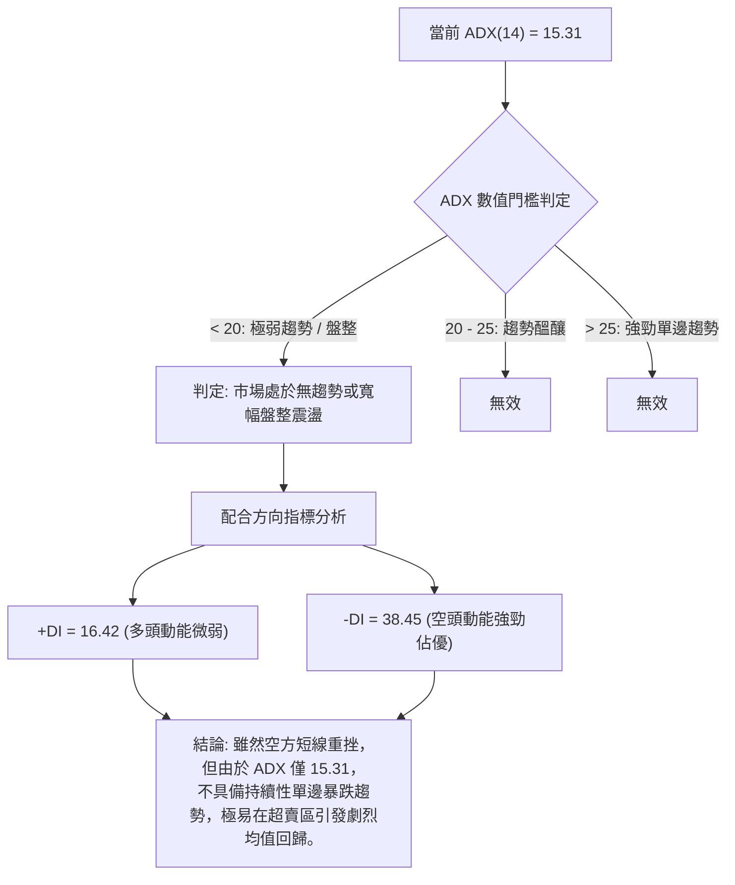

#### ADX 趨勢強度對照表

| 指標項目 | 數值 | 門檻區間 | 技術含義 | 對交易策略之指導 |
|:---|:---:|:---:|:---|:---|
| **ADX (14)** | 15.31 | < 20 (極弱) | 盤整行情，缺乏單邊動能 | **嚴禁追空**；趨勢突破系統容易產生假訊號 |
| **+DI** | 16.42 | 基準線 20 以下 | 買盤力道貧弱 | 多頭僅能視為防守反彈，非主升趨勢 |
| **-DI** | 38.45 | 顯著大於 25 | 空方力量短線宣洩 | 賣壓主要源自財報事件短衝，警惕空頭力竭 |
| **DI 差值** | -22.03 | 絕對值擴大 | 空方動能短期過熱 | 預示技術性超賣修復一觸即發 |

---

## 3. 圖表形態分析

### 🔍 形態識別系統

依據嚴格規則 15，所有圖表幾何形態均需評估信心度與完成度；數據不足時僅做指標型解讀：

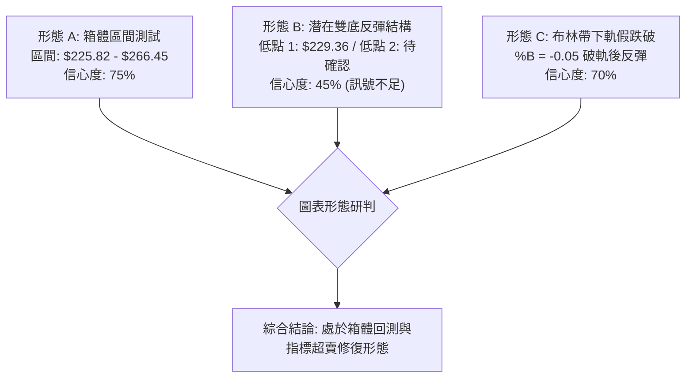

#### 形態識別與信心度評估表

| 形態名稱 | 信心度 | 判斷依據（嚴格引用數據） | 完成度 | 形態目標價（附精確計算式） |
|:---|:---:|:---|:---:|:---|
| **寬幅箱體區間震盪** | **75%** | 股價受制於高點阻力 R3 ($266.45)，下探回測支撐 S1 ($225.82)，在此區間內反覆震盪 | 80% | **下檔目標**：支撐位 S1 = $225.82<br/>**上檔目標**：箱體中軸 R1 = $248.81 |
| **布林通道破底翻形態** | **70%** | 10/30 最低下探 $229.36 跌破下軌 ($241.71)，收盤強勁拉回至 $240.35 (%B = -0.05) | 65% | **均值回歸目標**：布林中軌 MA20 = $254.39<br/>計算式：現價 $240.35 向上修正至中軌 |
| **潛在 W 底（雙重底）** | **45%** | **訊號不足，僅做指標型解讀**。10/30 出現首個探底低點 $229.36，尚無第二隻腳確認 | 20% | 依規則：信心度 < 50%，不預設幾何測幅目標，視為無效形態 |

---

### 🕯️ 重要K線形態分析

依據規則 19，僅針對「近10根日K」與「近8根週K」之真實 OHLCV 數據進行客觀解讀：

#### 近 10 根日 K 線形態解讀表

| 日期 (日K) | 開盤價 | 最高價 | 最低價 | 收盤價 | 成交量 | K線形態名稱 | 技術解讀與多空隱義 | 訊號 |
|:---:|:---:|:---:|:---:|:---:|:---:|:---:|:---|:---:|
| **2026-10-19** | 255.25 | 263.72 | 255.22 | 262.45 | 56,188,800 | 光腳中陽線 | 突破短均線，多頭發力推升，量能溫和 | 🟢 |
| **2026-10-20** | 264.08 | 265.34 | 260.42 | 262.63 | 34,927,200 | 高檔十字星 | 衝高 $265.34 受阻於阻力 R3 附近，量縮猶豫 | 🟡 |
| **2026-10-21** | 262.71 | 264.36 | 259.29 | 262.37 | 31,214,700 | 窄幅十字陰線 | 連續三天滯漲於 $262 上方，量能遞減，呈現多頭疲態 | 🟡 |
| **2026-10-22** | 258.18 | 258.41 | 248.00 | 250.38 | 48,814,000 | 破位中長陰線 | 跳空低開低走，跌破 MA20，形成空頭吞噬特徵 | 🔴 |
| **2026-10-23** | 248.85 | 250.01 | 246.45 | 248.00 | 25,569,000 | 低檔窄幅小陰線 | 縮量橫盤，多空於 $248 附近僵持，觀望氣氛濃 | 🟡 |
| **2026-10-26** | 249.47 | 250.79 | 247.23 | 249.09 | 32,696,400 | 紡錘十字小陽線 | 波動幅度收窄，多空暫時均衡，均線向下壓制 | 🟡 |
| **2026-10-27** | 250.43 | 254.68 | 248.71 | 253.10 | 34,477,800 | 溫和小陽線 | 向上試探 MA20 阻力，但未補量，反彈空間受限 | 🟡 |
| **2026-10-28** | 253.00 | 255.36 | 251.98 | 254.60 | 34,915,900 | 穿頭緩漲小陽線 | 連續反彈至最高 $255.36，剛好觸及 MA20 ($254.39) | 🟡 |
| **2026-10-29** | 246.95 | 249.14 | 241.24 | 243.79 | 85,234,400 | 放量下挫中長陰 | 財報前夕搶先避險，跳空跌破 MA200，賣壓湧現 | 🔴 |
| **2026-10-30** | 232.54 | 241.55 | 229.36 | 240.35 | 104,775,800 | **長下影錘頭陰線** | **巨量恐慌盤湧出，最低 $229.36 引發強勁抄底買盤，下影線長達 $10.99，顯示 $230 具剛性買盤** | 🟢 |

#### 近 8 根週 K 線形態速查

| 週末交易日 | 開盤價 | 最高價 | 最低價 | 收盤價 | 週成交量 | 週K線形態解讀 | 訊號 |
|:---:|:---:|:---:|:---:|:---:|:---:|:---|:---:|
| **2026-09-11** | 256.68 | 257.99 | 249.58 | 256.78 | 114,662,400 | 窄幅縮量紡錘線，多空拉鋸 | 🟡 |
| **2026-09-18** | 253.15 | 255.95 | 244.30 | 253.71 | 186,830,200 | 下影線小陽線，下測 $244 獲支撐 | 🟡 |
| **2026-09-25** | 256.40 | 259.49 | 245.60 | 249.67 | 196,475,200 | 衝高回落小陰線，高檔反壓沉重 | 🔴 |
| **2026-10-02** | 246.63 | 253.56 | 244.73 | 251.52 | 174,917,500 | 下影小陽線，於 $244 附近二度守穩 | 🟢 |
| **2026-10-09** | 250.19 | 262.80 | 250.18 | 262.43 | 183,040,400 | 突破中長陽線，放量上攻測試壓力 | 🟢 |
| **2026-10-16** | 262.50 | 263.70 | 248.60 | 250.00 | 161,689,900 | 長上影長陰線，高檔遇阻深度回撤 | 🔴 |
| **2026-10-23** | 255.25 | 265.34 | 246.45 | 248.00 | 196,713,700 | 衝高回落下挫陰線，頭部壓力確認 | 🔴 |
| **2026-10-30** | 249.47 | 255.36 | 229.36 | 240.35 | 292,100,300 | **爆量探底長下影十字陰線，多空激烈換手** | 🟡 |

---

### 📉 ASCII 走勢形態示意圖

以下展示 2026 年 10 月下旬日 K 線破位與長下影錘頭的關鍵形態：

```
AMZN 10月下旬日K線價格結構形態圖
價格軸 ($)
$265 ┤       ● (10/20 高點 $265.34 形成雙頂壓制)
$260 ┤      ┌┴┐ ┌┴┐
$255 ┤ ┌─┐  │ │ │ │       ┌─┐ ┌─┐ (10/28 反彈見頂 $255.36 受阻於 MA20)
$250 ┤ │ │  │ │ │ │  ┌─┐  │ │ │ │
$245 ┤ └┬┘  └┬┘ └┬┘  │ │  └┬┘ └┬┘ ─── 跳空缺口 ───
$240 ┤                └┬┘                ┌─┐        ┌─┐◄ 現價 $240.35
$235 ┤                                   │ │        │ │ (10/30 錘頭實體)
$230 ┤                                   └┬┘        └┬┘
$225 ┤                                               │  (10/30 長下影線最低 $229.36)
     └───────────────────────────────────────────────┴────────────────
       10-19 10-20 10-21 10-22 10-23 10-26 10-27 10-28 10-29 10-30
```

---

### 🎯 形態目標價計算

根據上述已確認的**寬幅箱體區間震盪**與**布林通道下軌破底翻**，計算理論推算目標價位：

1. **布林下軌破底翻回歸目標（均值回歸測幅）**：
   - 跌破點：布林下軌 $241.71
   - 探底極值：$229.36（偏離下軌幅度為 $241.71 − $229.36 = $12.35）
   - 回歸第一目標：阻力位 **R1 = $248.81**（收復跌幅的 50% 處）
   - 回歸第二目標：布林中軌 **MA20 = $254.39**（標準均值回歸位置）
2. **箱體下邊緣支撐有效性推算**：
   - 形態底部邊界：支撐位 **S1 = $225.82**
   - 形態上部邊界：阻力位 **R3 = $266.45**
   - 箱體高度：$266.45 − $225.82 = $40.63
   - 箱體中軸位：$225.82 + ($40.63 ÷ 2) = $246.14（與 R1 $248.81 極為接近）

---

## 4. 支撐與阻力

### 🗺️ 關鍵價位分布圖（Unicode）

```
AMZN 價位結構分布圖（嚴格依據 OHLCV 聚類與斐波那契計算）
══════════════════════════════════════════════════════════════════
  $287.20 ║████████████████████████████████║ 52W 最高點 (0.0% 斐波)
  $266.45 ║████████████████████████        ║ 強阻力 R3 / 23.6% 斐波 ($265.68)
  $258.78 ║██████████████████              ║ 波段阻力 R2 (9月震盪高點)
  $254.39 ║██████████████                  ║ 布林中軌 / MA20 重合區
  $248.81 ║████████████                    ║ 關鍵阻力 R1 (日線反彈頸線)
  $241.60 ║▓▓▓▓▓▓▓▓▓▓▓▓                    ║ 50.0% 斐波那契回調位
  $240.35 ╠════════════════════════════════╣ ◄ 現價 ($240.35)
  $230.84 ║▓▓▓▓▓▓▓▓▓▓▓▓▓▓▓▓                ║ 61.8% 斐波那契黃金分割
  $225.82 ║████████████████                ║ 近期關鍵支撐 S1
  $220.99 ║████████████████████            ║ 強支撐 S2 (波段密集成交底)
  $215.18 ║████████████████████████        ║ 極強支撐 S3 / 78.6% 斐波 ($215.52)
  $196.00 ║████████████████████████████████║ 52W 最低點 (100.0% 斐波)
══════════════════════════════════════════════════════════════════
```

---

### 🚧 阻力位分析表

所有價位均嚴格引用提供之數據聚類結果：

| 阻力級別 | 價位 | 距離現價幅度 | 形成原因與籌碼技術面背景 | 突破難度 | 重要性 |
|:---|:---:|:---:|:---|:---:|:---:|
| **阻力位 R1** | **$248.81** | +3.52% | 近一年波段高點聚類、10月下旬反覆震盪之成交密集下緣，同時鄰近 5日均線 ($248.19) | 🟡 中等 | ★★★☆☆ |
| **阻力位 R2** | **$258.78** | +7.67% | 9月多週震盪高點聚類，且 MA60 ($256.34) 下壓於此處，存在套牢籌碼解套壓力 | 🔴 較高 | ★★★★☆ |
| **阻力位 R3** | **$266.45** | +10.86% | 8月反彈頂部、布林通道上軌 ($267.07) 及 23.6% 斐波那契位 ($265.68) 共振強阻力 | 🔴 極高 | ★★★★★ |

---

### 🛡️ 支撐位分析表

所有價位均嚴格引用提供之數據聚類結果：

| 支撐級別 | 價位 | 距離現價幅度 | 形成原因與籌碼技術面背景 | 守住機率 | 重要性 |
|:---|:---:|:---:|:---|:---:|:---:|
| **支撐位 S1** | **$225.82** | -6.04% | 近一年波段低點聚類，10/30 恐慌低點 $229.36 下方的首道結構性緩衝帶 | 🟢 70% | ★★★★☆ |
| **支撐位 S2** | **$220.99** | -8.05% | 2025年夏季突破前之平台頂部，轉化為中期極強支撐位，機構防守底線 | 🟢 80% | ★★★★☆ |
| **支撐位 S3** | **$215.18** | -10.47% | 近一年極端波段低點聚類，精確重合 78.6% 斐波那契回調位 ($215.52) | 🟢 90% | ★★★★★ |

---

### 📐 斐波那契回調位分析

依據 52 週絕對極值區間（低點 **$196.00** 至 高點 **$287.20**，落差 $91.20）計算所得之回調位分佈：

| 斐波那契分位 | 關鍵價位 | 與現價關係 | 技術意義與多空攻防重點 |
|:---:|:---:|:---:|:---|
| **0.0% (52W High)** | **$287.20** | +19.49% | 年度歷史頂部，長期多頭牛市目標位 |
| **23.6%** | **$265.68** | +10.54% | 淺度回調位，與阻力 R3 ($266.45) 完美重疊，確認為強阻力區 |
| **38.2%** | **$252.36** | +5.00% | 弱勢修正回調位，上方緊鄰 MA20 ($254.39)，短線反彈首要分水嶺 |
| **50.0%** | **$241.60** | +0.52% | **多空中軸線**。現價 **$240.35** 正緊密圍繞 50% 回調位進行拉鋸測試 |
| **61.8% (黃金分割)** | **$230.84** | -3.96% | **關鍵防守線**。10/30 最低點 $229.36 精準虛破此位後強勢拉回，確認黃金分割支撐有效 |
| **78.6%** | **$215.52** | -10.33% | 深度防禦位，與支撐 S3 ($215.18) 重合，為多頭最後堡壘 |
| **100.0% (52W Low)** | **$196.00** | -18.45% | 年度波段起漲點，跌破則宣告長期上升結構徹底終結 |

> **回調位深度解讀**：現價 $240.35 目前落於 **50.0% ($241.60)** 與 **61.8% ($230.84)** 兩大核心回調位之間。10/30 當日最低下探至 $229.36，剛好觸及 61.8% 斐波那契回調位（$230.84）後引發強力買盤拉升收於 $240.35，這在技術分析上屬於標準的「回踩黃金分割位完成誘空洗盤」形態。

---

## 5. 技術指標深度解讀

### 🎛️ 指標訊號總覽

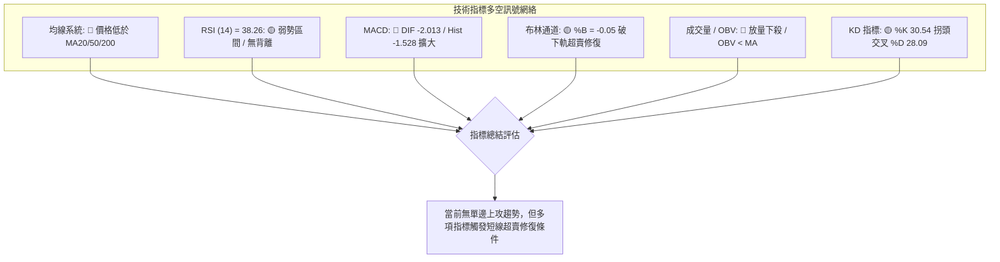

---

### 📈 移動平均線排列分析

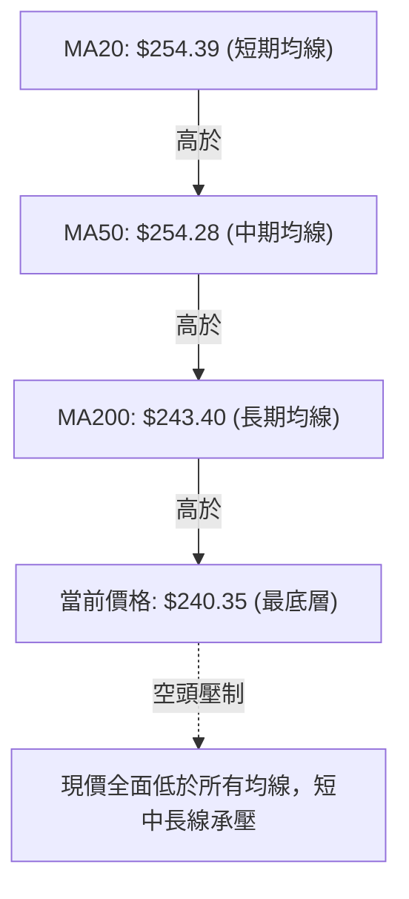

#### 各週期移動平均線狀態剖析

| 均線名稱 | 數值 | 現價與 MA 差距 | 趨勢方向 | 技術意涵與實戰解讀 |
|:---|:---:|:---:|:---:|:---|
| **MA 5** | $248.19 | -3.16% | ▼ 下行 | 極短線壓力，與阻力 R1 ($248.81) 形成反彈第一道天花板 |
| **MA 10** | $252.68 | -4.88% | ▼ 下行 | 短期下行斜率陡峭，反映近期連續下跌引發的持倉成本下移 |
| **MA 20** | $254.39 | -5.52% | ▼ 下行 | 月線生命線，亦為布林中軌，站穩此線前短線反彈皆屬弱勢反抽 |
| **MA 50** | $254.28 | -5.48% | ▼ 平緩 | 與 MA20 形成死叉粘合區，構成中期極強反壓帶 |
| **MA 60** | $256.34 | -6.24% | ▼ 下行 | 季線阻力，限制波段反彈高度 |
| **MA 120**| $253.42 | -5.16% | ▼ 下行 | 半年線位置，與 MA20/50 密集交錯於 $253–$255 區間 |
| **MA 200**| $243.40 | -1.25% | ▼ 平緩 | **牛熊分界線**。現價首次跌破 MA200，需觀察 3 日內能否快速收復 |
| **MA 240**| $241.33 | -0.41% | ▼ 平緩 | 年線支撐，現價正於此線邊緣進行多空拉鋸攻防 |

> **均線排列特徵**：從歷史參數來看，指標快照顯示長期排列仍為 `MA20 ($254.39) > MA50 ($254.28) > MA200 ($243.40)`，維持形式上的多頭排列框架；然而現價（$240.35）已跳空跌至所有主要均線下方。這種「均線在上方維持多頭，但價格跌破最下層」的形態，屬於典型的**「強震盪洗盤」或「中級頭部破位初期」**。

---

### 📉 RSI(14) 分析

- **當前 RSI(14) 數值**：**38.26**（採用 Wilder 平滑算法）。
- **RSI 區間強度展示**：
  ```
  超賣 (0-30)        弱勢中性 (30-50)       強勢中性 (50-70)       超買 (70-100)
  ├───────────────┼──────────────────────┼──────────────────────┼───────────────┤
  ░░░░░░░░░░░░░░░░█████████░░░░░░░░░░░░░░░░░░░░░░░░░░░░░░░░░░░░░░░░░░░░░░░░░░░░░
                  ▲
               38.26 (現值)
  ```
- **超買超賣判定**：數值處於 30 至 70 的中性區間偏下緣（38.26），尚未進入 30 以下之極端超賣區，表明市場拋壓雖沉重但尚未完全力竭。
- **背離分析結論**：
  - **日線背離檢驗**：比對近 20 根 K 棒首尾價格（高點 $265.34 下跌至 $240.35）與 RSI 方向，價格下行同時 RSI 同步由 59 下降至 38.26，**明確判定：無明顯頂背離或底背離**。
  - **技術隱義**：指標與價格完全同步，屬於標準的價格動能宣洩，後續的反彈將依賴於支撐位帶來的買盤共振，而非動能指標的底背離驅動。

---

### 📊 MACD(12/26/9) 訊號解讀

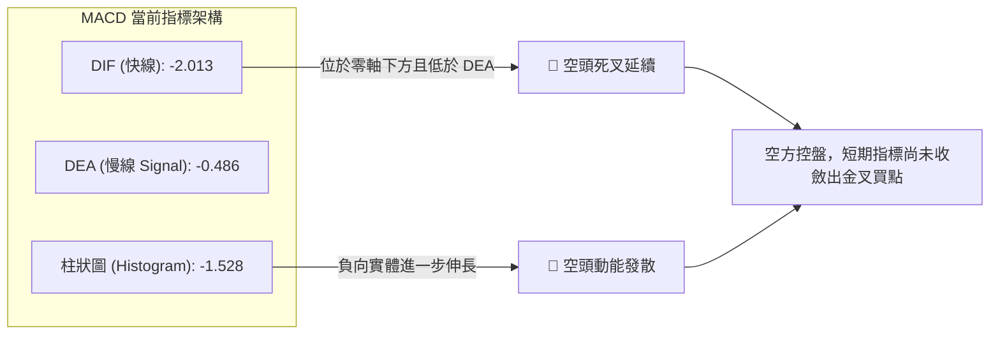

- **MACD 詳細數值解讀**：
  - 快線（DIF）：`-2.013`
  - 訊號線（DEA）：`-0.486`
  - 柱狀體（Histogram）：`-1.528`（柱狀體呈現負向擴展）
- **背離狀況**：週線與日線 MACD 均隨價格破位而同步走低，**確認無底背離存在**。空頭柱狀體達到 -1.528 的波段低位，顯示空方動能處於短線極盛期，歷史規律顯示當負柱擴大至極限後，常伴隨柱體縮短的技術性抽頭反彈。

---

### 📦 布林通道分析

```
AMZN 布林通道 (20, 2) 結構圖
══════════════════════════════════════════════════════════════════
  $267.07 ┬────────────────────────────────────────── [上軌 Upper]
          │
          │
  $254.39 ┼────────────────────────────────────────── [中軌 Middle / MA20]
          │
  $241.71 ┴────────────────────────────────────────── [下軌 Lower]
    ▲
  $240.35 ◄── 現價在下軌下方 (-0.05), 最低下探 $229.36
══════════════════════════════════════════════════════════════════
```

- **布林通道關鍵參數**：
  - 上軌（Upper Band）：**$267.07**
  - 中軌（Middle Band / MA20）：**$254.39**
  - 下軌（Lower Band）：**$241.71**
  - 帶寬（Bandwidth）：`($267.07 - $241.71) ÷ $254.39 = 9.97%`（通道呈現微幅開口擴張）
  - 當前位置 %B：**-0.05**
- **深度技術解讀**：%B 數值為 -0.05，明確表明收盤價（$240.35）已實質性擊穿布林下軌（$241.71）。在統計學常態分佈中，股價運行於布林通道外的機率不足 5%。10/30 當日盤中一度暴跌至 $229.36，遠離下軌超過 5%，尾盤大幅抽腳收在 $240.35，構築了典型的**「下軌極端超跌後之均值回歸修復走勢」**。

---

### 💹 成交量分析（量價配合度）

1. **量能爆發與量比分析**：
   - 最新單日成交量：**104,775,800 股**
   - 20 日平均成交量：**41,677,215 股**
   - 50 日平均成交量：**37,244,422 股**
   - **量比（Volume Ratio）**：`104,775,800 ÷ 41,677,215 =` **2.51 倍**
2. **籌碼與 OBV 走勢**：
   - 數據明確顯示：`OBV 趨勢: OBV < MA → 量能疲弱`。
   - 能量潮（OBV）跌破其均線，代表在過去一季的震盪區間內，主力資金呈現淨流出狀態，整體籌碼結構受到財報與總經避險情緒打擊。
3. **量價關係判定**：
   - 10 月 30 日在跌破關鍵支撐後爆出 2.51 倍的巨量，收出長達 11 美元的下影線。這屬於標準的**「恐慌性拋售與流動性吸籌（Capitulation & Accumulation）」**，顯示有大規模機構被動買盤在 $230 附近承接恐慌籌碼。

---

## 6. 動能與波動率

### ⚡ 動能評估四象限

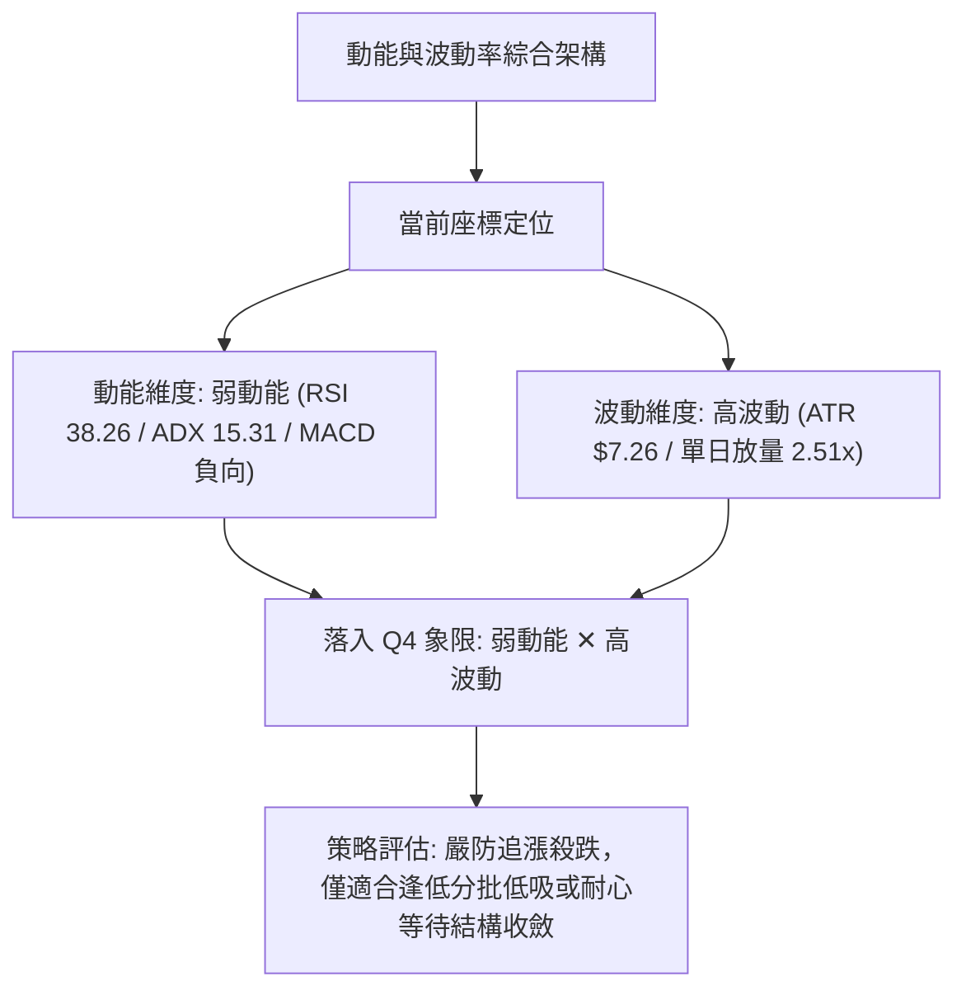

#### 動能與波動率象限分析表

| 象限 | 動能狀態 | 波動率狀態 | 當前狀態標記 | 策略指導與操作原則 |
|:---:|:---:|:---:|:---:|:---|
| **Q1** | 強動能 (趨勢明確) | 低波動 (有序推進) | — | 最佳波段持股機會，趨勢順勢加碼 |
| **Q2** | 弱動能 (盤整無向) | 低波動 (區間收斂) | — | 觀望等待變盤突破 |
| **Q3** | 強動能 (單邊暴發) | 高波動 (情緒狂熱) | — | 高風險高收益突破交易 |
| **Q4** | **弱動能 (動能下行)** | **高波動 (情緒釋放)** | **✓ (當前 AMZN)** | **避免追價進場；利用超賣打底進行高盈虧比低吸，嚴設止損** |

---

### 📊 ATR 波動率分析

- **當前 ATR(14) 數值**：**$7.26**（佔當前股價比例為 **3.02%**，Wilder 平滑）。
- **ATR 歷史位階**：常態下 AMZN 的波動幅度約在 1.5%–2.2% 之間，當前 3.02% 的 ATR 數值反映出市場因財報利空與 AI 資本支出擔憂引發的波動性激增。
- **動態止損建議距離**：
  - **極短線（Day Trading）**：`1.0 × ATR = $7.26`
  - **波段交易（Swing Trading）**：`1.5 × ATR = 1.5 × $7.26 = $10.89`
  - **順勢防守（Position Trading）**：`2.0 × ATR = 2.0 × $7.26 = $14.52`

---

### 📐 Beta 與市場相關性

- **Beta 數值**：**1.456**
- **市場敏感度評估**：
  - AMZN 的 Beta 達到 1.456，屬於**高彈性成長股**特徵，其價格波動幅度約為 S&P 500 指數的 1.45 倍。
  - 當前美股科技板塊面臨回調壓力（近期新聞提及 Anthropic 放緩、AI 資本支出疑慮），高 Beta 屬性放大了 AMZN 的短期下行壓力。然而在大盤觸底反彈時，該高 Beta 屬性亦將賦予其領先市場彈升的動能。

---

## 7. 多時框架總結

### 📋 時框架評分表

| 時框架 | 趨勢方向 | 動能指標狀態 | 均線排列特徵 | 圖表形態識別 | 綜合評分 | 戰術操作建議 |
|:---:|:---:|:---:|:---:|:---:|:---:|:---|
| **月線 (長期)** | 🟢 偏多震盪 | RSI 52 (中性回調) | 股價位於長期上行趨勢線上方 | 52W 高檔拉回整理 | **65/100** | 長期投資者逢低配置，關注核心價值支撐 |
| **週線 (中期)** | 🟡 震盪整理 | MACD 翻負 / RSI 38.3 | 測試 50週均線與斐波 50% | 高檔雙頭頸線測試 | **48/100** | 中期籌碼換手，等待週線止跌確認訊號 |
| **日線 (短期)** | 🔴 超跌反彈 | RSI 38.26 / %B -0.05 | 價格跌破所有短期均線 | 10/30 爆量長下影線 | **38/100** | 短線嚴禁追空，等待超賣反抽阻力位 R1 |

---

### 🔲 綜合訊號矩陣

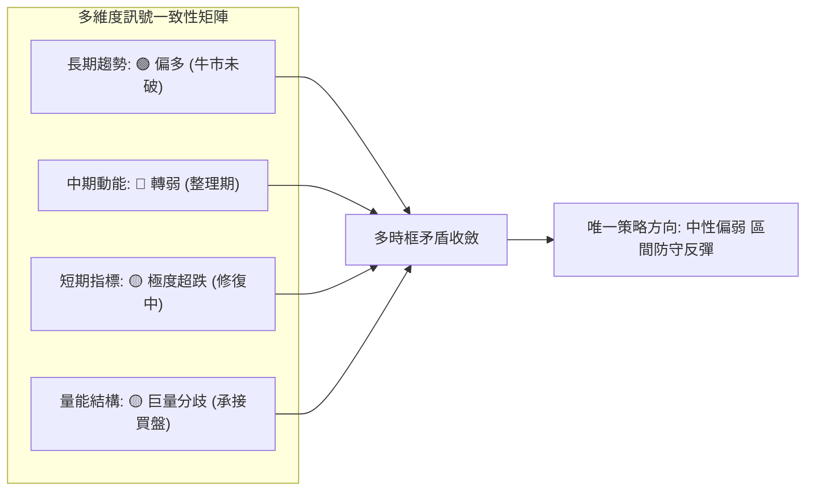

---

### ⚖️ 多時框收斂結論

依據本報告設定之**「多時框收斂規則（規則 14）」**：
1. **行情性質判定**：當前 ADX(14) 數值為 **15.31 (< 25)**，嚴格判定當前市場**並非強勁單邊趨勢行情，而是處於寬幅震盪與盤整築底行情**。
2. **主導時框與優先級取捨**：
   - 由於 ADX < 25，趨勢追隨系統（如日線均線空頭排列追空）極易遭遇假突破與反抽巴結。
   - 依照規則 14，盤整行情應**以日線布林通道上下軌為主要交易區間**，並參考長週期關鍵支撐。
3. **方向性唯一結論**：**中性偏弱／區間超賣反彈（Neutral-to-Weak Range Bound）**。
   - 雖然日線均線呈現空頭壓制，但考量到價格已擊穿布林下軌（%B = -0.05），且 10/30 在 61.8% 斐波那契回調位 $230.84 附近引發了高達 1.047 億股的爆量長下影線承接，短期空方動能已顯現力竭跡象。
   - 結論收斂於：**「以箱體下緣為防守，參與布林下軌至中軌的超跌均值回歸修復；在未有效收復阻力 R1 前，不盲目看大牛市，維持區間震盪思維」**。

---

## 8. 交易策略建議

### 🗺️ 策略決策流程圖

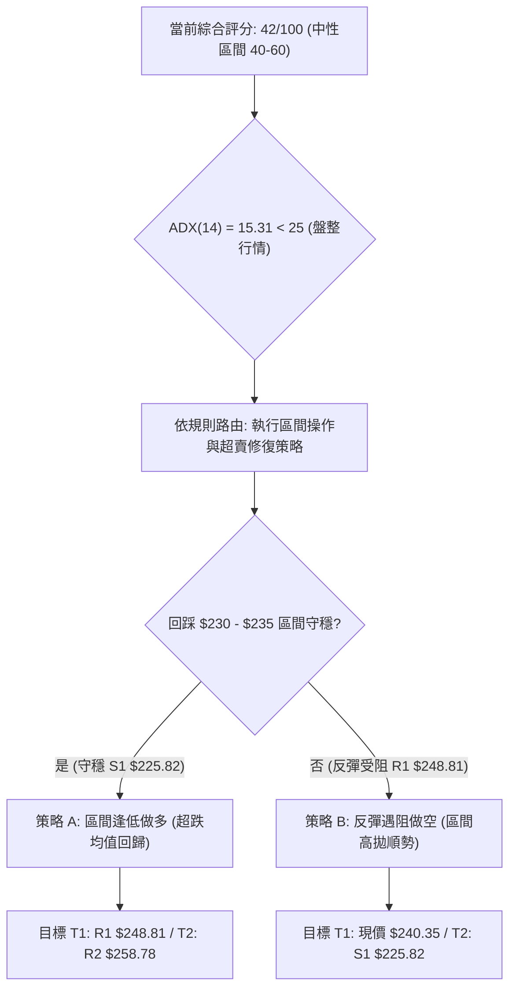

---

### 🧭 策略路由（依評分卡分流）

> **當前主策略方向 = 區間操作／超賣修復（依技術評分卡綜合評分：42/100）**  
> 由於綜合評分落於 40–60 分區間，且 ADX 為 15.31（典型盤整市），嚴禁採取極端單邊追價操作。本章節以「布林通道下軌至中軌的區間均值回歸」為核心主線，並設定阻力位受阻時的防禦性高空策略。

---

### 🎯 價格情境階梯（Price Scenarios）

價位嚴格引用第 4 章及提供數據之精確數值：

| 觸發條件 | 下一目標價位 | 後續延伸價位 | 情境技術含義與應對要點 |
|:---|:---:|:---:|:---|
| **強勢突破阻力 R1 ($248.81)** | **阻力 R2 ($258.78)** | **阻力 R3 ($266.45)** | 短線超賣修復擴大，成功回補財報缺口，挑戰布林中軌 MA20 |
| **站穩現價區間 ($240.35)** | **阻力 R1 ($248.81)** | — | 在 50.0% 斐波那契回調位築底震盪，進行籌碼沉澱 |
| **跌破支撐 S1 ($225.82)** | **強支撐 S2 ($220.99)** | **極強支撐 S3 ($215.18)** | 10/30 下影線失守，形態演變為破位下行，考驗年度深層支撐 |

---

### 📊 情境機率分佈

| 情境劇本 | 機率 | 主要技術與量化指標依據 |
|:---|:---:|:---|
| **情境一：超跌反彈 / 區間均值回歸** | **55%** | 布林 %B = -0.05 嚴重超賣，10/30 出現 2.51x 爆量長下影線，KD %K 低檔拐頭向上 |
| **情境二：箱體底部震盪整理** | **30%** | ADX(14) 僅 15.31 缺乏單邊趨勢，OBV 疲弱壓制多頭，需在 $235–$248 長期橫盤打底 |
| **情境三：向下破位 / 二次探底** | **15%** | 均線空頭排列下壓，MACD 柱狀體尚未翻正，若大盤重挫可能回測支撐 S1 ($225.82) |

---

### 🟢 主策略詳情（方向依上方路由）

依據規則 13 與規則 17，所有數值嚴格引用關鍵價位，風險報酬比公式為：  
`做多 RR = (目標價 T1 − 進場價) ÷ (進場價 − 止損價)`  
`做空 RR = (進場價 − 目標價 T1) ÷ (止損價 − 進場價)`

| 策略要素 | 策略 A（主推：區間逢低做多／均值回歸） | 策略 B（輔助：反彈受阻做空／波段防禦） |
|:---|:---|:---|
| **交易邏輯** | 利用 10/30 長下影線支撐與布林破底翻，於區間下緣低吸博取均值回歸 | 當股價反彈至阻力位 R1 處動能衰竭時，順應日線均線下行趨勢放空 |
| **進場條件** | 股價回踩測試 $230–$240 區間不破，或於現價附近回調確認支撐有效 | 股價反彈測試阻力位 R1 ($248.81) 出現上影線且無量受阻 |
| **進場價格** | **$235.00**（回踩區間中點掛單） | **$248.81**（觸及阻力位 R1） |
| **目標價 T1** | **$248.81**（引用阻力位 R1） | **$240.35**（引用當前收盤價／50% 斐波位） |
| **目標價 T2** | **$258.78**（引用阻力位 R2） | **$225.82**（引用關鍵支撐 S1） |
| **止損價格** | **$225.82**（引用關鍵支撐 S1） | **$254.39**（引用布林中軌 / MA20） |
| **風險報酬比** | **1 : 1.50（以 T1 計）**<br/>計算式：`(248.81 - 235.00) ÷ (235.00 - 225.82) = 13.81 ÷ 9.18 = 1.50` | **1 : 1.52（以 T1 計）**<br/>計算式：`(248.81 - 240.35) ÷ (254.39 - 248.81) = 8.46 ÷ 5.58 = 1.52` |
| **延伸風報比** | **1 : 2.59（以 T2 計）**<br/>計算式：`(258.78 - 235.00) ÷ 9.18 = 23.78 ÷ 9.18 = 2.59` | **1 : 4.12（以 T2 計）**<br/>計算式：`(248.81 - 225.82) ÷ 5.58 = 22.99 ÷ 5.58 = 4.12` |
| **預估勝率** | **55%** | **45%** |
| **建議倉位** | **10% – 15%**（輕倉防守型） | **5% – 10%**（對沖保護型） |

---

### 🔴 反向風險觸發點（對沖提示）

- **推翻多頭主策略之關鍵條件**：
  - 日線收盤價**實質跌破支撐 S1 ($225.82)**，跌破意味著 10/30 的 1.047 億股承接買盤全數陣亡套牢。
  - **對沖處置措施**：立即無條件執行多頭止損，同時可建立同等市值的指數反向 ETF 或放空，下看支撐 S2 ($220.99) 及 S3 ($215.18)。
- **推翻空頭輔助策略之關鍵條件**：
  - 價格以大陽線放量收復**布林中軌 MA20 ($254.39)**，且 MACD 柱狀體翻正。
  - **對沖處置措施**：空單全數離場，轉為多頭突破追隨策略。

---

### ⭐ 整體訊號強度評星

```
做多訊號強度：★★★☆☆  (3.0/5星 — 短線超跌支撐強勁，但上方均線壓制)
做空訊號強度：★★☆☆☆  (2.5/5星 — 雖然均線空頭，但 ADX 偏低且破底翻易被嘎)
整體可信度：  ★★★☆☆  (3.5/5星 — 區間震盪特徵明確，數據指標一致性良好)
```

---

## 9. 風險提示與監控

### ✅ 關鍵監控指標 Checklist

```
╔══════════════════════════════════════════════════════════════════╗
║              AMZN 日常交易關鍵監控清單 (Checklist)               ║
╠══════════════════════════════════════════════════════════════════╣
║ [ ] 價格是否成功收復長期生命線 MA200 ($243.40)                    ║
║ [ ] RSI(14) 能否自 38.26 拐頭回升至 50.0 多空平衡線上          ║
║ [ ] 日成交量能否自 1.04 億股回落至 4,000 萬股正常水平 (縮量築底) ║
║ [ ] 盤中回測是否守穩 10/30 最低點 $229.36 與黃金分割 $230.84    ║
║ [ ] MACD Histogram 負值能否開始收斂 (當前 -1.528)               ║
║ [ ] 布林帶 %B 能否重返 0.00 以上 (徹底脫離下軌 $241.71 之壓制)  ║
║ [ ] 華爾街 58 位分析師平均目標價 $332.41 是否出現下修潮         ║
╚══════════════════════════════════════════════════════════════════╝
```

---

### ⚠️ 風險場景分析

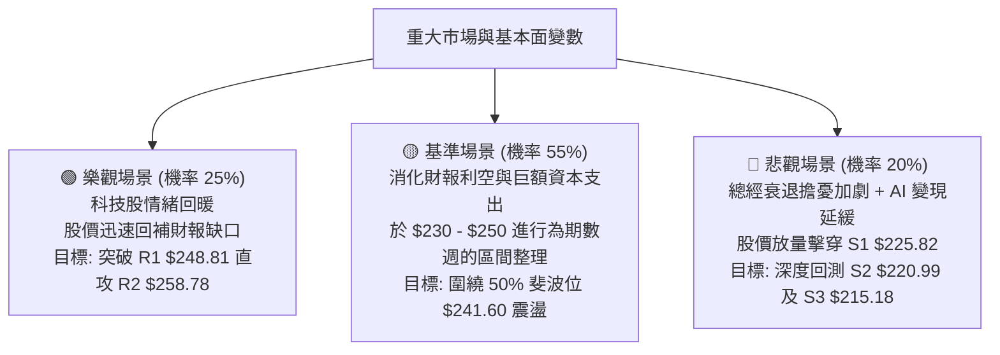

---

### 🛡️ 風險管理重要提醒

1. **基本面與技術面割裂風險**：
   - 近期新聞顯示「Amazon Just Lost $42 Billion in Free Cash Flow」、「AI 資本支出飆升引發股東回報降至 15 年低點」。儘管 58 位分析師給出 `strong_buy` 評級且平均目標價高達 $332.41，但市場短期定價權掌握在對自由現金流為負（$-2.47B）感到擔憂的機構賣方手中。嚴禁僅因「基本面長期看好」而忽視技術止損。
2. **波動率控制與倉位管理**：
   - AMZN 的 Beta 高達 1.456，ATR 達到 $7.26（3.02%）。單筆交易最大虧損額度應嚴格限制在總賬戶資產的 **1.0% – 1.5%** 範圍內。
   - 若採用策略 A（進場 $235.00，止損 $225.82，每股風險 $9.18），以 10 萬美元賬戶且單筆風險控制在 1,000 美元（1%）計算：  
     `最大建倉股數 = $1,000 ÷ $9.18 ≈ 108 股`（佔賬戶名義資金約 $25,380，即約 25% 倉位上限）。
3. **區間操作紀律**：
   - 在 ADX < 25 的環境下，切勿進行追突破交易。若股價急拉至阻力位 R1（$248.81）而未顯著放量，應主動獲利平倉或分批了結多單。

---

## 📋 報告總結

```
╔══════════════════════════════════════════════════════════════════╗
║                    AMZN 技術分析報告總結                         ║
╠══════════════════════════════════════════════════════════════════╣
║ 報告日期：2026-10-31                                             ║
║ 當前價格：$240.35                                                ║
║ 分析評級：⚖️ 中性偏弱 / 區間震盪打底 (綜合評分: 42/100)          ║
║                                                                  ║
║ 關鍵技術結論：                                                   ║
║ ├─ 長期趨勢：🟢 偏多未變 (均線 MA20>MA50>MA200，但價格面臨考驗)  ║
║ ├─ 中期趨勢：🟡 震盪回調 (高檔雙頂拉回，回測 50% 斐波位 $241.60) ║
║ ├─ 短期趨勢：🔴 超跌修復 (布林 %B=-0.05 破軌，10/30 放量下影線)  ║
║ ├─ 核心支撐：S1 $225.82 ｜ S2 $220.99 ｜ 61.8% 斐波 $230.84    ║
║ ├─ 核心阻力：R1 $248.81 ｜ R2 $258.78 ｜ MA20 $254.39           ║
║ └─ 分析師共識：Strong Buy (58位分析師，目標均價 $332.41)         ║
║                                                                  ║
║ 最優策略組合：                                                   ║
║ 1. 🥇 最佳機會：策略 A (區間低吸做多)                            ║
║    進場 $235.00 ｜ 止損 $225.82 ｜ 目標 $248.81 (RR = 1 : 1.50)  ║
║ 2. 🥈 次選機會：策略 B (阻力受阻放空)                            ║
║    進場 $248.81 ｜ 止損 $254.39 ｜ 目標 $240.35 (RR = 1 : 1.52)  ║
║ 3. 🥉 保守選擇：場外觀望                                         ║
║    等待 ADX > 25 趨勢明朗或股價重新站上 MA200 ($243.40) 再行介入 ║
╚══════════════════════════════════════════════════════════════════╝
```

---

> ⚠️ **免責聲明**：本報告為依據特定歷史技術指標與價格數據所生成之量化研究報告，所有內容及估算數值**僅供學術交流與投資研究參考，不構成任何形式的證券買賣邀約或投資建議**。市場具有高度不確定性，金融交易存在重大本金虧損風險，投資人應依個人財務狀況與風險承受能力獨立做出投資決策並自負盈虧。

---

*報告生成時間：2026-10-31 ｜ 數據來源：Yahoo Finance ｜ 分析框架：多時框技術分析模型*