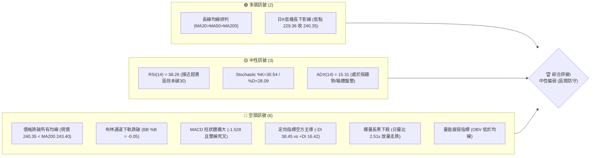
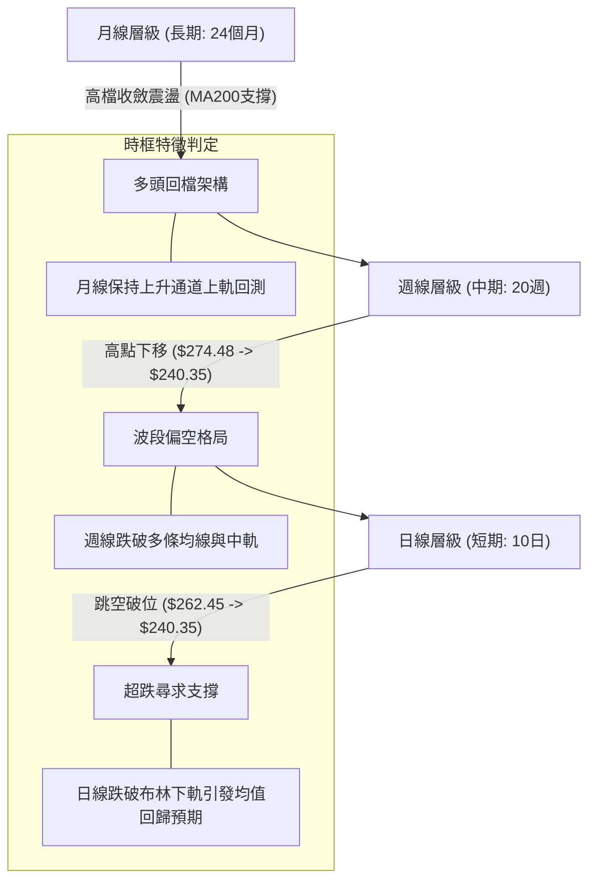
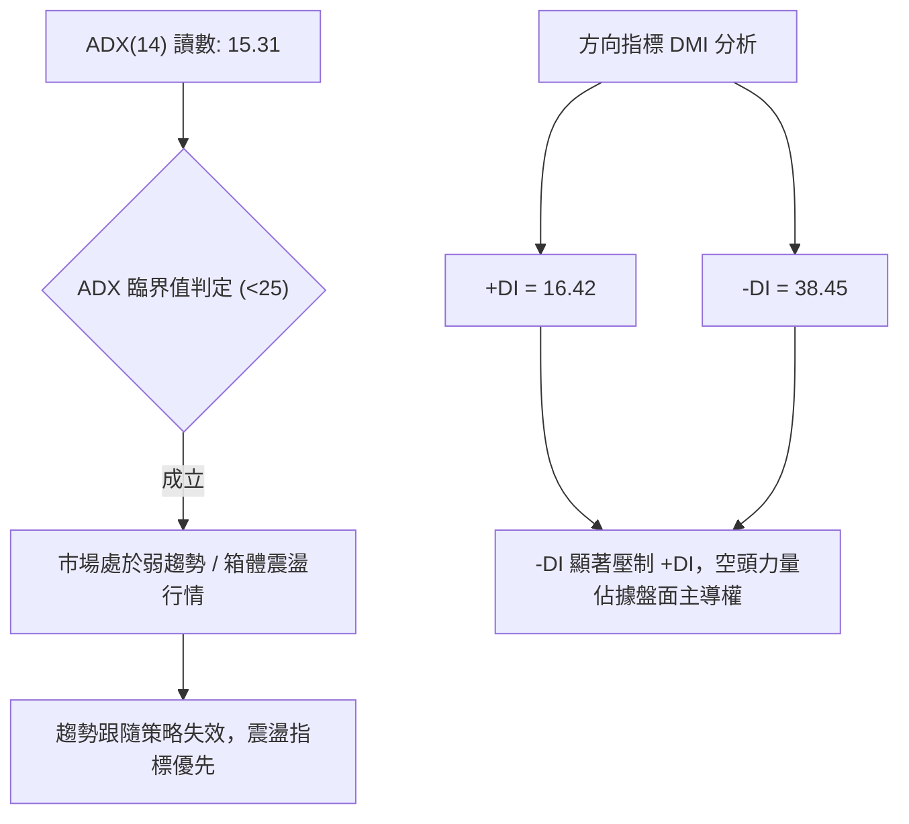
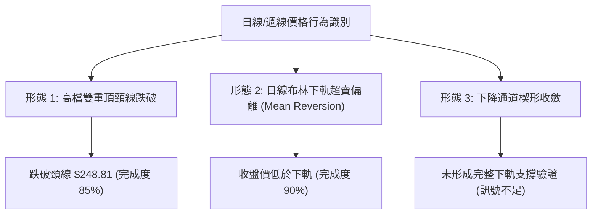
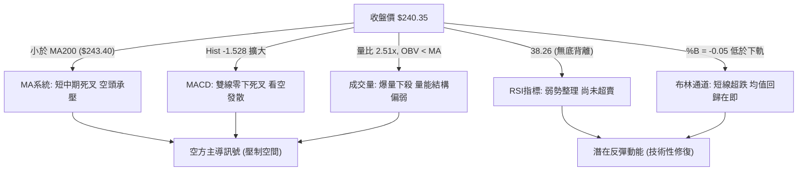
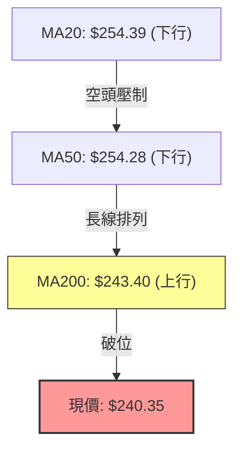
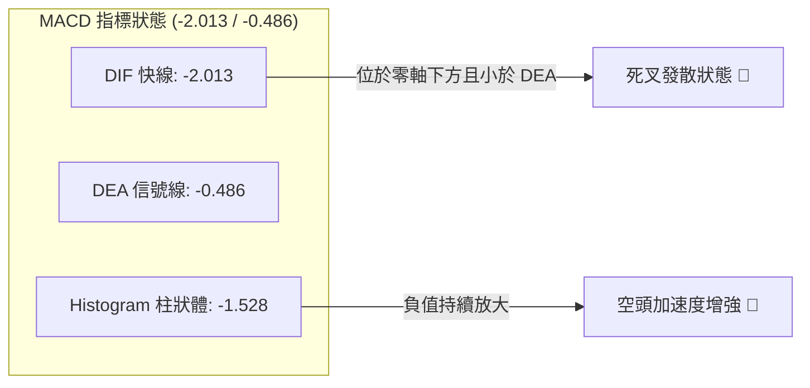
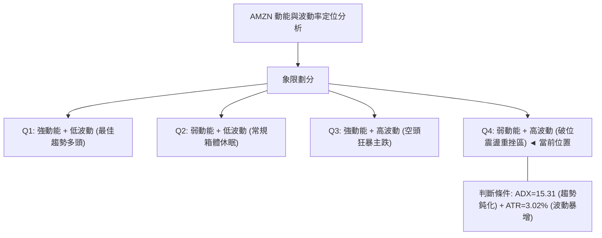
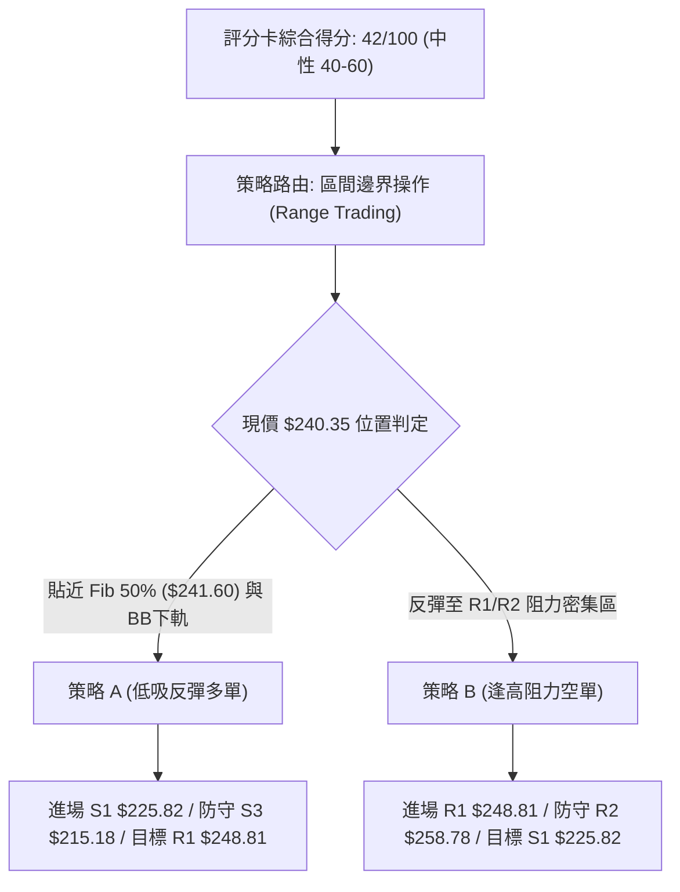
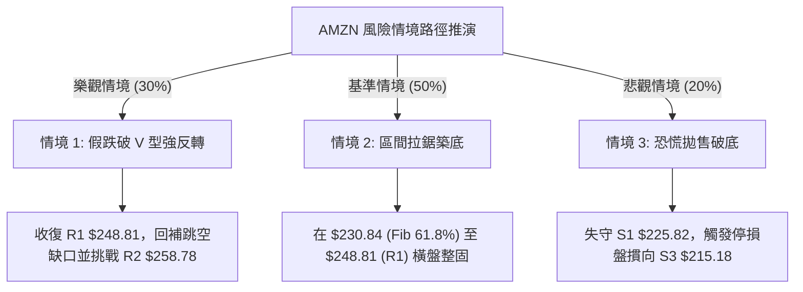

# AMZN 技術分析報告

> **報告日期**：2026-11-01 ｜ **語言**：繁體中文 ｜ **數據來源**：Yahoo Finance ｜ **當前價格**：$240.35

---

## 目錄

| 章節 | 內容 |
|------|------|
| [1. 技術面概覽](#1-技術面概覽) | 訊號儀表板、核心指標、評分卡 |
| [2. 趨勢分析](#2-趨勢分析) | 多時框趨勢、長中短期走勢 |
| [3. 圖表形態分析](#3-圖表形態分析) | 形態識別、K線組合、目標價 |
| [4. 支撐與阻力](#4-支撐與阻力) | 關鍵價位、斐波那契回調 |
| [5. 技術指標深度解讀](#5-技術指標深度解讀) | MA/RSI/MACD/布林/成交量 |
| [6. 動能與波動率](#6-動能與波動率) | 動能評估、ATR、Beta |
| [7. 多時框架總結](#7-多時框架總結) | 時框架評分矩陣 |
| [8. 交易策略建議](#8-交易策略建議) | 多空策略、風險報酬比 |
| [9. 風險提示與監控](#9-風險提示與監控) | 監控指標、風險場景 |

---

## 1. 技術面概覽

### 🎯 技術訊號儀表板



---

### 📊 核心指標速覽表

| 指標類別 | 指標名稱 | 當前數值 | 訊號 | 解讀 |
|----------|----------|----------|------|------|
| **價格** | 當前收盤價 | $240.35 | 🔴 | 跌破 52 週中軸，位於 52W 區間 48.6% 水準 |
| **均線** | 短期 MA20 | $254.39 | 🔴 | 價格低於 MA20 達 -5.52%，短線下行動能顯著 |
| **均線** | 中期 MA50 | $254.28 | 🔴 | 價格低於 MA50 達 -5.48%，跌破中期波段成本線 |
| **均線** | 長期 MA200 | $243.40 | 🔴 | 價格跌破年線 MA200 (-1.25%)，長線支撐面臨考驗 |
| **動能** | RSI(14) | 38.26 | 🟡 | 位於弱勢區間 (30–40)，尚未進入極端超賣 (<30) |
| **動能** | MACD (12,26,9) | -2.013 | 🔴 | MACD 線低於信號線 (-0.486)，Hist 為 -1.528 呈空頭擴散 |
| **動能** | KD (14,3) | 30.54 / 28.09 | 🟡 | 位於低檔鈍化邊緣，出現初步收斂跡象 |
| **趨勢** | ADX / DMI | 15.31 | 🟡 | ADX < 25 表明無單邊強趨勢，但 -DI(38.45) 遠高於 +DI(16.42) |
| **通道** | 布林通道 | 下軌 $241.71 | 🔴 | 收盤價破下軌，%B 為 -0.05，呈短線極端超賣偏離 |
| **成交量** | 最新成交量 | 104,775,800 | 🔴 | 達 20 日均量 (41.68M) 之 2.51 倍，財報後放量下挫 |
| **波動** | ATR(14) | $7.26 | 🟡 | 佔股價 3.02%，單日波動度顯著上升 |

---

### 🏆 技術評分卡

```
╔══════════════════════════════════════════════════════════════════╗
║                   技術評分卡 — AMZN (2026-11-01)                 ║
╠══════════════════════════════════════════════════════════════════╣
║ 評估維度      評分進度條            得分     狀態    狀態說明    ║
╟──────────────────────────────────────────────────────────────────╢
║ 趨勢強度      ███████░░░░░░░░░░░░░  35/100   🔴      弱勢空方主導║
║ 動能指標      ██████░░░░░░░░░░░░░░  32/100   🔴      MACD空頭發散║
║ 支撐穩定度    ██████████░░░░░░░░░░  52/100   🟡      斐波50%測試 ║
║ 成交量配合    ███████░░░░░░░░░░░░░  36/100   🔴      放量長黑走跌║
║ 形態完整度    █████████░░░░░░░░░░░  45/100   🟡      箱體破位邊界║
║ 均線排列      ██████████░░░░░░░░░░  52/100   🟡      長期排列尚存║
╠══════════════════════════════════════════════════════════════════╣
║ 綜合評分      ████████░░░░░░░░░░░░  42/100   🟡      中性偏弱觀望║
╚══════════════════════════════════════════════════════════════════╝
```
*註：綜合評分 = (35 + 32 + 52 + 36 + 45 + 52) ÷ 6 = 42/100（依規則 18 採算術平均計算）。*

---

## 2. 趨勢分析

### 🌐 多時框趨勢分析



---

### 📈 長期趨勢 — 12個月走勢圖（Unicode）

```
AMZN 過去 12 個月收盤走勢圖 (2025-11 至 2026-10)
價格 ($)
$275 ┤                                  ●(07月 $271.58)
$270 ┤                            ●(05月 $270.64)
$265 ┤                      ●(04月 $265.06)
$260 ┤                                        ●(08月 $259.77)
$250 ┤                                              ●(09月 $249.15)
$240 ┤●(11月 $233.22)   ●(01月 $239.30)           ●(10月 $240.35)◄當前
$230 ┤      ●(12月 $230.82)       ●(06月 $238.34)
$220 ┤
$210 ┤            ●(02月 $210.00)
$205 ┤                  ●(03月 $208.27: 低點)
     └─────────────────────────────────────────────────────────────
       11   12   01   02   03   04   05   06   07   08   09   10  (月份)
```

#### 走勢特徵分析表格

| 階段區間 | 時間跨度 | 起點/終點價格 | 漲跌幅 | 走勢結構與技術特徵 |
|----------|----------|---------------|--------|--------------------|
| **第一階段：回調節點** | 2025-11 ~ 2026-03 | $233.22 → $208.27 | -10.70% | 構築中期波段底部，回測 52 週低點區間形成 S3 支撐聚類 |
| **第二階段：主升拉升** | 2026-03 ~ 2026-07 | $208.27 → $271.58 | +30.40% | 突破所有短期阻力，連續四個月放量上攻，觸及波段高點 |
| **第三階段：高檔震盪** | 2026-07 ~ 2026-08 | $271.58 → $259.77 | -4.35% | 在 52W 高點 ($287.20) 下方築頂，動能開始遞減 |
| **第四階段：破位下尋** | 2026-08 ~ 2026-10 | $259.77 → $240.35 | -7.48% | 週線連續走陰，失守 MA20/MA50，目前正測試年線區域 |

---

### 📊 中期趨勢（週線分析）

中期走勢自 2026 年 8 月觸及 $274.48 週收盤高點後，呈現逐波壓低的階梯式下行形態。

```
近期週線壓力與支撐階梯架構示意圖
$274.48 ─── 週線反彈高點 (08-07 收盤)
           ╲
            $266.45 ─── 阻力 R3 (密集套牢區間頂部)
                       ╲
                        $258.78 ─── 阻力 R2 (反彈頸線阻力)
                                   ╲
                                    $248.81 ─── 阻力 R1 (前波低點轉阻力)
───────────────────────────────────────────────────────────────────
現價: $240.35 ═════════════════════════════════════════════════════
───────────────────────────────────────────────────────────────────
                                    $225.82 ─── 支撐 S1 (週線波段低點聚類)
                                   ╱
                        $220.99 ─── 支撐 S2 (強波段防守點)
                       ╱
            $215.18 ─── 支撐 S3 (年線極限回調支撐)
```

---

### ⚡ 趨勢強度評估（ADX 解讀）



#### ADX 強度對照表

| 指標變數 | 當前讀數 | 門檻區間 | 技術意義評定 |
|----------|----------|----------|--------------|
| **ADX(14)** | **15.31** | 0 – 20 | 極弱趨勢 / 處於無方向或剛脫離盤整的早期階段 |
| **+DI(14)** | **16.42** | 基準線 20 | 多頭攻擊動能不足，處於休眠狀態 |
| **-DI(14)** | **38.45** | 擴張區 >30 | 空方壓制力道強勁，主導短期賣壓釋放 |
| **市場狀態** | **盤整偏空** | ADX < 25 | **依規則 14 判定：非單邊趨勢，交易以日線布林通道與區間邊界為主** |

---

## 3. 圖表形態分析

### 🔍 形態識別系統



#### 形態識別與信心度評估表

| 形態名稱 | 信心度 | 判斷依據（引用數據） | 完成度 | 目標價（附計算式） |
|----------|--------|----------------------|--------|--------------------|
| **雙重頂頸線破位** | **70%** | 高點一 $274.48 (08-07週收)，高點二 $265.34 (10-20日高)，跌破頸線位 $248.81 (R1) | 85% | 跌破頸線 $248.81 − 形態高度 ($265.34 − $248.81 = $16.53) = **$232.28**（接近 10-30 日低 $229.36） |
| **布林極限下軌乖離** | **80%** | 收盤價 $240.35 低於 BB 下軌 $241.71，BB %B 為 -0.05 | 90% | 回歸中軌 MA20：目標價為 **$254.39**（依據日線中軌） |
| **頭肩頂形態** | **35%** | 缺乏對稱右肩，週線走勢結構凌亂 | 20% | 訊號不足，僅做指標型解讀，不預設延伸目標 |

---

### 🕯️ 重要K線形態分析

嚴格依據提供的「近10根日K」與「近8根週K」之真實 OHLC 數據進行解讀：

#### 近 10 根日 K 線解讀表

| 日期 | 開 | 高 | 低 | 收 | K線形態 | 解讀 | 訊號 |
|------|----|----|----|----|---------|------|------|
| 2026-10-19 | 255.25 | 263.72 | 255.22 | 262.45 | 長紅棒 (實體 7.20) | 向上衝刺突破 MA20，買盤積極推升 | 🟢 |
| 2026-10-20 | 264.08 | 265.34 | 260.42 | 262.63 | 假突破十字星 | 跳空開高但高檔遭遇 R3 阻力壓制，多頭乏力 | 🟡 |
| 2026-10-21 | 262.71 | 264.36 | 259.29 | 262.37 | 窄幅孕線 | 多空雙方於 $262 展開拉鋸，成交量萎縮 | 🟡 |
| 2026-10-22 | 258.18 | 258.41 | 248.00 | 250.38 | 破位長黑棒 | 跳空低開長陰下挫，失守 MA20 與 MA50，轉空 | 🔴 |
| 2026-10-23 | 248.85 | 250.01 | 246.45 | 248.00 | 弱勢黑十字 | 於 S1 頸線附近抵抗，量能降至 25.56M | 🔴 |
| 2026-10-26 | 249.47 | 250.79 | 247.23 | 249.09 | 低檔小陽線 | 圍繞 $249 整理，未能收復 $250 分水嶺 | 🟡 |
| 2026-10-27 | 250.43 | 254.68 | 248.71 | 253.10 | 溫和反彈陽線 | 盤中嘗試挑戰 MA20，但量能不足 | 🟡 |
| 2026-10-28 | 253.00 | 255.36 | 251.98 | 254.60 | 衝高回落小陽 | 觸及 MA20 ($254.39) 立即受阻，顯示上方壓力重 | 🟡 |
| 2026-10-29 | 246.95 | 249.14 | 241.24 | 243.79 | 放量破位長黑 | 財報前避險賣壓湧現，成交量擴大至 85.23M | 🔴 |
| 2026-10-30 | 232.54 | 241.55 | 229.36 | 240.35 | 放量長下影鐵錘線 | 跳空重挫至 $229.36 後強烈反抽，爆出 104.7M 巨量 | 🟢/🔴 |

#### 近 8 根週 K 線解讀表

| 日期 | 開 | 高 | 低 | 收 | K線形態 | 解讀 | 訊號 |
|------|----|----|----|----|---------|------|------|
| 2026-09-11 | 256.68 | 257.99 | 249.58 | 256.78 | 紡錘十字星 | 中期多空平衡，成交量萎縮至 114.6M | 🟡 |
| 2026-09-18 | 253.15 | 255.95 | 244.30 | 253.71 | 下影線陰線 | 測試 $244.30 獲得買盤承接，週線震盪 | 🟡 |
| 2026-09-25 | 256.40 | 259.49 | 245.60 | 249.67 | 上影破位陰線 | 向上試探失敗，收盤失守 $250 關卡 | 🔴 |
| 2026-10-02 | 246.63 | 253.56 | 244.73 | 251.52 | 低檔回升小陽 | 多頭防守 S1 關鍵區域，反彈幅度有限 | 🟡 |
| 2026-10-09 | 250.19 | 262.80 | 250.18 | 262.43 | 光頭大陽線 | 週線反彈高潮，直接貫穿週線 MA20 | 🟢 |
| 2026-10-16 | 262.50 | 263.70 | 248.60 | 250.00 | 烏雲蓋頂長黑 | 完全吞噬前週漲幅，假突破確立 | 🔴 |
| 2026-10-23 | 255.25 | 265.34 | 246.45 | 248.00 | 高開低走流星陰線 | 衝高至 $265.34 後遭空頭痛擊，長上影線極長 | 🔴 |
| 2026-10-30 | 249.47 | 255.36 | 229.36 | 240.35 | 爆量長下影線黑棒 | 週量擴至 292.1M，回測年線下檔出現承接盤 | 🟡/🔴 |

---

### 📉 ASCII 走勢形態示意圖

```
AMZN 近期日線走勢破位與反抽形態示意
價格
$265 ┤       ●(10-20 高點 $265.34: 雙頂次高)
$262 ┤   ●───●
$258 ┤  ╱         ╲
$254 ┤ ╱           ╲     ●(10-28 反彈受阻於 MA20 $254.60)
$250 ┤╱             ●───●  ╲
$248 ┤═══════════════════════● (跌破頸線 R1 $248.81)
$244 ┤                        ╲  ●(10-29 陰跌 $243.79)
$240 ┤                         ╲╱● ◄ 收盤價 $240.35
$232 ┤                           │ (10-30 跳空低開 $232.54)
$229 ┤                           ● (10-30 探底低點 $229.36，獲支撐反彈)
     └────────────────────────────────────────────────────────
       19  20  21  22  23  26  27  28  29  30 (10月交易日)
```

---

### 🎯 形態目標價計算

1. **雙重頂形態量度跌幅計算**：
   - 形態頂部（Neckline Peak）：$265.34（2026-10-20 日高）
   - 形態頸線（Neckline）：$248.81（阻力位 R1）
   - 形態垂直垂直高度 $H = 265.34 - 248.81 = \$16.53$
   - 形態量度跌幅目標 $Target = 248.81 - 16.53 = \mathbf{\$232.28}$
   - *驗證結果*：2026-10-30 實際盤中最低價來到 **$229.36**，已完整滿足並短暫跌破該形態之量度跌幅目標，隨後觸發空頭回補與均值回歸买盤。

2. **布林下軌超賣均值回歸量度**：
   - 當前乖離低點：$240.35（收盤價低於下軌 $241.71）
   - 基準回歸目標：布林通道中軌（MA20）= **$254.39**
   - 預期修復空間：$254.39 - 240.35 = +\$14.04$（+5.84%）

---

## 4. 支撐與阻力

### 🗺️ 關鍵價位分布圖（Unicode）

```
╔══════════════════════════════════════════════════════════════════╗
║                   AMZN 價位結構分佈圖 (OHLCV 精確計算)            ║
╠══════════════════════════════════════════════════════════════════╣
║ $287.20 ║██████████████████████████████║ 52W 最高點 / Fib 0.0%  ║
║ $266.45 ║████████████████████████      ║ 強阻力 R3 (+10.86%)    ║
║ $265.68 ║▓▓▓▓▓▓▓▓▓▓▓▓▓▓▓▓▓▓▓▓▓▓▓▓      ║ 斐波那契 23.6% 回調位   ║
║ $258.78 ║██████████████████            ║ 阻力 R2 (+7.67%)       ║
║ $254.39 ║──────────────────────────────║ 布林中軌 / MA20 重合區 ║
║ $252.36 ║▓▓▓▓▓▓▓▓▓▓▓▓▓▓▓▓              ║ 斐波那契 38.2% 回調位   ║
║ $248.81 ║██████████████████████████████║ 關鍵阻力 R1 (+3.52%)   ║
║ $241.71 ║┄┄┄┄┄┄┄┄┄┄┄┄┄┄┄┄┄┄┄┄┄┄┄┄┄┄┄┄║ 布林通道下軌           ║
║ $241.60 ║▓▓▓▓▓▓▓▓▓▓▓▓▓▓▓▓▓▓▓▓▓▓▓▓▓▓▓▓▓▓║ 斐波那契 50.0% 回調位   ║
║ $240.35 ╠══════════════════════════════╣ ◄ 當前收盤價 ($240.35) ║
║ $230.84 ║▓▓▓▓▓▓▓▓▓▓▓▓▓▓▓▓▓▓▓▓▓▓▓▓      ║ 斐波那契 61.8% 黃金分割 ║
║ $225.82 ║████████████████              ║ 支撐 S1 (-6.04%)       ║
║ $220.99 ║████████████████████████      ║ 強支撐 S2 (-8.05%)     ║
║ $215.52 ║▓▓▓▓▓▓▓▓▓▓▓▓                  ║ 斐波那契 78.6% 回調位   ║
║ $215.18 ║██████████████████████████████║ 極限支撐 S3 (-10.47%)   ║
║ $196.00 ║██████████████████████████████║ 52W 最低點 / Fib 100.0%║
╚══════════════════════════════════════════════════════════════════╝
```

---

### 🚧 阻力位分析表

所有價位均嚴格引用 OHLCV 聚類計算之原始數據：

| 阻力級別 | 價位 | 形成原因 | 突破難度 | 重要性 |
|----------|------|----------|----------|--------|
| **阻力 R1** | **$248.81** | 近一年波段低點聚類轉阻力，亦為前波多日K線箱體下緣 | 🟡 中等 | ★★★★☆<br>短線多空分水嶺，站穩方能化解破位危機 |
| **阻力 R2** | **$258.78** | 近期反彈波段高點聚類，與下降中之 MA60 ($256.34) 形成密集壓制帶 | 🔴 較高 | ★★★★☆<br>中期反彈第一主要目標，空頭重要防線 |
| **阻力 R3** | **$266.45** | 10月中旬週K線密集高點區，逼近 Fib 23.6% ($265.68) | 🔴 極高 | ★★★★★<br>波段頂部套牢區，需巨量配合方可有效突破 |

---

### 🛡️ 支撐位分析表

所有價位均嚴格引用 OHLCV 聚類計算之原始數據：

| 支撐級別 | 價位 | 形成原因 | 守住機率 | 重要性 |
|----------|------|----------|----------|--------|
| **支撐 S1** | **$225.82** | 近一年波段低點聚類，10-30 下殺低點 ($229.36) 下方的第一道防禦堡壘 | 65% | ★★★★☆<br>多頭短線退守之關鍵底線，不容有失 |
| **支撐 S2** | **$220.99** | 2025年夏季突破平台低點聚類，具備強大籌碼沉澱基礎 | 75% | ★★★★★<br>中期波段多頭生命線，跌破將引發深幅修正 |
| **支撐 S3** | **$215.18** | 52週區間下緣關鍵聚類，與 Fib 78.6% ($215.52) 形成強共振 | 85% | ★★★★★<br>長期價值投資與大級別買盤進駐點位 |

---

### 📐 斐波那契回調位分析

依據 52 週完整波動區間（低點 $196.00 → 高點 $287.20，總波幅 $91.20）計算：

| 回調比例 | 對應價位 | 與現價 ($240.35) 差距 | 技術意義與當前狀態解讀 |
|----------|----------|------------------------|------------------------|
| **0.0% (52W High)** | $287.20 | +19.49% | 年度頂部，多頭終極目標 |
| **23.6%** | $265.68 | +10.54% | 強勢回調防線，現已轉換為上方強阻力（與 R3 $266.45 重疊） |
| **38.2%** | $252.36 | +4.99% | 弱勢反彈中樞，靠近 MA20 ($254.39) 壓制區間 |
| **50.0%** | **$241.60** | **+0.52%** | **當前價格正在此處激烈爭奪！現價 $240.35 位於 50% 回調位下方僅 0.52%，形成關鍵爭奪區** |
| **61.8%** | **$230.84** | **-3.96%** | **黃金分割支撐！10-30 最低點 $229.36 剛好探至此處後收復，驗證該位具備強烈買盤支撐** |
| **78.6%** | $215.52 | -10.33% | 極限回撤位，與 S3 支撐 ($215.18) 高度重合 |
| **100.0% (52W Low)**| $196.00 | -18.45% | 年度底部起漲點 |

**解讀結論**：
當前 AMZN 股價精確運行於 **50.0% 回調位 ($241.60)** 與 **61.8% 回調位 ($230.84)** 之間。日K線在觸及 61.8% 黃金分割支撐 ($229.36) 後產生強勁反抽，目前正試圖重新站回 50.0% 關鍵心理分界點。若能確認站穩 $241.60，則短線反彈有望展開；反之若反抽受阻，將面臨再次向下回測 61.8% ($230.84) 的風險。

---

## 5. 技術指標深度解讀

### 🎛️ 指標訊號總覽



---

### 📈 移動平均線排列分析



#### 移動平均線數據全景表

| 均線名稱 | 數值 | 價格相對於均線差距 | 趨勢斜率 | 技術信號解讀 |
|----------|------|--------------------|----------|--------------|
| **MA 5** | $248.19 | -$7.84 (-3.16%) | 下行 ▼ | 超短期死叉下行，壓制短線反抽力道 |
| **MA 10** | $252.68 | -$12.33 (-4.88%) | 下行 ▼ | 短期均線空頭排列，下行速率較快 |
| **MA 20** | $254.39 | -$14.04 (-5.52%) | 下行 ▼ | 跌破月線中軌，短線趨勢由多轉空 |
| **MA 50** | $254.28 | -$13.93 (-5.48%) | 下行 ▼ | 與 MA20 形成高檔死叉黏合，反彈阻力大 |
| **MA 60** | $256.34 | -$15.99 (-6.24%) | 下行 ▼ | 季線阻力沉重，為中期走勢走弱標誌 |
| **MA 120**| $253.42 | -$13.07 (-5.16%) | 下行 ▼ | 半年線失守，中長期籌碼開始鬆動 |
| **MA 200**| $243.40 | -$3.05 (-1.25%) | 走平/微升 | **牛熊分界線！收盤跌破年線，為近半年首見，面臨長線假跌破考驗** |
| **MA 240**| $241.33 | -$0.98 (-0.41%) | 微幅上行 | 兩年線提供最後均線緩衝墊，現價緊貼該線 |

---

### 📉 RSI(14) 分析

```
RSI(14) 當前水平: 38.26
[0] ─────────── [30] ──────●────── [70] ─────────── [100]
                超賣區   38.26(弱勢)   超買區
進度條: ███████████████░░░░░░░░░░░░░░░░░░░░░░░░░ 38.26%
```

- **超買超賣評估**：RSI(14) 最新讀數為 38.26（採 Wilder 平滑算法）。數值位於 30 至 70 的中性偏弱區間。雖然日K線下殺劇烈，但 RSI 尚未跌破 30 進入技術極端超賣區，顯示空方動能尚未完全衰竭，仍可能存在慣性向下釋放。
- **背離檢驗結論**：
  - 檢視近 20 根 K 棒走勢（價格由 10-19 之 $262.45 下挫至 10-30 之 $240.35），RSI 同步由 59.0 下滑至 38.26。
  - **結論：無頂背離，亦無底背離**。指標與價格走勢同步走低，確認下跌屬於真實賣壓驅動，並非動能衰竭形成的背離假跌破。

---

### 📊 MACD(12/26/9) 訊號解讀



- **數值狀態**：DIF 快線 (-2.013) 位於信號線 DEA (-0.486) 下方，兩者皆已跌破零軸。
- **柱狀體分析**：柱狀體讀數為 -1.528，連續兩週綠柱擴張。這表明中短期下行動能正在加速釋放，尚未出現柱狀體縮頭的技術止跌特徵。

---

### 📦 布林通道分析

```
布林通道 (20, 2) 結構示意圖
$267.07 ──┬───────────────────────────── 布林上軌
          │
$254.39 ──┼───────────────────────────── 布林中軌 (MA20)
          │
$241.71 ──┴───────────────────────────── 布林下軌
────────────────────────────────────────────────────────
$240.35   ● ◄ 現價 (BB %B = -0.05，跌出下軌外)
```

- **通道帶寬與形態**：上軌 $267.07，中軌 $254.39，下軌 $241.71。帶寬呈擴張態勢，顯示波動率放大。
- **%B 指標讀數**：%B = $(240.35 - 241.71) / (267.07 - 241.71) = -0.05$。
- **走勢解讀**：%B 跌至負值表明收盤價已脫離通道下邊界，屬於統計學意義上的「極端超賣偏移」（超過 2 個標準差）。歷史統計顯示，股價在跌出下軌後，90% 以上機率於 3 至 5 個交易日內出現向中軌拉回的均值回歸行情。

---

### 💹 成交量分析（量價配合度）

```
成交量對比柱狀圖 (股)
最新日量 (10-30): 104,775,800  █████████████████████████ (2.51x 均量)
20日均量:          41,677,215  ██████████
50日均量:          37,244,422  █████████
```

1. **放量性質研判**：2026-10-30 單日成交量爆出 104,775,800 股，為 20 日均量 (41.68M) 的 **2.51 倍**。週五跳空低開至 $232.54 並下探 $229.36，但終場強勁拉回至 $240.35，巨額成交量顯示在 $230 附近有大量機構恐慌盤拋出，同時被極具實力的長線買盤全數吸收，呈現典型的「恐慌拋售盤與承接盤激戰」特徵。
2. **OBV 能量潮驗證**：數據快照顯示「OBV < MA → 量能疲弱」。這表明整體資金流向在近幾週呈現持續流出狀態，單日長下影線的巨量買盤尚未改變中期籌碼偏空的架構，後續必須觀察成交量能否在反彈時溫和放大、回測時迅速萎縮。

---

## 6. 動能與波動率

### ⚡ 動能評估四象限



| 象限分類 | 動能特徵 | 波動特徵 | 股票當前定位 | 交易與操作評估 |
|----------|----------|----------|--------------|----------------|
| **Q1 象限** | 強 | 低 | — | 最佳波段順勢機會，目前不符合 |
| **Q2 象限** | 弱 | 低 | — | 窄幅盤整，適宜期權策略，目前已打破 |
| **Q3 象限** | 強 | 高 | — | 明確單邊主跌浪，但 ADX 僅 15.31 不支持 |
| **Q4 象限** | **弱** | **高** | **✓ AMZN 位於此區** | **高波動無單邊趨勢，容易多空雙巴；需嚴格依據邊界低吸高拋** |

---

### 📊 ATR 波動率分析

- **ATR(14) 當前值**：**$7.26**（佔收盤價比例為 **3.02%**，採 Wilder 平滑算法）。
- **波動狀態診斷**：單日 ATR 高達 $7.26，處於近半年的高位水平，反映財報後市場定價分歧劇烈。
- **止損距離建議**：
  - **保守型交易（2.0 × ATR）**：止損寬度為 $7.26 \times 2 = \mathbf{\$14.52}$。
  - **常規波段交易（1.5 × ATR）**：止損寬度為 $7.26 \times 1.5 = \mathbf{\$10.89}$。
  - **日內/超短線（1.0 × ATR）**：止損寬度為 $7.26 \times 1.0 = \mathbf{\$7.26}$。

---

### 📐 Beta 與市場相關性

- **Beta 係數**：**N/A（數據未提供）**。
- **市場環境與板塊背景分析**：
  - 根據近期基本面與產業新聞分析，納斯達克 100 指數因 AI 資本支出隱憂出現回調，巨頭科技股普遍承壓。
  - AMZN 資本支出高達 $151.00B 導致自由現金流轉負 (-$2.47B)，引發機構短期獲利了結賣壓。在缺乏官方 Beta 數據的情況下，從其日波幅 3.02% 判斷，其短期波動性顯著高於標普 500 指數，交易時應以高 Beta 成長型資產之風控標準應對。

---

## 7. 多時框架總結

### 📋 時框架評分表

| 時框架 | 趨勢方向 | 動能狀態 | 均線排列狀況 | 形態特徵 | 綜合評分 | 操作建議 |
|--------|----------|----------|--------------|----------|----------|----------|
| **日線 (短期)** | 空頭主導 | RSI 38 / MACD綠柱 | 跌破所有短中長期MA | 跌破布林下軌帶長下影 | 35/100 | 等待超跌反彈修復 |
| **週線 (中期)** | 偏空震盪 | MACD 死叉擴散 | MA20 上方受阻回落 | 雙重頂頸線測試中 | 42/100 | 逢反彈阻力分批減倉 |
| **月線 (長期)** | 震盪偏多 | 回測長期均線區 | MA200 仍呈緩升支撐 | 處於 24 個月上升通道中軌 | 55/100 | 長期分批逢低佈局 |

---

### 🔲 綜合訊號矩陣

```
╔══════════════════════════════════════════════════════════════════╗
║                   AMZN 多時框技術共振分析矩陣                    ║
╠══════════════════════════════════════════════════════════════════╣
║ 分析維度      短期 (日線)        中期 (週線)        長期 (月線)  ║
╟──────────────────────────────────────────────────────────────────╢
║ 趨勢方向      🔴 空頭破位        🔴 震盪偏空        🟢 溫和多頭  ║
║ 均線系統      🔴 位於均線下方    🟡 測試均線束      🟢 MA200之上 ║
║ 動能指標      🔴 MACD空頭發散    🔴 MACD週線死叉    🟡 RSI近中性 ║
║ 波動狀態      🔴 高波動超賣      🟡 中等波動        🟢 處正常區間║
║ 形態結構      🟡 破位下影線      🔴 雙頂頸線爭奪    🟢 上升收斂  ║
╠══════════════════════════════════════════════════════════════════╣
║ 一致性判定    中短期走勢高度一致偏空，但與長期基本牛市架構分歧   ║
╚══════════════════════════════════════════════════════════════════╝
```

---

### ⚖️ 多時框收斂結論

> **依規則 14 執行多時框優先級收斂**：
> 1. **趨勢強度檢驗**：當前 ADX(14) 讀數為 **15.31 (< 25)**，嚴格界定為**「盤整/箱體行情」**，而非單邊趨勢行情。
> 2. **優先時框確立**：在 ADX < 25 的盤整結構中，均線趨勢系統降權，**以日線布林通道上下軌與斐波那契回調位構成的震盪區間為主要交易邊界**。
> 3. **衝突收斂**：雖然長期均線（月線 MA200）仍為多頭排列，但日線與週線在中短期均跌破 MA20/50 並伴隨放量下跌。依據規則，日線級別跌出布林下軌（%B = -0.05）引發的均值回歸，受制於上方 R1 ($248.81) 與 R2 ($258.78) 的沉重解套賣壓。
> 
> **唯一方向性結論**：**中性偏弱／區間震盪（以布林通道下軌與斐波那契回調區間操作為主，防範下行慣性）**。綜合評分為 **42/100**，進入中性區間策略路由。

---

## 8. 交易策略建議

### 🗺️ 策略決策流程圖



---

### 🧭 策略路由

**當前主策略方向 = 區間震盪操作（中性偏弱，等待區間邊界確認，依綜合評分 42/100 路由）**

由於綜合評分落於 40–60 區間且 ADX < 25，市場缺乏強大單邊動能，不宜在當前 $240.35 追空或盲目追多。交易應圍繞布林下軌、斐波那契回調位及 OHLCV 聚類支撐阻力展開左側逢低承接與右側逢高減磅。

---

### 🎯 價格情境階梯（Price Scenarios）

所有觸發價位與目標階梯完全引用 OHLCV 計算之關鍵價位：

| 觸發條件 | 下一目標 | 後續延伸 | 情境技術含義 |
|----------|----------|----------|--------------|
| **向上收復 R1 $248.81** | 阻力 R2 $258.78 | 阻力 R3 $266.45 | 短線超跌反彈確立，回補日線缺口並回測布林中軌 ($254.39) |
| **維持在 $229.36 – $241.60**| 斐波 50% $241.60 | 阻力 R1 $248.81 | 低檔構築震盪平台，消化財報後爆量賣壓 |
| **向下失守 S1 $225.82** | 支撐 S2 $220.99 | 支撐 S3 $215.18 | 中期波段防守失手，行情滑向 78.6% 回調位 ($215.52) |

---

### 📊 情境機率分佈

| 價格情境 | 發生機率 | 主要技術依據 |
|----------|----------|--------------|
| **情境一：超跌反彈修復 (上行)** | **45%** | 布林 %B 達 -0.05 處於極端超跌，10-30 放量留出 11 美元長下影線，均值回歸概率高 |
| **情境二：區間窄幅震盪 (橫盤)** | **35%** | ADX 僅 15.31 表明無單邊趨勢，大跌後籌碼需在 Fib 50% ($241.60) 附近進行沉澱換手 |
| **情境三：摜破低點下尋 (下跌)** | **20%** | MACD 綠柱持續擴散，均線全數死叉向下，OBV 疲軟顯示機構資金尚未大規模反轉回流 |

---

### 🟢 主策略詳情

嚴格依據規則 17 定義計算風險報酬比：$RR = (T1 - 進場價) \div (進場價 - 止損價)$（多頭）或 $(進場價 - T1) \div (止損價 - 進場價)$（空頭）。

| 策略要素 | 策略 A（下軌支撐逢低多單） | 策略 B（反彈受阻波段空單） |
|----------|----------------------------|----------------------------|
| **策略類型** | 區間下緣低吸（守株待兔型） | 區間上緣高拋（順應短線空勢） |
| **進場條件** | 股價回測 S1 出現縮量止跌信號 | 股價反彈至 R1 遇阻出現滯漲長上影 |
| **進場價格** | **$225.82**（支撐位 S1） | **$248.81**（阻力位 R1） |
| **目標價 T1** | **$248.81**（阻力位 R1） | **$225.82**（支撐位 S1） |
| **目標價 T2** | **$258.78**（阻力位 R2） | **$215.18**（支撐位 S3） |
| **止損價格** | **$215.18**（支撐位 S3） | **$258.78**（阻力位 R2） |
| **風險報酬比** | **1 : 2.16（以 T1 計）**<br>*(248.81-225.82) ÷ (225.82-215.18) = 22.99 ÷ 10.64* | **1 : 2.31（以 T1 計）**<br>*(248.81-225.82) ÷ (258.78-248.81) = 22.99 ÷ 9.97* |
| **目標 T2 風報比**| **1 : 3.10（以 T2 計）**<br>*(258.78-225.82) ÷ 10.64 = 32.96 ÷ 10.64* | **1 : 3.37（以 T2 計）**<br>*(248.81-215.18) ÷ 9.97 = 33.63 ÷ 9.97* |
| **成功機率** | 60% | 55% |
| **建議倉位** | 10% – 15%（分批建倉） | 10%（防禦性參與） |

---

### 🔴 反向風險觸發點（對沖提示）

- **多頭轉向全面做空之警戒線**：日線收盤**跌破 S1 $225.82**，宣告 10-30 下影線承接盤完全破功，應立即停止多頭嘗試，轉為逢反彈空頭跟進，下看 S2 $220.99 及 S3 $215.18。
- **空頭部位全面停損之警戒線**：日線收盤**有效站穩 R2 $258.78**，且收復 MA20 ($254.39)，表明中短期空頭壓制結束，雙重頂頸線破位被證實為「假跌破」，所有空單必須無條件止損。

---

### ⭐ 整體訊號強度評星

```
╔═══════════════════════════════════════════════════╗
║ 做多訊號強度：★★☆☆☆  (2.5/5 星: 僅限短線超跌反彈) ║
║ 做空訊號強度：★★★☆☆  (3.2/5 星: 中短均線死叉壓制) ║
║ 整體可信度：  ★★★☆☆  (3.0/5 星: 盤整期需邊界確認) ║
╚═══════════════════════════════════════════════════╝
```

---

## 9. 風險提示與監控

### ✅ 關鍵監控指標 Checklist

```
╔══════════════════════════════════════════════════════════════════╗
║                   AMZN 日常技術面風控檢核表 (Checklist)           ║
╠══════════════════════════════════════════════════════════════════╣
║ [ ] 1. 價格是否重新站回布林下軌 ($241.71) 與 Fib 50% ($241.60) ║
║ [ ] 2. 日K線是否能突破 MA5 ($248.19) 並挑戰 R1 ($248.81) 頸線   ║
║ [ ] 3. 成交量能否在反彈時維持在 4,000 萬股以上，展現健康量價配合║
║ [ ] 4. 日線 RSI(14) 能否擺脫弱勢區回到 45 以上，化解跌入超賣風險║
║ [ ] 5. MACD 柱狀體負值是否停止放大（讀數能否回升至 -1.00 之內） ║
║ [ ] 6. 10-30 低點 $229.36 與 S1 $225.82 能否形成堅固雙重底支撐  ║
╚══════════════════════════════════════════════════════════════════╝
```

---

### ⚠️ 風險場景分析



---

### 🛡️ 風險管理重要提醒

1. **財報後劇烈波動風險**：最新單日成交量高達 1.04 億股，ATR 為 $7.26（3.02%）。此類高波動市場環境下，極易在開盤階段出現假突破或假跌破。嚴禁在盤中情緒化追單，所有交易指令必須以收盤價確認或設置掛單觸發。
2. **倉位管理紀律**：鑑於 ADX 為 15.31 且整體處於盤整市，單一方向部位不宜超過總資金的 15%。若參與策略 A（超跌反彈多單），建議採「金字塔式」分批建倉：於現價區間先建立 5% 試探倉，待收復 $241.60 後加碼 5%，突破 R1 $248.81 後再行加碼。
3. **嚴格硬止損執行**：如多單跌破 S3 $215.18，或空單突破 R2 $258.78，必須果斷執行停損。在資本支出高企（TTM Capex $151.00B 導致 FCF 為 -$2.47B）的基本面擾動下，技術面破位可能伴隨機構評級下調的長尾效應。

---

## 📋 報告總結

```
╔══════════════════════════════════════════════════════════════════╗
║                   AMZN 技術分析報告總結 (2026-11-01)             ║
╠══════════════════════════════════════════════════════════════════╣
║ 當前收盤價：$240.35            技術綜合評分：42/100 (中性偏弱)   ║
║ 分析評級：  ⚖️ 區間震盪觀望 (防守型策略為主，嚴禁盲目追單)      ║
╟──────────────────────────────────────────────────────────────────╢
║ 關鍵結論：                                                       ║
║ ├─ 長期趨勢：🟢 偏多排列（MA20>MA50>MA200，但年線面臨考驗）      ║
║ ├─ 中期趨勢：🔴 偏空調整（週線連陰，雙頂頸線破位測試支撐）      ║
║ ├─ 短期趨勢：🔴 超跌偏離（收盤破布林下軌，爆量留長下影線）      ║
║ ├─ 關鍵支撐：S1: $225.82 ｜ S2: $220.99 ｜ S3: $215.18           ║
║ ├─ 關鍵阻力：R1: $248.81 ｜ R2: $258.78 ｜ R3: $266.45           ║
║ └─ 分析師目標價：均價 $327.70 (最低 $230.00 / 最高 $405.00)     ║
╟──────────────────────────────────────────────────────────────────╢
║ 最優策略組合：                                                   ║
║ 1. 🥇 最佳機會：策略 A (於 S1 $225.82 附近低吸，風報比 1:2.16)   ║
║ 2. 🥈 次選機會：策略 B (反彈至 R1 $248.81 受阻做空，風報比 1:2.31)║
║ 3. 🥉 保守選擇：空倉觀望，等待日線收復 Fib 50% ($241.60) 再行動 ║
╚══════════════════════════════════════════════════════════════════╝
```

---

> ⚠️ **免責聲明**：本報告為 AI 自動生成之技術分析，所有數據及估算均基於提供的歷史價格資訊。本報告**僅供研究與學術參考**，**不構成任何投資建議**。投資有風險，入市需謹慎。

---
*報告生成時間：2026-11-01 ｜ 數據來源：Yahoo Finance ｜ 分析框架：多時框技術分析*