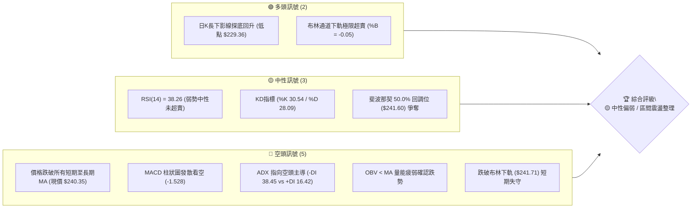
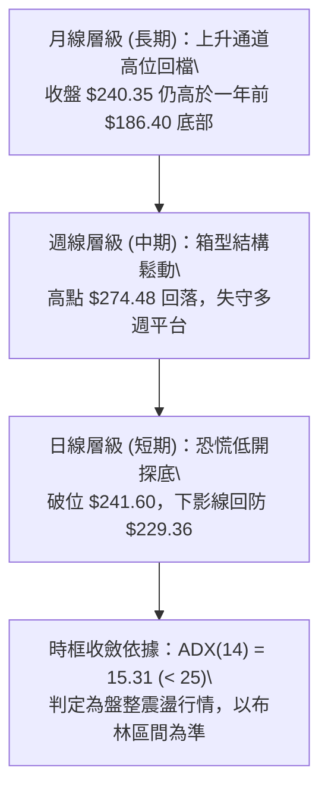
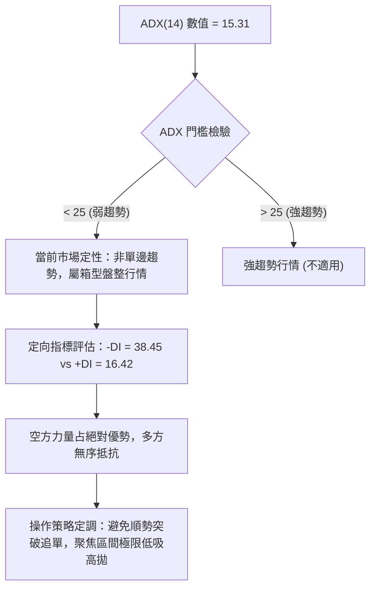
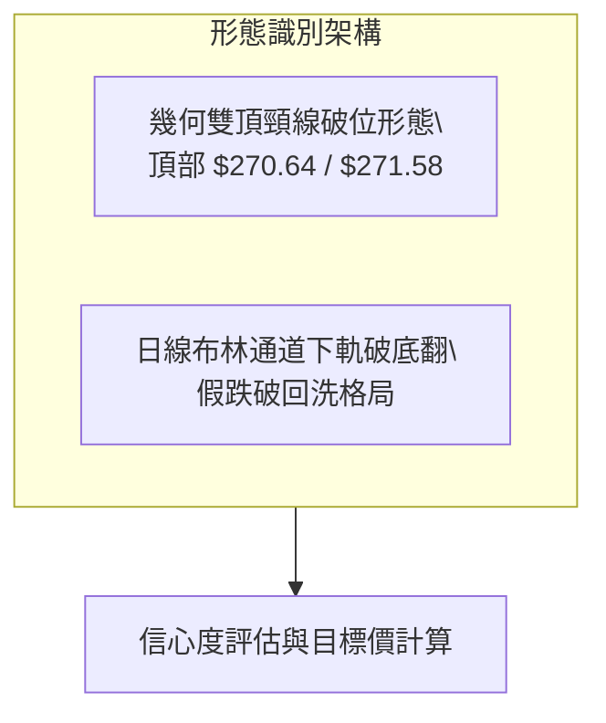
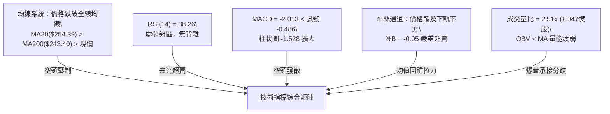
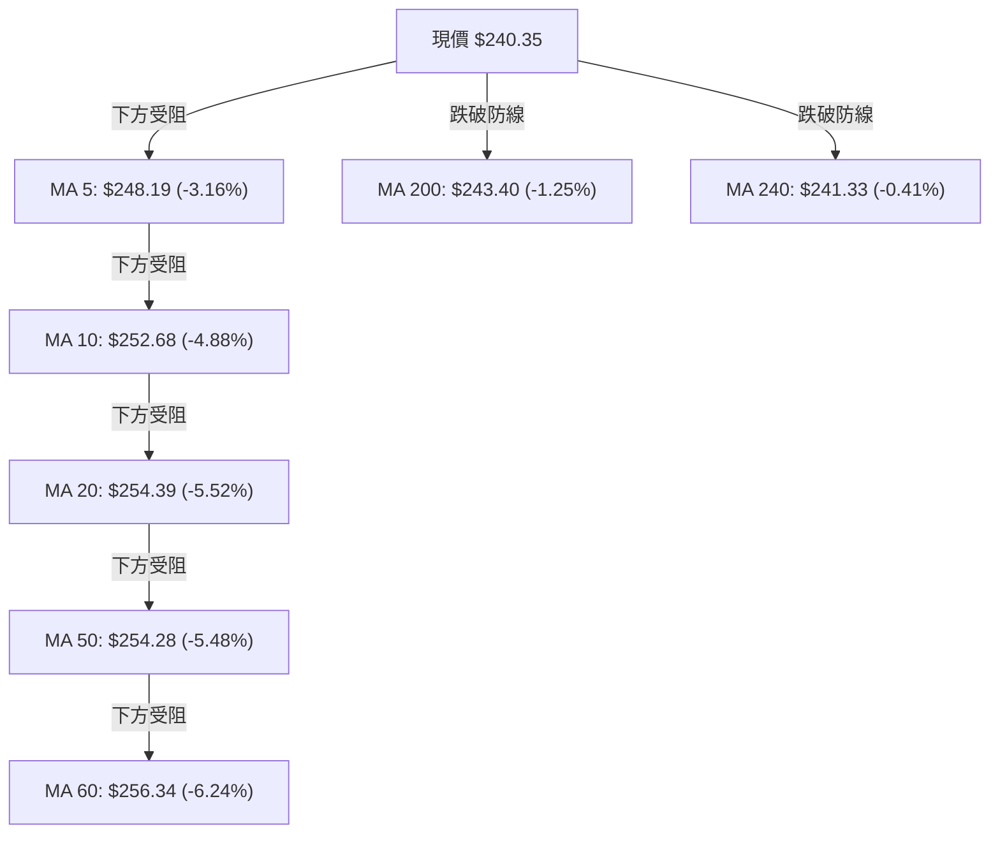
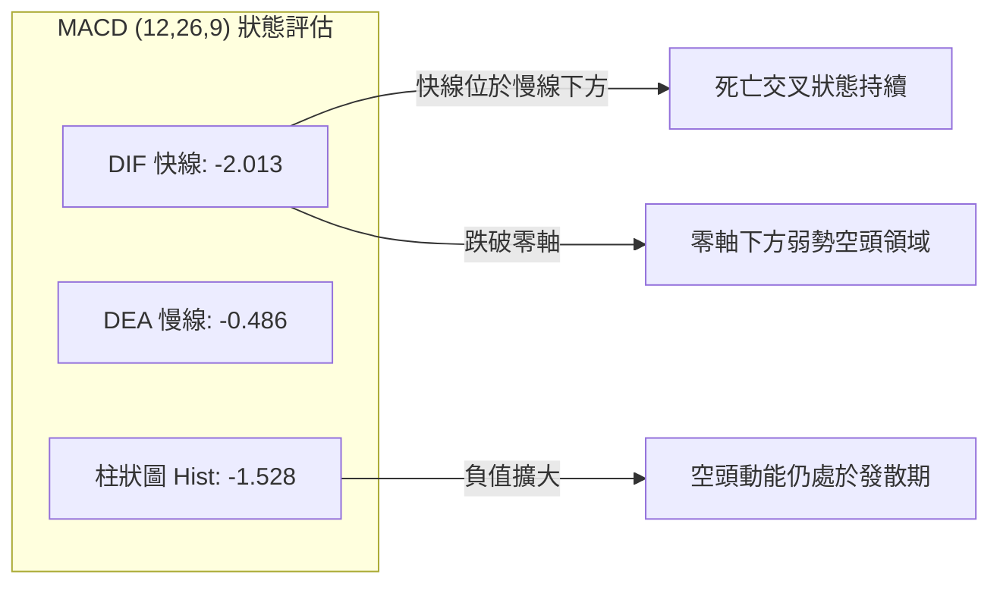
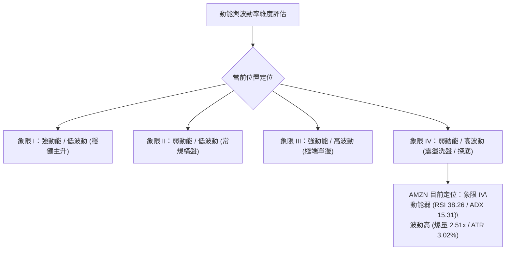
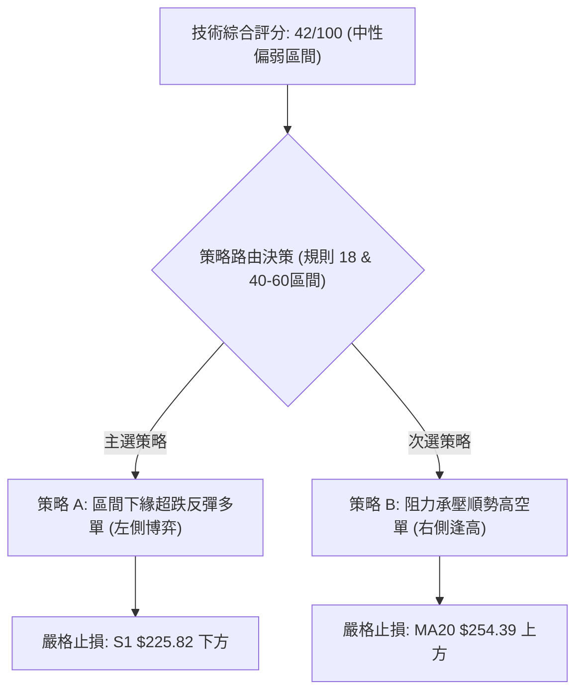
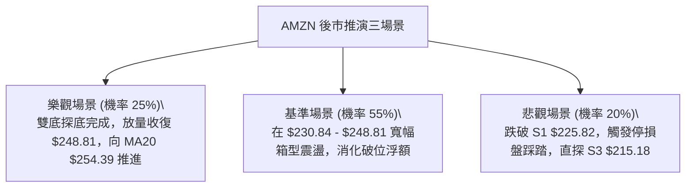

# AMZN 技術分析報告

> **報告日期**：2026-11-02 ｜ **語言**：繁體中文 ｜ **數據來源**：Yahoo Finance ｜ **當前價格**：$240.35 USD

---

## 目錄

| 章節 | 內容 |
|------|------|
| [1. 技術面概覽](#1-技術面概覽) | 訊號儀表板、核心指標、評分卡 |
| [2. 趨勢分析](#2-趨勢分析) | 多時框趨勢、長中短期走勢、ADX強度 |
| [3. 圖表形態分析](#3-圖表形態分析) | 形態識別、K線組合、目標價推算 |
| [4. 支撐與阻力](#4-支撐與阻力) | 關鍵價位聚類、斐波那契回調結構 |
| [5. 技術指標深度解讀](#5-技術指標深度解讀) | MA/RSI/MACD/布林通道/成交量OBV |
| [6. 動能與波動率](#6-動能與波動率) | 動能四象限、ATR波幅、Beta相關性 |
| [7. 多時框架總結](#7-多時框架總結) | 時框矩陣、多時框收斂定調 |
| [8. 交易策略建議](#8-交易策略建議) | 策略路由、情境階梯、主策略詳情 |
| [9. 風險提示與監控](#9-風險提示與監控) | 監控Checklist、極端場景、風控紀律 |

---

## 1. 技術面概覽

### 🎯 技術訊號儀表板



### 📊 核心指標速覽表

| 指標類別 | 指標名稱 | 當前數值 | 訊號 | 解讀 |
|----------|----------|----------|------|------|
| **價格** | 當前收盤價 | $240.35 | 🔴 | 位於52週區間48.6%，失守50%斐波那契位（$241.60） |
| **均線** | MA20 (月線) | $254.39 | 🔴 | 現價低於MA20達-5.52%，短中期趨勢受壓制 |
| **均線** | MA50 (季線) | $254.28 | 🔴 | 現價低於MA50，上方形成密集成交反壓帶 |
| **均線** | MA200 (年線) | $243.40 | 🔴 | 現價跌破年線支撐（-1.25%），長期防線面臨考驗 |
| **動能** | RSI(14) | 38.26 | 🟡 | 弱勢中性區間（30–70），尚未觸及30極端超賣 |
| **動能** | MACD (12,26,9) | -2.013 | 🔴 | 快慢線位於零軸下方，柱狀圖-1.528持續看空 |
| **趨勢** | ADX(14) | 15.31 | 🟡 | ADX < 25屬於盤整/弱趨勢，-DI (38.45) 壓制 +DI (16.42) |
| **波動** | ATR(14) | $7.26 | 🟡 | 佔現價3.02%，單日波動幅度中等偏高，風控需留緩衝 |
| **通道** | 布林帶 (%B) | -0.05 | 🟢 | 跌破下軌（$241.71），短線出現統計學超賣反彈契機 |
| **成交量**| 最新量 / 20日均量 | 2.51x | 🟡 | 單日爆量1.047億股，顯示恐慌拋盤與承接盤激烈換手 |

### 🏆 技術評分卡

```
╔══════════════════════════════════════════════════════════════╗
║                 技術評分卡 — AMZN (2026-11-02)               ║
╠══════════════════════════════════════════════════════════════╣
║  趨勢強度      ███████░░░░░░░░░░░░░  35/100  🔴 空頭壓制     ║
║  動能指標      ████████░░░░░░░░░░░░  38/100  🔴 動能偏弱     ║
║  支撐穩定度    ██████████░░░░░░░░░░  50/100  🟡 考驗S1支撐   ║
║  成交量配合    ████████░░░░░░░░░░░░  42/100  🔴 量能呈背離   ║
║  形態完整度    █████████░░░░░░░░░░░  45/100  🟡 箱型破底測試 ║
║  均線排列      ████████░░░░░░░░░░░░  40/100  🔴 全線遭跌破   ║
╠══════════════════════════════════════════════════════════════╣
║  綜合評分      ████████░░░░░░░░░░░░  42/100  🟡 中性偏弱整理 ║
╚══════════════════════════════════════════════════════════════╝
```
*註：綜合評分 = (35 + 38 + 50 + 42 + 45 + 40) ÷ 6 = 41.67，四捨五入為 42/100（依規則 18 算術平均計算）。*

---

## 2. 趨勢分析

### 🌐 多時框趨勢分析



### 📈 長期趨勢 — 12個月走勢圖（Unicode）

```
AMZN 月線走勢圖（過去12個月：2025-11 至 2026-10）
價格軸 ($)
$275 ┤                                  ●(07月 $271.58)
$270 ┤                          ●(05月 $270.64)
$265 ┤                      ●(04月 $265.06)  ●(08月 $259.77)
$250 ┤                                            ●(09月 $249.15)
$240 ┤              ●(01月 $239.30)                     ●(10月 $240.35)←現在
$230 ┤●(11月 $233.22)   ●(12月 $230.82)
$210 ┤                  ●(02月 $210.00)
$205 ┤                      ●(03月 $208.27)
     └────────────────────────────────────────────────────────────
       11   12   01   02   03   04   05   06   07   08   09   10
      (25) (25) (26) (26) (26) (26) (26) (26) (26) (26) (26) (26)
```

#### 走勢特徵分析表格

| 階段 | 期間 | 價格區間 ($) | 漲跌幅 (%) | 趨勢特徵解讀 |
|------|------|--------------|------------|--------------|
| **第1階段：震盪築底** | 2025-11 ~ 2026-03 | 233.22 → 208.27 | -10.70% | 兩度下探$210.00與$208.27形成堅固中長線雙底 |
| **第2階段：強勢主升** | 2026-03 ~ 2026-05 | 208.27 → 270.64 | +29.95% | 突破$240關卡，連續大陽線拉升，觸及波段高點 |
| **第3階段：高位分歧** | 2026-05 ~ 2026-07 | 270.64 → 271.58 | +0.35% | 期間劇烈洗盤（6月回踩$238.34），7月創$271.58收盤高 |
| **第4階段：高位盤跌** | 2026-07 ~ 2026-10 | 271.58 → 240.35 | -11.50% | 逐月走低（259.77→249.15→240.35），進入回調修正 |

### 📊 中期趨勢（週線分析）

從近20週數據觀察，AMZN在2026-08-07觸及當期週收盤高點 $274.48（週MACD柱達到+4.090最高峰）後，動能呈現階梯式衰竭。至2026-10-30該週，週線成交量驟增至292,100,300股，單週收盤跌破多道週均線，週MACD柱惡化至-1.528，顯示中期格局已由強勢多頭轉入弱勢整理。

```
AMZN 週線近期壓力與支撐示意圖
$280 ┤ 52週高點 $287.20 / 週收盤高點 $274.48 (強阻力頂部)
$270 ┤ ════════════════════════════════════════ (8月反彈高位平台)
$260 ┤ ---------------------------------------- (MA50 / 密集換手反壓區)
$250 ┤ ---------------------------------------- (整數關卡 / 頸線突破點)
$240 ┤ ◄────────── 現價 $240.35 (斐波那契 50.0% 回調位 $241.60 處)
$230 ┤ ════════════════════════════════════════ (10-30 週低點 $229.36 / 61.8% 處)
$220 ┤ ---------------------------------------- (支撐位 S2 $220.99)
```

### ⚡ 趨勢強度評估（ADX 解讀）



| 指標名稱 | 數值 | 參考標準 | 當前狀態解讀 |
|----------|------|----------|--------------|
| **ADX (14)** | 15.31 | < 20 極弱 / 20–25 偏弱 / > 25 趨勢確立 | 處於極弱趨勢區，技術指標鈍化風險高，價格主要受邊界約束 |
| **+DI (14)** | 16.42 | > 25 多頭動能充沛 | 多頭動能匱乏，多方缺乏組織性拉抬能力 |
| **-DI (14)** | 38.45 | > 25 空頭動能充沛 | 空方佔據顯著主導地位，賣壓釋放集中 |

---

## 3. 圖表形態分析

### 🔍 形態識別系統



#### 形態識別與信心度評估表

| 形態名稱 | 信心度 | 判斷依據（引用數據） | 完成度 | 目標價（附計算式） |
|----------|--------|----------------------|--------|--------------------|
| **高位雙頂結構** (M-Top) | 70% | 2026-05收盤$270.64與2026-07收盤$271.58形成雙頂，頸線為2026-06收盤$238.34。10-30盤中跌破至$229.36。 | 85% | 形態高度 = $271.58 − $238.34 = $33.24。理論破位目標 = $238.34 − $33.24 = $205.10（接近52週低點$196.00與3月低點$208.27）。 |
| **布林下軌極端超賣形態** | 60% | 價格跌至$229.36後收斂於$240.35，BB %B達-0.05，伴隨2.51倍量能承接。 | 75% | 均值回歸第一目標為BB中軌（MA20）$254.39。 |
| **箱型旗形整理** | 45% | 數據中未偵測到標準旗形持續整理結構，訊號不足，僅做指標型解讀。 | N/A | N/A（數據未提供） |

### 🕯️ 重要K線形態分析

嚴格依據近10根日K與近8根週K的實際 OHLCV 數據進行識別：

| 日期（層級） | 開 | 高 | 低 | 收 | K線形態名稱 | 技術解讀 | 訊號 |
|--------------|----|----|----|----|-------------|----------|------|
| **2026-10-22 (日K)** | 258.18 | 258.41 | 248.00 | 250.38 | 光頭大陰線 | 破位放量長黑，實體跌幅達-3.02%，開啟破位下行走勢 | 🔴 |
| **2026-10-28 (日K)** | 253.00 | 255.36 | 251.98 | 254.60 | 縮量小陽線 | 弱勢反抽無力，受阻於MA20（$254.39）阻力下方 | 🟡 |
| **2026-10-29 (日K)** | 246.95 | 249.14 | 241.24 | 243.79 | 跳空下挫陰線 | 成交量擴大至85,234,400股，直接貫穿年線與多道均線 | 🔴 |
| **2026-10-30 (日K)** | 232.54 | 241.55 | 229.36 | 240.35 | 放量長下影錘頭線 | 恐慌低開至$232.54，探底$229.36後獲爆量拉抬，實體為陽且收復$240 | 🟢 |
| **2026-10-23 (週K)** | 255.25 | 265.34 | 246.45 | 248.00 | 長上影倒錘陰線 | 週線衝高受阻於$265.34（接近R3 $266.45），空方壓制確立 | 🔴 |
| **2026-10-30 (週K)** | 249.47 | 255.36 | 229.36 | 240.35 | 長下影週陰線 | 單週爆量2.92億股，測試斐波那契61.8%（$230.84）後長下影收腳 | 🟡 |

### 📉 ASCII 走勢形態示意圖

```
AMZN 近期日K走勢形態與關鍵結構
$265 ┤       ●(10/20 高點 $265.34)
$260 ┤   ┌───┘
$255 ┤   │       ┌─┐(10/28 反抽受阻 $255.36)
$250 ┤───┼───────┴─┼─────────────────────────── [阻力區間 R1 $248.81]
$245 ┤   │         │ 
$240 ┤───┼─────────┼───────────┬─● 現價 $240.35 (10/30 收盤)
$235 ┤   │         │           │ 
$230 ┤───┴─────────┴───────────┴─●(10/30 恐慌低點 $229.36，長下影支撐)
     └────────────────────────────────────────
       10-20     10-22       10-29 10-30
```

### 🎯 形態目標價計算

根據雙頂形態與區間震盪特徵進行幾何量度運算：
1. **雙頂頸線下破量度目標**：
   - 頂部均值：($270.64 + $271.58) ÷ 2 = $271.11
   - 頸線基點：2026-06收盤價 $238.34
   - 形態垂直高度：$271.11 − $238.34 = $32.77
   - 理論極限空頭目標：$238.34 − $32.77 = **$205.57**（位於支撐位S3 $215.18與52W低點$196.00之間）
2. **超賣反彈均值回歸量度目標**：
   - 超賣極端低點：2026-10-30 低點 $229.36
   - 回歸中軸：布林通道中軌（MA20）= **$254.39**
   - 潛在反彈空間：$254.39 − $240.35 = +$14.04 (+5.84%)

---

## 4. 支撐與阻力

### 🗺️ 關鍵價位分布圖（Unicode）

```
AMZN 價位結構分布圖
═══════════════════════════════════════════════════
$266.45 ║████████████████████████║ 強阻力 R3 (波段高點聚類 / 接近52W 23.6%)
$258.78 ║████████████████        ║ 阻力 R2 (MA60 / 密集換手平台)
$254.39 ║▓▓▓▓▓▓▓▓▓▓▓▓▓▓▓▓▓▓      ║ 動態阻力 (MA20 / 布林中軌)
$248.81 ║████████████████████████║ 關鍵阻力 R1 (前波低點轉阻力 / MA5)
$241.60 ║────────────────────────║ 斐波那契 50.0% 回調分水嶺
$240.35 ╠════════════════════════╣ ◄ 現價 (收盤價)
$230.84 ║------------------------║ 斐波那契 61.8% 黃金回調位 (10/30低點守住)
$225.82 ║▓▓▓▓▓▓▓▓▓▓▓▓▓▓▓▓        ║ 近期強支撐 S1 (近一年波段低點聚類)
$220.99 ║████████████████████    ║ 關鍵支撐 S2 (波段低點聚類)
$215.18 ║████████████████████████║ 強支撐 S3 (斐波那契 78.6% $215.52 重合帶)
═══════════════════════════════════════════════════
```

### 🚧 阻力位分析表

價位嚴格引用自數據之「關鍵價位（波段高點聚類）」與均線：

| 阻力級別 | 價位 | 與現價距離 | 形成原因與籌碼特徵 | 突破難度 | 重要性 |
|----------|------|------------|--------------------|----------|--------|
| **R1** | $248.81 | +3.52% | 近一年波段高點聚類，同時接近MA5（$248.19）與10-23日K收盤點 | 🟡 中等 | ★★★☆☆ |
| **R2** | $258.78 | +7.67% | 近一年波段高點聚類，重疊MA60（$256.34）及9-10月震盪中樞下緣 | 🔴 高 | ★★★★☆ |
| **R3** | $266.45 | +10.86% | 近一年強阻力峰值，接近布林上軌（$267.07）與斐波那契23.6%（$265.68） | 🔴 極高 | ★★★★★ |

### 🛡️ 支撐位分析表

價位嚴格引用自數據之「關鍵價位（波段低點聚類）」：

| 支撐級別 | 價位 | 與現價距離 | 形成原因與籌碼特徵 | 守住機率 | 重要性 |
|----------|------|------------|--------------------|----------|--------|
| **S1** | $225.82 | -6.04% | 近一年波段低點聚類核心，位於10-30下影線最低點（$229.36）下方之第一緩衝帶 | 70% | ★★★★☆ |
| **S2** | $220.99 | -8.05% | 近一年密集換手低點聚類，2024年底起漲整理中樞 | 80% | ★★★★☆ |
| **S3** | $215.18 | -10.47% | 近一年最核心防守底線，高度重合斐波那契78.6%回調位（$215.52） | 90% | ★★★★★ |

### 📐 斐波那契回調位分析

依據52週高點 $287.20 至52週低點 $196.00 之完整波動區間：

| 回調比率 | 對應價位 | 技術含義解讀 | 當前價格位置關係 |
|----------|----------|--------------|------------------|
| **0.0%** (52W High) | $287.20 | 歷史最高壓力極限 | 現價位於其下方 $46.85 (-16.31%) |
| **23.6%** | $265.68 | 淺幅回調位，多頭強勢持穩線（鄰近R3 $266.45） | 現價位於其下方 $25.33 (-9.53%) |
| **38.2%** | $252.36 | 關鍵強弱分水嶺（鄰近MA10 $252.68 與 MA20 $254.39） | 現價位於其下方 $12.01 (-4.76%) |
| **50.0%** | $241.60 | 多空平衡中軸位 | **現價 $240.35 緊貼於此位置下方 $1.25 (-0.52%)** |
| **61.8%** | $230.84 | 黃金分割強支撐防線（10-30低點$229.36在此獲得有效承接） | 現價位於其上方 $9.51 (+4.12%) |
| **78.6%** | $215.52 | 深度回調防線，多頭最後反轉防守區（與S3 $215.18重合） | 現價位於其上方 $24.83 (+11.53%) |
| **100.0%** (52W Low) | $196.00 | 52週絕對底部 | 現價位於其上方 $44.35 (+22.63%) |

**現價區間解讀**：現價 $240.35 精確座落於 **50.0%（$241.60）與 61.8%（$230.84）** 兩大黃金分割位之間。10-30盤中一度刺穿61.8%位觸及$229.36，但尾盤強勁拉回至50%關口邊緣，顯示61.8%黃金回調位具備實質買盤支撐，目前多空正圍繞50.0%分水嶺進行激烈防守爭奪。

---

## 5. 技術指標深度解讀

### 🎛️ 指標訊號總覽



### 📈 移動平均線排列分析



#### 均線參數與價位偏離分析表

| 均線名稱 | 數值 ($) | 價格相對位置 | 偏離率 (%) | 走勢特徵與意義 |
|----------|----------|--------------|------------|----------------|
| **MA 5** | $248.19 | 下方 | -3.16% | 短線第一道動態反彈壓力線 |
| **MA 10** | $252.68 | 下方 | -4.88% | 快速下行中，壓制短線反抽力道 |
| **MA 20** | $254.39 | 下方 | -5.52% | 月線趨勢轉下，布林通道中軌，多空波段臨界點 |
| **MA 50** | $254.28 | 下方 | -5.48% | 與MA20粘合，形成「死叉」高壓區域 |
| **MA 60** | $256.34 | 下方 | -6.24% | 季線下行，中期防守轉為阻力 |
| **MA 120**| $253.42 | 下方 | -5.16% | 半年線走平，密集成交區頂部 |
| **MA 200**| $243.40 | 下方 | -1.25% | 牛熊分界年線，目前被有效跌破，需盡快收復 |
| **MA 240**| $241.33 | 下方 | -0.41% | 长期牛熊防線，現價貼近其下方，存在爭奪機會 |

### 📉 RSI(14) 分析

當前數值：**38.26**
進度條展示：
```
超賣區 (0-30)        中性區 (30-70)                   超買區 (70-100)
├──────────────┼──────────────────────────────┼──────────────┤
░░░░░░░░░░░░░░  ████░░░░░░░░░░░░░░░░░░░░░░░░░  ░░░░░░░░░░░░░░
0              30   38.26                     70            100
```
- **區間評估**：RSI(14) 報 38.26，位於30–70常規中性偏弱區間。尚未進入小於30的極端超賣區，表示空方賣壓雖然沉重，但尚未出現技術性衰竭踩踏後的經典無腦超賣買點。
- **背離判斷**：
  - 價格近20根K棒從高點 $265.34 下挫至 $240.35（期間低點 $229.36）。
  - RSI(14) 從高位 59.0 同步回落至 38.26。
  - **結論**：依近20根K棒首尾之價格與RSI方向比對，**無頂背離亦無底背離**，指標健康反映價格下行趨勢，尚未發出動能轉向訊號。

### 📊 MACD(12,26,9) 訊號解讀


- **量化數值**：MACD線 -2.013，訊號線 -0.486，柱狀圖 -1.528。
- **形態分析**：DIF 與 DEA 均位於零軸下方，且 DIF 快速向下穿破 DEA，柱狀圖呈現顯著的負向放大（紅柱擴張）。
- **背離檢驗**：觀察MACD柱狀圖與收盤價，價格破低同時MACD數值亦同步創波段新低，**無底背離跡象**，確認當前空頭趨勢具備實質動能支撐。

### 📦 布林通道分析

```
AMZN 日線布林通道 (20, 2) 結構圖
$267.07 ┬────────────────────────────────────────── 布林上軌 (阻力 R3 $266.45 處)
        │
$254.39 ┼────────────────────────────────────────── 布林中軌 (MA20 / 核心動態反壓)
        │
$241.71 ┴────────────────────────────────────────── 布林下軌 (前支撐防線)
  $240.35   ▲ [現價: 突破下軌下方 %B = -0.05]
  $229.36   └─► 10/30 盤中下影線測試極限點
```
- **軌道參數**：上軌 $267.07，中軌 $254.39，下軌 $241.71，帶寬 $25.36 (10.55%)。
- **極值解讀**：%B 為 **-0.05**，代表收盤價正式脫離下軌保護並落於下軌之外。在統計概率上，價格處於布林帶外部的概率小於5%，這代表短線處於**極度延伸的超賣狀態**。歷史走勢表明，一旦%B由負值回升穿過0.00（收復下軌$241.71），高概率引發向中軌（$254.39）的均值回歸修復走勢。

### 💹 成交量分析（量價配合度）

- **量能規模**：2026-10-30 單日成交量達到 **104,775,800 股**，較20日均量（41,677,215股）放大 **2.51倍**；50日均量為 37,244,422 股。
- **OBV 趨勢**：數據明確標示 **OBV < MA**，代表長期資金累積指標疲弱，資金呈淨流出狀態。
- **量價關係解讀**：
  - 10-29 大跌時放量至 85,234,400 股，10-30 更爆出超過 1 億股的歷史級大量。
  - 10-30 的長下影線（最低 $229.36，收盤 $240.35）伴隨 2.51 倍均量，反映出市場在 $230.00 關卡附近出現恐慌盤湧出與機構被動接盤的劇烈換手。
  - **量價結論**：短線爆量下影線代表賣壓得到充分宣洩，但因 OBV 仍處於弱勢，尚無法定性為「反轉量」，僅能先視為「短線流動性承接引發的超賣減速量」。

---

## 6. 動能與波動率

### ⚡ 動能評估四象限



| 象限類別 | 動能維度 | 波動維度 | 當前狀態吻合度 | 戰略應對建議 |
|----------|----------|----------|----------------|--------------|
| **第一象限 (Q1)** | 強動能 | 低波動 | 否 | 適合加碼順勢持股，享受穩定趨勢紅利 |
| **第二象限 (Q2)** | 弱動能 | 低波動 | 否 | 適合防守觀望或低頻率區間網格操作 |
| **第三象限 (Q3)** | 強動能 | 高波動 | 否 | 適合突破追單，嚴格追蹤移動止盈 |
| **第四象限 (Q4)** | **弱動能** | **高波動** | **✓ (當前狀態)** | **避免追高殺跌，以左側輕倉分批或右側確認後進場為主** |

### 📊 ATR 波動率分析

- **ATR(14) 數值**：**$7.26**（佔當前股價之 **3.02%**）。
- **波動特徵**：單日平均真實波幅高達 $7.26，顯示近期震盪劇烈，市場定價分歧巨大。
- **風控止損參數推算**：
  - **短線交易止損距離**：建議設定為 1.5 倍 ATR = $7.26 × 1.5 = **$10.89**。
  - **波段交易止損距離**：建議設定為 2.0 倍 ATR = $7.26 × 2.0 = **$14.52**。
  - **意義**：在現價 $240.35 附近若建立多單，若僅預留 $2–$3 的止損空間，極易被正常的日內噪聲掃出場；止損點必須設置於波段低點 $229.36 或支撐位 S1 $225.82 下方，方能規避隨機波動風險。

### 📐 Beta 與市場相關性

- **Beta 係數**：**1.456**。
- **市場特徵分析**：
  - AMZN 的 Beta 達到 1.456，屬於典型的高彈性成長與權重科技股標的。當標普500指數波動 1.0% 時，AMZN 理論上將產生 1.456% 的同向波動。
  - **大盤共振效應**：當前科技板塊受 AI 支出擔憂與財報分歧影響整體承壓，AMZN 的高 Beta 屬性放大了下行波動。在制定交易策略時，必須將大盤系統性風險列為首要風控因子。

---

## 7. 多時框架總結

### 📋 時框架評分表

| 時框架 | 趨勢方向 | 動能狀態 | 均線排列 | 圖表形態 | 綜合評分 | 戰術建議 |
|--------|----------|----------|----------|----------|----------|----------|
| **月線 (長期)** | 🟢 偏多回檔 | 🟡 中性回落 | 🟢 MA20>MA50>MA200 多頭 | 箱型頂部回調 | **62/100** | 長線多頭未破壞，維持底倉 |
| **週線 (中期)** | 🟡 箱型震盪 | 🔴 空方死叉 | 🟡 跌破週MA20，測MA50 | 雙頂頸線測試 | **45/100** | 暫停波段加碼，等待止跌 |
| **日線 (短期)** | 🔴 弱勢下探 | 🔴 負向發散 | 🔴 價格低於全均線 | 布林下軌超賣錘頭 | **38/100** | 嚴禁盲目追空，防超跌反彈 |

### 🔲 綜合訊號矩陣

| 分析維度 | 短期（日線） | 中期（週線） | 長期（月線） | 跨維度一致性檢驗 |
|----------|--------------|--------------|--------------|------------------|
| **趨勢方向** | 🔴 破位探底 | 🟡 箱型整理 | 🟢 向上趨勢 | 長多中整短空，出現時框分歧 |
| **動能狀態** | 🔴 MACD擴大 | 🔴 柱狀轉負 | 🟡 高位回落 | 動能全面下行，空方掌控主動 |
| **量價結構** | 🟡 爆量長下影 | 🔴 放量破位 | 🟡 量能正常 | 短線具承接力，但中期趨勢仍偏弱 |
| **支撐阻力** | 跌破年線 $243.40 | 考驗 50% $241.60 | 堅守 61.8% $230.84 | 關鍵分水嶺聚集於 $240–$241 帶 |

### ⚖️ 多時框收斂結論

依據多時框收斂規則（規則 14）：
1. **行情定性**：當前 **ADX(14) = 15.31 (< 25)**，明確指示當前市場屬於**盤整行情（非單邊趨勢）**。
2. **主導維度**：在盤整行情下，收斂優先級以**日線布林通道上下軌（$241.71 – $267.07）與關鍵支撐阻力區間**為主要決策邊界，中長期方向僅作為風險防護底線。
3. **收斂方向性結論**：**🟡 中性偏弱／區間震盪整理**。
   - 短期雖然跌破年線（$243.40）與布林下軌（$241.71），但 10-30 日K在 $229.36 處爆出 2.51 倍天量並收出長下影線，驗證下方 S1（$225.82）至斐波那契 61.8%（$230.84）具備強大支撐防禦力。
   - 綜合評分為 **42/100**（落入 40–60 區間操作帶），因此戰術上**否定單邊追空或重倉抄底**，定調為**圍繞布林下軌與關鍵支撐阻力的區間防守交易**。

---

## 8. 交易策略建議

### 🗺️ 策略決策流程圖



### 🧭 策略路由（依評分卡分流）

> **當前主策略方向 = 🟡 區間震盪操作（依綜合評分 42/100，落入 40–60 區間）**  
> 分析結論明確顯示：市場處於弱趨勢盤整（ADX=15.31），價格處於布林帶極度超賣區（%B=-0.05）但受制於全線均線反壓。因此不進行單邊趨勢押注，以**布林下軌支撐回升至中軌阻力的區間修復**為主線策略，並以**反彈遇阻做空**為輔助對沖策略。

### 🎯 價格情境階梯（Price Scenarios）

價位嚴格引用自「關鍵價位」與斐波那契回調計算值：

| 觸發條件 | 下一目標 | 後續延伸 | 情境含義解讀 |
|----------|----------|----------|--------------|
| **強勢突破 R1 $248.81** | R2 $258.78 | R3 $266.45 | 短線轉強，站回MA5/MA10，修復破位形態，挑戰布林中軌與上軌 |
| **站穩現價區間 $240.35** | 50%位 $241.60 | R1 $248.81 | 區間震盪築底，確認10-30下影線有效，空方動能減速 |
| **有效跌破 S1 $225.82** | S2 $220.99 | S3 $215.18 | 中期轉弱崩塌，雙頂破位幅度擴大，考驗78.6%黃金回調位 |

### 📊 情境機率分佈

| 預測情境 | 機率 | 主要技術依據 |
|----------|------|--------------|
| **情境一：超跌修復反彈** | 45% | 布林%B=-0.05極端超賣；10-30放量2.51x長下影線；61.8%回調位$230.84展現買盤 |
| **情境二：窄幅區間震盪** | 35% | ADX(14)=15.31顯示無明顯單邊趨勢；均線下壓與下方承接形成拉鋸平衡 |
| **情境三：破底加速下行** | 20% | MACD柱狀圖-1.528持續看空；-DI=38.45占優；全均線系統呈空頭排列反壓 |

### 🟢 主策略詳情（方向依上方路由）

以下所有價位嚴格引用報告中已確立之關鍵價位與支撐阻力數據，並依規則 17 計算風險報酬比：

| 策略要素 | 策略 A（區間低吸多單：超跌反彈） | 策略 B（區間高空空單：反彈遇阻做空） |
|----------|----------------------------------|--------------------------------------|
| **戰術類型** | 左側博弈 / 均值回歸 | 右側順勢 / 均線承壓做空 |
| **進場條件** | 回踩斐波那契 61.8% 獲得支撐不破 | 反抽至關鍵阻力位 R1 出現滯漲信號 |
| **進場價格** | **$230.84** (斐波那契 61.8% 回調位) | **$248.81** (阻力位 R1 / 鄰近 MA5) |
| **止損價格** | **$225.82** (支撐位 S1) | **$254.39** (布林中軌 / MA20) |
| **目標價 T1** | **$241.60** (斐波那契 50.0% 回調位) | **$240.35** (當前價格 / 頸線爭奪點) |
| **目標價 T2** | **$248.81** (關鍵阻力位 R1) | **$225.82** (關鍵支撐位 S1) |
| **風險空間** | $230.84 − $225.82 = $5.02 | $254.39 − $248.81 = $5.58 |
| **利潤空間 (T1)** | $241.60 − $230.84 = $10.76 | $248.81 − $240.35 = $8.46 |
| **利潤空間 (T2)** | $248.81 − $230.84 = $17.97 | $248.81 − $225.82 = $22.99 |
| **風險報酬比** | **1 : 2.14（以 T1 計）**<br>*(1 : 3.58 以 T2 計)* | **1 : 1.52（以 T1 計）**<br>*(1 : 4.12 以 T2 計)* |
| **預估勝率** | 55% | 50% |
| **建議倉位** | **15%** (輕倉防守型配置) | **15%** (對沖防護型配置) |

*精確公式驗證（規則 17）：*
- *策略 A (T1) = ($241.60 − $230.84) ÷ ($230.84 − $225.82) = 10.76 ÷ 5.02 = 2.143 → 1 : 2.14*
- *策略 A (T2) = ($248.81 − $230.84) ÷ ($230.84 − $225.82) = 17.97 ÷ 5.02 = 3.579 → 1 : 3.58*
- *策略 B (T1) = ($248.81 − $240.35) ÷ ($254.39 − $248.81) = 8.46 ÷ 5.58 = 1.516 → 1 : 1.52*
- *策略 B (T2) = ($248.81 − $225.82) ÷ ($254.39 − $248.81) = 22.99 ÷ 5.58 = 4.116 → 1 : 4.12*

### 🔴 反向風險觸發點（對沖提示）

- **推翻做多策略條件**：若日K收盤價實體有效跌穿 **S1 $225.82**，代表 10-30 爆量下影線徹底失效，下行空間全面打開至 S2 $220.99 及 S3 $215.18，此時所有多頭部位必須無條件停損離場，嚴禁攤平。
- **推翻做空策略條件**：若價格放量強勢突破並站穩 **MA20 $254.39**，代表均線死叉被強行扭轉，雙頂破位轉化為假跌破真洗盤，空頭部位應立即平倉止損，轉為逢低看多。

### ⭐ 整體訊號強度評星

```
做多訊號強度：★★☆☆☆  (2.5/5 星 — 僅具超賣反彈價值，趨勢未明)
做空訊號強度：★★★☆☆  (3.0/5 星 — 均線與動能空頭，受限下影線支撐)
整體可信度：  ★★★☆☆  (3.5/5 星 — 盤整震盪格局，區間邊界有效)
```

---

## 9. 風險提示與監控

### ✅ 關鍵監控指標 Checklist

```
╔══════════════════════════════════════════════════════════════╗
║               每日盤後交易風控監控清單 (Checklist)           ║
╠══════════════════════════════════════════════════════════════╣
║ [ ] 價格是否成功收復年線 MA200 ($243.40) 與斐波那契 50%    ║
║ [ ] 日線 RSI(14) 是否脫離弱勢區回升至 45.00 以上            ║
║ [ ] MACD 負向柱狀圖是否由 -1.528 縮減，出現收斂跡象          ║
║ [ ] 成交量是否萎縮至 4,000 萬股以內，確認拋壓耗盡            ║
║ [ ] 盤中低點是否持續守穩 10-30 下影線低點 $229.36 之上       ║
║ [ ] 阻力位 R1 ($248.81) 處是否出現多頭主動買盤突破量能      ║
╚══════════════════════════════════════════════════════════════╝
```

### ⚠️ 風險場景分析



### 🛡️ 風險管理重要提醒

1. **嚴禁滿倉與單邊追單**：
   - 當前 ADX(14) 僅為 15.31，處於盤整行情中。盤整行情的特徵是「指標反覆鈍化、假突破與假跌破頻繁」。在此環境下追漲殺跌將承受雙向打臉風險，單一策略倉位應嚴格控制在 15% 以內，總持倉不宜超過 30%。
2. **ATR 波動保護**：
   - 目前 ATR 高達 $7.26，盤中單日上下 3% 屬於正常統計噪聲。任何交易的止損距離絕不可小於 1.0 倍 ATR（$7.26），否則極易被非理性噪聲震盪出局。
3. **系統性與財報事件風險**：
   - AMZN Beta 達到 1.456，且近期科技板塊資本支出過高引發市場擔憂。需高度警惕納斯達克整體回調對個股形成的估值擠壓。

---

## 📋 報告總結

```
╔══════════════════════════════════════════════════════════════╗
║                     AMZN 技術分析報告總結                    ║
╠══════════════════════════════════════════════════════════════╣
║ 報告日期：2026-11-02                                         ║
║ 當前價格：$240.35 USD                                        ║
║ 分析評級：🟡 42/100 (中性偏弱 / 區間震盪整理)                ║
╠══════════════════════════════════════════════════════════════╣
║ 關鍵結論：                                                   ║
║ ├─ 長期趨勢：🟢 偏多回檔 (月線未破壞一年前起漲大底 $186.40)  ║
║ ├─ 中期趨勢：🟡 箱型鬆動 (週線高位回撤，考驗頸線平台)       ║
║ ├─ 短期趨勢：🔴 弱勢破位 (日線全均線跌破，下影線初現承接)   ║
║ ├─ 關鍵支撐：S1: $225.82 ｜ 斐波 61.8%: $230.84             ║
║ ├─ 關鍵阻力：R1: $248.81 ｜ MA20: $254.39 ｜ R2: $258.78     ║
║ └─ 華爾街目標：平均 $326.92 ｜ 最低 $230.00 ｜ 最高 $405.00  ║
╠══════════════════════════════════════════════════════════════╣
║ 最優策略組合：                                               ║
║ 1. 🥇 最佳機會：在斐波 61.8% ($230.84) 附近輕倉布局超買     ║
║                 反彈多單，止損設於 S1 ($225.82) 下方。      ║
║ 2. 🥈 次選機會：反彈遇阻 R1 ($248.81) 且無量時建立波段空單， ║
║                 博弈下軌二度探底，止損設於 MA20 ($254.39)。 ║
║ 3. 🥉 保守選擇：完全空倉觀望，等待日K站穩年線 ($243.40) 或   ║
║                 有效突破 R1 確認止跌信號後再行順勢介入。     ║
╚══════════════════════════════════════════════════════════════╝
```

---

> ⚠️ **免責聲明**：本報告為依據客觀量化技術指標與歷史價格結構生成之專業技術分析研究，所有數據、圖表及推算目標均基於市場公開歷史資訊。本報告**僅供學術研究與投資參考**，**不構成任何要約、招攬或投資買賣建議**。金融市場瞬息萬變，技術指標存在隨機性與滯後性，投資人應獨立評估風險並自負盈虧。

---

*報告生成時間：2026-11-02 ｜ 數據來源：Yahoo Finance ｜ 分析框架：多時框技術分析模型*